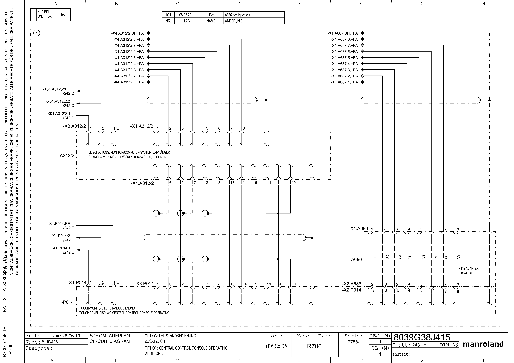

# +BA_Cx_DA — Sheet 243 of 247 — OPTION: LEITSTANDBEDIENUNG

**ZUSÄTZLICH**

> Part of the manroland **R700** printing press IEC/UL circuit diagrams.
> Drawing class: **Stromlaufplan / Circuit diagram** (DIN A3).
> Document `+BA_Cx_DA` covers the **Printing units / main switch cabinet** machine section.

## At a glance

| Field | Value |
|---|---|
| Document | `+BA_Cx_DA`  (8039G38J415) |
| Sheet | **243** of 247 |
| Section (DE) | OPTION: LEITSTANDBEDIENUNG |
| Section (EN) | ZUSÄTZLICH |
| Section type | CIRCUIT — Circuit diagram |
| Machine type | `R700` |
| Series | `7758` |
| Created | 28.06.10 |
| Replaces | — |
| Columns used | A, B, C, D, E, F, G, H |
| Path numbers | — |
| Labels on sheet | 130 |
| Cross-refs out | 6 |
| Cross-refs in | 68 |

**Previous:** [+BA_Cx_DA sheet 242](SHEET_0242.md) · **Next:** [+BA_Cx_DA sheet 244](SHEET_0244.md) · **Document TOC:** [_TOC.md](_TOC.md)  (+BA_Cx_DA) · **Master TOC:** [all sheets](../_MASTER_TOC.md)

## Sheet image (300 DPI, exact vector render)



_Rendered directly from the PDF vector layer at 300 DPI (1-bit), no OCR and no resampling. Use it to confirm anything ambiguous in the text below._

## Cross-references on this sheet

Each entry is a wire leaving this sheet. The printed token is `/sheet.column`; the link resolves to that sheet inside the same document.

| Ref | Target sheet | Col | Path | Destination on target | Target section | From col |
|---|---|---|---|---|---|---|
| `/242.C` | [+BA_Cx_DA sheet 242](SHEET_0242.md) | C | — | X01.A312\2:PE | OPTION: LEITSTANDBEDIENUNG | A |
| `/242.C` | [+BA_Cx_DA sheet 242](SHEET_0242.md) | C | — | X01.A312\2:2 | OPTION: LEITSTANDBEDIENUNG | A |
| `/242.C` | [+BA_Cx_DA sheet 242](SHEET_0242.md) | C | — | X01.A312\2:1 | OPTION: LEITSTANDBEDIENUNG | A |
| `/242.E` | [+BA_Cx_DA sheet 242](SHEET_0242.md) | E | — | X1.P014:PE | OPTION: LEITSTANDBEDIENUNG | A |
| `/242.E` | [+BA_Cx_DA sheet 242](SHEET_0242.md) | E | — | X1.P014:2 | OPTION: LEITSTANDBEDIENUNG | A |
| `/242.E` | [+BA_Cx_DA sheet 242](SHEET_0242.md) | E | — | X1.P014:1 | OPTION: LEITSTANDBEDIENUNG | A |

### Incoming references (sheets that point here)

Every other sheet that sends a wire to this one. `Back-ref` is the token printed on *that* sheet; `Path` is its line number.

| From sheet | Cols | Back-ref | Path | Refs | What continues there |
|---|---|---|---|---|---|
| [+BA_Cx_DA#138](SHEET_0138.md) | A | `/138.A` | — | 3 | — |
| [+BA_Cx_DA#141](SHEET_0141.md) | B | `/141.B` | — | 12 | — |
| [+BA_Cx_DA#143](SHEET_0143.md) | G | `/143.G` | — | 8 | — |
| [+BA_Cx_DA#149](SHEET_0149.md) | C | `/149.C` | — | 3 | — |
| [+BA_Cx_DA#154](SHEET_0154.md) | B | `/154.B` | — | 8 | — |
| [+BA_Cx_DA#155](SHEET_0155.md) | G | `/155.G` | — | 8 | — |
| [+BA_Cx_DA#158](SHEET_0158.md) | B, H | `/158.B`, `/158.H` | — | 20 | — |
| [+BA_Cx_DA#242](SHEET_0242.md) | D, E | `/242.D`, `/242.E` | — | 6 | X01.A312\2:1; X01.A312\2:2; X01.A312\2:PE; X1.P014:1; X1.P014:2; X1.P014:PE |


## Devices on this sheet

| Tag | Class | Class meaning (IEC) | Col | Sub | Terminal | Sign |
|---|---|---|---|---|---|---|
| `P014` | P | Messgeraet / measuring instrument, meter | A | — | — | — |
| `A312/2` | A | Baugruppe / assembly, module, PC board | A | 2 | — | — |
| `A686` | A | Baugruppe / assembly, module, PC board | F | — | — | — |
| `X1.P014` | — | cross-device reference | A | — | — | — |
| `X3.P014` | — | cross-device reference | B | — | — | — |
| `X2.P014` | — | cross-device reference | F | — | — | — |
| `X1.A686` | — | cross-device reference | F | — | — | — |
| `X2.A686` | — | cross-device reference | F | — | — | — |
| `X1.P014:PE` | — | cross-device reference | A | — | PE | — |
| `X1.P014:2` | — | cross-device reference | A | — | 2 | — |
| `X1.P014:1` | — | cross-device reference | A | — | 1 | — |
| `X01.A312\2:1` | — | cross-device reference | A | — | 1 | — |
| `X01.A312\2:2` | — | cross-device reference | A | — | 2 | — |
| `X01.A312\2:PE` | — | cross-device reference | A | — | PE | — |
| `NR.` | — | cross-device reference | C | — | — | — |
| `08.02.2011` | — | cross-device reference | C | — | — | — |

## Potentials / nets

| Potential | Count | Columns | Attached devices | Terminals |
|---|---|---|---|---|
| `PE` | 2 | B | — | — |


A potential such as `L24+/4` or `M24+` is a named supply/return rail; every place it appears on this sheet is electrically common.

## Wire-end annotations (grouped as printed)

A wire that continues elsewhere is annotated with a small cluster: the destination description, the path/line number `#NN`, and the `/sheet.column` cross reference. Each row below is one such cluster exactly as it is grouped on the drawing.

| Col | Y | Path | Cross-ref | Text on the wire |
|---|---|---|---|---|
| A | 24.7 | — | — | `1 NUR BEI` |
| C | 31.4 | — | — | `001 08.02.2011 JDes A686 richtiggestellt` |
| A | 31.8 | — | — | `ONLY FOR +BA` |
| C | 45.6 | — | — | `NR. TAG NAME ÄNDERUNG` |
| B | 73.3 | — | — | `X4.A312\2:SH+FA` |
| F | 73.3 | — | — | `X1.A687:SH,+FA` |
| A | 73.5 | — | — | `1` |
| B | 87.4 | — | — | `X4.A312\2:8,+FA` |
| F | 87.4 | — | — | `X1.A687:8,+FA` |
| B | 101.6 | — | — | `X4.A312\2:7,+FA` |
| F | 101.6 | — | — | `X1.A687:7,+FA` |
| B | 115.8 | — | — | `X4.A312\2:6,+FA` |
| F | 115.8 | — | — | `X1.A687:6,+FA` |
| B | 129.9 | — | — | `X4.A312\2:5,+FA` |
| F | 129.9 | — | — | `X1.A687:5,+FA` |
| B | 144.1 | — | — | `X4.A312\2:4,+FA` |
| F | 144.1 | — | — | `X1.A687:4,+FA` |
| B | 158.3 | — | — | `X4.A312\2:3,+FA` |
| F | 158.3 | — | — | `X1.A687:3,+FA` |
| B | 172.5 | — | — | `X4.A312\2:2,+FA` |
| F | 172.5 | — | — | `X1.A687:2,+FA` |
| B | 186.7 | — | — | `X4.A312\2:1,+FA` |
| F | 186.7 | — | — | `X1.A687:1,+FA` |
| A | 202.9 | — | `/242.C` | `X01.A312\2:PE` |
| A | 231.3 | — | `/242.C` | `X01.A312\2:2` |
| A | 259.6 | — | `/242.C` | `X01.A312\2:1` |
| B | 288.0 | — | — | `X0.A312/2 1 2 PE` |
| C | 288.0 | — | — | `X4.A312/2 1 2 3 4 5 6 7 8` |
| B | 350.7 | — | — | `UMSCHALTUNG: MONITOR/COMPUTER SYSTEM, EMPFÄNGER` |
| A | 356.1 | — | — | `A312/2` |
| B | 361.4 | — | — | `CHANGE OVER: MONITOR/COMPUTER SYSTEM, RECEIVER` |
| D | 419.9 | — | — | `X1.A312/2 1 6 2 7 3 8 13 14 5 11 4 10` |
| A | 514.8 | — | `/242.E` | `X1.P014:PE` |
| G | 525.4 | — | — | `X1.A686 1 2 3 4 5 6 7 8` |
| A | 543.1 | — | `/242.E` | `X1.P014:2` |
| A | 571.5 | — | `/242.E` | `X1.P014:1` |
| G | 590.4 | — | — | `SW` |
| G | 591.6 | — | — | `GN` |
| F | 591.8 | — | — | `OR` |
| H | 591.8 | — | — | `GR` |
| G | 591.9 | — | — | `GE` |
| G | 592.8 | — | — | `BR` |
| G | 593.2 | — | — | `RT` |
| F | 593.8 | — | — | `BL` |
| F | 597.0 | — | — | `A686` |
| H | 620.0 | — | — | `RJ45 ADAPTER RJ45 ADAPTER` |
| C | 650.8 | — | — | `X1.P014 1 2 PE X3.P014 1 6 2 7 3 8 13 14 5 11 4 10` |
| G | 652.8 | — | — | `X2.A686 3 5 6 1 7` |
| G | 655.1 | — | — | `2 4 8` |
| G | 655.6 | — | — | `X2.P014 2 3 5 4 6 1 7 8` |
| A | 696.2 | — | — | `P014` |
| B | 712.1 | — | — | `TOUCH MONITOR: LEITSTANDBEDIENUNG TOUCH PANEL DISPLAY: CENTRAL CONTROL CONSOLE OPERATING` |


## Reconstructed tables

This sheet carries tabular content (pin map / terminal assignment / index). The grid below was rebuilt from the drawing's own rule lines, so each row is exactly one physical row of the table.

### Table 1 — 8 data rows × 15 columns (at x=205.5, y=76.5)

| C1 | C2 | C3 | C4 | C5 | C6 | C7 | C8 | C9 | C10 | C11 | C12 | C13 | C14 | C15 |
|---|---|---|---|---|---|---|---|---|---|---|---|---|---|---|
|  |  | `X4.A312\2:SH+FA` |  |  |  |  |  |  |  |  |  |  |  |  |
|  |  | `X4.A312\2:8,+FA` |  |  |  |  |  |  |  |  |  |  |  |  |
|  |  | `X4.A312\2:7,+FA` |  |  |  |  |  |  |  |  |  |  |  |  |
|  |  | `X4.A312\2:6,+FA` |  |  |  |  |  |  |  |  |  |  |  |  |
|  |  | `X4.A312\2:5,+FA` |  |  |  |  |  |  |  |  |  |  |  |  |
|  |  | `X4.A312\2:4,+FA` |  |  |  |  |  |  |  |  |  |  |  |  |
|  |  | `X4.A312\2:3,+FA X4.A312\2:2,+FA X4.A312\2:1,+FA` |  |  |  |  |  |  |  |  |  |  |  |  |
| `1 UMSCHALTUNG: CHANGE OVER:` | `2` | `X4.A312/2 PE MONITOR/COMPUTER SYSTEM, MONITOR/COMPUTER SYSTEM, X1.A312/2` | `1 EMPFÄNGER RECEIVER 1` | `2 6` | `3 2` | `4 7` | `5 3` | `6 8` | `7 13` | `8 14` | `5` | `11` | `4` | `10` |


## Notes and free text on this sheet

| Text | Col | Y (pt) |
|---|---|---|
| `TOUCH MONITOR: LEITSTANDBEDIENUNG` | B | 712.14 |
| `TOUCH PANEL DISPLAY: CENTRAL CONTROL CONSOLE OPERATING` | B | 722.76 |
| `X1.A312/2` | B | 420.55 |
| `X4.A312/2` | B | 288.03 |
| `UMSCHALTUNG: MONITOR/COMPUTER SYSTEM, EMPFÄNGER` | B | 350.72 |
| `CHANGE OVER: MONITOR/COMPUTER SYSTEM, RECEIVER` | B | 361.35 |
| `RJ45 ADAPTER` | H | 619.99 |
| `X4.A312\2:7,+FA` | B | 101.61 |
| `X4.A312\2:6,+FA` | B | 115.78 |
| `X4.A312\2:5,+FA` | B | 129.95 |
| `X4.A312\2:4,+FA` | B | 144.13 |
| `X4.A312\2:3,+FA` | B | 158.3 |
| `X4.A312\2:2,+FA` | B | 172.47 |
| `X4.A312\2:1,+FA` | B | 186.65 |
| `X4.A312\2:8,+FA` | B | 87.43 |
| `X4.A312\2:SH+FA` | B | 73.26 |
| `X1.A687:7,+FA` | F | 101.61 |
| `X1.A687:6,+FA` | F | 115.78 |
| `X1.A687:5,+FA` | F | 129.95 |
| `X1.A687:4,+FA` | F | 144.13 |
| `X1.A687:3,+FA` | F | 158.3 |
| `X1.A687:2,+FA` | F | 172.47 |
| `X1.A687:1,+FA` | F | 186.65 |
| `X1.A687:8,+FA` | F | 87.43 |
| `X1.A687:SH,+FA` | F | 73.26 |
| `X0.A312/2` | A | 288.03 |
| `TAG` | C | 45.69 |
| `NAME` | D | 45.68 |
| `ÄNDERUNG` | D | 45.74 |
| `JDes` | D | 31.53 |
| `A686 richtiggestellt` | D | 31.61 |
| `NUR BEI` | A | 24.67 |
| `ONLY FOR` | A | 35.36 |
| `+BA` | A | 31.78 |
| `GE` | G | 591.93 |
| `BL` | F | 593.82 |
| `OR` | F | 591.81 |
| `RT` | G | 593.22 |
| `SW` | G | 590.4 |
| `GN` | G | 591.64 |
| `BR` | G | 592.81 |
| `GR` | H | 591.81 |

## Complete label inventory (exact text from the drawing)

Every text object inside the drawing area of this sheet, in DIN reading order (column A→H, then top→bottom). This is the authoritative list: if a string is not here it is not printed on this sheet.

| Col | Y | X | Dir | Type | Text |
|---|---|---|---|---|---|
| A | 24.7 | 87.0 | → | text | `NUR BEI` |
| A | 30.0 | 75.4 | → | number | `1` |
| A | 31.8 | 137.9 | → | text | `+BA` |
| A | 35.4 | 87.6 | → | text | `ONLY FOR` |
| A | 73.5 | 83.3 | → | number | `1` |
| A | 202.9 | 98.9 | → | device ref | `X01.A312\2:PE` |
| A | 212.9 | 146.0 | → | cross-reference | `/242.C` |
| A | 231.3 | 106.0 | → | device ref | `X01.A312\2:2` |
| A | 241.2 | 146.0 | → | cross-reference | `/242.C` |
| A | 259.7 | 107.1 | → | device ref | `X01.A312\2:1` |
| A | 269.6 | 146.0 | → | cross-reference | `/242.C` |
| A | 288.0 | 146.0 | → | text | `X0.A312/2` |
| A | 356.1 | 134.9 | → | device tag | `A312/2` |
| A | 514.8 | 111.1 | → | device ref | `X1.P014:PE` |
| A | 524.7 | 146.6 | → | cross-reference | `/242.E` |
| A | 543.1 | 118.2 | → | device ref | `X1.P014:2` |
| A | 553.0 | 146.6 | → | cross-reference | `/242.E` |
| A | 571.5 | 119.3 | → | device ref | `X1.P014:1` |
| A | 581.4 | 146.6 | → | cross-reference | `/242.E` |
| A | 650.9 | 156.2 | → | device ref | `X1.P014` |
| A | 696.2 | 142.3 | → | device tag | `P014` |
| B | 73.3 | 258.0 | → | text | `X4.A312\2:SH+FA` |
| B | 87.4 | 262.8 | → | text | `X4.A312\2:8,+FA` |
| B | 101.6 | 262.8 | → | text | `X4.A312\2:7,+FA` |
| B | 115.8 | 262.8 | → | text | `X4.A312\2:6,+FA` |
| B | 130.0 | 262.8 | → | text | `X4.A312\2:5,+FA` |
| B | 144.1 | 262.8 | → | text | `X4.A312\2:4,+FA` |
| B | 158.3 | 262.8 | → | text | `X4.A312\2:3,+FA` |
| B | 172.5 | 262.8 | → | text | `X4.A312\2:2,+FA` |
| B | 186.6 | 262.8 | → | text | `X4.A312\2:1,+FA` |
| B | 288.0 | 301.9 | → | text | `X4.A312/2` |
| B | 293.6 | 264.2 | → | potential | `PE` |
| B | 293.7 | 207.5 | → | number | `1` |
| B | 293.7 | 236.4 | → | number | `2` |
| B | 350.7 | 204.7 | → | text | `UMSCHALTUNG: MONITOR/COMPUTER SYSTEM, EMPFÄNGER` |
| B | 361.4 | 205.2 | → | text | `CHANGE OVER: MONITOR/COMPUTER SYSTEM, RECEIVER` |
| B | 420.5 | 303.3 | → | text | `X1.A312/2` |
| B | 650.8 | 264.2 | → | potential | `PE` |
| B | 650.9 | 207.5 | → | number | `1` |
| B | 650.9 | 236.4 | → | number | `2` |
| B | 653.0 | 312.1 | → | device ref | `X3.P014` |
| B | 712.1 | 184.0 | → | text | `TOUCH MONITOR: LEITSTANDBEDIENUNG` |
| B | 722.8 | 184.0 | → | text | `TOUCH PANEL DISPLAY: CENTRAL CONTROL CONSOLE OPERATING` |
| C | 31.4 | 384.5 | → | number | `001` |
| C | 31.5 | 415.5 | → | device ref | `08.02.2011` |
| C | 45.6 | 383.6 | → | device ref | `NR.` |
| C | 45.7 | 425.2 | → | text | `TAG` |
| C | 293.7 | 363.4 | → | number | `1` |
| C | 293.7 | 392.3 | → | number | `2` |
| C | 293.7 | 420.7 | → | number | `3` |
| C | 293.7 | 449.0 | → | number | `4` |
| C | 293.7 | 477.4 | → | number | `5` |
| C | 419.9 | 363.4 | → | number | `1` |
| C | 419.9 | 392.3 | → | number | `6` |
| C | 419.9 | 420.7 | → | number | `2` |
| C | 419.9 | 449.0 | → | number | `7` |
| C | 419.9 | 477.4 | → | number | `3` |
| C | 655.1 | 363.4 | → | number | `1` |
| C | 655.1 | 392.3 | → | number | `6` |
| C | 655.1 | 420.7 | → | number | `2` |
| C | 655.1 | 449.0 | → | number | `7` |
| C | 655.1 | 477.4 | → | number | `3` |
| D | 31.5 | 480.9 | → | text | `JDes` |
| D | 31.6 | 521.1 | → | text | `A686 richtiggestellt` |
| D | 45.7 | 478.6 | → | text | `NAME` |
| D | 45.7 | 521.1 | → | text | `ÄNDERUNG` |
| D | 293.7 | 505.7 | → | number | `6` |
| D | 293.7 | 534.0 | → | number | `7` |
| D | 293.7 | 562.4 | → | number | `8` |
| D | 419.9 | 505.7 | → | number | `8` |
| D | 419.9 | 533.5 | → | number | `13` |
| D | 419.9 | 561.8 | → | number | `14` |
| D | 419.9 | 590.7 | → | number | `5` |
| D | 419.9 | 618.5 | → | number | `11` |
| D | 655.1 | 505.7 | → | number | `8` |
| D | 655.1 | 533.5 | → | number | `13` |
| D | 655.1 | 561.8 | → | number | `14` |
| D | 655.1 | 590.7 | → | number | `5` |
| D | 655.1 | 618.5 | → | number | `11` |
| E | 419.9 | 647.4 | → | number | `4` |
| E | 419.9 | 675.2 | → | number | `10` |
| E | 655.1 | 647.4 | → | number | `4` |
| E | 655.1 | 675.2 | → | number | `10` |
| F | 73.3 | 758.8 | → | text | `X1.A687:SH,+FA` |
| F | 87.4 | 766.2 | → | text | `X1.A687:8,+FA` |
| F | 101.6 | 766.2 | → | text | `X1.A687:7,+FA` |
| F | 115.8 | 766.2 | → | text | `X1.A687:6,+FA` |
| F | 130.0 | 766.2 | → | text | `X1.A687:5,+FA` |
| F | 144.1 | 766.2 | → | text | `X1.A687:4,+FA` |
| F | 158.3 | 766.2 | → | text | `X1.A687:3,+FA` |
| F | 172.5 | 766.2 | → | text | `X1.A687:2,+FA` |
| F | 186.6 | 766.2 | → | text | `X1.A687:1,+FA` |
| F | 525.4 | 808.2 | → | device ref | `X1.A686` |
| F | 527.6 | 859.5 | → | number | `1` |
| F | 527.6 | 888.4 | → | number | `2` |
| F | 591.8 | 894.2 | ↕ | text | `OR` |
| F | 593.8 | 865.8 | ↕ | text | `BL` |
| F | 597.0 | 809.9 | → | device tag | `A686` |
| F | 653.7 | 792.6 | → | device ref | `X2.A686` |
| F | 655.7 | 860.1 | → | number | `2` |
| F | 655.7 | 891.4 | → | number | `3` |
| F | 667.9 | 792.6 | → | device ref | `X2.P014` |
| F | 669.9 | 862.9 | → | number | `2` |
| F | 669.9 | 891.4 | → | number | `3` |
| G | 527.6 | 916.7 | → | number | `3` |
| G | 527.6 | 945.1 | → | number | `4` |
| G | 527.6 | 973.4 | → | number | `5` |
| G | 527.6 | 1001.8 | → | number | `6` |
| G | 527.6 | 1030.1 | → | number | `7` |
| G | 590.4 | 922.4 | ↕ | text | `SW` |
| G | 591.6 | 979.2 | ↕ | text | `GN` |
| G | 591.9 | 1007.6 | ↕ | text | `GE` |
| G | 592.8 | 1031.6 | ↕ | text | `BR` |
| G | 593.2 | 946.6 | ↕ | text | `RT` |
| G | 652.8 | 1001.9 | → | number | `1` |
| G | 655.1 | 945.1 | → | number | `4` |
| G | 655.1 | 1030.1 | → | number | `7` |
| G | 655.7 | 917.0 | → | number | `5` |
| G | 655.7 | 974.0 | → | number | `6` |
| G | 669.9 | 919.9 | → | number | `5` |
| G | 669.9 | 945.5 | → | number | `4` |
| G | 669.9 | 974.0 | → | number | `6` |
| G | 669.9 | 1001.9 | → | number | `1` |
| G | 672.1 | 1030.1 | → | number | `7` |
| H | 527.6 | 1058.5 | → | number | `8` |
| H | 591.8 | 1060.1 | ↕ | text | `GR` |
| H | 620.0 | 1062.1 | → | text | `RJ45 ADAPTER` |
| H | 630.6 | 1062.1 | → | text | `RJ45 ADAPTER` |
| H | 655.1 | 1058.5 | → | number | `8` |
| H | 672.1 | 1058.5 | → | number | `8` |

## Reading-order text block

The same content as a plain block, grouped by DIN column — convenient to paste or to match against a visual description.

```text
=== Column A ===
  24.7   87.0  text         NUR BEI
  30.0   75.4  numeric      1
  31.8  137.9  text         +BA
  35.4   87.6  text         ONLY FOR
  73.5   83.3  numeric      1
 202.9   98.9  devref       X01.A312\2:PE
 212.9  146.0  xref         /242.C
 231.3  106.0  devref       X01.A312\2:2
 241.2  146.0  xref         /242.C
 259.7  107.1  devref       X01.A312\2:1
 269.6  146.0  xref         /242.C
 288.0  146.0  text         X0.A312/2
 356.1  134.9  devtag       A312/2
 514.8  111.1  devref       X1.P014:PE
 524.7  146.6  xref         /242.E
 543.1  118.2  devref       X1.P014:2
 553.0  146.6  xref         /242.E
 571.5  119.3  devref       X1.P014:1
 581.4  146.6  xref         /242.E
 650.9  156.2  devref       X1.P014
 696.2  142.3  devtag       P014
=== Column B ===
  73.3  258.0  text         X4.A312\2:SH+FA
  87.4  262.8  text         X4.A312\2:8,+FA
 101.6  262.8  text         X4.A312\2:7,+FA
 115.8  262.8  text         X4.A312\2:6,+FA
 130.0  262.8  text         X4.A312\2:5,+FA
 144.1  262.8  text         X4.A312\2:4,+FA
 158.3  262.8  text         X4.A312\2:3,+FA
 172.5  262.8  text         X4.A312\2:2,+FA
 186.6  262.8  text         X4.A312\2:1,+FA
 288.0  301.9  text         X4.A312/2
 293.6  264.2  net          PE
 293.7  207.5  numeric      1
 293.7  236.4  numeric      2
 350.7  204.7  text         UMSCHALTUNG: MONITOR/COMPUTER SYSTEM, EMPFÄNGER
 361.4  205.2  text         CHANGE OVER: MONITOR/COMPUTER SYSTEM, RECEIVER
 420.5  303.3  text         X1.A312/2
 650.8  264.2  net          PE
 650.9  207.5  numeric      1
 650.9  236.4  numeric      2
 653.0  312.1  devref       X3.P014
 712.1  184.0  text         TOUCH MONITOR: LEITSTANDBEDIENUNG
 722.8  184.0  text         TOUCH PANEL DISPLAY: CENTRAL CONTROL CONSOLE OPERATING
=== Column C ===
  31.4  384.5  numeric      001
  31.5  415.5  devref       08.02.2011
  45.6  383.6  devref       NR.
  45.7  425.2  text         TAG
 293.7  363.4  numeric      1
 293.7  392.3  numeric      2
 293.7  420.7  numeric      3
 293.7  449.0  numeric      4
 293.7  477.4  numeric      5
 419.9  363.4  numeric      1
 419.9  392.3  numeric      6
 419.9  420.7  numeric      2
 419.9  449.0  numeric      7
 419.9  477.4  numeric      3
 655.1  363.4  numeric      1
 655.1  392.3  numeric      6
 655.1  420.7  numeric      2
 655.1  449.0  numeric      7
 655.1  477.4  numeric      3
=== Column D ===
  31.5  480.9  text         JDes
  31.6  521.1  text         A686 richtiggestellt
  45.7  478.6  text         NAME
  45.7  521.1  text         ÄNDERUNG
 293.7  505.7  numeric      6
 293.7  534.0  numeric      7
 293.7  562.4  numeric      8
 419.9  505.7  numeric      8
 419.9  533.5  numeric      13
 419.9  561.8  numeric      14
 419.9  590.7  numeric      5
 419.9  618.5  numeric      11
 655.1  505.7  numeric      8
 655.1  533.5  numeric      13
 655.1  561.8  numeric      14
 655.1  590.7  numeric      5
 655.1  618.5  numeric      11
=== Column E ===
 419.9  647.4  numeric      4
 419.9  675.2  numeric      10
 655.1  647.4  numeric      4
 655.1  675.2  numeric      10
=== Column F ===
  73.3  758.8  text         X1.A687:SH,+FA
  87.4  766.2  text         X1.A687:8,+FA
 101.6  766.2  text         X1.A687:7,+FA
 115.8  766.2  text         X1.A687:6,+FA
 130.0  766.2  text         X1.A687:5,+FA
 144.1  766.2  text         X1.A687:4,+FA
 158.3  766.2  text         X1.A687:3,+FA
 172.5  766.2  text         X1.A687:2,+FA
 186.6  766.2  text         X1.A687:1,+FA
 525.4  808.2  devref       X1.A686
 527.6  859.5  numeric      1
 527.6  888.4  numeric      2
 591.8  894.2  text         OR
 593.8  865.8  text         BL
 597.0  809.9  devtag       A686
 653.7  792.6  devref       X2.A686
 655.7  860.1  numeric      2
 655.7  891.4  numeric      3
 667.9  792.6  devref       X2.P014
 669.9  862.9  numeric      2
 669.9  891.4  numeric      3
=== Column G ===
 527.6  916.7  numeric      3
 527.6  945.1  numeric      4
 527.6  973.4  numeric      5
 527.6 1001.8  numeric      6
 527.6 1030.1  numeric      7
 590.4  922.4  text         SW
 591.6  979.2  text         GN
 591.9 1007.6  text         GE
 592.8 1031.6  text         BR
 593.2  946.6  text         RT
 652.8 1001.9  numeric      1
 655.1  945.1  numeric      4
 655.1 1030.1  numeric      7
 655.7  917.0  numeric      5
 655.7  974.0  numeric      6
 669.9  919.9  numeric      5
 669.9  945.5  numeric      4
 669.9  974.0  numeric      6
 669.9 1001.9  numeric      1
 672.1 1030.1  numeric      7
=== Column H ===
 527.6 1058.5  numeric      8
 591.8 1060.1  text         GR
 620.0 1062.1  text         RJ45 ADAPTER
 630.6 1062.1  text         RJ45 ADAPTER
 655.1 1058.5  numeric      8
 672.1 1058.5  numeric      8
```

---
_Generated from the PDF vector text layer; no OCR. Source: `R700_7758_IEC_UL_BA_CX_DA_8039G38J415_p`, sheet 243._
