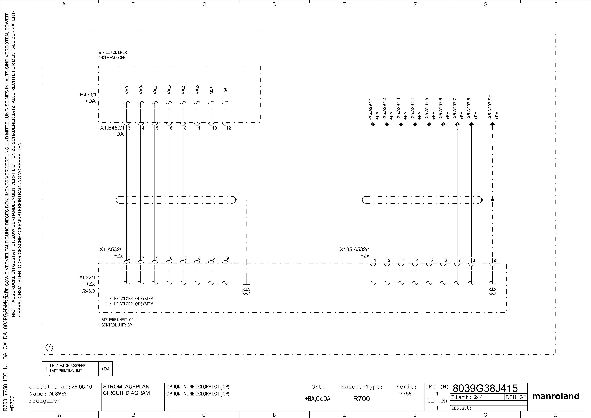

# +BA_Cx_DA — Sheet 244 of 247 — OPTION: INLINE COLORPILOT (ICP)

**OPTION: INLINE COLORPILOT (ICP)**

> Part of the manroland **R700** printing press IEC/UL circuit diagrams.
> Drawing class: **Stromlaufplan / Circuit diagram** (DIN A3).
> Document `+BA_Cx_DA` covers the **Printing units / main switch cabinet** machine section.

## At a glance

| Field | Value |
|---|---|
| Document | `+BA_Cx_DA`  (8039G38J415) |
| Sheet | **244** of 247 |
| Section (DE) | OPTION: INLINE COLORPILOT (ICP) |
| Section (EN) | OPTION: INLINE COLORPILOT (ICP) |
| Section type | OPTION — ColorPilot |
| Machine type | `R700` |
| Series | `7758` |
| Created | 28.06.10 |
| Replaces | — |
| Columns used | A, B, C, E, F, G |
| Path numbers | — |
| Labels on sheet | 73 |
| Cross-refs out | 1 |
| Cross-refs in | 26 |

**Previous:** [+BA_Cx_DA sheet 243](SHEET_0243.md) · **Next:** [+BA_Cx_DA sheet 245](SHEET_0245.md) · **Document TOC:** [_TOC.md](_TOC.md)  (+BA_Cx_DA) · **Master TOC:** [all sheets](../_MASTER_TOC.md)

## Sheet image (300 DPI, exact vector render)



_Rendered directly from the PDF vector layer at 300 DPI (1-bit), no OCR and no resampling. Use it to confirm anything ambiguous in the text below._

## Cross-references on this sheet

Each entry is a wire leaving this sheet. The printed token is `/sheet.column`; the link resolves to that sheet inside the same document.

| Ref | Target sheet | Col | Path | Destination on target | Target section | From col |
|---|---|---|---|---|---|---|
| `/246.B` | [+BA_Cx_DA sheet 246](SHEET_0246.md) | B | — | — | OPTION: INLINE COLORPILOT (ICP) | A |

### Incoming references (sheets that point here)

Every other sheet that sends a wire to this one. `Back-ref` is the token printed on *that* sheet; `Path` is its line number.

| From sheet | Cols | Back-ref | Path | Refs | What continues there |
|---|---|---|---|---|---|
| [+BA_Cx_DA#144](SHEET_0144.md) | B | `/144.B` | — | 8 | — |
| [+BA_Cx_DA#146](SHEET_0146.md) | F | `/146.F` | — | 8 | — |
| [+BA_Cx_DA#186](SHEET_0186.md) | H | `/186.H` | — | 9 | — |
| [+BA_Cx_DA#246](SHEET_0246.md) | B | `/246.B` | — | 1 | — |


## Devices on this sheet

| Tag | Class | Class meaning (IEC) | Col | Sub | Terminal | Sign |
|---|---|---|---|---|---|---|
| `B450/1` | B | Umformer / transducer, sensor | A | 1 | — | — |
| `A532/1` | A | Baugruppe / assembly, module, PC board | A | 1 | — | — |
| `VA0` | VA |  | B | — | — | — |
| `VA0` | VA |  | B | — | — | — |
| `VA2` | VA |  | C | — | — | — |
| `VA2` | VA |  | C | — | — | — |
| `X5.A297:1` | — | cross-device reference | E | — | 1 | — |
| `X5.A297:2` | — | cross-device reference | F | — | 2 | — |
| `X5.A297:3` | — | cross-device reference | F | — | 3 | — |
| `X5.A297:4` | — | cross-device reference | F | — | 4 | — |
| `X5.A297:5` | — | cross-device reference | F | — | 5 | — |
| `X5.A297:6` | — | cross-device reference | F | — | 6 | — |
| `X5.A297:7` | — | cross-device reference | G | — | 7 | — |
| `X5.A297:8` | — | cross-device reference | G | — | 8 | — |
| `X5.A297:SH` | — | cross-device reference | G | — | SH | — |

## Potentials / nets

| Potential | Count | Columns | Attached devices | Terminals |
|---|---|---|---|---|
| `L5+` | 1 | C | — | — |
| `M5+` | 1 | C | — | — |


A potential such as `L24+/4` or `M24+` is a named supply/return rail; every place it appears on this sheet is electrically common.

## Wire-end annotations (grouped as printed)

A wire that continues elsewhere is annotated with a small cluster: the destination description, the path/line number `#NN`, and the `/sheet.column` cross reference. Each row below is one such cluster exactly as it is grouped on the drawing.

| Col | Y | Path | Cross-ref | Text on the wire |
|---|---|---|---|---|
| B | 102.7 | — | — | `WINKELKODIERER ANGLE ENCODER` |
| B | 170.4 | — | — | `VA0` |
| C | 170.4 | — | — | `VAL` |
| C | 170.4 | — | — | `VA2` |
| B | 173.2 | — | — | `VA0` |
| B | 173.2 | — | — | `VAL` |
| C | 173.2 | — | — | `VA2` |
| C | 173.5 | — | — | `M5+` |
| C | 176.0 | — | — | `L5+` |
| A | 186.0 | — | — | `B450/1` |
| G | 189.9 | — | — | `X5.A297:SH` |
| E | 197.3 | — | — | `X5.A297:1` |
| F | 197.3 | — | — | `X5.A297:2` |
| F | 197.3 | — | — | `X5.A297:3` |
| F | 197.3 | — | — | `X5.A297:4` |
| F | 197.3 | — | — | `X5.A297:5` |
| F | 197.3 | — | — | `X5.A297:6` |
| G | 197.3 | — | — | `X5.A297:7` |
| G | 197.3 | — | — | `X5.A297:8` |
| A | 198.7 | — | — | `+DA` |
| E | 224.8 | — | — | `+FA` |
| F | 224.8 | — | — | `+FA` |
| F | 224.8 | — | — | `+FA` |
| F | 224.8 | — | — | `+FA` |
| F | 224.8 | — | — | `+FA` |
| F | 224.8 | — | — | `+FA` |
| G | 224.8 | — | — | `+FA` |
| G | 224.8 | — | — | `+FA` |
| G | 224.8 | — | — | `+FA` |
| B | 252.6 | — | — | `X1.B450/1 3` |
| C | 254.0 | — | — | `4 5 6 8 1 10 12` |
| B | 265.3 | — | — | `+DA` |
| B | 497.8 | — | — | `X1.A532/1` |
| E | 497.8 | — | — | `X105.A532/1` |
| C | 510.6 | — | — | `+Zx 7 1 6 3 8 5 9` |
| E | 510.6 | — | — | `+Zx` |
| E | 516.2 | — | — | `2 2 3 4 5 6 7 8 9` |
| E | 520.5 | — | — | `1` |
| A | 554.5 | — | — | `A532/1` |
| A | 567.3 | — | — | `+Zx` |
| A | 582.4 | — | `/246.B` | — |
| B | 598.7 | — | — | `1. INLINE COLORPILOT SYSTEM 1. INLINE COLORPILOT SYSTEM` |
| B | 641.2 | — | — | `1. STEUEREINHEIT: ICP 1. CONTROL UNIT: ICP` |
| A | 697.1 | — | — | `1` |
| A | 733.4 | — | — | `1 LETZTES DRUCKWERK LAST PRINTING UNIT +DA` |


## Notes and free text on this sheet

| Text | Col | Y (pt) |
|---|---|---|
| `X105.A532/1` | E | 497.79 |
| `+Zx` | E | 510.57 |
| `X1.A532/1` | B | 497.79 |
| `+Zx` | B | 510.57 |
| `+DA` | A | 198.66 |
| `WINKELKODIERER` | B | 102.65 |
| `ANGLE ENCODER` | B | 113.32 |
| `X1.B450/1` | B | 252.6 |
| `+DA` | B | 265.27 |
| `+Zx` | A | 567.27 |
| `1. STEUEREINHEIT: ICP` | B | 641.24 |
| `1. CONTROL UNIT: ICP` | B | 651.89 |
| `+FA` | E | 224.79 |
| `+FA` | F | 224.79 |
| `+FA` | G | 224.79 |
| `VAL` | B | 173.2 |
| `VAL` | C | 170.36 |
| `1. INLINE COLORPILOT SYSTEM` | B | 598.73 |
| `LETZTES DRUCKWERK` | A | 733.36 |
| `LAST PRINTING UNIT` | A | 744.01 |

## Complete label inventory (exact text from the drawing)

Every text object inside the drawing area of this sheet, in DIN reading order (column A→H, then top→bottom). This is the authoritative list: if a string is not here it is not printed on this sheet.

| Col | Y | X | Dir | Type | Text |
|---|---|---|---|---|---|
| A | 186.0 | 157.6 | → | device tag | `B450/1` |
| A | 198.7 | 171.5 | → | text | `+DA` |
| A | 554.5 | 156.2 | → | device tag | `A532/1` |
| A | 567.3 | 173.5 | → | text | `+Zx` |
| A | 582.4 | 166.1 | → | cross-reference | `/246.B` |
| A | 697.1 | 97.5 | → | number | `1` |
| A | 733.4 | 101.2 | → | text | `LETZTES DRUCKWERK` |
| A | 738.7 | 89.6 | → | number | `1` |
| A | 744.0 | 101.2 | → | text | `LAST PRINTING UNIT` |
| B | 102.7 | 198.4 | → | text | `WINKELKODIERER` |
| B | 113.3 | 198.4 | → | text | `ANGLE ENCODER` |
| B | 170.4 | 280.2 | ↕ | device tag | `VA0` |
| B | 173.2 | 251.8 | ↕ | device tag | `VA0` |
| B | 173.2 | 308.5 | ↕ | text | `VAL` |
| B | 252.6 | 198.4 | → | text | `X1.B450/1` |
| B | 254.0 | 257.7 | → | number | `3` |
| B | 254.0 | 286.0 | → | number | `4` |
| B | 254.0 | 314.4 | → | number | `5` |
| B | 265.3 | 228.2 | → | text | `+DA` |
| B | 497.8 | 197.0 | → | text | `X1.A532/1` |
| B | 510.6 | 230.2 | → | text | `+Zx` |
| B | 516.2 | 257.7 | → | number | `2` |
| B | 516.2 | 286.0 | → | number | `7` |
| B | 516.2 | 313.8 | → | number | `1` |
| B | 598.7 | 211.7 | → | text | `1. INLINE COLORPILOT SYSTEM` |
| B | 609.4 | 211.7 | → | text | `1. INLINE COLORPILOT SYSTEM` |
| B | 641.2 | 197.6 | → | text | `1. STEUEREINHEIT: ICP` |
| B | 651.9 | 197.6 | → | text | `1. CONTROL UNIT: ICP` |
| B | 739.4 | 203.8 | → | text | `+DA` |
| C | 170.4 | 336.9 | ↕ | text | `VAL` |
| C | 170.4 | 393.6 | ↕ | device tag | `VA2` |
| C | 173.2 | 365.2 | ↕ | device tag | `VA2` |
| C | 173.5 | 422.0 | ↕ | potential | `M5+` |
| C | 176.0 | 450.3 | ↕ | potential | `L5+` |
| C | 254.0 | 342.7 | → | number | `6` |
| C | 254.0 | 371.1 | → | number | `8` |
| C | 254.0 | 398.8 | → | number | `1` |
| C | 254.0 | 427.2 | → | number | `10` |
| C | 254.0 | 455.5 | → | number | `12` |
| C | 516.2 | 342.7 | → | number | `6` |
| C | 516.2 | 371.1 | → | number | `3` |
| C | 516.2 | 399.4 | → | number | `8` |
| C | 516.2 | 427.7 | → | number | `5` |
| C | 516.2 | 456.1 | → | number | `9` |
| E | 197.3 | 742.2 | ↕ | device ref | `X5.A297:1` |
| E | 224.8 | 756.4 | ↕ | text | `+FA` |
| E | 497.8 | 681.2 | → | text | `X105.A532/1` |
| E | 510.6 | 726.2 | → | text | `+Zx` |
| E | 520.5 | 753.2 | → | number | `1` |
| F | 197.3 | 770.6 | ↕ | device ref | `X5.A297:2` |
| F | 197.3 | 798.9 | ↕ | device ref | `X5.A297:3` |
| F | 197.3 | 827.3 | ↕ | device ref | `X5.A297:4` |
| F | 197.3 | 855.6 | ↕ | device ref | `X5.A297:5` |
| F | 197.3 | 884.0 | ↕ | device ref | `X5.A297:6` |
| F | 224.8 | 784.7 | ↕ | text | `+FA` |
| F | 224.8 | 813.1 | ↕ | text | `+FA` |
| F | 224.8 | 841.4 | ↕ | text | `+FA` |
| F | 224.8 | 869.8 | ↕ | text | `+FA` |
| F | 224.8 | 898.1 | ↕ | text | `+FA` |
| F | 520.5 | 782.1 | → | number | `2` |
| F | 520.5 | 810.4 | → | number | `3` |
| F | 520.5 | 838.8 | → | number | `4` |
| F | 520.5 | 867.1 | → | number | `5` |
| F | 520.5 | 895.5 | → | number | `6` |
| G | 189.9 | 983.2 | ↕ | device ref | `X5.A297:SH` |
| G | 197.3 | 912.3 | ↕ | device ref | `X5.A297:7` |
| G | 197.3 | 940.7 | ↕ | device ref | `X5.A297:8` |
| G | 224.8 | 926.5 | ↕ | text | `+FA` |
| G | 224.8 | 954.8 | ↕ | text | `+FA` |
| G | 224.8 | 997.3 | ↕ | text | `+FA` |
| G | 520.5 | 923.8 | → | number | `7` |
| G | 520.5 | 952.2 | → | number | `8` |
| G | 520.5 | 994.7 | → | number | `9` |

## Reading-order text block

The same content as a plain block, grouped by DIN column — convenient to paste or to match against a visual description.

```text
=== Column A ===
 186.0  157.6  devtag       B450/1
 198.7  171.5  text         +DA
 554.5  156.2  devtag       A532/1
 567.3  173.5  text         +Zx
 582.4  166.1  xref         /246.B
 697.1   97.5  numeric      1
 733.4  101.2  text         LETZTES DRUCKWERK
 738.7   89.6  numeric      1
 744.0  101.2  text         LAST PRINTING UNIT
=== Column B ===
 102.7  198.4  text         WINKELKODIERER
 113.3  198.4  text         ANGLE ENCODER
 170.4  280.2  devtag       VA0
 173.2  251.8  devtag       VA0
 173.2  308.5  text         VAL
 252.6  198.4  text         X1.B450/1
 254.0  257.7  numeric      3
 254.0  286.0  numeric      4
 254.0  314.4  numeric      5
 265.3  228.2  text         +DA
 497.8  197.0  text         X1.A532/1
 510.6  230.2  text         +Zx
 516.2  257.7  numeric      2
 516.2  286.0  numeric      7
 516.2  313.8  numeric      1
 598.7  211.7  text         1. INLINE COLORPILOT SYSTEM
 609.4  211.7  text         1. INLINE COLORPILOT SYSTEM
 641.2  197.6  text         1. STEUEREINHEIT: ICP
 651.9  197.6  text         1. CONTROL UNIT: ICP
 739.4  203.8  text         +DA
=== Column C ===
 170.4  336.9  text         VAL
 170.4  393.6  devtag       VA2
 173.2  365.2  devtag       VA2
 173.5  422.0  net          M5+
 176.0  450.3  net          L5+
 254.0  342.7  numeric      6
 254.0  371.1  numeric      8
 254.0  398.8  numeric      1
 254.0  427.2  numeric      10
 254.0  455.5  numeric      12
 516.2  342.7  numeric      6
 516.2  371.1  numeric      3
 516.2  399.4  numeric      8
 516.2  427.7  numeric      5
 516.2  456.1  numeric      9
=== Column E ===
 197.3  742.2  devref       X5.A297:1
 224.8  756.4  text         +FA
 497.8  681.2  text         X105.A532/1
 510.6  726.2  text         +Zx
 520.5  753.2  numeric      1
=== Column F ===
 197.3  770.6  devref       X5.A297:2
 197.3  798.9  devref       X5.A297:3
 197.3  827.3  devref       X5.A297:4
 197.3  855.6  devref       X5.A297:5
 197.3  884.0  devref       X5.A297:6
 224.8  784.7  text         +FA
 224.8  813.1  text         +FA
 224.8  841.4  text         +FA
 224.8  869.8  text         +FA
 224.8  898.1  text         +FA
 520.5  782.1  numeric      2
 520.5  810.4  numeric      3
 520.5  838.8  numeric      4
 520.5  867.1  numeric      5
 520.5  895.5  numeric      6
=== Column G ===
 189.9  983.2  devref       X5.A297:SH
 197.3  912.3  devref       X5.A297:7
 197.3  940.7  devref       X5.A297:8
 224.8  926.5  text         +FA
 224.8  954.8  text         +FA
 224.8  997.3  text         +FA
 520.5  923.8  numeric      7
 520.5  952.2  numeric      8
 520.5  994.7  numeric      9
```

---
_Generated from the PDF vector text layer; no OCR. Source: `R700_7758_IEC_UL_BA_CX_DA_8039G38J415_p`, sheet 244._
