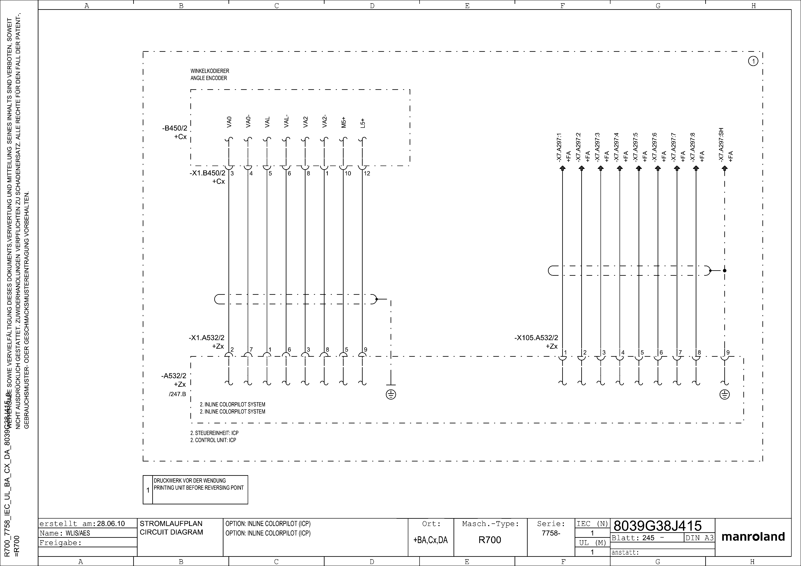

# +BA_Cx_DA — Sheet 245 of 247 — OPTION: INLINE COLORPILOT (ICP)

**OPTION: INLINE COLORPILOT (ICP)**

> Part of the manroland **R700** printing press IEC/UL circuit diagrams.
> Drawing class: **Stromlaufplan / Circuit diagram** (DIN A3).
> Document `+BA_Cx_DA` covers the **Printing units / main switch cabinet** machine section.

## At a glance

| Field | Value |
|---|---|
| Document | `+BA_Cx_DA`  (8039G38J415) |
| Sheet | **245** of 247 |
| Section (DE) | OPTION: INLINE COLORPILOT (ICP) |
| Section (EN) | OPTION: INLINE COLORPILOT (ICP) |
| Section type | OPTION — ColorPilot |
| Machine type | `R700` |
| Series | `7758` |
| Created | 28.06.10 |
| Replaces | — |
| Columns used | B, C, D, F, G, H |
| Path numbers | — |
| Labels on sheet | 72 |
| Cross-refs out | 1 |
| Cross-refs in | 26 |

**Previous:** [+BA_Cx_DA sheet 244](SHEET_0244.md) · **Next:** [+BA_Cx_DA sheet 246](SHEET_0246.md) · **Document TOC:** [_TOC.md](_TOC.md)  (+BA_Cx_DA) · **Master TOC:** [all sheets](../_MASTER_TOC.md)

## Sheet image (300 DPI, exact vector render)



_Rendered directly from the PDF vector layer at 300 DPI (1-bit), no OCR and no resampling. Use it to confirm anything ambiguous in the text below._

## Cross-references on this sheet

Each entry is a wire leaving this sheet. The printed token is `/sheet.column`; the link resolves to that sheet inside the same document.

| Ref | Target sheet | Col | Path | Destination on target | Target section | From col |
|---|---|---|---|---|---|---|
| `/247.B` | [+BA_Cx_DA sheet 247](SHEET_0247.md) | B | — | — | OPTION: INLINE COLORPILOT (ICP) | B |

### Incoming references (sheets that point here)

Every other sheet that sends a wire to this one. `Back-ref` is the token printed on *that* sheet; `Path` is its line number.

| From sheet | Cols | Back-ref | Path | Refs | What continues there |
|---|---|---|---|---|---|
| [+BA_Cx_DA#144](SHEET_0144.md) | B | `/144.B` | — | 8 | — |
| [+BA_Cx_DA#146](SHEET_0146.md) | G | `/146.G` | — | 8 | — |
| [+BA_Cx_DA#186](SHEET_0186.md) | H | `/186.H` | — | 9 | — |
| [+BA_Cx_DA#247](SHEET_0247.md) | B | `/247.B` | — | 1 | — |


## Devices on this sheet

| Tag | Class | Class meaning (IEC) | Col | Sub | Terminal | Sign |
|---|---|---|---|---|---|---|
| `B450/2` | B | Umformer / transducer, sensor | B | 2 | — | — |
| `A532/2` | A | Baugruppe / assembly, module, PC board | B | 2 | — | — |
| `VA0` | VA |  | C | — | — | — |
| `VA0` | VA |  | C | — | — | — |
| `VA2` | VA |  | C | — | — | — |
| `VA2` | VA |  | D | — | — | — |
| `X7.A297:1` | — | cross-device reference | F | — | 1 | — |
| `X7.A297:2` | — | cross-device reference | F | — | 2 | — |
| `X7.A297:3` | — | cross-device reference | F | — | 3 | — |
| `X7.A297:4` | — | cross-device reference | G | — | 4 | — |
| `X7.A297:5` | — | cross-device reference | G | — | 5 | — |
| `X7.A297:6` | — | cross-device reference | G | — | 6 | — |
| `X7.A297:7` | — | cross-device reference | G | — | 7 | — |
| `X7.A297:8` | — | cross-device reference | G | — | 8 | — |
| `X7.A297:SH` | — | cross-device reference | H | — | SH | — |

## Potentials / nets

| Potential | Count | Columns | Attached devices | Terminals |
|---|---|---|---|---|
| `L5+` | 1 | D | — | — |
| `M5+` | 1 | D | — | — |


A potential such as `L24+/4` or `M24+` is a named supply/return rail; every place it appears on this sheet is electrically common.

## Wire-end annotations (grouped as printed)

A wire that continues elsewhere is annotated with a small cluster: the destination description, the path/line number `#NN`, and the `/sheet.column` cross reference. Each row below is one such cluster exactly as it is grouped on the drawing.

| Col | Y | Path | Cross-ref | Text on the wire |
|---|---|---|---|---|
| H | 87.7 | — | — | `1` |
| B | 102.7 | — | — | `WINKELKODIERER ANGLE ENCODER` |
| C | 170.4 | — | — | `VA0` |
| C | 170.4 | — | — | `VAL` |
| D | 170.4 | — | — | `VA2` |
| C | 173.2 | — | — | `VA0` |
| C | 173.2 | — | — | `VAL` |
| C | 173.2 | — | — | `VA2` |
| D | 173.5 | — | — | `M5+` |
| D | 176.0 | — | — | `L5+` |
| B | 186.0 | — | — | `B450/2` |
| H | 189.9 | — | — | `X7.A297:SH` |
| F | 197.3 | — | — | `X7.A297:1` |
| F | 197.3 | — | — | `X7.A297:2` |
| F | 197.3 | — | — | `X7.A297:3` |
| G | 197.3 | — | — | `X7.A297:4` |
| G | 197.3 | — | — | `X7.A297:5` |
| G | 197.3 | — | — | `X7.A297:6` |
| G | 197.3 | — | — | `X7.A297:7` |
| G | 197.3 | — | — | `X7.A297:8` |
| B | 198.8 | — | — | `+Cx` |
| F | 224.8 | — | — | `+FA` |
| F | 224.8 | — | — | `+FA` |
| F | 224.8 | — | — | `+FA` |
| G | 224.8 | — | — | `+FA` |
| G | 224.8 | — | — | `+FA` |
| G | 224.8 | — | — | `+FA` |
| G | 224.8 | — | — | `+FA` |
| G | 224.8 | — | — | `+FA` |
| H | 224.8 | — | — | `+FA` |
| B | 252.6 | — | — | `X1.B450/2 3` |
| C | 254.0 | — | — | `4 5 6 8 1 10 12` |
| B | 265.4 | — | — | `+Cx` |
| B | 497.8 | — | — | `X1.A532/2` |
| F | 497.8 | — | — | `X105.A532/2` |
| C | 510.6 | — | — | `+Zx 7 1 6 3 8 5 9` |
| F | 510.6 | — | — | `+Zx` |
| E | 516.2 | — | — | `2 2 3 4 5 6 7 8 9` |
| F | 520.5 | — | — | `1` |
| B | 554.5 | — | — | `A532/2` |
| B | 567.3 | — | — | `+Zx` |
| B | 582.4 | — | `/247.B` | — |
| C | 598.7 | — | — | `2. INLINE COLORPILOT SYSTEM 2. INLINE COLORPILOT SYSTEM` |
| B | 641.2 | — | — | `2. STEUEREINHEIT: ICP 2. CONTROL UNIT: ICP` |
| B | 712.1 | — | — | `1 DRUCKWERK VOR DER WENDUNG PRINTING UNIT BEFORE REVERSING POINT` |


## Reconstructed tables

This sheet carries tabular content (pin map / terminal assignment / index). The grid below was rebuilt from the drawing's own rule lines, so each row is exactly one physical row of the table.

### Table 1 — 1 data rows × 8 columns (at x=340.2, y=76.5)

| VA0 3 | VA0 4 | VAL 5 | VAL 6 | VA2 8 | VA2 1 | M5+ 10 | L5+ 12 |
|---|---|---|---|---|---|---|---|
| `2 COLORPILOT COLORPILOT ICP ICP` | `7 SYSTEM SYSTEM` | `1` | `6` | `3` | `8` | `5` | `9` |


### Table 2 — 1 data rows × 9 columns (at x=836.2, y=76.5)

| X7.A297:2 +FA | X7.A297:3 +FA | X7.A297:4 +FA | X7.A297:5 +FA | X7.A297:6 +FA | X7.A297:7 +FA | X7.A297:8 +FA | X7.A297:SH +FA | 1 +FA |
|---|---|---|---|---|---|---|---|---|
| `1` | `2` | `3` | `4` | `5` | `6` | `7` | `8` | `9` |


## Notes and free text on this sheet

| Text | Col | Y (pt) |
|---|---|---|
| `X105.A532/2` | F | 497.79 |
| `+Zx` | F | 510.57 |
| `X1.A532/2` | B | 497.79 |
| `+Zx` | B | 510.57 |
| `+Cx` | B | 198.77 |
| `WINKELKODIERER` | B | 102.65 |
| `ANGLE ENCODER` | B | 113.32 |
| `2. STEUEREINHEIT: ICP` | B | 641.24 |
| `2. CONTROL UNIT: ICP` | B | 651.9 |
| `X1.B450/2` | B | 252.6 |
| `+FA` | F | 224.79 |
| `+FA` | G | 224.79 |
| `+FA` | H | 224.79 |
| `VAL` | C | 173.2 |
| `2. INLINE COLORPILOT SYSTEM` | C | 598.74 |
| `DRUCKWERK VOR DER WENDUNG` | B | 712.11 |
| `PRINTING UNIT BEFORE REVERSING POINT` | B | 722.75 |

## Complete label inventory (exact text from the drawing)

Every text object inside the drawing area of this sheet, in DIN reading order (column A→H, then top→bottom). This is the authoritative list: if a string is not here it is not printed on this sheet.

| Col | Y | X | Dir | Type | Text |
|---|---|---|---|---|---|
| B | 102.7 | 283.5 | → | text | `WINKELKODIERER` |
| B | 113.3 | 283.5 | → | text | `ANGLE ENCODER` |
| B | 186.0 | 241.2 | → | device tag | `B450/2` |
| B | 198.8 | 258.8 | → | text | `+Cx` |
| B | 252.6 | 282.0 | → | text | `X1.B450/2` |
| B | 265.4 | 315.5 | → | text | `+Cx` |
| B | 497.8 | 280.6 | → | text | `X1.A532/2` |
| B | 510.6 | 315.2 | → | text | `+Zx` |
| B | 554.5 | 239.8 | → | device tag | `A532/2` |
| B | 567.3 | 258.5 | → | text | `+Zx` |
| B | 582.4 | 251.1 | → | cross-reference | `/247.B` |
| B | 641.2 | 283.2 | → | text | `2. STEUEREINHEIT: ICP` |
| B | 651.9 | 283.2 | → | text | `2. CONTROL UNIT: ICP` |
| B | 712.1 | 228.8 | → | text | `DRUCKWERK VOR DER WENDUNG` |
| B | 722.8 | 228.8 | → | text | `PRINTING UNIT BEFORE REVERSING POINT` |
| B | 724.5 | 217.1 | → | number | `1` |
| C | 170.4 | 365.2 | ↕ | device tag | `VA0` |
| C | 170.4 | 421.9 | ↕ | text | `VAL` |
| C | 173.2 | 336.9 | ↕ | device tag | `VA0` |
| C | 173.2 | 393.6 | ↕ | text | `VAL` |
| C | 173.2 | 450.3 | ↕ | device tag | `VA2` |
| C | 254.0 | 342.7 | → | number | `3` |
| C | 254.0 | 371.1 | → | number | `4` |
| C | 254.0 | 399.4 | → | number | `5` |
| C | 254.0 | 427.7 | → | number | `6` |
| C | 254.0 | 456.1 | → | number | `8` |
| C | 516.2 | 342.7 | → | number | `2` |
| C | 516.2 | 371.1 | → | number | `7` |
| C | 516.2 | 398.8 | → | number | `1` |
| C | 516.2 | 427.7 | → | number | `6` |
| C | 516.2 | 456.1 | → | number | `3` |
| C | 598.7 | 297.4 | → | text | `2. INLINE COLORPILOT SYSTEM` |
| C | 609.4 | 297.4 | → | text | `2. INLINE COLORPILOT SYSTEM` |
| D | 170.4 | 478.6 | ↕ | device tag | `VA2` |
| D | 173.5 | 507.0 | ↕ | potential | `M5+` |
| D | 176.0 | 535.4 | ↕ | potential | `L5+` |
| D | 254.0 | 483.9 | → | number | `1` |
| D | 254.0 | 512.2 | → | number | `10` |
| D | 254.0 | 540.6 | → | number | `12` |
| D | 516.2 | 484.4 | → | number | `8` |
| D | 516.2 | 512.8 | → | number | `5` |
| D | 516.2 | 541.1 | → | number | `9` |
| F | 197.3 | 827.3 | ↕ | device ref | `X7.A297:1` |
| F | 197.3 | 855.6 | ↕ | device ref | `X7.A297:2` |
| F | 197.3 | 884.0 | ↕ | device ref | `X7.A297:3` |
| F | 224.8 | 841.4 | ↕ | text | `+FA` |
| F | 224.8 | 869.8 | ↕ | text | `+FA` |
| F | 224.8 | 898.1 | ↕ | text | `+FA` |
| F | 497.8 | 764.8 | → | text | `X105.A532/2` |
| F | 510.6 | 811.3 | → | text | `+Zx` |
| F | 520.5 | 838.2 | → | number | `1` |
| F | 520.5 | 867.1 | → | number | `2` |
| F | 520.5 | 895.5 | → | number | `3` |
| G | 197.3 | 912.3 | ↕ | device ref | `X7.A297:4` |
| G | 197.3 | 940.7 | ↕ | device ref | `X7.A297:5` |
| G | 197.3 | 969.0 | ↕ | device ref | `X7.A297:6` |
| G | 197.3 | 997.4 | ↕ | device ref | `X7.A297:7` |
| G | 197.3 | 1025.7 | ↕ | device ref | `X7.A297:8` |
| G | 224.8 | 926.5 | ↕ | text | `+FA` |
| G | 224.8 | 954.8 | ↕ | text | `+FA` |
| G | 224.8 | 983.2 | ↕ | text | `+FA` |
| G | 224.8 | 1011.5 | ↕ | text | `+FA` |
| G | 224.8 | 1039.9 | ↕ | text | `+FA` |
| G | 520.5 | 923.8 | → | number | `4` |
| G | 520.5 | 952.2 | → | number | `5` |
| G | 520.5 | 980.5 | → | number | `6` |
| G | 520.5 | 1008.9 | → | number | `7` |
| G | 520.5 | 1037.2 | → | number | `8` |
| H | 87.7 | 1117.9 | → | number | `1` |
| H | 189.9 | 1068.2 | ↕ | device ref | `X7.A297:SH` |
| H | 224.8 | 1082.4 | ↕ | text | `+FA` |
| H | 520.5 | 1079.7 | → | number | `9` |

## Reading-order text block

The same content as a plain block, grouped by DIN column — convenient to paste or to match against a visual description.

```text
=== Column B ===
 102.7  283.5  text         WINKELKODIERER
 113.3  283.5  text         ANGLE ENCODER
 186.0  241.2  devtag       B450/2
 198.8  258.8  text         +Cx
 252.6  282.0  text         X1.B450/2
 265.4  315.5  text         +Cx
 497.8  280.6  text         X1.A532/2
 510.6  315.2  text         +Zx
 554.5  239.8  devtag       A532/2
 567.3  258.5  text         +Zx
 582.4  251.1  xref         /247.B
 641.2  283.2  text         2. STEUEREINHEIT: ICP
 651.9  283.2  text         2. CONTROL UNIT: ICP
 712.1  228.8  text         DRUCKWERK VOR DER WENDUNG
 722.8  228.8  text         PRINTING UNIT BEFORE REVERSING POINT
 724.5  217.1  numeric      1
=== Column C ===
 170.4  365.2  devtag       VA0
 170.4  421.9  text         VAL
 173.2  336.9  devtag       VA0
 173.2  393.6  text         VAL
 173.2  450.3  devtag       VA2
 254.0  342.7  numeric      3
 254.0  371.1  numeric      4
 254.0  399.4  numeric      5
 254.0  427.7  numeric      6
 254.0  456.1  numeric      8
 516.2  342.7  numeric      2
 516.2  371.1  numeric      7
 516.2  398.8  numeric      1
 516.2  427.7  numeric      6
 516.2  456.1  numeric      3
 598.7  297.4  text         2. INLINE COLORPILOT SYSTEM
 609.4  297.4  text         2. INLINE COLORPILOT SYSTEM
=== Column D ===
 170.4  478.6  devtag       VA2
 173.5  507.0  net          M5+
 176.0  535.4  net          L5+
 254.0  483.9  numeric      1
 254.0  512.2  numeric      10
 254.0  540.6  numeric      12
 516.2  484.4  numeric      8
 516.2  512.8  numeric      5
 516.2  541.1  numeric      9
=== Column F ===
 197.3  827.3  devref       X7.A297:1
 197.3  855.6  devref       X7.A297:2
 197.3  884.0  devref       X7.A297:3
 224.8  841.4  text         +FA
 224.8  869.8  text         +FA
 224.8  898.1  text         +FA
 497.8  764.8  text         X105.A532/2
 510.6  811.3  text         +Zx
 520.5  838.2  numeric      1
 520.5  867.1  numeric      2
 520.5  895.5  numeric      3
=== Column G ===
 197.3  912.3  devref       X7.A297:4
 197.3  940.7  devref       X7.A297:5
 197.3  969.0  devref       X7.A297:6
 197.3  997.4  devref       X7.A297:7
 197.3 1025.7  devref       X7.A297:8
 224.8  926.5  text         +FA
 224.8  954.8  text         +FA
 224.8  983.2  text         +FA
 224.8 1011.5  text         +FA
 224.8 1039.9  text         +FA
 520.5  923.8  numeric      4
 520.5  952.2  numeric      5
 520.5  980.5  numeric      6
 520.5 1008.9  numeric      7
 520.5 1037.2  numeric      8
=== Column H ===
  87.7 1117.9  numeric      1
 189.9 1068.2  devref       X7.A297:SH
 224.8 1082.4  text         +FA
 520.5 1079.7  numeric      9
```

---
_Generated from the PDF vector text layer; no OCR. Source: `R700_7758_IEC_UL_BA_CX_DA_8039G38J415_p`, sheet 245._
