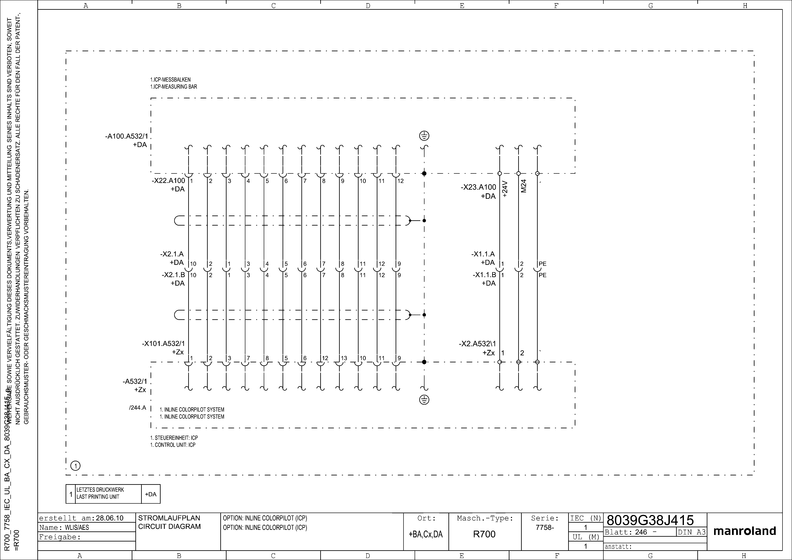

# +BA_Cx_DA — Sheet 246 of 247 — OPTION: INLINE COLORPILOT (ICP)

**OPTION: INLINE COLORPILOT (ICP)**

> Part of the manroland **R700** printing press IEC/UL circuit diagrams.
> Drawing class: **Stromlaufplan / Circuit diagram** (DIN A3).
> Document `+BA_Cx_DA` covers the **Printing units / main switch cabinet** machine section.

## At a glance

| Field | Value |
|---|---|
| Document | `+BA_Cx_DA`  (8039G38J415) |
| Sheet | **246** of 247 |
| Section (DE) | OPTION: INLINE COLORPILOT (ICP) |
| Section (EN) | OPTION: INLINE COLORPILOT (ICP) |
| Section type | OPTION — ColorPilot |
| Machine type | `R700` |
| Series | `7758` |
| Created | 28.06.10 |
| Replaces | — |
| Columns used | A, B, C, D, E, F |
| Path numbers | — |
| Labels on sheet | 92 |
| Cross-refs out | 1 |
| Cross-refs in | 55 |

**Previous:** [+BA_Cx_DA sheet 245](SHEET_0245.md) · **Next:** [+BA_Cx_DA sheet 247](SHEET_0247.md) · **Document TOC:** [_TOC.md](_TOC.md)  (+BA_Cx_DA) · **Master TOC:** [all sheets](../_MASTER_TOC.md)

## Sheet image (300 DPI, exact vector render)



_Rendered directly from the PDF vector layer at 300 DPI (1-bit), no OCR and no resampling. Use it to confirm anything ambiguous in the text below._

## Cross-references on this sheet

Each entry is a wire leaving this sheet. The printed token is `/sheet.column`; the link resolves to that sheet inside the same document.

| Ref | Target sheet | Col | Path | Destination on target | Target section | From col |
|---|---|---|---|---|---|---|
| `/244.A` | [+BA_Cx_DA sheet 244](SHEET_0244.md) | A | — | — | OPTION: INLINE COLORPILOT (ICP) | B |

### Incoming references (sheets that point here)

Every other sheet that sends a wire to this one. `Back-ref` is the token printed on *that* sheet; `Path` is its line number.

| From sheet | Cols | Back-ref | Path | Refs | What continues there |
|---|---|---|---|---|---|
| [+BA_Cx_DA#138](SHEET_0138.md) | C | `/138.C` | — | 6 | — |
| [+BA_Cx_DA#151](SHEET_0151.md) | B | `/151.B` | — | 24 | — |
| [+BA_Cx_DA#174](SHEET_0174.md) | C | `/174.C` | — | 12 | — |
| [+BA_Cx_DA#186](SHEET_0186.md) | F | `/186.F` | — | 12 | — |
| [+BA_Cx_DA#244](SHEET_0244.md) | A | `/244.A` | — | 1 | — |


## Devices on this sheet

| Tag | Class | Class meaning (IEC) | Col | Sub | Terminal | Sign |
|---|---|---|---|---|---|---|
| `A532/1` | A | Baugruppe / assembly, module, PC board | B | 1 | — | — |
| `X22.A100` | — | cross-device reference | B | — | — | — |
| `X2.1.B` | — | cross-device reference | B | — | — | — |
| `X2.1.A` | — | cross-device reference | B | — | — | — |
| `X1.1.B` | — | cross-device reference | E | — | — | — |
| `X1.1.A` | — | cross-device reference | E | — | — | — |
| `X23.A100` | — | cross-device reference | E | — | — | — |
| `X2.A532\1` | — | cross-device reference | E | — | — | — |

## Potentials / nets

| Potential | Count | Columns | Attached devices | Terminals |
|---|---|---|---|---|
| `+24V` | 1 | E | — | — |
| `M24` | 1 | F | — | — |
| `PE` | 2 | F | — | — |


A potential such as `L24+/4` or `M24+` is a named supply/return rail; every place it appears on this sheet is electrically common.

## Wire-end annotations (grouped as printed)

A wire that continues elsewhere is annotated with a small cluster: the destination description, the path/line number `#NN`, and the `/sheet.column` cross reference. Each row below is one such cluster exactly as it is grouped on the drawing.

| Col | Y | Path | Cross-ref | Text on the wire |
|---|---|---|---|---|
| B | 116.8 | — | — | `1.ICP MESSBALKEN 1.ICP MEASURING BAR` |
| A | 200.2 | — | — | `A100.A532/1` |
| B | 212.8 | — | — | `+DA` |
| B | 266.8 | — | — | `X22.A100 1` |
| C | 268.2 | — | — | `2 3 4 5 6 7 8 9 10 11 12` |
| F | 269.3 | — | — | `M24` |
| E | 271.6 | — | — | `+24V` |
| F | 271.8 | — | — | `'` |
| E | 276.4 | — | — | `X23.A100` |
| B | 279.4 | — | — | `+DA` |
| E | 290.1 | — | — | `+DA` |
| B | 377.3 | — | — | `X2.1.A 10` |
| E | 377.3 | — | — | `X1.1.A 1` |
| B | 390.0 | — | — | `+DA` |
| E | 390.0 | — | — | `+DA` |
| F | 392.8 | — | — | `PE` |
| B | 392.9 | — | — | `2` |
| C | 392.9 | — | — | `1` |
| C | 392.9 | — | — | `3` |
| C | 392.9 | — | — | `4` |
| C | 392.9 | — | — | `5` |
| C | 392.9 | — | — | `6` |
| D | 392.9 | — | — | `7` |
| D | 392.9 | — | — | `8` |
| D | 392.9 | — | — | `11` |
| D | 392.9 | — | — | `12` |
| D | 392.9 | — | — | `9` |
| F | 392.9 | — | — | `2` |
| B | 408.5 | — | — | `X2.1.B 10` |
| E | 408.5 | — | — | `X1.1.B 1` |
| F | 409.8 | — | — | `PE` |
| B | 409.9 | — | — | `2` |
| C | 409.9 | — | — | `1` |
| C | 409.9 | — | — | `3` |
| C | 409.9 | — | — | `4` |
| C | 409.9 | — | — | `5` |
| C | 409.9 | — | — | `6` |
| D | 409.9 | — | — | `7` |
| D | 409.9 | — | — | `8` |
| D | 409.9 | — | — | `11` |
| D | 409.9 | — | — | `12` |
| D | 409.9 | — | — | `9` |
| F | 409.9 | — | — | `2` |
| B | 421.2 | — | — | `+DA` |
| E | 421.2 | — | — | `+DA` |
| E | 511.7 | — | — | `X2.A532\1 1` |
| B | 512.0 | — | — | `X101.A532/1` |
| B | 524.8 | — | — | `+Zx` |
| F | 525.6 | — | — | `+Zx 2 '` |
| B | 534.7 | — | — | `1` |
| C | 534.7 | — | — | `2 3 7 8 5 6 12 13 10 11 9` |
| B | 568.7 | — | — | `A532/1` |
| B | 581.4 | — | — | `+Zx` |
| B | 609.0 | — | `/244.A` | — |
| B | 612.9 | — | — | `1. INLINE COLORPILOT SYSTEM 1. INLINE COLORPILOT SYSTEM` |
| B | 655.4 | — | — | `1. STEUEREINHEIT: ICP 1. CONTROL UNIT: ICP` |
| A | 697.1 | — | — | `1` |
| A | 733.4 | — | — | `1 LETZTES DRUCKWERK LAST PRINTING UNIT +DA` |


## Notes and free text on this sheet

| Text | Col | Y (pt) |
|---|---|---|
| `+Zx` | B | 581.44 |
| `1. STEUEREINHEIT: ICP` | B | 655.41 |
| `1. CONTROL UNIT: ICP` | B | 666.06 |
| `A100.A532/1` | A | 200.15 |
| `+DA` | B | 212.83 |
| `1.ICP MESSBALKEN` | B | 116.83 |
| `1.ICP MEASURING BAR` | B | 127.48 |
| `X101.A532/1` | B | 511.96 |
| `+DA` | E | 421.18 |
| `+Zx` | E | 525.59 |
| `1. INLINE COLORPILOT SYSTEM` | B | 612.91 |
| `LETZTES DRUCKWERK` | A | 733.36 |
| `LAST PRINTING UNIT` | A | 744.01 |

## Complete label inventory (exact text from the drawing)

Every text object inside the drawing area of this sheet, in DIN reading order (column A→H, then top→bottom). This is the authoritative list: if a string is not here it is not printed on this sheet.

| Col | Y | X | Dir | Type | Text |
|---|---|---|---|---|---|
| A | 200.1 | 158.2 | → | text | `A100.A532/1` |
| A | 697.1 | 111.6 | → | number | `1` |
| A | 733.4 | 115.4 | → | text | `LETZTES DRUCKWERK` |
| A | 738.7 | 103.7 | → | number | `1` |
| A | 744.0 | 115.4 | → | text | `LAST PRINTING UNIT` |
| B | 116.8 | 225.9 | → | text | `1.ICP MESSBALKEN` |
| B | 127.5 | 225.9 | → | text | `1.ICP MEASURING BAR` |
| B | 212.8 | 199.8 | → | text | `+DA` |
| B | 266.8 | 228.2 | → | device ref | `X22.A100` |
| B | 268.2 | 285.4 | → | number | `1` |
| B | 268.2 | 314.4 | → | number | `2` |
| B | 279.4 | 256.5 | → | text | `+DA` |
| B | 377.3 | 240.9 | → | device ref | `X2.1.A` |
| B | 390.0 | 255.1 | → | text | `+DA` |
| B | 392.9 | 285.4 | → | number | `10` |
| B | 392.9 | 314.4 | → | number | `2` |
| B | 408.5 | 243.2 | → | device ref | `X2.1.B` |
| B | 409.9 | 285.4 | → | number | `10` |
| B | 409.9 | 314.4 | → | number | `2` |
| B | 421.2 | 256.5 | → | text | `+DA` |
| B | 512.0 | 213.4 | → | text | `X101.A532/1` |
| B | 524.7 | 258.5 | → | text | `+Zx` |
| B | 534.7 | 285.4 | → | number | `1` |
| B | 534.7 | 314.4 | → | number | `2` |
| B | 568.7 | 184.5 | → | device tag | `A532/1` |
| B | 581.4 | 201.8 | → | text | `+Zx` |
| B | 609.0 | 194.2 | → | cross-reference | `/244.A` |
| B | 612.9 | 240.1 | → | text | `1. INLINE COLORPILOT SYSTEM` |
| B | 623.5 | 240.1 | → | text | `1. INLINE COLORPILOT SYSTEM` |
| B | 655.4 | 225.9 | → | text | `1. STEUEREINHEIT: ICP` |
| B | 666.1 | 225.9 | → | text | `1. CONTROL UNIT: ICP` |
| B | 739.4 | 218.0 | → | text | `+DA` |
| C | 268.2 | 342.7 | → | number | `3` |
| C | 268.2 | 371.1 | → | number | `4` |
| C | 268.2 | 399.4 | → | number | `5` |
| C | 268.2 | 427.7 | → | number | `6` |
| C | 268.2 | 456.1 | → | number | `7` |
| C | 392.9 | 342.1 | → | number | `1` |
| C | 392.9 | 371.1 | → | number | `3` |
| C | 392.9 | 399.4 | → | number | `4` |
| C | 392.9 | 427.7 | → | number | `5` |
| C | 392.9 | 456.1 | → | number | `6` |
| C | 409.9 | 342.1 | → | number | `1` |
| C | 409.9 | 371.1 | → | number | `3` |
| C | 409.9 | 399.4 | → | number | `4` |
| C | 409.9 | 427.7 | → | number | `5` |
| C | 409.9 | 456.1 | → | number | `6` |
| C | 534.7 | 342.7 | → | number | `3` |
| C | 534.7 | 371.1 | → | number | `7` |
| C | 534.7 | 399.4 | → | number | `8` |
| C | 534.7 | 427.7 | → | number | `5` |
| C | 534.7 | 456.1 | → | number | `6` |
| D | 268.2 | 484.4 | → | number | `8` |
| D | 268.2 | 512.8 | → | number | `9` |
| D | 268.2 | 540.6 | → | number | `10` |
| D | 268.2 | 568.9 | → | number | `11` |
| D | 268.2 | 597.3 | → | number | `12` |
| D | 392.9 | 484.4 | → | number | `7` |
| D | 392.9 | 512.8 | → | number | `8` |
| D | 392.9 | 540.6 | → | number | `11` |
| D | 392.9 | 568.9 | → | number | `12` |
| D | 392.9 | 597.8 | → | number | `9` |
| D | 409.9 | 484.4 | → | number | `7` |
| D | 409.9 | 512.8 | → | number | `8` |
| D | 409.9 | 540.6 | → | number | `11` |
| D | 409.9 | 568.9 | → | number | `12` |
| D | 409.9 | 597.8 | → | number | `9` |
| D | 534.7 | 483.9 | → | number | `12` |
| D | 534.7 | 512.2 | → | number | `13` |
| D | 534.7 | 540.6 | → | number | `10` |
| D | 534.7 | 568.9 | → | number | `11` |
| D | 534.7 | 597.8 | → | number | `9` |
| E | 271.6 | 754.3 | ↕ | potential | `+24V` |
| E | 276.4 | 692.8 | → | device ref | `X23.A100` |
| E | 290.1 | 722.8 | → | text | `+DA` |
| E | 377.3 | 708.7 | → | device ref | `X1.1.A` |
| E | 390.0 | 722.8 | → | text | `+DA` |
| E | 392.9 | 753.2 | → | number | `1` |
| E | 408.5 | 710.9 | → | device ref | `X1.1.B` |
| E | 409.9 | 753.2 | → | number | `1` |
| E | 421.2 | 724.3 | → | text | `+DA` |
| E | 511.7 | 690.0 | → | device ref | `X2.A532\1` |
| E | 525.6 | 725.4 | → | text | `+Zx` |
| E | 526.1 | 752.9 | → | number | `1` |
| F | 269.3 | 782.7 | ↕ | potential | `M24` |
| F | 271.8 | 811.2 | ↕ | other | `'` |
| F | 392.8 | 809.9 | → | potential | `PE` |
| F | 392.9 | 782.1 | → | number | `2` |
| F | 409.8 | 809.9 | → | potential | `PE` |
| F | 409.9 | 782.1 | → | number | `2` |
| F | 526.1 | 782.1 | → | number | `2` |
| F | 526.3 | 810.4 | → | other | `'` |

## Reading-order text block

The same content as a plain block, grouped by DIN column — convenient to paste or to match against a visual description.

```text
=== Column A ===
 200.1  158.2  text         A100.A532/1
 697.1  111.6  numeric      1
 733.4  115.4  text         LETZTES DRUCKWERK
 738.7  103.7  numeric      1
 744.0  115.4  text         LAST PRINTING UNIT
=== Column B ===
 116.8  225.9  text         1.ICP MESSBALKEN
 127.5  225.9  text         1.ICP MEASURING BAR
 212.8  199.8  text         +DA
 266.8  228.2  devref       X22.A100
 268.2  285.4  numeric      1
 268.2  314.4  numeric      2
 279.4  256.5  text         +DA
 377.3  240.9  devref       X2.1.A
 390.0  255.1  text         +DA
 392.9  285.4  numeric      10
 392.9  314.4  numeric      2
 408.5  243.2  devref       X2.1.B
 409.9  285.4  numeric      10
 409.9  314.4  numeric      2
 421.2  256.5  text         +DA
 512.0  213.4  text         X101.A532/1
 524.7  258.5  text         +Zx
 534.7  285.4  numeric      1
 534.7  314.4  numeric      2
 568.7  184.5  devtag       A532/1
 581.4  201.8  text         +Zx
 609.0  194.2  xref         /244.A
 612.9  240.1  text         1. INLINE COLORPILOT SYSTEM
 623.5  240.1  text         1. INLINE COLORPILOT SYSTEM
 655.4  225.9  text         1. STEUEREINHEIT: ICP
 666.1  225.9  text         1. CONTROL UNIT: ICP
 739.4  218.0  text         +DA
=== Column C ===
 268.2  342.7  numeric      3
 268.2  371.1  numeric      4
 268.2  399.4  numeric      5
 268.2  427.7  numeric      6
 268.2  456.1  numeric      7
 392.9  342.1  numeric      1
 392.9  371.1  numeric      3
 392.9  399.4  numeric      4
 392.9  427.7  numeric      5
 392.9  456.1  numeric      6
 409.9  342.1  numeric      1
 409.9  371.1  numeric      3
 409.9  399.4  numeric      4
 409.9  427.7  numeric      5
 409.9  456.1  numeric      6
 534.7  342.7  numeric      3
 534.7  371.1  numeric      7
 534.7  399.4  numeric      8
 534.7  427.7  numeric      5
 534.7  456.1  numeric      6
=== Column D ===
 268.2  484.4  numeric      8
 268.2  512.8  numeric      9
 268.2  540.6  numeric      10
 268.2  568.9  numeric      11
 268.2  597.3  numeric      12
 392.9  484.4  numeric      7
 392.9  512.8  numeric      8
 392.9  540.6  numeric      11
 392.9  568.9  numeric      12
 392.9  597.8  numeric      9
 409.9  484.4  numeric      7
 409.9  512.8  numeric      8
 409.9  540.6  numeric      11
 409.9  568.9  numeric      12
 409.9  597.8  numeric      9
 534.7  483.9  numeric      12
 534.7  512.2  numeric      13
 534.7  540.6  numeric      10
 534.7  568.9  numeric      11
 534.7  597.8  numeric      9
=== Column E ===
 271.6  754.3  net          +24V
 276.4  692.8  devref       X23.A100
 290.1  722.8  text         +DA
 377.3  708.7  devref       X1.1.A
 390.0  722.8  text         +DA
 392.9  753.2  numeric      1
 408.5  710.9  devref       X1.1.B
 409.9  753.2  numeric      1
 421.2  724.3  text         +DA
 511.7  690.0  devref       X2.A532\1
 525.6  725.4  text         +Zx
 526.1  752.9  numeric      1
=== Column F ===
 269.3  782.7  net          M24
 271.8  811.2  other        `
 392.8  809.9  net          PE
 392.9  782.1  numeric      2
 409.8  809.9  net          PE
 409.9  782.1  numeric      2
 526.1  782.1  numeric      2
 526.3  810.4  other        `
```

---
_Generated from the PDF vector text layer; no OCR. Source: `R700_7758_IEC_UL_BA_CX_DA_8039G38J415_p`, sheet 246._
