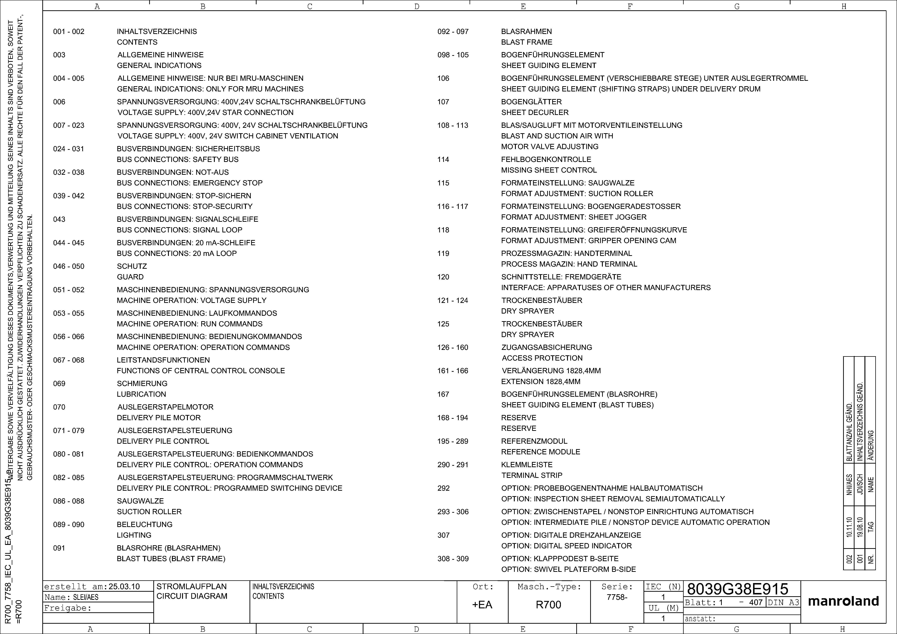

# +EA — Sheet 1 of 407 — INHALTSVERZEICHNIS

**CONTENTS**

> Part of the manroland **R700** printing press IEC/UL circuit diagrams.
> Drawing class: **Stromlaufplan / Circuit diagram** (DIN A3).
> Document `+EA` covers the **Printing unit** machine section.

## At a glance

| Field | Value |
|---|---|
| Document | `+EA`  (8039G38E915) |
| Sheet | **1** of 407 |
| Section (DE) | INHALTSVERZEICHNIS |
| Section (EN) | CONTENTS |
| Section type | TOC — Contents |
| Machine type | `R700` |
| Series | `7758` |
| Created | 25.03.10 |
| Replaces | — |
| Columns used | A, B, D, E, F, H |
| Path numbers | — |
| Labels on sheet | 151 |
| Cross-refs out | 0 |
| Cross-refs in | 0 |

**Previous:** [+BA_Cx_DA sheet 247](../BA_Cx_DA/SHEET_0247.md) · **Next:** [+EA sheet 2](SHEET_0002.md) · **Document TOC:** [_TOC.md](_TOC.md)  (+EA) · **Master TOC:** [all sheets](../_MASTER_TOC.md)

## Sheet image (300 DPI, exact vector render)



_Rendered directly from the PDF vector layer at 300 DPI (1-bit), no OCR and no resampling. Use it to confirm anything ambiguous in the text below._

## Cross-references on this sheet

Each entry is a wire leaving this sheet. The printed token is `/sheet.column`; the link resolves to that sheet inside the same document.

_No outgoing cross-references on this sheet._

## Devices on this sheet

| Tag | Class | Class meaning (IEC) | Col | Sub | Terminal | Sign |
|---|---|---|---|---|---|---|
| `NR.` | — | cross-device reference | H | — | — | — |
| `19.08.10` | — | cross-device reference | H | — | — | — |
| `10.11.10` | — | cross-device reference | H | — | — | — |

## Potentials / nets

_No named potentials on this sheet._

## Wire-end annotations (grouped as printed)

A wire that continues elsewhere is annotated with a small cluster: the destination description, the path/line number `#NN`, and the `/sheet.column` cross reference. Each row below is one such cluster exactly as it is grouped on the drawing.

| Col | Y | Path | Cross-ref | Text on the wire |
|---|---|---|---|---|
| A | 37.5 | — | — | `001 002 INHALTSVERZEICHNIS CONTENTS` |
| E | 37.5 | — | — | `092 097 BLASRAHMEN BLAST FRAME` |
| A | 68.6 | — | — | `003 GENERAL INDICATIONS ALLGEMEINE HINWEISE` |
| E | 68.6 | — | — | `098 105 BOGENFÜHRUNGSELEMENT SHEET GUIDING ELEMENT` |
| B | 99.8 | — | — | `004 005 GENERAL INDICATIONS: ONLY FOR MRU MACHINES ALLGEMEINE HINWEISE: NUR BEI MRU MASCHINEN` |
| F | 99.8 | — | — | `106 BOGENFÜHRUNGSELEMENT (VERSCHIEBBARE STEGE) UNTER AUSLEGERTROMMEL SHEET GUIDING ELEMENT (SHIFTING STRAPS) UNDER DELIVERY DRUM` |
| B | 131.0 | — | — | `006 SPANNUNGSVERSORGUNG: 400V,24V SCHALTSCHRANKBELÜFTUNG` |
| E | 131.0 | — | — | `107 BOGENGLÄTTER SHEET DECURLER` |
| B | 145.2 | — | — | `VOLTAGE SUPPLY: 400V,24V STAR CONNECTION` |
| B | 162.2 | — | — | `007 023 SPANNUNGSVERSORGUNG: 400V, 24V SCHALTSCHRANKBELÜFTUNG` |
| E | 162.2 | — | — | `108 113 BLAS/SAUGLUFT MIT MOTORVENTILEINSTELLUNG BLAST AND SUCTION AIR WITH MOTOR VALVE ADJUSTING` |
| B | 176.3 | — | — | `VOLTAGE SUPPLY: 400V, 24V SWITCH CABINET VENTILATION` |
| B | 193.4 | — | — | `024 031 BUSVERBINDUNGEN: SICHERHEITSBUS BUS CONNECTIONS: SAFETY BUS` |
| E | 207.5 | — | — | `114 FEHLBOGENKONTROLLE MISSING SHEET CONTROL` |
| B | 224.5 | — | — | `032 038 BUSVERBINDUNGEN: NOT AUS BUS CONNECTIONS: EMERGENCY STOP` |
| E | 238.7 | — | — | `115 FORMATEINSTELLUNG: SAUGWALZE FORMAT ADJUSTMENT: SUCTION ROLLER` |
| B | 255.7 | — | — | `039 042 BUSVERBINDUNGEN: STOP SICHERN BUS CONNECTIONS: STOP SECURITY` |
| E | 269.9 | — | — | `116 117 FORMATEINSTELLUNG: BOGENGERADESTOSSER FORMAT ADJUSTMENT: SHEET JOGGER` |
| B | 286.9 | — | — | `043 BUSVERBINDUNGEN: SIGNALSCHLEIFE BUS CONNECTIONS: SIGNAL LOOP` |
| E | 301.1 | — | — | `118 FORMATEINSTELLUNG: GREIFERÖFFNUNGSKURVE FORMAT ADJUSTMENT: GRIPPER OPENING CAM` |
| B | 318.1 | — | — | `044 045 BUSVERBINDUNGEN: 20 mA SCHLEIFE BUS CONNECTIONS: 20 mA LOOP` |
| E | 332.3 | — | — | `119 PROZESSMAGAZIN: HANDTERMINAL PROCESS MAGAZIN: HAND TERMINAL` |
| A | 349.3 | — | — | `046 050 SCHUTZ GUARD` |
| E | 363.4 | — | — | `120 INTERFACE: APPARATUSES OF OTHER MANUFACTURERS SCHNITTSTELLE: FREMDGERÄTE` |
| B | 380.4 | — | — | `051 052 MASCHINENBEDIENUNG: SPANNUNGSVERSORGUNG MACHINE OPERATION: VOLTAGE SUPPLY` |
| E | 394.6 | — | — | `121 124 DRY SPRAYER TROCKENBESTÄUBER` |
| B | 411.6 | — | — | `053 055 MASCHINENBEDIENUNG: LAUFKOMMANDOS MACHINE OPERATION: RUN COMMANDS` |
| E | 425.8 | — | — | `125 DRY SPRAYER TROCKENBESTÄUBER` |
| B | 442.8 | — | — | `056 066 MASCHINENBEDIENUNG: BEDIENUNGKOMMANDOS MACHINE OPERATION: OPERATION COMMANDS` |
| E | 457.0 | — | — | `126 160 ZUGANGSABSICHERUNG` |
| E | 471.2 | — | — | `ACCESS PROTECTION` |
| B | 474.0 | — | — | `067 068 LEITSTANDSFUNKTIONEN FUNCTIONS OF CENTRAL CONTROL CONSOLE` |
| E | 488.2 | — | — | `161 166 EXTENSION 1828,4MM VERLÄNGERUNG 1828,4MM` |
| A | 505.2 | — | — | `069 LUBRICATION SCHMIERUNG` |
| H | 507.4 | — | — | `001 JDI/SCH 19.08.10 INHALTSVERZEICHNIS GEÄND.` |
| E | 519.3 | — | — | `167 BOGENFÜHRUNGSELEMENT (BLASROHRE) SHEET GUIDING ELEMENT (BLAST TUBES)` |
| H | 534.2 | — | — | `NHI/AES 10.11.10 BLATTANZAHL GEÄND. 002` |
| A | 536.4 | — | — | `070 DELIVERY PILE MOTOR AUSLEGERSTAPELMOTOR` |
| E | 550.5 | — | — | `168 194 RESERVE RESERVE` |
| A | 567.5 | — | — | `071 079 DELIVERY PILE CONTROL AUSLEGERSTAPELSTEUERUNG` |
| H | 571.4 | — | — | `NR. NAME TAG ÄNDERUNG` |
| E | 581.7 | — | — | `195 289 REFERENZMODUL REFERENCE MODULE` |
| B | 598.7 | — | — | `080 081 DELIVERY PILE CONTROL: OPERATION COMMANDS AUSLEGERSTAPELSTEUERUNG: BEDIENKOMMANDOS` |
| E | 612.9 | — | — | `290 291 KLEMMLEISTE` |
| E | 627.1 | — | — | `TERMINAL STRIP` |
| B | 629.9 | — | — | `082 085 DELIVERY PILE CONTROL: PROGRAMMED SWITCHING DEVICE AUSLEGERSTAPELSTEUERUNG: PROGRAMMSCHALTWERK` |
| F | 644.1 | — | — | `292 OPTION: PROBEBOGENENTNAHME HALBAUTOMATISCH OPTION: INSPECTION SHEET REMOVAL SEMIAUTOMATICALLY` |
| A | 661.0 | — | — | `086 088 SAUGWALZE SUCTION ROLLER` |
| F | 675.2 | — | — | `293 306 OPTION: ZWISCHENSTAPEL / NONSTOP EINRICHTUNG AUTOMATISCH OPTION: INTERMEDIATE PILE / NONSTOP DEVICE AUTOMATIC OPERATION` |
| A | 692.3 | — | — | `089 090 BELEUCHTUNG LIGHTING` |
| E | 706.5 | — | — | `307 OPTION: DIGITALE DREHZAHLANZEIGE OPTION: DIGITAL SPEED INDICATOR` |
| A | 723.4 | — | — | `091 BLASROHRE (BLASRAHMEN) BLAST TUBES (BLAST FRAME)` |
| E | 737.6 | — | — | `308 309 OPTION: KLAPPPODEST B SEITE OPTION: SWIVEL PLATEFORM B SIDE` |


## Reconstructed tables

This sheet carries tabular content (pin map / terminal assignment / index). The grid below was rebuilt from the drawing's own rule lines, so each row is exactly one physical row of the table.

### Table 1 — 6 data rows × 7 columns (at x=204.1, y=0.0)

| INHALTSVERZEICHNIS HINWEISE INDICATIONS HINWEISE: NUR BEI INDICATIONS: ONLY FOR SPANNUNGSVERSORGUNG: 400V,24V SUPPLY: 400V,24V STAR SPANNUNGSVERSORGUNG: 400V, 24V SUPPLY: 400V, 24V SWITCH BUSVERBINDUNGEN: SICHERHEITSBUS CONNECTIONS: SAFETY BUS BUSVERBINDUNGEN: NOT AUS CONNECTIONS: EMERGENCY BUSVERBINDUNGEN: STOP SICHERN CONNECTIONS: STOP SECURITY BUSVERBINDUNGEN: SIGNALSCHLEIFE CONNECTIONS: SIGNAL LOOP BUSVERBINDUNGEN: 20 mA SCHLEIFE CONNECTIONS: 20 mA LOOP MASCHINENBEDIENUNG: OPERATION: VOLTAGE MASCHINENBEDIENUNG: LAUFKOMMANDOS OPERATION: RUN COMMANDS MASCHINENBEDIENUNG: OPERATION: OPERATION LEITSTANDSFUNKTIONEN OF CENTRAL CONTROL AUSLEGERSTAPELMOTOR PILE MOTOR AUSLEGERSTAPELSTEUERUNG PILE CONTROL AUSLEGERSTAPELSTEUERUNG: PILE CONTROL: OPERATION AUSLEGERSTAPELSTEUERUNG: PILE CONTROL: PROGRAMMED ROLLER (BLASRAHMEN) TUBES (BLAST FRAME) | 092 098 MRU MASCHINEN 106 MRU MACHINES SCHALTSCHRANKBELÜFTUNG 107 CONNECTION SCHALTSCHRANKBELÜFTUNG 108 CABINET VENTILATION 114 STOP 115 116 118 119 120 SPANNUNGSVERSORGUNG SUPPLY 121 125 BEDIENUNGKOMMANDOS COMMANDS 126 CONSOLE 161 167 168 195 BEDIENKOMMANDOS COMMANDS 290 PROGRAMMSCHALTWERK SWITCHING DEVICE 292 293 307 308 | 097 105 113 117 124 160 166 194 289 291 306 309 | BLASRAHMEN BLAST FRAME BOGENFÜHRUNGSELEMENT SHEET GUIDING ELEMENT BOGENFÜHRUNGSELEMENT SHEET GUIDING ELEMENT BOGENGLÄTTER SHEET DECURLER BLAS/SAUGLUFT MIT BLAST AND SUCTION AIR MOTOR VALVE ADJUSTING FEHLBOGENKONTROLLE MISSING SHEET CONTROL FORMATEINSTELLUNG: FORMAT ADJUSTMENT: FORMATEINSTELLUNG: FORMAT ADJUSTMENT: FORMATEINSTELLUNG: FORMAT ADJUSTMENT: PROZESSMAGAZIN: PROCESS MAGAZIN: HAND SCHNITTSTELLE: INTERFACE: APPARATUSES TROCKENBESTÄUBER DRY SPRAYER TROCKENBESTÄUBER DRY SPRAYER ZUGANGSABSICHERUNG ACCESS PROTECTION VERLÄNGERUNG 1828,4MM EXTENSION 1828,4MM BOGENFÜHRUNGSELEMENT SHEET GUIDING ELEMENT RESERVE RESERVE REFERENZMODUL REFERENCE MODULE KLEMMLEISTE TERMINAL STRIP OPTION: PROBEBOGENENTNAHME OPTION: INSPECTION OPTION: ZWISCHENSTAPEL OPTION: INTERMEDIATE OPTION: DIGITALE OPTION: DIGITAL SPEED OPTION: KLAPPPODEST OPTION: SWIVEL PLATEFORM | (VERSCHIEBBARE (SHIFTING MOTORVENTILEINSTELLUNG WITH SAUGWALZE SUCTION ROLLER BOGENGERADESTOSSER SHEET JOGGER GREIFERÖFFNUNGSKURVE GRIPPER OPENING HANDTERMINAL TERMINAL FREMDGERÄTE OF OTHER (BLASROHRE) (BLAST TUBES) SHEET REMOVAL / NONSTOP PILE / NONSTOP DREHZAHLANZEIGE INDICATOR B SEITE B SIDE | STRAPS) CAM MANUFACTURERS HALBAUTOMATISCH EINRICHTUNG DEVICE | STEGE) UNTER AUSLEGERTROMMEL UNDER DELIVERY DRUM SEMIAUTOMATICALLY AUTOMATISCH AUTOMATIC OPERATION |
|---|---|---|---|---|---|---|
| `STROMLAUFPLAN` | `INHALTSVERZEICHNIS` | `Ort:` | `Masch. Type:` | `Serie:` | `IEC (N)` | `8039G38E915` |
| `CIRCUIT DIAGRAM` |  |  |  |  |  |  |
|  | `CONTENTS` |  |  | `7758` | `1` |  |
|  |  | `+EA` | `R700` |  |  | `Blatt: DIN A3 1 407` |
|  |  |  |  |  | `UL (M)` |  |
|  |  |  |  |  | `1` | `anstatt:` |


## Notes and free text on this sheet

| Text | Col | Y (pt) |
|---|---|---|
| `TAG` | H | 692.75 |
| `NAME` | H | 633.34 |
| `ÄNDERUNG` | H | 571.36 |
| `JDI/SCH` | H | 629.43 |
| `INHALTSVERZEICHNIS GEÄND.` | H | 507.4 |
| `NHI/AES` | H | 629.51 |
| `BLATTANZAHL GEÄND.` | H | 534.17 |
| `INHALTSVERZEICHNIS` | B | 37.48 |
| `CONTENTS` | A | 51.63 |
| `ALLGEMEINE HINWEISE` | B | 68.63 |
| `GENERAL INDICATIONS` | B | 82.83 |
| `ALLGEMEINE HINWEISE: NUR BEI MRU MASCHINEN` | B | 99.81 |
| `GENERAL INDICATIONS: ONLY FOR MRU MACHINES` | B | 113.99 |
| `SPANNUNGSVERSORGUNG: 400V,24V SCHALTSCHRANKBELÜFTUNG` | B | 131 |
| `VOLTAGE SUPPLY: 400V,24V STAR CONNECTION` | B | 145.18 |
| `SPANNUNGSVERSORGUNG: 400V, 24V SCHALTSCHRANKBELÜFTUNG` | B | 162.18 |
| `VOLTAGE SUPPLY: 400V, 24V SWITCH CABINET VENTILATION` | B | 176.35 |
| `BUSVERBINDUNGEN: SICHERHEITSBUS` | B | 193.37 |
| `BUS CONNECTIONS: SAFETY BUS` | B | 207.53 |
| `BUSVERBINDUNGEN: NOT AUS` | B | 224.54 |
| `BUS CONNECTIONS: EMERGENCY STOP` | B | 238.71 |
| `BUSVERBINDUNGEN: STOP SICHERN` | B | 255.73 |
| `BUS CONNECTIONS: STOP SECURITY` | B | 269.9 |
| `BUSVERBINDUNGEN: SIGNALSCHLEIFE` | B | 286.92 |
| `BUS CONNECTIONS: SIGNAL LOOP` | B | 301.08 |
| `BUSVERBINDUNGEN: 20 mA SCHLEIFE` | B | 318.09 |
| `BUS CONNECTIONS: 20 mA LOOP` | B | 332.25 |
| `SCHUTZ` | A | 349.27 |
| `GUARD` | A | 363.44 |
| `MASCHINENBEDIENUNG: SPANNUNGSVERSORGUNG` | B | 380.45 |
| `MACHINE OPERATION: VOLTAGE SUPPLY` | B | 394.62 |
| `MASCHINENBEDIENUNG: LAUFKOMMANDOS` | B | 411.63 |
| `MACHINE OPERATION: RUN COMMANDS` | B | 425.8 |
| `MASCHINENBEDIENUNG: BEDIENUNGKOMMANDOS` | B | 442.81 |
| `MACHINE OPERATION: OPERATION COMMANDS` | B | 456.98 |
| `LEITSTANDSFUNKTIONEN` | B | 474.01 |
| `FUNCTIONS OF CENTRAL CONTROL CONSOLE` | B | 488.16 |
| `SCHMIERUNG` | A | 505.18 |
| `LUBRICATION` | A | 519.37 |
| `AUSLEGERSTAPELMOTOR` | B | 536.36 |
| `DELIVERY PILE MOTOR` | B | 550.54 |
| `AUSLEGERSTAPELSTEUERUNG` | B | 567.54 |
| `DELIVERY PILE CONTROL` | B | 581.72 |
| `AUSLEGERSTAPELSTEUERUNG: BEDIENKOMMANDOS` | B | 598.72 |
| `DELIVERY PILE CONTROL: OPERATION COMMANDS` | B | 612.89 |
| `AUSLEGERSTAPELSTEUERUNG: PROGRAMMSCHALTWERK` | B | 629.89 |
| `DELIVERY PILE CONTROL: PROGRAMMED SWITCHING DEVICE` | B | 644.06 |
| `SAUGWALZE` | A | 661.03 |
| `SUCTION ROLLER` | A | 675.26 |
| `BELEUCHTUNG` | A | 692.26 |
| `LIGHTING` | A | 706.46 |
| `BLASROHRE (BLASRAHMEN)` | B | 723.44 |
| `BLAST TUBES (BLAST FRAME)` | B | 737.61 |
| `BLASRAHMEN` | E | 37.46 |
| `BLAST FRAME` | E | 51.63 |
| `BOGENFÜHRUNGSELEMENT` | E | 68.64 |
| `SHEET GUIDING ELEMENT` | E | 82.82 |
| `BOGENFÜHRUNGSELEMENT (VERSCHIEBBARE STEGE) UNTER AUSLEGERTROMMEL` | F | 99.82 |
| `SHEET GUIDING ELEMENT (SHIFTING STRAPS) UNDER DELIVERY DRUM` | F | 113.99 |
| `BOGENGLÄTTER` | E | 131.01 |
| `SHEET DECURLER` | E | 145.17 |
| `BLAS/SAUGLUFT MIT MOTORVENTILEINSTELLUNG` | F | 162.19 |
| `BLAST AND SUCTION AIR WITH` | E | 176.34 |
| `MOTOR VALVE ADJUSTING` | E | 190.52 |
| `FEHLBOGENKONTROLLE` | E | 207.54 |
| `MISSING SHEET CONTROL` | E | 221.71 |
| `FORMATEINSTELLUNG: SAUGWALZE` | E | 238.7 |
| `FORMAT ADJUSTMENT: SUCTION ROLLER` | F | 252.88 |
| `FORMATEINSTELLUNG: BOGENGERADESTOSSER` | F | 269.9 |
| `FORMAT ADJUSTMENT: SHEET JOGGER` | E | 284.06 |
| `FORMATEINSTELLUNG: GREIFERÖFFNUNGSKURVE` | F | 301.08 |
| `FORMAT ADJUSTMENT: GRIPPER OPENING CAM` | F | 315.25 |
| `PROZESSMAGAZIN: HANDTERMINAL` | E | 332.27 |
| `PROCESS MAGAZIN: HAND TERMINAL` | E | 346.43 |
| `SCHNITTSTELLE: FREMDGERÄTE` | E | 363.45 |
| `INTERFACE: APPARATUSES OF OTHER MANUFACTURERS` | F | 377.61 |
| `TROCKENBESTÄUBER` | E | 394.63 |
| `DRY SPRAYER` | E | 408.79 |
| `ZUGANGSABSICHERUNG` | E | 456.99 |
| `ACCESS PROTECTION` | E | 471.16 |
| `VERLÄNGERUNG 1828,4MM` | E | 488.17 |
| `EXTENSION 1828,4MM` | E | 502.35 |
| `BOGENFÜHRUNGSELEMENT (BLASROHRE)` | F | 519.34 |
| `SHEET GUIDING ELEMENT (BLAST TUBES)` | F | 533.52 |
| `RESERVE` | E | 550.53 |
| `REFERENZMODUL` | E | 581.71 |
| `REFERENCE MODULE` | E | 595.88 |
| `KLEMMLEISTE` | E | 612.91 |
| `TERMINAL STRIP` | E | 627.08 |
| `OPTION: PROBEBOGENENTNAHME HALBAUTOMATISCH` | F | 644.07 |
| `OPTION: INSPECTION SHEET REMOVAL SEMIAUTOMATICALLY` | F | 658.25 |
| `OPTION: ZWISCHENSTAPEL / NONSTOP EINRICHTUNG AUTOMATISCH` | F | 675.25 |
| `OPTION: INTERMEDIATE PILE / NONSTOP DEVICE AUTOMATIC OPERATION` | F | 689.43 |
| `OPTION: DIGITALE DREHZAHLANZEIGE` | E | 706.45 |
| `OPTION: DIGITAL SPEED INDICATOR` | E | 720.62 |
| `OPTION: KLAPPPODEST B SEITE` | E | 737.62 |
| `OPTION: SWIVEL PLATEFORM B SIDE` | E | 751.77 |

## Complete label inventory (exact text from the drawing)

Every text object inside the drawing area of this sheet, in DIN reading order (column A→H, then top→bottom). This is the authoritative list: if a string is not here it is not printed on this sheet.

| Col | Y | X | Dir | Type | Text |
|---|---|---|---|---|---|
| A | 37.5 | 70.6 | → | number | `001 002` |
| A | 51.6 | 155.3 | → | text | `CONTENTS` |
| A | 68.7 | 70.6 | → | number | `003` |
| A | 99.8 | 70.6 | → | number | `004 005` |
| A | 131.0 | 70.6 | → | number | `006` |
| A | 162.2 | 70.6 | → | number | `007 023` |
| A | 193.4 | 70.6 | → | number | `024 031` |
| A | 224.5 | 70.6 | → | number | `032 038` |
| A | 255.7 | 70.6 | → | number | `039 042` |
| A | 287.0 | 70.6 | → | number | `043` |
| A | 318.1 | 70.6 | → | number | `044 045` |
| A | 349.3 | 70.6 | → | number | `046 050` |
| A | 349.3 | 155.3 | → | text | `SCHUTZ` |
| A | 363.4 | 155.3 | → | text | `GUARD` |
| A | 380.5 | 70.6 | → | number | `051 052` |
| A | 411.6 | 70.6 | → | number | `053 055` |
| A | 442.8 | 70.6 | → | number | `056 066` |
| A | 474.0 | 70.6 | → | number | `067 068` |
| A | 505.2 | 70.6 | → | number | `069` |
| A | 505.2 | 155.3 | → | text | `SCHMIERUNG` |
| A | 519.4 | 155.1 | → | text | `LUBRICATION` |
| A | 536.4 | 70.6 | → | number | `070` |
| A | 567.5 | 70.6 | → | number | `071 079` |
| A | 598.7 | 70.6 | → | number | `080 081` |
| A | 629.9 | 70.6 | → | number | `082 085` |
| A | 661.0 | 155.3 | → | text | `SAUGWALZE` |
| A | 661.1 | 70.6 | → | number | `086 088` |
| A | 675.3 | 155.3 | → | text | `SUCTION ROLLER` |
| A | 692.3 | 70.6 | → | number | `089 090` |
| A | 692.3 | 155.1 | → | text | `BELEUCHTUNG` |
| A | 706.5 | 155.1 | → | text | `LIGHTING` |
| A | 723.5 | 70.6 | → | number | `091` |
| B | 37.5 | 155.1 | → | text | `INHALTSVERZEICHNIS` |
| B | 68.6 | 156.2 | → | text | `ALLGEMEINE HINWEISE` |
| B | 82.8 | 155.3 | → | text | `GENERAL INDICATIONS` |
| B | 99.8 | 156.2 | → | text | `ALLGEMEINE HINWEISE: NUR BEI MRU MASCHINEN` |
| B | 114.0 | 155.3 | → | text | `GENERAL INDICATIONS: ONLY FOR MRU MACHINES` |
| B | 131.0 | 155.3 | → | text | `SPANNUNGSVERSORGUNG: 400V,24V SCHALTSCHRANKBELÜFTUNG` |
| B | 145.2 | 156.2 | → | text | `VOLTAGE SUPPLY: 400V,24V STAR CONNECTION` |
| B | 162.2 | 155.3 | → | text | `SPANNUNGSVERSORGUNG: 400V, 24V SCHALTSCHRANKBELÜFTUNG` |
| B | 176.4 | 156.2 | → | text | `VOLTAGE SUPPLY: 400V, 24V SWITCH CABINET VENTILATION` |
| B | 193.4 | 155.1 | → | text | `BUSVERBINDUNGEN: SICHERHEITSBUS` |
| B | 207.5 | 155.1 | → | text | `BUS CONNECTIONS: SAFETY BUS` |
| B | 224.5 | 155.1 | → | text | `BUSVERBINDUNGEN: NOT AUS` |
| B | 238.7 | 155.1 | → | text | `BUS CONNECTIONS: EMERGENCY STOP` |
| B | 255.7 | 155.1 | → | text | `BUSVERBINDUNGEN: STOP SICHERN` |
| B | 269.9 | 155.1 | → | text | `BUS CONNECTIONS: STOP SECURITY` |
| B | 286.9 | 155.1 | → | text | `BUSVERBINDUNGEN: SIGNALSCHLEIFE` |
| B | 301.1 | 155.1 | → | text | `BUS CONNECTIONS: SIGNAL LOOP` |
| B | 318.1 | 155.1 | → | text | `BUSVERBINDUNGEN: 20 mA SCHLEIFE` |
| B | 332.3 | 155.1 | → | text | `BUS CONNECTIONS: 20 mA LOOP` |
| B | 380.4 | 155.1 | → | text | `MASCHINENBEDIENUNG: SPANNUNGSVERSORGUNG` |
| B | 394.6 | 155.1 | → | text | `MACHINE OPERATION: VOLTAGE SUPPLY` |
| B | 411.6 | 155.1 | → | text | `MASCHINENBEDIENUNG: LAUFKOMMANDOS` |
| B | 425.8 | 155.1 | → | text | `MACHINE OPERATION: RUN COMMANDS` |
| B | 442.8 | 155.1 | → | text | `MASCHINENBEDIENUNG: BEDIENUNGKOMMANDOS` |
| B | 457.0 | 155.1 | → | text | `MACHINE OPERATION: OPERATION COMMANDS` |
| B | 474.0 | 155.1 | → | text | `LEITSTANDSFUNKTIONEN` |
| B | 488.2 | 155.1 | → | text | `FUNCTIONS OF CENTRAL CONTROL CONSOLE` |
| B | 536.4 | 156.2 | → | text | `AUSLEGERSTAPELMOTOR` |
| B | 550.5 | 155.1 | → | text | `DELIVERY PILE MOTOR` |
| B | 567.5 | 156.2 | → | text | `AUSLEGERSTAPELSTEUERUNG` |
| B | 581.7 | 155.1 | → | text | `DELIVERY PILE CONTROL` |
| B | 598.7 | 156.2 | → | text | `AUSLEGERSTAPELSTEUERUNG: BEDIENKOMMANDOS` |
| B | 612.9 | 155.1 | → | text | `DELIVERY PILE CONTROL: OPERATION COMMANDS` |
| B | 629.9 | 156.2 | → | text | `AUSLEGERSTAPELSTEUERUNG: PROGRAMMSCHALTWERK` |
| B | 644.1 | 155.1 | → | text | `DELIVERY PILE CONTROL: PROGRAMMED SWITCHING DEVICE` |
| B | 723.4 | 155.1 | → | text | `BLASROHRE (BLASRAHMEN)` |
| B | 737.6 | 155.1 | → | text | `BLAST TUBES (BLAST FRAME)` |
| D | 37.5 | 580.8 | → | number | `092 097` |
| D | 68.6 | 580.8 | → | number | `098 105` |
| D | 99.9 | 580.3 | → | number | `106` |
| D | 131.0 | 580.3 | → | number | `107` |
| D | 162.2 | 580.3 | → | number | `108 113` |
| D | 207.6 | 580.3 | → | number | `114` |
| D | 238.8 | 580.3 | → | number | `115` |
| D | 269.9 | 580.3 | → | number | `116 117` |
| D | 301.1 | 580.3 | → | number | `118` |
| D | 332.3 | 580.3 | → | number | `119` |
| D | 363.5 | 580.3 | → | number | `120` |
| D | 394.6 | 580.3 | → | number | `121 124` |
| D | 425.8 | 580.3 | → | number | `125` |
| D | 457.0 | 580.3 | → | number | `126 160` |
| D | 488.2 | 580.3 | → | number | `161 166` |
| D | 519.4 | 580.3 | → | number | `167` |
| D | 550.5 | 580.3 | → | number | `168 194` |
| D | 581.7 | 580.3 | → | number | `195 289` |
| D | 612.9 | 580.8 | → | number | `290 291` |
| D | 644.1 | 580.8 | → | number | `292` |
| D | 675.3 | 580.8 | → | number | `293 306` |
| D | 706.5 | 580.8 | → | number | `307` |
| D | 737.6 | 580.8 | → | number | `308 309` |
| E | 37.5 | 665.3 | → | text | `BLASRAHMEN` |
| E | 51.6 | 665.3 | → | text | `BLAST FRAME` |
| E | 68.6 | 665.3 | → | text | `BOGENFÜHRUNGSELEMENT` |
| E | 82.8 | 665.6 | → | text | `SHEET GUIDING ELEMENT` |
| E | 131.0 | 665.3 | → | text | `BOGENGLÄTTER` |
| E | 145.2 | 665.6 | → | text | `SHEET DECURLER` |
| E | 176.3 | 665.3 | → | text | `BLAST AND SUCTION AIR WITH` |
| E | 190.5 | 665.3 | → | text | `MOTOR VALVE ADJUSTING` |
| E | 207.5 | 665.3 | → | text | `FEHLBOGENKONTROLLE` |
| E | 221.7 | 665.3 | → | text | `MISSING SHEET CONTROL` |
| E | 238.7 | 665.3 | → | text | `FORMATEINSTELLUNG: SAUGWALZE` |
| E | 284.1 | 665.3 | → | text | `FORMAT ADJUSTMENT: SHEET JOGGER` |
| E | 332.3 | 665.3 | → | text | `PROZESSMAGAZIN: HANDTERMINAL` |
| E | 346.4 | 665.3 | → | text | `PROCESS MAGAZIN: HAND TERMINAL` |
| E | 363.4 | 665.6 | → | text | `SCHNITTSTELLE: FREMDGERÄTE` |
| E | 394.6 | 665.9 | → | text | `TROCKENBESTÄUBER` |
| E | 408.8 | 665.3 | → | text | `DRY SPRAYER` |
| E | 425.8 | 665.9 | → | text | `TROCKENBESTÄUBER` |
| E | 440.0 | 665.3 | → | text | `DRY SPRAYER` |
| E | 457.0 | 665.9 | → | text | `ZUGANGSABSICHERUNG` |
| E | 471.2 | 666.4 | → | text | `ACCESS PROTECTION` |
| E | 488.2 | 666.4 | → | text | `VERLÄNGERUNG 1828,4MM` |
| E | 502.3 | 665.3 | → | text | `EXTENSION 1828,4MM` |
| E | 550.5 | 665.3 | → | text | `RESERVE` |
| E | 564.7 | 665.3 | → | text | `RESERVE` |
| E | 581.7 | 665.3 | → | text | `REFERENZMODUL` |
| E | 595.9 | 665.3 | → | text | `REFERENCE MODULE` |
| E | 612.9 | 665.3 | → | text | `KLEMMLEISTE` |
| E | 627.1 | 665.9 | → | text | `TERMINAL STRIP` |
| E | 706.4 | 665.6 | → | text | `OPTION: DIGITALE DREHZAHLANZEIGE` |
| E | 720.6 | 665.6 | → | text | `OPTION: DIGITAL SPEED INDICATOR` |
| E | 737.6 | 665.6 | → | text | `OPTION: KLAPPPODEST B SEITE` |
| E | 751.8 | 665.6 | → | text | `OPTION: SWIVEL PLATEFORM B SIDE` |
| F | 99.8 | 665.3 | → | text | `BOGENFÜHRUNGSELEMENT (VERSCHIEBBARE STEGE) UNTER AUSLEGERTROMMEL` |
| F | 114.0 | 665.6 | → | text | `SHEET GUIDING ELEMENT (SHIFTING STRAPS) UNDER DELIVERY DRUM` |
| F | 162.2 | 665.3 | → | text | `BLAS/SAUGLUFT MIT MOTORVENTILEINSTELLUNG` |
| F | 252.9 | 665.3 | → | text | `FORMAT ADJUSTMENT: SUCTION ROLLER` |
| F | 269.9 | 665.3 | → | text | `FORMATEINSTELLUNG: BOGENGERADESTOSSER` |
| F | 301.1 | 665.3 | → | text | `FORMATEINSTELLUNG: GREIFERÖFFNUNGSKURVE` |
| F | 315.2 | 665.3 | → | text | `FORMAT ADJUSTMENT: GRIPPER OPENING CAM` |
| F | 377.6 | 665.3 | → | text | `INTERFACE: APPARATUSES OF OTHER MANUFACTURERS` |
| F | 519.3 | 665.3 | → | text | `BOGENFÜHRUNGSELEMENT (BLASROHRE)` |
| F | 533.5 | 665.6 | → | text | `SHEET GUIDING ELEMENT (BLAST TUBES)` |
| F | 644.1 | 665.6 | → | text | `OPTION: PROBEBOGENENTNAHME HALBAUTOMATISCH` |
| F | 658.3 | 665.6 | → | text | `OPTION: INSPECTION SHEET REMOVAL SEMIAUTOMATICALLY` |
| F | 675.2 | 665.6 | → | text | `OPTION: ZWISCHENSTAPEL / NONSTOP EINRICHTUNG AUTOMATISCH` |
| F | 689.4 | 665.6 | → | text | `OPTION: INTERMEDIATE PILE / NONSTOP DEVICE AUTOMATIC OPERATION` |
| H | 507.4 | 1138.5 | ↕ | text | `INHALTSVERZEICHNIS GEÄND.` |
| H | 534.2 | 1124.3 | ↕ | text | `BLATTANZAHL GEÄND.` |
| H | 571.4 | 1152.7 | ↕ | text | `ÄNDERUNG` |
| H | 629.4 | 1138.4 | ↕ | text | `JDI/SCH` |
| H | 629.5 | 1124.3 | ↕ | text | `NHI/AES` |
| H | 633.3 | 1152.6 | ↕ | text | `NAME` |
| H | 686.8 | 1124.3 | ↕ | device ref | `10.11.10` |
| H | 686.8 | 1138.5 | ↕ | device ref | `19.08.10` |
| H | 692.7 | 1152.6 | ↕ | text | `TAG` |
| H | 735.8 | 1138.4 | ↕ | number | `001` |
| H | 736.2 | 1152.5 | ↕ | device ref | `NR.` |
| H | 736.9 | 1124.3 | ↕ | number | `002` |

## Reading-order text block

The same content as a plain block, grouped by DIN column — convenient to paste or to match against a visual description.

```text
=== Column A ===
  37.5   70.6  numeric      001 002
  51.6  155.3  text         CONTENTS
  68.7   70.6  numeric      003
  99.8   70.6  numeric      004 005
 131.0   70.6  numeric      006
 162.2   70.6  numeric      007 023
 193.4   70.6  numeric      024 031
 224.5   70.6  numeric      032 038
 255.7   70.6  numeric      039 042
 287.0   70.6  numeric      043
 318.1   70.6  numeric      044 045
 349.3   70.6  numeric      046 050
 349.3  155.3  text         SCHUTZ
 363.4  155.3  text         GUARD
 380.5   70.6  numeric      051 052
 411.6   70.6  numeric      053 055
 442.8   70.6  numeric      056 066
 474.0   70.6  numeric      067 068
 505.2   70.6  numeric      069
 505.2  155.3  text         SCHMIERUNG
 519.4  155.1  text         LUBRICATION
 536.4   70.6  numeric      070
 567.5   70.6  numeric      071 079
 598.7   70.6  numeric      080 081
 629.9   70.6  numeric      082 085
 661.0  155.3  text         SAUGWALZE
 661.1   70.6  numeric      086 088
 675.3  155.3  text         SUCTION ROLLER
 692.3   70.6  numeric      089 090
 692.3  155.1  text         BELEUCHTUNG
 706.5  155.1  text         LIGHTING
 723.5   70.6  numeric      091
=== Column B ===
  37.5  155.1  text         INHALTSVERZEICHNIS
  68.6  156.2  text         ALLGEMEINE HINWEISE
  82.8  155.3  text         GENERAL INDICATIONS
  99.8  156.2  text         ALLGEMEINE HINWEISE: NUR BEI MRU MASCHINEN
 114.0  155.3  text         GENERAL INDICATIONS: ONLY FOR MRU MACHINES
 131.0  155.3  text         SPANNUNGSVERSORGUNG: 400V,24V SCHALTSCHRANKBELÜFTUNG
 145.2  156.2  text         VOLTAGE SUPPLY: 400V,24V STAR CONNECTION
 162.2  155.3  text         SPANNUNGSVERSORGUNG: 400V, 24V SCHALTSCHRANKBELÜFTUNG
 176.4  156.2  text         VOLTAGE SUPPLY: 400V, 24V SWITCH CABINET VENTILATION
 193.4  155.1  text         BUSVERBINDUNGEN: SICHERHEITSBUS
 207.5  155.1  text         BUS CONNECTIONS: SAFETY BUS
 224.5  155.1  text         BUSVERBINDUNGEN: NOT AUS
 238.7  155.1  text         BUS CONNECTIONS: EMERGENCY STOP
 255.7  155.1  text         BUSVERBINDUNGEN: STOP SICHERN
 269.9  155.1  text         BUS CONNECTIONS: STOP SECURITY
 286.9  155.1  text         BUSVERBINDUNGEN: SIGNALSCHLEIFE
 301.1  155.1  text         BUS CONNECTIONS: SIGNAL LOOP
 318.1  155.1  text         BUSVERBINDUNGEN: 20 mA SCHLEIFE
 332.3  155.1  text         BUS CONNECTIONS: 20 mA LOOP
 380.4  155.1  text         MASCHINENBEDIENUNG: SPANNUNGSVERSORGUNG
 394.6  155.1  text         MACHINE OPERATION: VOLTAGE SUPPLY
 411.6  155.1  text         MASCHINENBEDIENUNG: LAUFKOMMANDOS
 425.8  155.1  text         MACHINE OPERATION: RUN COMMANDS
 442.8  155.1  text         MASCHINENBEDIENUNG: BEDIENUNGKOMMANDOS
 457.0  155.1  text         MACHINE OPERATION: OPERATION COMMANDS
 474.0  155.1  text         LEITSTANDSFUNKTIONEN
 488.2  155.1  text         FUNCTIONS OF CENTRAL CONTROL CONSOLE
 536.4  156.2  text         AUSLEGERSTAPELMOTOR
 550.5  155.1  text         DELIVERY PILE MOTOR
 567.5  156.2  text         AUSLEGERSTAPELSTEUERUNG
 581.7  155.1  text         DELIVERY PILE CONTROL
 598.7  156.2  text         AUSLEGERSTAPELSTEUERUNG: BEDIENKOMMANDOS
 612.9  155.1  text         DELIVERY PILE CONTROL: OPERATION COMMANDS
 629.9  156.2  text         AUSLEGERSTAPELSTEUERUNG: PROGRAMMSCHALTWERK
 644.1  155.1  text         DELIVERY PILE CONTROL: PROGRAMMED SWITCHING DEVICE
 723.4  155.1  text         BLASROHRE (BLASRAHMEN)
 737.6  155.1  text         BLAST TUBES (BLAST FRAME)
=== Column D ===
  37.5  580.8  numeric      092 097
  68.6  580.8  numeric      098 105
  99.9  580.3  numeric      106
 131.0  580.3  numeric      107
 162.2  580.3  numeric      108 113
 207.6  580.3  numeric      114
 238.8  580.3  numeric      115
 269.9  580.3  numeric      116 117
 301.1  580.3  numeric      118
 332.3  580.3  numeric      119
 363.5  580.3  numeric      120
 394.6  580.3  numeric      121 124
 425.8  580.3  numeric      125
 457.0  580.3  numeric      126 160
 488.2  580.3  numeric      161 166
 519.4  580.3  numeric      167
 550.5  580.3  numeric      168 194
 581.7  580.3  numeric      195 289
 612.9  580.8  numeric      290 291
 644.1  580.8  numeric      292
 675.3  580.8  numeric      293 306
 706.5  580.8  numeric      307
 737.6  580.8  numeric      308 309
=== Column E ===
  37.5  665.3  text         BLASRAHMEN
  51.6  665.3  text         BLAST FRAME
  68.6  665.3  text         BOGENFÜHRUNGSELEMENT
  82.8  665.6  text         SHEET GUIDING ELEMENT
 131.0  665.3  text         BOGENGLÄTTER
 145.2  665.6  text         SHEET DECURLER
 176.3  665.3  text         BLAST AND SUCTION AIR WITH
 190.5  665.3  text         MOTOR VALVE ADJUSTING
 207.5  665.3  text         FEHLBOGENKONTROLLE
 221.7  665.3  text         MISSING SHEET CONTROL
 238.7  665.3  text         FORMATEINSTELLUNG: SAUGWALZE
 284.1  665.3  text         FORMAT ADJUSTMENT: SHEET JOGGER
 332.3  665.3  text         PROZESSMAGAZIN: HANDTERMINAL
 346.4  665.3  text         PROCESS MAGAZIN: HAND TERMINAL
 363.4  665.6  text         SCHNITTSTELLE: FREMDGERÄTE
 394.6  665.9  text         TROCKENBESTÄUBER
 408.8  665.3  text         DRY SPRAYER
 425.8  665.9  text         TROCKENBESTÄUBER
 440.0  665.3  text         DRY SPRAYER
 457.0  665.9  text         ZUGANGSABSICHERUNG
 471.2  666.4  text         ACCESS PROTECTION
 488.2  666.4  text         VERLÄNGERUNG 1828,4MM
 502.3  665.3  text         EXTENSION 1828,4MM
 550.5  665.3  text         RESERVE
 564.7  665.3  text         RESERVE
 581.7  665.3  text         REFERENZMODUL
 595.9  665.3  text         REFERENCE MODULE
 612.9  665.3  text         KLEMMLEISTE
 627.1  665.9  text         TERMINAL STRIP
 706.4  665.6  text         OPTION: DIGITALE DREHZAHLANZEIGE
 720.6  665.6  text         OPTION: DIGITAL SPEED INDICATOR
 737.6  665.6  text         OPTION: KLAPPPODEST B SEITE
 751.8  665.6  text         OPTION: SWIVEL PLATEFORM B SIDE
=== Column F ===
  99.8  665.3  text         BOGENFÜHRUNGSELEMENT (VERSCHIEBBARE STEGE) UNTER AUSLEGERTROMMEL
 114.0  665.6  text         SHEET GUIDING ELEMENT (SHIFTING STRAPS) UNDER DELIVERY DRUM
 162.2  665.3  text         BLAS/SAUGLUFT MIT MOTORVENTILEINSTELLUNG
 252.9  665.3  text         FORMAT ADJUSTMENT: SUCTION ROLLER
 269.9  665.3  text         FORMATEINSTELLUNG: BOGENGERADESTOSSER
 301.1  665.3  text         FORMATEINSTELLUNG: GREIFERÖFFNUNGSKURVE
 315.2  665.3  text         FORMAT ADJUSTMENT: GRIPPER OPENING CAM
 377.6  665.3  text         INTERFACE: APPARATUSES OF OTHER MANUFACTURERS
 519.3  665.3  text         BOGENFÜHRUNGSELEMENT (BLASROHRE)
 533.5  665.6  text         SHEET GUIDING ELEMENT (BLAST TUBES)
 644.1  665.6  text         OPTION: PROBEBOGENENTNAHME HALBAUTOMATISCH
 658.3  665.6  text         OPTION: INSPECTION SHEET REMOVAL SEMIAUTOMATICALLY
 675.2  665.6  text         OPTION: ZWISCHENSTAPEL / NONSTOP EINRICHTUNG AUTOMATISCH
 689.4  665.6  text         OPTION: INTERMEDIATE PILE / NONSTOP DEVICE AUTOMATIC OPERATION
=== Column H ===
 507.4 1138.5  text         INHALTSVERZEICHNIS GEÄND.
 534.2 1124.3  text         BLATTANZAHL GEÄND.
 571.4 1152.7  text         ÄNDERUNG
 629.4 1138.4  text         JDI/SCH
 629.5 1124.3  text         NHI/AES
 633.3 1152.6  text         NAME
 686.8 1124.3  devref       10.11.10
 686.8 1138.5  devref       19.08.10
 692.7 1152.6  text         TAG
 735.8 1138.4  numeric      001
 736.2 1152.5  devref       NR.
 736.9 1124.3  numeric      002
```

---
_Generated from the PDF vector text layer; no OCR. Source: `R700_7758_IEC_UL_EA_8039G38E915_p`, sheet 1._
