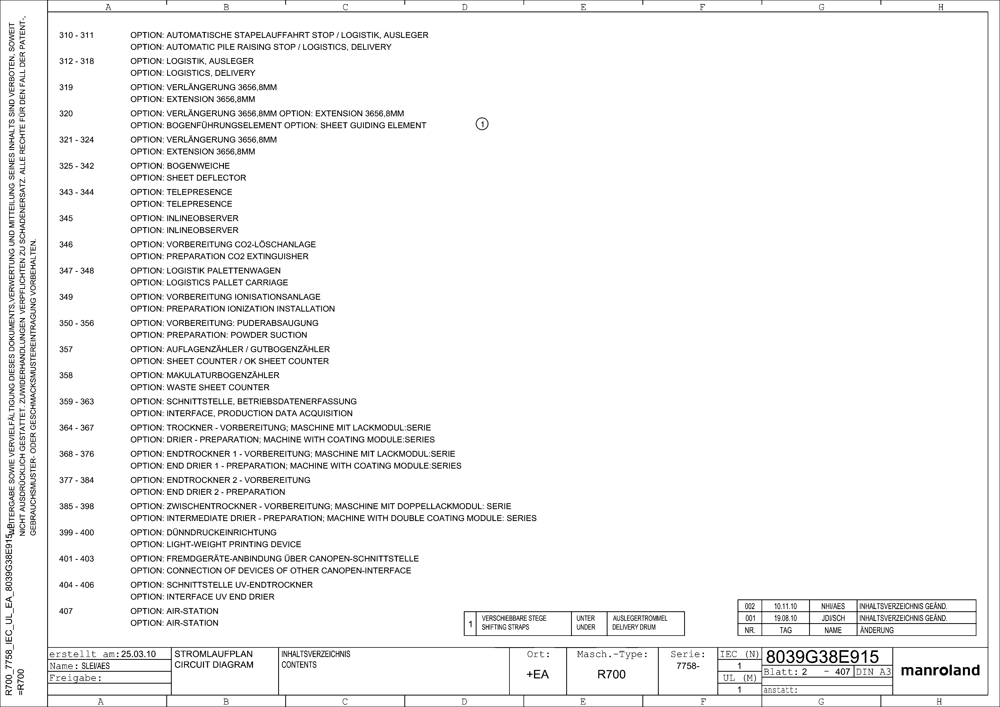

# +EA — Sheet 2 of 407 — INHALTSVERZEICHNIS

**CONTENTS**

> Part of the manroland **R700** printing press IEC/UL circuit diagrams.
> Drawing class: **Stromlaufplan / Circuit diagram** (DIN A3).
> Document `+EA` covers the **Printing unit** machine section.

## At a glance

| Field | Value |
|---|---|
| Document | `+EA`  (8039G38E915) |
| Sheet | **2** of 407 |
| Section (DE) | INHALTSVERZEICHNIS |
| Section (EN) | CONTENTS |
| Section type | TOC — Contents |
| Machine type | `R700` |
| Series | `7758` |
| Created | 25.03.10 |
| Replaces | — |
| Columns used | A, B, C, D, E, F, G, H |
| Path numbers | — |
| Labels on sheet | 89 |
| Cross-refs out | 0 |
| Cross-refs in | 0 |

**Previous:** [+EA sheet 1](SHEET_0001.md) · **Next:** [+EA sheet 3](SHEET_0003.md) · **Document TOC:** [_TOC.md](_TOC.md)  (+EA) · **Master TOC:** [all sheets](../_MASTER_TOC.md)

## Sheet image (300 DPI, exact vector render)



_Rendered directly from the PDF vector layer at 300 DPI (1-bit), no OCR and no resampling. Use it to confirm anything ambiguous in the text below._

## Cross-references on this sheet

Each entry is a wire leaving this sheet. The printed token is `/sheet.column`; the link resolves to that sheet inside the same document.

_No outgoing cross-references on this sheet._

## Devices on this sheet

| Tag | Class | Class meaning (IEC) | Col | Sub | Terminal | Sign |
|---|---|---|---|---|---|---|
| `NR.` | — | cross-device reference | F | — | — | — |
| `19.08.10` | — | cross-device reference | G | — | — | — |
| `10.11.10` | — | cross-device reference | G | — | — | — |

## Potentials / nets

_No named potentials on this sheet._

## Wire-end annotations (grouped as printed)

A wire that continues elsewhere is annotated with a small cluster: the destination description, the path/line number `#NN`, and the `/sheet.column` cross reference. Each row below is one such cluster exactly as it is grouped on the drawing.

| Col | Y | Path | Cross-ref | Text on the wire |
|---|---|---|---|---|
| B | 37.5 | — | — | `310 311 OPTION: AUTOMATISCHE STAPELAUFFAHRT STOP / LOGISTIK, AUSLEGER OPTION: AUTOMATIC PILE RAISING STOP / LOGISTICS, DELIVERY` |
| A | 68.6 | — | — | `312 318 OPTION: LOGISTIK, AUSLEGER OPTION: LOGISTICS, DELIVERY` |
| B | 99.8 | — | — | `319 OPTION: VERLÄNGERUNG 3656,8MM OPTION: EXTENSION 3656,8MM` |
| B | 131.0 | — | — | `320 OPTION: VERLÄNGERUNG 3656,8MM OPTION: EXTENSION 3656,8MM OPTION: BOGENFÜHRUNGSELEMENT OPTION: SHEET GUIDING ELEMENT` |
| D | 144.3 | — | — | `1` |
| B | 162.2 | — | — | `321 324 OPTION: VERLÄNGERUNG 3656,8MM OPTION: EXTENSION 3656,8MM` |
| A | 193.3 | — | — | `325 342 OPTION: BOGENWEICHE OPTION: SHEET DEFLECTOR` |
| A | 224.6 | — | — | `343 344 OPTION: TELEPRESENCE OPTION: TELEPRESENCE` |
| A | 255.7 | — | — | `345 OPTION: INLINEOBSERVER OPTION: INLINEOBSERVER` |
| B | 286.9 | — | — | `346 OPTION: VORBEREITUNG CO2 LÖSCHANLAGE OPTION: PREPARATION CO2 EXTINGUISHER` |
| B | 318.1 | — | — | `347 348 OPTION: LOGISTIK PALETTENWAGEN OPTION: LOGISTICS PALLET CARRIAGE` |
| B | 349.3 | — | — | `349 OPTION: VORBEREITUNG IONISATIONSANLAGE OPTION: PREPARATION IONIZATION INSTALLATION` |
| B | 380.4 | — | — | `350 356 OPTION: VORBEREITUNG: PUDERABSAUGUNG OPTION: PREPARATION: POWDER SUCTION` |
| B | 411.6 | — | — | `357 OPTION: AUFLAGENZÄHLER / GUTBOGENZÄHLER OPTION: SHEET COUNTER / OK SHEET COUNTER` |
| B | 442.8 | — | — | `358 OPTION: MAKULATURBOGENZÄHLER OPTION: WASTE SHEET COUNTER` |
| B | 474.0 | — | — | `359 363 OPTION: SCHNITTSTELLE, BETRIEBSDATENERFASSUNG OPTION: INTERFACE, PRODUCTION DATA ACQUISITION` |
| B | 505.2 | — | — | `364 367 OPTION: TROCKNER VORBEREITUNG; MASCHINE MIT LACKMODUL:SERIE OPTION: DRIER PREPARATION; MACHINE WITH COATING MODULE:SERIES` |
| B | 536.4 | — | — | `368 376 OPTION: ENDTROCKNER 1 VORBEREITUNG; MASCHINE MIT LACKMODUL:SERIE OPTION: END DRIER 1 PREPARATION; MACHINE WITH COATING MODULE:SERIES` |
| B | 567.5 | — | — | `377 384 OPTION: ENDTROCKNER 2 VORBEREITUNG OPTION: END DRIER 2 PREPARATION` |
| C | 598.7 | — | — | `385 398 OPTION: ZWISCHENTROCKNER VORBEREITUNG; MASCHINE MIT DOPPELLACKMODUL: SERIE OPTION: INTERMEDIATE DRIER PREPARATION; MACHINE WITH DOUBLE COATING MODULE: SERIES` |
| B | 629.9 | — | — | `399 400 OPTION: DÜNNDRUCKEINRICHTUNG OPTION: LIGHT WEIGHT PRINTING DEVICE` |
| B | 661.1 | — | — | `401 403 OPTION: FREMDGERÄTE ANBINDUNG ÜBER CANOPEN SCHNITTSTELLE OPTION: CONNECTION OF DEVICES OF OTHER CANOPEN INTERFACE` |
| B | 692.3 | — | — | `404 406 OPTION: SCHNITTSTELLE UV ENDTROCKNER OPTION: INTERFACE UV END DRIER` |
| G | 718.9 | — | — | `002 10.11.10 NHI/AES INHALTSVERZEICHNIS GEÄND.` |
| A | 723.5 | — | — | `407 OPTION: AIR STATION OPTION: AIR STATION` |
| G | 733.0 | — | — | `001 19.08.10 JDI/SCH INHALTSVERZEICHNIS GEÄND.` |
| E | 733.4 | — | — | `1 DELIVERY DRUM AUSLEGERTROMMEL` |
| D | 733.4 | — | — | `SHIFTING STRAPS VERSCHIEBBARE STEGE` |
| E | 733.4 | — | — | `UNTER UNDER` |
| G | 747.1 | — | — | `NR. TAG NAME ÄNDERUNG` |


## Reconstructed tables

This sheet carries tabular content (pin map / terminal assignment / index). The grid below was rebuilt from the drawing's own rule lines, so each row is exactly one physical row of the table.

### Table 1 — 6 data rows × 7 columns (at x=204.1, y=0.0)

| AUTOMATISCHE STAPELAUFFAHRT AUTOMATIC PILE RAISING LOGISTIK, AUSLEGER LOGISTICS, DELIVERY VERLÄNGERUNG 3656,8MM EXTENSION 3656,8MM VERLÄNGERUNG 3656,8MM BOGENFÜHRUNGSELEMENT VERLÄNGERUNG 3656,8MM EXTENSION 3656,8MM BOGENWEICHE SHEET DEFLECTOR TELEPRESENCE TELEPRESENCE INLINEOBSERVER INLINEOBSERVER VORBEREITUNG CO2 LÖSCHANLAGE PREPARATION CO2 EXTINGUISHER LOGISTIK PALETTENWAGEN LOGISTICS PALLET CARRIAGE VORBEREITUNG IONISATIONSANLAGE PREPARATION IONIZATION VORBEREITUNG: PUDERABSAUGUNG PREPARATION: POWDER AUFLAGENZÄHLER / SHEET COUNTER / OK SHEET MAKULATURBOGENZÄHLER WASTE SHEET COUNTER SCHNITTSTELLE, INTERFACE, PRODUCTION TROCKNER VORBEREITUNG; DRIER PREPARATION; ENDTROCKNER 1 VORBEREITUNG; END DRIER 1 PREPARATION; ENDTROCKNER 2 VORBEREITUNG END DRIER 2 PREPARATION ZWISCHENTROCKNER INTERMEDIATE DRIER DÜNNDRUCKEINRICHTUNG LIGHT WEIGHT PRINTING FREMDGERÄTE ANBINDUNG CONNECTION OF DEVICES SCHNITTSTELLE UV ENDTROCKNER INTERFACE UV END DRIER AIR STATION AIR STATION | STOP / LOGISTIK, AUSLEGER STOP / LOGISTICS, DELIVERY OPTION: EXTENSION 3656,8MM 1 OPTION: SHEET GUIDING ELEMENT INSTALLATION SUCTION GUTBOGENZÄHLER COUNTER BETRIEBSDATENERFASSUNG DATA ACQUISITION MASCHINE MIT LACKMODUL:SERIE MACHINE WITH COATING MODULE:SERIES MASCHINE MIT LACKMODUL:SERIE MACHINE WITH COATING MODULE:SERIES VORBEREITUNG; MASCHINE MIT DOPPELLACKMODUL: SERIE PREPARATION; MACHINE WITH DOUBLE COATING MODULE: DEVICE ÜBER CANOPEN SCHNITTSTELLE OF OTHER CANOPEN INTERFACE VERSCHIEBBARE 1 SHIFTING | SERIES STEGE STRAPS | UNTER AUSLEGERTROMMEL DELIVERY DRUM UNDER |  | 002 001 NR. | NHI/AES 10.11.10 INHALTSVERZEICHNIS JDI/SCH 19.08.10 INHALTSVERZEICHNIS NAME TAG ÄNDERUNG |
|---|---|---|---|---|---|---|
| `STROMLAUFPLAN` | `INHALTSVERZEICHNIS` | `Ort:` | `Masch. Type:` | `Serie:` | `IEC (N)` | `8039G38E915` |
| `CIRCUIT DIAGRAM` |  |  |  |  |  |  |
|  | `CONTENTS` |  |  | `7758` | `1` |  |
|  |  | `+EA` | `R700` |  |  | `Blatt: DIN A3 2 407` |
|  |  |  |  |  | `UL (M)` |  |
|  |  |  |  |  | `1` | `anstatt:` |


## Notes and free text on this sheet

| Text | Col | Y (pt) |
|---|---|---|
| `TAG` | G | 747.27 |
| `NAME` | G | 747.25 |
| `ÄNDERUNG` | G | 747.31 |
| `JDI/SCH` | G | 733.1 |
| `INHALTSVERZEICHNIS GEÄND.` | H | 733.14 |
| `NHI/AES` | G | 718.93 |
| `OPTION: AUTOMATISCHE STAPELAUFFAHRT STOP / LOGISTIK, AUSLEGER` | B | 37.46 |
| `OPTION: AUTOMATIC PILE RAISING STOP / LOGISTICS, DELIVERY` | B | 51.64 |
| `OPTION: LOGISTIK, AUSLEGER` | B | 68.64 |
| `OPTION: LOGISTICS, DELIVERY` | B | 82.82 |
| `OPTION: VERLÄNGERUNG 3656,8MM` | B | 99.82 |
| `OPTION: EXTENSION 3656,8MM` | B | 114 |
| `OPTION: VERLÄNGERUNG 3656,8MM OPTION: EXTENSION 3656,8MM` | B | 131 |
| `OPTION: BOGENFÜHRUNGSELEMENT OPTION: SHEET GUIDING ELEMENT` | B | 145.17 |
| `OPTION: BOGENWEICHE` | B | 193.34 |
| `OPTION: SHEET DEFLECTOR` | B | 207.54 |
| `OPTION: TELEPRESENCE` | B | 224.55 |
| `OPTION: INLINEOBSERVER` | B | 255.74 |
| `OPTION: VORBEREITUNG CO2 LÖSCHANLAGE` | B | 286.91 |
| `OPTION: PREPARATION CO2 EXTINGUISHER` | B | 301.09 |
| `OPTION: LOGISTIK PALETTENWAGEN` | B | 318.08 |
| `OPTION: LOGISTICS PALLET CARRIAGE` | B | 332.27 |
| `OPTION: VORBEREITUNG IONISATIONSANLAGE` | B | 349.28 |
| `OPTION: PREPARATION IONIZATION INSTALLATION` | B | 363.46 |
| `OPTION: VORBEREITUNG: PUDERABSAUGUNG` | B | 380.45 |
| `OPTION: PREPARATION: POWDER SUCTION` | B | 394.61 |
| `OPTION: AUFLAGENZÄHLER / GUTBOGENZÄHLER` | B | 411.63 |
| `OPTION: SHEET COUNTER / OK SHEET COUNTER` | B | 425.79 |
| `OPTION: MAKULATURBOGENZÄHLER` | B | 442.81 |
| `OPTION: WASTE SHEET COUNTER` | B | 456.96 |
| `OPTION: SCHNITTSTELLE, BETRIEBSDATENERFASSUNG` | B | 474 |
| `OPTION: INTERFACE, PRODUCTION DATA ACQUISITION` | B | 488.17 |
| `OPTION: TROCKNER VORBEREITUNG; MASCHINE MIT LACKMODUL:SERIE` | B | 505.17 |
| `OPTION: DRIER PREPARATION; MACHINE WITH COATING MODULE:SERIES` | B | 519.34 |
| `OPTION: ENDTROCKNER 1 VORBEREITUNG; MASCHINE MIT LACKMODUL:SERIE` | C | 536.35 |
| `OPTION: END DRIER 1 PREPARATION; MACHINE WITH COATING MODULE:SERIES` | C | 550.52 |
| `OPTION: ENDTROCKNER 2 VORBEREITUNG` | B | 567.53 |
| `OPTION: END DRIER 2 PREPARATION` | B | 581.71 |
| `OPTION: ZWISCHENTROCKNER VORBEREITUNG; MASCHINE MIT DOPPELLACKMODUL: SERIE` | C | 598.71 |
| `OPTION: INTERMEDIATE DRIER PREPARATION; MACHINE WITH DOUBLE COATING MODULE: SERIES` | C | 612.88 |
| `OPTION: DÜNNDRUCKEINRICHTUNG` | B | 629.9 |
| `OPTION: LIGHT WEIGHT PRINTING DEVICE` | B | 644.06 |
| `OPTION: FREMDGERÄTE ANBINDUNG ÜBER CANOPEN SCHNITTSTELLE` | B | 661.08 |
| `OPTION: CONNECTION OF DEVICES OF OTHER CANOPEN INTERFACE` | B | 675.25 |
| `OPTION: SCHNITTSTELLE UV ENDTROCKNER` | B | 692.26 |
| `OPTION: INTERFACE UV END DRIER` | B | 706.44 |
| `OPTION: AIR STATION` | B | 723.45 |
| `VERSCHIEBBARE STEGE` | D | 733.37 |
| `SHIFTING STRAPS` | D | 744 |
| `UNTER` | E | 733.37 |
| `UNDER` | E | 744.02 |
| `AUSLEGERTROMMEL` | E | 733.41 |
| `DELIVERY DRUM` | E | 744.02 |

## Complete label inventory (exact text from the drawing)

Every text object inside the drawing area of this sheet, in DIN reading order (column A→H, then top→bottom). This is the authoritative list: if a string is not here it is not printed on this sheet.

| Col | Y | X | Dir | Type | Text |
|---|---|---|---|---|---|
| A | 37.5 | 70.6 | → | number | `310 311` |
| A | 68.6 | 70.6 | → | number | `312 318` |
| A | 99.9 | 70.6 | → | number | `319` |
| A | 131.0 | 70.6 | → | number | `320` |
| A | 162.2 | 70.6 | → | number | `321 324` |
| A | 193.4 | 70.6 | → | number | `325 342` |
| A | 224.5 | 70.6 | → | number | `343 344` |
| A | 255.8 | 70.6 | → | number | `345` |
| A | 287.0 | 70.6 | → | number | `346` |
| A | 318.1 | 70.6 | → | number | `347 348` |
| A | 349.3 | 70.6 | → | number | `349` |
| A | 380.5 | 70.6 | → | number | `350 356` |
| A | 411.7 | 70.6 | → | number | `357` |
| A | 442.9 | 70.6 | → | number | `358` |
| A | 474.0 | 70.6 | → | number | `359 363` |
| A | 505.2 | 70.6 | → | number | `364 367` |
| A | 536.4 | 70.6 | → | number | `368 376` |
| A | 567.5 | 70.6 | → | number | `377 384` |
| A | 598.7 | 70.6 | → | number | `385 398` |
| A | 629.9 | 70.6 | → | number | `399 400` |
| A | 661.1 | 70.6 | → | number | `401 403` |
| A | 692.3 | 70.6 | → | number | `404 406` |
| A | 723.5 | 70.6 | → | number | `407` |
| B | 37.5 | 155.3 | → | text | `OPTION: AUTOMATISCHE STAPELAUFFAHRT STOP / LOGISTIK, AUSLEGER` |
| B | 51.6 | 155.3 | → | text | `OPTION: AUTOMATIC PILE RAISING STOP / LOGISTICS, DELIVERY` |
| B | 68.6 | 155.3 | → | text | `OPTION: LOGISTIK, AUSLEGER` |
| B | 82.8 | 155.3 | → | text | `OPTION: LOGISTICS, DELIVERY` |
| B | 99.8 | 155.3 | → | text | `OPTION: VERLÄNGERUNG 3656,8MM` |
| B | 114.0 | 155.3 | → | text | `OPTION: EXTENSION 3656,8MM` |
| B | 131.0 | 155.3 | → | text | `OPTION: VERLÄNGERUNG 3656,8MM OPTION: EXTENSION 3656,8MM` |
| B | 145.2 | 155.3 | → | text | `OPTION: BOGENFÜHRUNGSELEMENT OPTION: SHEET GUIDING ELEMENT` |
| B | 162.2 | 155.3 | → | text | `OPTION: VERLÄNGERUNG 3656,8MM` |
| B | 176.4 | 155.3 | → | text | `OPTION: EXTENSION 3656,8MM` |
| B | 193.3 | 155.3 | → | text | `OPTION: BOGENWEICHE` |
| B | 207.5 | 155.3 | → | text | `OPTION: SHEET DEFLECTOR` |
| B | 224.5 | 155.3 | → | text | `OPTION: TELEPRESENCE` |
| B | 238.7 | 155.3 | → | text | `OPTION: TELEPRESENCE` |
| B | 255.7 | 155.3 | → | text | `OPTION: INLINEOBSERVER` |
| B | 269.9 | 155.3 | → | text | `OPTION: INLINEOBSERVER` |
| B | 286.9 | 155.3 | → | text | `OPTION: VORBEREITUNG CO2 LÖSCHANLAGE` |
| B | 301.1 | 155.3 | → | text | `OPTION: PREPARATION CO2 EXTINGUISHER` |
| B | 318.1 | 155.3 | → | text | `OPTION: LOGISTIK PALETTENWAGEN` |
| B | 332.3 | 155.3 | → | text | `OPTION: LOGISTICS PALLET CARRIAGE` |
| B | 349.3 | 155.3 | → | text | `OPTION: VORBEREITUNG IONISATIONSANLAGE` |
| B | 363.5 | 155.3 | → | text | `OPTION: PREPARATION IONIZATION INSTALLATION` |
| B | 380.4 | 155.3 | → | text | `OPTION: VORBEREITUNG: PUDERABSAUGUNG` |
| B | 394.6 | 155.3 | → | text | `OPTION: PREPARATION: POWDER SUCTION` |
| B | 411.6 | 155.3 | → | text | `OPTION: AUFLAGENZÄHLER / GUTBOGENZÄHLER` |
| B | 425.8 | 155.3 | → | text | `OPTION: SHEET COUNTER / OK SHEET COUNTER` |
| B | 442.8 | 155.3 | → | text | `OPTION: MAKULATURBOGENZÄHLER` |
| B | 457.0 | 155.3 | → | text | `OPTION: WASTE SHEET COUNTER` |
| B | 474.0 | 155.3 | → | text | `OPTION: SCHNITTSTELLE, BETRIEBSDATENERFASSUNG` |
| B | 488.2 | 155.3 | → | text | `OPTION: INTERFACE, PRODUCTION DATA ACQUISITION` |
| B | 505.2 | 155.3 | → | text | `OPTION: TROCKNER VORBEREITUNG; MASCHINE MIT LACKMODUL:SERIE` |
| B | 519.3 | 155.3 | → | text | `OPTION: DRIER PREPARATION; MACHINE WITH COATING MODULE:SERIES` |
| B | 567.5 | 155.3 | → | text | `OPTION: ENDTROCKNER 2 VORBEREITUNG` |
| B | 581.7 | 155.3 | → | text | `OPTION: END DRIER 2 PREPARATION` |
| B | 629.9 | 155.3 | → | text | `OPTION: DÜNNDRUCKEINRICHTUNG` |
| B | 644.1 | 155.3 | → | text | `OPTION: LIGHT WEIGHT PRINTING DEVICE` |
| B | 661.1 | 155.3 | → | text | `OPTION: FREMDGERÄTE ANBINDUNG ÜBER CANOPEN SCHNITTSTELLE` |
| B | 675.3 | 155.3 | → | text | `OPTION: CONNECTION OF DEVICES OF OTHER CANOPEN INTERFACE` |
| B | 692.3 | 155.3 | → | text | `OPTION: SCHNITTSTELLE UV ENDTROCKNER` |
| B | 706.4 | 155.3 | → | text | `OPTION: INTERFACE UV END DRIER` |
| B | 723.5 | 155.3 | → | text | `OPTION: AIR STATION` |
| B | 737.6 | 155.3 | → | text | `OPTION: AIR STATION` |
| C | 536.4 | 155.3 | → | text | `OPTION: ENDTROCKNER 1 VORBEREITUNG; MASCHINE MIT LACKMODUL:SERIE` |
| C | 550.5 | 155.3 | → | text | `OPTION: END DRIER 1 PREPARATION; MACHINE WITH COATING MODULE:SERIES` |
| C | 598.7 | 155.3 | → | text | `OPTION: ZWISCHENTROCKNER VORBEREITUNG; MASCHINE MIT DOPPELLACKMODUL: SERIE` |
| C | 612.9 | 155.3 | → | text | `OPTION: INTERMEDIATE DRIER PREPARATION; MACHINE WITH DOUBLE COATING MODULE: SERIES` |
| D | 144.3 | 572.3 | → | number | `1` |
| D | 733.4 | 574.0 | → | text | `VERSCHIEBBARE STEGE` |
| D | 738.7 | 557.3 | → | number | `1` |
| D | 744.0 | 573.7 | → | text | `SHIFTING STRAPS` |
| E | 733.4 | 686.6 | → | text | `UNTER` |
| E | 733.4 | 729.9 | → | text | `AUSLEGERTROMMEL` |
| E | 744.0 | 686.6 | → | text | `UNDER` |
| E | 744.0 | 729.1 | → | text | `DELIVERY DRUM` |
| F | 719.0 | 887.1 | → | number | `002` |
| F | 733.0 | 887.7 | → | number | `001` |
| F | 747.1 | 886.7 | → | device ref | `NR.` |
| G | 718.9 | 921.5 | → | device ref | `10.11.10` |
| G | 718.9 | 977.9 | → | text | `NHI/AES` |
| G | 733.1 | 921.5 | → | device ref | `19.08.10` |
| G | 733.1 | 978.7 | → | text | `JDI/SCH` |
| G | 747.3 | 928.3 | → | text | `TAG` |
| G | 747.3 | 981.7 | → | text | `NAME` |
| G | 747.3 | 1024.3 | → | text | `ÄNDERUNG` |
| H | 719.0 | 1023.2 | → | text | `INHALTSVERZEICHNIS GEÄND.` |
| H | 733.1 | 1023.2 | → | text | `INHALTSVERZEICHNIS GEÄND.` |

## Reading-order text block

The same content as a plain block, grouped by DIN column — convenient to paste or to match against a visual description.

```text
=== Column A ===
  37.5   70.6  numeric      310 311
  68.6   70.6  numeric      312 318
  99.9   70.6  numeric      319
 131.0   70.6  numeric      320
 162.2   70.6  numeric      321 324
 193.4   70.6  numeric      325 342
 224.5   70.6  numeric      343 344
 255.8   70.6  numeric      345
 287.0   70.6  numeric      346
 318.1   70.6  numeric      347 348
 349.3   70.6  numeric      349
 380.5   70.6  numeric      350 356
 411.7   70.6  numeric      357
 442.9   70.6  numeric      358
 474.0   70.6  numeric      359 363
 505.2   70.6  numeric      364 367
 536.4   70.6  numeric      368 376
 567.5   70.6  numeric      377 384
 598.7   70.6  numeric      385 398
 629.9   70.6  numeric      399 400
 661.1   70.6  numeric      401 403
 692.3   70.6  numeric      404 406
 723.5   70.6  numeric      407
=== Column B ===
  37.5  155.3  text         OPTION: AUTOMATISCHE STAPELAUFFAHRT STOP / LOGISTIK, AUSLEGER
  51.6  155.3  text         OPTION: AUTOMATIC PILE RAISING STOP / LOGISTICS, DELIVERY
  68.6  155.3  text         OPTION: LOGISTIK, AUSLEGER
  82.8  155.3  text         OPTION: LOGISTICS, DELIVERY
  99.8  155.3  text         OPTION: VERLÄNGERUNG 3656,8MM
 114.0  155.3  text         OPTION: EXTENSION 3656,8MM
 131.0  155.3  text         OPTION: VERLÄNGERUNG 3656,8MM OPTION: EXTENSION 3656,8MM
 145.2  155.3  text         OPTION: BOGENFÜHRUNGSELEMENT OPTION: SHEET GUIDING ELEMENT
 162.2  155.3  text         OPTION: VERLÄNGERUNG 3656,8MM
 176.4  155.3  text         OPTION: EXTENSION 3656,8MM
 193.3  155.3  text         OPTION: BOGENWEICHE
 207.5  155.3  text         OPTION: SHEET DEFLECTOR
 224.5  155.3  text         OPTION: TELEPRESENCE
 238.7  155.3  text         OPTION: TELEPRESENCE
 255.7  155.3  text         OPTION: INLINEOBSERVER
 269.9  155.3  text         OPTION: INLINEOBSERVER
 286.9  155.3  text         OPTION: VORBEREITUNG CO2 LÖSCHANLAGE
 301.1  155.3  text         OPTION: PREPARATION CO2 EXTINGUISHER
 318.1  155.3  text         OPTION: LOGISTIK PALETTENWAGEN
 332.3  155.3  text         OPTION: LOGISTICS PALLET CARRIAGE
 349.3  155.3  text         OPTION: VORBEREITUNG IONISATIONSANLAGE
 363.5  155.3  text         OPTION: PREPARATION IONIZATION INSTALLATION
 380.4  155.3  text         OPTION: VORBEREITUNG: PUDERABSAUGUNG
 394.6  155.3  text         OPTION: PREPARATION: POWDER SUCTION
 411.6  155.3  text         OPTION: AUFLAGENZÄHLER / GUTBOGENZÄHLER
 425.8  155.3  text         OPTION: SHEET COUNTER / OK SHEET COUNTER
 442.8  155.3  text         OPTION: MAKULATURBOGENZÄHLER
 457.0  155.3  text         OPTION: WASTE SHEET COUNTER
 474.0  155.3  text         OPTION: SCHNITTSTELLE, BETRIEBSDATENERFASSUNG
 488.2  155.3  text         OPTION: INTERFACE, PRODUCTION DATA ACQUISITION
 505.2  155.3  text         OPTION: TROCKNER VORBEREITUNG; MASCHINE MIT LACKMODUL:SERIE
 519.3  155.3  text         OPTION: DRIER PREPARATION; MACHINE WITH COATING MODULE:SERIES
 567.5  155.3  text         OPTION: ENDTROCKNER 2 VORBEREITUNG
 581.7  155.3  text         OPTION: END DRIER 2 PREPARATION
 629.9  155.3  text         OPTION: DÜNNDRUCKEINRICHTUNG
 644.1  155.3  text         OPTION: LIGHT WEIGHT PRINTING DEVICE
 661.1  155.3  text         OPTION: FREMDGERÄTE ANBINDUNG ÜBER CANOPEN SCHNITTSTELLE
 675.3  155.3  text         OPTION: CONNECTION OF DEVICES OF OTHER CANOPEN INTERFACE
 692.3  155.3  text         OPTION: SCHNITTSTELLE UV ENDTROCKNER
 706.4  155.3  text         OPTION: INTERFACE UV END DRIER
 723.5  155.3  text         OPTION: AIR STATION
 737.6  155.3  text         OPTION: AIR STATION
=== Column C ===
 536.4  155.3  text         OPTION: ENDTROCKNER 1 VORBEREITUNG; MASCHINE MIT LACKMODUL:SERIE
 550.5  155.3  text         OPTION: END DRIER 1 PREPARATION; MACHINE WITH COATING MODULE:SERIES
 598.7  155.3  text         OPTION: ZWISCHENTROCKNER VORBEREITUNG; MASCHINE MIT DOPPELLACKMODUL: SERIE
 612.9  155.3  text         OPTION: INTERMEDIATE DRIER PREPARATION; MACHINE WITH DOUBLE COATING MODULE: SERIES
=== Column D ===
 144.3  572.3  numeric      1
 733.4  574.0  text         VERSCHIEBBARE STEGE
 738.7  557.3  numeric      1
 744.0  573.7  text         SHIFTING STRAPS
=== Column E ===
 733.4  686.6  text         UNTER
 733.4  729.9  text         AUSLEGERTROMMEL
 744.0  686.6  text         UNDER
 744.0  729.1  text         DELIVERY DRUM
=== Column F ===
 719.0  887.1  numeric      002
 733.0  887.7  numeric      001
 747.1  886.7  devref       NR.
=== Column G ===
 718.9  921.5  devref       10.11.10
 718.9  977.9  text         NHI/AES
 733.1  921.5  devref       19.08.10
 733.1  978.7  text         JDI/SCH
 747.3  928.3  text         TAG
 747.3  981.7  text         NAME
 747.3 1024.3  text         ÄNDERUNG
=== Column H ===
 719.0 1023.2  text         INHALTSVERZEICHNIS GEÄND.
 733.1 1023.2  text         INHALTSVERZEICHNIS GEÄND.
```

---
_Generated from the PDF vector text layer; no OCR. Source: `R700_7758_IEC_UL_EA_8039G38E915_p`, sheet 2._
