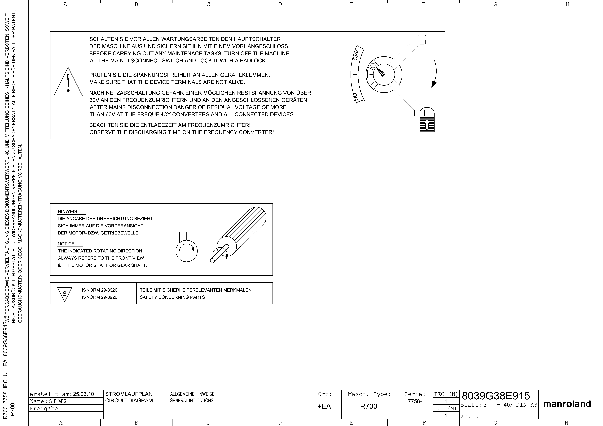

# +EA — Sheet 3 of 407 — ALLGEMEINE HINWEISE

**GENERAL INDICATIONS**

> Part of the manroland **R700** printing press IEC/UL circuit diagrams.
> Drawing class: **Stromlaufplan / Circuit diagram** (DIN A3).
> Document `+EA` covers the **Printing unit** machine section.

## At a glance

| Field | Value |
|---|---|
| Document | `+EA`  (8039G38E915) |
| Sheet | **3** of 407 |
| Section (DE) | ALLGEMEINE HINWEISE |
| Section (EN) | GENERAL INDICATIONS |
| Section type | LEGEND — General indications |
| Machine type | `R700` |
| Series | `7758` |
| Created | 25.03.10 |
| Replaces | — |
| Columns used | A, B, C, E |
| Path numbers | — |
| Labels on sheet | 29 |
| Cross-refs out | 0 |
| Cross-refs in | 0 |

**Previous:** [+EA sheet 2](SHEET_0002.md) · **Next:** [+EA sheet 4](SHEET_0004.md) · **Document TOC:** [_TOC.md](_TOC.md)  (+EA) · **Master TOC:** [all sheets](../_MASTER_TOC.md)

## Sheet image (300 DPI, exact vector render)



_Rendered directly from the PDF vector layer at 300 DPI (1-bit), no OCR and no resampling. Use it to confirm anything ambiguous in the text below._

## Cross-references on this sheet

Each entry is a wire leaving this sheet. The printed token is `/sheet.column`; the link resolves to that sheet inside the same document.

_No outgoing cross-references on this sheet._

## Devices on this sheet

_No device designators on this sheet._

## Potentials / nets

_No named potentials on this sheet._

## Wire-end annotations (grouped as printed)

A wire that continues elsewhere is annotated with a small cluster: the destination description, the path/line number `#NN`, and the `/sheet.column` cross reference. Each row below is one such cluster exactly as it is grouped on the drawing.

| Col | Y | Path | Cross-ref | Text on the wire |
|---|---|---|---|---|
| C | 72.6 | — | — | `SCHALTEN SIE VOR ALLEN WARTUNGSARBEITEN DEN HAUPTSCHALTER` |
| C | 86.8 | — | — | `DER MASCHINE AUS UND SICHERN SIE IHN MIT EINEM VORHÄNGESCHLOSS.` |
| E | 97.8 | — | — | `OFF` |
| C | 101.0 | — | — | `BEFORE CARRYING OUT ANY MAINTENACE TASKS, TURN OFF THE MACHINE` |
| C | 115.1 | — | — | `AT THE MAIN DISCONNECT SWITCH AND LOCK IT WITH A PADLOCK.` |
| C | 143.5 | — | — | `PRÜFEN SIE DIE SPANNUNGSFREIHEIT AN ALLEN GERÄTEKLEMMEN. MAKE SURE THAT THE DEVICE TERMINALS ARE NOT ALIVE.` |
| E | 146.1 | — | — | `I` |
| C | 178.9 | — | — | `NACH NETZABSCHALTUNG GEFAHR EINER MÖGLICHEN RESTSPANNUNG VON ÜBER` |
| E | 182.5 | — | — | `ON` |
| C | 193.1 | — | — | `60V AN DEN FREQUENZUMRICHTERN UND AN DEN ANGESCHLOSSENEN GERÄTEN! THAN 60V AT THE FREQUENCY CONVERTERS AND ALL CONNECTED DEVICES. AFTER MAINS DISCONNECTION DANGER OF RESIDUAL VOLTAGE OF MORE` |
| C | 242.7 | — | — | `BEACHTEN SIE DIE ENTLADEZEIT AM FREQUENZUMRICHTER! OBSERVE THE DISCHARGING TIME ON THE FREQUENCY CONVERTER!` |
| A | 414.1 | — | — | `HINWEIS:` |
| B | 428.3 | — | — | `DIE ANGABE DER DREHRICHTUNG BEZIEHT` |
| A | 442.5 | — | — | `SICH IMMER AUF DIE VORDERANSICHT` |
| A | 456.6 | — | — | `DER MOTOR BZW. GETRIEBEWELLE.` |
| A | 477.9 | — | — | `NOTICE:` |
| A | 492.1 | — | — | `THE INDICATED ROTATING DIRECTION` |
| B | 506.2 | — | — | `ALWAYS REFERS TO THE FRONT VIEW` |
| B | 520.4 | — | — | `OF THE MOTOR SHAFT OR GEAR SHAFT.` |
| A | 520.4 | — | — | `X` |
| C | 569.3 | — | — | `TEILE MIT SICHERHEITSRELEVANTEN MERKMALEN` |
| A | 569.4 | — | — | `S K NORM 29 3920 K NORM 29 3920` |
| C | 583.5 | — | — | `SAFETY CONCERNING PARTS` |


## Reconstructed tables

This sheet carries tabular content (pin map / terminal assignment / index). The grid below was rebuilt from the drawing's own rule lines, so each row is exactly one physical row of the table.

### Table 1 — 8 data rows × 14 columns (at x=133.2, y=0.0) — **DER BEFORE AT PRÜFEN MAKE NACH SCHALTEN SIE VOR ALLEN MASCHINE AUS UND CARRYING OUT ANY THE MAIN DISCONNECT SIE DIE SPANNUNGSFREIHEIT SURE THAT THE DEVICE NETZABSCHALTUNG SICHERN SWITCH GEFAHR MAINTENACE TERMINALS WARTUNGSARBEITEN SIE AND EINER DEN HAUPTSCHALTER IHN MIT EINEM VORHÄNGESCHLOSS. TASKS, TURN OFF THE MACHINE LOCK IT WITH A PADLOCK. AN ALLEN GERÄTEKLEMMEN. ARE NOT ALIVE. MÖGLICHEN RESTSPANNUNG VON ÜBER OFF I**

| HINWEIS: | 60V AFTER THAN OBSERVE | AN DEN FREQUENZUMRICHTERN MAINS DISCONNECTION 60V AT THE FREQUENCY BEACHTEN SIE DIE ENTLADEZEIT THE DISCHARGING | TIME | DANGER AM ON | CONVERTERS | UND AN DEN ANGESCHLOSSENEN GERÄTEN! OF RESIDUAL VOLTAGE OF MORE AND ALL CONNECTED DEVICES. FREQUENZUMRICHTER! THE FREQUENCY CONVERTER! |  | ON |  |  |  |  |  |
|---|---|---|---|---|---|---|---|---|---|---|---|---|---|
| `ANGABE IMMER MOTOR` | `DER AUF DIE BZW.` | `DREHRICHTUNG BEZIEHT VORDERANSICHT GETRIEBEWELLE.` |  |  |  |  |  |  |  |  |  |  |  |
| `INDICATED ALWAYS THE MOTOR` | `REFERS TO SHAFT K NORM K NORM` | `ROTATING DIRECTION THE FRONT VIEW OR GEAR SHAFT. TEILE MIT 29 3920 SAFETY 29 3920` | `CONCERNING` |  | `SICHERHEITSRELEVANTEN` | `MERKMALEN PARTS` |  |  |  |  |  |  |  |
| `25.03.10` |  | `STROMLAUFPLAN` |  | `ALLGEMEINE` |  | `HINWEISE` | `Ort:` | `Masch. Type:` | `Serie:` |  |  | `IEC (N)` | `8039G38E915` |
|  |  | `CIRCUIT DIAGRAM` |  |  |  |  |  |  |  |  |  |  |  |
|  |  |  | `GENERAL` |  |  | `INDICATIONS` |  |  | `7758` |  |  | `1` |  |
|  |  |  |  |  |  |  | `+EA` | `R700` |  |  |  |  | `Blatt: DIN A3 3 407` |
|  |  |  |  |  |  |  |  |  |  |  |  | `UL (M)` |  |
|  |  |  |  |  |  |  |  |  |  |  |  | `1` | `anstatt:` |


## Notes and free text on this sheet

| Text | Col | Y (pt) |
|---|---|---|
| `SCHALTEN SIE VOR ALLEN WARTUNGSARBEITEN DEN HAUPTSCHALTER` | C | 72.59 |
| `BEFORE CARRYING OUT ANY MAINTENACE TASKS, TURN OFF THE MACHINE` | C | 100.97 |
| `ON` | E | 182.52 |
| `OFF` | E | 97.76 |
| `I` | E | 146.13 |
| `BEACHTEN SIE DIE ENTLADEZEIT AM FREQUENZUMRICHTER!` | B | 242.69 |
| `OBSERVE THE DISCHARGING TIME ON THE FREQUENCY CONVERTER!` | C | 256.87 |
| `PRÜFEN SIE DIE SPANNUNGSFREIHEIT AN ALLEN GERÄTEKLEMMEN.` | C | 143.48 |
| `MAKE SURE THAT THE DEVICE TERMINALS ARE NOT ALIVE.` | B | 157.66 |
| `NACH NETZABSCHALTUNG GEFAHR EINER MÖGLICHEN RESTSPANNUNG VON ÜBER` | C | 178.9 |
| `60V AN DEN FREQUENZUMRICHTERN UND AN DEN ANGESCHLOSSENEN GERÄTEN!` | C | 193.07 |
| `AFTER MAINS DISCONNECTION DANGER OF RESIDUAL VOLTAGE OF MORE` | C | 207.26 |
| `THAN 60V AT THE FREQUENCY CONVERTERS AND ALL CONNECTED DEVICES.` | C | 221.43 |
| `DER MASCHINE AUS UND SICHERN SIE IHN MIT EINEM VORHÄNGESCHLOSS.` | C | 86.8 |
| `AT THE MAIN DISCONNECT SWITCH AND LOCK IT WITH A PADLOCK.` | C | 115.13 |
| `HINWEIS:` | A | 414.05 |
| `DIE ANGABE DER DREHRICHTUNG BEZIEHT` | B | 428.3 |
| `SICH IMMER AUF DIE VORDERANSICHT` | A | 442.48 |
| `DER MOTOR BZW. GETRIEBEWELLE.` | A | 456.61 |
| `NOTICE:` | A | 477.91 |
| `THE INDICATED ROTATING DIRECTION` | A | 492.09 |
| `ALWAYS REFERS TO THE FRONT VIEW` | B | 506.21 |
| `OF THE MOTOR SHAFT OR GEAR SHAFT.` | B | 520.43 |
| `K NORM 29 3920` | A | 569.38 |
| `S` | A | 575.1 |
| `TEILE MIT SICHERHEITSRELEVANTEN MERKMALEN` | C | 569.33 |
| `SAFETY CONCERNING PARTS` | C | 583.5 |

## Complete label inventory (exact text from the drawing)

Every text object inside the drawing area of this sheet, in DIN reading order (column A→H, then top→bottom). This is the authoritative list: if a string is not here it is not printed on this sheet.

| Col | Y | X | Dir | Type | Text |
|---|---|---|---|---|---|
| A | 414.0 | 114.0 | → | text | `HINWEIS:` |
| A | 442.5 | 114.5 | → | text | `SICH IMMER AUF DIE VORDERANSICHT` |
| A | 456.6 | 114.0 | → | text | `DER MOTOR BZW. GETRIEBEWELLE.` |
| A | 477.9 | 114.0 | → | text | `NOTICE:` |
| A | 492.1 | 114.5 | → | text | `THE INDICATED ROTATING DIRECTION` |
| A | 520.4 | 114.8 | → | not fitted | `X` |
| A | 569.4 | 162.1 | → | text | `K NORM 29 3920` |
| A | 575.1 | 123.4 | → | text | `S` |
| A | 583.5 | 162.1 | → | text | `K NORM 29 3920` |
| B | 157.7 | 176.3 | → | text | `MAKE SURE THAT THE DEVICE TERMINALS ARE NOT ALIVE.` |
| B | 242.7 | 176.3 | → | text | `BEACHTEN SIE DIE ENTLADEZEIT AM FREQUENZUMRICHTER!` |
| B | 428.3 | 114.0 | → | text | `DIE ANGABE DER DREHRICHTUNG BEZIEHT` |
| B | 506.2 | 114.8 | → | text | `ALWAYS REFERS TO THE FRONT VIEW` |
| B | 520.4 | 114.5 | → | text | `OF THE MOTOR SHAFT OR GEAR SHAFT.` |
| C | 72.6 | 176.6 | → | text | `SCHALTEN SIE VOR ALLEN WARTUNGSARBEITEN DEN HAUPTSCHALTER` |
| C | 86.8 | 176.3 | → | text | `DER MASCHINE AUS UND SICHERN SIE IHN MIT EINEM VORHÄNGESCHLOSS.` |
| C | 101.0 | 176.3 | → | text | `BEFORE CARRYING OUT ANY MAINTENACE TASKS, TURN OFF THE MACHINE` |
| C | 115.1 | 177.4 | → | text | `AT THE MAIN DISCONNECT SWITCH AND LOCK IT WITH A PADLOCK.` |
| C | 143.5 | 176.3 | → | text | `PRÜFEN SIE DIE SPANNUNGSFREIHEIT AN ALLEN GERÄTEKLEMMEN.` |
| C | 178.9 | 176.3 | → | text | `NACH NETZABSCHALTUNG GEFAHR EINER MÖGLICHEN RESTSPANNUNG VON ÜBER` |
| C | 193.1 | 176.9 | → | text | `60V AN DEN FREQUENZUMRICHTERN UND AN DEN ANGESCHLOSSENEN GERÄTEN!` |
| C | 207.3 | 177.4 | → | text | `AFTER MAINS DISCONNECTION DANGER OF RESIDUAL VOLTAGE OF MORE` |
| C | 221.4 | 176.9 | → | text | `THAN 60V AT THE FREQUENCY CONVERTERS AND ALL CONNECTED DEVICES.` |
| C | 256.9 | 176.6 | → | text | `OBSERVE THE DISCHARGING TIME ON THE FREQUENCY CONVERTER!` |
| C | 569.3 | 276.1 | → | text | `TEILE MIT SICHERHEITSRELEVANTEN MERKMALEN` |
| C | 583.5 | 276.1 | → | text | `SAFETY CONCERNING PARTS` |
| E | 97.8 | 695.9 | ↕ | text | `OFF` |
| E | 146.1 | 696.8 | ↕ | text | `I` |
| E | 182.5 | 693.2 | ↕ | text | `ON` |

## Reading-order text block

The same content as a plain block, grouped by DIN column — convenient to paste or to match against a visual description.

```text
=== Column A ===
 414.0  114.0  text         HINWEIS:
 442.5  114.5  text         SICH IMMER AUF DIE VORDERANSICHT
 456.6  114.0  text         DER MOTOR BZW. GETRIEBEWELLE.
 477.9  114.0  text         NOTICE:
 492.1  114.5  text         THE INDICATED ROTATING DIRECTION
 520.4  114.8  placeholder  X
 569.4  162.1  text         K NORM 29 3920
 575.1  123.4  text         S
 583.5  162.1  text         K NORM 29 3920
=== Column B ===
 157.7  176.3  text         MAKE SURE THAT THE DEVICE TERMINALS ARE NOT ALIVE.
 242.7  176.3  text         BEACHTEN SIE DIE ENTLADEZEIT AM FREQUENZUMRICHTER!
 428.3  114.0  text         DIE ANGABE DER DREHRICHTUNG BEZIEHT
 506.2  114.8  text         ALWAYS REFERS TO THE FRONT VIEW
 520.4  114.5  text         OF THE MOTOR SHAFT OR GEAR SHAFT.
=== Column C ===
  72.6  176.6  text         SCHALTEN SIE VOR ALLEN WARTUNGSARBEITEN DEN HAUPTSCHALTER
  86.8  176.3  text         DER MASCHINE AUS UND SICHERN SIE IHN MIT EINEM VORHÄNGESCHLOSS.
 101.0  176.3  text         BEFORE CARRYING OUT ANY MAINTENACE TASKS, TURN OFF THE MACHINE
 115.1  177.4  text         AT THE MAIN DISCONNECT SWITCH AND LOCK IT WITH A PADLOCK.
 143.5  176.3  text         PRÜFEN SIE DIE SPANNUNGSFREIHEIT AN ALLEN GERÄTEKLEMMEN.
 178.9  176.3  text         NACH NETZABSCHALTUNG GEFAHR EINER MÖGLICHEN RESTSPANNUNG VON ÜBER
 193.1  176.9  text         60V AN DEN FREQUENZUMRICHTERN UND AN DEN ANGESCHLOSSENEN GERÄTEN!
 207.3  177.4  text         AFTER MAINS DISCONNECTION DANGER OF RESIDUAL VOLTAGE OF MORE
 221.4  176.9  text         THAN 60V AT THE FREQUENCY CONVERTERS AND ALL CONNECTED DEVICES.
 256.9  176.6  text         OBSERVE THE DISCHARGING TIME ON THE FREQUENCY CONVERTER!
 569.3  276.1  text         TEILE MIT SICHERHEITSRELEVANTEN MERKMALEN
 583.5  276.1  text         SAFETY CONCERNING PARTS
=== Column E ===
  97.8  695.9  text         OFF
 146.1  696.8  text         I
 182.5  693.2  text         ON
```

---
_Generated from the PDF vector text layer; no OCR. Source: `R700_7758_IEC_UL_EA_8039G38E915_p`, sheet 3._
