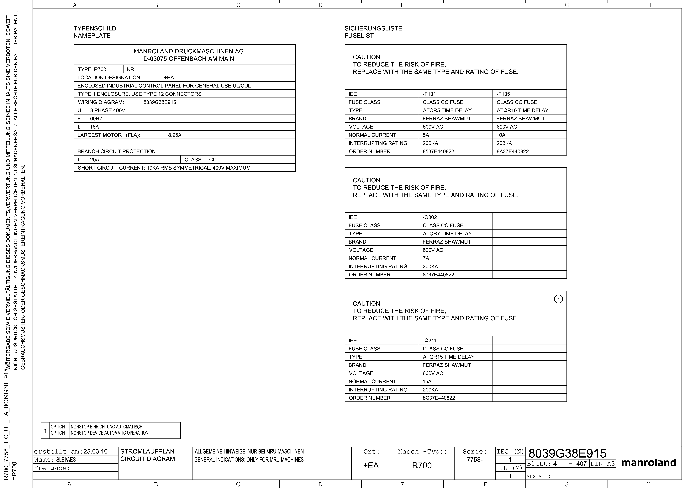

# +EA — Sheet 4 of 407 — ALLGEMEINE HINWEISE: NUR BEI MRU MASCHINEN

**GENERAL INDICATIONS: ONLY FOR MRU MACHINES**

> Part of the manroland **R700** printing press IEC/UL circuit diagrams.
> Drawing class: **Stromlaufplan / Circuit diagram** (DIN A3).
> Document `+EA` covers the **Printing unit** machine section.

## At a glance

| Field | Value |
|---|---|
| Document | `+EA`  (8039G38E915) |
| Sheet | **4** of 407 |
| Section (DE) | ALLGEMEINE HINWEISE: NUR BEI MRU MASCHINEN |
| Section (EN) | GENERAL INDICATIONS: ONLY FOR MRU MACHINES |
| Section type | LEGEND — General indications |
| Machine type | `R700` |
| Series | `7758` |
| Created | 25.03.10 |
| Replaces | — |
| Columns used | A, B, C, D, E, F, G |
| Path numbers | — |
| Labels on sheet | 99 |
| Cross-refs out | 0 |
| Cross-refs in | 0 |

**Previous:** [+EA sheet 3](SHEET_0003.md) · **Next:** [+EA sheet 5](SHEET_0005.md) · **Document TOC:** [_TOC.md](_TOC.md)  (+EA) · **Master TOC:** [all sheets](../_MASTER_TOC.md)

## Sheet image (300 DPI, exact vector render)



_Rendered directly from the PDF vector layer at 300 DPI (1-bit), no OCR and no resampling. Use it to confirm anything ambiguous in the text below._

## Cross-references on this sheet

Each entry is a wire leaving this sheet. The printed token is `/sheet.column`; the link resolves to that sheet inside the same document.

_No outgoing cross-references on this sheet._

## Devices on this sheet

| Tag | Class | Class meaning (IEC) | Col | Sub | Terminal | Sign |
|---|---|---|---|---|---|---|
| `F131` | F | Schutz / protection device (fuse, circuit breaker) | E | — | — | — |
| `F135` | F | Schutz / protection device (fuse, circuit breaker) | F | — | — | — |
| `Q302` | Q | Leistungsschalter / power switching device | E | — | — | — |
| `Q211` | Q | Leistungsschalter / power switching device | E | — | — | — |

## Potentials / nets

| Potential | Count | Columns | Attached devices | Terminals |
|---|---|---|---|---|
| `600V` | 4 | E, F | — | — |


A potential such as `L24+/4` or `M24+` is a named supply/return rail; every place it appears on this sheet is electrically common.

## Wire-end annotations (grouped as printed)

A wire that continues elsewhere is annotated with a small cluster: the destination description, the path/line number `#NN`, and the `/sheet.column` cross reference. Each row below is one such cluster exactly as it is grouped on the drawing.

| Col | Y | Path | Cross-ref | Text on the wire |
|---|---|---|---|---|
| A | 44.3 | — | — | `NAMEPLATE TYPENSCHILD` |
| E | 44.3 | — | — | `FUSELIST SICHERUNGSLISTE` |
| B | 84.0 | — | — | `MANROLAND DRUCKMASCHINEN AG` |
| E | 93.9 | — | — | `REPLACE WITH THE SAME TYPE AND RATING OF FUSE. CAUTION: TO REDUCE THE RISK OF FIRE,` |
| B | 96.6 | — | — | `D 63075 OFFENBACH AM MAIN` |
| A | 115.8 | — | — | `TYPE: R700` |
| B | 115.8 | — | — | `NR:` |
| B | 129.9 | — | — | `+EA` |
| A | 130.0 | — | — | `LOCATION DESIGNATION:` |
| B | 144.1 | — | — | `ENCLOSED INDUSTRIAL CONTROL PANEL FOR GENERAL USE UL/CUL` |
| D | 158.2 | — | — | `IEE` |
| B | 158.3 | — | — | `TYPE 1 ENCLOSURE. USE TYPE 12 CONNECTORS` |
| E | 158.3 | — | — | `F131` |
| F | 158.3 | — | — | `F135` |
| A | 172.4 | — | — | `WIRING DIAGRAM:` |
| B | 172.5 | — | — | `8039G38E915` |
| E | 172.5 | — | — | `FUSE CLASS` |
| E | 172.5 | — | — | `CLASS CC FUSE` |
| F | 172.5 | — | — | `CLASS CC FUSE` |
| A | 186.6 | — | — | `3 PHASE 400V` |
| D | 186.6 | — | — | `TYPE` |
| A | 186.7 | — | — | `U:` |
| F | 186.7 | — | — | `ATQR5 TIME DELAY` |
| F | 186.7 | — | — | `ATQR10 TIME DELAY` |
| A | 200.8 | — | — | `F:` |
| D | 200.8 | — | — | `BRAND` |
| F | 200.8 | — | — | `FERRAZ SHAWMUT` |
| F | 200.8 | — | — | `FERRAZ SHAWMUT` |
| A | 200.9 | — | — | `60HZ` |
| A | 214.8 | — | — | `I:` |
| A | 215.0 | — | — | `16A` |
| D | 215.0 | — | — | `VOLTAGE` |
| E | 215.0 | — | — | `600V AC` |
| F | 215.0 | — | — | `600V AC` |
| A | 229.2 | — | — | `LARGEST MOTOR I (FLA):` |
| B | 229.2 | — | — | `8,95A` |
| E | 229.2 | — | — | `NORMAL CURRENT` |
| E | 229.2 | — | — | `5A` |
| F | 229.2 | — | — | `10A` |
| E | 243.3 | — | — | `INTERRUPTING RATING` |
| E | 243.3 | — | — | `200KA` |
| F | 243.3 | — | — | `200KA` |
| B | 257.5 | — | — | `BRANCH CIRCUIT PROTECTION` |
| E | 257.6 | — | — | `ORDER NUMBER 8537E440822 8A37E440822` |
| A | 271.6 | — | — | `I:` |
| B | 271.7 | — | — | `20A CC` |
| B | 271.7 | — | — | `CLASS:` |
| B | 285.9 | — | — | `SHORT CIRCUIT CURRENT: 10KA RMS SYMMETRICAL, 400V MAXIMUM` |
| E | 306.5 | — | — | `REPLACE WITH THE SAME TYPE AND RATING OF FUSE. CAUTION: TO REDUCE THE RISK OF FIRE,` |
| D | 370.8 | — | — | `IEE` |
| E | 370.9 | — | — | `Q302` |
| E | 385.1 | — | — | `FUSE CLASS` |
| E | 385.1 | — | — | `CLASS CC FUSE` |
| D | 399.2 | — | — | `TYPE` |
| F | 399.2 | — | — | `ATQR7 TIME DELAY` |
| D | 413.4 | — | — | `BRAND` |
| F | 413.4 | — | — | `FERRAZ SHAWMUT` |
| D | 427.6 | — | — | `VOLTAGE` |
| E | 427.6 | — | — | `600V AC` |
| E | 441.8 | — | — | `NORMAL CURRENT` |
| E | 441.8 | — | — | `7A` |
| E | 455.9 | — | — | `INTERRUPTING RATING` |
| E | 455.9 | — | — | `200KA` |
| E | 470.1 | — | — | `ORDER NUMBER` |
| E | 470.2 | — | — | `8737E440822` |
| G | 512.9 | — | — | `1` |
| E | 519.1 | — | — | `REPLACE WITH THE SAME TYPE AND RATING OF FUSE. CAUTION: TO REDUCE THE RISK OF FIRE,` |
| D | 583.4 | — | — | `IEE` |
| E | 583.5 | — | — | `Q211` |
| E | 597.7 | — | — | `FUSE CLASS` |
| E | 597.7 | — | — | `CLASS CC FUSE` |
| D | 611.8 | — | — | `TYPE` |
| F | 611.9 | — | — | `ATQR15 TIME DELAY` |
| D | 626.0 | — | — | `BRAND` |
| F | 626.0 | — | — | `FERRAZ SHAWMUT` |
| D | 640.2 | — | — | `VOLTAGE` |
| E | 640.2 | — | — | `600V AC` |
| E | 654.4 | — | — | `NORMAL CURRENT` |
| E | 654.4 | — | — | `15A` |
| E | 668.5 | — | — | `INTERRUPTING RATING` |
| E | 668.5 | — | — | `200KA` |
| E | 682.7 | — | — | `ORDER NUMBER` |
| E | 682.8 | — | — | `8C37E440822` |
| A | 733.4 | — | — | `1 OPTION OPTION` |
| A | 733.4 | — | — | `NONSTOP EINRICHTUNG AUTOMATISCH NONSTOP DEVICE AUTOMATIC OPERATION` |


## Reconstructed tables

This sheet carries tabular content (pin map / terminal assignment / index). The grid below was rebuilt from the drawing's own rule lines, so each row is exactly one physical row of the table.

### Table 1 — 32 data rows × 7 columns (at x=204.1, y=0.0)

| MANROLAND D 63075 OFFENBACH NR: | DRUCKMASCHINEN AG AM MAIN | SICHERUNGSLISTE FUSELIST CAUTION: TO REDUCE REPLACE WITH | THE RISK OF FIRE, THE SAME TYPE | AND RATING OF | FUSE. |  |
|---|---|---|---|---|---|---|
| `+EA DESIGNATION:` |  |  |  |  |  |  |
| `INDUSTRIAL CONTROL PANEL FOR` | `GENERAL USE UL/CUL` |  |  |  |  |  |
| `USE TYPE 12 CONNECTORS` |  | `IEE` | `F131` |  | `F135` |  |
| `8039G38E915` |  | `FUSE CLASS` | `CLASS CC` | `FUSE` | `CLASS CC` | `FUSE` |
| `400V` |  | `TYPE` | `ATQR5 TIME` | `DELAY` | `ATQR10 TIME` | `DELAY` |
|  |  | `BRAND` | `FERRAZ` | `SHAWMUT` | `FERRAZ` | `SHAWMUT` |
|  |  | `VOLTAGE` | `600V AC` |  | `600V AC` |  |
| `I (FLA): 8,95A` |  | `NORMAL CURRENT` | `5A` |  | `10A` |  |
|  |  | `INTERRUPTING` | `RATING 200KA` |  | `200KA` |  |
| `PROTECTION` |  | `ORDER NUMBER` | `8537E440822` |  | `8A37E440822` |  |
|  | `CLASS: CC` |  |  |  |  |  |
| `CURRENT: 10KA RMS` | `SYMMETRICAL, 400V MAXIMUM` | `CAUTION: TO REDUCE REPLACE WITH IEE` | `THE RISK OF FIRE, THE SAME TYPE Q302` | `AND RATING OF` | `FUSE.` |  |
|  |  | `FUSE CLASS` | `CLASS CC` | `FUSE` |  |  |
|  |  | `TYPE` | `ATQR7 TIME` | `DELAY` |  |  |
|  |  | `BRAND` | `FERRAZ` | `SHAWMUT` |  |  |
|  |  | `VOLTAGE` | `600V AC` |  |  |  |
|  |  | `NORMAL CURRENT` | `7A` |  |  |  |
|  |  | `INTERRUPTING` | `RATING 200KA` |  |  |  |
|  |  | `ORDER NUMBER CAUTION: TO REDUCE REPLACE WITH IEE` | `8737E440822 THE RISK OF FIRE, THE SAME TYPE Q211` | `AND RATING OF` | `FUSE.` | `1` |
|  |  | `FUSE CLASS` | `CLASS CC` | `FUSE` |  |  |
|  |  | `TYPE` | `ATQR15 TIME` | `DELAY` |  |  |
|  |  | `BRAND` | `FERRAZ` | `SHAWMUT` |  |  |
|  |  | `VOLTAGE` | `600V AC` |  |  |  |
|  |  | `NORMAL CURRENT` | `15A` |  |  |  |
|  |  | `INTERRUPTING` | `RATING 200KA` |  |  |  |
| `AUTOMATISCH OPERATION` |  | `ORDER NUMBER` | `8C37E440822` |  |  |  |
| `STROMLAUFPLAN` | `ALLGEMEINE HINWEISE: NUR BEI MRU MASCHINEN` | `Ort:` | `Masch. Type:` | `Serie:` | `IEC (N)` | `8039G38E915` |
| `CIRCUIT DIAGRAM` |  |  |  |  |  |  |
|  | `GENERAL INDICATIONS: ONLY FOR MRU MACHINES` |  |  | `7758` | `1` |  |
|  |  | `+EA` | `R700` |  |  | `Blatt: DIN A3 4 407` |
|  |  |  |  |  | `UL (M)` |  |
|  |  |  |  |  | `1` | `anstatt:` |


## Device order codes printed on this sheet

> **These are NOT device part numbers and must not be attributed to a single device.** They are order/manufacturing codes that sit inside the same annotation cluster as a device, with no printed label and no leader line binding them to one item. Measured across the whole set: such codes appear on **8 of 1,351 sheets** (see `01_SYSTEM/A_HOW_TO_READ.md` §8.1).

| Token | Col | Y (pt) | What it is |
|---|---|---|---|
| `8537E440822` | E | 257.6 | order code |
| `8737E440822` | E | 470.2 | order code |


## Notes and free text on this sheet

| Text | Col | Y (pt) |
|---|---|---|
| `TYPE: R700` | A | 115.78 |
| `LOCATION DESIGNATION:` | A | 129.96 |
| `MANROLAND DRUCKMASCHINEN AG` | B | 83.95 |
| `D 63075 OFFENBACH AM MAIN` | B | 96.64 |
| `TYPE 1 ENCLOSURE. USE TYPE 12 CONNECTORS` | B | 158.3 |
| `WIRING DIAGRAM:` | A | 172.45 |
| `U:` | A | 186.66 |
| `F:` | A | 200.77 |
| `I:` | A | 214.85 |
| `LARGEST MOTOR I (FLA):` | A | 229.17 |
| `BRANCH CIRCUIT PROTECTION` | B | 257.53 |
| `SHORT CIRCUIT CURRENT: 10KA RMS SYMMETRICAL, 400V MAXIMUM` | B | 285.88 |
| `ENCLOSED INDUSTRIAL CONTROL PANEL FOR GENERAL USE UL/CUL` | B | 144.14 |
| `NR:` | B | 115.81 |
| `CLASS:` | B | 271.67 |
| `+EA` | B | 129.93 |
| `8039G38E915` | B | 172.52 |
| `3 PHASE 400V` | A | 186.64 |
| `60HZ` | A | 200.86 |
| `16A` | A | 215.01 |
| `20A` | A | 271.7 |
| `CC` | C | 271.75 |
| `8,95A` | B | 229.18 |
| `OPTION` | A | 733.35 |
| `NONSTOP EINRICHTUNG AUTOMATISCH` | A | 733.39 |
| `NONSTOP DEVICE AUTOMATIC OPERATION` | A | 744.01 |
| `IEE` | D | 158.24 |
| `FUSE CLASS` | E | 172.46 |
| `TYPE` | D | 186.61 |
| `BRAND` | D | 200.84 |
| `VOLTAGE` | D | 214.99 |
| `NORMAL CURRENT` | E | 229.21 |
| `INTERRUPTING RATING` | E | 243.35 |
| `CAUTION:` | E | 93.89 |
| `TO REDUCE THE RISK OF FIRE,` | E | 106.58 |
| `REPLACE WITH THE SAME TYPE AND RATING OF FUSE.` | E | 119.25 |
| `CLASS CC FUSE` | E | 172.47 |
| `ATQR5 TIME DELAY` | F | 186.65 |
| `FERRAZ SHAWMUT` | F | 200.8 |
| `5A` | E | 229.17 |
| `200KA` | E | 243.35 |
| `CLASS CC FUSE` | F | 172.47 |
| `ATQR10 TIME DELAY` | F | 186.65 |
| `10A` | F | 229.18 |
| `200KA` | F | 243.35 |
| `ORDER NUMBER` | E | 257.55 |
| `8A37E440822` | F | 257.55 |
| `TYPENSCHILD` | A | 44.29 |
| `NAMEPLATE` | A | 56.93 |
| `SICHERUNGSLISTE` | E | 44.27 |
| `FUSELIST` | D | 56.96 |
| `ATQR7 TIME DELAY` | F | 399.25 |
| `7A` | E | 441.77 |
| `ATQR15 TIME DELAY` | F | 611.85 |
| `15A` | E | 654.38 |
| `8C37E440822` | E | 682.76 |

## Complete label inventory (exact text from the drawing)

Every text object inside the drawing area of this sheet, in DIN reading order (column A→H, then top→bottom). This is the authoritative list: if a string is not here it is not printed on this sheet.

| Col | Y | X | Dir | Type | Text |
|---|---|---|---|---|---|
| A | 44.3 | 127.3 | → | text | `TYPENSCHILD` |
| A | 56.9 | 126.7 | → | text | `NAMEPLATE` |
| A | 115.8 | 134.4 | → | text | `TYPE: R700` |
| A | 130.0 | 133.8 | → | text | `LOCATION DESIGNATION:` |
| A | 172.4 | 134.6 | → | text | `WIRING DIAGRAM:` |
| A | 186.6 | 155.6 | → | text | `3 PHASE 400V` |
| A | 186.7 | 133.8 | → | text | `U:` |
| A | 200.8 | 133.8 | → | text | `F:` |
| A | 200.9 | 155.6 | → | text | `60HZ` |
| A | 214.9 | 133.8 | → | text | `I:` |
| A | 215.0 | 155.1 | → | text | `16A` |
| A | 229.2 | 133.8 | → | text | `LARGEST MOTOR I (FLA):` |
| A | 271.5 | 133.8 | → | text | `I:` |
| A | 271.7 | 155.6 | → | text | `20A` |
| A | 733.4 | 87.6 | → | text | `OPTION` |
| A | 733.4 | 122.5 | → | text | `NONSTOP EINRICHTUNG AUTOMATISCH` |
| A | 738.7 | 75.4 | → | number | `1` |
| A | 744.0 | 87.6 | → | text | `OPTION` |
| A | 744.0 | 122.5 | → | text | `NONSTOP DEVICE AUTOMATIC OPERATION` |
| B | 83.9 | 231.0 | → | text | `MANROLAND DRUCKMASCHINEN AG` |
| B | 96.6 | 247.6 | → | text | `D 63075 OFFENBACH AM MAIN` |
| B | 115.8 | 218.8 | → | text | `NR:` |
| B | 129.9 | 283.2 | → | text | `+EA` |
| B | 144.1 | 133.8 | → | text | `ENCLOSED INDUSTRIAL CONTROL PANEL FOR GENERAL USE UL/CUL` |
| B | 158.3 | 134.4 | → | text | `TYPE 1 ENCLOSURE. USE TYPE 12 CONNECTORS` |
| B | 172.5 | 247.7 | → | text | `8039G38E915` |
| B | 229.2 | 290.3 | → | text | `8,95A` |
| B | 257.5 | 133.8 | → | text | `BRANCH CIRCUIT PROTECTION` |
| B | 271.7 | 318.6 | → | text | `CLASS:` |
| B | 285.9 | 134.4 | → | text | `SHORT CIRCUIT CURRENT: 10KA RMS SYMMETRICAL, 400V MAXIMUM` |
| C | 271.8 | 361.1 | → | text | `CC` |
| D | 57.0 | 594.4 | → | text | `FUSELIST` |
| D | 158.2 | 601.5 | → | text | `IEE` |
| D | 186.6 | 602.1 | → | text | `TYPE` |
| D | 200.8 | 601.5 | → | text | `BRAND` |
| D | 215.0 | 602.4 | → | text | `VOLTAGE` |
| D | 370.8 | 601.5 | → | text | `IEE` |
| D | 399.2 | 602.1 | → | text | `TYPE` |
| D | 413.4 | 601.5 | → | text | `BRAND` |
| D | 427.6 | 602.4 | → | text | `VOLTAGE` |
| D | 583.4 | 601.5 | → | text | `IEE` |
| D | 611.8 | 602.1 | → | text | `TYPE` |
| D | 626.0 | 601.5 | → | text | `BRAND` |
| D | 640.2 | 602.4 | → | text | `VOLTAGE` |
| E | 44.3 | 594.7 | → | text | `SICHERUNGSLISTE` |
| E | 93.9 | 608.9 | → | text | `CAUTION:` |
| E | 106.6 | 609.2 | → | text | `TO REDUCE THE RISK OF FIRE,` |
| E | 119.3 | 608.6 | → | text | `REPLACE WITH THE SAME TYPE AND RATING OF FUSE.` |
| E | 158.3 | 729.6 | → | device tag | `F131` |
| E | 172.5 | 601.5 | → | text | `FUSE CLASS` |
| E | 172.5 | 729.6 | → | text | `CLASS CC FUSE` |
| E | 215.0 | 729.6 | → | potential | `600V AC` |
| E | 229.2 | 601.5 | → | text | `NORMAL CURRENT` |
| E | 229.2 | 729.6 | → | text | `5A` |
| E | 243.4 | 601.5 | → | text | `INTERRUPTING RATING` |
| E | 243.4 | 729.6 | → | text | `200KA` |
| E | 257.5 | 602.1 | → | text | `ORDER NUMBER` |
| E | 257.6 | 729.6 | → | ordercode | `8537E440822` |
| E | 306.5 | 608.9 | → | text | `CAUTION:` |
| E | 319.2 | 609.2 | → | text | `TO REDUCE THE RISK OF FIRE,` |
| E | 331.9 | 608.6 | → | text | `REPLACE WITH THE SAME TYPE AND RATING OF FUSE.` |
| E | 371.0 | 729.6 | → | device tag | `Q302` |
| E | 385.1 | 601.5 | → | text | `FUSE CLASS` |
| E | 385.1 | 729.6 | → | text | `CLASS CC FUSE` |
| E | 427.6 | 729.6 | → | potential | `600V AC` |
| E | 441.8 | 601.5 | → | text | `NORMAL CURRENT` |
| E | 441.8 | 729.6 | → | text | `7A` |
| E | 455.9 | 601.5 | → | text | `INTERRUPTING RATING` |
| E | 455.9 | 729.6 | → | text | `200KA` |
| E | 470.1 | 602.1 | → | text | `ORDER NUMBER` |
| E | 470.2 | 729.6 | → | ordercode | `8737E440822` |
| E | 519.1 | 608.9 | → | text | `CAUTION:` |
| E | 531.8 | 609.2 | → | text | `TO REDUCE THE RISK OF FIRE,` |
| E | 544.4 | 608.6 | → | text | `REPLACE WITH THE SAME TYPE AND RATING OF FUSE.` |
| E | 583.6 | 729.6 | → | device tag | `Q211` |
| E | 597.7 | 601.5 | → | text | `FUSE CLASS` |
| E | 597.7 | 729.6 | → | text | `CLASS CC FUSE` |
| E | 640.2 | 729.6 | → | potential | `600V AC` |
| E | 654.4 | 601.5 | → | text | `NORMAL CURRENT` |
| E | 654.4 | 729.1 | → | text | `15A` |
| E | 668.5 | 601.5 | → | text | `INTERRUPTING RATING` |
| E | 668.5 | 729.6 | → | text | `200KA` |
| E | 682.7 | 602.1 | → | text | `ORDER NUMBER` |
| E | 682.8 | 729.6 | → | text | `8C37E440822` |
| F | 158.3 | 857.2 | → | device tag | `F135` |
| F | 172.5 | 857.2 | → | text | `CLASS CC FUSE` |
| F | 186.6 | 729.9 | → | text | `ATQR5 TIME DELAY` |
| F | 186.7 | 857.5 | → | text | `ATQR10 TIME DELAY` |
| F | 200.8 | 729.1 | → | text | `FERRAZ SHAWMUT` |
| F | 200.8 | 856.6 | → | text | `FERRAZ SHAWMUT` |
| F | 215.0 | 857.2 | → | potential | `600V AC` |
| F | 229.2 | 856.6 | → | text | `10A` |
| F | 243.4 | 857.2 | → | text | `200KA` |
| F | 257.5 | 857.2 | → | text | `8A37E440822` |
| F | 399.2 | 729.9 | → | text | `ATQR7 TIME DELAY` |
| F | 413.4 | 729.1 | → | text | `FERRAZ SHAWMUT` |
| F | 611.8 | 729.9 | → | text | `ATQR15 TIME DELAY` |
| F | 626.0 | 729.1 | → | text | `FERRAZ SHAWMUT` |
| G | 512.8 | 962.0 | → | number | `1` |

## Reading-order text block

The same content as a plain block, grouped by DIN column — convenient to paste or to match against a visual description.

```text
=== Column A ===
  44.3  127.3  text         TYPENSCHILD
  56.9  126.7  text         NAMEPLATE
 115.8  134.4  text         TYPE: R700
 130.0  133.8  text         LOCATION DESIGNATION:
 172.4  134.6  text         WIRING DIAGRAM:
 186.6  155.6  text         3 PHASE 400V
 186.7  133.8  text         U:
 200.8  133.8  text         F:
 200.9  155.6  text         60HZ
 214.9  133.8  text         I:
 215.0  155.1  text         16A
 229.2  133.8  text         LARGEST MOTOR I (FLA):
 271.5  133.8  text         I:
 271.7  155.6  text         20A
 733.4   87.6  text         OPTION
 733.4  122.5  text         NONSTOP EINRICHTUNG AUTOMATISCH
 738.7   75.4  numeric      1
 744.0   87.6  text         OPTION
 744.0  122.5  text         NONSTOP DEVICE AUTOMATIC OPERATION
=== Column B ===
  83.9  231.0  text         MANROLAND DRUCKMASCHINEN AG
  96.6  247.6  text         D 63075 OFFENBACH AM MAIN
 115.8  218.8  text         NR:
 129.9  283.2  text         +EA
 144.1  133.8  text         ENCLOSED INDUSTRIAL CONTROL PANEL FOR GENERAL USE UL/CUL
 158.3  134.4  text         TYPE 1 ENCLOSURE. USE TYPE 12 CONNECTORS
 172.5  247.7  text         8039G38E915
 229.2  290.3  text         8,95A
 257.5  133.8  text         BRANCH CIRCUIT PROTECTION
 271.7  318.6  text         CLASS:
 285.9  134.4  text         SHORT CIRCUIT CURRENT: 10KA RMS SYMMETRICAL, 400V MAXIMUM
=== Column C ===
 271.8  361.1  text         CC
=== Column D ===
  57.0  594.4  text         FUSELIST
 158.2  601.5  text         IEE
 186.6  602.1  text         TYPE
 200.8  601.5  text         BRAND
 215.0  602.4  text         VOLTAGE
 370.8  601.5  text         IEE
 399.2  602.1  text         TYPE
 413.4  601.5  text         BRAND
 427.6  602.4  text         VOLTAGE
 583.4  601.5  text         IEE
 611.8  602.1  text         TYPE
 626.0  601.5  text         BRAND
 640.2  602.4  text         VOLTAGE
=== Column E ===
  44.3  594.7  text         SICHERUNGSLISTE
  93.9  608.9  text         CAUTION:
 106.6  609.2  text         TO REDUCE THE RISK OF FIRE,
 119.3  608.6  text         REPLACE WITH THE SAME TYPE AND RATING OF FUSE.
 158.3  729.6  devtag       F131
 172.5  601.5  text         FUSE CLASS
 172.5  729.6  text         CLASS CC FUSE
 215.0  729.6  net          600V AC
 229.2  601.5  text         NORMAL CURRENT
 229.2  729.6  text         5A
 243.4  601.5  text         INTERRUPTING RATING
 243.4  729.6  text         200KA
 257.5  602.1  text         ORDER NUMBER
 257.6  729.6  ordercode    8537E440822
 306.5  608.9  text         CAUTION:
 319.2  609.2  text         TO REDUCE THE RISK OF FIRE,
 331.9  608.6  text         REPLACE WITH THE SAME TYPE AND RATING OF FUSE.
 371.0  729.6  devtag       Q302
 385.1  601.5  text         FUSE CLASS
 385.1  729.6  text         CLASS CC FUSE
 427.6  729.6  net          600V AC
 441.8  601.5  text         NORMAL CURRENT
 441.8  729.6  text         7A
 455.9  601.5  text         INTERRUPTING RATING
 455.9  729.6  text         200KA
 470.1  602.1  text         ORDER NUMBER
 470.2  729.6  ordercode    8737E440822
 519.1  608.9  text         CAUTION:
 531.8  609.2  text         TO REDUCE THE RISK OF FIRE,
 544.4  608.6  text         REPLACE WITH THE SAME TYPE AND RATING OF FUSE.
 583.6  729.6  devtag       Q211
 597.7  601.5  text         FUSE CLASS
 597.7  729.6  text         CLASS CC FUSE
 640.2  729.6  net          600V AC
 654.4  601.5  text         NORMAL CURRENT
 654.4  729.1  text         15A
 668.5  601.5  text         INTERRUPTING RATING
 668.5  729.6  text         200KA
 682.7  602.1  text         ORDER NUMBER
 682.8  729.6  text         8C37E440822
=== Column F ===
 158.3  857.2  devtag       F135
 172.5  857.2  text         CLASS CC FUSE
 186.6  729.9  text         ATQR5 TIME DELAY
 186.7  857.5  text         ATQR10 TIME DELAY
 200.8  729.1  text         FERRAZ SHAWMUT
 200.8  856.6  text         FERRAZ SHAWMUT
 215.0  857.2  net          600V AC
 229.2  856.6  text         10A
 243.4  857.2  text         200KA
 257.5  857.2  text         8A37E440822
 399.2  729.9  text         ATQR7 TIME DELAY
 413.4  729.1  text         FERRAZ SHAWMUT
 611.8  729.9  text         ATQR15 TIME DELAY
 626.0  729.1  text         FERRAZ SHAWMUT
=== Column G ===
 512.8  962.0  numeric      1
```

---
_Generated from the PDF vector text layer; no OCR. Source: `R700_7758_IEC_UL_EA_8039G38E915_p`, sheet 4._
