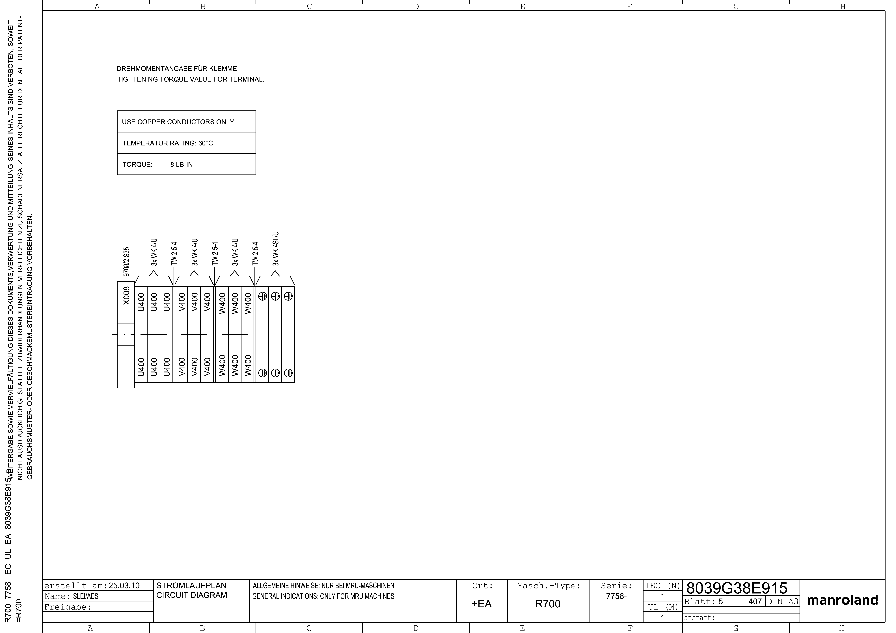

# +EA — Sheet 5 of 407 — ALLGEMEINE HINWEISE: NUR BEI MRU MASCHINEN

**GENERAL INDICATIONS: ONLY FOR MRU MACHINES**

> Part of the manroland **R700** printing press IEC/UL circuit diagrams.
> Drawing class: **Stromlaufplan / Circuit diagram** (DIN A3).
> Document `+EA` covers the **Printing unit** machine section.

## At a glance

| Field | Value |
|---|---|
| Document | `+EA`  (8039G38E915) |
| Sheet | **5** of 407 |
| Section (DE) | ALLGEMEINE HINWEISE: NUR BEI MRU MASCHINEN |
| Section (EN) | GENERAL INDICATIONS: ONLY FOR MRU MACHINES |
| Section type | LEGEND — General indications |
| Machine type | `R700` |
| Series | `7758` |
| Created | 25.03.10 |
| Replaces | — |
| Columns used | A, B, C |
| Path numbers | — |
| Labels on sheet | 33 |
| Cross-refs out | 0 |
| Cross-refs in | 0 |

**Previous:** [+EA sheet 4](SHEET_0004.md) · **Next:** [+EA sheet 6](SHEET_0006.md) · **Document TOC:** [_TOC.md](_TOC.md)  (+EA) · **Master TOC:** [all sheets](../_MASTER_TOC.md)

## Sheet image (300 DPI, exact vector render)



_Rendered directly from the PDF vector layer at 300 DPI (1-bit), no OCR and no resampling. Use it to confirm anything ambiguous in the text below._

## Cross-references on this sheet

Each entry is a wire leaving this sheet. The printed token is `/sheet.column`; the link resolves to that sheet inside the same document.

_No outgoing cross-references on this sheet._

## Devices on this sheet

| Tag | Class | Class meaning (IEC) | Col | Sub | Terminal | Sign |
|---|---|---|---|---|---|---|
| `X008` | X | Klemme / terminal, plug connector | A | — | — | — |
| `U400` | U | Umrichter / frequency converter | A | — | — | — |
| `U400` | U | Umrichter / frequency converter | B | — | — | — |
| `U400` | U | Umrichter / frequency converter | A | — | — | — |
| `U400` | U | Umrichter / frequency converter | B | — | — | — |
| `U400` | U | Umrichter / frequency converter | B | — | — | — |
| `U400` | U | Umrichter / frequency converter | B | — | — | — |
| `V400` | V | Diode / semiconductor valve | B | — | — | — |
| `V400` | V | Diode / semiconductor valve | B | — | — | — |
| `V400` | V | Diode / semiconductor valve | B | — | — | — |
| `V400` | V | Diode / semiconductor valve | B | — | — | — |
| `V400` | V | Diode / semiconductor valve | B | — | — | — |
| `V400` | V | Diode / semiconductor valve | B | — | — | — |
| `W400` | W | Kabel / cable, line, bus | B | — | — | — |
| `W400` | W | Kabel / cable, line, bus | B | — | — | — |
| `W400` | W | Kabel / cable, line, bus | B | — | — | — |
| `W400` | W | Kabel / cable, line, bus | B | — | — | — |
| `W400` | W | Kabel / cable, line, bus | B | — | — | — |
| `W400` | W | Kabel / cable, line, bus | B | — | — | — |

## Potentials / nets

_No named potentials on this sheet._

## Wire-end annotations (grouped as printed)

A wire that continues elsewhere is annotated with a small cluster: the destination description, the path/line number `#NN`, and the `/sheet.column` cross reference. Each row below is one such cluster exactly as it is grouped on the drawing.

| Col | Y | Path | Cross-ref | Text on the wire |
|---|---|---|---|---|
| B | 87.5 | — | — | `DREHMOMENTANGABE FÜR KLEMME.` |
| B | 101.6 | — | — | `TIGHTENING TORQUE VALUE FOR TERMINAL.` |
| B | 158.3 | — | — | `USE COPPER CONDUCTORS ONLY` |
| B | 186.7 | — | — | `TEMPERATUR RATING: 60°C` |
| B | 215.0 | — | — | `TORQUE: 8 LB IN` |
| C | 307.8 | — | — | `3x WK 4SL/U` |
| B | 317.1 | — | — | `3x WK 4/U` |
| B | 317.1 | — | — | `3x WK 4/U` |
| B | 317.1 | — | — | `3x WK 4/U` |
| B | 321.6 | — | — | `TW 2,5 4` |
| B | 321.6 | — | — | `TW 2,5 4` |
| C | 321.6 | — | — | `TW 2,5 4` |
| A | 328.7 | — | — | `9708/2 S35` |
| A | 380.7 | — | — | `X008` |
| A | 389.2 | — | — | `U400` |
| B | 389.2 | — | — | `U400 U400` |
| B | 389.2 | — | — | `U400` |
| B | 389.2 | — | — | `V400` |
| B | 389.2 | — | — | `V400 V400` |
| B | 389.2 | — | — | `V400` |
| B | 389.2 | — | — | `W400` |
| B | 389.2 | — | — | `W400 W400` |
| B | 389.2 | — | — | `W400` |
| B | 471.7 | — | — | `W400` |
| B | 471.7 | — | — | `W400` |
| B | 475.4 | — | — | `V400` |
| B | 475.4 | — | — | `V400` |
| A | 475.6 | — | — | `U400` |
| B | 475.6 | — | — | `U400` |


## Reconstructed tables

This sheet carries tabular content (pin map / terminal assignment / index). The grid below was rebuilt from the drawing's own rule lines, so each row is exactly one physical row of the table.

### Table 1 — 5 data rows × 21 columns (at x=155.9, y=0.0) — **USE S35 9708/2 TIGHTENING TEMPERATUR TORQUE: COPPER DREHMOMENTANGABE 4/U WK 3x 8 RATING: LB IN 2,5 4 TW CONDUCTORS 4/U WK 3x FÜR VALUE 60°C KLEMME. FOR ONLY 2,5 4 TW 4/U WK 3x TERMINAL. 2,5 4 TW 4SL/U WK 3x X008 U400 U400 V400 V400 W400 W400**

| 25.03.10 |  |  |  |  |  | STROMLAUFPLAN |  |  |  |  |  |  | ALLGEMEINE |  | HINWEISE: NUR BEI MRU MASCHINEN | Ort: | Masch. Type: | Serie: | IEC (N) | 8039G38E915 |
|---|---|---|---|---|---|---|---|---|---|---|---|---|---|---|---|---|---|---|---|---|
|  |  |  |  | `CIRCUIT` |  |  | `DIAGRAM` |  |  |  |  |  |  |  |  |  |  |  |  |  |
|  |  |  |  |  |  |  |  |  |  |  |  | `GENERAL` |  |  | `INDICATIONS: ONLY FOR MRU MACHINES` |  |  | `7758` | `1` |  |
|  |  |  |  |  |  |  |  |  |  |  |  |  |  |  |  | `+EA` | `R700` |  |  | `Blatt: DIN A3 5 407` |
|  |  |  |  |  |  |  |  |  |  |  |  |  |  |  |  |  |  |  | `UL (M)` |  |
|  |  |  |  |  |  |  |  |  |  |  |  |  |  |  |  |  |  |  | `1` | `anstatt:` |


## Notes and free text on this sheet

| Text | Col | Y (pt) |
|---|---|---|
| `DREHMOMENTANGABE FÜR KLEMME.` | B | 87.46 |
| `TIGHTENING TORQUE VALUE FOR TERMINAL.` | B | 101.61 |
| `USE COPPER CONDUCTORS ONLY` | B | 158.32 |
| `TEMPERATUR RATING: 60°C` | B | 186.66 |
| `TORQUE:` | A | 215.01 |
| `8 LB IN` | B | 215.01 |
| `TW 2,5 4` | B | 321.56 |
| `3x WK 4SL/U` | C | 307.79 |
| `3x WK 4/U` | B | 317.05 |
| `TW 2,5 4` | C | 321.56 |
| `9708/2 S35` | A | 328.68 |

## Complete label inventory (exact text from the drawing)

Every text object inside the drawing area of this sheet, in DIN reading order (column A→H, then top→bottom). This is the authoritative list: if a string is not here it is not printed on this sheet.

| Col | Y | X | Dir | Type | Text |
|---|---|---|---|---|---|
| A | 215.0 | 162.7 | → | text | `TORQUE:` |
| A | 328.7 | 164.6 | ↕ | text | `9708/2 S35` |
| A | 380.7 | 163.3 | ↕ | device tag | `X008` |
| A | 389.2 | 183.1 | ↕ | device tag | `U400` |
| A | 475.7 | 183.1 | ↕ | device tag | `U400` |
| B | 87.5 | 155.1 | → | text | `DREHMOMENTANGABE FÜR KLEMME.` |
| B | 101.6 | 155.6 | → | text | `TIGHTENING TORQUE VALUE FOR TERMINAL.` |
| B | 158.3 | 162.1 | → | text | `USE COPPER CONDUCTORS ONLY` |
| B | 186.7 | 162.7 | → | text | `TEMPERATUR RATING: 60°C` |
| B | 215.0 | 226.5 | → | text | `8 LB IN` |
| B | 317.0 | 201.4 | ↕ | text | `3x WK 4/U` |
| B | 317.0 | 255.3 | ↕ | text | `3x WK 4/U` |
| B | 317.0 | 309.1 | ↕ | text | `3x WK 4/U` |
| B | 321.6 | 228.3 | ↕ | text | `TW 2,5 4` |
| B | 321.6 | 282.2 | ↕ | text | `TW 2,5 4` |
| B | 389.2 | 200.1 | ↕ | device tag | `U400` |
| B | 389.2 | 217.1 | ↕ | device tag | `U400` |
| B | 389.2 | 237.0 | ↕ | device tag | `V400` |
| B | 389.2 | 254.0 | ↕ | device tag | `V400` |
| B | 389.2 | 271.0 | ↕ | device tag | `V400` |
| B | 389.2 | 290.7 | ↕ | device tag | `W400` |
| B | 389.2 | 307.7 | ↕ | device tag | `W400` |
| B | 389.2 | 324.7 | ↕ | device tag | `W400` |
| B | 471.7 | 290.7 | ↕ | device tag | `W400` |
| B | 471.7 | 307.7 | ↕ | device tag | `W400` |
| B | 471.7 | 324.7 | ↕ | device tag | `W400` |
| B | 475.4 | 237.0 | ↕ | device tag | `V400` |
| B | 475.4 | 254.0 | ↕ | device tag | `V400` |
| B | 475.4 | 271.0 | ↕ | device tag | `V400` |
| B | 475.7 | 200.1 | ↕ | device tag | `U400` |
| B | 475.7 | 217.1 | ↕ | device tag | `U400` |
| C | 307.8 | 363.0 | ↕ | text | `3x WK 4SL/U` |
| C | 321.6 | 336.0 | ↕ | text | `TW 2,5 4` |

## Reading-order text block

The same content as a plain block, grouped by DIN column — convenient to paste or to match against a visual description.

```text
=== Column A ===
 215.0  162.7  text         TORQUE:
 328.7  164.6  text         9708/2 S35
 380.7  163.3  devtag       X008
 389.2  183.1  devtag       U400
 475.7  183.1  devtag       U400
=== Column B ===
  87.5  155.1  text         DREHMOMENTANGABE FÜR KLEMME.
 101.6  155.6  text         TIGHTENING TORQUE VALUE FOR TERMINAL.
 158.3  162.1  text         USE COPPER CONDUCTORS ONLY
 186.7  162.7  text         TEMPERATUR RATING: 60°C
 215.0  226.5  text         8 LB IN
 317.0  201.4  text         3x WK 4/U
 317.0  255.3  text         3x WK 4/U
 317.0  309.1  text         3x WK 4/U
 321.6  228.3  text         TW 2,5 4
 321.6  282.2  text         TW 2,5 4
 389.2  200.1  devtag       U400
 389.2  217.1  devtag       U400
 389.2  237.0  devtag       V400
 389.2  254.0  devtag       V400
 389.2  271.0  devtag       V400
 389.2  290.7  devtag       W400
 389.2  307.7  devtag       W400
 389.2  324.7  devtag       W400
 471.7  290.7  devtag       W400
 471.7  307.7  devtag       W400
 471.7  324.7  devtag       W400
 475.4  237.0  devtag       V400
 475.4  254.0  devtag       V400
 475.4  271.0  devtag       V400
 475.7  200.1  devtag       U400
 475.7  217.1  devtag       U400
=== Column C ===
 307.8  363.0  text         3x WK 4SL/U
 321.6  336.0  text         TW 2,5 4
```

---
_Generated from the PDF vector text layer; no OCR. Source: `R700_7758_IEC_UL_EA_8039G38E915_p`, sheet 5._
