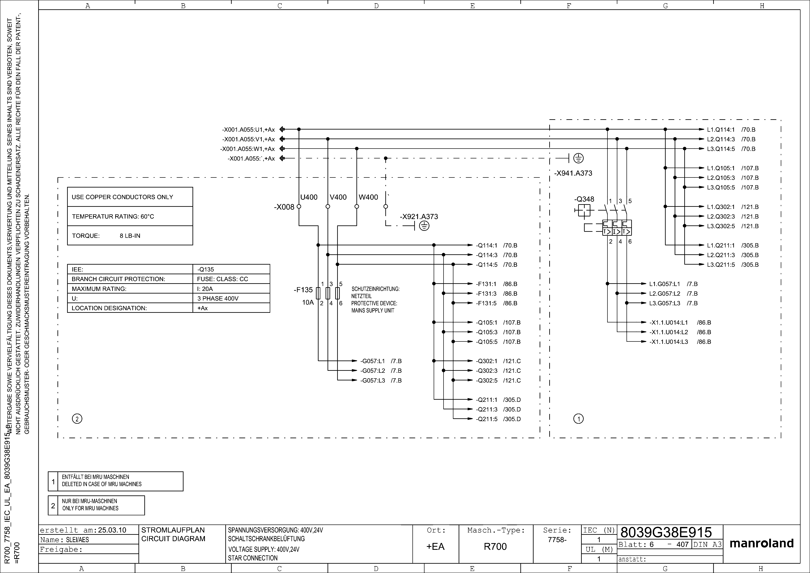

# +EA — Sheet 6 of 407 — SPANNUNGSVERSORGUNG: 400V,24V

**SCHALTSCHRANKBELÜFTUNG**

> Part of the manroland **R700** printing press IEC/UL circuit diagrams.
> Drawing class: **Stromlaufplan / Circuit diagram** (DIN A3).
> Document `+EA` covers the **Printing unit** machine section.

## At a glance

| Field | Value |
|---|---|
| Document | `+EA`  (8039G38E915) |
| Sheet | **6** of 407 |
| Section (DE) | SPANNUNGSVERSORGUNG: 400V,24V |
| Section (EN) | SCHALTSCHRANKBELÜFTUNG |
| Section type | POWER_SUPPLY — Voltage supply |
| Machine type | `R700` |
| Series | `7758` |
| Created | 25.03.10 |
| Replaces | — |
| Columns used | A, B, C, D, E, F, G, H |
| Path numbers | — |
| Labels on sheet | 123 |
| Cross-refs out | 36 |
| Cross-refs in | 36 |

**Previous:** [+EA sheet 5](SHEET_0005.md) · **Next:** [+EA sheet 7](SHEET_0007.md) · **Document TOC:** [_TOC.md](_TOC.md)  (+EA) · **Master TOC:** [all sheets](../_MASTER_TOC.md)

## Sheet image (300 DPI, exact vector render)



_Rendered directly from the PDF vector layer at 300 DPI (1-bit), no OCR and no resampling. Use it to confirm anything ambiguous in the text below._

## Cross-references on this sheet

Each entry is a wire leaving this sheet. The printed token is `/sheet.column`; the link resolves to that sheet inside the same document.

| Ref | Target sheet | Col | Path | Destination on target | Target section | From col |
|---|---|---|---|---|---|---|
| `/70.B` | [+EA sheet 70](SHEET_0070.md) | B | — | L1.Q114:1 | AUSLEGERSTAPELMOTOR | H |
| `/70.B` | [+EA sheet 70](SHEET_0070.md) | B | — | L2.Q114:3 | AUSLEGERSTAPELMOTOR | H |
| `/70.B` | [+EA sheet 70](SHEET_0070.md) | B | — | L3.Q114:5 | AUSLEGERSTAPELMOTOR | H |
| `/107.B` | [+EA sheet 107](SHEET_0107.md) | B | — | L1.Q105:1 | BOGENGLÄTTER | H |
| `/107.B` | [+EA sheet 107](SHEET_0107.md) | B | — | L2.Q105:3 | BOGENGLÄTTER | H |
| `/107.B` | [+EA sheet 107](SHEET_0107.md) | B | — | L3.Q105:5 | BOGENGLÄTTER | H |
| `/121.B` | [+EA sheet 121](SHEET_0121.md) | B | — | L1.Q302:1 | TROCKENBESTÄUBER | H |
| `/121.B` | [+EA sheet 121](SHEET_0121.md) | B | — | L2.Q302:3 | TROCKENBESTÄUBER | H |
| `/121.B` | [+EA sheet 121](SHEET_0121.md) | B | — | L3.Q302:5 | TROCKENBESTÄUBER | H |
| `/70.B` | [+EA sheet 70](SHEET_0070.md) | B | — | Q114:1 | AUSLEGERSTAPELMOTOR | E |
| `/305.B` | [+EA sheet 305](SHEET_0305.md) | B | — | L1.Q211:1 | OPTION: ZWISCHENSTAPEL / | H |
| `/70.B` | [+EA sheet 70](SHEET_0070.md) | B | — | Q114:3 | AUSLEGERSTAPELMOTOR | E |
| `/305.B` | [+EA sheet 305](SHEET_0305.md) | B | — | L2.Q211:3 | OPTION: ZWISCHENSTAPEL / | H |
| `/70.B` | [+EA sheet 70](SHEET_0070.md) | B | — | Q114:5 | AUSLEGERSTAPELMOTOR | E |
| `/305.B` | [+EA sheet 305](SHEET_0305.md) | B | — | L3.Q211:5 | OPTION: ZWISCHENSTAPEL / | H |
| `/7.B` | [+EA sheet 7](SHEET_0007.md) | B | — | L1.G057:L1 | SPANNUNGSVERSORGUNG: 400V, 24V | G |
| `/86.B` | [+EA sheet 86](SHEET_0086.md) | B | — | F131:1 | SAUGWALZE | E |
| `/7.B` | [+EA sheet 7](SHEET_0007.md) | B | — | L2.G057:L2 | SPANNUNGSVERSORGUNG: 400V, 24V | G |
| `/86.B` | [+EA sheet 86](SHEET_0086.md) | B | — | F131:3 | SAUGWALZE | E |
| `/7.B` | [+EA sheet 7](SHEET_0007.md) | B | — | L3.G057:L3 | SPANNUNGSVERSORGUNG: 400V, 24V | G |
| `/86.B` | [+EA sheet 86](SHEET_0086.md) | B | — | F131:5 | SAUGWALZE | E |
| `/86.B` | [+EA sheet 86](SHEET_0086.md) | B | — | X1.1.U014:L1 | SAUGWALZE | G |
| `/107.B` | [+EA sheet 107](SHEET_0107.md) | B | — | Q105:1 | BOGENGLÄTTER | E |
| `/86.B` | [+EA sheet 86](SHEET_0086.md) | B | — | X1.1.U014:L2 | SAUGWALZE | G |
| `/107.B` | [+EA sheet 107](SHEET_0107.md) | B | — | Q105:3 | BOGENGLÄTTER | E |
| `/86.B` | [+EA sheet 86](SHEET_0086.md) | B | — | X1.1.U014:L3 | SAUGWALZE | G |
| `/107.B` | [+EA sheet 107](SHEET_0107.md) | B | — | Q105:5 | BOGENGLÄTTER | E |
| `/7.B` | [+EA sheet 7](SHEET_0007.md) | B | — | G057:L1 | SPANNUNGSVERSORGUNG: 400V, 24V | D |
| `/121.C` | [+EA sheet 121](SHEET_0121.md) | C | — | Q302:1 | TROCKENBESTÄUBER | E |
| `/7.B` | [+EA sheet 7](SHEET_0007.md) | B | — | G057:L2 | SPANNUNGSVERSORGUNG: 400V, 24V | D |
| `/121.C` | [+EA sheet 121](SHEET_0121.md) | C | — | Q302:3 | TROCKENBESTÄUBER | E |
| `/7.B` | [+EA sheet 7](SHEET_0007.md) | B | — | G057:L3 | SPANNUNGSVERSORGUNG: 400V, 24V | D |
| `/121.C` | [+EA sheet 121](SHEET_0121.md) | C | — | Q302:5 | TROCKENBESTÄUBER | E |
| `/305.D` | [+EA sheet 305](SHEET_0305.md) | D | — | Q211:1 | OPTION: ZWISCHENSTAPEL / | E |
| `/305.D` | [+EA sheet 305](SHEET_0305.md) | D | — | Q211:3 | OPTION: ZWISCHENSTAPEL / | E |
| `/305.D` | [+EA sheet 305](SHEET_0305.md) | D | — | Q211:5 | OPTION: ZWISCHENSTAPEL / | E |

### Incoming references (sheets that point here)

Every other sheet that sends a wire to this one. `Back-ref` is the token printed on *that* sheet; `Path` is its line number.

| From sheet | Cols | Back-ref | Path | Refs | What continues there |
|---|---|---|---|---|---|
| [+EA#7](SHEET_0007.md) | A | `/7.A` | — | 6 | G057:L1; G057:L2; G057:L3; L1.G057:L1; L2.G057:L2; L3.G057:L3 |
| [+EA#70](SHEET_0070.md) | A | `/70.A` | — | 6 | L1.Q114:1; L2.Q114:3; L3.Q114:5; Q114:1; Q114:3; Q114:5 |
| [+EA#86](SHEET_0086.md) | B | `/86.B` | — | 6 | F131:1; F131:3; F131:5; X1.1.U014:L1; X1.1.U014:L2; X1.1.U014:L3 |
| [+EA#107](SHEET_0107.md) | A | `/107.A` | — | 6 | L1.Q105:1; L2.Q105:3; L3.Q105:5; Q105:1; Q105:3; Q105:5 |
| [+EA#121](SHEET_0121.md) | A, B, C | `/121.A`, `/121.B`, `/121.C` | — | 6 | L1.Q302:1; L2.Q302:3; L3.Q302:5 Q302:5; Q302:1; Q302:3 |
| [+EA#305](SHEET_0305.md) | A, D | `/305.A`, `/305.D` | — | 6 | L1.Q211:1; L2.Q211:3; L3.Q211:5; Q211:1; Q211:3; Q211:5 |


## Devices on this sheet

| Tag | Class | Class meaning (IEC) | Col | Sub | Terminal | Sign |
|---|---|---|---|---|---|---|
| `Q348` | Q | Leistungsschalter / power switching device | F | — | — | — |
| `V400` | V | Diode / semiconductor valve | D | — | — | — |
| `W400` | W | Kabel / cable, line, bus | D | — | — | — |
| `F135` | F | Schutz / protection device (fuse, circuit breaker) | C | — | — | — |
| `U400` | U | Umrichter / frequency converter | C | — | — | — |
| `X008` | X | Klemme / terminal, plug connector | C | — | — | — |
| `G057:L3` | G | Stromversorgung / power supply | D | — | L3 | — |
| `G057:L2` | G | Stromversorgung / power supply | D | — | L2 | — |
| `G057:L1` | G | Stromversorgung / power supply | D | — | L1 | — |
| `Q114:5` | Q | Leistungsschalter / power switching device | E | — | 5 | — |
| `Q114:3` | Q | Leistungsschalter / power switching device | E | — | 3 | — |
| `Q114:1` | Q | Leistungsschalter / power switching device | E | — | 1 | — |
| `Q105:5` | Q | Leistungsschalter / power switching device | E | — | 5 | — |
| `Q211:1` | Q | Leistungsschalter / power switching device | E | — | 1 | — |
| `Q211:3` | Q | Leistungsschalter / power switching device | E | — | 3 | — |
| `Q105:3` | Q | Leistungsschalter / power switching device | E | — | 3 | — |
| `Q105:1` | Q | Leistungsschalter / power switching device | E | — | 1 | — |
| `Q302:5` | Q | Leistungsschalter / power switching device | E | — | 5 | — |
| `Q302:3` | Q | Leistungsschalter / power switching device | E | — | 3 | — |
| `Q302:1` | Q | Leistungsschalter / power switching device | E | — | 1 | — |
| `Q211:5` | Q | Leistungsschalter / power switching device | E | — | 5 | — |
| `F131:1` | F | Schutz / protection device (fuse, circuit breaker) | E | — | 1 | — |
| `F131:3` | F | Schutz / protection device (fuse, circuit breaker) | E | — | 3 | — |
| `F131:5` | F | Schutz / protection device (fuse, circuit breaker) | E | — | 5 | — |
| `Q135` | Q | Leistungsschalter / power switching device | B | — | — | — |
| `X1.1.U014:L2` | — | cross-device reference | G | — | L2 | — |
| `X1.1.U014:L3` | — | cross-device reference | G | — | L3 | — |
| `X1.1.U014:L1` | — | cross-device reference | G | — | L1 | — |
| `X921.A373` | — | cross-device reference | D | — | — | — |
| `X941.A373` | — | cross-device reference | F | — | — | — |

## Potentials / nets

| Potential | Count | Columns | Attached devices | Terminals |
|---|---|---|---|---|
| `L1` | 5 | G, H | `G057`, `Q105`, `Q114`, `Q211`, `Q302` | `1`, `L1` |
| `L2` | 5 | G, H | `G057`, `Q105`, `Q114`, `Q211`, `Q302` | `3`, `L2` |
| `L3` | 5 | G, H | `G057`, `Q105`, `Q114`, `Q211`, `Q302` | `5`, `L3` |


A potential such as `L24+/4` or `M24+` is a named supply/return rail; every place it appears on this sheet is electrically common.

## Wire-end annotations (grouped as printed)

A wire that continues elsewhere is annotated with a small cluster: the destination description, the path/line number `#NN`, and the `/sheet.column` cross reference. Each row below is one such cluster exactly as it is grouped on the drawing.

| Col | Y | Path | Cross-ref | Text on the wire |
|---|---|---|---|---|
| H | 186.6 | — | `/70.B` | `L1.Q114:1` |
| C | 186.7 | — | — | `X001.A055:U1,+Ax` |
| C | 200.8 | — | — | `X001.A055:V1,+Ax` |
| H | 200.8 | — | `/70.B` | `L2.Q114:3` |
| C | 215.0 | — | — | `X001.A055:W1,+Ax` |
| H | 215.0 | — | `/70.B` | `L3.Q114:5` |
| C | 229.2 | — | — | `X001.A055:',+Ax` |
| H | 243.3 | — | `/107.B` | `L1.Q105:1` |
| F | 249.8 | — | — | `X941.A373` |
| H | 257.5 | — | `/107.B` | `L2.Q105:3` |
| H | 271.7 | — | `/107.B` | `L3.Q105:5` |
| E | 285.1 | — | — | `V400 W400 ' Q348` |
| C | 285.2 | — | — | `X008 U400` |
| A | 285.9 | — | — | `USE COPPER CONDUCTORS ONLY` |
| G | 291.6 | — | — | `1 3 5` |
| H | 300.0 | — | `/121.B` | `L1.Q302:1` |
| D | 313.5 | — | — | `X921.A373` |
| A | 314.2 | — | — | `TEMPERATUR RATING: 60°C` |
| H | 314.2 | — | `/121.B` | `L2.Q302:3` |
| H | 328.4 | — | `/121.B` | `L3.Q302:5` |
| A | 342.5 | — | — | `TORQUE: 8 LB IN` |
| G | 351.1 | — | — | `2 4 6` |
| E | 356.7 | — | `/70.B` | `Q114:1` |
| H | 356.7 | — | `/305.B` | `L1.Q211:1` |
| E | 370.9 | — | `/70.B` | `Q114:3` |
| H | 370.9 | — | `/305.B` | `L2.Q211:3` |
| E | 385.1 | — | `/70.B` | `Q114:5` |
| H | 385.1 | — | `/305.B` | `L3.Q211:5` |
| A | 392.1 | — | — | `IEE:` |
| B | 392.2 | — | — | `Q135` |
| B | 406.3 | — | — | `FUSE: CLASS: CC` |
| A | 406.4 | — | — | `BRANCH CIRCUIT PROTECTION:` |
| E | 413.4 | — | `/86.B` | `F131:1` |
| G | 413.4 | — | `/7.B` | `L1.G057:L1` |
| D | 413.5 | — | — | `1 3 5` |
| A | 420.5 | — | — | `MAXIMUM RATING:` |
| B | 420.5 | — | — | `I: 20A` |
| D | 421.2 | — | — | `F135 NETZTEIL PROTECTIVE DEVICE: MAINS SUPPLY UNIT SCHUTZEINRICHTUNG:` |
| E | 427.6 | — | `/86.B` | `F131:3` |
| G | 427.6 | — | `/7.B` | `L2.G057:L2` |
| A | 434.7 | — | — | `U:` |
| B | 434.7 | — | — | `3 PHASE 400V` |
| C | 440.0 | — | — | `10A` |
| E | 441.7 | — | `/86.B` | `F131:5` |
| G | 441.7 | — | `/7.B` | `L3.G057:L3` |
| D | 441.8 | — | — | `2 4 6` |
| A | 448.9 | — | — | `LOCATION DESIGNATION:` |
| B | 448.9 | — | — | `+Ax` |
| E | 470.1 | — | `/107.B` | `Q105:1` |
| G | 470.1 | — | `/86.B` | `X1.1.U014:L1` |
| E | 484.3 | — | `/107.B` | `Q105:3` |
| G | 484.3 | — | `/86.B` | `X1.1.U014:L2` |
| E | 498.4 | — | `/107.B` | `Q105:5` |
| G | 498.4 | — | `/86.B` | `X1.1.U014:L3` |
| D | 526.8 | — | `/7.B` | `G057:L1` |
| E | 526.8 | — | `/121.C` | `Q302:1` |
| D | 540.9 | — | `/7.B` | `G057:L2` |
| E | 541.0 | — | `/121.C` | `Q302:3` |
| D | 555.1 | — | `/7.B` | `G057:L3` |
| E | 555.2 | — | `/121.C` | `Q302:5` |
| E | 583.5 | — | `/305.D` | `Q211:1` |
| E | 597.7 | — | `/305.D` | `Q211:3` |
| E | 611.9 | — | `/305.D` | `Q211:5` |
| D | 612.1 | — | — | `2 1` |
| A | 698.0 | — | — | `1 ENTFÄLLT BEI MRU MASCHINEN DELETED IN CASE OF MRU MACHINES` |
| A | 733.4 | — | — | `NUR BEI MRU MASCHINEN` |
| A | 738.7 | — | — | `2` |
| A | 744.0 | — | — | `ONLY FOR MRU MACHINES` |


## Reconstructed tables

This sheet carries tabular content (pin map / terminal assignment / index). The grid below was rebuilt from the drawing's own rule lines, so each row is exactly one physical row of the table.

### Table 1 — 2 data rows × 6 columns (at x=439.4, y=189.9)

| U400 |  |  |  | W400 | ` X921.A373 |
|---|---|---|---|---|---|
| `F135 10A` | `1 2` | `3 4` | `5 6` | `SCHUTZEINRICHTUNG: NETZTEIL PROTECTIVE MAINS SUPPLY` | `DEVICE: UNIT` |
|  |  |  |  | `G057:L1 G057:L2 G057:L3` | `/7.B /7.B /7.B` |


### Table 2 — 2 data rows × 1 columns (at x=892.9, y=189.9)

| C1 |
|---|
| `1` |
| `2` |


### Table 3 — 2 data rows × 1 columns (at x=907.1, y=189.9)

| C1 |
|---|
| `3` |
| `4` |


### Table 4 — 3 data rows × 2 columns (at x=921.3, y=189.9)

| C1 | C2 |
|---|---|
| `5` |  |
| `6` |  |
|  | `L1.G057:L1 L2.G057:L2 L3.G057:L3` |


## Notes and free text on this sheet

| Text | Col | Y (pt) |
|---|---|---|
| `10A` | C | 439.96 |
| `SCHUTZEINRICHTUNG:` | D | 421.59 |
| `NETZTEIL` | D | 432.17 |
| `PROTECTIVE DEVICE:` | D | 442.81 |
| `MAINS SUPPLY UNIT` | D | 453.46 |
| `X001.A055:U1,+Ax` | C | 186.68 |
| `X001.A055:V1,+Ax` | C | 200.84 |
| `X001.A055:W1,+Ax` | C | 214.99 |
| `X001.A055:',+Ax` | C | 229.2 |
| `NUR BEI MRU MASCHINEN` | A | 733.4 |
| `ONLY FOR MRU MACHINES` | A | 744.03 |
| `ENTFÄLLT BEI MRU MASCHINEN` | A | 697.95 |
| `DELETED IN CASE OF MRU MACHINES` | A | 708.58 |
| `USE COPPER CONDUCTORS ONLY` | A | 285.87 |
| `TEMPERATUR RATING: 60°C` | A | 314.22 |
| `TORQUE: 8 LB IN` | A | 342.52 |
| `IEE:` | A | 392.09 |
| `BRANCH CIRCUIT PROTECTION:` | A | 406.35 |
| `MAXIMUM RATING:` | A | 420.53 |
| `U:` | A | 434.69 |
| `LOCATION DESIGNATION:` | A | 448.85 |
| `FUSE: CLASS: CC` | B | 406.32 |
| `I: 20A` | B | 420.47 |
| `3 PHASE 400V` | B | 434.67 |
| `+Ax` | B | 448.94 |

## Complete label inventory (exact text from the drawing)

Every text object inside the drawing area of this sheet, in DIN reading order (column A→H, then top→bottom). This is the authoritative list: if a string is not here it is not printed on this sheet.

| Col | Y | X | Dir | Type | Text |
|---|---|---|---|---|---|
| A | 285.9 | 105.4 | → | text | `USE COPPER CONDUCTORS ONLY` |
| A | 314.2 | 106.0 | → | text | `TEMPERATUR RATING: 60°C` |
| A | 342.5 | 106.0 | → | text | `TORQUE: 8 LB IN` |
| A | 392.1 | 105.4 | → | text | `IEE:` |
| A | 406.3 | 105.4 | → | text | `BRANCH CIRCUIT PROTECTION:` |
| A | 420.5 | 105.7 | → | text | `MAXIMUM RATING:` |
| A | 434.7 | 105.4 | → | text | `U:` |
| A | 448.9 | 105.4 | → | text | `LOCATION DESIGNATION:` |
| A | 612.6 | 111.4 | → | number | `2` |
| A | 698.0 | 91.3 | → | text | `ENTFÄLLT BEI MRU MASCHINEN` |
| A | 703.3 | 75.4 | → | number | `1` |
| A | 708.6 | 91.3 | → | text | `DELETED IN CASE OF MRU MACHINES` |
| A | 733.4 | 91.3 | → | text | `NUR BEI MRU MASCHINEN` |
| A | 738.7 | 75.1 | → | number | `2` |
| A | 744.0 | 91.8 | → | text | `ONLY FOR MRU MACHINES` |
| B | 392.2 | 290.3 | → | device tag | `Q135` |
| B | 406.3 | 289.7 | → | text | `FUSE: CLASS: CC` |
| B | 420.5 | 289.7 | → | text | `I: 20A` |
| B | 434.7 | 290.3 | → | text | `3 PHASE 400V` |
| B | 448.9 | 290.3 | → | text | `+Ax` |
| C | 186.7 | 326.6 | → | text | `X001.A055:U1,+Ax` |
| C | 200.8 | 326.8 | → | text | `X001.A055:V1,+Ax` |
| C | 215.0 | 323.7 | → | text | `X001.A055:W1,+Ax` |
| C | 229.2 | 334.8 | → | text | `X001.A055:',+Ax` |
| C | 285.2 | 441.4 | → | device tag | `U400` |
| C | 299.1 | 402.8 | → | device tag | `X008` |
| C | 413.5 | 471.7 | → | number | `1` |
| C | 421.2 | 432.0 | → | device tag | `F135` |
| C | 440.0 | 443.9 | → | text | `10A` |
| C | 441.8 | 470.6 | → | number | `2` |
| D | 285.1 | 527.2 | → | device tag | `W400` |
| D | 285.2 | 484.7 | → | device tag | `V400` |
| D | 285.3 | 569.5 | → | other | `'` |
| D | 313.5 | 587.9 | → | device ref | `X921.A373` |
| D | 413.5 | 484.4 | → | number | `3` |
| D | 413.5 | 498.6 | → | number | `5` |
| D | 421.6 | 517.0 | → | text | `SCHUTZEINRICHTUNG:` |
| D | 432.2 | 516.5 | → | text | `NETZTEIL` |
| D | 441.8 | 484.4 | → | number | `4` |
| D | 441.8 | 498.6 | → | number | `6` |
| D | 442.8 | 516.5 | → | text | `PROTECTIVE DEVICE:` |
| D | 453.5 | 516.8 | → | text | `MAINS SUPPLY UNIT` |
| D | 526.8 | 529.8 | → | device tag | `G057:L1` |
| D | 526.8 | 574.7 | → | cross-reference | `/7.B` |
| D | 540.9 | 574.7 | → | cross-reference | `/7.B` |
| D | 541.0 | 529.8 | → | device tag | `G057:L2` |
| D | 555.1 | 574.7 | → | cross-reference | `/7.B` |
| D | 555.2 | 529.8 | → | device tag | `G057:L3` |
| E | 356.7 | 739.8 | → | cross-reference | `/70.B` |
| E | 356.8 | 699.9 | → | device tag | `Q114:1` |
| E | 370.9 | 699.9 | → | device tag | `Q114:3` |
| E | 370.9 | 739.8 | → | cross-reference | `/70.B` |
| E | 385.1 | 699.9 | → | device tag | `Q114:5` |
| E | 385.1 | 739.8 | → | cross-reference | `/70.B` |
| E | 413.4 | 739.8 | → | cross-reference | `/86.B` |
| E | 413.5 | 699.9 | → | device tag | `F131:1` |
| E | 427.6 | 699.9 | → | device tag | `F131:3` |
| E | 427.6 | 739.8 | → | cross-reference | `/86.B` |
| E | 441.7 | 739.8 | → | cross-reference | `/86.B` |
| E | 441.8 | 699.9 | → | device tag | `F131:5` |
| E | 470.1 | 739.8 | → | cross-reference | `/107.B` |
| E | 470.2 | 699.9 | → | device tag | `Q105:1` |
| E | 484.3 | 699.9 | → | device tag | `Q105:3` |
| E | 484.3 | 739.8 | → | cross-reference | `/107.B` |
| E | 498.5 | 699.9 | → | device tag | `Q105:5` |
| E | 498.5 | 739.8 | → | cross-reference | `/107.B` |
| E | 526.8 | 699.9 | → | device tag | `Q302:1` |
| E | 526.8 | 739.8 | → | cross-reference | `/121.C` |
| E | 541.0 | 699.9 | → | device tag | `Q302:3` |
| E | 541.0 | 739.8 | → | cross-reference | `/121.C` |
| E | 555.2 | 699.9 | → | device tag | `Q302:5` |
| E | 555.2 | 739.8 | → | cross-reference | `/121.C` |
| E | 583.5 | 699.9 | → | device tag | `Q211:1` |
| E | 583.5 | 739.8 | → | cross-reference | `/305.D` |
| E | 597.7 | 699.9 | → | device tag | `Q211:3` |
| E | 597.7 | 739.8 | → | cross-reference | `/305.D` |
| E | 611.9 | 699.9 | → | device tag | `Q211:5` |
| E | 611.9 | 739.8 | → | cross-reference | `/305.D` |
| F | 249.7 | 814.7 | → | device ref | `X941.A373` |
| F | 288.0 | 844.2 | → | device tag | `Q348` |
| F | 291.6 | 894.9 | → | number | `1` |
| F | 351.1 | 895.5 | → | number | `2` |
| F | 612.1 | 848.6 | → | number | `1` |
| G | 291.6 | 909.6 | → | number | `3` |
| G | 291.6 | 923.8 | → | number | `5` |
| G | 351.1 | 909.6 | → | number | `4` |
| G | 351.1 | 923.8 | → | number | `6` |
| G | 413.4 | 954.4 | → | potential | `L1.G057:L1` |
| G | 413.4 | 1009.8 | → | cross-reference | `/7.B` |
| G | 427.5 | 1009.8 | → | cross-reference | `/7.B` |
| G | 427.6 | 954.4 | → | potential | `L2.G057:L2` |
| G | 441.7 | 1009.8 | → | cross-reference | `/7.B` |
| G | 441.8 | 954.4 | → | potential | `L3.G057:L3` |
| G | 470.1 | 955.0 | → | device ref | `X1.1.U014:L1` |
| G | 470.1 | 1024.7 | → | cross-reference | `/86.B` |
| G | 484.3 | 955.0 | → | device ref | `X1.1.U014:L2` |
| G | 484.3 | 1024.7 | → | cross-reference | `/86.B` |
| G | 498.4 | 1024.7 | → | cross-reference | `/86.B` |
| G | 498.5 | 955.0 | → | device ref | `X1.1.U014:L3` |
| H | 186.6 | 1089.9 | → | cross-reference | `/70.B` |
| H | 186.7 | 1039.5 | → | potential | `L1.Q114:1` |
| H | 200.8 | 1039.5 | → | potential | `L2.Q114:3` |
| H | 200.8 | 1089.9 | → | cross-reference | `/70.B` |
| H | 215.0 | 1039.5 | → | potential | `L3.Q114:5` |
| H | 215.0 | 1089.9 | → | cross-reference | `/70.B` |
| H | 243.3 | 1089.9 | → | cross-reference | `/107.B` |
| H | 243.4 | 1039.5 | → | potential | `L1.Q105:1` |
| H | 257.5 | 1039.5 | → | potential | `L2.Q105:3` |
| H | 257.5 | 1089.9 | → | cross-reference | `/107.B` |
| H | 271.7 | 1039.5 | → | potential | `L3.Q105:5` |
| H | 271.7 | 1089.9 | → | cross-reference | `/107.B` |
| H | 300.0 | 1089.9 | → | cross-reference | `/121.B` |
| H | 300.1 | 1039.5 | → | potential | `L1.Q302:1` |
| H | 314.2 | 1039.5 | → | potential | `L2.Q302:3` |
| H | 314.2 | 1089.9 | → | cross-reference | `/121.B` |
| H | 328.4 | 1039.5 | → | potential | `L3.Q302:5` |
| H | 328.4 | 1089.9 | → | cross-reference | `/121.B` |
| H | 356.7 | 1089.9 | → | cross-reference | `/305.B` |
| H | 356.8 | 1039.5 | → | potential | `L1.Q211:1` |
| H | 370.9 | 1039.5 | → | potential | `L2.Q211:3` |
| H | 370.9 | 1089.9 | → | cross-reference | `/305.B` |
| H | 385.1 | 1039.5 | → | potential | `L3.Q211:5` |
| H | 385.1 | 1089.9 | → | cross-reference | `/305.B` |

## Reading-order text block

The same content as a plain block, grouped by DIN column — convenient to paste or to match against a visual description.

```text
=== Column A ===
 285.9  105.4  text         USE COPPER CONDUCTORS ONLY
 314.2  106.0  text         TEMPERATUR RATING: 60°C
 342.5  106.0  text         TORQUE: 8 LB IN
 392.1  105.4  text         IEE:
 406.3  105.4  text         BRANCH CIRCUIT PROTECTION:
 420.5  105.7  text         MAXIMUM RATING:
 434.7  105.4  text         U:
 448.9  105.4  text         LOCATION DESIGNATION:
 612.6  111.4  numeric      2
 698.0   91.3  text         ENTFÄLLT BEI MRU MASCHINEN
 703.3   75.4  numeric      1
 708.6   91.3  text         DELETED IN CASE OF MRU MACHINES
 733.4   91.3  text         NUR BEI MRU MASCHINEN
 738.7   75.1  numeric      2
 744.0   91.8  text         ONLY FOR MRU MACHINES
=== Column B ===
 392.2  290.3  devtag       Q135
 406.3  289.7  text         FUSE: CLASS: CC
 420.5  289.7  text         I: 20A
 434.7  290.3  text         3 PHASE 400V
 448.9  290.3  text         +Ax
=== Column C ===
 186.7  326.6  text         X001.A055:U1,+Ax
 200.8  326.8  text         X001.A055:V1,+Ax
 215.0  323.7  text         X001.A055:W1,+Ax
 229.2  334.8  text         X001.A055:`,+Ax
 285.2  441.4  devtag       U400
 299.1  402.8  devtag       X008
 413.5  471.7  numeric      1
 421.2  432.0  devtag       F135
 440.0  443.9  text         10A
 441.8  470.6  numeric      2
=== Column D ===
 285.1  527.2  devtag       W400
 285.2  484.7  devtag       V400
 285.3  569.5  other        `
 313.5  587.9  devref       X921.A373
 413.5  484.4  numeric      3
 413.5  498.6  numeric      5
 421.6  517.0  text         SCHUTZEINRICHTUNG:
 432.2  516.5  text         NETZTEIL
 441.8  484.4  numeric      4
 441.8  498.6  numeric      6
 442.8  516.5  text         PROTECTIVE DEVICE:
 453.5  516.8  text         MAINS SUPPLY UNIT
 526.8  529.8  devtag       G057:L1
 526.8  574.7  xref         /7.B
 540.9  574.7  xref         /7.B
 541.0  529.8  devtag       G057:L2
 555.1  574.7  xref         /7.B
 555.2  529.8  devtag       G057:L3
=== Column E ===
 356.7  739.8  xref         /70.B
 356.8  699.9  devtag       Q114:1
 370.9  699.9  devtag       Q114:3
 370.9  739.8  xref         /70.B
 385.1  699.9  devtag       Q114:5
 385.1  739.8  xref         /70.B
 413.4  739.8  xref         /86.B
 413.5  699.9  devtag       F131:1
 427.6  699.9  devtag       F131:3
 427.6  739.8  xref         /86.B
 441.7  739.8  xref         /86.B
 441.8  699.9  devtag       F131:5
 470.1  739.8  xref         /107.B
 470.2  699.9  devtag       Q105:1
 484.3  699.9  devtag       Q105:3
 484.3  739.8  xref         /107.B
 498.5  699.9  devtag       Q105:5
 498.5  739.8  xref         /107.B
 526.8  699.9  devtag       Q302:1
 526.8  739.8  xref         /121.C
 541.0  699.9  devtag       Q302:3
 541.0  739.8  xref         /121.C
 555.2  699.9  devtag       Q302:5
 555.2  739.8  xref         /121.C
 583.5  699.9  devtag       Q211:1
 583.5  739.8  xref         /305.D
 597.7  699.9  devtag       Q211:3
 597.7  739.8  xref         /305.D
 611.9  699.9  devtag       Q211:5
 611.9  739.8  xref         /305.D
=== Column F ===
 249.7  814.7  devref       X941.A373
 288.0  844.2  devtag       Q348
 291.6  894.9  numeric      1
 351.1  895.5  numeric      2
 612.1  848.6  numeric      1
=== Column G ===
 291.6  909.6  numeric      3
 291.6  923.8  numeric      5
 351.1  909.6  numeric      4
 351.1  923.8  numeric      6
 413.4  954.4  net          L1.G057:L1
 413.4 1009.8  xref         /7.B
 427.5 1009.8  xref         /7.B
 427.6  954.4  net          L2.G057:L2
 441.7 1009.8  xref         /7.B
 441.8  954.4  net          L3.G057:L3
 470.1  955.0  devref       X1.1.U014:L1
 470.1 1024.7  xref         /86.B
 484.3  955.0  devref       X1.1.U014:L2
 484.3 1024.7  xref         /86.B
 498.4 1024.7  xref         /86.B
 498.5  955.0  devref       X1.1.U014:L3
=== Column H ===
 186.6 1089.9  xref         /70.B
 186.7 1039.5  net          L1.Q114:1
 200.8 1039.5  net          L2.Q114:3
 200.8 1089.9  xref         /70.B
 215.0 1039.5  net          L3.Q114:5
 215.0 1089.9  xref         /70.B
 243.3 1089.9  xref         /107.B
 243.4 1039.5  net          L1.Q105:1
 257.5 1039.5  net          L2.Q105:3
 257.5 1089.9  xref         /107.B
 271.7 1039.5  net          L3.Q105:5
 271.7 1089.9  xref         /107.B
 300.0 1089.9  xref         /121.B
 300.1 1039.5  net          L1.Q302:1
 314.2 1039.5  net          L2.Q302:3
 314.2 1089.9  xref         /121.B
 328.4 1039.5  net          L3.Q302:5
 328.4 1089.9  xref         /121.B
 356.7 1089.9  xref         /305.B
 356.8 1039.5  net          L1.Q211:1
 370.9 1039.5  net          L2.Q211:3
 370.9 1089.9  xref         /305.B
 385.1 1039.5  net          L3.Q211:5
 385.1 1089.9  xref         /305.B
```

---
_Generated from the PDF vector text layer; no OCR. Source: `R700_7758_IEC_UL_EA_8039G38E915_p`, sheet 6._
