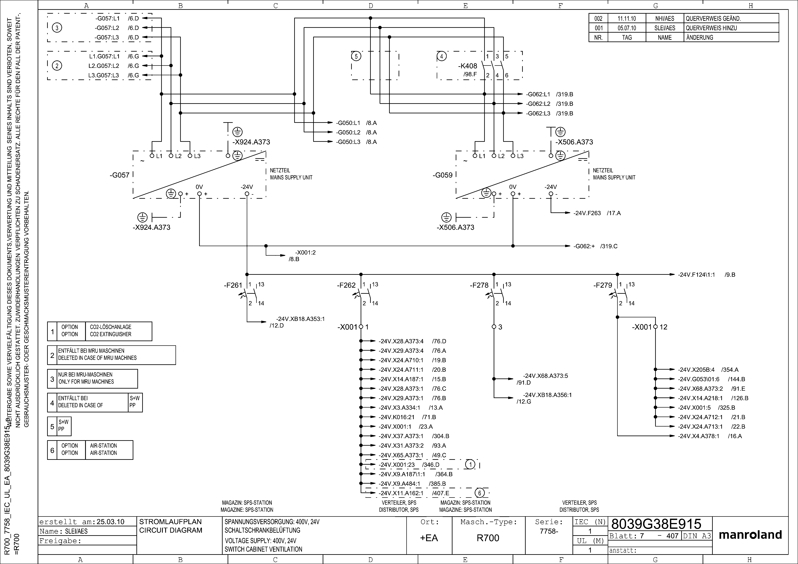

# +EA — Sheet 7 of 407 — SPANNUNGSVERSORGUNG: 400V, 24V

**SCHALTSCHRANKBELÜFTUNG**

> Part of the manroland **R700** printing press IEC/UL circuit diagrams.
> Drawing class: **Stromlaufplan / Circuit diagram** (DIN A3).
> Document `+EA` covers the **Printing unit** machine section.

## At a glance

| Field | Value |
|---|---|
| Document | `+EA`  (8039G38E915) |
| Sheet | **7** of 407 |
| Section (DE) | SPANNUNGSVERSORGUNG: 400V, 24V |
| Section (EN) | SCHALTSCHRANKBELÜFTUNG |
| Section type | POWER_SUPPLY — Voltage supply |
| Machine type | `R700` |
| Series | `7758` |
| Created | 25.03.10 |
| Replaces | — |
| Columns used | A, B, C, D, E, F, G, H |
| Path numbers | — |
| Labels on sheet | 197 |
| Cross-refs out | 45 |
| Cross-refs in | 45 |

**Previous:** [+EA sheet 6](SHEET_0006.md) · **Next:** [+EA sheet 8](SHEET_0008.md) · **Document TOC:** [_TOC.md](_TOC.md)  (+EA) · **Master TOC:** [all sheets](../_MASTER_TOC.md)

## Sheet image (300 DPI, exact vector render)



_Rendered directly from the PDF vector layer at 300 DPI (1-bit), no OCR and no resampling. Use it to confirm anything ambiguous in the text below._

## Cross-references on this sheet

Each entry is a wire leaving this sheet. The printed token is `/sheet.column`; the link resolves to that sheet inside the same document.

| Ref | Target sheet | Col | Path | Destination on target | Target section | From col |
|---|---|---|---|---|---|---|
| `/6.D` | [+EA sheet 6](SHEET_0006.md) | D | — | G057:L1 | SPANNUNGSVERSORGUNG: 400V,24V | A |
| `/6.D` | [+EA sheet 6](SHEET_0006.md) | D | — | G057:L2 | SPANNUNGSVERSORGUNG: 400V,24V | A |
| `/6.D` | [+EA sheet 6](SHEET_0006.md) | D | — | G057:L3 | SPANNUNGSVERSORGUNG: 400V,24V | A |
| `/6.G` | [+EA sheet 6](SHEET_0006.md) | G | — | L1.G057:L1 | SPANNUNGSVERSORGUNG: 400V,24V | A |
| `/6.G` | [+EA sheet 6](SHEET_0006.md) | G | — | L2.G057:L2 | SPANNUNGSVERSORGUNG: 400V,24V | A |
| `/98.F` | [+EA sheet 98](SHEET_0098.md) | F | — | — | BOGENFÜHRUNGSELEMENT | E |
| `/6.G` | [+EA sheet 6](SHEET_0006.md) | G | — | L3.G057:L3 | SPANNUNGSVERSORGUNG: 400V,24V | A |
| `/319.B` | [+EA sheet 319](SHEET_0319.md) | B | — | G062:L1 | OPTION: VERLÄNGERUNG 3656,8MM | F |
| `/319.B` | [+EA sheet 319](SHEET_0319.md) | B | — | G062:L2 | OPTION: VERLÄNGERUNG 3656,8MM | F |
| `/319.B` | [+EA sheet 319](SHEET_0319.md) | B | — | G062:L3 | OPTION: VERLÄNGERUNG 3656,8MM | F |
| `/8.A` | [+EA sheet 8](SHEET_0008.md) | A | — | G050:L1 | SPANNUNGSVERSORGUNG: 400V, 24V | D |
| `/8.A` | [+EA sheet 8](SHEET_0008.md) | A | — | G050:L2 | SPANNUNGSVERSORGUNG: 400V, 24V | D |
| `/8.A` | [+EA sheet 8](SHEET_0008.md) | A | — | G050:L3 | SPANNUNGSVERSORGUNG: 400V, 24V | D |
| `/17.A` | [+EA sheet 17](SHEET_0017.md) | A | — | 24V.F263 | SPANNUNGSVERSORGUNG: 400V, 24V | F |
| `/319.C` | [+EA sheet 319](SHEET_0319.md) | C | — | G062:+ | OPTION: VERLÄNGERUNG 3656,8MM | F |
| `/8.B` | [+EA sheet 8](SHEET_0008.md) | B | — | — | SPANNUNGSVERSORGUNG: 400V, 24V | C |
| `/9.B` | [+EA sheet 9](SHEET_0009.md) | B | — | 24V.F124\1:1 | SPANNUNGSVERSORGUNG: 400V, 24V | H |
| `/12.D` | [+EA sheet 12](SHEET_0012.md) | D | — | — | SPANNUNGSVERSORGUNG: 400V, 24V | C |
| `/76.D` | [+EA sheet 76](SHEET_0076.md) | D | — | 24V.X28.A373:4 | AUSLEGERSTAPELSTEUERUNG | D |
| `/76.A` | [+EA sheet 76](SHEET_0076.md) | A | — | 24V.X29.A373:4 | AUSLEGERSTAPELSTEUERUNG | D |
| `/19.B` | [+EA sheet 19](SHEET_0019.md) | B | — | 24V.X24.A710:1 | SPANNUNGSVERSORGUNG: 400V, 24V | D |
| `/20.B` | [+EA sheet 20](SHEET_0020.md) | B | — | 24V.X24.A711:1 | SPANNUNGSVERSORGUNG: 400V, 24V | D |
| `/354.A` | [+EA sheet 354](SHEET_0354.md) | A | — | 24V.X205B:4 | OPTION: VORBEREITUNG: PUDERABSAUGUNG | H |
| `/15.B` | [+EA sheet 15](SHEET_0015.md) | B | — | 24V.X14.A187:1 | SPANNUNGSVERSORGUNG: 400V, 24V | D |
| `/144.B` | [+EA sheet 144](SHEET_0144.md) | B | — | 24V.G053\01:6 | ZUGANGSABSICHERUNG | H |
| `/91.D` | [+EA sheet 91](SHEET_0091.md) | D | — | — | BLASROHRE (BLASRAHMEN) | F |
| `/91.E` | [+EA sheet 91](SHEET_0091.md) | E | — | 24V.X68.A373:2 | BLASROHRE (BLASRAHMEN) | H |
| `/76.C` | [+EA sheet 76](SHEET_0076.md) | C | — | 24V.X28.A373:1 | AUSLEGERSTAPELSTEUERUNG | D |
| `/76.B` | [+EA sheet 76](SHEET_0076.md) | B | — | 24V.X29.A373:1 | AUSLEGERSTAPELSTEUERUNG | D |
| `/126.B` | [+EA sheet 126](SHEET_0126.md) | B | — | 24V.X14.A218:1 | ZUGANGSABSICHERUNG | H |
| `/12.G` | [+EA sheet 12](SHEET_0012.md) | G | — | — | SPANNUNGSVERSORGUNG: 400V, 24V | F |
| `/13.A` | [+EA sheet 13](SHEET_0013.md) | A | — | 24V.X3.A334:1 | SPANNUNGSVERSORGUNG: 400V, 24V | D |
| `/325.B` | [+EA sheet 325](SHEET_0325.md) | B | — | 24V.X001:5 | OPTION: BOGENWEICHE | H |
| `/71.B` | [+EA sheet 71](SHEET_0071.md) | B | — | 24V.K016:21 | AUSLEGERSTAPELSTEUERUNG | D |
| `/21.B` | [+EA sheet 21](SHEET_0021.md) | B | — | 24V.X24.A712:1 | SPANNUNGSVERSORGUNG: 400V, 24V | H |
| `/23.A` | [+EA sheet 23](SHEET_0023.md) | A | — | 24V.X001:1 | SPANNUNGSVERSORGUNG: 400V, 24V | D |
| `/22.B` | [+EA sheet 22](SHEET_0022.md) | B | — | 24V.X24.A713:1 | SPANNUNGSVERSORGUNG: 400V, 24V | H |
| `/16.A` | [+EA sheet 16](SHEET_0016.md) | A | — | 24V.X4.A378:1 | SPANNUNGSVERSORGUNG: 400V, 24V | H |
| `/304.B` | [+EA sheet 304](SHEET_0304.md) | B | — | 24V.X37.A373:1 | OPTION: ZWISCHENSTAPEL / | D |
| `/93.A` | [+EA sheet 93](SHEET_0093.md) | A | — | 24V.X31.A373:2 | BLASRAHMEN | D |
| `/49.C` | [+EA sheet 49](SHEET_0049.md) | C | — | 24V.X65.A373:1 | SCHUTZ | D |
| `/346.D` | [+EA sheet 346](SHEET_0346.md) | D | — | 24V.X001:23 | OPTION: VORBEREITUNG CO2 LÖSCHANLAGE | D |
| `/364.B` | [+EA sheet 364](SHEET_0364.md) | B | — | 24V.X9.A187\1:1 | OPTION: TROCKNER VORBEREITUNG; | D |
| `/385.B` | [+EA sheet 385](SHEET_0385.md) | B | — | 24V.X9.A484:1 | OPTION: ZWISCHENTROCKNER VORBEREITUNG; | D |
| `/407.E` | [+EA sheet 407](SHEET_0407.md) | E | — | 24V.X11.A162:1 | OPTION: AIR STATION | D |

### Incoming references (sheets that point here)

Every other sheet that sends a wire to this one. `Back-ref` is the token printed on *that* sheet; `Path` is its line number.

| From sheet | Cols | Back-ref | Path | Refs | What continues there |
|---|---|---|---|---|---|
| [+EA#6](SHEET_0006.md) | D, G | `/6.D`, `/6.G` | — | 6 | G057:L1; G057:L2; G057:L3; L1.G057:L1; L2.G057:L2; L3.G057:L3 |
| [+EA#8](SHEET_0008.md) | A, B | `/8.A`, `/8.B` | — | 4 | G050:L1; G050:L2; G050:L3; X001:2 |
| [+EA#9](SHEET_0009.md) | A | `/9.A` | — | 1 | 24V.F124\1:1 |
| [+EA#12](SHEET_0012.md) | D, G | `/12.D`, `/12.G` | — | 2 | 24V.XB18.A353:1; 24V.XB18.A356:1 |
| [+EA#13](SHEET_0013.md) | A | `/13.A` | — | 1 | 24V.X3.A334:1 |
| [+EA#15](SHEET_0015.md) | A | `/15.A` | — | 1 | 24V.X14.A187:1 |
| [+EA#16](SHEET_0016.md) | A | `/16.A` | — | 1 | 24V.X4.A378:1 |
| [+EA#17](SHEET_0017.md) | A | `/17.A` | — | 1 | 24V.F263 |
| [+EA#19](SHEET_0019.md) | B | `/19.B` | — | 1 | 24V.X24.A710:1 |
| [+EA#20](SHEET_0020.md) | B | `/20.B` | — | 1 | 24V.X24.A711:1 |
| [+EA#21](SHEET_0021.md) | B | `/21.B` | — | 1 | 24V.X24.A712:1 |
| [+EA#22](SHEET_0022.md) | B | `/22.B` | — | 1 | 24V.X24.A713:1 |
| [+EA#23](SHEET_0023.md) | C | `/23.C` | — | 1 | 24V.X001:1 24V.Q114:14 |
| [+EA#49](SHEET_0049.md) | C | `/49.C` | — | 1 | 24V.X65.A373:1 |
| [+EA#71](SHEET_0071.md) | A | `/71.A` | — | 1 | 24V.K016:21 |
| [+EA#76](SHEET_0076.md) | A, B, C | `/76.A`, `/76.B`, `/76.C` | — | 4 | 24V.X28.A373:1; 24V.X29.A373:1 |
| [+EA#91](SHEET_0091.md) | D | `/91.D` | — | 2 | 24V.X68.A373:5 24V.X68.A373:2 |
| [+EA#93](SHEET_0093.md) | A | `/93.A` | — | 1 | — |
| [+EA#98](SHEET_0098.md) | F | `/98.F` | — | 1 | — |
| [+EA#126](SHEET_0126.md) | C | `/126.C` | — | 1 | X7:1 |
| [+EA#144](SHEET_0144.md) | B | `/144.B` | — | 1 | 24V.G053\01:6 24V.G053\02:6 |
| [+EA#304](SHEET_0304.md) | A | `/304.A` | — | 1 | 24V.X37.A373:1 |
| [+EA#319](SHEET_0319.md) | B, C | `/319.B`, `/319.C` | — | 4 | G062:+; G062:L1; G062:L2; G062:L3 |
| [+EA#325](SHEET_0325.md) | B | `/325.B` | — | 1 | 24V.X001:5 |
| [+EA#346](SHEET_0346.md) | D | `/346.D` | — | 1 | 24V.X001:23 |
| [+EA#354](SHEET_0354.md) | A | `/354.A` | — | 1 | 24V.X205B:4 |
| [+EA#364](SHEET_0364.md) | A | `/364.A` | — | 1 | 24V.X9.A187\1:1 |
| [+EA#385](SHEET_0385.md) | A | `/385.A` | — | 1 | 24V.X9.A484:1 |
| [+EA#407](SHEET_0407.md) | E | `/407.E` | — | 1 | 24V.X11.A162:1 |


## Devices on this sheet

| Tag | Class | Class meaning (IEC) | Col | Sub | Terminal | Sign |
|---|---|---|---|---|---|---|
| `G057` | G | Stromversorgung / power supply | A | — | — | — |
| `F261` | F | Schutz / protection device (fuse, circuit breaker) | C | — | — | — |
| `G059` | G | Stromversorgung / power supply | E | — | — | — |
| `F262` | F | Schutz / protection device (fuse, circuit breaker) | D | — | — | — |
| `F279` | F | Schutz / protection device (fuse, circuit breaker) | F | — | — | — |
| `F278` | F | Schutz / protection device (fuse, circuit breaker) | E | — | — | — |
| `X001` | X | Klemme / terminal, plug connector | D | — | — | — |
| `X001` | X | Klemme / terminal, plug connector | G | — | — | — |
| `K408` | K | Relais / relay, contactor | E | — | — | — |
| `X001:2` | X | Klemme / terminal, plug connector | C | — | 2 | — |
| `G062:L3` | G | Stromversorgung / power supply | F | — | L3 | — |
| `G062:L2` | G | Stromversorgung / power supply | F | — | L2 | — |
| `G062:L1` | G | Stromversorgung / power supply | F | — | L1 | — |
| `G057:L3` | G | Stromversorgung / power supply | A | — | L3 | — |
| `G057:L2` | G | Stromversorgung / power supply | A | — | L2 | — |
| `G057:L1` | G | Stromversorgung / power supply | A | — | L1 | — |
| `G050:L3` | G | Stromversorgung / power supply | D | — | L3 | — |
| `G050:L2` | G | Stromversorgung / power supply | D | — | L2 | — |
| `G050:L1` | G | Stromversorgung / power supply | D | — | L1 | — |
| `NR.` | — | cross-device reference | F | — | — | — |
| `05.07.10` | — | cross-device reference | G | — | — | — |
| `11.11.10` | — | cross-device reference | G | — | — | — |
| `X924.A373` | — | cross-device reference | B | — | — | — |
| `X506.A373` | — | cross-device reference | F | — | — | — |
| `X506.A373` | — | cross-device reference | E | — | — | — |
| `X924.A373` | — | cross-device reference | C | — | — | — |

## Potentials / nets

| Potential | Count | Columns | Attached devices | Terminals |
|---|---|---|---|---|
| `0V` | 2 | B, E | — | — |
| `24V` | 32 | C, D, F, G | `A162`, `A187`, `A187\1`, `A218`, `A334`, `A353`, `A356`, `A373`, `A378`, `A484`, `A710`, `A711`, `A712`, `A713`, `F124\1`, `F263`, `G053\01`, `K016`, `X001`, `X11`, `X14`, `X205B`, `X24`, `X28`, `X29`, `X3`, `X31`, `X37`, `X4`, `X65`, `X68`, `X9`, `XB18` | `1`, `2`, `21`, `23`, `4`, `5`, `6` |
| `L1` | 3 | A, B, E | `G057` | `L1` |
| `L2` | 3 | A, B, E | `G057` | `L2` |
| `L3` | 3 | A, B, F | `G057` | `L3` |


A potential such as `L24+/4` or `M24+` is a named supply/return rail; every place it appears on this sheet is electrically common.

## Wire-end annotations (grouped as printed)

A wire that continues elsewhere is annotated with a small cluster: the destination description, the path/line number `#NN`, and the `/sheet.column` cross reference. Each row below is one such cluster exactly as it is grouped on the drawing.

| Col | Y | Path | Cross-ref | Text on the wire |
|---|---|---|---|---|
| A | 23.6 | — | `/6.D` | `G057:L1` |
| G | 24.4 | — | — | `002 11.11.10 NHI/AES QUERVERWEIS GEÄND.` |
| A | 37.8 | — | `/6.D` | `G057:L2` |
| G | 38.5 | — | — | `001 05.07.10 SLEI/AES QUERVERWEIS HINZU` |
| A | 38.6 | — | — | `3` |
| A | 52.0 | — | `/6.D` | `G057:L3` |
| G | 52.7 | — | — | `NR. TAG NAME ÄNDERUNG` |
| A | 80.3 | — | `/6.G` | `L1.G057:L1` |
| E | 80.4 | — | — | `1` |
| E | 80.4 | — | — | `3` |
| E | 80.4 | — | — | `5` |
| D | 81.1 | — | — | `5 4` |
| E | 93.8 | — | — | `K408 6` |
| A | 94.5 | — | `/6.G` | `L2.G057:L2` |
| A | 95.2 | — | — | `2` |
| E | 106.9 | — | `/98.F` | — |
| A | 108.7 | — | `/6.G` | `L3.G057:L3` |
| E | 108.8 | — | — | `2` |
| E | 108.8 | — | — | `4` |
| F | 137.0 | — | `/319.B` | `G062:L1` |
| F | 151.2 | — | `/319.B` | `G062:L2` |
| F | 165.4 | — | `/319.B` | `G062:L3` |
| D | 179.5 | — | `/8.A` | `G050:L1` |
| D | 193.7 | — | `/8.A` | `G050:L2` |
| C | 207.2 | — | — | `X924.A373` |
| F | 207.2 | — | — | `X506.A373` |
| D | 207.9 | — | `/8.A` | `G050:L3` |
| B | 229.2 | — | — | `L1 L2 L3` |
| E | 229.2 | — | — | `L1 L2 L3` |
| B | 235.6 | — | — | `~` |
| E | 235.6 | — | — | `~` |
| C | 251.5 | — | — | `NETZTEIL MAINS SUPPLY UNIT` |
| G | 251.5 | — | — | `NETZTEIL MAINS SUPPLY UNIT` |
| A | 256.8 | — | — | `G057` |
| E | 256.8 | — | — | `G059` |
| B | 275.2 | — | — | `+ 0V + 24V` |
| F | 275.2 | — | — | `+ 0V + 24V` |
| F | 314.2 | — | `/17.A` | `24V.F263` |
| B | 334.8 | — | — | `X924.A373` |
| E | 334.8 | — | — | `X506.A373` |
| F | 363.8 | — | `/319.C` | `G062:+` |
| C | 373.1 | — | — | `X001:2` |
| C | 382.9 | — | `/8.B` | — |
| H | 406.3 | — | `/9.B` | `24V.F124\1:1` |
| C | 420.6 | — | — | `1` |
| C | 420.6 | — | — | `13` |
| E | 420.6 | — | — | `F262 1` |
| D | 420.6 | — | — | `1` |
| D | 420.6 | — | — | `13` |
| F | 420.6 | — | — | `1 F279` |
| E | 420.6 | — | — | `13` |
| G | 420.6 | — | — | `13` |
| C | 421.2 | — | — | `F261` |
| E | 421.2 | — | — | `F278` |
| C | 448.9 | — | — | `2` |
| C | 448.9 | — | — | `14` |
| D | 448.9 | — | — | `2` |
| D | 448.9 | — | — | `14` |
| E | 448.9 | — | — | `2` |
| E | 448.9 | — | — | `14` |
| G | 448.9 | — | — | `2` |
| G | 448.9 | — | — | `14` |
| C | 472.2 | — | — | `24V.XB18.A353:1` |
| C | 482.2 | — | `/12.D` | — |
| E | 483.4 | — | — | `X001 1 3 X001 12` |
| A | 485.3 | — | — | `1 OPTION OPTION` |
| A | 485.4 | — | — | `CO2 LÖSCHANLAGE CO2 EXTINGUISHER` |
| D | 505.6 | — | `/76.D` | `24V.X28.A373:4` |
| D | 519.7 | — | `/76.A` | `24V.X29.A373:4` |
| A | 520.8 | — | — | `2 ENTFÄLLT BEI MRU MASCHINEN DELETED IN CASE OF MRU MACHINES` |
| D | 533.9 | — | `/19.B` | `24V.X24.A710:1` |
| D | 548.0 | — | `/20.B` | `24V.X24.A711:1` |
| H | 548.1 | — | `/354.A` | `24V.X205B:4` |
| A | 556.2 | — | — | `3 NUR BEI MRU MASCHINEN` |
| F | 557.3 | — | — | `24V.X68.A373:5` |
| D | 562.2 | — | `/15.B` | `24V.X14.A187:1` |
| H | 562.2 | — | `/144.B` | `24V.G053\01:6` |
| A | 566.9 | — | — | `ONLY FOR MRU MACHINES` |
| F | 567.2 | — | `/91.D` | — |
| D | 576.4 | — | `/76.C` | `24V.X28.A373:1` |
| H | 576.4 | — | `/91.E` | `24V.X68.A373:2` |
| F | 585.6 | — | — | `24V.XB18.A356:1` |
| D | 590.6 | — | `/76.B` | `24V.X29.A373:1` |
| H | 590.6 | — | `/126.B` | `24V.X14.A218:1` |
| B | 591.5 | — | — | `PP S+W` |
| A | 591.6 | — | — | `ENTFÄLLT BEI DELETED IN CASE OF` |
| F | 595.5 | — | `/12.G` | — |
| A | 597.0 | — | — | `4` |
| D | 604.7 | — | `/13.A` | `24V.X3.A334:1` |
| H | 604.8 | — | `/325.B` | `24V.X001:5` |
| D | 618.9 | — | `/71.B` | `24V.K016:21` |
| H | 618.9 | — | `/21.B` | `24V.X24.A712:1` |
| A | 626.9 | — | — | `5 PP S+W` |
| D | 633.1 | — | `/23.A` | `24V.X001:1` |
| H | 633.1 | — | `/22.B` | `24V.X24.A713:1` |
| D | 647.3 | — | `/304.B` | `24V.X37.A373:1` |
| H | 647.3 | — | `/16.A` | `24V.X4.A378:1` |
| D | 661.4 | — | `/93.A` | `24V.X31.A373:2` |
| A | 662.5 | — | — | `6 OPTION OPTION` |
| A | 662.5 | — | — | `AIR STATION AIR STATION` |
| D | 675.6 | — | `/49.C` | `24V.X65.A373:1` |
| D | 689.8 | — | `/346.D` | `24V.X001:23` |
| E | 690.0 | — | — | `1` |
| D | 704.0 | — | `/364.B` | `24V.X9.A187\1:1` |
| D | 718.1 | — | `/385.B` | `24V.X9.A484:1` |
| D | 732.3 | — | `/407.E` | `24V.X11.A162:1` |
| E | 733.0 | — | — | `6` |
| C | 747.5 | — | — | `MAGAZINE: SPS STATION MAGAZIN: SPS STATION` |
| D | 747.5 | — | — | `DISTRIBUTOR, SPS VERTEILER, SPS` |
| E | 747.5 | — | — | `MAGAZINE: SPS STATION MAGAZIN: SPS STATION` |
| F | 747.5 | — | — | `DISTRIBUTOR, SPS VERTEILER, SPS` |


## Reconstructed tables

This sheet carries tabular content (pin map / terminal assignment / index). The grid below was rebuilt from the drawing's own rule lines, so each row is exactly one physical row of the table.

### Table 1 — 1 data rows × 5 columns (at x=255.1, y=26.9)

| L2 | L3 0V + | + | 24V | X924.A373 NETZTEIL MAINS SUPPLY |
|---|---|---|---|---|
|  |  |  |  | `/8.B` |


### Table 2 — 1 data rows × 2 columns (at x=453.5, y=26.9) — **5**

| UNIT | G050:L1 G050:L2 G050:L3 |
|---|---|
| `X001:2` |  |


### Table 3 — 1 data rows × 3 columns (at x=722.8, y=26.9)

| 1 2 | 3 4 | 5 6 |
|---|---|---|
|  | `L2 +` | `0V` |


## Notes and free text on this sheet

| Text | Col | Y (pt) |
|---|---|---|
| `NETZTEIL` | C | 251.46 |
| `MAINS SUPPLY UNIT` | C | 262.12 |
| `NETZTEIL` | F | 251.46 |
| `MAINS SUPPLY UNIT` | G | 262.12 |
| `TAG` | G | 52.78 |
| `NAME` | G | 52.76 |
| `ÄNDERUNG` | G | 52.82 |
| `SLEI/AES` | G | 38.64 |
| `QUERVERWEIS HINZU` | H | 38.62 |
| `NHI/AES` | G | 24.45 |
| `QUERVERWEIS GEÄND.` | H | 24.44 |
| `G062:+` | F | 363.85 |
| `MAGAZIN: SPS STATION` | C | 747.54 |
| `MAGAZINE: SPS STATION` | C | 758.17 |
| `VERTEILER, SPS` | D | 747.53 |
| `DISTRIBUTOR, SPS` | D | 758.17 |
| `MAGAZIN: SPS STATION` | E | 747.54 |
| `MAGAZINE: SPS STATION` | E | 758.17 |
| `VERTEILER, SPS` | F | 747.53 |
| `DISTRIBUTOR, SPS` | F | 758.17 |
| `ENTFÄLLT BEI` | A | 591.61 |
| `DELETED IN CASE OF` | A | 602.27 |
| `S+W` | B | 591.51 |
| `PP` | A | 602.14 |
| `NUR BEI MRU MASCHINEN` | A | 556.23 |
| `ONLY FOR MRU MACHINES` | A | 566.87 |
| `ENTFÄLLT BEI MRU MASCHINEN` | A | 520.79 |
| `DELETED IN CASE OF MRU MACHINES` | A | 531.42 |
| `S+W` | A | 626.94 |
| `OPTION` | A | 662.49 |
| `AIR STATION` | A | 662.5 |
| `CO2 LÖSCHANLAGE` | A | 485.37 |
| `CO2 EXTINGUISHER` | A | 495.99 |

## Complete label inventory (exact text from the drawing)

Every text object inside the drawing area of this sheet, in DIN reading order (column A→H, then top→bottom). This is the authoritative list: if a string is not here it is not printed on this sheet.

| Col | Y | X | Dir | Type | Text |
|---|---|---|---|---|---|
| A | 23.7 | 142.6 | → | device tag | `G057:L1` |
| A | 23.7 | 191.1 | → | cross-reference | `/6.D` |
| A | 37.8 | 191.1 | → | cross-reference | `/6.D` |
| A | 37.9 | 141.4 | → | device tag | `G057:L2` |
| A | 38.6 | 83.0 | → | number | `3` |
| A | 52.0 | 141.2 | → | device tag | `G057:L3` |
| A | 52.0 | 191.1 | → | cross-reference | `/6.D` |
| A | 80.3 | 190.8 | → | cross-reference | `/6.G` |
| A | 80.4 | 133.2 | → | potential | `L1.G057:L1` |
| A | 94.5 | 190.8 | → | cross-reference | `/6.G` |
| A | 94.6 | 132.1 | → | potential | `L2.G057:L2` |
| A | 95.3 | 83.0 | → | number | `2` |
| A | 108.7 | 131.8 | → | potential | `L3.G057:L3` |
| A | 108.7 | 190.8 | → | cross-reference | `/6.G` |
| A | 256.8 | 163.8 | → | device tag | `G057` |
| A | 485.3 | 91.8 | → | text | `OPTION` |
| A | 485.4 | 134.4 | → | text | `CO2 LÖSCHANLAGE` |
| A | 490.7 | 75.4 | → | number | `1` |
| A | 496.0 | 91.8 | → | text | `OPTION` |
| A | 496.0 | 134.4 | → | text | `CO2 EXTINGUISHER` |
| A | 520.8 | 87.0 | → | text | `ENTFÄLLT BEI MRU MASCHINEN` |
| A | 526.1 | 75.1 | → | number | `2` |
| A | 531.4 | 87.0 | → | text | `DELETED IN CASE OF MRU MACHINES` |
| A | 556.2 | 87.0 | → | text | `NUR BEI MRU MASCHINEN` |
| A | 561.5 | 75.0 | → | number | `3` |
| A | 566.9 | 87.6 | → | text | `ONLY FOR MRU MACHINES` |
| A | 591.6 | 87.0 | → | text | `ENTFÄLLT BEI` |
| A | 597.0 | 75.1 | → | number | `4` |
| A | 602.1 | 193.3 | → | text | `PP` |
| A | 602.3 | 87.0 | → | text | `DELETED IN CASE OF` |
| A | 626.9 | 87.6 | → | text | `S+W` |
| A | 632.4 | 75.0 | → | number | `5` |
| A | 637.6 | 87.0 | → | text | `PP` |
| A | 662.5 | 91.8 | → | text | `OPTION` |
| A | 662.5 | 134.6 | → | text | `AIR STATION` |
| A | 667.8 | 75.1 | → | number | `6` |
| A | 673.1 | 91.8 | → | text | `OPTION` |
| A | 673.1 | 134.6 | → | text | `AIR STATION` |
| B | 229.2 | 233.0 | → | potential | `L1` |
| B | 229.2 | 261.4 | → | potential | `L2` |
| B | 229.2 | 289.7 | → | potential | `L3` |
| B | 235.6 | 209.3 | → | other | `~` |
| B | 275.2 | 292.1 | → | potential | `0V` |
| B | 285.9 | 276.1 | → | number | `+` |
| B | 285.9 | 304.4 | → | number | `+` |
| B | 334.8 | 198.1 | → | device ref | `X924.A373` |
| B | 591.5 | 193.9 | → | text | `S+W` |
| C | 207.2 | 347.0 | → | device ref | `X924.A373` |
| C | 251.5 | 403.1 | → | text | `NETZTEIL` |
| C | 262.1 | 403.4 | → | text | `MAINS SUPPLY UNIT` |
| C | 275.3 | 359.1 | → | potential | `24V` |
| C | 373.1 | 440.5 | → | device tag | `X001:2` |
| C | 382.9 | 430.9 | → | cross-reference | `/8.B` |
| C | 420.6 | 370.5 | → | number | `1` |
| C | 420.6 | 384.7 | → | number | `13` |
| C | 421.2 | 334.2 | → | device tag | `F261` |
| C | 448.9 | 371.1 | → | number | `2` |
| C | 448.9 | 384.7 | → | number | `14` |
| C | 472.2 | 412.2 | → | potential | `24V.XB18.A353:1` |
| C | 482.2 | 402.5 | → | cross-reference | `/12.D` |
| C | 747.5 | 331.5 | → | text | `MAGAZIN: SPS STATION` |
| C | 758.2 | 329.4 | → | text | `MAGAZINE: SPS STATION` |
| D | 81.1 | 529.5 | → | number | `5` |
| D | 179.5 | 546.4 | → | cross-reference | `/8.A` |
| D | 179.6 | 501.4 | → | device tag | `G050:L1` |
| D | 193.7 | 546.4 | → | cross-reference | `/8.A` |
| D | 193.8 | 501.4 | → | device tag | `G050:L2` |
| D | 207.9 | 501.4 | → | device tag | `G050:L3` |
| D | 207.9 | 546.4 | → | cross-reference | `/8.A` |
| D | 420.6 | 540.6 | → | number | `1` |
| D | 420.6 | 554.7 | → | number | `13` |
| D | 421.2 | 502.9 | → | device tag | `F262` |
| D | 448.9 | 541.1 | → | number | `2` |
| D | 448.9 | 554.7 | → | number | `14` |
| D | 483.4 | 503.7 | → | device tag | `X001` |
| D | 483.6 | 544.5 | → | number | `1` |
| D | 505.6 | 565.2 | → | potential | `24V.X28.A373:4` |
| D | 519.7 | 565.2 | → | potential | `24V.X29.A373:4` |
| D | 533.9 | 565.2 | → | potential | `24V.X24.A710:1` |
| D | 548.1 | 565.2 | → | potential | `24V.X24.A711:1` |
| D | 562.2 | 565.2 | → | potential | `24V.X14.A187:1` |
| D | 576.4 | 565.2 | → | potential | `24V.X28.A373:1` |
| D | 590.6 | 565.2 | → | potential | `24V.X29.A373:1` |
| D | 604.8 | 565.2 | → | potential | `24V.X3.A334:1` |
| D | 618.9 | 565.2 | → | potential | `24V.K016:21` |
| D | 633.1 | 565.2 | → | potential | `24V.X001:1` |
| D | 647.3 | 565.2 | → | potential | `24V.X37.A373:1` |
| D | 661.5 | 565.2 | → | potential | `24V.X31.A373:2` |
| D | 675.6 | 565.2 | → | potential | `24V.X65.A373:1` |
| D | 689.8 | 565.2 | → | potential | `24V.X001:23` |
| D | 704.0 | 565.2 | → | potential | `24V.X9.A187\1:1` |
| D | 718.1 | 565.2 | → | potential | `24V.X9.A484:1` |
| D | 732.3 | 565.2 | → | potential | `24V.X11.A162:1` |
| D | 747.5 | 569.9 | → | text | `VERTEILER, SPS` |
| D | 758.2 | 565.6 | → | text | `DISTRIBUTOR, SPS` |
| E | 80.4 | 724.8 | → | number | `1` |
| E | 80.4 | 739.6 | → | number | `3` |
| E | 80.4 | 753.7 | → | number | `5` |
| E | 81.1 | 657.1 | → | number | `4` |
| E | 93.8 | 683.7 | → | device tag | `K408` |
| E | 106.9 | 691.7 | → | cross-reference | `/98.F` |
| E | 108.7 | 725.4 | → | number | `2` |
| E | 108.7 | 739.6 | → | number | `4` |
| E | 108.7 | 753.7 | → | number | `6` |
| E | 229.2 | 714.9 | → | potential | `L1` |
| E | 229.2 | 743.2 | → | potential | `L2` |
| E | 235.6 | 691.2 | → | other | `~` |
| E | 256.8 | 645.7 | → | device tag | `G059` |
| E | 275.2 | 759.8 | → | potential | `0V` |
| E | 285.9 | 743.8 | → | number | `+` |
| E | 334.8 | 651.7 | → | device ref | `X506.A373` |
| E | 420.6 | 739.0 | → | number | `1` |
| E | 420.6 | 753.2 | → | number | `13` |
| E | 421.2 | 701.3 | → | device tag | `F278` |
| E | 448.9 | 739.6 | → | number | `2` |
| E | 448.9 | 753.2 | → | number | `14` |
| E | 483.6 | 743.5 | → | number | `3` |
| E | 505.6 | 644.9 | → | cross-reference | `/76.D` |
| E | 519.7 | 644.9 | → | cross-reference | `/76.A` |
| E | 533.9 | 644.9 | → | cross-reference | `/19.B` |
| E | 548.0 | 644.9 | → | cross-reference | `/20.B` |
| E | 562.2 | 644.9 | → | cross-reference | `/15.B` |
| E | 576.4 | 644.9 | → | cross-reference | `/76.C` |
| E | 590.6 | 644.9 | → | cross-reference | `/76.B` |
| E | 604.7 | 639.9 | → | cross-reference | `/13.A` |
| E | 618.9 | 630.0 | → | cross-reference | `/71.B` |
| E | 633.1 | 625.0 | → | cross-reference | `/23.A` |
| E | 647.3 | 644.9 | → | cross-reference | `/304.B` |
| E | 661.4 | 644.9 | → | cross-reference | `/93.A` |
| E | 675.6 | 644.9 | → | cross-reference | `/49.C` |
| E | 689.8 | 630.0 | → | cross-reference | `/346.D` |
| E | 690.0 | 699.8 | → | number | `1` |
| E | 704.0 | 649.8 | → | cross-reference | `/364.B` |
| E | 718.1 | 639.9 | → | cross-reference | `/385.B` |
| E | 732.3 | 644.9 | → | cross-reference | `/407.E` |
| E | 733.0 | 713.8 | → | number | `6` |
| E | 747.5 | 657.5 | → | text | `MAGAZIN: SPS STATION` |
| E | 758.2 | 655.4 | → | text | `MAGAZINE: SPS STATION` |
| F | 24.5 | 887.1 | → | number | `002` |
| F | 38.5 | 887.7 | → | number | `001` |
| F | 52.7 | 886.7 | → | device ref | `NR.` |
| F | 137.0 | 829.8 | → | cross-reference | `/319.B` |
| F | 137.1 | 784.9 | → | device tag | `G062:L1` |
| F | 151.2 | 829.8 | → | cross-reference | `/319.B` |
| F | 151.3 | 784.9 | → | device tag | `G062:L2` |
| F | 165.4 | 784.9 | → | device tag | `G062:L3` |
| F | 165.4 | 829.8 | → | cross-reference | `/319.B` |
| F | 207.2 | 828.9 | → | device ref | `X506.A373` |
| F | 229.2 | 771.6 | → | potential | `L3` |
| F | 251.5 | 885.0 | → | text | `NETZTEIL` |
| F | 275.3 | 812.7 | → | potential | `24V` |
| F | 285.9 | 772.2 | → | number | `+` |
| F | 314.2 | 855.8 | → | potential | `24V.F263` |
| F | 363.8 | 855.8 | → | text | `G062:+` |
| F | 421.2 | 885.5 | → | device tag | `F279` |
| F | 557.3 | 780.7 | → | potential | `24V.X68.A373:5` |
| F | 567.2 | 771.0 | → | cross-reference | `/91.D` |
| F | 585.6 | 780.7 | → | potential | `24V.XB18.A356:1` |
| F | 595.5 | 771.0 | → | cross-reference | `/12.G` |
| F | 747.5 | 839.2 | → | text | `VERTEILER, SPS` |
| F | 758.2 | 834.9 | → | text | `DISTRIBUTOR, SPS` |
| G | 24.4 | 977.9 | → | text | `NHI/AES` |
| G | 24.5 | 921.5 | → | device ref | `11.11.10` |
| G | 38.6 | 976.6 | → | text | `SLEI/AES` |
| G | 38.7 | 921.9 | → | device ref | `05.07.10` |
| G | 52.8 | 928.3 | → | text | `TAG` |
| G | 52.8 | 981.7 | → | text | `NAME` |
| G | 52.8 | 1024.3 | → | text | `ÄNDERUNG` |
| G | 262.1 | 885.3 | → | text | `MAINS SUPPLY UNIT` |
| G | 314.2 | 905.7 | → | cross-reference | `/17.A` |
| G | 363.8 | 895.7 | → | cross-reference | `/319.C` |
| G | 406.3 | 1011.7 | → | potential | `24V.F124\1:1` |
| G | 420.6 | 923.2 | → | number | `1` |
| G | 420.6 | 937.4 | → | number | `13` |
| G | 448.9 | 923.8 | → | number | `2` |
| G | 448.9 | 937.4 | → | number | `14` |
| G | 483.4 | 943.1 | → | device tag | `X001` |
| G | 483.6 | 983.9 | → | number | `12` |
| G | 548.1 | 1011.7 | → | potential | `24V.X205B:4` |
| G | 562.3 | 1011.7 | → | potential | `24V.G053\01:6` |
| G | 576.4 | 1011.7 | → | potential | `24V.X68.A373:2` |
| G | 590.6 | 1011.7 | → | potential | `24V.X14.A218:1` |
| G | 604.8 | 1011.7 | → | potential | `24V.X001:5` |
| G | 618.9 | 1011.7 | → | potential | `24V.X24.A712:1` |
| G | 633.1 | 1011.7 | → | potential | `24V.X24.A713:1` |
| G | 647.3 | 1011.7 | → | potential | `24V.X4.A378:1` |
| H | 24.4 | 1023.4 | → | text | `QUERVERWEIS GEÄND.` |
| H | 38.6 | 1023.4 | → | text | `QUERVERWEIS HINZU` |
| H | 406.3 | 1081.4 | → | cross-reference | `/9.B` |
| H | 548.1 | 1076.5 | → | cross-reference | `/354.A` |
| H | 562.2 | 1086.4 | → | cross-reference | `/144.B` |
| H | 576.4 | 1091.3 | → | cross-reference | `/91.E` |
| H | 590.6 | 1091.3 | → | cross-reference | `/126.B` |
| H | 604.8 | 1071.5 | → | cross-reference | `/325.B` |
| H | 618.9 | 1091.3 | → | cross-reference | `/21.B` |
| H | 633.1 | 1091.3 | → | cross-reference | `/22.B` |
| H | 647.3 | 1086.4 | → | cross-reference | `/16.A` |

## Reading-order text block

The same content as a plain block, grouped by DIN column — convenient to paste or to match against a visual description.

```text
=== Column A ===
  23.7  142.6  devtag       G057:L1
  23.7  191.1  xref         /6.D
  37.8  191.1  xref         /6.D
  37.9  141.4  devtag       G057:L2
  38.6   83.0  numeric      3
  52.0  141.2  devtag       G057:L3
  52.0  191.1  xref         /6.D
  80.3  190.8  xref         /6.G
  80.4  133.2  net          L1.G057:L1
  94.5  190.8  xref         /6.G
  94.6  132.1  net          L2.G057:L2
  95.3   83.0  numeric      2
 108.7  131.8  net          L3.G057:L3
 108.7  190.8  xref         /6.G
 256.8  163.8  devtag       G057
 485.3   91.8  text         OPTION
 485.4  134.4  text         CO2 LÖSCHANLAGE
 490.7   75.4  numeric      1
 496.0   91.8  text         OPTION
 496.0  134.4  text         CO2 EXTINGUISHER
 520.8   87.0  text         ENTFÄLLT BEI MRU MASCHINEN
 526.1   75.1  numeric      2
 531.4   87.0  text         DELETED IN CASE OF MRU MACHINES
 556.2   87.0  text         NUR BEI MRU MASCHINEN
 561.5   75.0  numeric      3
 566.9   87.6  text         ONLY FOR MRU MACHINES
 591.6   87.0  text         ENTFÄLLT BEI
 597.0   75.1  numeric      4
 602.1  193.3  text         PP
 602.3   87.0  text         DELETED IN CASE OF
 626.9   87.6  text         S+W
 632.4   75.0  numeric      5
 637.6   87.0  text         PP
 662.5   91.8  text         OPTION
 662.5  134.6  text         AIR STATION
 667.8   75.1  numeric      6
 673.1   91.8  text         OPTION
 673.1  134.6  text         AIR STATION
=== Column B ===
 229.2  233.0  net          L1
 229.2  261.4  net          L2
 229.2  289.7  net          L3
 235.6  209.3  other        ~
 275.2  292.1  net          0V
 285.9  276.1  numeric      +
 285.9  304.4  numeric      +
 334.8  198.1  devref       X924.A373
 591.5  193.9  text         S+W
=== Column C ===
 207.2  347.0  devref       X924.A373
 251.5  403.1  text         NETZTEIL
 262.1  403.4  text         MAINS SUPPLY UNIT
 275.3  359.1  net          24V
 373.1  440.5  devtag       X001:2
 382.9  430.9  xref         /8.B
 420.6  370.5  numeric      1
 420.6  384.7  numeric      13
 421.2  334.2  devtag       F261
 448.9  371.1  numeric      2
 448.9  384.7  numeric      14
 472.2  412.2  net          24V.XB18.A353:1
 482.2  402.5  xref         /12.D
 747.5  331.5  text         MAGAZIN: SPS STATION
 758.2  329.4  text         MAGAZINE: SPS STATION
=== Column D ===
  81.1  529.5  numeric      5
 179.5  546.4  xref         /8.A
 179.6  501.4  devtag       G050:L1
 193.7  546.4  xref         /8.A
 193.8  501.4  devtag       G050:L2
 207.9  501.4  devtag       G050:L3
 207.9  546.4  xref         /8.A
 420.6  540.6  numeric      1
 420.6  554.7  numeric      13
 421.2  502.9  devtag       F262
 448.9  541.1  numeric      2
 448.9  554.7  numeric      14
 483.4  503.7  devtag       X001
 483.6  544.5  numeric      1
 505.6  565.2  net          24V.X28.A373:4
 519.7  565.2  net          24V.X29.A373:4
 533.9  565.2  net          24V.X24.A710:1
 548.1  565.2  net          24V.X24.A711:1
 562.2  565.2  net          24V.X14.A187:1
 576.4  565.2  net          24V.X28.A373:1
 590.6  565.2  net          24V.X29.A373:1
 604.8  565.2  net          24V.X3.A334:1
 618.9  565.2  net          24V.K016:21
 633.1  565.2  net          24V.X001:1
 647.3  565.2  net          24V.X37.A373:1
 661.5  565.2  net          24V.X31.A373:2
 675.6  565.2  net          24V.X65.A373:1
 689.8  565.2  net          24V.X001:23
 704.0  565.2  net          24V.X9.A187\1:1
 718.1  565.2  net          24V.X9.A484:1
 732.3  565.2  net          24V.X11.A162:1
 747.5  569.9  text         VERTEILER, SPS
 758.2  565.6  text         DISTRIBUTOR, SPS
=== Column E ===
  80.4  724.8  numeric      1
  80.4  739.6  numeric      3
  80.4  753.7  numeric      5
  81.1  657.1  numeric      4
  93.8  683.7  devtag       K408
 106.9  691.7  xref         /98.F
 108.7  725.4  numeric      2
 108.7  739.6  numeric      4
 108.7  753.7  numeric      6
 229.2  714.9  net          L1
 229.2  743.2  net          L2
 235.6  691.2  other        ~
 256.8  645.7  devtag       G059
 275.2  759.8  net          0V
 285.9  743.8  numeric      +
 334.8  651.7  devref       X506.A373
 420.6  739.0  numeric      1
 420.6  753.2  numeric      13
 421.2  701.3  devtag       F278
 448.9  739.6  numeric      2
 448.9  753.2  numeric      14
 483.6  743.5  numeric      3
 505.6  644.9  xref         /76.D
 519.7  644.9  xref         /76.A
 533.9  644.9  xref         /19.B
 548.0  644.9  xref         /20.B
 562.2  644.9  xref         /15.B
 576.4  644.9  xref         /76.C
 590.6  644.9  xref         /76.B
 604.7  639.9  xref         /13.A
 618.9  630.0  xref         /71.B
 633.1  625.0  xref         /23.A
 647.3  644.9  xref         /304.B
 661.4  644.9  xref         /93.A
 675.6  644.9  xref         /49.C
 689.8  630.0  xref         /346.D
 690.0  699.8  numeric      1
 704.0  649.8  xref         /364.B
 718.1  639.9  xref         /385.B
 732.3  644.9  xref         /407.E
 733.0  713.8  numeric      6
 747.5  657.5  text         MAGAZIN: SPS STATION
 758.2  655.4  text         MAGAZINE: SPS STATION
=== Column F ===
  24.5  887.1  numeric      002
  38.5  887.7  numeric      001
  52.7  886.7  devref       NR.
 137.0  829.8  xref         /319.B
 137.1  784.9  devtag       G062:L1
 151.2  829.8  xref         /319.B
 151.3  784.9  devtag       G062:L2
 165.4  784.9  devtag       G062:L3
 165.4  829.8  xref         /319.B
 207.2  828.9  devref       X506.A373
 229.2  771.6  net          L3
 251.5  885.0  text         NETZTEIL
 275.3  812.7  net          24V
 285.9  772.2  numeric      +
 314.2  855.8  net          24V.F263
 363.8  855.8  text         G062:+
 421.2  885.5  devtag       F279
 557.3  780.7  net          24V.X68.A373:5
 567.2  771.0  xref         /91.D
 585.6  780.7  net          24V.XB18.A356:1
 595.5  771.0  xref         /12.G
 747.5  839.2  text         VERTEILER, SPS
 758.2  834.9  text         DISTRIBUTOR, SPS
=== Column G ===
  24.4  977.9  text         NHI/AES
  24.5  921.5  devref       11.11.10
  38.6  976.6  text         SLEI/AES
  38.7  921.9  devref       05.07.10
  52.8  928.3  text         TAG
  52.8  981.7  text         NAME
  52.8 1024.3  text         ÄNDERUNG
 262.1  885.3  text         MAINS SUPPLY UNIT
 314.2  905.7  xref         /17.A
 363.8  895.7  xref         /319.C
 406.3 1011.7  net          24V.F124\1:1
 420.6  923.2  numeric      1
 420.6  937.4  numeric      13
 448.9  923.8  numeric      2
 448.9  937.4  numeric      14
 483.4  943.1  devtag       X001
 483.6  983.9  numeric      12
 548.1 1011.7  net          24V.X205B:4
 562.3 1011.7  net          24V.G053\01:6
 576.4 1011.7  net          24V.X68.A373:2
 590.6 1011.7  net          24V.X14.A218:1
 604.8 1011.7  net          24V.X001:5
 618.9 1011.7  net          24V.X24.A712:1
 633.1 1011.7  net          24V.X24.A713:1
 647.3 1011.7  net          24V.X4.A378:1
=== Column H ===
  24.4 1023.4  text         QUERVERWEIS GEÄND.
  38.6 1023.4  text         QUERVERWEIS HINZU
 406.3 1081.4  xref         /9.B
 548.1 1076.5  xref         /354.A
 562.2 1086.4  xref         /144.B
 576.4 1091.3  xref         /91.E
 590.6 1091.3  xref         /126.B
 604.8 1071.5  xref         /325.B
 618.9 1091.3  xref         /21.B
 633.1 1091.3  xref         /22.B
 647.3 1086.4  xref         /16.A
```

---
_Generated from the PDF vector text layer; no OCR. Source: `R700_7758_IEC_UL_EA_8039G38E915_p`, sheet 7._
