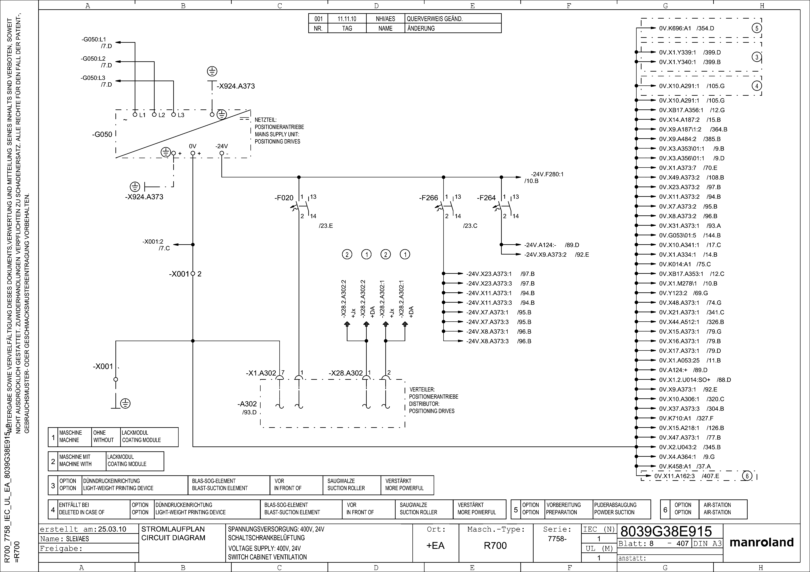

# +EA — Sheet 8 of 407 — SPANNUNGSVERSORGUNG: 400V, 24V

**SCHALTSCHRANKBELÜFTUNG**

> Part of the manroland **R700** printing press IEC/UL circuit diagrams.
> Drawing class: **Stromlaufplan / Circuit diagram** (DIN A3).
> Document `+EA` covers the **Printing unit** machine section.

## At a glance

| Field | Value |
|---|---|
| Document | `+EA`  (8039G38E915) |
| Sheet | **8** of 407 |
| Section (DE) | SPANNUNGSVERSORGUNG: 400V, 24V |
| Section (EN) | SCHALTSCHRANKBELÜFTUNG |
| Section type | POWER_SUPPLY — Voltage supply |
| Machine type | `R700` |
| Series | `7758` |
| Created | 25.03.10 |
| Replaces | — |
| Columns used | A, B, C, D, E, F, G, H |
| Path numbers | — |
| Labels on sheet | 242 |
| Cross-refs out | 62 |
| Cross-refs in | 66 |

**Previous:** [+EA sheet 7](SHEET_0007.md) · **Next:** [+EA sheet 9](SHEET_0009.md) · **Document TOC:** [_TOC.md](_TOC.md)  (+EA) · **Master TOC:** [all sheets](../_MASTER_TOC.md)

## Sheet image (300 DPI, exact vector render)



_Rendered directly from the PDF vector layer at 300 DPI (1-bit), no OCR and no resampling. Use it to confirm anything ambiguous in the text below._

## Cross-references on this sheet

Each entry is a wire leaving this sheet. The printed token is `/sheet.column`; the link resolves to that sheet inside the same document.

| Ref | Target sheet | Col | Path | Destination on target | Target section | From col |
|---|---|---|---|---|---|---|
| `/354.D` | [+EA sheet 354](SHEET_0354.md) | D | — | 0V.K696:A1 | OPTION: VORBEREITUNG: PUDERABSAUGUNG | G |
| `/7.D` | [+EA sheet 7](SHEET_0007.md) | D | — | G050:L1 | SPANNUNGSVERSORGUNG: 400V, 24V | A |
| `/399.D` | [+EA sheet 399](SHEET_0399.md) | D | — | 0V.X1.Y339:1 | OPTION: DÜNNDRUCKEINRICHTUNG | G |
| `/7.D` | [+EA sheet 7](SHEET_0007.md) | D | — | G050:L2 | SPANNUNGSVERSORGUNG: 400V, 24V | A |
| `/399.B` | [+EA sheet 399](SHEET_0399.md) | B | — | 0V.X1.Y340:1 | OPTION: DÜNNDRUCKEINRICHTUNG | G |
| `/7.D` | [+EA sheet 7](SHEET_0007.md) | D | — | G050:L3 | SPANNUNGSVERSORGUNG: 400V, 24V | A |
| `/105.G` | [+EA sheet 105](SHEET_0105.md) | G | — | 0V.X10.A291:1 | BOGENFÜHRUNGSELEMENT | G |
| `/105.G` | [+EA sheet 105](SHEET_0105.md) | G | — | 0V.X10.A291:1 | BOGENFÜHRUNGSELEMENT | G |
| `/12.G` | [+EA sheet 12](SHEET_0012.md) | G | — | 0V.XB17.A356:1 | SPANNUNGSVERSORGUNG: 400V, 24V | G |
| `/15.B` | [+EA sheet 15](SHEET_0015.md) | B | — | 0V.X14.A187:2 | SPANNUNGSVERSORGUNG: 400V, 24V | G |
| `/364.B` | [+EA sheet 364](SHEET_0364.md) | B | — | 0V.X9.A187\1:2 | OPTION: TROCKNER VORBEREITUNG; | G |
| `/385.B` | [+EA sheet 385](SHEET_0385.md) | B | — | 0V.X9.A484:2 | OPTION: ZWISCHENTROCKNER VORBEREITUNG; | G |
| `/9.B` | [+EA sheet 9](SHEET_0009.md) | B | — | 0V.X3.A353\01:1 | SPANNUNGSVERSORGUNG: 400V, 24V | G |
| `/9.D` | [+EA sheet 9](SHEET_0009.md) | D | — | 0V.X3.A356\01:1 | SPANNUNGSVERSORGUNG: 400V, 24V | G |
| `/70.E` | [+EA sheet 70](SHEET_0070.md) | E | — | 0V.X1.A373:7 | AUSLEGERSTAPELMOTOR | G |
| `/108.B` | [+EA sheet 108](SHEET_0108.md) | B | — | 0V.X49.A373:2 | BLAS/SAUGLUFT MIT MOTORVENTILEINSTELLUNG | G |
| `/10.B` | [+EA sheet 10](SHEET_0010.md) | B | — | — | SPANNUNGSVERSORGUNG: 400V, 24V | F |
| `/97.B` | [+EA sheet 97](SHEET_0097.md) | B | — | 0V.X23.A373:2 | BLASRAHMEN | G |
| `/94.B` | [+EA sheet 94](SHEET_0094.md) | B | — | 0V.X11.A373:2 | BLASRAHMEN | G |
| `/95.B` | [+EA sheet 95](SHEET_0095.md) | B | — | 0V.X7.A373:2 | BLASRAHMEN | G |
| `/96.B` | [+EA sheet 96](SHEET_0096.md) | B | — | 0V.X8.A373:2 | BLASRAHMEN | G |
| `/23.E` | [+EA sheet 23](SHEET_0023.md) | E | — | — | SPANNUNGSVERSORGUNG: 400V, 24V | C |
| `/93.A` | [+EA sheet 93](SHEET_0093.md) | A | — | 0V.X31.A373:1 | BLASRAHMEN | G |
| `/23.C` | [+EA sheet 23](SHEET_0023.md) | C | — | — | SPANNUNGSVERSORGUNG: 400V, 24V | E |
| `/144.B` | [+EA sheet 144](SHEET_0144.md) | B | — | 0V.G053\01:5 | ZUGANGSABSICHERUNG | G |
| `/7.C` | [+EA sheet 7](SHEET_0007.md) | C | — | X001:2 | SPANNUNGSVERSORGUNG: 400V, 24V | B |
| `/17.C` | [+EA sheet 17](SHEET_0017.md) | C | — | 0V.X10.A341:1 | SPANNUNGSVERSORGUNG: 400V, 24V | G |
| `/89.D` | [+EA sheet 89](SHEET_0089.md) | D | — | 24V.A124: | BELEUCHTUNG | F |
| `/92.E` | [+EA sheet 92](SHEET_0092.md) | E | — | 24V.X9.A373:2 | BLASRAHMEN | F |
| `/14.B` | [+EA sheet 14](SHEET_0014.md) | B | — | 0V.X1.A334:1 | SPANNUNGSVERSORGUNG: 400V, 24V | G |
| `/75.C` | [+EA sheet 75](SHEET_0075.md) | C | — | 0V.K014:A1 | AUSLEGERSTAPELSTEUERUNG | G |
| `/97.B` | [+EA sheet 97](SHEET_0097.md) | B | — | 24V.X23.A373:1 | BLASRAHMEN | E |
| `/12.C` | [+EA sheet 12](SHEET_0012.md) | C | — | 0V.XB17.A353:1 | SPANNUNGSVERSORGUNG: 400V, 24V | G |
| `/97.B` | [+EA sheet 97](SHEET_0097.md) | B | — | 24V.X23.A373:3 | BLASRAHMEN | E |
| `/10.B` | [+EA sheet 10](SHEET_0010.md) | B | — | 0V.X1.M278\1 | SPANNUNGSVERSORGUNG: 400V, 24V | G |
| `/94.B` | [+EA sheet 94](SHEET_0094.md) | B | — | 24V.X11.A373:1 | BLASRAHMEN | E |
| `/69.G` | [+EA sheet 69](SHEET_0069.md) | G | — | 0V.Y123:2 | SCHMIERUNG | G |
| `/94.B` | [+EA sheet 94](SHEET_0094.md) | B | — | 24V.X11.A373:3 | BLASRAHMEN | E |
| `/74.G` | [+EA sheet 74](SHEET_0074.md) | G | — | 0V.X48.A373:1 | AUSLEGERSTAPELSTEUERUNG | G |
| `/95.B` | [+EA sheet 95](SHEET_0095.md) | B | — | 24V.X7.A373:1 | BLASRAHMEN | E |
| `/341.C` | [+EA sheet 341](SHEET_0341.md) | C | — | 0V.X21.A373:1 | OPTION: BOGENWEICHE | G |
| `/95.B` | [+EA sheet 95](SHEET_0095.md) | B | — | 24V.X7.A373:3 | BLASRAHMEN | E |
| `/326.B` | [+EA sheet 326](SHEET_0326.md) | B | — | 0V.X44.A512:1 | OPTION: BOGENWEICHE | G |
| `/96.B` | [+EA sheet 96](SHEET_0096.md) | B | — | 24V.X8.A373:1 | BLASRAHMEN | E |
| `/79.G` | [+EA sheet 79](SHEET_0079.md) | G | — | 0V.X15.A373:1 | AUSLEGERSTAPELSTEUERUNG | G |
| `/96.B` | [+EA sheet 96](SHEET_0096.md) | B | — | 24V.X8.A373:3 | BLASRAHMEN | E |
| `/79.B` | [+EA sheet 79](SHEET_0079.md) | B | — | 0V.X16.A373:1 | AUSLEGERSTAPELSTEUERUNG | G |
| `/79.D` | [+EA sheet 79](SHEET_0079.md) | D | — | 0V.X17.A373:1 | AUSLEGERSTAPELSTEUERUNG | G |
| `/11.B` | [+EA sheet 11](SHEET_0011.md) | B | — | 0V.X1.A053:25 | SPANNUNGSVERSORGUNG: 400V, 24V | G |
| `/89.D` | [+EA sheet 89](SHEET_0089.md) | D | — | 0V.A124:+ | BELEUCHTUNG | G |
| `/88.D` | [+EA sheet 88](SHEET_0088.md) | D | — | 0V.X1.2.U014:SO+ | SAUGWALZE | G |
| `/92.E` | [+EA sheet 92](SHEET_0092.md) | E | — | 0V.X9.A373:1 | BLASRAHMEN | G |
| `/320.C` | [+EA sheet 320](SHEET_0320.md) | C | — | 0V.X10.A306:1 | OPTION: VERLÄNGERUNG 3656,8MM | G |
| `/304.B` | [+EA sheet 304](SHEET_0304.md) | B | — | 0V.X37.A373:3 | OPTION: ZWISCHENSTAPEL / | G |
| `/93.D` | [+EA sheet 93](SHEET_0093.md) | D | — | — | BLASRAHMEN | C |
| `/327.F` | [+EA sheet 327](SHEET_0327.md) | F | — | 0V.K710:A1 | OPTION: BOGENWEICHE | G |
| `/126.B` | [+EA sheet 126](SHEET_0126.md) | B | — | 0V.X15.A218:1 | ZUGANGSABSICHERUNG | G |
| `/77.B` | [+EA sheet 77](SHEET_0077.md) | B | — | 0V.X47.A373:1 | AUSLEGERSTAPELSTEUERUNG | G |
| `/345.B` | [+EA sheet 345](SHEET_0345.md) | B | — | 0V.X2.U043:2 | OPTION: INLINEOBSERVER | G |
| `/9.G` | [+EA sheet 9](SHEET_0009.md) | G | — | 0V.X4.A364:1 | SPANNUNGSVERSORGUNG: 400V, 24V | G |
| `/37.A` | [+EA sheet 37](SHEET_0037.md) | A | — | 0V.K458:A1 | BUSVERBINDUNGEN: NOT AUS | G |
| `/407.E` | [+EA sheet 407](SHEET_0407.md) | E | — | 0V.X11.A162:3 | OPTION: AIR STATION | G |

### Incoming references (sheets that point here)

Every other sheet that sends a wire to this one. `Back-ref` is the token printed on *that* sheet; `Path` is its line number.

| From sheet | Cols | Back-ref | Path | Refs | What continues there |
|---|---|---|---|---|---|
| [+EA#7](SHEET_0007.md) | C, D | `/7.C`, `/7.D` | — | 4 | G050:L1; G050:L2; G050:L3 |
| [+EA#9](SHEET_0009.md) | D | `/9.D` | — | 3 | 0V.X4.A364:1 0V.X3.A353\01:1 0V.X3.A356\01:1 |
| [+EA#10](SHEET_0010.md) | B | `/10.B` | — | 2 | 0V.X1.M278\1; 24V.F280:1 |
| [+EA#11](SHEET_0011.md) | B | `/11.B` | — | 1 | 0V.X1.A053:25 |
| [+EA#12](SHEET_0012.md) | C, G | `/12.C`, `/12.G` | — | 2 | 0V.XB17.A353:1; 0V.XB17.A356:1 |
| [+EA#14](SHEET_0014.md) | A | `/14.A` | — | 1 | 0V.X1.A334:1 |
| [+EA#15](SHEET_0015.md) | A | `/15.A` | — | 1 | 0V.X14.A187:2 |
| [+EA#17](SHEET_0017.md) | C | `/17.C` | — | 1 | 0V.X10.A341:1 |
| [+EA#23](SHEET_0023.md) | C, E | `/23.C`, `/23.E` | — | 2 | — |
| [+EA#37](SHEET_0037.md) | D | `/37.D` | — | 1 | 0V.K458:A1 |
| [+EA#69](SHEET_0069.md) | F | `/69.F` | — | 1 | 0V.Y123:2 |
| [+EA#70](SHEET_0070.md) | E | `/70.E` | — | 1 | 0V.X1.A373:7 |
| [+EA#74](SHEET_0074.md) | G | `/74.G` | — | 1 | 0V.X48.A373:1 |
| [+EA#75](SHEET_0075.md) | E | `/75.E` | — | 1 | 0V.K014:A1 0V.K384:A1 |
| [+EA#77](SHEET_0077.md) | A | `/77.A` | — | 1 | 0V.X47.A373:1 |
| [+EA#79](SHEET_0079.md) | D | `/79.D` | — | 3 | 0V.X16.A373:1 0V.X17.A373:1 0V.X15.A373:1 |
| [+EA#88](SHEET_0088.md) | D | `/88.D` | — | 1 | 0V.X1.2.U014:SO+ |
| [+EA#89](SHEET_0089.md) | E | `/89.E` | — | 2 | 0V.A124:+ 0V.A124:(+); 24V.A124: 24V.A124:( ) |
| [+EA#92](SHEET_0092.md) | D | `/92.D` | — | 2 | 0V.X9.A373:1; 24V.X9.A373:2 |
| [+EA#93](SHEET_0093.md) | A, D | `/93.A`, `/93.D` | — | 2 | — |
| [+EA#94](SHEET_0094.md) | B, C | `/94.B`, `/94.C` | — | 3 | 0V.X11.A373:2 X9.A155:2; 24V.X11.A373:1; 24V.X11.A373:3 |
| [+EA#95](SHEET_0095.md) | B | `/95.B` | — | 3 | 0V.X7.A373:2; 24V.X7.A373:1; 24V.X7.A373:3 |
| [+EA#96](SHEET_0096.md) | B | `/96.B` | — | 3 | 0V.X8.A373:2; 24V.X8.A373:1; 24V.X8.A373:3 |
| [+EA#97](SHEET_0097.md) | B | `/97.B` | — | 3 | 0V.X23.A373:2; 24V.X23.A373:1; 24V.X23.A373:3 |
| [+EA#105](SHEET_0105.md) | G | `/105.G` | — | 2 | — |
| [+EA#108](SHEET_0108.md) | A | `/108.A` | — | 1 | 0V.X49.A373:2 |
| [+EA#126](SHEET_0126.md) | A | `/126.A` | — | 1 | — |
| [+EA#144](SHEET_0144.md) | A | `/144.A` | — | 1 | 0V.G053\01:5 |
| [+EA#208](SHEET_0208.md) | B | `/208.B` | — | 2 | — |
| [+EA#272](SHEET_0272.md) | D | `/272.D` | — | 2 | — |
| [+EA#304](SHEET_0304.md) | A | `/304.A` | — | 1 | 0V.X37.A373:3 |
| [+EA#320](SHEET_0320.md) | C | `/320.C` | — | 1 | 0V.X10.A306:1 |
| [+EA#326](SHEET_0326.md) | A | `/326.A` | — | 1 | 0V.X44.A512:1 |
| [+EA#327](SHEET_0327.md) | E | `/327.E` | — | 1 | 0V.K710:A1 |
| [+EA#341](SHEET_0341.md) | C | `/341.C` | — | 1 | 0V.X21.A373:1 |
| [+EA#345](SHEET_0345.md) | B | `/345.B` | — | 1 | 0V.X2.U043:2 |
| [+EA#354](SHEET_0354.md) | E | `/354.E` | — | 1 | 0V.K696:A1 0V.K665:A1 |
| [+EA#364](SHEET_0364.md) | A | `/364.A` | — | 1 | 0V.X9.A187\1:2 |
| [+EA#385](SHEET_0385.md) | A | `/385.A` | — | 1 | 0V.X9.A484:2 |
| [+EA#399](SHEET_0399.md) | C | `/399.C` | — | 2 | 0V.X1.Y340:1 0V.X1.Y339:1 |
| [+EA#407](SHEET_0407.md) | E | `/407.E` | — | 1 | 0V.X11.A162:3 |


## Devices on this sheet

| Tag | Class | Class meaning (IEC) | Col | Sub | Terminal | Sign |
|---|---|---|---|---|---|---|
| `F020` | F | Schutz / protection device (fuse, circuit breaker) | C | — | — | — |
| `F264` | F | Schutz / protection device (fuse, circuit breaker) | E | — | — | — |
| `F266` | F | Schutz / protection device (fuse, circuit breaker) | E | — | — | — |
| `G050` | G | Stromversorgung / power supply | A | — | — | — |
| `A302` | A | Baugruppe / assembly, module, PC board | C | — | — | — |
| `X001` | X | Klemme / terminal, plug connector | B | — | — | — |
| `X001` | X | Klemme / terminal, plug connector | A | — | — | — |
| `X001:2` | X | Klemme / terminal, plug connector | B | — | 2 | — |
| `G050:L3` | G | Stromversorgung / power supply | A | — | L3 | — |
| `G050:L2` | G | Stromversorgung / power supply | A | — | L2 | — |
| `G050:L1` | G | Stromversorgung / power supply | A | — | L1 | — |
| `X28.A302` | — | cross-device reference | D | — | — | — |
| `X28.2.A302:2` | — | cross-device reference | D | — | 2 | — |
| `X28.2.A302:2` | — | cross-device reference | D | — | 2 | — |
| `X28.2.A302:1` | — | cross-device reference | D | — | 1 | — |
| `X28.2.A302:1` | — | cross-device reference | D | — | 1 | — |
| `X1.A302` | — | cross-device reference | C | — | — | — |
| `NR.` | — | cross-device reference | C | — | — | — |
| `11.11.10` | — | cross-device reference | D | — | — | — |
| `X924.A373` | — | cross-device reference | C | — | — | — |
| `X924.A373` | — | cross-device reference | B | — | — | — |

## Potentials / nets

| Potential | Count | Columns | Attached devices | Terminals |
|---|---|---|---|---|
| `0V` | 44 | B, G | `A053`, `A124`, `A162`, `A187`, `A187\1`, `A218`, `A291`, `A306`, `A334`, `A341`, `A353`, `A353\01`, `A356`, `A356\01`, `A364`, `A373`, `A484`, `A512`, `G053\01`, `K014`, `K458`, `K696`, `K710`, `M278\1`, `U043`, `X1`, `X10`, `X11`, `X14`, `X15`, `X16`, `X17`, `X2`, `X21`, `X23`, `X3`, `X31`, `X37`, `X4`, `X44`, `X47`, `X48`, `X49`, `X7`, `X8`, `X9`, `XB17`, `Y123`, `Y339`, `Y340` | `1`, `2`, `25`, `3`, `5`, `7`, `A1` |
| `24V` | 12 | B, E, F | `A124`, `A373`, `F280`, `X11`, `X23`, `X7`, `X8`, `X9` | `1`, `2`, `3` |
| `L1` | 1 | B | — | — |
| `L2` | 1 | B | — | — |
| `L3` | 1 | B | — | — |


A potential such as `L24+/4` or `M24+` is a named supply/return rail; every place it appears on this sheet is electrically common.

## Wire-end annotations (grouped as printed)

A wire that continues elsewhere is annotated with a small cluster: the destination description, the path/line number `#NN`, and the `/sheet.column` cross reference. Each row below is one such cluster exactly as it is grouped on the drawing.

| Col | Y | Path | Cross-ref | Text on the wire |
|---|---|---|---|---|
| D | 24.3 | — | — | `001 11.11.10 NHI/AES QUERVERWEIS GEÄND.` |
| G | 37.8 | — | `/354.D` | `0V.K696:A1` |
| D | 38.5 | — | — | `NR. TAG NAME ÄNDERUNG` |
| H | 38.6 | — | — | `5` |
| A | 54.2 | — | `/7.D` | `G050:L1` |
| G | 73.3 | — | `/399.D` | `0V.X1.Y339:1` |
| H | 81.1 | — | — | `3` |
| A | 82.5 | — | `/7.D` | `G050:L2` |
| G | 87.4 | — | `/399.B` | `0V.X1.Y340:1` |
| A | 110.9 | — | `/7.D` | `G050:L3` |
| C | 122.2 | — | — | `X924.A373` |
| G | 122.9 | — | `/105.G` | `0V.X10.A291:1` |
| H | 123.6 | — | — | `4` |
| G | 144.1 | — | `/105.G` | `0V.X10.A291:1` |
| G | 158.3 | — | `/12.G` | `0V.XB17.A356:1` |
| B | 165.4 | — | — | `L1 L2 L3` |
| A | 171.8 | — | — | `~` |
| G | 172.4 | — | `/15.B` | `0V.X14.A187:2` |
| C | 173.5 | — | — | `NETZTEIL: POSITIONIERANTRIEBE POSITIONING DRIVES MAINS SUPPLY UNIT:` |
| G | 186.6 | — | `/364.B` | `0V.X9.A187\1:2` |
| A | 193.1 | — | — | `G050` |
| G | 200.8 | — | `/385.B` | `0V.X9.A484:2` |
| B | 211.4 | — | — | `+ 0V + 24V` |
| G | 214.9 | — | `/9.B` | `0V.X3.A353\01:1` |
| G | 229.2 | — | `/9.D` | `0V.X3.A356\01:1` |
| G | 243.3 | — | `/70.E` | `0V.X1.A373:7` |
| F | 252.6 | — | — | `24V.F280:1` |
| G | 257.5 | — | `/108.B` | `0V.X49.A373:2` |
| F | 262.4 | — | `/10.B` | — |
| G | 271.7 | — | `/97.B` | `0V.X23.A373:2` |
| B | 285.2 | — | — | `X924.A373` |
| G | 285.8 | — | `/94.B` | `0V.X11.A373:2` |
| C | 285.9 | — | — | `1` |
| C | 285.9 | — | — | `13` |
| E | 285.9 | — | — | `1` |
| E | 285.9 | — | — | `13` |
| E | 285.9 | — | — | `1` |
| E | 285.9 | — | — | `13` |
| C | 286.6 | — | — | `F020` |
| E | 286.6 | — | — | `F266` |
| E | 286.6 | — | — | `F264` |
| G | 300.0 | — | `/95.B` | `0V.X7.A373:2` |
| G | 314.2 | — | `/96.B` | `0V.X8.A373:2` |
| C | 314.3 | — | — | `2` |
| C | 314.3 | — | — | `14` |
| E | 314.3 | — | — | `2` |
| E | 314.3 | — | — | `14` |
| E | 314.3 | — | — | `2` |
| E | 314.3 | — | — | `14` |
| C | 328.4 | — | `/23.E` | — |
| E | 328.4 | — | `/23.C` | — |
| G | 328.4 | — | `/93.A` | `0V.X31.A373:1` |
| G | 342.6 | — | `/144.B` | `0V.G053\01:5` |
| B | 351.8 | — | `/7.C` | `X001:2` |
| F | 356.7 | — | `/89.D` | `24V.A124:` |
| G | 356.7 | — | `/17.C` | `0V.X10.A341:1` |
| F | 370.9 | — | `/92.E` | `24V.X9.A373:2` |
| G | 370.9 | — | `/14.B` | `0V.X1.A334:1` |
| D | 371.1 | — | — | `2 1 2 1` |
| G | 385.1 | — | `/75.C` | `0V.K014:A1` |
| B | 398.3 | — | — | `X001 2` |
| E | 399.2 | — | `/97.B` | `24V.X23.A373:1` |
| G | 399.2 | — | `/12.C` | `0V.XB17.A353:1` |
| D | 411.9 | — | — | `X28.2.A302:2` |
| D | 411.9 | — | — | `X28.2.A302:2` |
| D | 411.9 | — | — | `X28.2.A302:1` |
| D | 411.9 | — | — | `X28.2.A302:1` |
| E | 413.4 | — | `/97.B` | `24V.X23.A373:3` |
| G | 413.4 | — | `/10.B` | `0V.X1.M278\1` |
| E | 427.6 | — | `/94.B` | `24V.X11.A373:1` |
| G | 427.6 | — | `/69.G` | `0V.Y123:2` |
| E | 441.7 | — | `/94.B` | `24V.X11.A373:3` |
| G | 441.8 | — | `/74.G` | `0V.X48.A373:1` |
| D | 450.7 | — | — | `+DA` |
| D | 450.7 | — | — | `+DA` |
| D | 454.4 | — | — | `+Jx` |
| D | 454.4 | — | — | `+Jx` |
| E | 455.9 | — | `/95.B` | `24V.X7.A373:1` |
| G | 455.9 | — | `/341.C` | `0V.X21.A373:1` |
| E | 470.1 | — | `/95.B` | `24V.X7.A373:3` |
| G | 470.1 | — | `/326.B` | `0V.X44.A512:1` |
| E | 484.3 | — | `/96.B` | `24V.X8.A373:1` |
| G | 484.3 | — | `/79.G` | `0V.X15.A373:1` |
| E | 498.4 | — | `/96.B` | `24V.X8.A373:3` |
| G | 498.4 | — | `/79.B` | `0V.X16.A373:1` |
| G | 512.6 | — | `/79.D` | `0V.X17.A373:1` |
| G | 526.8 | — | `/11.B` | `0V.X1.A053:25` |
| A | 534.4 | — | — | `X001 '` |
| G | 541.0 | — | `/89.D` | `0V.A124:+` |
| C | 544.6 | — | — | `X1.A302 7` |
| C | 544.6 | — | — | `1` |
| D | 544.6 | — | — | `X28.A302 1 2` |
| G | 555.1 | — | `/88.D` | `0V.X1.2.U014:SO+` |
| G | 569.3 | — | `/92.E` | `0V.X9.A373:1` |
| E | 570.4 | — | — | `POSITIONIERANTRIEBE DISTRIBUTOR: POSITIONING DRIVES VERTEILER:` |
| G | 583.5 | — | `/320.C` | `0V.X10.A306:1` |
| C | 589.9 | — | — | `A302` |
| G | 597.7 | — | `/304.B` | `0V.X37.A373:3` |
| C | 603.0 | — | `/93.D` | — |
| G | 611.8 | — | `/327.F` | `0V.K710:A1` |
| G | 626.0 | — | `/126.B` | `0V.X15.A218:1` |
| A | 634.2 | — | — | `1 MASCHINE MACHINE` |
| A | 634.2 | — | — | `OHNE WITHOUT` |
| A | 634.2 | — | — | `LACKMODUL` |
| G | 640.2 | — | `/77.B` | `0V.X47.A373:1` |
| B | 644.8 | — | — | `COATING MODULE` |
| G | 654.4 | — | `/345.B` | `0V.X2.U043:2` |
| G | 668.5 | — | `/9.G` | `0V.X4.A364:1` |
| A | 669.6 | — | — | `2 MASCHINE MIT MACHINE WITH` |
| A | 669.6 | — | — | `LACKMODUL` |
| A | 680.2 | — | — | `COATING MODULE` |
| G | 682.7 | — | `/37.A` | `0V.K458:A1` |
| G | 696.9 | — | `/407.E` | `0V.X11.A162:3` |
| H | 697.6 | — | — | `6` |
| A | 705.0 | — | — | `3 OPTION OPTION` |
| B | 705.0 | — | — | `BLAS SOG ELEMENT BLAST SUCTION ELEMENT` |
| C | 705.0 | — | — | `IN FRONT OF VOR` |
| D | 705.0 | — | — | `SAUGWALZE SUCTION ROLLER` |
| D | 705.0 | — | — | `MORE POWERFUL VERSTÄRKT` |
| A | 705.1 | — | — | `DÜNNDRUCKEINRICHTUNG LIGHT WEIGHT PRINTING DEVICE` |
| A | 740.4 | — | — | `4 ENTFÄLLT BEI DELETED IN CASE OF` |
| B | 740.4 | — | — | `OPTION OPTION` |
| D | 740.4 | — | — | `SAUGWALZE SUCTION ROLLER` |
| F | 740.4 | — | — | `5 OPTION OPTION` |
| G | 740.4 | — | — | `PUDERABSAUGUNG POWDER SUCTION 6 OPTION OPTION` |
| B | 740.5 | — | — | `DÜNNDRUCKEINRICHTUNG LIGHT WEIGHT PRINTING DEVICE` |
| C | 740.5 | — | — | `BLAS SOG ELEMENT BLAST SUCTION ELEMENT` |
| D | 740.5 | — | — | `IN FRONT OF VOR` |
| E | 740.5 | — | — | `MORE POWERFUL VERSTÄRKT` |
| F | 740.5 | — | — | `PREPARATION VORBEREITUNG` |
| H | 740.5 | — | — | `AIR STATION AIR STATION` |


## Reconstructed tables

This sheet carries tabular content (pin map / terminal assignment / index). The grid below was rebuilt from the drawing's own rule lines, so each row is exactly one physical row of the table.

### Table 1 — 2 data rows × 12 columns (at x=170.1, y=90.7)

| ~ | L1 | L2 | L3 0V + | + | 24V | X924.A373 NETZTEIL: POSITIONIERANTRIEBE MAINS SUPPLY POSITIONING | UNIT: DRIVES |  |  |  |  |
|---|---|---|---|---|---|---|---|---|---|---|---|
|  | `X924.A373 X001:2` | `/7.C` | `X001` | `2` |  |  | `F020` | `1 13 2 14 /23.E 2 X28.2.A302:2 X28.2.A302:2 +Jx` | `1 X28.2.A302:1 +DA` | `F266 1 2 X28.2.A302:1 +DA +Jx` | `1 13 F264 2 14 /23.C 24V.X23.A373:1 24V.X23.A373:3 24V.X11.A373:1 24V.X11.A373:3 24V.X7.A373:1 24V.X7.A373:3 24V.X8.A373:1` |
| `' COATING` | `LACKMODUL MODULE` |  |  |  |  | `X1.A302 A302 /93.D` | `7` | `X28.A302 1` | `1` | `2 VERTEILER: POSITIONIERANTRIEBE DISTRIBUTOR: POSITIONING` | `24V.X8.A373:3 DRIVES` |


## Notes and free text on this sheet

| Text | Col | Y (pt) |
|---|---|---|
| `+Jx` | D | 454.4 |
| `+DA` | D | 450.71 |
| `NETZTEIL:` | C | 173.49 |
| `POSITIONIERANTRIEBE` | C | 184.15 |
| `MAINS SUPPLY UNIT:` | C | 194.79 |
| `POSITIONING DRIVES` | C | 205.42 |
| `VERTEILER:` | D | 570.37 |
| `POSITIONIERANTRIEBE` | E | 581 |
| `DISTRIBUTOR:` | E | 591.63 |
| `POSITIONING DRIVES` | E | 602.27 |
| `TAG` | D | 38.61 |
| `NAME` | D | 38.59 |
| `ÄNDERUNG` | D | 38.65 |
| `NHI/AES` | D | 24.45 |
| `QUERVERWEIS GEÄND.` | E | 24.44 |
| `0V.X1.2.U014:SO+` | G | 555.15 |
| `MASCHINE` | A | 634.17 |
| `MACHINE` | A | 644.8 |
| `MASCHINE MIT` | A | 669.61 |
| `MACHINE WITH` | A | 680.2 |
| `LACKMODUL` | A | 669.62 |
| `COATING MODULE` | A | 680.25 |
| `OHNE` | A | 634.16 |
| `WITHOUT` | A | 644.76 |
| `COATING MODULE` | B | 644.82 |
| `ENTFÄLLT BEI` | A | 740.43 |
| `DELETED IN CASE OF` | A | 751.09 |
| `OPTION` | B | 740.44 |
| `DÜNNDRUCKEINRICHTUNG` | B | 740.5 |
| `LIGHT WEIGHT PRINTING DEVICE` | B | 751.08 |
| `BLAS SOG ELEMENT` | C | 740.47 |
| `BLAST SUCTION ELEMENT` | C | 751.1 |
| `VOR` | D | 740.47 |
| `IN FRONT OF` | D | 751.09 |
| `SAUGWALZE` | D | 740.42 |
| `SUCTION ROLLER` | D | 751.12 |
| `VERSTÄRKT` | E | 740.46 |
| `MORE POWERFUL` | E | 751.09 |
| `OPTION` | A | 705.01 |
| `DÜNNDRUCKEINRICHTUNG` | A | 705.06 |
| `LIGHT WEIGHT PRINTING DEVICE` | A | 715.65 |
| `BLAS SOG ELEMENT` | B | 705.04 |
| `BLAST SUCTION ELEMENT` | B | 715.67 |
| `VOR` | C | 705.04 |
| `IN FRONT OF` | C | 715.66 |
| `VERSTÄRKT` | D | 705.03 |
| `MORE POWERFUL` | D | 715.65 |
| `OPTION` | F | 740.44 |
| `VORBEREITUNG` | F | 740.47 |
| `PREPARATION` | F | 751.07 |
| `PUDERABSAUGUNG` | F | 740.47 |
| `POWDER SUCTION` | F | 751.07 |
| `OPTION` | G | 740.44 |
| `AIR STATION` | H | 740.46 |

## Complete label inventory (exact text from the drawing)

Every text object inside the drawing area of this sheet, in DIN reading order (column A→H, then top→bottom). This is the authoritative list: if a string is not here it is not printed on this sheet.

| Col | Y | X | Dir | Type | Text |
|---|---|---|---|---|---|
| A | 54.2 | 119.9 | → | device tag | `G050:L1` |
| A | 64.0 | 148.5 | → | cross-reference | `/7.D` |
| A | 82.5 | 118.8 | → | device tag | `G050:L2` |
| A | 92.4 | 148.5 | → | cross-reference | `/7.D` |
| A | 110.9 | 118.5 | → | device tag | `G050:L3` |
| A | 120.7 | 148.5 | → | cross-reference | `/7.D` |
| A | 171.8 | 181.0 | → | other | `~` |
| A | 193.1 | 135.5 | → | device tag | `G050` |
| A | 534.4 | 136.6 | → | device tag | `X001` |
| A | 540.5 | 172.6 | → | other | `'` |
| A | 634.2 | 87.3 | → | text | `MASCHINE` |
| A | 634.2 | 137.2 | → | text | `OHNE` |
| A | 634.2 | 179.1 | → | text | `LACKMODUL` |
| A | 639.5 | 75.4 | → | number | `1` |
| A | 644.8 | 87.3 | → | text | `MACHINE` |
| A | 644.8 | 137.5 | → | text | `WITHOUT` |
| A | 669.6 | 87.3 | → | text | `MASCHINE MIT` |
| A | 669.6 | 157.9 | → | text | `LACKMODUL` |
| A | 674.9 | 75.1 | → | number | `2` |
| A | 680.2 | 87.3 | → | text | `MACHINE WITH` |
| A | 680.3 | 158.5 | → | text | `COATING MODULE` |
| A | 705.0 | 87.6 | → | text | `OPTION` |
| A | 705.1 | 122.5 | → | text | `DÜNNDRUCKEINRICHTUNG` |
| A | 710.3 | 75.0 | → | number | `3` |
| A | 715.6 | 87.6 | → | text | `OPTION` |
| A | 715.7 | 122.5 | → | text | `LIGHT WEIGHT PRINTING DEVICE` |
| A | 740.4 | 87.0 | → | text | `ENTFÄLLT BEI` |
| A | 745.8 | 75.1 | → | number | `4` |
| A | 751.1 | 87.0 | → | text | `DELETED IN CASE OF` |
| B | 165.4 | 204.7 | → | potential | `L1` |
| B | 165.4 | 233.0 | → | potential | `L2` |
| B | 165.4 | 261.4 | → | potential | `L3` |
| B | 211.5 | 277.9 | → | potential | `0V` |
| B | 211.5 | 316.6 | → | potential | `24V` |
| B | 222.1 | 261.9 | → | number | `+` |
| B | 222.1 | 290.3 | → | number | `+` |
| B | 285.2 | 184.0 | → | device ref | `X924.A373` |
| B | 351.8 | 209.5 | → | device tag | `X001:2` |
| B | 361.7 | 233.6 | → | cross-reference | `/7.C` |
| B | 398.3 | 248.6 | → | device tag | `X001` |
| B | 398.5 | 290.3 | → | number | `2` |
| B | 644.8 | 179.7 | → | text | `COATING MODULE` |
| B | 705.0 | 282.6 | → | text | `BLAS SOG ELEMENT` |
| B | 715.7 | 282.6 | → | text | `BLAST SUCTION ELEMENT` |
| B | 740.4 | 193.9 | → | text | `OPTION` |
| B | 740.5 | 228.8 | → | text | `DÜNNDRUCKEINRICHTUNG` |
| B | 751.1 | 193.9 | → | text | `OPTION` |
| B | 751.1 | 228.8 | → | text | `LIGHT WEIGHT PRINTING DEVICE` |
| C | 24.3 | 462.5 | → | number | `001` |
| C | 38.5 | 461.5 | → | device ref | `NR.` |
| C | 122.2 | 318.6 | → | device ref | `X924.A373` |
| C | 173.5 | 374.7 | → | text | `NETZTEIL:` |
| C | 184.2 | 374.7 | → | text | `POSITIONIERANTRIEBE` |
| C | 194.8 | 375.0 | → | text | `MAINS SUPPLY UNIT:` |
| C | 205.4 | 374.7 | → | text | `POSITIONING DRIVES` |
| C | 285.9 | 441.4 | → | number | `1` |
| C | 285.9 | 455.5 | → | number | `13` |
| C | 286.6 | 403.7 | → | device tag | `F020` |
| C | 314.3 | 441.9 | → | number | `2` |
| C | 314.3 | 455.5 | → | number | `14` |
| C | 328.4 | 468.9 | → | cross-reference | `/23.E` |
| C | 544.6 | 361.7 | → | device ref | `X1.A302` |
| C | 544.6 | 413.6 | → | number | `7` |
| C | 544.6 | 441.4 | → | number | `1` |
| C | 589.9 | 349.2 | → | device tag | `A302` |
| C | 603.0 | 356.3 | → | cross-reference | `/93.D` |
| C | 705.0 | 403.9 | → | text | `VOR` |
| C | 715.7 | 403.1 | → | text | `IN FRONT OF` |
| C | 740.5 | 388.9 | → | text | `BLAS SOG ELEMENT` |
| C | 751.1 | 388.9 | → | text | `BLAST SUCTION ELEMENT` |
| D | 24.4 | 552.7 | → | text | `NHI/AES` |
| D | 24.5 | 496.3 | → | device ref | `11.11.10` |
| D | 38.6 | 503.1 | → | text | `TAG` |
| D | 38.6 | 556.5 | → | text | `NAME` |
| D | 38.6 | 599.1 | → | text | `ÄNDERUNG` |
| D | 371.1 | 536.8 | → | number | `1` |
| D | 371.1 | 593.5 | → | number | `1` |
| D | 371.6 | 508.2 | → | number | `2` |
| D | 371.6 | 564.9 | → | number | `2` |
| D | 411.9 | 501.3 | ↕ | device ref | `X28.2.A302:2` |
| D | 411.9 | 529.7 | ↕ | device ref | `X28.2.A302:2` |
| D | 411.9 | 558.0 | ↕ | device ref | `X28.2.A302:1` |
| D | 411.9 | 586.3 | ↕ | device ref | `X28.2.A302:1` |
| D | 450.7 | 543.8 | ↕ | text | `+DA` |
| D | 450.7 | 600.5 | ↕ | text | `+DA` |
| D | 454.4 | 515.6 | ↕ | text | `+Jx` |
| D | 454.4 | 572.2 | ↕ | text | `+Jx` |
| D | 544.6 | 483.3 | → | device ref | `X28.A302` |
| D | 544.6 | 540.6 | → | number | `1` |
| D | 544.6 | 569.5 | → | number | `2` |
| D | 570.4 | 602.4 | → | text | `VERTEILER:` |
| D | 705.0 | 481.6 | → | text | `SAUGWALZE` |
| D | 705.0 | 566.9 | → | text | `VERSTÄRKT` |
| D | 715.7 | 481.6 | → | text | `SUCTION ROLLER` |
| D | 715.7 | 566.4 | → | text | `MORE POWERFUL` |
| D | 740.4 | 587.9 | → | text | `SAUGWALZE` |
| D | 740.5 | 510.2 | → | text | `VOR` |
| D | 751.1 | 509.4 | → | text | `IN FRONT OF` |
| D | 751.1 | 587.9 | → | text | `SUCTION ROLLER` |
| E | 24.4 | 598.3 | → | text | `QUERVERWEIS GEÄND.` |
| E | 285.9 | 654.0 | → | number | `1` |
| E | 285.9 | 668.1 | → | number | `13` |
| E | 285.9 | 739.0 | → | number | `1` |
| E | 285.9 | 753.2 | → | number | `13` |
| E | 286.6 | 616.3 | → | device tag | `F266` |
| E | 286.6 | 701.3 | → | device tag | `F264` |
| E | 314.3 | 654.5 | → | number | `2` |
| E | 314.3 | 668.1 | → | number | `14` |
| E | 314.3 | 739.6 | → | number | `2` |
| E | 314.3 | 753.2 | → | number | `14` |
| E | 328.4 | 680.9 | → | cross-reference | `/23.C` |
| E | 399.3 | 685.7 | → | potential | `24V.X23.A373:1` |
| E | 413.4 | 685.7 | → | potential | `24V.X23.A373:3` |
| E | 427.6 | 685.7 | → | potential | `24V.X11.A373:1` |
| E | 441.8 | 685.7 | → | potential | `24V.X11.A373:3` |
| E | 455.9 | 685.7 | → | potential | `24V.X7.A373:1` |
| E | 470.1 | 685.7 | → | potential | `24V.X7.A373:3` |
| E | 484.3 | 685.7 | → | potential | `24V.X8.A373:1` |
| E | 498.5 | 685.7 | → | potential | `24V.X8.A373:3` |
| E | 581.0 | 601.5 | → | text | `POSITIONIERANTRIEBE` |
| E | 591.6 | 601.5 | → | text | `DISTRIBUTOR:` |
| E | 602.3 | 601.5 | → | text | `POSITIONING DRIVES` |
| E | 740.5 | 673.2 | → | text | `VERSTÄRKT` |
| E | 745.8 | 755.3 | → | number | `5` |
| E | 751.1 | 672.7 | → | text | `MORE POWERFUL` |
| F | 252.6 | 780.7 | → | potential | `24V.F280:1` |
| F | 262.5 | 771.0 | → | cross-reference | `/10.B` |
| F | 356.7 | 770.7 | → | potential | `24V.A124:` |
| F | 356.7 | 830.6 | → | cross-reference | `/89.D` |
| F | 370.9 | 770.7 | → | potential | `24V.X9.A373:2` |
| F | 370.9 | 845.4 | → | cross-reference | `/92.E` |
| F | 399.2 | 765.4 | → | cross-reference | `/97.B` |
| F | 413.4 | 765.4 | → | cross-reference | `/97.B` |
| F | 427.6 | 765.4 | → | cross-reference | `/94.B` |
| F | 441.7 | 765.4 | → | cross-reference | `/94.B` |
| F | 455.9 | 760.4 | → | cross-reference | `/95.B` |
| F | 470.1 | 760.4 | → | cross-reference | `/95.B` |
| F | 484.3 | 760.4 | → | cross-reference | `/96.B` |
| F | 498.4 | 760.4 | → | cross-reference | `/96.B` |
| F | 740.4 | 767.9 | → | text | `OPTION` |
| F | 740.5 | 803.6 | → | text | `VORBEREITUNG` |
| F | 740.5 | 873.6 | → | text | `PUDERABSAUGUNG` |
| F | 751.1 | 767.9 | → | text | `OPTION` |
| F | 751.1 | 802.8 | → | text | `PREPARATION` |
| F | 751.1 | 873.6 | → | text | `POWDER SUCTION` |
| G | 37.8 | 969.2 | → | potential | `0V.K696:A1` |
| G | 37.8 | 1024.0 | → | cross-reference | `/354.D` |
| G | 73.3 | 969.2 | → | potential | `0V.X1.Y339:1` |
| G | 73.3 | 1033.9 | → | cross-reference | `/399.D` |
| G | 87.4 | 969.2 | → | potential | `0V.X1.Y340:1` |
| G | 87.4 | 1033.9 | → | cross-reference | `/399.B` |
| G | 122.9 | 969.2 | → | potential | `0V.X10.A291:1` |
| G | 144.1 | 969.2 | → | potential | `0V.X10.A291:1` |
| G | 158.3 | 969.2 | → | potential | `0V.XB17.A356:1` |
| G | 172.5 | 969.2 | → | potential | `0V.X14.A187:2` |
| G | 186.6 | 969.2 | → | potential | `0V.X9.A187\1:2` |
| G | 200.8 | 969.2 | → | potential | `0V.X9.A484:2` |
| G | 200.8 | 1033.9 | → | cross-reference | `/385.B` |
| G | 215.0 | 969.2 | → | potential | `0V.X3.A353\01:1` |
| G | 229.2 | 969.2 | → | potential | `0V.X3.A356\01:1` |
| G | 243.3 | 969.2 | → | potential | `0V.X1.A373:7` |
| G | 243.3 | 1033.9 | → | cross-reference | `/70.E` |
| G | 257.5 | 969.2 | → | potential | `0V.X49.A373:2` |
| G | 271.7 | 969.2 | → | potential | `0V.X23.A373:2` |
| G | 285.9 | 969.2 | → | potential | `0V.X11.A373:2` |
| G | 300.0 | 969.2 | → | potential | `0V.X7.A373:2` |
| G | 300.0 | 1033.9 | → | cross-reference | `/95.B` |
| G | 314.2 | 969.2 | → | potential | `0V.X8.A373:2` |
| G | 314.2 | 1033.9 | → | cross-reference | `/96.B` |
| G | 328.4 | 969.2 | → | potential | `0V.X31.A373:1` |
| G | 342.5 | 1033.9 | → | cross-reference | `/144.B` |
| G | 342.6 | 969.2 | → | potential | `0V.G053\01:5` |
| G | 356.7 | 969.2 | → | potential | `0V.X10.A341:1` |
| G | 370.9 | 969.2 | → | potential | `0V.X1.A334:1` |
| G | 370.9 | 1033.9 | → | cross-reference | `/14.B` |
| G | 385.1 | 969.2 | → | potential | `0V.K014:A1` |
| G | 385.1 | 1024.0 | → | cross-reference | `/75.C` |
| G | 399.2 | 969.2 | → | potential | `0V.XB17.A353:1` |
| G | 413.4 | 969.2 | → | potential | `0V.X1.M278\1` |
| G | 413.4 | 1033.9 | → | cross-reference | `/10.B` |
| G | 427.6 | 969.2 | → | potential | `0V.Y123:2` |
| G | 427.6 | 1019.1 | → | cross-reference | `/69.G` |
| G | 441.8 | 969.2 | → | potential | `0V.X48.A373:1` |
| G | 455.9 | 969.2 | → | potential | `0V.X21.A373:1` |
| G | 470.1 | 969.2 | → | potential | `0V.X44.A512:1` |
| G | 484.3 | 969.2 | → | potential | `0V.X15.A373:1` |
| G | 498.5 | 969.2 | → | potential | `0V.X16.A373:1` |
| G | 512.6 | 969.2 | → | potential | `0V.X17.A373:1` |
| G | 526.8 | 969.2 | → | potential | `0V.X1.A053:25` |
| G | 541.0 | 969.2 | → | potential | `0V.A124:+` |
| G | 541.0 | 1019.1 | → | cross-reference | `/89.D` |
| G | 555.2 | 969.2 | → | text | `0V.X1.2.U014:SO+` |
| G | 569.3 | 969.2 | → | potential | `0V.X9.A373:1` |
| G | 569.3 | 1033.9 | → | cross-reference | `/92.E` |
| G | 583.5 | 969.2 | → | potential | `0V.X10.A306:1` |
| G | 597.7 | 969.2 | → | potential | `0V.X37.A373:3` |
| G | 611.8 | 969.2 | → | potential | `0V.K710:A1` |
| G | 611.8 | 1024.0 | → | cross-reference | `/327.F` |
| G | 626.0 | 969.2 | → | potential | `0V.X15.A218:1` |
| G | 640.2 | 969.2 | → | potential | `0V.X47.A373:1` |
| G | 654.4 | 969.2 | → | potential | `0V.X2.U043:2` |
| G | 654.4 | 1033.9 | → | cross-reference | `/345.B` |
| G | 668.5 | 969.2 | → | potential | `0V.X4.A364:1` |
| G | 668.5 | 1033.9 | → | cross-reference | `/9.G` |
| G | 682.7 | 969.2 | → | potential | `0V.K458:A1` |
| G | 682.7 | 1024.0 | → | cross-reference | `/37.A` |
| G | 696.9 | 962.1 | → | potential | `0V.X11.A162:3` |
| G | 696.9 | 1031.8 | → | cross-reference | `/407.E` |
| G | 740.4 | 991.8 | → | text | `OPTION` |
| G | 745.8 | 975.1 | → | number | `6` |
| G | 751.1 | 991.8 | → | text | `OPTION` |
| H | 38.6 | 1110.6 | → | number | `5` |
| H | 81.1 | 1110.6 | → | number | `3` |
| H | 122.9 | 1038.9 | → | cross-reference | `/105.G` |
| H | 123.6 | 1110.6 | → | number | `4` |
| H | 144.1 | 1038.9 | → | cross-reference | `/105.G` |
| H | 158.3 | 1043.9 | → | cross-reference | `/12.G` |
| H | 172.5 | 1038.9 | → | cross-reference | `/15.B` |
| H | 186.6 | 1043.9 | → | cross-reference | `/364.B` |
| H | 214.9 | 1048.8 | → | cross-reference | `/9.B` |
| H | 229.2 | 1048.8 | → | cross-reference | `/9.D` |
| H | 257.5 | 1038.9 | → | cross-reference | `/108.B` |
| H | 271.7 | 1038.9 | → | cross-reference | `/97.B` |
| H | 285.8 | 1038.9 | → | cross-reference | `/94.B` |
| H | 328.4 | 1038.9 | → | cross-reference | `/93.A` |
| H | 356.7 | 1038.9 | → | cross-reference | `/17.C` |
| H | 399.3 | 1043.9 | → | cross-reference | `/12.C` |
| H | 441.8 | 1038.9 | → | cross-reference | `/74.G` |
| H | 456.0 | 1038.9 | → | cross-reference | `/341.C` |
| H | 470.1 | 1038.9 | → | cross-reference | `/326.B` |
| H | 484.3 | 1038.9 | → | cross-reference | `/79.G` |
| H | 498.4 | 1038.9 | → | cross-reference | `/79.B` |
| H | 512.6 | 1038.9 | → | cross-reference | `/79.D` |
| H | 526.8 | 1038.9 | → | cross-reference | `/11.B` |
| H | 555.2 | 1053.8 | → | cross-reference | `/88.D` |
| H | 583.5 | 1038.9 | → | cross-reference | `/320.C` |
| H | 597.7 | 1038.9 | → | cross-reference | `/304.B` |
| H | 626.0 | 1038.9 | → | cross-reference | `/126.B` |
| H | 640.2 | 1038.9 | → | cross-reference | `/77.B` |
| H | 697.6 | 1096.4 | → | number | `6` |
| H | 740.5 | 1034.6 | → | text | `AIR STATION` |
| H | 751.1 | 1034.6 | → | text | `AIR STATION` |

## Reading-order text block

The same content as a plain block, grouped by DIN column — convenient to paste or to match against a visual description.

```text
=== Column A ===
  54.2  119.9  devtag       G050:L1
  64.0  148.5  xref         /7.D
  82.5  118.8  devtag       G050:L2
  92.4  148.5  xref         /7.D
 110.9  118.5  devtag       G050:L3
 120.7  148.5  xref         /7.D
 171.8  181.0  other        ~
 193.1  135.5  devtag       G050
 534.4  136.6  devtag       X001
 540.5  172.6  other        `
 634.2   87.3  text         MASCHINE
 634.2  137.2  text         OHNE
 634.2  179.1  text         LACKMODUL
 639.5   75.4  numeric      1
 644.8   87.3  text         MACHINE
 644.8  137.5  text         WITHOUT
 669.6   87.3  text         MASCHINE MIT
 669.6  157.9  text         LACKMODUL
 674.9   75.1  numeric      2
 680.2   87.3  text         MACHINE WITH
 680.3  158.5  text         COATING MODULE
 705.0   87.6  text         OPTION
 705.1  122.5  text         DÜNNDRUCKEINRICHTUNG
 710.3   75.0  numeric      3
 715.6   87.6  text         OPTION
 715.7  122.5  text         LIGHT WEIGHT PRINTING DEVICE
 740.4   87.0  text         ENTFÄLLT BEI
 745.8   75.1  numeric      4
 751.1   87.0  text         DELETED IN CASE OF
=== Column B ===
 165.4  204.7  net          L1
 165.4  233.0  net          L2
 165.4  261.4  net          L3
 211.5  277.9  net          0V
 211.5  316.6  net          24V
 222.1  261.9  numeric      +
 222.1  290.3  numeric      +
 285.2  184.0  devref       X924.A373
 351.8  209.5  devtag       X001:2
 361.7  233.6  xref         /7.C
 398.3  248.6  devtag       X001
 398.5  290.3  numeric      2
 644.8  179.7  text         COATING MODULE
 705.0  282.6  text         BLAS SOG ELEMENT
 715.7  282.6  text         BLAST SUCTION ELEMENT
 740.4  193.9  text         OPTION
 740.5  228.8  text         DÜNNDRUCKEINRICHTUNG
 751.1  193.9  text         OPTION
 751.1  228.8  text         LIGHT WEIGHT PRINTING DEVICE
=== Column C ===
  24.3  462.5  numeric      001
  38.5  461.5  devref       NR.
 122.2  318.6  devref       X924.A373
 173.5  374.7  text         NETZTEIL:
 184.2  374.7  text         POSITIONIERANTRIEBE
 194.8  375.0  text         MAINS SUPPLY UNIT:
 205.4  374.7  text         POSITIONING DRIVES
 285.9  441.4  numeric      1
 285.9  455.5  numeric      13
 286.6  403.7  devtag       F020
 314.3  441.9  numeric      2
 314.3  455.5  numeric      14
 328.4  468.9  xref         /23.E
 544.6  361.7  devref       X1.A302
 544.6  413.6  numeric      7
 544.6  441.4  numeric      1
 589.9  349.2  devtag       A302
 603.0  356.3  xref         /93.D
 705.0  403.9  text         VOR
 715.7  403.1  text         IN FRONT OF
 740.5  388.9  text         BLAS SOG ELEMENT
 751.1  388.9  text         BLAST SUCTION ELEMENT
=== Column D ===
  24.4  552.7  text         NHI/AES
  24.5  496.3  devref       11.11.10
  38.6  503.1  text         TAG
  38.6  556.5  text         NAME
  38.6  599.1  text         ÄNDERUNG
 371.1  536.8  numeric      1
 371.1  593.5  numeric      1
 371.6  508.2  numeric      2
 371.6  564.9  numeric      2
 411.9  501.3  devref       X28.2.A302:2
 411.9  529.7  devref       X28.2.A302:2
 411.9  558.0  devref       X28.2.A302:1
 411.9  586.3  devref       X28.2.A302:1
 450.7  543.8  text         +DA
 450.7  600.5  text         +DA
 454.4  515.6  text         +Jx
 454.4  572.2  text         +Jx
 544.6  483.3  devref       X28.A302
 544.6  540.6  numeric      1
 544.6  569.5  numeric      2
 570.4  602.4  text         VERTEILER:
 705.0  481.6  text         SAUGWALZE
 705.0  566.9  text         VERSTÄRKT
 715.7  481.6  text         SUCTION ROLLER
 715.7  566.4  text         MORE POWERFUL
 740.4  587.9  text         SAUGWALZE
 740.5  510.2  text         VOR
 751.1  509.4  text         IN FRONT OF
 751.1  587.9  text         SUCTION ROLLER
=== Column E ===
  24.4  598.3  text         QUERVERWEIS GEÄND.
 285.9  654.0  numeric      1
 285.9  668.1  numeric      13
 285.9  739.0  numeric      1
 285.9  753.2  numeric      13
 286.6  616.3  devtag       F266
 286.6  701.3  devtag       F264
 314.3  654.5  numeric      2
 314.3  668.1  numeric      14
 314.3  739.6  numeric      2
 314.3  753.2  numeric      14
 328.4  680.9  xref         /23.C
 399.3  685.7  net          24V.X23.A373:1
 413.4  685.7  net          24V.X23.A373:3
 427.6  685.7  net          24V.X11.A373:1
 441.8  685.7  net          24V.X11.A373:3
 455.9  685.7  net          24V.X7.A373:1
 470.1  685.7  net          24V.X7.A373:3
 484.3  685.7  net          24V.X8.A373:1
 498.5  685.7  net          24V.X8.A373:3
 581.0  601.5  text         POSITIONIERANTRIEBE
 591.6  601.5  text         DISTRIBUTOR:
 602.3  601.5  text         POSITIONING DRIVES
 740.5  673.2  text         VERSTÄRKT
 745.8  755.3  numeric      5
 751.1  672.7  text         MORE POWERFUL
=== Column F ===
 252.6  780.7  net          24V.F280:1
 262.5  771.0  xref         /10.B
 356.7  770.7  net          24V.A124:
 356.7  830.6  xref         /89.D
 370.9  770.7  net          24V.X9.A373:2
 370.9  845.4  xref         /92.E
 399.2  765.4  xref         /97.B
 413.4  765.4  xref         /97.B
 427.6  765.4  xref         /94.B
 441.7  765.4  xref         /94.B
 455.9  760.4  xref         /95.B
 470.1  760.4  xref         /95.B
 484.3  760.4  xref         /96.B
 498.4  760.4  xref         /96.B
 740.4  767.9  text         OPTION
 740.5  803.6  text         VORBEREITUNG
 740.5  873.6  text         PUDERABSAUGUNG
 751.1  767.9  text         OPTION
 751.1  802.8  text         PREPARATION
 751.1  873.6  text         POWDER SUCTION
=== Column G ===
  37.8  969.2  net          0V.K696:A1
  37.8 1024.0  xref         /354.D
  73.3  969.2  net          0V.X1.Y339:1
  73.3 1033.9  xref         /399.D
  87.4  969.2  net          0V.X1.Y340:1
  87.4 1033.9  xref         /399.B
 122.9  969.2  net          0V.X10.A291:1
 144.1  969.2  net          0V.X10.A291:1
 158.3  969.2  net          0V.XB17.A356:1
 172.5  969.2  net          0V.X14.A187:2
 186.6  969.2  net          0V.X9.A187\1:2
 200.8  969.2  net          0V.X9.A484:2
 200.8 1033.9  xref         /385.B
 215.0  969.2  net          0V.X3.A353\01:1
 229.2  969.2  net          0V.X3.A356\01:1
 243.3  969.2  net          0V.X1.A373:7
 243.3 1033.9  xref         /70.E
 257.5  969.2  net          0V.X49.A373:2
 271.7  969.2  net          0V.X23.A373:2
 285.9  969.2  net          0V.X11.A373:2
 300.0  969.2  net          0V.X7.A373:2
 300.0 1033.9  xref         /95.B
 314.2  969.2  net          0V.X8.A373:2
 314.2 1033.9  xref         /96.B
 328.4  969.2  net          0V.X31.A373:1
 342.5 1033.9  xref         /144.B
 342.6  969.2  net          0V.G053\01:5
 356.7  969.2  net          0V.X10.A341:1
 370.9  969.2  net          0V.X1.A334:1
 370.9 1033.9  xref         /14.B
 385.1  969.2  net          0V.K014:A1
 385.1 1024.0  xref         /75.C
 399.2  969.2  net          0V.XB17.A353:1
 413.4  969.2  net          0V.X1.M278\1
 413.4 1033.9  xref         /10.B
 427.6  969.2  net          0V.Y123:2
 427.6 1019.1  xref         /69.G
 441.8  969.2  net          0V.X48.A373:1
 455.9  969.2  net          0V.X21.A373:1
 470.1  969.2  net          0V.X44.A512:1
 484.3  969.2  net          0V.X15.A373:1
 498.5  969.2  net          0V.X16.A373:1
 512.6  969.2  net          0V.X17.A373:1
 526.8  969.2  net          0V.X1.A053:25
 541.0  969.2  net          0V.A124:+
 541.0 1019.1  xref         /89.D
 555.2  969.2  text         0V.X1.2.U014:SO+
 569.3  969.2  net          0V.X9.A373:1
 569.3 1033.9  xref         /92.E
 583.5  969.2  net          0V.X10.A306:1
 597.7  969.2  net          0V.X37.A373:3
 611.8  969.2  net          0V.K710:A1
 611.8 1024.0  xref         /327.F
 626.0  969.2  net          0V.X15.A218:1
 640.2  969.2  net          0V.X47.A373:1
 654.4  969.2  net          0V.X2.U043:2
 654.4 1033.9  xref         /345.B
 668.5  969.2  net          0V.X4.A364:1
 668.5 1033.9  xref         /9.G
 682.7  969.2  net          0V.K458:A1
 682.7 1024.0  xref         /37.A
 696.9  962.1  net          0V.X11.A162:3
 696.9 1031.8  xref         /407.E
 740.4  991.8  text         OPTION
 745.8  975.1  numeric      6
 751.1  991.8  text         OPTION
=== Column H ===
  38.6 1110.6  numeric      5
  81.1 1110.6  numeric      3
 122.9 1038.9  xref         /105.G
 123.6 1110.6  numeric      4
 144.1 1038.9  xref         /105.G
 158.3 1043.9  xref         /12.G
 172.5 1038.9  xref         /15.B
 186.6 1043.9  xref         /364.B
 214.9 1048.8  xref         /9.B
 229.2 1048.8  xref         /9.D
 257.5 1038.9  xref         /108.B
 271.7 1038.9  xref         /97.B
 285.8 1038.9  xref         /94.B
 328.4 1038.9  xref         /93.A
 356.7 1038.9  xref         /17.C
 399.3 1043.9  xref         /12.C
 441.8 1038.9  xref         /74.G
 456.0 1038.9  xref         /341.C
 470.1 1038.9  xref         /326.B
 484.3 1038.9  xref         /79.G
 498.4 1038.9  xref         /79.B
 512.6 1038.9  xref         /79.D
 526.8 1038.9  xref         /11.B
 555.2 1053.8  xref         /88.D
 583.5 1038.9  xref         /320.C
 597.7 1038.9  xref         /304.B
 626.0 1038.9  xref         /126.B
 640.2 1038.9  xref         /77.B
 697.6 1096.4  numeric      6
 740.5 1034.6  text         AIR STATION
 751.1 1034.6  text         AIR STATION
```

---
_Generated from the PDF vector text layer; no OCR. Source: `R700_7758_IEC_UL_EA_8039G38E915_p`, sheet 8._
