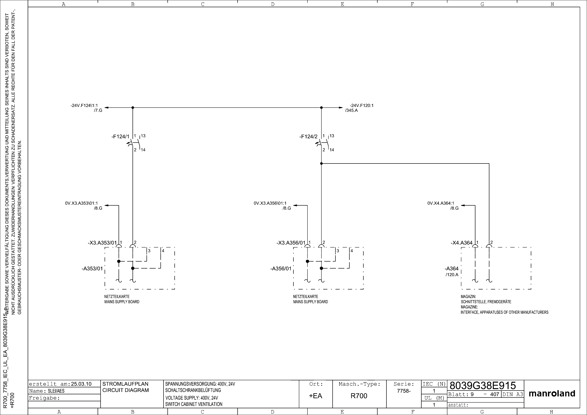

# +EA — Sheet 9 of 407 — SPANNUNGSVERSORGUNG: 400V, 24V

**SCHALTSCHRANKBELÜFTUNG**

> Part of the manroland **R700** printing press IEC/UL circuit diagrams.
> Drawing class: **Stromlaufplan / Circuit diagram** (DIN A3).
> Document `+EA` covers the **Printing unit** machine section.

## At a glance

| Field | Value |
|---|---|
| Document | `+EA`  (8039G38E915) |
| Sheet | **9** of 407 |
| Section (DE) | SPANNUNGSVERSORGUNG: 400V, 24V |
| Section (EN) | SCHALTSCHRANKBELÜFTUNG |
| Section type | POWER_SUPPLY — Voltage supply |
| Machine type | `R700` |
| Series | `7758` |
| Created | 25.03.10 |
| Replaces | — |
| Columns used | A, B, D, E, F, G |
| Path numbers | — |
| Labels on sheet | 45 |
| Cross-refs out | 6 |
| Cross-refs in | 12 |

**Previous:** [+EA sheet 8](SHEET_0008.md) · **Next:** [+EA sheet 10](SHEET_0010.md) · **Document TOC:** [_TOC.md](_TOC.md)  (+EA) · **Master TOC:** [all sheets](../_MASTER_TOC.md)

## Sheet image (300 DPI, exact vector render)



_Rendered directly from the PDF vector layer at 300 DPI (1-bit), no OCR and no resampling. Use it to confirm anything ambiguous in the text below._

## Cross-references on this sheet

Each entry is a wire leaving this sheet. The printed token is `/sheet.column`; the link resolves to that sheet inside the same document.

| Ref | Target sheet | Col | Path | Destination on target | Target section | From col |
|---|---|---|---|---|---|---|
| `/7.G` | [+EA sheet 7](SHEET_0007.md) | G | — | 24V.F124\1:1 | SPANNUNGSVERSORGUNG: 400V, 24V | A |
| `/345.A` | [+EA sheet 345](SHEET_0345.md) | A | — | — | OPTION: INLINEOBSERVER | E |
| `/8.G` | [+EA sheet 8](SHEET_0008.md) | G | — | 0V.X4.A364:1 0V.X3.A353\01:1 0V.X3.A356\01:1 | SPANNUNGSVERSORGUNG: 400V, 24V | D |
| `/8.G` | [+EA sheet 8](SHEET_0008.md) | G | — | 0V.X4.A364:1 0V.X3.A353\01:1 0V.X3.A356\01:1 | SPANNUNGSVERSORGUNG: 400V, 24V | D |
| `/8.G` | [+EA sheet 8](SHEET_0008.md) | G | — | 0V.X4.A364:1 0V.X3.A353\01:1 0V.X3.A356\01:1 | SPANNUNGSVERSORGUNG: 400V, 24V | D |
| `/120.A` | [+EA sheet 120](SHEET_0120.md) | A | — | — | SCHNITTSTELLE: FREMDGERÄTE | G |

### Incoming references (sheets that point here)

Every other sheet that sends a wire to this one. `Back-ref` is the token printed on *that* sheet; `Path` is its line number.

| From sheet | Cols | Back-ref | Path | Refs | What continues there |
|---|---|---|---|---|---|
| [+EA#7](SHEET_0007.md) | H | `/7.H` | — | 1 | 24V.F124\1:1 |
| [+EA#8](SHEET_0008.md) | G | `/8.G` | — | 3 | 0V.X3.A353\01:1; 0V.X3.A356\01:1; 0V.X4.A364:1 |
| [+EA#120](SHEET_0120.md) | A | `/120.A` | — | 1 | — |
| [+EA#234](SHEET_0234.md) | G | `/234.G` | — | 2 | — |
| [+EA#235](SHEET_0235.md) | B | `/235.B` | — | 2 | — |
| [+EA#237](SHEET_0237.md) | H | `/237.H` | — | 2 | — |
| [+EA#345](SHEET_0345.md) | A | `/345.A` | — | 1 | — |


## Devices on this sheet

| Tag | Class | Class meaning (IEC) | Col | Sub | Terminal | Sign |
|---|---|---|---|---|---|---|
| `A353/01` | A | Baugruppe / assembly, module, PC board | A | 01 | — | — |
| `F124/1` | F | Schutz / protection device (fuse, circuit breaker) | B | 1 | — | — |
| `F124/2` | F | Schutz / protection device (fuse, circuit breaker) | E | 2 | — | — |
| `A356/01` | A | Baugruppe / assembly, module, PC board | D | 01 | — | — |
| `A364` | A | Baugruppe / assembly, module, PC board | G | — | — | — |
| `X4.A364` | — | cross-device reference | G | — | — | — |

## Potentials / nets

| Potential | Count | Columns | Attached devices | Terminals |
|---|---|---|---|---|
| `0V` | 3 | A, D, F | `A353\01`, `A356\01`, `A364`, `X3`, `X4` | `1` |
| `24V` | 2 | A, E | `F120`, `F124\1` | `1` |


A potential such as `L24+/4` or `M24+` is a named supply/return rail; every place it appears on this sheet is electrically common.

## Wire-end annotations (grouped as printed)

A wire that continues elsewhere is annotated with a small cluster: the destination description, the path/line number `#NN`, and the `/sheet.column` cross reference. Each row below is one such cluster exactly as it is grouped on the drawing.

| Col | Y | Path | Cross-ref | Text on the wire |
|---|---|---|---|---|
| A | 210.1 | — | `/7.G` | `24V.F124\1:1` |
| E | 210.1 | — | — | `24V.F120:1` |
| E | 219.9 | — | `/345.A` | — |
| C | 271.7 | — | — | `F124/1 1` |
| B | 271.7 | — | — | `1` |
| B | 271.7 | — | — | `13` |
| E | 271.7 | — | — | `13` |
| E | 272.4 | — | — | `F124/2` |
| B | 300.1 | — | — | `2` |
| B | 300.1 | — | — | `14` |
| E | 300.1 | — | — | `2` |
| E | 300.1 | — | — | `14` |
| D | 408.4 | — | `/8.G`, `/8.G`, `/8.G` | `0V.X3.A353\01:1 0V.X3.A356\01:1 0V.X4.A364:1` |
| B | 487.9 | — | — | `X3.A353/01 1 2` |
| D | 487.9 | — | — | `X3.A356/01 1 2` |
| G | 487.9 | — | — | `X4.A364 1 2` |
| B | 504.9 | — | — | `3 4` |
| E | 504.9 | — | — | `3 4` |
| A | 540.3 | — | — | `A353/01` |
| D | 540.3 | — | — | `A356/01` |
| G | 540.3 | — | — | `A364` |
| G | 553.4 | — | `/120.A` | — |
| B | 598.7 | — | — | `NETZTEILKARTE MAINS SUPPLY BOARD` |
| E | 598.7 | — | — | `NETZTEILKARTE MAINS SUPPLY BOARD` |
| G | 598.7 | — | — | `INTERFACE, APPARATUSES OF OTHER MANUFACTURERS MAGAZIN: MAGAZINE: SCHNITTSTELLE, FREMDGERÄTE` |


## Reconstructed tables

This sheet carries tabular content (pin map / terminal assignment / index). The grid below was rebuilt from the drawing's own rule lines, so each row is exactly one physical row of the table.

### Table 1 — 1 data rows × 2 columns (at x=623.6, y=218.3)

| F124/2 | 1 13 2 14 |
|---|---|
| `1` | `2 3` |


## Notes and free text on this sheet

| Text | Col | Y (pt) |
|---|---|---|
| `NETZTEILKARTE` | B | 598.71 |
| `MAINS SUPPLY BOARD` | B | 609.37 |
| `X3.A353/01` | B | 487.87 |
| `NETZTEILKARTE` | D | 598.71 |
| `MAINS SUPPLY BOARD` | E | 609.37 |
| `X3.A356/01` | D | 487.87 |
| `MAGAZIN:` | G | 598.71 |
| `SCHNITTSTELLE, FREMDGERÄTE` | G | 609.37 |
| `MAGAZINE:` | G | 619.97 |
| `INTERFACE, APPARATUSES OF OTHER MANUFACTURERS` | G | 630.64 |

## Complete label inventory (exact text from the drawing)

Every text object inside the drawing area of this sheet, in DIN reading order (column A→H, then top→bottom). This is the authoritative list: if a string is not here it is not printed on this sheet.

| Col | Y | X | Dir | Type | Text |
|---|---|---|---|---|---|
| A | 210.0 | 143.1 | → | potential | `24V.F124\1:1` |
| A | 219.9 | 190.8 | → | cross-reference | `/7.G` |
| A | 408.5 | 132.1 | → | potential | `0V.X3.A353\01:1` |
| A | 418.4 | 190.8 | → | cross-reference | `/8.G` |
| A | 540.3 | 165.8 | → | device tag | `A353/01` |
| B | 271.7 | 271.3 | → | number | `1` |
| B | 271.7 | 285.4 | → | number | `13` |
| B | 272.4 | 226.2 | → | device tag | `F124/1` |
| B | 300.1 | 271.8 | → | number | `2` |
| B | 300.1 | 285.4 | → | number | `14` |
| B | 487.9 | 178.3 | → | text | `X3.A353/01` |
| B | 487.9 | 242.9 | → | number | `1` |
| B | 487.9 | 271.8 | → | number | `2` |
| B | 504.9 | 300.2 | → | number | `3` |
| B | 504.9 | 328.5 | → | number | `4` |
| B | 598.7 | 211.7 | → | text | `NETZTEILKARTE` |
| B | 609.4 | 212.0 | → | text | `MAINS SUPPLY BOARD` |
| D | 408.5 | 514.8 | → | potential | `0V.X3.A356\01:1` |
| D | 418.4 | 573.4 | → | cross-reference | `/8.G` |
| D | 487.9 | 561.0 | → | text | `X3.A356/01` |
| D | 540.3 | 548.5 | → | device tag | `A356/01` |
| D | 598.7 | 594.4 | → | text | `NETZTEILKARTE` |
| E | 210.1 | 709.8 | → | potential | `24V.F120:1` |
| E | 219.9 | 700.2 | → | cross-reference | `/345.A` |
| E | 271.7 | 654.0 | → | number | `1` |
| E | 271.7 | 668.1 | → | number | `13` |
| E | 272.4 | 607.5 | → | device tag | `F124/2` |
| E | 300.1 | 654.5 | → | number | `2` |
| E | 300.1 | 668.1 | → | number | `14` |
| E | 487.9 | 625.6 | → | number | `1` |
| E | 487.9 | 654.5 | → | number | `2` |
| E | 504.9 | 682.9 | → | number | `3` |
| E | 504.9 | 711.2 | → | number | `4` |
| E | 609.4 | 594.7 | → | text | `MAINS SUPPLY BOARD` |
| F | 408.5 | 867.1 | → | potential | `0V.X4.A364:1` |
| G | 418.4 | 913.6 | → | cross-reference | `/8.G` |
| G | 487.9 | 914.5 | → | device ref | `X4.A364` |
| G | 487.9 | 965.8 | → | number | `1` |
| G | 487.9 | 994.7 | → | number | `2` |
| G | 540.3 | 902.0 | → | device tag | `A364` |
| G | 553.4 | 904.3 | → | cross-reference | `/120.A` |
| G | 598.7 | 934.9 | → | text | `MAGAZIN:` |
| G | 609.4 | 935.1 | → | text | `SCHNITTSTELLE, FREMDGERÄTE` |
| G | 620.0 | 934.9 | → | text | `MAGAZINE:` |
| G | 630.6 | 934.6 | → | text | `INTERFACE, APPARATUSES OF OTHER MANUFACTURERS` |

## Reading-order text block

The same content as a plain block, grouped by DIN column — convenient to paste or to match against a visual description.

```text
=== Column A ===
 210.0  143.1  net          24V.F124\1:1
 219.9  190.8  xref         /7.G
 408.5  132.1  net          0V.X3.A353\01:1
 418.4  190.8  xref         /8.G
 540.3  165.8  devtag       A353/01
=== Column B ===
 271.7  271.3  numeric      1
 271.7  285.4  numeric      13
 272.4  226.2  devtag       F124/1
 300.1  271.8  numeric      2
 300.1  285.4  numeric      14
 487.9  178.3  text         X3.A353/01
 487.9  242.9  numeric      1
 487.9  271.8  numeric      2
 504.9  300.2  numeric      3
 504.9  328.5  numeric      4
 598.7  211.7  text         NETZTEILKARTE
 609.4  212.0  text         MAINS SUPPLY BOARD
=== Column D ===
 408.5  514.8  net          0V.X3.A356\01:1
 418.4  573.4  xref         /8.G
 487.9  561.0  text         X3.A356/01
 540.3  548.5  devtag       A356/01
 598.7  594.4  text         NETZTEILKARTE
=== Column E ===
 210.1  709.8  net          24V.F120:1
 219.9  700.2  xref         /345.A
 271.7  654.0  numeric      1
 271.7  668.1  numeric      13
 272.4  607.5  devtag       F124/2
 300.1  654.5  numeric      2
 300.1  668.1  numeric      14
 487.9  625.6  numeric      1
 487.9  654.5  numeric      2
 504.9  682.9  numeric      3
 504.9  711.2  numeric      4
 609.4  594.7  text         MAINS SUPPLY BOARD
=== Column F ===
 408.5  867.1  net          0V.X4.A364:1
=== Column G ===
 418.4  913.6  xref         /8.G
 487.9  914.5  devref       X4.A364
 487.9  965.8  numeric      1
 487.9  994.7  numeric      2
 540.3  902.0  devtag       A364
 553.4  904.3  xref         /120.A
 598.7  934.9  text         MAGAZIN:
 609.4  935.1  text         SCHNITTSTELLE, FREMDGERÄTE
 620.0  934.9  text         MAGAZINE:
 630.6  934.6  text         INTERFACE, APPARATUSES OF OTHER MANUFACTURERS
```

---
_Generated from the PDF vector text layer; no OCR. Source: `R700_7758_IEC_UL_EA_8039G38E915_p`, sheet 9._
