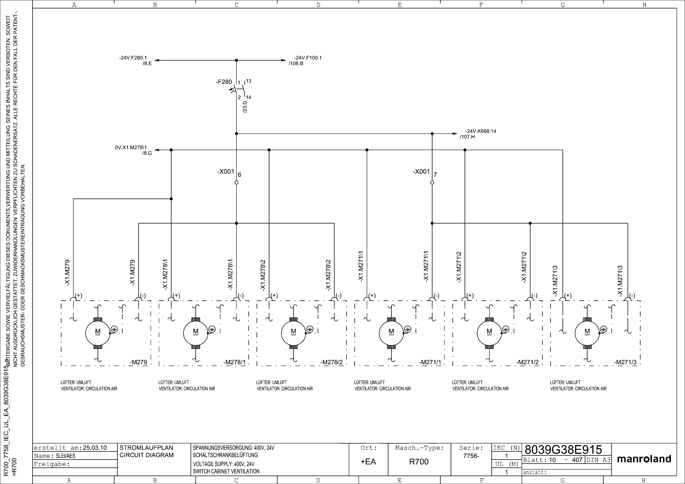

# +EA — Sheet 10 of 407 — SPANNUNGSVERSORGUNG: 400V, 24V

**SCHALTSCHRANKBELÜFTUNG**

> Part of the manroland **R700** printing press IEC/UL circuit diagrams.
> Drawing class: **Stromlaufplan / Circuit diagram** (DIN A3).
> Document `+EA` covers the **Printing unit** machine section.

## At a glance

| Field | Value |
|---|---|
| Document | `+EA`  (8039G38E915) |
| Sheet | **10** of 407 |
| Section (DE) | SPANNUNGSVERSORGUNG: 400V, 24V |
| Section (EN) | SCHALTSCHRANKBELÜFTUNG |
| Section type | POWER_SUPPLY — Voltage supply |
| Machine type | `R700` |
| Series | `7758` |
| Created | 25.03.10 |
| Replaces | — |
| Columns used | A, B, C, D, E, F, G, H |
| Path numbers | — |
| Labels on sheet | 66 |
| Cross-refs out | 5 |
| Cross-refs in | 5 |

**Previous:** [+EA sheet 9](SHEET_0009.md) · **Next:** [+EA sheet 11](SHEET_0011.md) · **Document TOC:** [_TOC.md](_TOC.md)  (+EA) · **Master TOC:** [all sheets](../_MASTER_TOC.md)

## Sheet image (300 DPI, exact vector render)



_Rendered directly from the PDF vector layer at 300 DPI (1-bit), no OCR and no resampling. Use it to confirm anything ambiguous in the text below._

## Cross-references on this sheet

Each entry is a wire leaving this sheet. The printed token is `/sheet.column`; the link resolves to that sheet inside the same document.

| Ref | Target sheet | Col | Path | Destination on target | Target section | From col |
|---|---|---|---|---|---|---|
| `/8.E` | [+EA sheet 8](SHEET_0008.md) | E | — | 24V.F280:1 | SPANNUNGSVERSORGUNG: 400V, 24V | B |
| `/108.B` | [+EA sheet 108](SHEET_0108.md) | B | — | — | BLAS/SAUGLUFT MIT MOTORVENTILEINSTELLUNG | D |
| `/23.D` | [+EA sheet 23](SHEET_0023.md) | D | — | — | SPANNUNGSVERSORGUNG: 400V, 24V | C |
| `/107.H` | [+EA sheet 107](SHEET_0107.md) | H | — | — | BOGENGLÄTTER | F |
| `/8.G` | [+EA sheet 8](SHEET_0008.md) | G | — | 0V.X1.M278\1 | SPANNUNGSVERSORGUNG: 400V, 24V | B |

### Incoming references (sheets that point here)

Every other sheet that sends a wire to this one. `Back-ref` is the token printed on *that* sheet; `Path` is its line number.

| From sheet | Cols | Back-ref | Path | Refs | What continues there |
|---|---|---|---|---|---|
| [+EA#8](SHEET_0008.md) | F, G | `/8.F`, `/8.G` | — | 2 | 0V.X1.M278\1 |
| [+EA#23](SHEET_0023.md) | D | `/23.D` | — | 1 | — |
| [+EA#107](SHEET_0107.md) | E | `/107.E` | — | 1 | 24V.K668:14 24V.Q105:14 |
| [+EA#108](SHEET_0108.md) | B | `/108.B` | — | 1 | 24V.F100:1 |


## Devices on this sheet

| Tag | Class | Class meaning (IEC) | Col | Sub | Terminal | Sign |
|---|---|---|---|---|---|---|
| `M271/1` | M | Motor | E | 1 | — | — |
| `M271/2` | M | Motor | G | 2 | — | — |
| `M271/3` | M | Motor | H | 3 | — | — |
| `M278/1` | M | Motor | C | 1 | — | — |
| `F280` | F | Schutz / protection device (fuse, circuit breaker) | C | — | — | — |
| `M278/2` | M | Motor | D | 2 | — | — |
| `X001` | X | Klemme / terminal, plug connector | E | — | — | — |
| `X001` | X | Klemme / terminal, plug connector | C | — | — | — |
| `X1.M278\2` | — | cross-device reference | C | — | — | — |
| `X1.M278\2` | — | cross-device reference | D | — | — | — |
| `X1.M271\1` | — | cross-device reference | E | — | — | — |
| `X1.M271\1` | — | cross-device reference | E | — | — | — |
| `X1.M271\2` | — | cross-device reference | F | — | — | — |
| `X1.M271\2` | — | cross-device reference | G | — | — | — |
| `X1.M271\3` | — | cross-device reference | G | — | — | — |
| `X1.M278\1` | — | cross-device reference | B | — | — | — |
| `X1.M278\1` | — | cross-device reference | C | — | — | — |
| `X1.M279` | — | cross-device reference | A | — | — | — |
| `X1.M279` | — | cross-device reference | B | — | — | — |
| `X1.M271\3` | — | cross-device reference | H | — | — | — |

## Potentials / nets

| Potential | Count | Columns | Attached devices | Terminals |
|---|---|---|---|---|
| `0V` | 1 | B | `M278\1`, `X1` | — |
| `24V` | 3 | B, D, F | `F100`, `F280`, `K668` | `1`, `14` |
| `M279` | 1 | B | — | — |


A potential such as `L24+/4` or `M24+` is a named supply/return rail; every place it appears on this sheet is electrically common.

## Wire-end annotations (grouped as printed)

A wire that continues elsewhere is annotated with a small cluster: the destination description, the path/line number `#NN`, and the `/sheet.column` cross reference. Each row below is one such cluster exactly as it is grouped on the drawing.

| Col | Y | Path | Cross-ref | Text on the wire |
|---|---|---|---|---|
| B | 96.7 | — | `/8.E` | `24V.F280:1` |
| D | 96.7 | — | — | `24V.F100:1` |
| D | 106.6 | — | `/108.B` | — |
| C | 137.1 | — | — | `13` |
| C | 137.8 | — | — | `F280` |
| C | 139.9 | — | — | `1` |
| C | 165.4 | — | — | `2` |
| C | 165.4 | — | — | `14` |
| C | 175.5 | — | `/23.D` | — |
| F | 224.2 | — | — | `24V.K668:14` |
| F | 234.2 | — | `/107.H` | — |
| B | 252.6 | — | `/8.G` | `0V.X1.M278\1` |
| D | 293.4 | — | — | `X001 6 X001 7` |
| E | 436.0 | — | — | `X1.M271\1` |
| E | 436.0 | — | — | `X1.M271\1` |
| F | 437.4 | — | — | `X1.M271\2` |
| G | 437.4 | — | — | `X1.M271\2` |
| B | 450.1 | — | — | `X1.M278\1` |
| C | 450.1 | — | — | `X1.M278\1` |
| A | 451.6 | — | — | `X1.M279` |
| B | 451.6 | — | — | `X1.M279` |
| C | 451.6 | — | — | `X1.M278\2` |
| D | 451.6 | — | — | `X1.M278\2` |
| G | 461.5 | — | — | `X1.M271\3` |
| H | 461.5 | — | — | `X1.M271\3` |
| A | 509.2 | — | — | `(+)` |
| B | 509.2 | — | — | `(+)` |
| C | 509.2 | — | — | `(+)` |
| E | 509.2 | — | — | `(+)` |
| F | 509.2 | — | — | `(+)` |
| G | 509.2 | — | — | `(+)` |
| B | 509.3 | — | — | `( )` |
| C | 509.3 | — | — | `( )` |
| D | 509.3 | — | — | `( )` |
| E | 509.3 | — | — | `( )` |
| G | 509.3 | — | — | `( )` |
| H | 509.3 | — | — | `( )` |
| A | 571.3 | — | — | `M` |
| B | 571.3 | — | — | `M` |
| D | 571.3 | — | — | `M` |
| E | 571.3 | — | — | `M` |
| F | 571.3 | — | — | `M` |
| G | 571.3 | — | — | `M` |
| B | 625.4 | — | — | `M279` |
| C | 625.4 | — | — | `M278/1` |
| D | 625.4 | — | — | `M278/2` |
| E | 625.4 | — | — | `M271/1` |
| G | 625.4 | — | — | `M271/2` |
| H | 625.4 | — | — | `M271/3` |
| A | 662.5 | — | — | `LÜFTER: UMLUFT` |
| B | 662.5 | — | — | `LÜFTER: UMLUFT` |
| C | 662.5 | — | — | `LÜFTER: UMLUFT` |
| E | 662.5 | — | — | `LÜFTER: UMLUFT` |
| F | 662.5 | — | — | `LÜFTER: UMLUFT` |
| G | 662.5 | — | — | `LÜFTER: UMLUFT` |
| A | 673.2 | — | — | `VENTILATOR: CIRCULATION AIR` |
| B | 673.2 | — | — | `VENTILATOR: CIRCULATION AIR` |
| D | 673.2 | — | — | `VENTILATOR: CIRCULATION AIR` |
| E | 673.2 | — | — | `VENTILATOR: CIRCULATION AIR` |
| F | 673.2 | — | — | `VENTILATOR: CIRCULATION AIR` |
| G | 673.2 | — | — | `VENTILATOR: CIRCULATION AIR` |


## Reconstructed tables

This sheet carries tabular content (pin map / terminal assignment / index). The grid below was rebuilt from the drawing's own rule lines, so each row is exactly one physical row of the table.

### Table 1 — 3 data rows × 2 columns (at x=212.6, y=104.9)

| C1 | C2 |
|---|---|
|  | `/8.E` |
| `0V.X1.M278\1` |  |
|  | `/8.G` |


### Table 2 — 1 data rows × 3 columns (at x=382.7, y=104.9)

| F280 | 13 1 2 14 /23.D | /108.B |
|---|---|---|
| `X001` | `6` |  |


### Table 3 — 0 data rows × 3 columns (at x=722.8, y=104.9) — **24V.K668:14 /107.H**

_none_


## Notes and free text on this sheet

| Text | Col | Y (pt) |
|---|---|---|
| `M` | D | 571.26 |
| `LÜFTER: UMLUFT` | E | 662.53 |
| `VENTILATOR: CIRCULATION AIR` | E | 673.16 |
| `M` | E | 571.26 |
| `LÜFTER: UMLUFT` | F | 662.53 |
| `VENTILATOR: CIRCULATION AIR` | F | 673.16 |
| `M` | F | 571.26 |
| `LÜFTER: UMLUFT` | G | 662.53 |
| `VENTILATOR: CIRCULATION AIR` | G | 673.16 |
| `M` | G | 571.26 |
| `M` | B | 571.26 |
| `M` | A | 571.26 |
| `LÜFTER: UMLUFT` | B | 662.53 |
| `VENTILATOR: CIRCULATION AIR` | B | 673.16 |
| `LÜFTER: UMLUFT` | A | 662.53 |
| `VENTILATOR: CIRCULATION AIR` | A | 673.16 |
| `LÜFTER: UMLUFT` | C | 662.53 |
| `VENTILATOR: CIRCULATION AIR` | D | 673.16 |

## Complete label inventory (exact text from the drawing)

Every text object inside the drawing area of this sheet, in DIN reading order (column A→H, then top→bottom). This is the authoritative list: if a string is not here it is not printed on this sheet.

| Col | Y | X | Dir | Type | Text |
|---|---|---|---|---|---|
| A | 451.6 | 112.3 | ↕ | device ref | `X1.M279` |
| A | 509.2 | 129.8 | → | other | `(+)` |
| A | 571.3 | 165.4 | → | text | `M` |
| A | 662.5 | 105.4 | → | text | `LÜFTER: UMLUFT` |
| A | 673.2 | 106.3 | → | text | `VENTILATOR: CIRCULATION AIR` |
| B | 96.7 | 207.2 | → | potential | `24V.F280:1` |
| B | 106.5 | 248.3 | → | cross-reference | `/8.E` |
| B | 252.6 | 199.8 | → | potential | `0V.X1.M278\1` |
| B | 262.5 | 247.5 | → | cross-reference | `/8.G` |
| B | 450.1 | 282.4 | ↕ | device ref | `X1.M278\1` |
| B | 451.6 | 225.7 | ↕ | device ref | `X1.M279` |
| B | 509.2 | 299.9 | → | other | `(+)` |
| B | 509.3 | 243.2 | → | other | `( )` |
| B | 571.3 | 335.5 | → | text | `M` |
| B | 625.3 | 225.6 | → | potential | `M279` |
| B | 662.5 | 275.5 | → | text | `LÜFTER: UMLUFT` |
| B | 673.2 | 276.4 | → | text | `VENTILATOR: CIRCULATION AIR` |
| C | 137.1 | 427.2 | → | number | `13` |
| C | 137.8 | 375.3 | → | device tag | `F280` |
| C | 139.9 | 413.0 | → | number | `1` |
| C | 165.4 | 413.6 | → | number | `2` |
| C | 165.4 | 427.2 | → | number | `14` |
| C | 175.5 | 421.9 | ↕ | cross-reference | `/23.D` |
| C | 293.5 | 377.6 | → | device tag | `X001` |
| C | 299.3 | 413.6 | → | number | `6` |
| C | 450.1 | 395.8 | ↕ | device ref | `X1.M278\1` |
| C | 451.6 | 452.4 | ↕ | device ref | `X1.M278\2` |
| C | 509.2 | 470.0 | → | other | `(+)` |
| C | 509.3 | 413.3 | → | other | `( )` |
| C | 625.4 | 388.3 | → | device tag | `M278/1` |
| C | 662.5 | 445.6 | → | text | `LÜFTER: UMLUFT` |
| D | 96.7 | 511.4 | → | potential | `24V.F100:1` |
| D | 106.6 | 501.7 | → | cross-reference | `/108.B` |
| D | 451.6 | 565.8 | ↕ | device ref | `X1.M278\2` |
| D | 509.3 | 583.4 | → | other | `( )` |
| D | 571.3 | 505.6 | → | text | `M` |
| D | 625.4 | 557.0 | → | device tag | `M278/2` |
| D | 673.2 | 446.5 | → | text | `VENTILATOR: CIRCULATION AIR` |
| E | 293.5 | 717.7 | → | device tag | `X001` |
| E | 299.3 | 753.7 | → | number | `7` |
| E | 436.0 | 622.5 | ↕ | device ref | `X1.M271\1` |
| E | 436.0 | 735.9 | ↕ | device ref | `X1.M271\1` |
| E | 509.2 | 640.1 | → | other | `(+)` |
| E | 509.3 | 753.4 | → | other | `( )` |
| E | 571.3 | 675.6 | → | text | `M` |
| E | 625.4 | 728.5 | → | device tag | `M271/1` |
| E | 662.5 | 615.7 | → | text | `LÜFTER: UMLUFT` |
| E | 673.2 | 616.5 | → | text | `VENTILATOR: CIRCULATION AIR` |
| F | 224.2 | 809.0 | → | potential | `24V.K668:14` |
| F | 234.1 | 799.4 | → | cross-reference | `/107.H` |
| F | 437.4 | 792.9 | ↕ | device ref | `X1.M271\2` |
| F | 509.2 | 810.4 | → | other | `(+)` |
| F | 571.3 | 846.0 | → | text | `M` |
| F | 662.5 | 786.0 | → | text | `LÜFTER: UMLUFT` |
| F | 673.2 | 786.9 | → | text | `VENTILATOR: CIRCULATION AIR` |
| G | 437.4 | 906.3 | ↕ | device ref | `X1.M271\2` |
| G | 461.5 | 960.1 | ↕ | device ref | `X1.M271\3` |
| G | 509.2 | 980.5 | → | other | `(+)` |
| G | 509.3 | 923.8 | → | other | `( )` |
| G | 571.3 | 1016.1 | → | text | `M` |
| G | 625.4 | 897.4 | → | device tag | `M271/2` |
| G | 662.5 | 956.1 | → | text | `LÜFTER: UMLUFT` |
| G | 673.2 | 957.0 | → | text | `VENTILATOR: CIRCULATION AIR` |
| H | 461.5 | 1073.2 | ↕ | device ref | `X1.M271\3` |
| H | 509.3 | 1093.6 | → | other | `( )` |
| H | 625.4 | 1067.5 | → | device tag | `M271/3` |

## Reading-order text block

The same content as a plain block, grouped by DIN column — convenient to paste or to match against a visual description.

```text
=== Column A ===
 451.6  112.3  devref       X1.M279
 509.2  129.8  other        (+)
 571.3  165.4  text         M
 662.5  105.4  text         LÜFTER: UMLUFT
 673.2  106.3  text         VENTILATOR: CIRCULATION AIR
=== Column B ===
  96.7  207.2  net          24V.F280:1
 106.5  248.3  xref         /8.E
 252.6  199.8  net          0V.X1.M278\1
 262.5  247.5  xref         /8.G
 450.1  282.4  devref       X1.M278\1
 451.6  225.7  devref       X1.M279
 509.2  299.9  other        (+)
 509.3  243.2  other        ( )
 571.3  335.5  text         M
 625.3  225.6  net          M279
 662.5  275.5  text         LÜFTER: UMLUFT
 673.2  276.4  text         VENTILATOR: CIRCULATION AIR
=== Column C ===
 137.1  427.2  numeric      13
 137.8  375.3  devtag       F280
 139.9  413.0  numeric      1
 165.4  413.6  numeric      2
 165.4  427.2  numeric      14
 175.5  421.9  xref         /23.D
 293.5  377.6  devtag       X001
 299.3  413.6  numeric      6
 450.1  395.8  devref       X1.M278\1
 451.6  452.4  devref       X1.M278\2
 509.2  470.0  other        (+)
 509.3  413.3  other        ( )
 625.4  388.3  devtag       M278/1
 662.5  445.6  text         LÜFTER: UMLUFT
=== Column D ===
  96.7  511.4  net          24V.F100:1
 106.6  501.7  xref         /108.B
 451.6  565.8  devref       X1.M278\2
 509.3  583.4  other        ( )
 571.3  505.6  text         M
 625.4  557.0  devtag       M278/2
 673.2  446.5  text         VENTILATOR: CIRCULATION AIR
=== Column E ===
 293.5  717.7  devtag       X001
 299.3  753.7  numeric      7
 436.0  622.5  devref       X1.M271\1
 436.0  735.9  devref       X1.M271\1
 509.2  640.1  other        (+)
 509.3  753.4  other        ( )
 571.3  675.6  text         M
 625.4  728.5  devtag       M271/1
 662.5  615.7  text         LÜFTER: UMLUFT
 673.2  616.5  text         VENTILATOR: CIRCULATION AIR
=== Column F ===
 224.2  809.0  net          24V.K668:14
 234.1  799.4  xref         /107.H
 437.4  792.9  devref       X1.M271\2
 509.2  810.4  other        (+)
 571.3  846.0  text         M
 662.5  786.0  text         LÜFTER: UMLUFT
 673.2  786.9  text         VENTILATOR: CIRCULATION AIR
=== Column G ===
 437.4  906.3  devref       X1.M271\2
 461.5  960.1  devref       X1.M271\3
 509.2  980.5  other        (+)
 509.3  923.8  other        ( )
 571.3 1016.1  text         M
 625.4  897.4  devtag       M271/2
 662.5  956.1  text         LÜFTER: UMLUFT
 673.2  957.0  text         VENTILATOR: CIRCULATION AIR
=== Column H ===
 461.5 1073.2  devref       X1.M271\3
 509.3 1093.6  other        ( )
 625.4 1067.5  devtag       M271/3
```

---
_Generated from the PDF vector text layer; no OCR. Source: `R700_7758_IEC_UL_EA_8039G38E915_p`, sheet 10._
