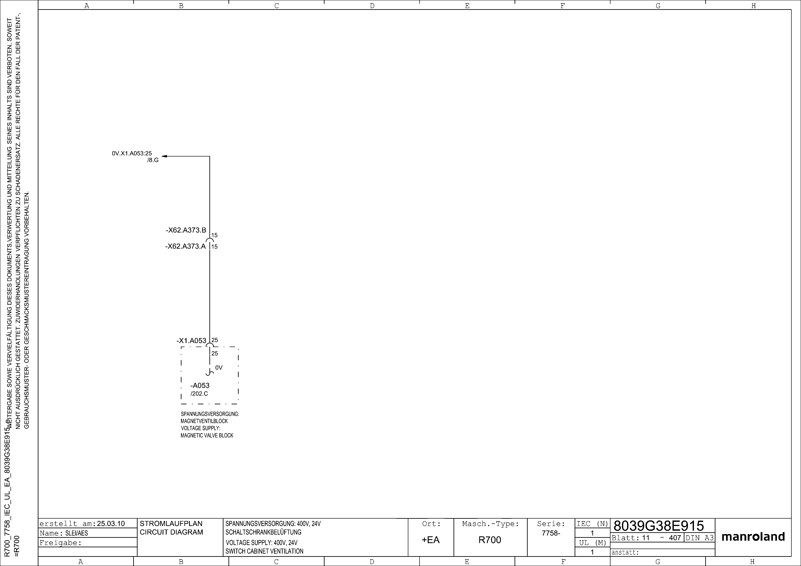

# +EA — Sheet 11 of 407 — SPANNUNGSVERSORGUNG: 400V, 24V

**SCHALTSCHRANKBELÜFTUNG**

> Part of the manroland **R700** printing press IEC/UL circuit diagrams.
> Drawing class: **Stromlaufplan / Circuit diagram** (DIN A3).
> Document `+EA` covers the **Printing unit** machine section.

## At a glance

| Field | Value |
|---|---|
| Document | `+EA`  (8039G38E915) |
| Sheet | **11** of 407 |
| Section (DE) | SPANNUNGSVERSORGUNG: 400V, 24V |
| Section (EN) | SCHALTSCHRANKBELÜFTUNG |
| Section type | POWER_SUPPLY — Voltage supply |
| Machine type | `R700` |
| Series | `7758` |
| Created | 25.03.10 |
| Replaces | — |
| Columns used | A, B |
| Path numbers | — |
| Labels on sheet | 16 |
| Cross-refs out | 2 |
| Cross-refs in | 5 |

**Previous:** [+EA sheet 10](SHEET_0010.md) · **Next:** [+EA sheet 12](SHEET_0012.md) · **Document TOC:** [_TOC.md](_TOC.md)  (+EA) · **Master TOC:** [all sheets](../_MASTER_TOC.md)

## Sheet image (300 DPI, exact vector render)



_Rendered directly from the PDF vector layer at 300 DPI (1-bit), no OCR and no resampling. Use it to confirm anything ambiguous in the text below._

## Cross-references on this sheet

Each entry is a wire leaving this sheet. The printed token is `/sheet.column`; the link resolves to that sheet inside the same document.

| Ref | Target sheet | Col | Path | Destination on target | Target section | From col |
|---|---|---|---|---|---|---|
| `/8.G` | [+EA sheet 8](SHEET_0008.md) | G | — | 0V.X1.A053:25 | SPANNUNGSVERSORGUNG: 400V, 24V | B |
| `/202.C` | [+EA sheet 202](SHEET_0202.md) | C | — | A053 | REFERENZMODUL | B |

### Incoming references (sheets that point here)

Every other sheet that sends a wire to this one. `Back-ref` is the token printed on *that* sheet; `Path` is its line number.

| From sheet | Cols | Back-ref | Path | Refs | What continues there |
|---|---|---|---|---|---|
| [+EA#8](SHEET_0008.md) | G | `/8.G` | — | 1 | 0V.X1.A053:25 |
| [+EA#202](SHEET_0202.md) | C | `/202.C` | — | 1 | — |
| [+EA#206](SHEET_0206.md) | D | `/206.D` | — | 1 | — |
| [+EA#283](SHEET_0283.md) | H | `/283.H` | — | 2 | — |


## Devices on this sheet

| Tag | Class | Class meaning (IEC) | Col | Sub | Terminal | Sign |
|---|---|---|---|---|---|---|
| `A053` | A | Baugruppe / assembly, module, PC board | B | — | — | — |
| `X1.A053` | — | cross-device reference | B | — | — | — |
| `X62.A373.B` | — | cross-device reference | B | — | — | — |
| `X62.A373.A` | — | cross-device reference | B | — | — | — |

## Potentials / nets

| Potential | Count | Columns | Attached devices | Terminals |
|---|---|---|---|---|
| `0V` | 2 | A, B | `A053`, `X1` | `25` |


A potential such as `L24+/4` or `M24+` is a named supply/return rail; every place it appears on this sheet is electrically common.

## Wire-end annotations (grouped as printed)

A wire that continues elsewhere is annotated with a small cluster: the destination description, the path/line number `#NN`, and the `/sheet.column` cross reference. Each row below is one such cluster exactly as it is grouped on the drawing.

| Col | Y | Path | Cross-ref | Text on the wire |
|---|---|---|---|---|
| B | 224.2 | — | `/8.G` | `0V.X1.A053:25` |
| B | 337.6 | — | — | `X62.A373.B 15` |
| B | 361.7 | — | — | `X62.A373.A 15` |
| B | 502.0 | — | — | `X1.A053 25` |
| B | 521.9 | — | — | `25` |
| B | 543.1 | — | — | `0V` |
| B | 568.6 | — | `/202.C` | `A053` |
| B | 612.9 | — | — | `MAGNETVENTILBLOCK SPANNUNGSVERSORGUNG:` |
| B | 634.2 | — | — | `MAGNETIC VALVE BLOCK VOLTAGE SUPPLY:` |


## Reconstructed tables

This sheet carries tabular content (pin map / terminal assignment / index). The grid below was rebuilt from the drawing's own rule lines, so each row is exactly one physical row of the table.

### Table 1 — 5 data rows × 8 columns (at x=204.1, y=0.0) — **/8.G X62.A373.B X62.A373.A X1.A053 A053 /202.C MAGNETVENTILBLOCK VOLTAGE MAGNETIC 15 15 25 25 0V SPANNUNGSVERSORGUNG: SUPPLY: VALVE BLOCK**

| STROMLAUFPLAN |  | SPANNUNGSVERSORGUNG: 400V, 24V | Ort: | Masch. Type: | Serie: | IEC (N) | 8039G38E915 |
|---|---|---|---|---|---|---|---|
| `CIRCUIT DIAGRAM` |  |  |  |  |  |  |  |
|  |  | `SCHALTSCHRANKBELÜFTUNG` |  |  | `7758` | `1` |  |
|  |  |  | `+EA` | `R700` |  |  | `Blatt: DIN A3 11 407` |
|  |  | `VOLTAGE SUPPLY: 400V, 24V` |  |  |  | `UL (M)` |  |
|  |  | `SWITCH CABINET VENTILATION` |  |  |  | `1` | `anstatt:` |


## Notes and free text on this sheet

| Text | Col | Y (pt) |
|---|---|---|
| `SPANNUNGSVERSORGUNG:` | B | 612.92 |
| `MAGNETVENTILBLOCK` | B | 623.55 |
| `VOLTAGE SUPPLY:` | B | 634.16 |
| `MAGNETIC VALVE BLOCK` | B | 644.81 |

## Complete label inventory (exact text from the drawing)

Every text object inside the drawing area of this sheet, in DIN reading order (column A→H, then top→bottom). This is the authoritative list: if a string is not here it is not printed on this sheet.

| Col | Y | X | Dir | Type | Text |
|---|---|---|---|---|---|
| A | 224.2 | 166.4 | → | potential | `0V.X1.A053:25` |
| B | 234.1 | 219.1 | → | cross-reference | `/8.G` |
| B | 337.6 | 246.6 | → | device ref | `X62.A373.B` |
| B | 346.2 | 313.8 | → | number | `15` |
| B | 361.7 | 245.8 | → | device ref | `X62.A373.A` |
| B | 363.2 | 313.8 | → | number | `15` |
| B | 502.0 | 262.5 | → | device ref | `X1.A053` |
| B | 502.1 | 314.4 | → | number | `25` |
| B | 521.9 | 314.4 | → | number | `25` |
| B | 543.1 | 320.0 | → | potential | `0V` |
| B | 568.6 | 283.2 | → | device tag | `A053` |
| B | 581.7 | 283.5 | → | cross-reference | `/202.C` |
| B | 612.9 | 269.0 | → | text | `SPANNUNGSVERSORGUNG:` |
| B | 623.6 | 268.7 | → | text | `MAGNETVENTILBLOCK` |
| B | 634.2 | 269.3 | → | text | `VOLTAGE SUPPLY:` |
| B | 644.8 | 268.7 | → | text | `MAGNETIC VALVE BLOCK` |

## Reading-order text block

The same content as a plain block, grouped by DIN column — convenient to paste or to match against a visual description.

```text
=== Column A ===
 224.2  166.4  net          0V.X1.A053:25
=== Column B ===
 234.1  219.1  xref         /8.G
 337.6  246.6  devref       X62.A373.B
 346.2  313.8  numeric      15
 361.7  245.8  devref       X62.A373.A
 363.2  313.8  numeric      15
 502.0  262.5  devref       X1.A053
 502.1  314.4  numeric      25
 521.9  314.4  numeric      25
 543.1  320.0  net          0V
 568.6  283.2  devtag       A053
 581.7  283.5  xref         /202.C
 612.9  269.0  text         SPANNUNGSVERSORGUNG:
 623.6  268.7  text         MAGNETVENTILBLOCK
 634.2  269.3  text         VOLTAGE SUPPLY:
 644.8  268.7  text         MAGNETIC VALVE BLOCK
```

---
_Generated from the PDF vector text layer; no OCR. Source: `R700_7758_IEC_UL_EA_8039G38E915_p`, sheet 11._
