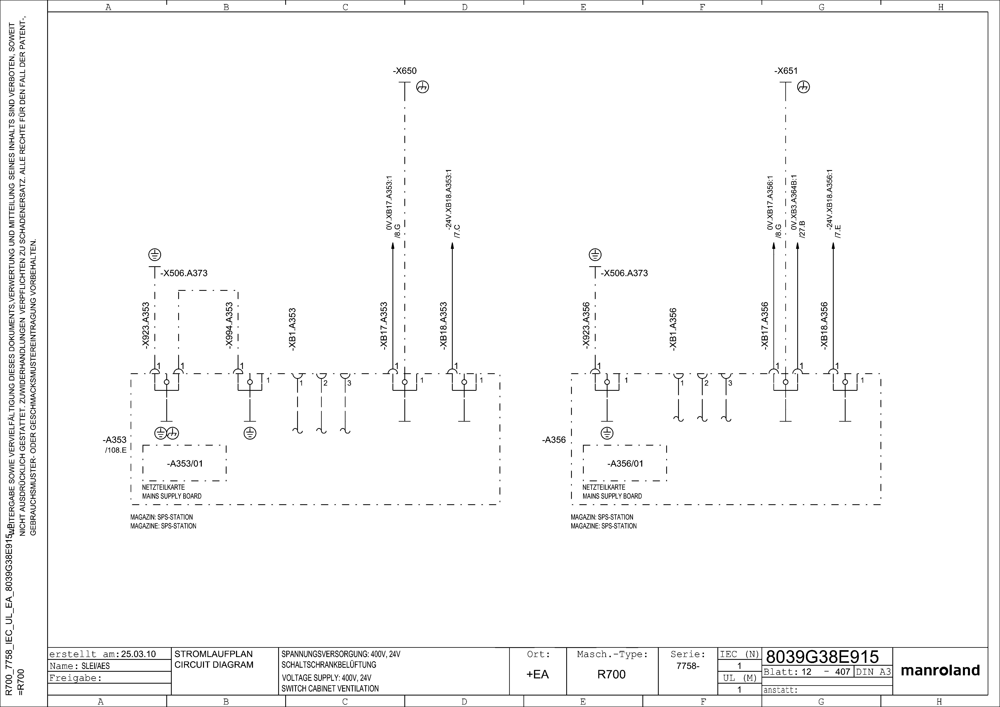

# +EA — Sheet 12 of 407 — SPANNUNGSVERSORGUNG: 400V, 24V

**SCHALTSCHRANKBELÜFTUNG**

> Part of the manroland **R700** printing press IEC/UL circuit diagrams.
> Drawing class: **Stromlaufplan / Circuit diagram** (DIN A3).
> Document `+EA` covers the **Printing unit** machine section.

## At a glance

| Field | Value |
|---|---|
| Document | `+EA`  (8039G38E915) |
| Sheet | **12** of 407 |
| Section (DE) | SPANNUNGSVERSORGUNG: 400V, 24V |
| Section (EN) | SCHALTSCHRANKBELÜFTUNG |
| Section type | POWER_SUPPLY — Voltage supply |
| Machine type | `R700` |
| Series | `7758` |
| Created | 25.03.10 |
| Replaces | — |
| Columns used | A, B, C, D, E, F, G |
| Path numbers | — |
| Labels on sheet | 56 |
| Cross-refs out | 6 |
| Cross-refs in | 6 |

**Previous:** [+EA sheet 11](SHEET_0011.md) · **Next:** [+EA sheet 13](SHEET_0013.md) · **Document TOC:** [_TOC.md](_TOC.md)  (+EA) · **Master TOC:** [all sheets](../_MASTER_TOC.md)

## Sheet image (300 DPI, exact vector render)



_Rendered directly from the PDF vector layer at 300 DPI (1-bit), no OCR and no resampling. Use it to confirm anything ambiguous in the text below._

## Cross-references on this sheet

Each entry is a wire leaving this sheet. The printed token is `/sheet.column`; the link resolves to that sheet inside the same document.

| Ref | Target sheet | Col | Path | Destination on target | Target section | From col |
|---|---|---|---|---|---|---|
| `/7.C` | [+EA sheet 7](SHEET_0007.md) | C | — | 24V.XB18.A353:1 | SPANNUNGSVERSORGUNG: 400V, 24V | D |
| `/7.E` | [+EA sheet 7](SHEET_0007.md) | E | — | 24V.XB18.A356:1 | SPANNUNGSVERSORGUNG: 400V, 24V | G |
| `/27.B` | [+EA sheet 27](SHEET_0027.md) | B | — | 0V.XB3.A364B:1 | BUSVERBINDUNGEN: SICHERHEITSBUS | G |
| `/8.G` | [+EA sheet 8](SHEET_0008.md) | G | — | 0V.XB17.A353:1 | SPANNUNGSVERSORGUNG: 400V, 24V | C |
| `/8.G` | [+EA sheet 8](SHEET_0008.md) | G | — | 0V.XB17.A356:1 | SPANNUNGSVERSORGUNG: 400V, 24V | G |
| `/108.E` | [+EA sheet 108](SHEET_0108.md) | E | — | — | BLAS/SAUGLUFT MIT MOTORVENTILEINSTELLUNG | A |

### Incoming references (sheets that point here)

Every other sheet that sends a wire to this one. `Back-ref` is the token printed on *that* sheet; `Path` is its line number.

| From sheet | Cols | Back-ref | Path | Refs | What continues there |
|---|---|---|---|---|---|
| [+EA#7](SHEET_0007.md) | C, F | `/7.C`, `/7.F` | — | 2 | — |
| [+EA#8](SHEET_0008.md) | G | `/8.G` | — | 2 | 0V.XB17.A353:1; 0V.XB17.A356:1 |
| [+EA#27](SHEET_0027.md) | B | `/27.B` | — | 1 | 0V.XB3.A364B:1 |
| [+EA#108](SHEET_0108.md) | E | `/108.E` | — | 1 | — |


## Devices on this sheet

| Tag | Class | Class meaning (IEC) | Col | Sub | Terminal | Sign |
|---|---|---|---|---|---|---|
| `A353` | A | Baugruppe / assembly, module, PC board | A | — | — | — |
| `A356` | A | Baugruppe / assembly, module, PC board | E | — | — | — |
| `A353/01` | A | Baugruppe / assembly, module, PC board | B | 01 | — | — |
| `A356/01` | A | Baugruppe / assembly, module, PC board | E | 01 | — | — |
| `X650` | X | Klemme / terminal, plug connector | C | — | — | — |
| `X651` | X | Klemme / terminal, plug connector | G | — | — | — |
| `X994.A353` | — | cross-device reference | B | — | — | — |
| `XB17.A353` | — | cross-device reference | C | — | — | — |
| `XB18.A353` | — | cross-device reference | D | — | — | — |
| `XB17.A356` | — | cross-device reference | G | — | — | — |
| `XB18.A356` | — | cross-device reference | G | — | — | — |
| `X923.A353` | — | cross-device reference | A | — | — | — |
| `X923.A356` | — | cross-device reference | E | — | — | — |
| `XB1.A353` | — | cross-device reference | C | — | — | — |
| `XB1.A356` | — | cross-device reference | F | — | — | — |
| `X506.A373` | — | cross-device reference | B | — | — | — |
| `X506.A373` | — | cross-device reference | E | — | — | — |

## Potentials / nets

| Potential | Count | Columns | Attached devices | Terminals |
|---|---|---|---|---|
| `0V` | 3 | C, G | `A353`, `A356`, `A364B`, `XB17`, `XB3` | `1` |
| `24V` | 2 | D, G | `A353`, `A356`, `XB18` | `1` |


A potential such as `L24+/4` or `M24+` is a named supply/return rail; every place it appears on this sheet is electrically common.

## Wire-end annotations (grouped as printed)

A wire that continues elsewhere is annotated with a small cluster: the destination description, the path/line number `#NN`, and the `/sheet.column` cross reference. Each row below is one such cluster exactly as it is grouped on the drawing.

| Col | Y | Path | Cross-ref | Text on the wire |
|---|---|---|---|---|
| E | 79.7 | — | — | `X650 X651` |
| D | 201.0 | — | `/7.C` | `24V.XB18.A353:1` |
| G | 201.0 | — | `/7.E` | `24V.XB18.A356:1` |
| G | 207.5 | — | `/27.B` | `0V.XB3.A364B:1` |
| C | 208.6 | — | `/8.G` | `0V.XB17.A353:1` |
| G | 208.6 | — | `/8.G` | `0V.XB17.A356:1` |
| B | 320.6 | — | — | `X506.A373` |
| E | 320.6 | — | — | `X506.A373` |
| A | 359.4 | — | — | `X923.A353` |
| B | 359.4 | — | — | `X994.A353` |
| C | 359.4 | — | — | `XB17.A353` |
| D | 359.4 | — | — | `XB18.A353` |
| E | 359.4 | — | — | `X923.A356` |
| G | 359.4 | — | — | `XB17.A356` |
| G | 359.4 | — | — | `XB18.A356` |
| C | 366.5 | — | — | `XB1.A353` |
| F | 366.5 | — | — | `XB1.A356` |
| A | 431.1 | — | — | `1` |
| B | 431.1 | — | — | `1` |
| B | 431.1 | — | — | `1` |
| C | 431.1 | — | — | `1` |
| D | 431.1 | — | — | `1` |
| E | 431.1 | — | — | `1` |
| G | 431.1 | — | — | `1` |
| G | 431.1 | — | — | `1` |
| G | 431.1 | — | — | `1` |
| C | 448.9 | — | — | `1 1` |
| E | 448.9 | — | — | `1 1` |
| E | 448.9 | — | — | `1` |
| C | 452.4 | — | — | `1 2 3` |
| F | 452.4 | — | — | `1 2 3` |
| A | 519.0 | — | — | `A353` |
| E | 519.0 | — | — | `A356` |
| A | 532.1 | — | `/108.E` | — |
| B | 547.4 | — | — | `A353/01` |
| E | 547.4 | — | — | `A356/01` |
| B | 577.5 | — | — | `NETZTEILKARTE MAINS SUPPLY BOARD` |
| E | 577.5 | — | — | `NETZTEILKARTE MAINS SUPPLY BOARD` |
| A | 612.9 | — | — | `MAGAZIN: SPS STATION MAGAZINE: SPS STATION` |
| E | 612.9 | — | — | `MAGAZIN: SPS STATION MAGAZINE: SPS STATION` |


## Reconstructed tables

This sheet carries tabular content (pin map / terminal assignment / index). The grid below was rebuilt from the drawing's own rule lines, so each row is exactly one physical row of the table.

### Table 1 — 5 data rows × 29 columns (at x=184.3, y=0.0) — **X506.A373 0V.XB17.A353:1 /8.G X650 24V.XB18.A353:1 /7.C 0V.XB17.A356:1 X651 0V.XB3.A364B:1 24V.XB18.A356:1 /27.B /7.E 1 NETZTEILKARTE SUPPLY SPS STATION X994.A353 1 A353/01 BOARD SPS STATION 1 XB1.A353 2 XB17.A353 3 XB18.A353 1 A356 X923.A356 MAINS MAGAZIN: MAGAZINE: 1 A356/01 SUPPLY BOARD SPS STATION SPS STATION XB1.A356 3 XB17.A356 XB18.A356 1**

|  |  |  | STROMLAUFPLAN |  |  |  |  | SPANNUNGSVERSORGUNG: | 400V, | 24V |  |  |  | Ort: |  |  | Masch. Type: |  | Serie: |  |  | IEC (N) |  |  |  | 8039G38E915 |  |  |
|---|---|---|---|---|---|---|---|---|---|---|---|---|---|---|---|---|---|---|---|---|---|---|---|---|---|---|---|---|
|  |  |  | `CIRCUIT DIAGRAM` |  |  |  |  |  |  |  |  |  |  |  |  |  |  |  |  |  |  |  |  |  |  |  |  |  |
|  |  |  |  |  |  |  |  | `SCHALTSCHRANKBELÜFTUNG` |  |  |  |  |  |  |  |  |  |  | `7758` |  |  | `1` |  |  |  |  |  |  |
|  |  |  |  |  |  |  |  |  |  |  |  |  |  | `+EA` |  |  | `R700` |  |  |  |  |  |  | `Blatt:` |  | `12` | `407` | `DIN A3` |
|  |  |  |  |  |  | `VOLTAGE` |  | `SUPPLY:` | `400V, 24V` |  |  |  |  |  |  |  |  |  |  |  |  | `UL (M)` |  |  |  |  |  |  |
|  |  |  |  |  |  | `SWITCH` |  | `CABINET` | `VENTILATION` |  |  |  |  |  |  |  |  |  |  |  |  | `1` |  | `anstatt:` |  |  |  |  |


## Notes and free text on this sheet

| Text | Col | Y (pt) |
|---|---|---|
| `MAGAZIN: SPS STATION` | A | 612.89 |
| `MAGAZINE: SPS STATION` | A | 623.53 |
| `MAGAZIN: SPS STATION` | E | 612.89 |
| `MAGAZINE: SPS STATION` | E | 623.53 |
| `NETZTEILKARTE` | A | 577.45 |
| `MAINS SUPPLY BOARD` | B | 588.11 |
| `NETZTEILKARTE` | E | 577.45 |
| `MAINS SUPPLY BOARD` | E | 588.11 |

## Complete label inventory (exact text from the drawing)

Every text object inside the drawing area of this sheet, in DIN reading order (column A→H, then top→bottom). This is the authoritative list: if a string is not here it is not printed on this sheet.

| Col | Y | X | Dir | Type | Text |
|---|---|---|---|---|---|
| A | 359.4 | 169.0 | ↕ | device ref | `X923.A353` |
| A | 431.1 | 186.0 | → | number | `1` |
| A | 519.0 | 122.5 | → | device tag | `A353` |
| A | 532.1 | 125.3 | → | cross-reference | `/108.E` |
| A | 577.5 | 169.2 | → | text | `NETZTEILKARTE` |
| A | 612.9 | 155.3 | → | text | `MAGAZIN: SPS STATION` |
| A | 623.5 | 155.3 | → | text | `MAGAZINE: SPS STATION` |
| B | 320.6 | 191.1 | → | device ref | `X506.A373` |
| B | 359.4 | 268.2 | ↕ | device ref | `X994.A353` |
| B | 431.1 | 214.3 | → | number | `1` |
| B | 431.1 | 285.2 | → | number | `1` |
| B | 448.9 | 316.9 | → | number | `1` |
| B | 547.4 | 199.0 | → | device tag | `A353/01` |
| B | 588.1 | 169.5 | → | text | `MAINS SUPPLY BOARD` |
| C | 79.7 | 467.9 | → | device tag | `X650` |
| C | 208.6 | 459.5 | ↕ | potential | `0V.XB17.A353:1` |
| C | 266.7 | 469.4 | ↕ | cross-reference | `/8.G` |
| C | 359.4 | 452.4 | ↕ | device ref | `XB17.A353` |
| C | 366.5 | 343.3 | ↕ | device ref | `XB1.A353` |
| C | 431.1 | 469.4 | → | number | `1` |
| C | 452.5 | 356.3 | → | number | `1` |
| C | 452.5 | 385.2 | → | number | `2` |
| C | 452.5 | 413.6 | → | number | `3` |
| D | 201.0 | 530.4 | ↕ | potential | `24V.XB18.A353:1` |
| D | 267.3 | 540.3 | ↕ | cross-reference | `/7.C` |
| D | 359.4 | 523.3 | ↕ | device ref | `XB18.A353` |
| D | 431.1 | 540.3 | → | number | `1` |
| D | 448.9 | 500.0 | → | number | `1` |
| D | 448.9 | 570.9 | → | number | `1` |
| E | 320.6 | 715.5 | → | device ref | `X506.A373` |
| E | 359.4 | 693.4 | ↕ | device ref | `X923.A356` |
| E | 431.1 | 710.4 | → | number | `1` |
| E | 448.9 | 743.2 | → | number | `1` |
| E | 519.0 | 645.4 | → | device tag | `A356` |
| E | 547.4 | 723.4 | → | device tag | `A356/01` |
| E | 577.5 | 693.6 | → | text | `NETZTEILKARTE` |
| E | 588.1 | 693.9 | → | text | `MAINS SUPPLY BOARD` |
| E | 612.9 | 679.7 | → | text | `MAGAZIN: SPS STATION` |
| E | 623.5 | 679.7 | → | text | `MAGAZINE: SPS STATION` |
| F | 366.5 | 796.8 | ↕ | device ref | `XB1.A356` |
| F | 452.5 | 809.9 | → | number | `1` |
| F | 452.5 | 838.8 | → | number | `2` |
| F | 452.5 | 867.1 | → | number | `3` |
| G | 79.7 | 922.1 | → | device tag | `X651` |
| G | 201.0 | 983.9 | ↕ | potential | `24V.XB18.A356:1` |
| G | 207.5 | 941.4 | ↕ | potential | `0V.XB3.A364B:1` |
| G | 208.6 | 913.0 | ↕ | potential | `0V.XB17.A356:1` |
| G | 262.8 | 951.3 | ↕ | cross-reference | `/27.B` |
| G | 266.7 | 922.9 | ↕ | cross-reference | `/8.G` |
| G | 267.6 | 993.8 | ↕ | cross-reference | `/7.E` |
| G | 359.4 | 906.0 | ↕ | device ref | `XB17.A356` |
| G | 359.4 | 976.8 | ↕ | device ref | `XB18.A356` |
| G | 431.1 | 923.0 | → | number | `1` |
| G | 431.1 | 951.3 | → | number | `1` |
| G | 431.1 | 993.8 | → | number | `1` |
| G | 448.9 | 1024.4 | → | number | `1` |

## Reading-order text block

The same content as a plain block, grouped by DIN column — convenient to paste or to match against a visual description.

```text
=== Column A ===
 359.4  169.0  devref       X923.A353
 431.1  186.0  numeric      1
 519.0  122.5  devtag       A353
 532.1  125.3  xref         /108.E
 577.5  169.2  text         NETZTEILKARTE
 612.9  155.3  text         MAGAZIN: SPS STATION
 623.5  155.3  text         MAGAZINE: SPS STATION
=== Column B ===
 320.6  191.1  devref       X506.A373
 359.4  268.2  devref       X994.A353
 431.1  214.3  numeric      1
 431.1  285.2  numeric      1
 448.9  316.9  numeric      1
 547.4  199.0  devtag       A353/01
 588.1  169.5  text         MAINS SUPPLY BOARD
=== Column C ===
  79.7  467.9  devtag       X650
 208.6  459.5  net          0V.XB17.A353:1
 266.7  469.4  xref         /8.G
 359.4  452.4  devref       XB17.A353
 366.5  343.3  devref       XB1.A353
 431.1  469.4  numeric      1
 452.5  356.3  numeric      1
 452.5  385.2  numeric      2
 452.5  413.6  numeric      3
=== Column D ===
 201.0  530.4  net          24V.XB18.A353:1
 267.3  540.3  xref         /7.C
 359.4  523.3  devref       XB18.A353
 431.1  540.3  numeric      1
 448.9  500.0  numeric      1
 448.9  570.9  numeric      1
=== Column E ===
 320.6  715.5  devref       X506.A373
 359.4  693.4  devref       X923.A356
 431.1  710.4  numeric      1
 448.9  743.2  numeric      1
 519.0  645.4  devtag       A356
 547.4  723.4  devtag       A356/01
 577.5  693.6  text         NETZTEILKARTE
 588.1  693.9  text         MAINS SUPPLY BOARD
 612.9  679.7  text         MAGAZIN: SPS STATION
 623.5  679.7  text         MAGAZINE: SPS STATION
=== Column F ===
 366.5  796.8  devref       XB1.A356
 452.5  809.9  numeric      1
 452.5  838.8  numeric      2
 452.5  867.1  numeric      3
=== Column G ===
  79.7  922.1  devtag       X651
 201.0  983.9  net          24V.XB18.A356:1
 207.5  941.4  net          0V.XB3.A364B:1
 208.6  913.0  net          0V.XB17.A356:1
 262.8  951.3  xref         /27.B
 266.7  922.9  xref         /8.G
 267.6  993.8  xref         /7.E
 359.4  906.0  devref       XB17.A356
 359.4  976.8  devref       XB18.A356
 431.1  923.0  numeric      1
 431.1  951.3  numeric      1
 431.1  993.8  numeric      1
 448.9 1024.4  numeric      1
```

---
_Generated from the PDF vector text layer; no OCR. Source: `R700_7758_IEC_UL_EA_8039G38E915_p`, sheet 12._
