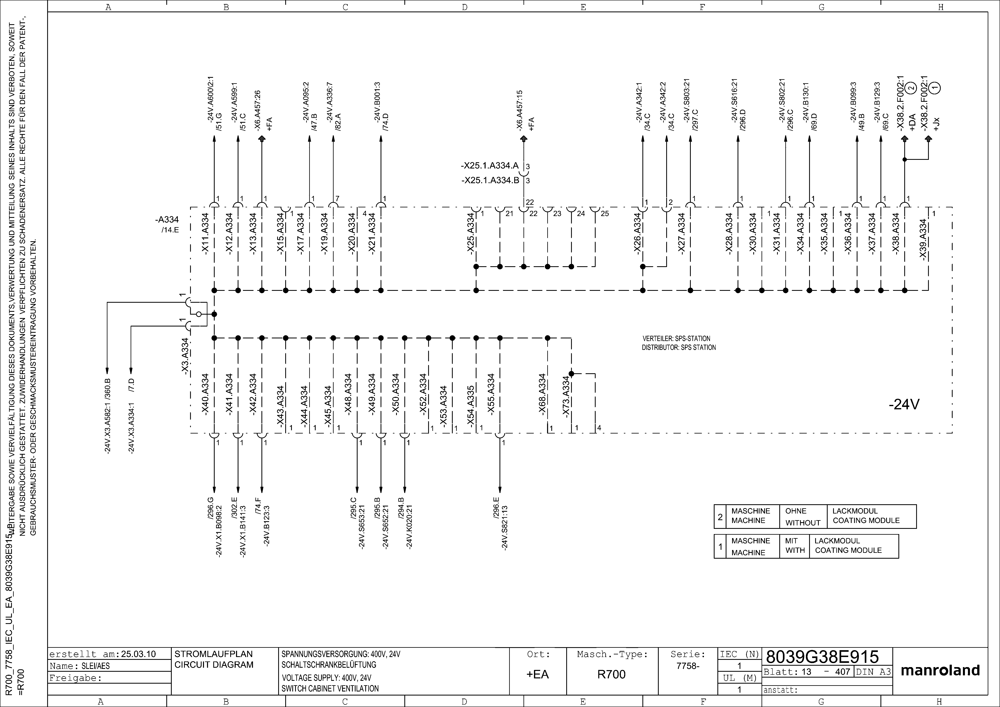

# +EA — Sheet 13 of 407 — SPANNUNGSVERSORGUNG: 400V, 24V

**SCHALTSCHRANKBELÜFTUNG**

> Part of the manroland **R700** printing press IEC/UL circuit diagrams.
> Drawing class: **Stromlaufplan / Circuit diagram** (DIN A3).
> Document `+EA` covers the **Printing unit** machine section.

## At a glance

| Field | Value |
|---|---|
| Document | `+EA`  (8039G38E915) |
| Sheet | **13** of 407 |
| Section (DE) | SPANNUNGSVERSORGUNG: 400V, 24V |
| Section (EN) | SCHALTSCHRANKBELÜFTUNG |
| Section type | POWER_SUPPLY — Voltage supply |
| Machine type | `R700` |
| Series | `7758` |
| Created | 25.03.10 |
| Replaces | — |
| Columns used | A, B, C, D, E, F, G, H |
| Path numbers | — |
| Labels on sheet | 158 |
| Cross-refs out | 23 |
| Cross-refs in | 67 |

**Previous:** [+EA sheet 12](SHEET_0012.md) · **Next:** [+EA sheet 14](SHEET_0014.md) · **Document TOC:** [_TOC.md](_TOC.md)  (+EA) · **Master TOC:** [all sheets](../_MASTER_TOC.md)

## Sheet image (300 DPI, exact vector render)



_Rendered directly from the PDF vector layer at 300 DPI (1-bit), no OCR and no resampling. Use it to confirm anything ambiguous in the text below._

## Cross-references on this sheet

Each entry is a wire leaving this sheet. The printed token is `/sheet.column`; the link resolves to that sheet inside the same document.

| Ref | Target sheet | Col | Path | Destination on target | Target section | From col |
|---|---|---|---|---|---|---|
| `/51.G` | [+EA sheet 51](SHEET_0051.md) | G | — | 24V.A600\2:1 | MASCHINENBEDIENUNG: SPANNUNGSVERSORGUNG | B |
| `/296.G` | [+EA sheet 296](SHEET_0296.md) | G | — | 24V.A600\2:1 | OPTION: ZWISCHENSTAPEL / | B |
| `/297.C` | [+EA sheet 297](SHEET_0297.md) | C | — | 24V.S803:21 | OPTION: ZWISCHENSTAPEL / | F |
| `/296.D` | [+EA sheet 296](SHEET_0296.md) | D | — | 24V.S616:21 | OPTION: ZWISCHENSTAPEL / | F |
| `/296.C` | [+EA sheet 296](SHEET_0296.md) | C | — | 24V.S802:21 | OPTION: ZWISCHENSTAPEL / | G |
| `/51.C` | [+EA sheet 51](SHEET_0051.md) | C | — | 24V.A599:1 | MASCHINENBEDIENUNG: SPANNUNGSVERSORGUNG | B |
| `/47.B` | [+EA sheet 47](SHEET_0047.md) | B | — | 24V.A095:2 | SCHUTZ | C |
| `/82.A` | [+EA sheet 82](SHEET_0082.md) | A | — | 24V.A336:7 | AUSLEGERSTAPELSTEUERUNG: PROGRAMMSCHALTWERK | C |
| `/74.D` | [+EA sheet 74](SHEET_0074.md) | D | — | 24V.B001:3 | AUSLEGERSTAPELSTEUERUNG | C |
| `/34.C` | [+EA sheet 34](SHEET_0034.md) | C | — | 24V.A342:1 | BUSVERBINDUNGEN: NOT AUS | F |
| `/34.C` | [+EA sheet 34](SHEET_0034.md) | C | — | 24V.A342:2 | BUSVERBINDUNGEN: NOT AUS | F |
| `/69.D` | [+EA sheet 69](SHEET_0069.md) | D | — | 24V.B130:1 | SCHMIERUNG | G |
| `/49.B` | [+EA sheet 49](SHEET_0049.md) | B | — | 24V.B099:3 | SCHUTZ | G |
| `/69.C` | [+EA sheet 69](SHEET_0069.md) | C | — | 24V.B129:3 | SCHMIERUNG | H |
| `/14.E` | [+EA sheet 14](SHEET_0014.md) | E | — | — | SPANNUNGSVERSORGUNG: 400V, 24V | B |
| `/360.B` | [+EA sheet 360](SHEET_0360.md) | B | — | 24V.X3.A582:1 | OPTION: | A |
| `/7.D` | [+EA sheet 7](SHEET_0007.md) | D | — | 24V.X3.A334:1 | SPANNUNGSVERSORGUNG: 400V, 24V | A |
| `/302.E` | [+EA sheet 302](SHEET_0302.md) | E | — | — | OPTION: ZWISCHENSTAPEL / | B |
| `/296.E` | [+EA sheet 296](SHEET_0296.md) | E | — | — | OPTION: ZWISCHENSTAPEL / | D |
| `/74.F` | [+EA sheet 74](SHEET_0074.md) | F | — | — | AUSLEGERSTAPELSTEUERUNG | B |
| `/295.C` | [+EA sheet 295](SHEET_0295.md) | C | — | — | OPTION: ZWISCHENSTAPEL / | C |
| `/295.B` | [+EA sheet 295](SHEET_0295.md) | B | — | — | OPTION: ZWISCHENSTAPEL / | C |
| `/294.B` | [+EA sheet 294](SHEET_0294.md) | B | — | — | OPTION: ZWISCHENSTAPEL / | C |

### Incoming references (sheets that point here)

Every other sheet that sends a wire to this one. `Back-ref` is the token printed on *that* sheet; `Path` is its line number.

| From sheet | Cols | Back-ref | Path | Refs | What continues there |
|---|---|---|---|---|---|
| [+EA#7](SHEET_0007.md) | D | `/7.D` | — | 1 | 24V.X3.A334:1 |
| [+EA#14](SHEET_0014.md) | E | `/14.E` | — | 1 | — |
| [+EA#34](SHEET_0034.md) | B, C | `/34.B`, `/34.C` | — | 2 | 24V.A342:1; 24V.A342:2 |
| [+EA#47](SHEET_0047.md) | B | `/47.B` | — | 1 | 24V.A095:2 |
| [+EA#49](SHEET_0049.md) | A | `/49.A` | — | 1 | 24V.B099:3 |
| [+EA#51](SHEET_0051.md) | B, F | `/51.B`, `/51.F` | — | 2 | 24V.A599:1; 24V.A600\1:1 24V.A600\2:1 |
| [+EA#69](SHEET_0069.md) | B, D | `/69.B`, `/69.D` | — | 2 | 24V.B129:3; 24V.B130:1 |
| [+EA#74](SHEET_0074.md) | D, E | `/74.D`, `/74.E` | — | 2 | 24V.B001:3; 24V.B123:3 |
| [+EA#82](SHEET_0082.md) | A | `/82.A` | — | 1 | 24V.A336:7 |
| [+EA#255](SHEET_0255.md) | G | `/255.G` | — | 1 | — |
| [+EA#257](SHEET_0257.md) | A | `/257.A` | — | 1 | — |
| [+EA#258](SHEET_0258.md) | C | `/258.C` | — | 1 | — |
| [+EA#260](SHEET_0260.md) | D | `/260.D` | — | 1 | — |
| [+EA#263](SHEET_0263.md) | A, G | `/263.A`, `/263.G` | — | 2 | — |
| [+EA#264](SHEET_0264.md) | A, D | `/264.A`, `/264.D` | — | 2 | — |
| [+EA#267](SHEET_0267.md) | C, E | `/267.C`, `/267.E` | — | 8 | — |
| [+EA#269](SHEET_0269.md) | B | `/269.B` | — | 2 | — |
| [+EA#270](SHEET_0270.md) | F | `/270.F` | — | 1 | — |
| [+EA#272](SHEET_0272.md) | D | `/272.D` | — | 1 | — |
| [+EA#275](SHEET_0275.md) | E, H | `/275.E`, `/275.H` | — | 2 | — |
| [+EA#278](SHEET_0278.md) | A, F | `/278.A`, `/278.F` | — | 2 | — |
| [+EA#279](SHEET_0279.md) | B, F | `/279.B`, `/279.F` | — | 2 | — |
| [+EA#280](SHEET_0280.md) | B, D, G | `/280.B`, `/280.D`, `/280.G` | — | 3 | STROMPFAD PIN 1 2 3 4 |
| [+EA#281](SHEET_0281.md) | A, B, C, F, G | `/281.A`, `/281.B`, `/281.C`, `/281.F`, `/281.G` | — | 5 | — |
| [+EA#282](SHEET_0282.md) | B, C, E, G, H | `/282.B`, `/282.C`, `/282.E`, `/282.G`, `/282.H` | — | 5 | — |
| [+EA#283](SHEET_0283.md) | A, B | `/283.A`, `/283.B` | — | 2 | — |
| [+EA#285](SHEET_0285.md) | B, F | `/285.B`, `/285.F` | — | 3 | — |
| [+EA#294](SHEET_0294.md) | B | `/294.B` | — | 1 | 24V.K020:21 |
| [+EA#295](SHEET_0295.md) | B | `/295.B` | — | 2 | 24V.S652:21 24V.S653:21 |
| [+EA#296](SHEET_0296.md) | B, C, E, G | `/296.B`, `/296.C`, `/296.E`, `/296.G` | — | 4 | 24V.S616:21; 24V.S802:21; 24V.S821:13; 24V.X1.B098:2 |
| [+EA#297](SHEET_0297.md) | C | `/297.C` | — | 1 | 24V.S803:21 |
| [+EA#302](SHEET_0302.md) | D | `/302.D` | — | 1 | 24V.X1.B141:3 |
| [+EA#360](SHEET_0360.md) | B | `/360.B` | — | 1 | 24V.X3.A582:1 |


## Devices on this sheet

| Tag | Class | Class meaning (IEC) | Col | Sub | Terminal | Sign |
|---|---|---|---|---|---|---|
| `A334` | A | Baugruppe / assembly, module, PC board | A | — | — | — |
| `X11.A334` | — | cross-device reference | B | — | — | — |
| `X12.A334` | — | cross-device reference | B | — | — | — |
| `X13.A334` | — | cross-device reference | B | — | — | — |
| `X6.A457:26` | — | cross-device reference | B | — | 26 | — |
| `X17.A334` | — | cross-device reference | C | — | — | — |
| `X19.A334` | — | cross-device reference | C | — | — | — |
| `X21.A334` | — | cross-device reference | C | — | — | — |
| `X6.A457:15` | — | cross-device reference | D | — | 15 | — |
| `X25.1.A334.B` | — | cross-device reference | D | — | — | — |
| `X25.1.A334.A` | — | cross-device reference | D | — | — | — |
| `X3.A334` | — | cross-device reference | B | — | — | — |
| `X40.A334` | — | cross-device reference | B | — | — | — |
| `X41.A334` | — | cross-device reference | B | — | — | — |
| `X42.A334` | — | cross-device reference | B | — | — | — |
| `X48.A334` | — | cross-device reference | C | — | — | — |
| `X55.A334` | — | cross-device reference | D | — | — | — |
| `X50.A334` | — | cross-device reference | C | — | — | — |
| `X49.A334` | — | cross-device reference | C | — | — | — |
| `X31.A334` | — | cross-device reference | G | — | — | — |
| `X34.A334` | — | cross-device reference | G | — | — | — |
| `X38.A334` | — | cross-device reference | H | — | — | — |
| `X36.A334` | — | cross-device reference | G | — | — | — |
| `X37.A334` | — | cross-device reference | G | — | — | — |
| `X28.A334` | — | cross-device reference | F | — | — | — |
| `X38.2.F002:1` | — | cross-device reference | H | — | 1 | — |
| `X38.2.F002:1` | — | cross-device reference | H | — | 1 | — |
| `X27.A334` | — | cross-device reference | F | — | — | — |
| `X26.A334` | — | cross-device reference | E | — | — | — |
| `X15.A334` | — | cross-device reference | B | — | — | — |
| `X20.A334` | — | cross-device reference | C | — | — | — |
| `X43.A334` | — | cross-device reference | B | — | — | — |
| `X54.A335` | — | cross-device reference | D | — | — | — |
| `X73.A334` | — | cross-device reference | E | — | — | — |
| `X39.A334` | — | cross-device reference | H | — | — | — |
| `X44.A334` | — | cross-device reference | C | — | — | — |
| `X45.A334` | — | cross-device reference | C | — | — | — |
| `X25.A334` | — | cross-device reference | D | — | — | — |
| `X30.A334` | — | cross-device reference | F | — | — | — |
| `X53.A334` | — | cross-device reference | D | — | — | — |
| `X52.A334` | — | cross-device reference | D | — | — | — |
| `X68.A334` | — | cross-device reference | E | — | — | — |
| `X35.A334` | — | cross-device reference | G | — | — | — |

## Potentials / nets

| Potential | Count | Columns | Attached devices | Terminals |
|---|---|---|---|---|
| `24V` | 23 | A, B, C, D, E, F, G, H | `A095`, `A334`, `A336`, `A342`, `A582`, `A599`, `A600\2`, `B001`, `B098`, `B099`, `B123`, `B129`, `B130`, `B141`, `K020`, `S616`, `S652`, `S653`, `S802`, `S803`, `S821`, `X1`, `X3` | `1`, `13`, `2`, `21`, `3`, `7` |


A potential such as `L24+/4` or `M24+` is a named supply/return rail; every place it appears on this sheet is electrically common.

## Wire-end annotations (grouped as printed)

A wire that continues elsewhere is annotated with a small cluster: the destination description, the path/line number `#NN`, and the `/sheet.column` cross reference. Each row below is one such cluster exactly as it is grouped on the drawing.

| Col | Y | Path | Cross-ref | Text on the wire |
|---|---|---|---|---|
| H | 89.0 | — | — | `X38.2.F002:1` |
| H | 89.0 | — | — | `X38.2.F002:1` |
| B | 90.1 | — | `/51.G`, `/296.G` | `24V.A600\2:1` |
| F | 92.7 | — | `/297.C` | `24V.S803:21` |
| F | 92.7 | — | `/296.D` | `24V.S616:21` |
| G | 92.7 | — | `/296.C` | `24V.S802:21` |
| B | 97.5 | — | `/51.C` | `24V.A599:1` |
| C | 97.5 | — | `/47.B` | `24V.A095:2` |
| C | 97.5 | — | `/82.A` | `24V.A336:7` |
| C | 97.5 | — | `/74.D` | `24V.B001:3` |
| F | 97.5 | — | `/34.C` | `24V.A342:1` |
| F | 97.5 | — | `/34.C` | `24V.A342:2` |
| G | 97.5 | — | `/69.D` | `24V.B130:1` |
| G | 97.5 | — | `/49.B` | `24V.B099:3` |
| H | 97.5 | — | `/69.C` | `24V.B129:3` |
| H | 102.0 | — | — | `1` |
| H | 102.9 | — | — | `2` |
| B | 107.4 | — | — | `X13.A334 X6.A457:26` |
| D | 107.4 | — | — | `X6.A457:15` |
| H | 135.5 | — | — | `+DA` |
| B | 139.8 | — | — | `+FA` |
| E | 139.8 | — | — | `+FA` |
| H | 140.0 | — | — | `+Jx` |
| D | 192.4 | — | — | `X25.1.A334.A 3` |
| D | 210.1 | — | — | `X25.1.A334.B 3` |
| B | 232.8 | — | — | `1` |
| B | 232.8 | — | — | `1` |
| B | 232.8 | — | — | `1` |
| C | 232.8 | — | — | `1` |
| C | 232.8 | — | — | `7` |
| C | 232.8 | — | — | `1` |
| F | 232.8 | — | — | `1` |
| F | 232.8 | — | — | `1` |
| G | 232.8 | — | — | `1` |
| G | 232.8 | — | — | `1` |
| G | 232.8 | — | — | `1` |
| H | 232.8 | — | — | `1` |
| H | 232.8 | — | — | `1` |
| E | 237.0 | — | — | `22` |
| F | 237.0 | — | — | `1` |
| F | 237.0 | — | — | `2` |
| C | 250.5 | — | — | `1` |
| D | 250.5 | — | — | `4 1 21 22 23 24 25` |
| G | 250.5 | — | — | `1` |
| G | 250.5 | — | — | `1` |
| H | 250.5 | — | — | `1` |
| B | 253.1 | — | — | `X11.A334` |
| B | 253.1 | — | — | `X12.A334` |
| B | 253.1 | — | — | `X15.A334` |
| C | 253.1 | — | — | `X17.A334` |
| C | 253.1 | — | — | `X19.A334` |
| C | 253.1 | — | — | `X20.A334` |
| C | 253.1 | — | — | `X21.A334` |
| D | 253.1 | — | — | `X25.A334` |
| E | 253.1 | — | — | `X26.A334` |
| F | 253.1 | — | — | `X27.A334` |
| F | 253.1 | — | — | `X28.A334` |
| F | 253.1 | — | — | `X30.A334` |
| G | 253.1 | — | — | `X31.A334` |
| G | 253.1 | — | — | `X34.A334` |
| G | 253.1 | — | — | `X35.A334` |
| G | 253.1 | — | — | `X36.A334` |
| G | 253.1 | — | — | `X37.A334` |
| H | 253.1 | — | — | `X38.A334` |
| A | 256.8 | — | — | `A334` |
| H | 260.2 | — | — | `X39.A334` |
| B | 269.9 | — | `/14.E` | — |
| B | 348.1 | — | — | `1 1 X3.A334` |
| F | 400.3 | — | — | `DISTRIBUTOR: SPS STATION VERTEILER: SPS STATION` |
| B | 444.5 | — | — | `X40.A334` |
| B | 444.5 | — | — | `X41.A334` |
| B | 444.5 | — | — | `X42.A334` |
| C | 444.5 | — | — | `X48.A334` |
| C | 444.5 | — | — | `X49.A334` |
| C | 444.5 | — | — | `X50.A334` |
| D | 444.5 | — | — | `X52.A334` |
| D | 444.5 | — | — | `X55.A334` |
| E | 444.5 | — | — | `X68.A334` |
| E | 447.3 | — | — | `X73.A334` |
| A | 450.4 | — | `/360.B` | `24V.X3.A582:1` |
| A | 450.4 | — | `/7.D` | `24V.X3.A334:1` |
| B | 458.9 | — | — | `X43.A334` |
| C | 458.9 | — | — | `X44.A334` |
| C | 458.9 | — | — | `X45.A334` |
| D | 458.9 | — | — | `X53.A334` |
| D | 458.9 | — | — | `X54.A335` |
| H | 474.0 | — | — | `24V` |
| C | 505.6 | — | — | `1` |
| C | 505.6 | — | — | `1 1` |
| D | 505.6 | — | — | `1` |
| E | 505.6 | — | — | `1 4` |
| D | 506.3 | — | — | `1 1` |
| D | 506.3 | — | — | `1` |
| B | 523.3 | — | — | `1` |
| B | 523.3 | — | — | `1` |
| B | 523.3 | — | — | `1` |
| C | 523.3 | — | — | `1` |
| C | 523.3 | — | — | `1` |
| D | 523.3 | — | — | `1` |
| D | 523.3 | — | — | `1` |
| B | 591.9 | — | `/302.E` | — |
| D | 591.9 | — | `/296.E` | — |
| B | 592.2 | — | `/74.F` | — |
| C | 592.2 | — | `/295.C` | — |
| C | 592.2 | — | `/295.B` | — |
| C | 592.2 | — | `/294.B` | — |
| C | 600.7 | — | — | `24V.S653:21` |
| C | 600.7 | — | — | `24V.S652:21` |
| D | 600.7 | — | — | `24V.K020:21` |
| B | 601.8 | — | — | `24V.X1.B098:2` |
| B | 602.1 | — | — | `24V.X1.B141:3` |
| B | 602.1 | — | — | `24V.B123:3` |
| D | 602.1 | — | — | `24V.S821:13` |
| F | 604.8 | — | — | `MASCHINE MACHINE` |
| G | 604.8 | — | — | `OHNE` |
| G | 604.8 | — | — | `LACKMODUL` |
| G | 611.1 | — | — | `2 COATING MODULE` |
| G | 618.9 | — | — | `WITHOUT` |
| F | 640.2 | — | — | `MASCHINE` |
| G | 640.2 | — | — | `MIT` |
| G | 640.2 | — | — | `LACKMODUL` |
| F | 646.6 | — | — | `1` |
| G | 651.4 | — | — | `WITH` |
| G | 651.6 | — | — | `COATING MODULE` |
| F | 654.4 | — | — | `MACHINE` |


## Reconstructed tables

This sheet carries tabular content (pin map / terminal assignment / index). The grid below was rebuilt from the drawing's own rule lines, so each row is exactly one physical row of the table.

### Table 1 — 2 data rows × 1 columns (at x=155.9, y=317.5)

| C1 |
|---|
| `1` |
| `1` |


## Notes and free text on this sheet

| Text | Col | Y (pt) |
|---|---|---|
| `VERTEILER: SPS STATION` | F | 400.3 |
| `DISTRIBUTOR: SPS STATION` | F | 410.92 |
| `+FA` | B | 139.75 |
| `+FA` | E | 139.75 |
| `+Jx` | H | 140.03 |
| `+DA` | H | 135.5 |
| `MASCHINE` | F | 640.21 |
| `MACHINE` | F | 654.39 |
| `MIT` | G | 640.22 |
| `WITH` | G | 651.42 |
| `LACKMODUL` | G | 640.23 |
| `COATING MODULE` | G | 651.56 |
| `OHNE` | G | 604.79 |
| `WITHOUT` | G | 618.88 |

## Complete label inventory (exact text from the drawing)

Every text object inside the drawing area of this sheet, in DIN reading order (column A→H, then top→bottom). This is the authoritative list: if a string is not here it is not printed on this sheet.

| Col | Y | X | Dir | Type | Text |
|---|---|---|---|---|---|
| A | 256.8 | 184.8 | → | device tag | `A334` |
| A | 450.4 | 124.3 | ↕ | cross-reference | `/360.B` |
| A | 450.4 | 152.6 | ↕ | cross-reference | `/7.D` |
| A | 478.8 | 124.3 | ↕ | potential | `24V.X3.A582:1` |
| A | 478.8 | 152.6 | ↕ | potential | `24V.X3.A334:1` |
| B | 90.1 | 246.9 | ↕ | potential | `24V.A600\2:1` |
| B | 97.5 | 275.2 | ↕ | potential | `24V.A599:1` |
| B | 107.4 | 302.9 | ↕ | device ref | `X6.A457:26` |
| B | 134.4 | 256.8 | ↕ | cross-reference | `/51.G` |
| B | 134.9 | 285.2 | ↕ | cross-reference | `/51.C` |
| B | 139.7 | 317.0 | ↕ | text | `+FA` |
| B | 232.8 | 257.1 | → | number | `1` |
| B | 232.8 | 285.4 | → | number | `1` |
| B | 232.8 | 313.8 | → | number | `1` |
| B | 253.1 | 239.8 | ↕ | device ref | `X11.A334` |
| B | 253.1 | 268.2 | ↕ | device ref | `X12.A334` |
| B | 253.1 | 296.5 | ↕ | device ref | `X13.A334` |
| B | 253.1 | 329.1 | ↕ | device ref | `X15.A334` |
| B | 269.9 | 192.5 | → | cross-reference | `/14.E` |
| B | 348.1 | 212.9 | ↕ | number | `1` |
| B | 377.9 | 212.9 | ↕ | number | `1` |
| B | 402.0 | 215.7 | ↕ | device ref | `X3.A334` |
| B | 444.5 | 239.8 | ↕ | device ref | `X40.A334` |
| B | 444.5 | 268.2 | ↕ | device ref | `X41.A334` |
| B | 444.5 | 296.5 | ↕ | device ref | `X42.A334` |
| B | 458.9 | 329.1 | ↕ | device ref | `X43.A334` |
| B | 523.3 | 257.1 | → | number | `1` |
| B | 523.3 | 285.4 | → | number | `1` |
| B | 523.3 | 313.8 | → | number | `1` |
| B | 591.9 | 246.9 | ↕ | cross-reference | `/296.G` |
| B | 591.9 | 275.2 | ↕ | cross-reference | `/302.E` |
| B | 592.2 | 303.6 | ↕ | cross-reference | `/74.F` |
| B | 601.8 | 256.8 | ↕ | potential | `24V.X1.B098:2` |
| B | 602.1 | 285.2 | ↕ | potential | `24V.X1.B141:3` |
| B | 602.1 | 313.5 | ↕ | potential | `24V.B123:3` |
| C | 97.5 | 360.3 | ↕ | potential | `24V.A095:2` |
| C | 97.5 | 388.6 | ↕ | potential | `24V.A336:7` |
| C | 97.5 | 445.3 | ↕ | potential | `24V.B001:3` |
| C | 134.9 | 455.2 | ↕ | cross-reference | `/74.D` |
| C | 135.2 | 370.2 | ↕ | cross-reference | `/47.B` |
| C | 135.2 | 398.5 | ↕ | cross-reference | `/82.A` |
| C | 232.8 | 370.5 | → | number | `1` |
| C | 232.8 | 399.4 | → | number | `7` |
| C | 232.8 | 455.5 | → | number | `1` |
| C | 250.5 | 345.3 | → | number | `1` |
| C | 250.5 | 432.0 | → | number | `4` |
| C | 253.1 | 353.2 | ↕ | device ref | `X17.A334` |
| C | 253.1 | 381.6 | ↕ | device ref | `X19.A334` |
| C | 253.1 | 414.2 | ↕ | device ref | `X20.A334` |
| C | 253.1 | 438.3 | ↕ | device ref | `X21.A334` |
| C | 444.5 | 409.9 | ↕ | device ref | `X48.A334` |
| C | 444.5 | 438.3 | ↕ | device ref | `X49.A334` |
| C | 444.5 | 466.6 | ↕ | device ref | `X50.A334` |
| C | 458.9 | 357.5 | ↕ | device ref | `X44.A334` |
| C | 458.9 | 385.8 | ↕ | device ref | `X45.A334` |
| C | 505.6 | 344.1 | → | number | `1` |
| C | 505.6 | 372.5 | → | number | `1` |
| C | 505.6 | 400.8 | → | number | `1` |
| C | 523.3 | 427.2 | → | number | `1` |
| C | 523.3 | 455.5 | → | number | `1` |
| C | 592.2 | 417.0 | ↕ | cross-reference | `/295.C` |
| C | 592.2 | 445.3 | ↕ | cross-reference | `/295.B` |
| C | 592.2 | 473.6 | ↕ | cross-reference | `/294.B` |
| C | 600.7 | 426.9 | ↕ | potential | `24V.S653:21` |
| C | 600.7 | 455.2 | ↕ | potential | `24V.S652:21` |
| D | 107.4 | 614.7 | ↕ | device ref | `X6.A457:15` |
| D | 192.4 | 548.8 | → | device ref | `X25.1.A334.A` |
| D | 210.1 | 549.6 | → | device ref | `X25.1.A334.B` |
| D | 250.5 | 572.0 | → | number | `1` |
| D | 250.5 | 602.1 | → | number | `21` |
| D | 253.1 | 555.9 | ↕ | device ref | `X25.A334` |
| D | 444.5 | 499.2 | ↕ | device ref | `X52.A334` |
| D | 444.5 | 580.0 | ↕ | device ref | `X55.A334` |
| D | 458.9 | 523.3 | ↕ | device ref | `X53.A334` |
| D | 458.9 | 555.9 | ↕ | device ref | `X54.A335` |
| D | 505.6 | 570.9 | → | number | `1` |
| D | 506.3 | 512.2 | → | number | `1` |
| D | 506.3 | 540.6 | → | number | `1` |
| D | 523.3 | 483.9 | → | number | `1` |
| D | 523.3 | 597.3 | → | number | `1` |
| D | 591.9 | 587.0 | ↕ | cross-reference | `/296.E` |
| D | 600.7 | 483.6 | ↕ | potential | `24V.K020:21` |
| D | 602.1 | 597.0 | ↕ | potential | `24V.S821:13` |
| E | 97.5 | 757.1 | ↕ | potential | `24V.A342:1` |
| E | 139.7 | 628.8 | ↕ | text | `+FA` |
| E | 194.5 | 626.2 | → | number | `3` |
| E | 211.5 | 626.2 | → | number | `3` |
| E | 237.0 | 626.2 | → | number | `22` |
| E | 250.5 | 630.4 | → | number | `22` |
| E | 250.5 | 658.8 | → | number | `23` |
| E | 250.5 | 687.1 | → | number | `24` |
| E | 250.5 | 715.5 | → | number | `25` |
| E | 253.1 | 754.3 | ↕ | device ref | `X26.A334` |
| E | 444.5 | 640.9 | ↕ | device ref | `X68.A334` |
| E | 447.3 | 669.3 | ↕ | device ref | `X73.A334` |
| E | 505.6 | 684.3 | → | number | `1` |
| E | 505.6 | 711.2 | → | number | `4` |
| E | 506.3 | 654.0 | → | number | `1` |
| F | 92.7 | 813.8 | ↕ | potential | `24V.S803:21` |
| F | 92.7 | 870.5 | ↕ | potential | `24V.S616:21` |
| F | 97.5 | 785.5 | ↕ | potential | `24V.A342:2` |
| F | 130.1 | 823.8 | ↕ | cross-reference | `/297.C` |
| F | 130.1 | 880.4 | ↕ | cross-reference | `/296.D` |
| F | 134.9 | 767.1 | ↕ | cross-reference | `/34.C` |
| F | 134.9 | 795.4 | ↕ | cross-reference | `/34.C` |
| F | 232.8 | 824.0 | → | number | `1` |
| F | 232.8 | 880.7 | → | number | `1` |
| F | 237.0 | 767.3 | → | number | `1` |
| F | 237.0 | 796.3 | → | number | `2` |
| F | 253.1 | 806.8 | ↕ | device ref | `X27.A334` |
| F | 253.1 | 863.5 | ↕ | device ref | `X28.A334` |
| F | 253.1 | 891.8 | ↕ | device ref | `X30.A334` |
| F | 400.3 | 765.4 | → | text | `VERTEILER: SPS STATION` |
| F | 410.9 | 764.5 | → | text | `DISTRIBUTOR: SPS STATION` |
| F | 604.8 | 871.1 | → | text | `MASCHINE` |
| F | 611.1 | 854.6 | → | number | `2` |
| F | 616.1 | 871.1 | → | text | `MACHINE` |
| F | 640.2 | 871.1 | → | text | `MASCHINE` |
| F | 646.6 | 854.9 | → | number | `1` |
| F | 654.4 | 871.1 | → | text | `MACHINE` |
| G | 92.7 | 927.2 | ↕ | potential | `24V.S802:21` |
| G | 97.5 | 955.6 | ↕ | potential | `24V.B130:1` |
| G | 97.5 | 1012.3 | ↕ | potential | `24V.B099:3` |
| G | 97.5 | 1040.6 | ↕ | potential | `24V.B129:3` |
| G | 130.1 | 937.1 | ↕ | cross-reference | `/296.C` |
| G | 134.9 | 965.5 | ↕ | cross-reference | `/69.D` |
| G | 135.2 | 1022.1 | ↕ | cross-reference | `/49.B` |
| G | 232.8 | 937.4 | → | number | `1` |
| G | 232.8 | 965.8 | → | number | `1` |
| G | 232.8 | 1022.5 | → | number | `1` |
| G | 250.5 | 913.3 | → | number | `1` |
| G | 250.5 | 998.4 | → | number | `1` |
| G | 253.1 | 920.1 | ↕ | device ref | `X31.A334` |
| G | 253.1 | 948.5 | ↕ | device ref | `X34.A334` |
| G | 253.1 | 976.8 | ↕ | device ref | `X35.A334` |
| G | 253.1 | 1005.2 | ↕ | device ref | `X36.A334` |
| G | 253.1 | 1033.5 | ↕ | device ref | `X37.A334` |
| G | 604.8 | 935.1 | → | text | `OHNE` |
| G | 604.8 | 991.3 | → | text | `LACKMODUL` |
| G | 616.1 | 991.8 | → | text | `COATING MODULE` |
| G | 618.9 | 935.4 | → | text | `WITHOUT` |
| G | 640.2 | 934.9 | → | text | `MIT` |
| G | 640.2 | 970.0 | → | text | `LACKMODUL` |
| G | 651.4 | 935.4 | → | text | `WITH` |
| G | 651.6 | 970.6 | → | text | `COATING MODULE` |
| H | 89.0 | 1067.6 | ↕ | device ref | `X38.2.F002:1` |
| H | 89.0 | 1095.9 | ↕ | device ref | `X38.2.F002:1` |
| H | 102.0 | 1109.5 | ↕ | number | `1` |
| H | 102.9 | 1081.7 | ↕ | number | `2` |
| H | 134.9 | 1050.5 | ↕ | cross-reference | `/69.C` |
| H | 135.5 | 1081.7 | ↕ | text | `+DA` |
| H | 140.0 | 1110.2 | ↕ | text | `+Jx` |
| H | 232.8 | 1050.8 | → | number | `1` |
| H | 232.8 | 1079.1 | → | number | `1` |
| H | 250.5 | 1109.5 | → | number | `1` |
| H | 253.1 | 1061.9 | ↕ | device ref | `X38.A334` |
| H | 260.2 | 1094.5 | ↕ | device ref | `X39.A334` |
| H | 474.0 | 1058.3 | → | potential | `24V` |

## Reading-order text block

The same content as a plain block, grouped by DIN column — convenient to paste or to match against a visual description.

```text
=== Column A ===
 256.8  184.8  devtag       A334
 450.4  124.3  xref         /360.B
 450.4  152.6  xref         /7.D
 478.8  124.3  net          24V.X3.A582:1
 478.8  152.6  net          24V.X3.A334:1
=== Column B ===
  90.1  246.9  net          24V.A600\2:1
  97.5  275.2  net          24V.A599:1
 107.4  302.9  devref       X6.A457:26
 134.4  256.8  xref         /51.G
 134.9  285.2  xref         /51.C
 139.7  317.0  text         +FA
 232.8  257.1  numeric      1
 232.8  285.4  numeric      1
 232.8  313.8  numeric      1
 253.1  239.8  devref       X11.A334
 253.1  268.2  devref       X12.A334
 253.1  296.5  devref       X13.A334
 253.1  329.1  devref       X15.A334
 269.9  192.5  xref         /14.E
 348.1  212.9  numeric      1
 377.9  212.9  numeric      1
 402.0  215.7  devref       X3.A334
 444.5  239.8  devref       X40.A334
 444.5  268.2  devref       X41.A334
 444.5  296.5  devref       X42.A334
 458.9  329.1  devref       X43.A334
 523.3  257.1  numeric      1
 523.3  285.4  numeric      1
 523.3  313.8  numeric      1
 591.9  246.9  xref         /296.G
 591.9  275.2  xref         /302.E
 592.2  303.6  xref         /74.F
 601.8  256.8  net          24V.X1.B098:2
 602.1  285.2  net          24V.X1.B141:3
 602.1  313.5  net          24V.B123:3
=== Column C ===
  97.5  360.3  net          24V.A095:2
  97.5  388.6  net          24V.A336:7
  97.5  445.3  net          24V.B001:3
 134.9  455.2  xref         /74.D
 135.2  370.2  xref         /47.B
 135.2  398.5  xref         /82.A
 232.8  370.5  numeric      1
 232.8  399.4  numeric      7
 232.8  455.5  numeric      1
 250.5  345.3  numeric      1
 250.5  432.0  numeric      4
 253.1  353.2  devref       X17.A334
 253.1  381.6  devref       X19.A334
 253.1  414.2  devref       X20.A334
 253.1  438.3  devref       X21.A334
 444.5  409.9  devref       X48.A334
 444.5  438.3  devref       X49.A334
 444.5  466.6  devref       X50.A334
 458.9  357.5  devref       X44.A334
 458.9  385.8  devref       X45.A334
 505.6  344.1  numeric      1
 505.6  372.5  numeric      1
 505.6  400.8  numeric      1
 523.3  427.2  numeric      1
 523.3  455.5  numeric      1
 592.2  417.0  xref         /295.C
 592.2  445.3  xref         /295.B
 592.2  473.6  xref         /294.B
 600.7  426.9  net          24V.S653:21
 600.7  455.2  net          24V.S652:21
=== Column D ===
 107.4  614.7  devref       X6.A457:15
 192.4  548.8  devref       X25.1.A334.A
 210.1  549.6  devref       X25.1.A334.B
 250.5  572.0  numeric      1
 250.5  602.1  numeric      21
 253.1  555.9  devref       X25.A334
 444.5  499.2  devref       X52.A334
 444.5  580.0  devref       X55.A334
 458.9  523.3  devref       X53.A334
 458.9  555.9  devref       X54.A335
 505.6  570.9  numeric      1
 506.3  512.2  numeric      1
 506.3  540.6  numeric      1
 523.3  483.9  numeric      1
 523.3  597.3  numeric      1
 591.9  587.0  xref         /296.E
 600.7  483.6  net          24V.K020:21
 602.1  597.0  net          24V.S821:13
=== Column E ===
  97.5  757.1  net          24V.A342:1
 139.7  628.8  text         +FA
 194.5  626.2  numeric      3
 211.5  626.2  numeric      3
 237.0  626.2  numeric      22
 250.5  630.4  numeric      22
 250.5  658.8  numeric      23
 250.5  687.1  numeric      24
 250.5  715.5  numeric      25
 253.1  754.3  devref       X26.A334
 444.5  640.9  devref       X68.A334
 447.3  669.3  devref       X73.A334
 505.6  684.3  numeric      1
 505.6  711.2  numeric      4
 506.3  654.0  numeric      1
=== Column F ===
  92.7  813.8  net          24V.S803:21
  92.7  870.5  net          24V.S616:21
  97.5  785.5  net          24V.A342:2
 130.1  823.8  xref         /297.C
 130.1  880.4  xref         /296.D
 134.9  767.1  xref         /34.C
 134.9  795.4  xref         /34.C
 232.8  824.0  numeric      1
 232.8  880.7  numeric      1
 237.0  767.3  numeric      1
 237.0  796.3  numeric      2
 253.1  806.8  devref       X27.A334
 253.1  863.5  devref       X28.A334
 253.1  891.8  devref       X30.A334
 400.3  765.4  text         VERTEILER: SPS STATION
 410.9  764.5  text         DISTRIBUTOR: SPS STATION
 604.8  871.1  text         MASCHINE
 611.1  854.6  numeric      2
 616.1  871.1  text         MACHINE
 640.2  871.1  text         MASCHINE
 646.6  854.9  numeric      1
 654.4  871.1  text         MACHINE
=== Column G ===
  92.7  927.2  net          24V.S802:21
  97.5  955.6  net          24V.B130:1
  97.5 1012.3  net          24V.B099:3
  97.5 1040.6  net          24V.B129:3
 130.1  937.1  xref         /296.C
 134.9  965.5  xref         /69.D
 135.2 1022.1  xref         /49.B
 232.8  937.4  numeric      1
 232.8  965.8  numeric      1
 232.8 1022.5  numeric      1
 250.5  913.3  numeric      1
 250.5  998.4  numeric      1
 253.1  920.1  devref       X31.A334
 253.1  948.5  devref       X34.A334
 253.1  976.8  devref       X35.A334
 253.1 1005.2  devref       X36.A334
 253.1 1033.5  devref       X37.A334
 604.8  935.1  text         OHNE
 604.8  991.3  text         LACKMODUL
 616.1  991.8  text         COATING MODULE
 618.9  935.4  text         WITHOUT
 640.2  934.9  text         MIT
 640.2  970.0  text         LACKMODUL
 651.4  935.4  text         WITH
 651.6  970.6  text         COATING MODULE
=== Column H ===
  89.0 1067.6  devref       X38.2.F002:1
  89.0 1095.9  devref       X38.2.F002:1
 102.0 1109.5  numeric      1
 102.9 1081.7  numeric      2
 134.9 1050.5  xref         /69.C
 135.5 1081.7  text         +DA
 140.0 1110.2  text         +Jx
 232.8 1050.8  numeric      1
 232.8 1079.1  numeric      1
 250.5 1109.5  numeric      1
 253.1 1061.9  devref       X38.A334
 260.2 1094.5  devref       X39.A334
 474.0 1058.3  net          24V
```

---
_Generated from the PDF vector text layer; no OCR. Source: `R700_7758_IEC_UL_EA_8039G38E915_p`, sheet 13._
