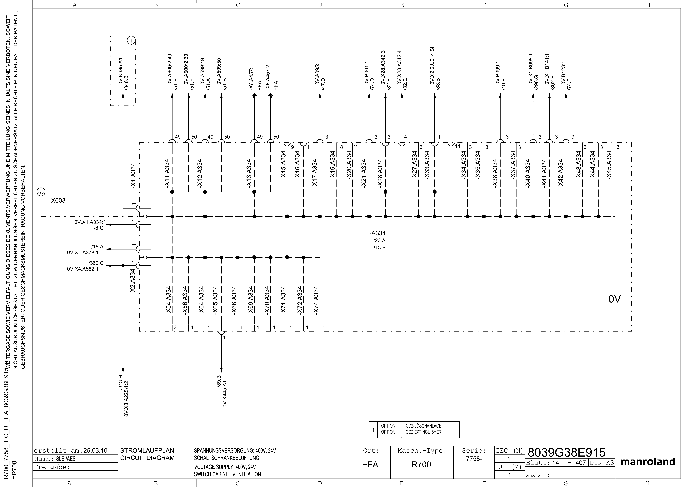

# +EA — Sheet 14 of 407 — SPANNUNGSVERSORGUNG: 400V, 24V

**SCHALTSCHRANKBELÜFTUNG**

> Part of the manroland **R700** printing press IEC/UL circuit diagrams.
> Drawing class: **Stromlaufplan / Circuit diagram** (DIN A3).
> Document `+EA` covers the **Printing unit** machine section.

## At a glance

| Field | Value |
|---|---|
| Document | `+EA`  (8039G38E915) |
| Sheet | **14** of 407 |
| Section (DE) | SPANNUNGSVERSORGUNG: 400V, 24V |
| Section (EN) | SCHALTSCHRANKBELÜFTUNG |
| Section type | POWER_SUPPLY — Voltage supply |
| Machine type | `R700` |
| Series | `7758` |
| Created | 25.03.10 |
| Replaces | — |
| Columns used | A, B, C, D, E, F, G, H |
| Path numbers | — |
| Labels on sheet | 128 |
| Cross-refs out | 21 |
| Cross-refs in | 58 |

**Previous:** [+EA sheet 13](SHEET_0013.md) · **Next:** [+EA sheet 15](SHEET_0015.md) · **Document TOC:** [_TOC.md](_TOC.md)  (+EA) · **Master TOC:** [all sheets](../_MASTER_TOC.md)

## Sheet image (300 DPI, exact vector render)



_Rendered directly from the PDF vector layer at 300 DPI (1-bit), no OCR and no resampling. Use it to confirm anything ambiguous in the text below._

## Cross-references on this sheet

Each entry is a wire leaving this sheet. The printed token is `/sheet.column`; the link resolves to that sheet inside the same document.

| Ref | Target sheet | Col | Path | Destination on target | Target section | From col |
|---|---|---|---|---|---|---|
| `/88.B` | [+EA sheet 88](SHEET_0088.md) | B | — | 0V.X2.2.U014:SI1 | SAUGWALZE | E |
| `/32.E` | [+EA sheet 32](SHEET_0032.md) | E | — | 0V.X28.A342:3 | BUSVERBINDUNGEN: NOT AUS | E |
| `/32.E` | [+EA sheet 32](SHEET_0032.md) | E | — | 0V.X28.A342:4 | BUSVERBINDUNGEN: NOT AUS | E |
| `/296.G` | [+EA sheet 296](SHEET_0296.md) | G | — | 0V.X1.B098:1 | OPTION: ZWISCHENSTAPEL / | G |
| `/302.E` | [+EA sheet 302](SHEET_0302.md) | E | — | 0V.X1.B141:1 | OPTION: ZWISCHENSTAPEL / | G |
| `/51.F` | [+EA sheet 51](SHEET_0051.md) | F | — | 0V.A600\2:49 | MASCHINENBEDIENUNG: SPANNUNGSVERSORGUNG | B |
| `/51.F` | [+EA sheet 51](SHEET_0051.md) | F | — | 0V.A600\2:50 | MASCHINENBEDIENUNG: SPANNUNGSVERSORGUNG | B |
| `/346.B` | [+EA sheet 346](SHEET_0346.md) | B | — | 0V.K635:A1 | OPTION: VORBEREITUNG CO2 LÖSCHANLAGE | B |
| `/51.A` | [+EA sheet 51](SHEET_0051.md) | A | — | 0V.A599:49 | MASCHINENBEDIENUNG: SPANNUNGSVERSORGUNG | C |
| `/51.B` | [+EA sheet 51](SHEET_0051.md) | B | — | 0V.A599:50 0V.K445:A1 | MASCHINENBEDIENUNG: SPANNUNGSVERSORGUNG | C |
| `/47.D` | [+EA sheet 47](SHEET_0047.md) | D | — | 0V.A095:1 | SCHUTZ | D |
| `/74.D` | [+EA sheet 74](SHEET_0074.md) | D | — | 0V.B001:1 | AUSLEGERSTAPELSTEUERUNG | E |
| `/49.B` | [+EA sheet 49](SHEET_0049.md) | B | — | 0V.B099:1 | SCHUTZ | F |
| `/74.F` | [+EA sheet 74](SHEET_0074.md) | F | — | 0V.B123:1 | AUSLEGERSTAPELSTEUERUNG | G |
| `/8.G` | [+EA sheet 8](SHEET_0008.md) | G | — | 0V.X1.A334:1 | SPANNUNGSVERSORGUNG: 400V, 24V | A |
| `/23.A` | [+EA sheet 23](SHEET_0023.md) | A | — | — | SPANNUNGSVERSORGUNG: 400V, 24V | E |
| `/13.B` | [+EA sheet 13](SHEET_0013.md) | B | — | — | SPANNUNGSVERSORGUNG: 400V, 24V | E |
| `/16.A` | [+EA sheet 16](SHEET_0016.md) | A | — | 0V.X1.A378:1 | SPANNUNGSVERSORGUNG: 400V, 24V | A |
| `/360.C` | [+EA sheet 360](SHEET_0360.md) | C | — | 0V.X4.A582:1 | OPTION: | A |
| `/343.H` | [+EA sheet 343](SHEET_0343.md) | H | — | — | OPTION: TELEPRESENCE | B |
| `/89.B` | [+EA sheet 89](SHEET_0089.md) | B | — | — | BELEUCHTUNG | C |

### Incoming references (sheets that point here)

Every other sheet that sends a wire to this one. `Back-ref` is the token printed on *that* sheet; `Path` is its line number.

| From sheet | Cols | Back-ref | Path | Refs | What continues there |
|---|---|---|---|---|---|
| [+EA#8](SHEET_0008.md) | G | `/8.G` | — | 1 | 0V.X1.A334:1 |
| [+EA#13](SHEET_0013.md) | B | `/13.B` | — | 1 | — |
| [+EA#16](SHEET_0016.md) | A | `/16.A` | — | 1 | 0V.X1.A378:1 |
| [+EA#23](SHEET_0023.md) | A | `/23.A` | — | 1 | — |
| [+EA#32](SHEET_0032.md) | D, E | `/32.D`, `/32.E` | — | 2 | 0V.X28.A342:4 |
| [+EA#47](SHEET_0047.md) | D | `/47.D` | — | 1 | 0V.A095:1 |
| [+EA#49](SHEET_0049.md) | A | `/49.A` | — | 1 | 0V.B099:1 |
| [+EA#51](SHEET_0051.md) | A, D, F | `/51.A`, `/51.D`, `/51.F` | — | 4 | 0V.A599:49; 0V.A600\2:49; 0V.A600\2:50 0V.A599:50 |
| [+EA#74](SHEET_0074.md) | E | `/74.E` | — | 2 | 0V.B001:1 0V.B123:1 |
| [+EA#88](SHEET_0088.md) | B | `/88.B` | — | 1 | 0V.X2.2.U014:SI1 |
| [+EA#89](SHEET_0089.md) | C | `/89.C` | — | 1 | 0V.K445:A1 0V.K668:A1 |
| [+EA#255](SHEET_0255.md) | H | `/255.H` | — | 2 | — |
| [+EA#257](SHEET_0257.md) | B | `/257.B` | — | 2 | — |
| [+EA#258](SHEET_0258.md) | D | `/258.D` | — | 2 | — |
| [+EA#260](SHEET_0260.md) | D | `/260.D` | — | 1 | — |
| [+EA#261](SHEET_0261.md) | F | `/261.F` | — | 1 | — |
| [+EA#263](SHEET_0263.md) | A, G | `/263.A`, `/263.G` | — | 2 | — |
| [+EA#264](SHEET_0264.md) | A, D | `/264.A`, `/264.D` | — | 2 | — |
| [+EA#269](SHEET_0269.md) | B | `/269.B` | — | 2 | — |
| [+EA#270](SHEET_0270.md) | F | `/270.F` | — | 1 | — |
| [+EA#277](SHEET_0277.md) | B | `/277.B` | — | 2 | — |
| [+EA#278](SHEET_0278.md) | A, F | `/278.A`, `/278.F` | — | 2 | — |
| [+EA#279](SHEET_0279.md) | B, F | `/279.B`, `/279.F` | — | 2 | — |
| [+EA#280](SHEET_0280.md) | G | `/280.G` | — | 1 | — |
| [+EA#281](SHEET_0281.md) | A, B, C, F, G | `/281.A`, `/281.B`, `/281.C`, `/281.F`, `/281.G` | — | 5 | — |
| [+EA#283](SHEET_0283.md) | A, C | `/283.A`, `/283.C` | — | 2 | STROMPFAD PIN 1 2 3 4 5 6 7 8 |
| [+EA#284](SHEET_0284.md) | C, E, G | `/284.C`, `/284.E`, `/284.G` | — | 3 | — |
| [+EA#285](SHEET_0285.md) | E, F | `/285.E`, `/285.F` | — | 5 | — |
| [+EA#296](SHEET_0296.md) | G | `/296.G` | — | 1 | 0V.X1.B098:1 |
| [+EA#302](SHEET_0302.md) | E | `/302.E` | — | 1 | 0V.X1.B141:1 |
| [+EA#343](SHEET_0343.md) | G | `/343.G` | — | 1 | 0V.X8.A225\1:2 |
| [+EA#346](SHEET_0346.md) | A | `/346.A` | — | 1 | 0V.K635:A1 |
| [+EA#360](SHEET_0360.md) | B | `/360.B` | — | 1 | 0V.X4.A582:1 |


## Devices on this sheet

| Tag | Class | Class meaning (IEC) | Col | Sub | Terminal | Sign |
|---|---|---|---|---|---|---|
| `A334` | A | Baugruppe / assembly, module, PC board | E | — | — | — |
| `X603` | X | Klemme / terminal, plug connector | A | — | — | — |
| `X11.A334` | — | cross-device reference | B | — | — | — |
| `X12.A334` | — | cross-device reference | C | — | — | — |
| `X6.A457:2` | — | cross-device reference | C | — | 2 | — |
| `X13.A334` | — | cross-device reference | C | — | — | — |
| `X6.A457:1` | — | cross-device reference | C | — | 1 | — |
| `X17.A334` | — | cross-device reference | D | — | — | — |
| `X26.A334` | — | cross-device reference | E | — | — | — |
| `X21.A334` | — | cross-device reference | E | — | — | — |
| `X33.A334` | — | cross-device reference | E | — | — | — |
| `X36.A334` | — | cross-device reference | F | — | — | — |
| `X42.A334` | — | cross-device reference | G | — | — | — |
| `X40.A334` | — | cross-device reference | G | — | — | — |
| `X41.A334` | — | cross-device reference | G | — | — | — |
| `X1.A334` | — | cross-device reference | B | — | — | — |
| `X2.A334` | — | cross-device reference | B | — | — | — |
| `X65.A334` | — | cross-device reference | C | — | — | — |
| `X19.A334` | — | cross-device reference | D | — | — | — |
| `X20.A334` | — | cross-device reference | D | — | — | — |
| `X34.A334` | — | cross-device reference | F | — | — | — |
| `X43.A334` | — | cross-device reference | G | — | — | — |
| `X37.A334` | — | cross-device reference | F | — | — | — |
| `X27.A334` | — | cross-device reference | E | — | — | — |
| `X15.A334` | — | cross-device reference | D | — | — | — |
| `X69.A334` | — | cross-device reference | C | — | — | — |
| `X72.A334` | — | cross-device reference | D | — | — | — |
| `X71.A334` | — | cross-device reference | D | — | — | — |
| `X66.A334` | — | cross-device reference | C | — | — | — |
| `X70.A334` | — | cross-device reference | C | — | — | — |
| `X56.A334` | — | cross-device reference | B | — | — | — |
| `X54.A334` | — | cross-device reference | B | — | — | — |
| `X64.A334` | — | cross-device reference | C | — | — | — |
| `X74.A334` | — | cross-device reference | D | — | — | — |
| `X44.A334` | — | cross-device reference | G | — | — | — |
| `X45.A334` | — | cross-device reference | H | — | — | — |
| `X16.A334` | — | cross-device reference | D | — | — | — |
| `X35.A334` | — | cross-device reference | F | — | — | — |

## Potentials / nets

| Potential | Count | Columns | Attached devices | Terminals |
|---|---|---|---|---|
| `0V` | 20 | A, B, C, D, E, F, G, H | `2`, `A095`, `A225\1`, `A334`, `A342`, `A378`, `A582`, `A599`, `A600\2`, `B001`, `B098`, `B099`, `B123`, `B141`, `K445`, `K635`, `U014`, `X1`, `X2`, `X28`, `X4`, `X8` | `1`, `2`, `3`, `4`, `49`, `50`, `A1`, `SI1` |


A potential such as `L24+/4` or `M24+` is a named supply/return rail; every place it appears on this sheet is electrically common.

## Wire-end annotations (grouped as printed)

A wire that continues elsewhere is annotated with a small cluster: the destination description, the path/line number `#NN`, and the `/sheet.column` cross reference. Each row below is one such cluster exactly as it is grouped on the drawing.

| Col | Y | Path | Cross-ref | Text on the wire |
|---|---|---|---|---|
| B | 66.4 | — | — | `1` |
| E | 75.7 | — | `/88.B` | `0V.X2.2.U014:SI1` |
| E | 87.0 | — | `/32.E` | `0V.X28.A342:3` |
| E | 87.0 | — | `/32.E` | `0V.X28.A342:4` |
| G | 91.8 | — | `/296.G` | `0V.X1.B098:1` |
| G | 91.8 | — | `/302.E` | `0V.X1.B141:1` |
| B | 93.0 | — | `/51.F` | `0V.A600\2:49` |
| B | 93.0 | — | `/51.F` | `0V.A600\2:50` |
| B | 99.2 | — | `/346.B` | `0V.K635:A1` |
| C | 100.3 | — | `/51.A` | `0V.A599:49` |
| C | 100.3 | — | `/51.B` | `0V.A599:50 0V.K445:A1` |
| D | 105.2 | — | `/47.D` | `0V.A095:1` |
| E | 105.2 | — | `/74.D` | `0V.B001:1` |
| F | 105.2 | — | `/49.B` | `0V.B099:1` |
| G | 105.2 | — | `/74.F` | `0V.B123:1` |
| C | 112.2 | — | — | `X13.A334 X6.A457:1` |
| C | 112.2 | — | — | `X6.A457:2` |
| C | 139.8 | — | — | `+FA` |
| C | 139.8 | — | — | `+FA` |
| B | 232.8 | — | — | `49` |
| C | 232.8 | — | — | `50 49` |
| C | 232.8 | — | — | `50` |
| C | 232.8 | — | — | `49` |
| C | 232.8 | — | — | `50` |
| D | 232.8 | — | — | `3` |
| E | 232.8 | — | — | `3 4` |
| E | 232.8 | — | — | `3` |
| E | 232.8 | — | — | `1` |
| F | 232.8 | — | — | `3` |
| G | 232.8 | — | — | `3` |
| G | 232.8 | — | — | `3` |
| G | 232.8 | — | — | `3` |
| F | 249.1 | — | — | `14` |
| D | 249.8 | — | — | `2` |
| E | 250.5 | — | — | `9 8 3 3 3 3` |
| D | 250.5 | — | — | `1` |
| F | 250.5 | — | — | `3` |
| H | 250.5 | — | — | `3 3` |
| D | 260.2 | — | — | `X15.A334` |
| D | 260.2 | — | — | `X16.A334` |
| D | 260.2 | — | — | `X19.A334` |
| D | 260.2 | — | — | `X20.A334` |
| E | 260.2 | — | — | `X27.A334` |
| E | 260.2 | — | — | `X33.A334` |
| F | 260.2 | — | — | `X34.A334` |
| F | 260.2 | — | — | `X35.A334` |
| F | 260.2 | — | — | `X37.A334` |
| G | 260.2 | — | — | `X43.A334` |
| G | 260.2 | — | — | `X44.A334` |
| H | 260.2 | — | — | `X45.A334` |
| B | 274.7 | — | — | `X11.A334` |
| C | 274.7 | — | — | `X12.A334` |
| D | 274.7 | — | — | `X17.A334` |
| E | 274.7 | — | — | `X21.A334` |
| E | 274.7 | — | — | `X26.A334` |
| F | 274.7 | — | — | `X36.A334` |
| G | 274.7 | — | — | `X40.A334` |
| G | 274.7 | — | — | `X41.A334` |
| G | 274.7 | — | — | `X42.A334` |
| B | 281.5 | — | — | `X2.A334 X1.A334 1 1 1 1` |
| A | 341.9 | — | — | `X603` |
| A | 380.1 | — | `/8.G` | `0V.X1.A334:1` |
| E | 398.6 | — | — | `A334` |
| E | 411.6 | — | `/23.A`, `/13.B` | — |
| A | 422.6 | — | `/16.A` | `0V.X1.A378:1` |
| A | 451.0 | — | `/360.C` | `0V.X4.A582:1` |
| B | 494.1 | — | — | `X54.A334` |
| B | 494.1 | — | — | `X56.A334` |
| C | 494.1 | — | — | `X64.A334` |
| C | 494.1 | — | — | `X65.A334` |
| C | 494.1 | — | — | `X66.A334` |
| C | 494.1 | — | — | `X69.A334` |
| C | 494.1 | — | — | `X70.A334` |
| D | 494.1 | — | — | `X71.A334` |
| D | 494.1 | — | — | `X72.A334` |
| D | 494.1 | — | — | `X74.A334` |
| H | 509.4 | — | — | `0V` |
| C | 562.3 | — | — | `3 1 1 1 1 1 1` |
| C | 562.3 | — | — | `1` |
| D | 562.3 | — | — | `1` |
| C | 580.0 | — | — | `1` |
| B | 648.3 | — | `/343.H` | — |
| C | 648.9 | — | `/89.B` | — |
| B | 658.5 | — | — | `0V.X8.A225\1:2` |
| E | 733.4 | — | — | `1 OPTION OPTION` |
| E | 733.4 | — | — | `CO2 LÖSCHANLAGE CO2 EXTINGUISHER` |


## Reconstructed tables

This sheet carries tabular content (pin map / terminal assignment / index). The grid below was rebuilt from the drawing's own rule lines, so each row is exactly one physical row of the table.

### Table 1 — 5 data rows × 35 columns (at x=204.1, y=0.0) — **0V.K635:A1 1 /346.B X1.A334 1 0V.A600\2:49 X11.A334 0V.A600\2:50 /51.F 49 0V.A599:49 /51.F 50 X12.A334 0V.A599:50 /51.A 49 /51.B 50 X6.A457:1 X13.A334 X6.A457:2 +FA 49 +FA 50 X15.A334 9 X16.A334 0V.A095:1 1 X17.A334 /47.D 3 X19.A334 8 X20.A334 0V.B001:1 2 X21.A334 0V.X28.A342:3 /74.D 3 X26.A334 /32.E 3 0V.X28.A342:4 /32.E 4 X27.A334 0V.X2.2.U014:SI1 3 X33.A334 /88.B 1 14 X34.A334 3 X35.A334 3 0V.B099:1 X36.A334 /49.B 3 X37.A334 0V.X1.B098:1 X40.A334 0V.X1.B141:1 /296.G 3 X41.A334 0V.B123:1 /302.E 3 X42.A334 /74.F 3 X43.A334 3 X44.A334 3 X45.A334 1 1 A334 /23.A /13.B /343.H 1 X2.A334 0V.X8.A225\1:2 X54.A334 X56.A334 3 X64.A334 1 X65.A334 1 /89.B X66.A334 1 0V.K445:A1 X69.A334 1 X70.A334 1 X71.A334 1 X72.A334 1 X74.A334 1 1 OPTION OPTION CO2 CO2 LÖSCHANLAGE EXTINGUISHER 0V**

|  | STROMLAUFPLAN |  |  |  |  |  | SPANNUNGSVERSORGUNG: |  | 400V, | 24V |  |  |  |  |  | Ort: |  |  |  | Masch. Type: |  |  |  | Serie: |  |  | IEC | (N) |  |  |  | 8039G38E915 |  |  |
|---|---|---|---|---|---|---|---|---|---|---|---|---|---|---|---|---|---|---|---|---|---|---|---|---|---|---|---|---|---|---|---|---|---|---|
|  | `CIRCUIT` | `DIAGRAM` |  |  |  |  |  |  |  |  |  |  |  |  |  |  |  |  |  |  |  |  |  |  |  |  |  |  |  |  |  |  |  |  |
|  |  |  |  |  |  |  | `SCHALTSCHRANKBELÜFTUNG` |  |  |  |  |  |  |  |  |  |  |  |  |  |  |  |  | `7758` |  |  | `1` |  |  |  |  |  |  |  |
|  |  |  |  |  |  |  |  |  |  |  |  |  |  |  |  | `+EA` |  |  |  | `R700` |  |  |  |  |  |  |  |  |  | `Blatt:` | `14` | `407` | `DIN` | `A3` |
|  |  |  |  |  | `VOLTAGE` |  | `SUPPLY:` | `400V, 24V` |  |  |  |  |  |  |  |  |  |  |  |  |  |  |  |  |  |  | `UL (M)` |  |  |  |  |  |  |  |
|  |  |  |  |  | `SWITCH` |  | `CABINET` | `VENTILATION` |  |  |  |  |  |  |  |  |  |  |  |  |  |  |  |  |  |  | `1` |  |  | `anstatt:` |  |  |  |  |


## Notes and free text on this sheet

| Text | Col | Y (pt) |
|---|---|---|
| `+FA` | C | 139.75 |
| `OPTION` | E | 733.35 |
| `CO2 LÖSCHANLAGE` | E | 733.4 |
| `CO2 EXTINGUISHER` | E | 744.02 |

## Complete label inventory (exact text from the drawing)

Every text object inside the drawing area of this sheet, in DIN reading order (column A→H, then top→bottom). This is the authoritative list: if a string is not here it is not printed on this sheet.

| Col | Y | X | Dir | Type | Text |
|---|---|---|---|---|---|
| A | 341.9 | 84.8 | → | device tag | `X603` |
| A | 380.1 | 128.7 | → | potential | `0V.X1.A334:1` |
| A | 390.0 | 162.4 | → | cross-reference | `/8.G` |
| A | 422.6 | 157.9 | → | cross-reference | `/16.A` |
| A | 432.5 | 115.9 | → | potential | `0V.X1.A378:1` |
| A | 451.0 | 153.1 | → | cross-reference | `/360.C` |
| A | 460.9 | 115.9 | → | potential | `0V.X4.A582:1` |
| B | 66.4 | 225.0 | → | number | `1` |
| B | 93.0 | 289.4 | ↕ | potential | `0V.A600\2:49` |
| B | 93.0 | 317.8 | ↕ | potential | `0V.A600\2:50` |
| B | 99.2 | 204.4 | ↕ | potential | `0V.K635:A1` |
| B | 130.4 | 214.3 | ↕ | cross-reference | `/346.B` |
| B | 135.8 | 299.3 | ↕ | cross-reference | `/51.F` |
| B | 135.8 | 327.7 | ↕ | cross-reference | `/51.F` |
| B | 232.8 | 302.5 | → | number | `49` |
| B | 232.8 | 330.8 | → | number | `50` |
| B | 274.7 | 283.8 | ↕ | device ref | `X11.A334` |
| B | 281.5 | 225.7 | ↕ | device ref | `X1.A334` |
| B | 349.5 | 227.0 | ↕ | number | `1` |
| B | 377.9 | 227.0 | ↕ | number | `1` |
| B | 420.4 | 227.0 | ↕ | number | `1` |
| B | 448.7 | 227.0 | ↕ | number | `1` |
| B | 464.3 | 224.2 | ↕ | device ref | `X2.A334` |
| B | 494.1 | 286.6 | ↕ | device ref | `X54.A334` |
| B | 494.1 | 315.0 | ↕ | device ref | `X56.A334` |
| B | 562.3 | 300.2 | → | number | `3` |
| B | 562.3 | 330.0 | → | number | `1` |
| B | 648.3 | 204.4 | ↕ | cross-reference | `/343.H` |
| B | 658.5 | 214.3 | ↕ | potential | `0V.X8.A225\1:2` |
| C | 100.3 | 346.1 | ↕ | potential | `0V.A599:49` |
| C | 100.3 | 374.5 | ↕ | potential | `0V.A599:50` |
| C | 112.3 | 430.4 | ↕ | device ref | `X6.A457:1` |
| C | 112.3 | 458.8 | ↕ | device ref | `X6.A457:2` |
| C | 135.2 | 356.0 | ↕ | cross-reference | `/51.A` |
| C | 135.2 | 384.3 | ↕ | cross-reference | `/51.B` |
| C | 139.7 | 444.6 | ↕ | text | `+FA` |
| C | 139.7 | 472.9 | ↕ | text | `+FA` |
| C | 232.8 | 359.1 | → | number | `49` |
| C | 232.8 | 387.5 | → | number | `50` |
| C | 232.8 | 444.2 | → | number | `49` |
| C | 232.8 | 472.5 | → | number | `50` |
| C | 274.7 | 340.5 | ↕ | device ref | `X12.A334` |
| C | 274.7 | 425.5 | ↕ | device ref | `X13.A334` |
| C | 494.1 | 343.3 | ↕ | device ref | `X64.A334` |
| C | 494.1 | 367.4 | ↕ | device ref | `X65.A334` |
| C | 494.1 | 400.0 | ↕ | device ref | `X66.A334` |
| C | 494.1 | 428.3 | ↕ | device ref | `X69.A334` |
| C | 494.1 | 456.7 | ↕ | device ref | `X70.A334` |
| C | 562.3 | 358.3 | → | number | `1` |
| C | 562.3 | 415.0 | → | number | `1` |
| C | 562.3 | 443.3 | → | number | `1` |
| C | 562.3 | 471.7 | → | number | `1` |
| C | 580.0 | 384.7 | → | number | `1` |
| C | 648.9 | 374.4 | ↕ | cross-reference | `/89.B` |
| C | 657.4 | 384.4 | ↕ | potential | `0V.K445:A1` |
| D | 105.2 | 544.5 | ↕ | potential | `0V.A095:1` |
| D | 134.9 | 554.5 | ↕ | cross-reference | `/47.D` |
| D | 232.8 | 562.4 | → | number | `3` |
| D | 249.8 | 612.0 | → | number | `2` |
| D | 250.5 | 502.9 | → | number | `9` |
| D | 250.5 | 530.6 | → | number | `1` |
| D | 250.5 | 587.9 | → | number | `8` |
| D | 260.2 | 485.0 | ↕ | device ref | `X15.A334` |
| D | 260.2 | 509.1 | ↕ | device ref | `X16.A334` |
| D | 260.2 | 570.1 | ↕ | device ref | `X19.A334` |
| D | 260.2 | 598.4 | ↕ | device ref | `X20.A334` |
| D | 274.7 | 538.9 | ↕ | device ref | `X17.A334` |
| D | 494.1 | 485.0 | ↕ | device ref | `X71.A334` |
| D | 494.1 | 513.4 | ↕ | device ref | `X72.A334` |
| D | 494.1 | 541.7 | ↕ | device ref | `X74.A334` |
| D | 562.3 | 500.0 | → | number | `1` |
| D | 562.3 | 528.4 | → | number | `1` |
| D | 562.3 | 556.7 | → | number | `1` |
| E | 75.7 | 742.9 | ↕ | potential | `0V.X2.2.U014:SI1` |
| E | 87.0 | 657.9 | ↕ | potential | `0V.X28.A342:3` |
| E | 87.0 | 686.3 | ↕ | potential | `0V.X28.A342:4` |
| E | 105.2 | 629.6 | ↕ | potential | `0V.B001:1` |
| E | 134.9 | 639.5 | ↕ | cross-reference | `/74.D` |
| E | 135.2 | 667.8 | ↕ | cross-reference | `/32.E` |
| E | 135.2 | 696.2 | ↕ | cross-reference | `/32.E` |
| E | 135.2 | 752.8 | ↕ | cross-reference | `/88.B` |
| E | 232.8 | 647.4 | → | number | `3` |
| E | 232.8 | 670.1 | → | number | `3` |
| E | 232.8 | 698.5 | → | number | `4` |
| E | 232.8 | 756.6 | → | number | `1` |
| E | 250.5 | 725.4 | → | number | `3` |
| E | 260.2 | 711.8 | ↕ | device ref | `X27.A334` |
| E | 260.2 | 733.1 | ↕ | device ref | `X33.A334` |
| E | 274.7 | 623.9 | ↕ | device ref | `X21.A334` |
| E | 274.7 | 652.3 | ↕ | device ref | `X26.A334` |
| E | 398.6 | 638.4 | → | device tag | `A334` |
| E | 411.6 | 645.4 | → | cross-reference | `/23.A` |
| E | 424.0 | 645.7 | → | cross-reference | `/13.B` |
| E | 733.4 | 658.8 | → | text | `OPTION` |
| E | 733.4 | 701.3 | → | text | `CO2 LÖSCHANLAGE` |
| E | 738.7 | 642.3 | → | number | `1` |
| E | 744.0 | 658.8 | → | text | `OPTION` |
| E | 744.0 | 701.3 | → | text | `CO2 EXTINGUISHER` |
| F | 105.2 | 856.3 | ↕ | potential | `0V.B099:1` |
| F | 135.2 | 866.2 | ↕ | cross-reference | `/49.B` |
| F | 232.8 | 874.2 | → | number | `3` |
| F | 249.1 | 785.8 | → | number | `14` |
| F | 250.5 | 810.4 | → | number | `3` |
| F | 250.5 | 838.8 | → | number | `3` |
| F | 250.5 | 895.5 | → | number | `3` |
| F | 260.2 | 796.8 | ↕ | device ref | `X34.A334` |
| F | 260.2 | 820.9 | ↕ | device ref | `X35.A334` |
| F | 260.2 | 881.9 | ↕ | device ref | `X37.A334` |
| F | 274.7 | 850.7 | ↕ | device ref | `X36.A334` |
| G | 91.8 | 913.0 | ↕ | potential | `0V.X1.B098:1` |
| G | 91.8 | 941.4 | ↕ | potential | `0V.X1.B141:1` |
| G | 105.2 | 969.7 | ↕ | potential | `0V.B123:1` |
| G | 129.5 | 923.0 | ↕ | cross-reference | `/296.G` |
| G | 130.4 | 951.3 | ↕ | cross-reference | `/302.E` |
| G | 135.8 | 979.6 | ↕ | cross-reference | `/74.F` |
| G | 232.8 | 930.9 | → | number | `3` |
| G | 232.8 | 959.2 | → | number | `3` |
| G | 232.8 | 987.6 | → | number | `3` |
| G | 250.5 | 1008.9 | → | number | `3` |
| G | 250.5 | 1037.2 | → | number | `3` |
| G | 260.2 | 995.3 | ↕ | device ref | `X43.A334` |
| G | 260.2 | 1019.4 | ↕ | device ref | `X44.A334` |
| G | 274.7 | 907.4 | ↕ | device ref | `X40.A334` |
| G | 274.7 | 935.7 | ↕ | device ref | `X41.A334` |
| G | 274.7 | 964.1 | ↕ | device ref | `X42.A334` |
| H | 250.5 | 1065.5 | → | number | `3` |
| H | 260.2 | 1047.7 | ↕ | device ref | `X45.A334` |
| H | 509.4 | 1051.8 | → | potential | `0V` |

## Reading-order text block

The same content as a plain block, grouped by DIN column — convenient to paste or to match against a visual description.

```text
=== Column A ===
 341.9   84.8  devtag       X603
 380.1  128.7  net          0V.X1.A334:1
 390.0  162.4  xref         /8.G
 422.6  157.9  xref         /16.A
 432.5  115.9  net          0V.X1.A378:1
 451.0  153.1  xref         /360.C
 460.9  115.9  net          0V.X4.A582:1
=== Column B ===
  66.4  225.0  numeric      1
  93.0  289.4  net          0V.A600\2:49
  93.0  317.8  net          0V.A600\2:50
  99.2  204.4  net          0V.K635:A1
 130.4  214.3  xref         /346.B
 135.8  299.3  xref         /51.F
 135.8  327.7  xref         /51.F
 232.8  302.5  numeric      49
 232.8  330.8  numeric      50
 274.7  283.8  devref       X11.A334
 281.5  225.7  devref       X1.A334
 349.5  227.0  numeric      1
 377.9  227.0  numeric      1
 420.4  227.0  numeric      1
 448.7  227.0  numeric      1
 464.3  224.2  devref       X2.A334
 494.1  286.6  devref       X54.A334
 494.1  315.0  devref       X56.A334
 562.3  300.2  numeric      3
 562.3  330.0  numeric      1
 648.3  204.4  xref         /343.H
 658.5  214.3  net          0V.X8.A225\1:2
=== Column C ===
 100.3  346.1  net          0V.A599:49
 100.3  374.5  net          0V.A599:50
 112.3  430.4  devref       X6.A457:1
 112.3  458.8  devref       X6.A457:2
 135.2  356.0  xref         /51.A
 135.2  384.3  xref         /51.B
 139.7  444.6  text         +FA
 139.7  472.9  text         +FA
 232.8  359.1  numeric      49
 232.8  387.5  numeric      50
 232.8  444.2  numeric      49
 232.8  472.5  numeric      50
 274.7  340.5  devref       X12.A334
 274.7  425.5  devref       X13.A334
 494.1  343.3  devref       X64.A334
 494.1  367.4  devref       X65.A334
 494.1  400.0  devref       X66.A334
 494.1  428.3  devref       X69.A334
 494.1  456.7  devref       X70.A334
 562.3  358.3  numeric      1
 562.3  415.0  numeric      1
 562.3  443.3  numeric      1
 562.3  471.7  numeric      1
 580.0  384.7  numeric      1
 648.9  374.4  xref         /89.B
 657.4  384.4  net          0V.K445:A1
=== Column D ===
 105.2  544.5  net          0V.A095:1
 134.9  554.5  xref         /47.D
 232.8  562.4  numeric      3
 249.8  612.0  numeric      2
 250.5  502.9  numeric      9
 250.5  530.6  numeric      1
 250.5  587.9  numeric      8
 260.2  485.0  devref       X15.A334
 260.2  509.1  devref       X16.A334
 260.2  570.1  devref       X19.A334
 260.2  598.4  devref       X20.A334
 274.7  538.9  devref       X17.A334
 494.1  485.0  devref       X71.A334
 494.1  513.4  devref       X72.A334
 494.1  541.7  devref       X74.A334
 562.3  500.0  numeric      1
 562.3  528.4  numeric      1
 562.3  556.7  numeric      1
=== Column E ===
  75.7  742.9  net          0V.X2.2.U014:SI1
  87.0  657.9  net          0V.X28.A342:3
  87.0  686.3  net          0V.X28.A342:4
 105.2  629.6  net          0V.B001:1
 134.9  639.5  xref         /74.D
 135.2  667.8  xref         /32.E
 135.2  696.2  xref         /32.E
 135.2  752.8  xref         /88.B
 232.8  647.4  numeric      3
 232.8  670.1  numeric      3
 232.8  698.5  numeric      4
 232.8  756.6  numeric      1
 250.5  725.4  numeric      3
 260.2  711.8  devref       X27.A334
 260.2  733.1  devref       X33.A334
 274.7  623.9  devref       X21.A334
 274.7  652.3  devref       X26.A334
 398.6  638.4  devtag       A334
 411.6  645.4  xref         /23.A
 424.0  645.7  xref         /13.B
 733.4  658.8  text         OPTION
 733.4  701.3  text         CO2 LÖSCHANLAGE
 738.7  642.3  numeric      1
 744.0  658.8  text         OPTION
 744.0  701.3  text         CO2 EXTINGUISHER
=== Column F ===
 105.2  856.3  net          0V.B099:1
 135.2  866.2  xref         /49.B
 232.8  874.2  numeric      3
 249.1  785.8  numeric      14
 250.5  810.4  numeric      3
 250.5  838.8  numeric      3
 250.5  895.5  numeric      3
 260.2  796.8  devref       X34.A334
 260.2  820.9  devref       X35.A334
 260.2  881.9  devref       X37.A334
 274.7  850.7  devref       X36.A334
=== Column G ===
  91.8  913.0  net          0V.X1.B098:1
  91.8  941.4  net          0V.X1.B141:1
 105.2  969.7  net          0V.B123:1
 129.5  923.0  xref         /296.G
 130.4  951.3  xref         /302.E
 135.8  979.6  xref         /74.F
 232.8  930.9  numeric      3
 232.8  959.2  numeric      3
 232.8  987.6  numeric      3
 250.5 1008.9  numeric      3
 250.5 1037.2  numeric      3
 260.2  995.3  devref       X43.A334
 260.2 1019.4  devref       X44.A334
 274.7  907.4  devref       X40.A334
 274.7  935.7  devref       X41.A334
 274.7  964.1  devref       X42.A334
=== Column H ===
 250.5 1065.5  numeric      3
 260.2 1047.7  devref       X45.A334
 509.4 1051.8  net          0V
```

---
_Generated from the PDF vector text layer; no OCR. Source: `R700_7758_IEC_UL_EA_8039G38E915_p`, sheet 14._
