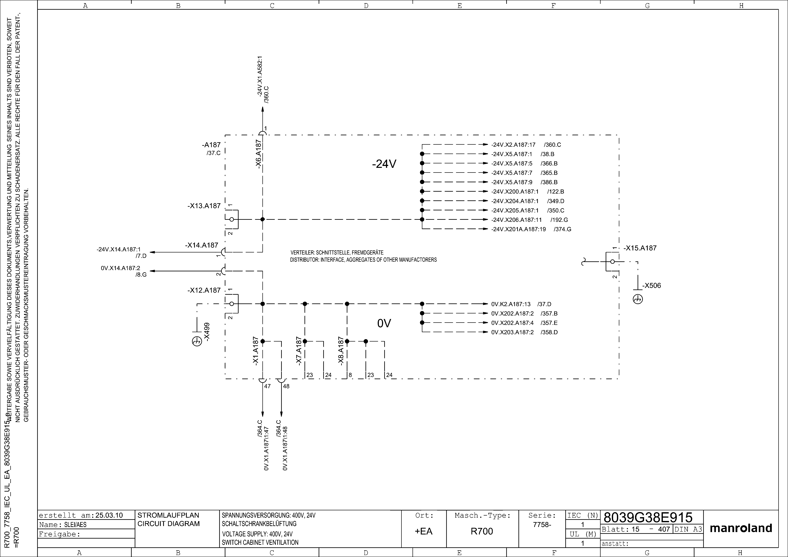

# +EA — Sheet 15 of 407 — SPANNUNGSVERSORGUNG: 400V, 24V

**SCHALTSCHRANKBELÜFTUNG**

> Part of the manroland **R700** printing press IEC/UL circuit diagrams.
> Drawing class: **Stromlaufplan / Circuit diagram** (DIN A3).
> Document `+EA` covers the **Printing unit** machine section.

## At a glance

| Field | Value |
|---|---|
| Document | `+EA`  (8039G38E915) |
| Sheet | **15** of 407 |
| Section (DE) | SPANNUNGSVERSORGUNG: 400V, 24V |
| Section (EN) | SCHALTSCHRANKBELÜFTUNG |
| Section type | POWER_SUPPLY — Voltage supply |
| Machine type | `R700` |
| Series | `7758` |
| Created | 25.03.10 |
| Replaces | — |
| Columns used | A, B, C, D, F, G |
| Path numbers | — |
| Labels on sheet | 70 |
| Cross-refs out | 20 |
| Cross-refs in | 30 |

**Previous:** [+EA sheet 14](SHEET_0014.md) · **Next:** [+EA sheet 16](SHEET_0016.md) · **Document TOC:** [_TOC.md](_TOC.md)  (+EA) · **Master TOC:** [all sheets](../_MASTER_TOC.md)

## Sheet image (300 DPI, exact vector render)



_Rendered directly from the PDF vector layer at 300 DPI (1-bit), no OCR and no resampling. Use it to confirm anything ambiguous in the text below._

## Cross-references on this sheet

Each entry is a wire leaving this sheet. The printed token is `/sheet.column`; the link resolves to that sheet inside the same document.

| Ref | Target sheet | Col | Path | Destination on target | Target section | From col |
|---|---|---|---|---|---|---|
| `/360.C` | [+EA sheet 360](SHEET_0360.md) | C | — | 24V.X1.A582:1 | OPTION: | C |
| `/360.C` | [+EA sheet 360](SHEET_0360.md) | C | — | 24V.X2.A187:17 | OPTION: | F |
| `/37.C` | [+EA sheet 37](SHEET_0037.md) | C | — | — | BUSVERBINDUNGEN: NOT AUS | B |
| `/38.B` | [+EA sheet 38](SHEET_0038.md) | B | — | 24V.X5.A187:1 | BUSVERBINDUNGEN: NOT AUS | F |
| `/366.B` | [+EA sheet 366](SHEET_0366.md) | B | — | 24V.X5.A187:5 | OPTION: TROCKNER VORBEREITUNG; | F |
| `/365.B` | [+EA sheet 365](SHEET_0365.md) | B | — | 24V.X5.A187:7 | OPTION: TROCKNER VORBEREITUNG; | F |
| `/386.B` | [+EA sheet 386](SHEET_0386.md) | B | — | 24V.X5.A187:9 | OPTION: ZWISCHENTROCKNER VORBEREITUNG; | F |
| `/122.B` | [+EA sheet 122](SHEET_0122.md) | B | — | 24V.X200.A187:1 | TROCKENBESTÄUBER | F |
| `/349.D` | [+EA sheet 349](SHEET_0349.md) | D | — | 24V.X204.A187:1 | OPTION: VORBEREITUNG IONISATIONSANLAGE | F |
| `/350.C` | [+EA sheet 350](SHEET_0350.md) | C | — | 24V.X205.A187:1 | OPTION: VORBEREITUNG: PUDERABSAUGUNG | F |
| `/192.G` | [+EA sheet 192](SHEET_0192.md) | G | — | 24V.X206.A187:11 | RESERVE | F |
| `/374.G` | [+EA sheet 374](SHEET_0374.md) | G | — | 24V.X201A.A187:19 | OPTION: ENDTROCKNER 1 VORBEREITUNG; | F |
| `/7.D` | [+EA sheet 7](SHEET_0007.md) | D | — | 24V.X14.A187:1 | SPANNUNGSVERSORGUNG: 400V, 24V | A |
| `/8.G` | [+EA sheet 8](SHEET_0008.md) | G | — | 0V.X14.A187:2 | SPANNUNGSVERSORGUNG: 400V, 24V | A |
| `/37.D` | [+EA sheet 37](SHEET_0037.md) | D | — | 0V.K2.A187:13 | BUSVERBINDUNGEN: NOT AUS | F |
| `/357.B` | [+EA sheet 357](SHEET_0357.md) | B | — | 0V.X202.A187:2 | OPTION: AUFLAGENZÄHLER / GUTBOGENZÄHLER | F |
| `/357.E` | [+EA sheet 357](SHEET_0357.md) | E | — | 0V.X202.A187:4 | OPTION: AUFLAGENZÄHLER / GUTBOGENZÄHLER | F |
| `/358.D` | [+EA sheet 358](SHEET_0358.md) | D | — | 0V.X203.A187:2 | OPTION: MAKULATURBOGENZÄHLER | F |
| `/364.C` | [+EA sheet 364](SHEET_0364.md) | C | — | — | OPTION: TROCKNER VORBEREITUNG; | C |
| `/364.C` | [+EA sheet 364](SHEET_0364.md) | C | — | — | OPTION: TROCKNER VORBEREITUNG; | C |

### Incoming references (sheets that point here)

Every other sheet that sends a wire to this one. `Back-ref` is the token printed on *that* sheet; `Path` is its line number.

| From sheet | Cols | Back-ref | Path | Refs | What continues there |
|---|---|---|---|---|---|
| [+EA#7](SHEET_0007.md) | D | `/7.D` | — | 1 | 24V.X14.A187:1 |
| [+EA#8](SHEET_0008.md) | G | `/8.G` | — | 1 | 0V.X14.A187:2 |
| [+EA#37](SHEET_0037.md) | C, D | `/37.C`, `/37.D` | — | 2 | 0V.K2.A187:13 |
| [+EA#38](SHEET_0038.md) | B | `/38.B` | — | 1 | 24V.X5.A187:1 |
| [+EA#122](SHEET_0122.md) | B | `/122.B` | — | 1 | 24V.X200.A187:1 |
| [+EA#192](SHEET_0192.md) | G | `/192.G` | — | 1 | 24V.X206.A187:11 |
| [+EA#206](SHEET_0206.md) | H | `/206.H` | — | 2 | — |
| [+EA#243](SHEET_0243.md) | G | `/243.G` | — | 1 | — |
| [+EA#246](SHEET_0246.md) | B | `/246.B` | — | 2 | — |
| [+EA#248](SHEET_0248.md) | C | `/248.C` | — | 3 | — |
| [+EA#259](SHEET_0259.md) | D | `/259.D` | — | 2 | — |
| [+EA#349](SHEET_0349.md) | D | `/349.D` | — | 1 | 24V.X204.A187:1 |
| [+EA#350](SHEET_0350.md) | B | `/350.B` | — | 1 | 24V.X205.A187:1 |
| [+EA#357](SHEET_0357.md) | C | `/357.C` | — | 2 | 0V.X202.A187:2 0V.X202.A187:4 |
| [+EA#358](SHEET_0358.md) | D | `/358.D` | — | 1 | (0V) (24V) 0V.X203.A187:2 |
| [+EA#360](SHEET_0360.md) | B, C | `/360.B`, `/360.C` | — | 2 | 24V.X1.A582:1; 24V.X2.A187:17 |
| [+EA#364](SHEET_0364.md) | C | `/364.C` | — | 2 | — |
| [+EA#365](SHEET_0365.md) | B | `/365.B` | — | 1 | 24V.X5.A187:7 |
| [+EA#366](SHEET_0366.md) | A | `/366.A` | — | 1 | 24V.X5.A187:5 |
| [+EA#374](SHEET_0374.md) | G | `/374.G` | — | 1 | 24V.X201A.A187:19 |
| [+EA#386](SHEET_0386.md) | B | `/386.B` | — | 1 | 24V.X5.A187:9 |


## Devices on this sheet

| Tag | Class | Class meaning (IEC) | Col | Sub | Terminal | Sign |
|---|---|---|---|---|---|---|
| `A187` | A | Baugruppe / assembly, module, PC board | B | — | — | — |
| `X499` | X | Klemme / terminal, plug connector | B | — | — | — |
| `X506` | X | Klemme / terminal, plug connector | G | — | — | — |
| `X6.A187` | — | cross-device reference | C | — | — | — |
| `X1.A187` | — | cross-device reference | C | — | — | — |
| `X14.A187` | — | cross-device reference | B | — | — | — |
| `X13.A187` | — | cross-device reference | B | — | — | — |
| `X12.A187` | — | cross-device reference | B | — | — | — |
| `X7.A187` | — | cross-device reference | C | — | — | — |
| `X8.A187` | — | cross-device reference | D | — | — | — |
| `X15.A187` | — | cross-device reference | G | — | — | — |

## Potentials / nets

| Potential | Count | Columns | Attached devices | Terminals |
|---|---|---|---|---|
| `0V` | 8 | A, C, D, F | `A187`, `A187\1`, `K2`, `X1`, `X14`, `X202`, `X203` | `13`, `2`, `4`, `47`, `48` |
| `24V` | 13 | A, C, D, F | `A187`, `A582`, `X1`, `X14`, `X2`, `X200`, `X201A`, `X204`, `X205`, `X206`, `X5` | `1`, `11`, `17`, `19`, `5`, `7`, `9` |


A potential such as `L24+/4` or `M24+` is a named supply/return rail; every place it appears on this sheet is electrically common.

## Wire-end annotations (grouped as printed)

A wire that continues elsewhere is annotated with a small cluster: the destination description, the path/line number `#NN`, and the `/sheet.column` cross reference. Each row below is one such cluster exactly as it is grouped on the drawing.

| Col | Y | Path | Cross-ref | Text on the wire |
|---|---|---|---|---|
| C | 84.2 | — | `/360.C` | `24V.X1.A582:1` |
| C | 190.2 | — | — | `1` |
| C | 210.6 | — | — | `X6.A187` |
| B | 214.3 | — | — | `A187` |
| F | 215.0 | — | `/360.C` | `24V.X2.A187:17` |
| B | 227.4 | — | `/37.C` | — |
| F | 229.2 | — | `/38.B` | `24V.X5.A187:1` |
| D | 240.1 | — | — | `24V` |
| F | 243.3 | — | `/366.B` | `24V.X5.A187:5` |
| F | 257.5 | — | `/365.B` | `24V.X5.A187:7` |
| F | 271.7 | — | `/386.B` | `24V.X5.A187:9` |
| F | 285.9 | — | `/122.B` | `24V.X200.A187:1` |
| F | 300.1 | — | `/349.D` | `24V.X204.A187:1` |
| B | 306.4 | — | — | `X13.A187` |
| C | 307.6 | — | — | `1 2` |
| F | 314.2 | — | `/350.C` | `24V.X205.A187:1` |
| F | 328.4 | — | `/192.G` | `24V.X206.A187:11` |
| F | 342.6 | — | `/374.G` | `24V.X201A.A187:19` |
| B | 366.0 | — | — | `X14.A187` |
| G | 370.2 | — | — | `X15.A187` |
| G | 372.5 | — | — | `1 2` |
| A | 373.0 | — | `/7.D` | `24V.X14.A187:1` |
| D | 379.1 | — | — | `DISTRIBUTOR: INTERFACE, AGGREGATES OF OTHER MANUFACTORERS VERTEILER: SCHNITTSTELLE, FREMDGERÄTE` |
| B | 384.4 | — | — | `1` |
| A | 401.4 | — | `/8.G` | `0V.X14.A187:2` |
| B | 412.2 | — | — | `2` |
| G | 426.9 | — | — | `X506` |
| B | 434.0 | — | — | `X12.A187` |
| C | 435.1 | — | — | `1 2` |
| F | 455.9 | — | `/37.D` | `0V.K2.A187:13` |
| F | 470.1 | — | `/357.B` | `0V.X202.A187:2` |
| D | 481.1 | — | — | `0V` |
| F | 484.3 | — | `/357.E` | `0V.X202.A187:4` |
| B | 487.4 | — | — | `X499` |
| F | 498.5 | — | `/358.D` | `0V.X203.A187:2` |
| C | 508.2 | — | — | `X1.A187` |
| C | 508.2 | — | — | `X7.A187` |
| D | 508.2 | — | — | `X8.A187` |
| D | 563.0 | — | — | `23 24 8 23 24` |
| C | 580.0 | — | — | `47` |
| C | 580.0 | — | — | `48` |
| C | 634.7 | — | `/364.C` | — |
| C | 634.7 | — | `/364.C` | — |
| C | 644.6 | — | — | `0V.X1.A187\1:47` |
| C | 644.6 | — | — | `0V.X1.A187\1:48` |


## Reconstructed tables

This sheet carries tabular content (pin map / terminal assignment / index). The grid below was rebuilt from the drawing's own rule lines, so each row is exactly one physical row of the table.

### Table 1 — 8 data rows × 2 columns (at x=297.6, y=218.3)

| C1 | C2 |
|---|---|
| `A187 /37.C` |  |
|  | `X6.A187` |
| `X13.A187 1` |  |
| `2 X14.A187` |  |
| `1` |  |
| `2 X12.A187 1` |  |
| `2` |  |
| `X499` |  |


### Table 2 — 1 data rows × 6 columns (at x=425.2, y=218.3) — **24V**

| VERTEILER: | DISTRIBUTOR: | SCHNITTSTELLE, INTERFACE, | AGGREGATES | FREMDGERÄTE OF | OTHER MANUFACTORERS |
|---|---|---|---|---|---|
|  |  |  |  | `0V` |  |


## Notes and free text on this sheet

| Text | Col | Y (pt) |
|---|---|---|
| `VERTEILER: SCHNITTSTELLE, FREMDGERÄTE` | D | 379.05 |
| `DISTRIBUTOR: INTERFACE, AGGREGATES OF OTHER MANUFACTORERS` | D | 389.69 |

## Complete label inventory (exact text from the drawing)

Every text object inside the drawing area of this sheet, in DIN reading order (column A→H, then top→bottom). This is the authoritative list: if a string is not here it is not printed on this sheet.

| Col | Y | X | Dir | Type | Text |
|---|---|---|---|---|---|
| A | 373.0 | 146.0 | → | potential | `24V.X14.A187:1` |
| A | 401.4 | 152.5 | → | potential | `0V.X14.A187:2` |
| B | 214.3 | 305.3 | → | device tag | `A187` |
| B | 227.4 | 312.4 | → | cross-reference | `/37.C` |
| B | 306.4 | 283.5 | → | device ref | `X13.A187` |
| B | 366.0 | 279.8 | → | device ref | `X14.A187` |
| B | 382.9 | 205.2 | → | cross-reference | `/7.D` |
| B | 384.4 | 326.3 | ↕ | number | `1` |
| B | 411.3 | 204.9 | → | cross-reference | `/8.G` |
| B | 412.2 | 326.3 | ↕ | number | `2` |
| B | 434.0 | 283.5 | → | device ref | `X12.A187` |
| B | 487.4 | 307.9 | ↕ | device tag | `X499` |
| C | 84.2 | 388.6 | ↕ | potential | `24V.X1.A582:1` |
| C | 130.1 | 398.6 | ↕ | cross-reference | `/360.C` |
| C | 190.2 | 398.8 | → | number | `1` |
| C | 210.6 | 385.8 | ↕ | device ref | `X6.A187` |
| C | 307.6 | 344.0 | ↕ | number | `1` |
| C | 350.4 | 344.0 | ↕ | number | `2` |
| C | 435.1 | 344.0 | ↕ | number | `1` |
| C | 477.9 | 344.0 | ↕ | number | `2` |
| C | 508.3 | 381.6 | ↕ | device ref | `X1.A187` |
| C | 508.3 | 446.8 | ↕ | device ref | `X7.A187` |
| C | 563.0 | 463.2 | → | number | `23` |
| C | 580.0 | 399.4 | → | number | `47` |
| C | 580.0 | 427.7 | → | number | `48` |
| C | 634.7 | 388.6 | ↕ | cross-reference | `/364.C` |
| C | 634.7 | 417.0 | ↕ | cross-reference | `/364.C` |
| C | 644.6 | 398.5 | ↕ | potential | `0V.X1.A187\1:47` |
| C | 644.6 | 426.9 | ↕ | potential | `0V.X1.A187\1:48` |
| D | 240.1 | 562.3 | → | potential | `24V` |
| D | 379.1 | 439.4 | → | text | `VERTEILER: SCHNITTSTELLE, FREMDGERÄTE` |
| D | 389.7 | 438.5 | → | text | `DISTRIBUTOR: INTERFACE, AGGREGATES OF OTHER MANUFACTORERS` |
| D | 481.1 | 569.9 | → | potential | `0V` |
| D | 508.3 | 510.5 | ↕ | device ref | `X8.A187` |
| D | 563.0 | 491.5 | → | number | `24` |
| D | 563.0 | 527.0 | → | number | `8` |
| D | 563.0 | 555.3 | → | number | `23` |
| D | 563.0 | 583.7 | → | number | `24` |
| F | 215.0 | 742.4 | → | potential | `24V.X2.A187:17` |
| F | 215.0 | 822.0 | → | cross-reference | `/360.C` |
| F | 229.1 | 817.1 | → | cross-reference | `/38.B` |
| F | 229.2 | 742.4 | → | potential | `24V.X5.A187:1` |
| F | 243.3 | 742.4 | → | potential | `24V.X5.A187:5` |
| F | 243.3 | 817.1 | → | cross-reference | `/366.B` |
| F | 257.5 | 742.4 | → | potential | `24V.X5.A187:7` |
| F | 257.5 | 817.1 | → | cross-reference | `/365.B` |
| F | 271.7 | 742.4 | → | potential | `24V.X5.A187:9` |
| F | 271.7 | 817.1 | → | cross-reference | `/386.B` |
| F | 285.9 | 742.4 | → | potential | `24V.X200.A187:1` |
| F | 285.9 | 827.0 | → | cross-reference | `/122.B` |
| F | 300.0 | 742.4 | → | potential | `24V.X204.A187:1` |
| F | 300.1 | 827.0 | → | cross-reference | `/349.D` |
| F | 314.2 | 742.4 | → | potential | `24V.X205.A187:1` |
| F | 314.2 | 827.0 | → | cross-reference | `/350.C` |
| F | 328.4 | 742.4 | → | potential | `24V.X206.A187:11` |
| F | 328.4 | 832.0 | → | cross-reference | `/192.G` |
| F | 342.6 | 742.4 | → | potential | `24V.X201A.A187:19` |
| F | 342.6 | 836.9 | → | cross-reference | `/374.G` |
| F | 455.9 | 742.4 | → | potential | `0V.K2.A187:13` |
| F | 456.0 | 812.1 | → | cross-reference | `/37.D` |
| F | 470.1 | 742.4 | → | potential | `0V.X202.A187:2` |
| F | 470.1 | 817.1 | → | cross-reference | `/357.B` |
| F | 484.3 | 742.4 | → | potential | `0V.X202.A187:4` |
| F | 484.3 | 817.1 | → | cross-reference | `/357.E` |
| F | 498.5 | 742.4 | → | potential | `0V.X203.A187:2` |
| F | 498.5 | 817.1 | → | cross-reference | `/358.D` |
| G | 370.2 | 942.2 | → | device ref | `X15.A187` |
| G | 372.5 | 925.1 | ↕ | number | `1` |
| G | 416.1 | 925.1 | ↕ | number | `2` |
| G | 426.9 | 970.6 | → | device tag | `X506` |

## Reading-order text block

The same content as a plain block, grouped by DIN column — convenient to paste or to match against a visual description.

```text
=== Column A ===
 373.0  146.0  net          24V.X14.A187:1
 401.4  152.5  net          0V.X14.A187:2
=== Column B ===
 214.3  305.3  devtag       A187
 227.4  312.4  xref         /37.C
 306.4  283.5  devref       X13.A187
 366.0  279.8  devref       X14.A187
 382.9  205.2  xref         /7.D
 384.4  326.3  numeric      1
 411.3  204.9  xref         /8.G
 412.2  326.3  numeric      2
 434.0  283.5  devref       X12.A187
 487.4  307.9  devtag       X499
=== Column C ===
  84.2  388.6  net          24V.X1.A582:1
 130.1  398.6  xref         /360.C
 190.2  398.8  numeric      1
 210.6  385.8  devref       X6.A187
 307.6  344.0  numeric      1
 350.4  344.0  numeric      2
 435.1  344.0  numeric      1
 477.9  344.0  numeric      2
 508.3  381.6  devref       X1.A187
 508.3  446.8  devref       X7.A187
 563.0  463.2  numeric      23
 580.0  399.4  numeric      47
 580.0  427.7  numeric      48
 634.7  388.6  xref         /364.C
 634.7  417.0  xref         /364.C
 644.6  398.5  net          0V.X1.A187\1:47
 644.6  426.9  net          0V.X1.A187\1:48
=== Column D ===
 240.1  562.3  net          24V
 379.1  439.4  text         VERTEILER: SCHNITTSTELLE, FREMDGERÄTE
 389.7  438.5  text         DISTRIBUTOR: INTERFACE, AGGREGATES OF OTHER MANUFACTORERS
 481.1  569.9  net          0V
 508.3  510.5  devref       X8.A187
 563.0  491.5  numeric      24
 563.0  527.0  numeric      8
 563.0  555.3  numeric      23
 563.0  583.7  numeric      24
=== Column F ===
 215.0  742.4  net          24V.X2.A187:17
 215.0  822.0  xref         /360.C
 229.1  817.1  xref         /38.B
 229.2  742.4  net          24V.X5.A187:1
 243.3  742.4  net          24V.X5.A187:5
 243.3  817.1  xref         /366.B
 257.5  742.4  net          24V.X5.A187:7
 257.5  817.1  xref         /365.B
 271.7  742.4  net          24V.X5.A187:9
 271.7  817.1  xref         /386.B
 285.9  742.4  net          24V.X200.A187:1
 285.9  827.0  xref         /122.B
 300.0  742.4  net          24V.X204.A187:1
 300.1  827.0  xref         /349.D
 314.2  742.4  net          24V.X205.A187:1
 314.2  827.0  xref         /350.C
 328.4  742.4  net          24V.X206.A187:11
 328.4  832.0  xref         /192.G
 342.6  742.4  net          24V.X201A.A187:19
 342.6  836.9  xref         /374.G
 455.9  742.4  net          0V.K2.A187:13
 456.0  812.1  xref         /37.D
 470.1  742.4  net          0V.X202.A187:2
 470.1  817.1  xref         /357.B
 484.3  742.4  net          0V.X202.A187:4
 484.3  817.1  xref         /357.E
 498.5  742.4  net          0V.X203.A187:2
 498.5  817.1  xref         /358.D
=== Column G ===
 370.2  942.2  devref       X15.A187
 372.5  925.1  numeric      1
 416.1  925.1  numeric      2
 426.9  970.6  devtag       X506
```

---
_Generated from the PDF vector text layer; no OCR. Source: `R700_7758_IEC_UL_EA_8039G38E915_p`, sheet 15._
