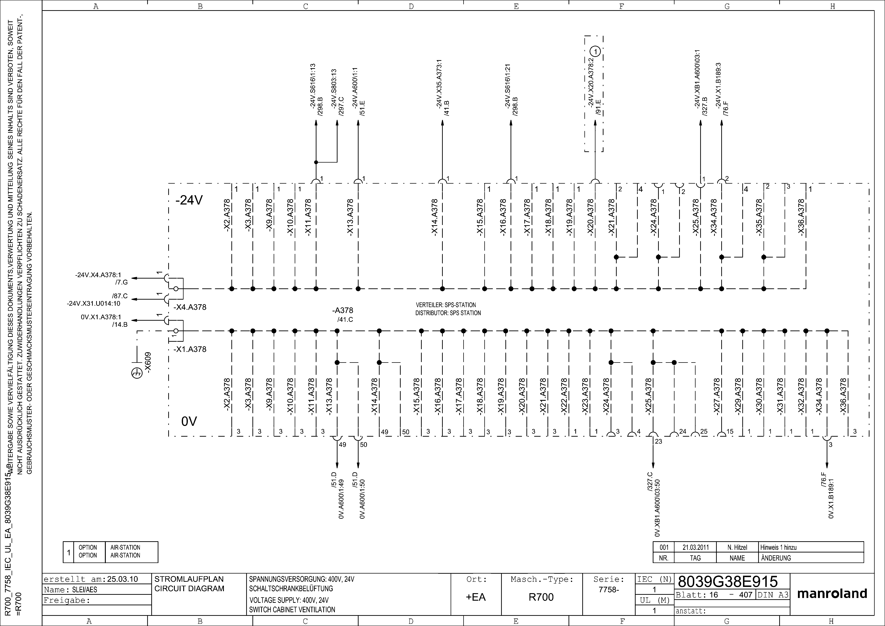

# +EA — Sheet 16 of 407 — SPANNUNGSVERSORGUNG: 400V, 24V

**SCHALTSCHRANKBELÜFTUNG**

> Part of the manroland **R700** printing press IEC/UL circuit diagrams.
> Drawing class: **Stromlaufplan / Circuit diagram** (DIN A3).
> Document `+EA` covers the **Printing unit** machine section.

## At a glance

| Field | Value |
|---|---|
| Document | `+EA`  (8039G38E915) |
| Sheet | **16** of 407 |
| Section (DE) | SPANNUNGSVERSORGUNG: 400V, 24V |
| Section (EN) | SCHALTSCHRANKBELÜFTUNG |
| Section type | POWER_SUPPLY — Voltage supply |
| Machine type | `R700` |
| Series | `7758` |
| Created | 25.03.10 |
| Replaces | — |
| Columns used | A, B, C, D, E, F, G, H |
| Path numbers | — |
| Labels on sheet | 153 |
| Cross-refs out | 16 |
| Cross-refs in | 69 |

**Previous:** [+EA sheet 15](SHEET_0015.md) · **Next:** [+EA sheet 17](SHEET_0017.md) · **Document TOC:** [_TOC.md](_TOC.md)  (+EA) · **Master TOC:** [all sheets](../_MASTER_TOC.md)

## Sheet image (300 DPI, exact vector render)



_Rendered directly from the PDF vector layer at 300 DPI (1-bit), no OCR and no resampling. Use it to confirm anything ambiguous in the text below._

## Cross-references on this sheet

Each entry is a wire leaving this sheet. The printed token is `/sheet.column`; the link resolves to that sheet inside the same document.

| Ref | Target sheet | Col | Path | Destination on target | Target section | From col |
|---|---|---|---|---|---|---|
| `/327.B` | [+EA sheet 327](SHEET_0327.md) | B | — | 24V.XB1.A600\03:1 | OPTION: BOGENWEICHE | G |
| `/91.E` | [+EA sheet 91](SHEET_0091.md) | E | — | 24V.X20.A378:2 | BLASROHRE (BLASRAHMEN) | F |
| `/41.B` | [+EA sheet 41](SHEET_0041.md) | B | — | 24V.X35.A373:1 | BUSVERBINDUNGEN: STOP SICHERN | D |
| `/76.F` | [+EA sheet 76](SHEET_0076.md) | F | — | 24V.X1.B189:3 | AUSLEGERSTAPELSTEUERUNG | G |
| `/298.B` | [+EA sheet 298](SHEET_0298.md) | B | — | 24V.S616\1:13 | OPTION: ZWISCHENSTAPEL / | C |
| `/298.B` | [+EA sheet 298](SHEET_0298.md) | B | — | 24V.S616\1:21 | OPTION: ZWISCHENSTAPEL / | E |
| `/51.E` | [+EA sheet 51](SHEET_0051.md) | E | — | 24V.A600\1:1 | MASCHINENBEDIENUNG: SPANNUNGSVERSORGUNG | D |
| `/297.C` | [+EA sheet 297](SHEET_0297.md) | C | — | 24V.S803:13 | OPTION: ZWISCHENSTAPEL / | C |
| `/7.G` | [+EA sheet 7](SHEET_0007.md) | G | — | 24V.X4.A378:1 | SPANNUNGSVERSORGUNG: 400V, 24V | A |
| `/87.C` | [+EA sheet 87](SHEET_0087.md) | C | — | 24V.X31.U014:10 | SAUGWALZE | A |
| `/14.B` | [+EA sheet 14](SHEET_0014.md) | B | — | 0V.X1.A378:1 | SPANNUNGSVERSORGUNG: 400V, 24V | A |
| `/41.C` | [+EA sheet 41](SHEET_0041.md) | C | — | — | BUSVERBINDUNGEN: STOP SICHERN | C |
| `/51.D` | [+EA sheet 51](SHEET_0051.md) | D | — | — | MASCHINENBEDIENUNG: SPANNUNGSVERSORGUNG | C |
| `/51.D` | [+EA sheet 51](SHEET_0051.md) | D | — | — | MASCHINENBEDIENUNG: SPANNUNGSVERSORGUNG | C |
| `/327.C` | [+EA sheet 327](SHEET_0327.md) | C | — | — | OPTION: BOGENWEICHE | F |
| `/76.F` | [+EA sheet 76](SHEET_0076.md) | F | — | — | AUSLEGERSTAPELSTEUERUNG | H |

### Incoming references (sheets that point here)

Every other sheet that sends a wire to this one. `Back-ref` is the token printed on *that* sheet; `Path` is its line number.

| From sheet | Cols | Back-ref | Path | Refs | What continues there |
|---|---|---|---|---|---|
| [+EA#7](SHEET_0007.md) | H | `/7.H` | — | 1 | 24V.X4.A378:1 |
| [+EA#14](SHEET_0014.md) | A | `/14.A` | — | 1 | 0V.X1.A378:1 |
| [+EA#41](SHEET_0041.md) | C | `/41.C` | — | 2 | 24V.X35.A373:1 24V.X35.A373:3 |
| [+EA#51](SHEET_0051.md) | C, D, F | `/51.C`, `/51.D`, `/51.F` | — | 3 | 0V.A600\1:49; 0V.A600\1:50; 24V.A600\1:1 24V.A600\2:1 |
| [+EA#76](SHEET_0076.md) | E, F | `/76.E`, `/76.F` | — | 2 | 0V.X1.B189:1; 24V.X1.B189:3 |
| [+EA#87](SHEET_0087.md) | B | `/87.B` | — | 1 | 24V.X31.U014:10 |
| [+EA#91](SHEET_0091.md) | E | `/91.E` | — | 1 | 24V.X20.A378:2 |
| [+EA#229](SHEET_0229.md) | G | `/229.G` | — | 2 | — |
| [+EA#235](SHEET_0235.md) | D | `/235.D` | — | 2 | — |
| [+EA#252](SHEET_0252.md) | H | `/252.H` | — | 2 | — |
| [+EA#254](SHEET_0254.md) | G | `/254.G` | — | 2 | — |
| [+EA#256](SHEET_0256.md) | E | `/256.E` | — | 2 | — |
| [+EA#259](SHEET_0259.md) | A, B | `/259.A`, `/259.B` | — | 3 | — |
| [+EA#260](SHEET_0260.md) | A, B | `/260.A`, `/260.B` | — | 3 | — |
| [+EA#261](SHEET_0261.md) | B | `/261.B` | — | 2 | — |
| [+EA#262](SHEET_0262.md) | G | `/262.G` | — | 2 | — |
| [+EA#263](SHEET_0263.md) | C, F, G | `/263.C`, `/263.F`, `/263.G` | — | 6 | — |
| [+EA#264](SHEET_0264.md) | B, E, H | `/264.B`, `/264.E`, `/264.H` | — | 6 | — |
| [+EA#265](SHEET_0265.md) | E | `/265.E` | — | 1 | — |
| [+EA#266](SHEET_0266.md) | F | `/266.F` | — | 4 | — |
| [+EA#268](SHEET_0268.md) | A | `/268.A` | — | 4 | — |
| [+EA#271](SHEET_0271.md) | A | `/271.A` | — | 1 | — |
| [+EA#273](SHEET_0273.md) | H | `/273.H` | — | 1 | — |
| [+EA#275](SHEET_0275.md) | D | `/275.D` | — | 1 | STROMPFAD PIN 1 2 3 4 |
| [+EA#276](SHEET_0276.md) | B, H | `/276.B`, `/276.H` | — | 2 | STROMPFAD PIN 1 2 3 4 |
| [+EA#278](SHEET_0278.md) | B, F | `/278.B`, `/278.F` | — | 5 | — |
| [+EA#279](SHEET_0279.md) | D | `/279.D` | — | 2 | — |
| [+EA#297](SHEET_0297.md) | C | `/297.C` | — | 1 | 24V.S803:13 |
| [+EA#298](SHEET_0298.md) | A | `/298.A` | — | 2 | 24V.S616\1:13; 24V.S616\1:21 |
| [+EA#327](SHEET_0327.md) | B, C | `/327.B`, `/327.C` | — | 2 | 0V.XB1.A600\03:50; 24V.XB1.A600\03:1 |


## Devices on this sheet

| Tag | Class | Class meaning (IEC) | Col | Sub | Terminal | Sign |
|---|---|---|---|---|---|---|
| `A378` | A | Baugruppe / assembly, module, PC board | C | — | — | — |
| `X609` | X | Klemme / terminal, plug connector | B | — | — | — |
| `X1.A378` | — | cross-device reference | B | — | — | — |
| `X13.A378` | — | cross-device reference | C | — | — | — |
| `X34.A378` | — | cross-device reference | H | — | — | — |
| `X25.A378` | — | cross-device reference | F | — | — | — |
| `X11.A378` | — | cross-device reference | C | — | — | — |
| `X4.A378` | — | cross-device reference | B | — | — | — |
| `X25.A378` | — | cross-device reference | G | — | — | — |
| `X34.A378` | — | cross-device reference | G | — | — | — |
| `X16.A378` | — | cross-device reference | E | — | — | — |
| `X14.A378` | — | cross-device reference | D | — | — | — |
| `X13.A378` | — | cross-device reference | C | — | — | — |
| `NR.` | — | cross-device reference | F | — | — | — |
| `21.03.2011` | — | cross-device reference | G | — | — | — |
| `X21.A378` | — | cross-device reference | E | — | — | — |
| `X22.A378` | — | cross-device reference | E | — | — | — |
| `X20.A378` | — | cross-device reference | E | — | — | — |
| `X23.A378` | — | cross-device reference | F | — | — | — |
| `X27.A378` | — | cross-device reference | G | — | — | — |
| `X30.A378` | — | cross-device reference | G | — | — | — |
| `X29.A378` | — | cross-device reference | G | — | — | — |
| `X31.A378` | — | cross-device reference | H | — | — | — |
| `X32.A378` | — | cross-device reference | H | — | — | — |
| `X36.A378` | — | cross-device reference | H | — | — | — |
| `X15.A378` | — | cross-device reference | D | — | — | — |
| `X16.A378` | — | cross-device reference | D | — | — | — |
| `X17.A378` | — | cross-device reference | D | — | — | — |
| `X3.A378` | — | cross-device reference | B | — | — | — |
| `X9.A378` | — | cross-device reference | C | — | — | — |
| `X10.A378` | — | cross-device reference | C | — | — | — |
| `X2.A378` | — | cross-device reference | B | — | — | — |
| `X11.A378` | — | cross-device reference | C | — | — | — |
| `X3.A378` | — | cross-device reference | B | — | — | — |
| `X9.A378` | — | cross-device reference | C | — | — | — |
| `X2.A378` | — | cross-device reference | B | — | — | — |
| `X17.A378` | — | cross-device reference | E | — | — | — |
| `X24.A378` | — | cross-device reference | F | — | — | — |
| `X35.A378` | — | cross-device reference | G | — | — | — |
| `X36.A378` | — | cross-device reference | H | — | — | — |
| `X15.A378` | — | cross-device reference | E | — | — | — |
| `X14.A378` | — | cross-device reference | D | — | — | — |
| `X24.A378` | — | cross-device reference | F | — | — | — |
| `X20.A378` | — | cross-device reference | F | — | — | — |
| `X18.A378` | — | cross-device reference | E | — | — | — |
| `X19.A378` | — | cross-device reference | E | — | — | — |
| `X18.A378` | — | cross-device reference | E | — | — | — |
| `X19.A378` | — | cross-device reference | F | — | — | — |
| `X10.A378` | — | cross-device reference | C | — | — | — |
| `X21.A378` | — | cross-device reference | F | — | — | — |

## Potentials / nets

| Potential | Count | Columns | Attached devices | Terminals |
|---|---|---|---|---|
| `0V` | 6 | A, B, C, D, F, H | `A378`, `A600\03`, `A600\1`, `B189`, `X1`, `XB1` | `1`, `49`, `50` |
| `24V` | 11 | A, B, C, D, E, F, G | `A373`, `A378`, `A600\03`, `A600\1`, `B189`, `S616\1`, `S803`, `U014`, `X1`, `X20`, `X31`, `X35`, `X4`, `XB1` | `1`, `10`, `13`, `2`, `21`, `3` |


A potential such as `L24+/4` or `M24+` is a named supply/return rail; every place it appears on this sheet is electrically common.

## Wire-end annotations (grouped as printed)

A wire that continues elsewhere is annotated with a small cluster: the destination description, the path/line number `#NN`, and the `/sheet.column` cross reference. Each row below is one such cluster exactly as it is grouped on the drawing.

| Col | Y | Path | Cross-ref | Text on the wire |
|---|---|---|---|---|
| F | 66.0 | — | — | `1` |
| G | 66.0 | — | `/327.B` | `24V.XB1.A600\03:1` |
| F | 78.0 | — | `/91.E` | `24V.X20.A378:2` |
| D | 79.4 | — | `/41.B` | `24V.X35.A373:1` |
| G | 84.2 | — | `/76.F` | `24V.X1.B189:3` |
| C | 85.3 | — | `/298.B` | `24V.S616\1:13` |
| E | 85.3 | — | `/298.B` | `24V.S616\1:21` |
| D | 90.1 | — | `/51.E` | `24V.A600\1:1` |
| C | 92.7 | — | `/297.C` | `24V.S803:13` |
| C | 236.3 | — | — | `1` |
| D | 236.3 | — | — | `1` |
| D | 236.3 | — | — | `1` |
| E | 236.3 | — | — | `1` |
| G | 236.3 | — | — | `2` |
| G | 237.0 | — | — | `1` |
| G | 246.9 | — | — | `4 2 3` |
| C | 249.7 | — | — | `1 1 1` |
| E | 249.7 | — | — | `1` |
| F | 249.7 | — | — | `1 4` |
| E | 249.7 | — | — | `1 1` |
| H | 249.7 | — | — | `1` |
| C | 250.5 | — | — | `1` |
| F | 250.5 | — | — | `2` |
| F | 254.0 | — | — | `1 2` |
| B | 261.4 | — | — | `24V` |
| B | 267.3 | — | — | `X2.A378` |
| B | 267.3 | — | — | `X3.A378` |
| C | 267.3 | — | — | `X9.A378` |
| C | 267.3 | — | — | `X10.A378` |
| C | 267.3 | — | — | `X11.A378` |
| C | 267.3 | — | — | `X13.A378` |
| D | 267.3 | — | — | `X14.A378` |
| E | 267.3 | — | — | `X15.A378` |
| E | 267.3 | — | — | `X16.A378` |
| E | 267.3 | — | — | `X17.A378` |
| E | 267.3 | — | — | `X18.A378` |
| F | 267.3 | — | — | `X19.A378` |
| F | 267.3 | — | — | `X20.A378` |
| F | 267.3 | — | — | `X21.A378` |
| F | 267.3 | — | — | `X24.A378` |
| G | 267.3 | — | — | `X25.A378` |
| G | 267.3 | — | — | `X34.A378` |
| G | 267.3 | — | — | `X35.A378` |
| H | 267.3 | — | — | `X36.A378` |
| B | 363.7 | — | — | `1` |
| A | 365.9 | — | `/7.G` | `24V.X4.A378:1` |
| B | 392.0 | — | — | `1` |
| A | 394.3 | — | `/87.C` | `24V.X31.U014:10` |
| D | 407.4 | — | — | `DISTRIBUTOR: SPS STATION VERTEILER: SPS STATION` |
| B | 408.5 | — | — | `X4.A378` |
| C | 412.7 | — | — | `A378` |
| B | 420.4 | — | — | `1` |
| A | 422.6 | — | `/14.B` | `0V.X1.A378:1` |
| C | 425.8 | — | `/41.C` | — |
| B | 449.6 | — | — | `1` |
| B | 465.2 | — | — | `X1.A378` |
| B | 473.2 | — | — | `X609` |
| B | 508.2 | — | — | `X2.A378` |
| B | 508.2 | — | — | `X3.A378` |
| C | 508.2 | — | — | `X9.A378` |
| C | 508.2 | — | — | `X10.A378` |
| C | 508.2 | — | — | `X11.A378` |
| C | 508.2 | — | — | `X13.A378` |
| D | 508.2 | — | — | `X14.A378` |
| D | 508.2 | — | — | `X15.A378` |
| D | 508.2 | — | — | `X16.A378` |
| D | 508.2 | — | — | `X17.A378` |
| E | 508.2 | — | — | `X18.A378` |
| E | 508.2 | — | — | `X19.A378` |
| E | 508.2 | — | — | `X20.A378` |
| E | 508.2 | — | — | `X21.A378` |
| E | 508.2 | — | — | `X22.A378` |
| F | 508.2 | — | — | `X23.A378` |
| F | 508.2 | — | — | `X24.A378` |
| F | 508.2 | — | — | `X25.A378` |
| G | 508.2 | — | — | `X27.A378` |
| G | 508.2 | — | — | `X29.A378` |
| G | 508.2 | — | — | `X30.A378` |
| H | 508.2 | — | — | `X31.A378` |
| H | 508.2 | — | — | `X32.A378` |
| H | 508.2 | — | — | `X34.A378` |
| H | 508.2 | — | — | `X36.A378` |
| C | 559.0 | — | — | `0V 3 3 3 3 3 3 3` |
| C | 576.5 | — | — | `3` |
| E | 576.5 | — | — | `49 50 3 3 15` |
| E | 576.5 | — | — | `3` |
| E | 576.5 | — | — | `3` |
| F | 576.5 | — | — | `1` |
| F | 576.5 | — | — | `1` |
| F | 576.5 | — | — | `3` |
| F | 576.5 | — | — | `4` |
| G | 576.5 | — | — | `24` |
| G | 576.5 | — | — | `25` |
| G | 576.5 | — | — | `1` |
| G | 576.5 | — | — | `1` |
| H | 576.5 | — | — | `1` |
| H | 576.5 | — | — | `1` |
| H | 576.5 | — | — | `3` |
| F | 589.9 | — | — | `23` |
| C | 594.2 | — | — | `49` |
| D | 594.2 | — | — | `50` |
| H | 594.2 | — | — | `3` |
| C | 634.7 | — | `/51.D` | — |
| C | 634.7 | — | `/51.D` | — |
| F | 634.7 | — | `/327.C` | — |
| H | 634.7 | — | `/76.F` | — |
| H | 643.2 | — | — | `0V.X1.B189:1` |
| C | 644.6 | — | — | `0V.A600\1:49` |
| D | 644.6 | — | — | `0V.A600\1:50` |
| F | 644.6 | — | — | `0V.XB1.A600\03:50` |
| G | 733.0 | — | — | `001 21.03.2011 N. Hitzel Hinweis 1 hinzu` |
| A | 733.4 | — | — | `1 OPTION OPTION` |
| A | 733.4 | — | — | `AIR STATION AIR STATION` |
| G | 747.1 | — | — | `NR. TAG NAME ÄNDERUNG` |


## Reconstructed tables

This sheet carries tabular content (pin map / terminal assignment / index). The grid below was rebuilt from the drawing's own rule lines, so each row is exactly one physical row of the table.

### Table 1 — 1 data rows × 2 columns (at x=184.3, y=388.3)

| 1 1 | X4.A378 |
|---|---|
| `1 X609` | `X1.A378` |


## Notes and free text on this sheet

| Text | Col | Y (pt) |
|---|---|---|
| `VERTEILER: SPS STATION` | D | 407.38 |
| `DISTRIBUTOR: SPS STATION` | D | 418.01 |
| `TAG` | G | 747.27 |
| `NAME` | G | 747.25 |
| `ÄNDERUNG` | G | 747.31 |
| `N. Hitzel` | G | 733.14 |
| `Hinweis 1 hinzu` | G | 733.16 |
| `OPTION` | A | 733.35 |
| `AIR STATION` | A | 733.37 |

## Complete label inventory (exact text from the drawing)

Every text object inside the drawing area of this sheet, in DIN reading order (column A→H, then top→bottom). This is the authoritative list: if a string is not here it is not printed on this sheet.

| Col | Y | X | Dir | Type | Text |
|---|---|---|---|---|---|
| A | 365.9 | 101.2 | → | potential | `24V.X4.A378:1` |
| A | 375.8 | 155.3 | → | cross-reference | `/7.G` |
| A | 394.3 | 150.8 | → | cross-reference | `/87.C` |
| A | 404.2 | 89.9 | → | potential | `24V.X31.U014:10` |
| A | 422.6 | 108.9 | → | potential | `0V.X1.A378:1` |
| A | 432.5 | 151.1 | → | cross-reference | `/14.B` |
| A | 733.4 | 106.0 | → | text | `OPTION` |
| A | 733.4 | 148.8 | → | text | `AIR STATION` |
| A | 738.7 | 89.6 | → | number | `1` |
| A | 744.0 | 106.0 | → | text | `OPTION` |
| A | 744.0 | 148.8 | → | text | `AIR STATION` |
| B | 249.7 | 314.9 | → | number | `1` |
| B | 261.4 | 236.3 | → | potential | `24V` |
| B | 267.3 | 300.8 | ↕ | device ref | `X2.A378` |
| B | 267.3 | 329.1 | ↕ | device ref | `X3.A378` |
| B | 363.7 | 210.0 | ↕ | number | `1` |
| B | 392.0 | 210.0 | ↕ | number | `1` |
| B | 408.5 | 233.6 | → | device ref | `X4.A378` |
| B | 420.4 | 210.0 | ↕ | number | `1` |
| B | 449.6 | 231.1 | ↕ | number | `1` |
| B | 465.2 | 233.6 | → | device ref | `X1.A378` |
| B | 473.2 | 194.5 | ↕ | device tag | `X609` |
| B | 508.3 | 300.8 | ↕ | device ref | `X2.A378` |
| B | 508.3 | 329.1 | ↕ | device ref | `X3.A378` |
| B | 559.1 | 243.9 | → | potential | `0V` |
| B | 576.5 | 318.6 | → | number | `3` |
| C | 85.3 | 417.0 | ↕ | potential | `24V.S616\1:13` |
| C | 90.1 | 473.7 | ↕ | potential | `24V.A600\1:1` |
| C | 92.7 | 445.3 | ↕ | potential | `24V.S803:13` |
| C | 130.1 | 455.3 | ↕ | cross-reference | `/297.C` |
| C | 130.4 | 426.9 | ↕ | cross-reference | `/298.B` |
| C | 236.3 | 430.3 | → | number | `1` |
| C | 249.7 | 343.3 | → | number | `1` |
| C | 250.5 | 372.5 | → | number | `1` |
| C | 250.5 | 400.8 | → | number | `1` |
| C | 267.3 | 357.5 | ↕ | device ref | `X9.A378` |
| C | 267.3 | 385.8 | ↕ | device ref | `X10.A378` |
| C | 267.3 | 409.9 | ↕ | device ref | `X11.A378` |
| C | 267.3 | 466.6 | ↕ | device ref | `X13.A378` |
| C | 412.7 | 447.0 | → | device tag | `A378` |
| C | 425.8 | 454.1 | → | cross-reference | `/41.C` |
| C | 508.3 | 357.5 | ↕ | device ref | `X9.A378` |
| C | 508.3 | 385.8 | ↕ | device ref | `X10.A378` |
| C | 508.3 | 414.2 | ↕ | device ref | `X11.A378` |
| C | 508.3 | 438.3 | ↕ | device ref | `X13.A378` |
| C | 576.5 | 347.0 | → | number | `3` |
| C | 576.5 | 375.3 | → | number | `3` |
| C | 576.5 | 403.7 | → | number | `3` |
| C | 576.5 | 432.0 | → | number | `3` |
| C | 594.2 | 456.1 | → | number | `49` |
| C | 634.7 | 445.3 | ↕ | cross-reference | `/51.D` |
| C | 634.7 | 473.7 | ↕ | cross-reference | `/51.D` |
| C | 644.6 | 455.2 | ↕ | potential | `0V.A600\1:49` |
| D | 79.4 | 587.1 | ↕ | potential | `24V.X35.A373:1` |
| D | 135.2 | 483.6 | ↕ | cross-reference | `/51.E` |
| D | 135.2 | 596.9 | ↕ | cross-reference | `/41.B` |
| D | 236.3 | 487.0 | → | number | `1` |
| D | 236.3 | 600.4 | → | number | `1` |
| D | 267.3 | 580.0 | ↕ | device ref | `X14.A378` |
| D | 407.4 | 559.8 | → | text | `VERTEILER: SPS STATION` |
| D | 418.0 | 559.0 | → | text | `DISTRIBUTOR: SPS STATION` |
| D | 508.3 | 499.2 | ↕ | device ref | `X14.A378` |
| D | 508.3 | 555.9 | ↕ | device ref | `X15.A378` |
| D | 508.3 | 584.2 | ↕ | device ref | `X16.A378` |
| D | 508.3 | 612.6 | ↕ | device ref | `X17.A378` |
| D | 576.5 | 573.7 | → | number | `3` |
| D | 576.5 | 602.1 | → | number | `3` |
| D | 577.2 | 512.8 | → | number | `49` |
| D | 577.2 | 541.1 | → | number | `50` |
| D | 594.2 | 484.4 | → | number | `50` |
| D | 644.6 | 483.6 | ↕ | potential | `0V.A600\1:50` |
| E | 85.3 | 679.2 | ↕ | potential | `24V.S616\1:21` |
| E | 130.4 | 689.1 | ↕ | cross-reference | `/298.B` |
| E | 236.3 | 692.5 | → | number | `1` |
| E | 249.7 | 655.1 | → | number | `1` |
| E | 249.7 | 718.9 | → | number | `1` |
| E | 249.7 | 747.2 | → | number | `1` |
| E | 267.3 | 640.9 | ↕ | device ref | `X15.A378` |
| E | 267.3 | 672.1 | ↕ | device ref | `X16.A378` |
| E | 267.3 | 704.7 | ↕ | device ref | `X17.A378` |
| E | 267.3 | 733.1 | ↕ | device ref | `X18.A378` |
| E | 508.3 | 640.9 | ↕ | device ref | `X18.A378` |
| E | 508.3 | 669.3 | ↕ | device ref | `X19.A378` |
| E | 508.3 | 697.6 | ↕ | device ref | `X20.A378` |
| E | 508.3 | 726.0 | ↕ | device ref | `X21.A378` |
| E | 508.3 | 754.3 | ↕ | device ref | `X22.A378` |
| E | 576.5 | 630.4 | → | number | `3` |
| E | 576.5 | 715.5 | → | number | `3` |
| E | 576.5 | 743.8 | → | number | `3` |
| E | 577.2 | 654.5 | → | number | `3` |
| E | 577.2 | 682.9 | → | number | `3` |
| F | 66.0 | 799.0 | → | number | `1` |
| F | 78.0 | 791.1 | ↕ | potential | `24V.X20.A378:2` |
| F | 133.8 | 801.0 | ↕ | cross-reference | `/91.E` |
| F | 249.7 | 775.6 | → | number | `1` |
| F | 249.7 | 859.2 | → | number | `4` |
| F | 250.5 | 832.0 | → | number | `2` |
| F | 254.0 | 889.8 | → | number | `1` |
| F | 267.3 | 761.4 | ↕ | device ref | `X19.A378` |
| F | 267.3 | 789.8 | ↕ | device ref | `X20.A378` |
| F | 267.3 | 818.1 | ↕ | device ref | `X21.A378` |
| F | 267.3 | 874.8 | ↕ | device ref | `X24.A378` |
| F | 508.3 | 782.7 | ↕ | device ref | `X23.A378` |
| F | 508.3 | 811.0 | ↕ | device ref | `X24.A378` |
| F | 508.3 | 867.7 | ↕ | device ref | `X25.A378` |
| F | 576.5 | 771.6 | → | number | `1` |
| F | 576.5 | 799.9 | → | number | `1` |
| F | 576.5 | 828.9 | → | number | `3` |
| F | 576.5 | 857.2 | → | number | `4` |
| F | 589.9 | 881.3 | → | number | `23` |
| F | 634.7 | 870.5 | ↕ | cross-reference | `/327.C` |
| F | 644.6 | 880.4 | ↕ | potential | `0V.XB1.A600\03:50` |
| F | 733.0 | 887.7 | → | number | `001` |
| F | 747.1 | 886.7 | → | device ref | `NR.` |
| G | 66.1 | 934.3 | ↕ | potential | `24V.XB1.A600\03:1` |
| G | 84.2 | 962.6 | ↕ | potential | `24V.X1.B189:3` |
| G | 130.4 | 944.2 | ↕ | cross-reference | `/327.B` |
| G | 135.8 | 972.5 | ↕ | cross-reference | `/76.F` |
| G | 236.3 | 975.7 | → | number | `2` |
| G | 237.0 | 944.5 | → | number | `1` |
| G | 246.9 | 1030.4 | → | number | `2` |
| G | 249.7 | 1000.9 | → | number | `4` |
| G | 254.0 | 917.0 | → | number | `2` |
| G | 267.3 | 931.5 | ↕ | device ref | `X25.A378` |
| G | 267.3 | 955.6 | ↕ | device ref | `X34.A378` |
| G | 267.3 | 1016.5 | ↕ | device ref | `X35.A378` |
| G | 508.3 | 959.8 | ↕ | device ref | `X27.A378` |
| G | 508.3 | 988.2 | ↕ | device ref | `X29.A378` |
| G | 508.3 | 1016.5 | ↕ | device ref | `X30.A378` |
| G | 576.5 | 913.9 | → | number | `24` |
| G | 576.5 | 942.2 | → | number | `25` |
| G | 576.5 | 977.1 | → | number | `15` |
| G | 576.5 | 1005.4 | → | number | `1` |
| G | 576.5 | 1033.8 | → | number | `1` |
| G | 733.1 | 918.6 | → | device ref | `21.03.2011` |
| G | 733.1 | 978.8 | → | text | `N. Hitzel` |
| G | 733.2 | 1023.2 | → | text | `Hinweis 1 hinzu` |
| G | 747.3 | 928.3 | → | text | `TAG` |
| G | 747.3 | 981.7 | → | text | `NAME` |
| G | 747.3 | 1024.3 | → | text | `ÄNDERUNG` |
| H | 246.9 | 1058.5 | → | number | `3` |
| H | 249.7 | 1087.4 | → | number | `1` |
| H | 267.3 | 1073.2 | ↕ | device ref | `X36.A378` |
| H | 508.3 | 1044.9 | ↕ | device ref | `X31.A378` |
| H | 508.3 | 1073.2 | ↕ | device ref | `X32.A378` |
| H | 508.3 | 1097.3 | ↕ | device ref | `X34.A378` |
| H | 508.3 | 1129.9 | ↕ | device ref | `X36.A378` |
| H | 576.5 | 1062.1 | → | number | `1` |
| H | 576.5 | 1090.5 | → | number | `1` |
| H | 576.5 | 1147.7 | → | number | `3` |
| H | 594.2 | 1115.1 | → | number | `3` |
| H | 634.7 | 1104.4 | ↕ | cross-reference | `/76.F` |
| H | 643.2 | 1114.3 | ↕ | potential | `0V.X1.B189:1` |

## Reading-order text block

The same content as a plain block, grouped by DIN column — convenient to paste or to match against a visual description.

```text
=== Column A ===
 365.9  101.2  net          24V.X4.A378:1
 375.8  155.3  xref         /7.G
 394.3  150.8  xref         /87.C
 404.2   89.9  net          24V.X31.U014:10
 422.6  108.9  net          0V.X1.A378:1
 432.5  151.1  xref         /14.B
 733.4  106.0  text         OPTION
 733.4  148.8  text         AIR STATION
 738.7   89.6  numeric      1
 744.0  106.0  text         OPTION
 744.0  148.8  text         AIR STATION
=== Column B ===
 249.7  314.9  numeric      1
 261.4  236.3  net          24V
 267.3  300.8  devref       X2.A378
 267.3  329.1  devref       X3.A378
 363.7  210.0  numeric      1
 392.0  210.0  numeric      1
 408.5  233.6  devref       X4.A378
 420.4  210.0  numeric      1
 449.6  231.1  numeric      1
 465.2  233.6  devref       X1.A378
 473.2  194.5  devtag       X609
 508.3  300.8  devref       X2.A378
 508.3  329.1  devref       X3.A378
 559.1  243.9  net          0V
 576.5  318.6  numeric      3
=== Column C ===
  85.3  417.0  net          24V.S616\1:13
  90.1  473.7  net          24V.A600\1:1
  92.7  445.3  net          24V.S803:13
 130.1  455.3  xref         /297.C
 130.4  426.9  xref         /298.B
 236.3  430.3  numeric      1
 249.7  343.3  numeric      1
 250.5  372.5  numeric      1
 250.5  400.8  numeric      1
 267.3  357.5  devref       X9.A378
 267.3  385.8  devref       X10.A378
 267.3  409.9  devref       X11.A378
 267.3  466.6  devref       X13.A378
 412.7  447.0  devtag       A378
 425.8  454.1  xref         /41.C
 508.3  357.5  devref       X9.A378
 508.3  385.8  devref       X10.A378
 508.3  414.2  devref       X11.A378
 508.3  438.3  devref       X13.A378
 576.5  347.0  numeric      3
 576.5  375.3  numeric      3
 576.5  403.7  numeric      3
 576.5  432.0  numeric      3
 594.2  456.1  numeric      49
 634.7  445.3  xref         /51.D
 634.7  473.7  xref         /51.D
 644.6  455.2  net          0V.A600\1:49
=== Column D ===
  79.4  587.1  net          24V.X35.A373:1
 135.2  483.6  xref         /51.E
 135.2  596.9  xref         /41.B
 236.3  487.0  numeric      1
 236.3  600.4  numeric      1
 267.3  580.0  devref       X14.A378
 407.4  559.8  text         VERTEILER: SPS STATION
 418.0  559.0  text         DISTRIBUTOR: SPS STATION
 508.3  499.2  devref       X14.A378
 508.3  555.9  devref       X15.A378
 508.3  584.2  devref       X16.A378
 508.3  612.6  devref       X17.A378
 576.5  573.7  numeric      3
 576.5  602.1  numeric      3
 577.2  512.8  numeric      49
 577.2  541.1  numeric      50
 594.2  484.4  numeric      50
 644.6  483.6  net          0V.A600\1:50
=== Column E ===
  85.3  679.2  net          24V.S616\1:21
 130.4  689.1  xref         /298.B
 236.3  692.5  numeric      1
 249.7  655.1  numeric      1
 249.7  718.9  numeric      1
 249.7  747.2  numeric      1
 267.3  640.9  devref       X15.A378
 267.3  672.1  devref       X16.A378
 267.3  704.7  devref       X17.A378
 267.3  733.1  devref       X18.A378
 508.3  640.9  devref       X18.A378
 508.3  669.3  devref       X19.A378
 508.3  697.6  devref       X20.A378
 508.3  726.0  devref       X21.A378
 508.3  754.3  devref       X22.A378
 576.5  630.4  numeric      3
 576.5  715.5  numeric      3
 576.5  743.8  numeric      3
 577.2  654.5  numeric      3
 577.2  682.9  numeric      3
=== Column F ===
  66.0  799.0  numeric      1
  78.0  791.1  net          24V.X20.A378:2
 133.8  801.0  xref         /91.E
 249.7  775.6  numeric      1
 249.7  859.2  numeric      4
 250.5  832.0  numeric      2
 254.0  889.8  numeric      1
 267.3  761.4  devref       X19.A378
 267.3  789.8  devref       X20.A378
 267.3  818.1  devref       X21.A378
 267.3  874.8  devref       X24.A378
 508.3  782.7  devref       X23.A378
 508.3  811.0  devref       X24.A378
 508.3  867.7  devref       X25.A378
 576.5  771.6  numeric      1
 576.5  799.9  numeric      1
 576.5  828.9  numeric      3
 576.5  857.2  numeric      4
 589.9  881.3  numeric      23
 634.7  870.5  xref         /327.C
 644.6  880.4  net          0V.XB1.A600\03:50
 733.0  887.7  numeric      001
 747.1  886.7  devref       NR.
=== Column G ===
  66.1  934.3  net          24V.XB1.A600\03:1
  84.2  962.6  net          24V.X1.B189:3
 130.4  944.2  xref         /327.B
 135.8  972.5  xref         /76.F
 236.3  975.7  numeric      2
 237.0  944.5  numeric      1
 246.9 1030.4  numeric      2
 249.7 1000.9  numeric      4
 254.0  917.0  numeric      2
 267.3  931.5  devref       X25.A378
 267.3  955.6  devref       X34.A378
 267.3 1016.5  devref       X35.A378
 508.3  959.8  devref       X27.A378
 508.3  988.2  devref       X29.A378
 508.3 1016.5  devref       X30.A378
 576.5  913.9  numeric      24
 576.5  942.2  numeric      25
 576.5  977.1  numeric      15
 576.5 1005.4  numeric      1
 576.5 1033.8  numeric      1
 733.1  918.6  devref       21.03.2011
 733.1  978.8  text         N. Hitzel
 733.2 1023.2  text         Hinweis 1 hinzu
 747.3  928.3  text         TAG
 747.3  981.7  text         NAME
 747.3 1024.3  text         ÄNDERUNG
=== Column H ===
 246.9 1058.5  numeric      3
 249.7 1087.4  numeric      1
 267.3 1073.2  devref       X36.A378
 508.3 1044.9  devref       X31.A378
 508.3 1073.2  devref       X32.A378
 508.3 1097.3  devref       X34.A378
 508.3 1129.9  devref       X36.A378
 576.5 1062.1  numeric      1
 576.5 1090.5  numeric      1
 576.5 1147.7  numeric      3
 594.2 1115.1  numeric      3
 634.7 1104.4  xref         /76.F
 643.2 1114.3  net          0V.X1.B189:1
```

---
_Generated from the PDF vector text layer; no OCR. Source: `R700_7758_IEC_UL_EA_8039G38E915_p`, sheet 16._
