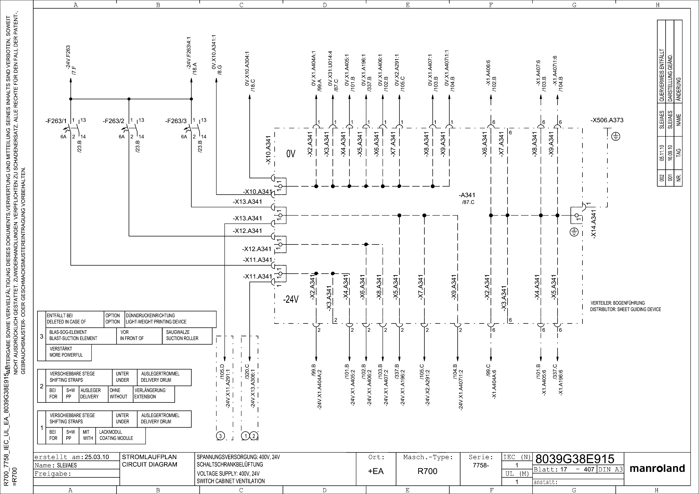

# +EA — Sheet 17 of 407 — SPANNUNGSVERSORGUNG: 400V, 24V

**SCHALTSCHRANKBELÜFTUNG**

> Part of the manroland **R700** printing press IEC/UL circuit diagrams.
> Drawing class: **Stromlaufplan / Circuit diagram** (DIN A3).
> Document `+EA` covers the **Printing unit** machine section.

## At a glance

| Field | Value |
|---|---|
| Document | `+EA`  (8039G38E915) |
| Sheet | **17** of 407 |
| Section (DE) | SPANNUNGSVERSORGUNG: 400V, 24V |
| Section (EN) | SCHALTSCHRANKBELÜFTUNG |
| Section type | POWER_SUPPLY — Voltage supply |
| Machine type | `R700` |
| Series | `7758` |
| Created | 25.03.10 |
| Replaces | — |
| Columns used | A, B, C, D, E, F, G, H |
| Path numbers | — |
| Labels on sheet | 212 |
| Cross-refs out | 31 |
| Cross-refs in | 55 |

**Previous:** [+EA sheet 16](SHEET_0016.md) · **Next:** [+EA sheet 18](SHEET_0018.md) · **Document TOC:** [_TOC.md](_TOC.md)  (+EA) · **Master TOC:** [all sheets](../_MASTER_TOC.md)

## Sheet image (300 DPI, exact vector render)



_Rendered directly from the PDF vector layer at 300 DPI (1-bit), no OCR and no resampling. Use it to confirm anything ambiguous in the text below._

## Cross-references on this sheet

Each entry is a wire leaving this sheet. The printed token is `/sheet.column`; the link resolves to that sheet inside the same document.

| Ref | Target sheet | Col | Path | Destination on target | Target section | From col |
|---|---|---|---|---|---|---|
| `/8.G` | [+EA sheet 8](SHEET_0008.md) | G | — | 0V.X10.A341:1 | SPANNUNGSVERSORGUNG: 400V, 24V | C |
| `/18.A` | [+EA sheet 18](SHEET_0018.md) | A | — | 24V.F263\4:1 | SPANNUNGSVERSORGUNG: 400V, 24V | B |
| `/7.F` | [+EA sheet 7](SHEET_0007.md) | F | — | 24V.F263 | SPANNUNGSVERSORGUNG: 400V, 24V | A |
| `/104.B` | [+EA sheet 104](SHEET_0104.md) | B | — | 0V.X1.A407\1:1 | BOGENFÜHRUNGSELEMENT | F |
| `/99.A` | [+EA sheet 99](SHEET_0099.md) | A | — | 0V.X1.A404A:1 | BOGENFÜHRUNGSELEMENT | D |
| `/87.C` | [+EA sheet 87](SHEET_0087.md) | C | — | 0V.X31.U014:4 | SAUGWALZE | D |
| `/18.C` | [+EA sheet 18](SHEET_0018.md) | C | — | 0V.X10.A304:1 | SPANNUNGSVERSORGUNG: 400V, 24V | C |
| `/101.B` | [+EA sheet 101](SHEET_0101.md) | B | — | 0V.X1.A405:1 | BOGENFÜHRUNGSELEMENT | D |
| `/337.B` | [+EA sheet 337](SHEET_0337.md) | B | — | 0V.X1.A196:1 | OPTION: BOGENWEICHE | E |
| `/102.B` | [+EA sheet 102](SHEET_0102.md) | B | — | 0V.X1.A406:1 | BOGENFÜHRUNGSELEMENT | E |
| `/105.C` | [+EA sheet 105](SHEET_0105.md) | C | — | 0V.X2.A291:1 | BOGENFÜHRUNGSELEMENT | E |
| `/103.B` | [+EA sheet 103](SHEET_0103.md) | B | — | 0V.X1.A407:1 | BOGENFÜHRUNGSELEMENT | E |
| `/104.B` | [+EA sheet 104](SHEET_0104.md) | B | — | X1.A407\1:6 | BOGENFÜHRUNGSELEMENT | G |
| `/102.B` | [+EA sheet 102](SHEET_0102.md) | B | — | X1.A406:6 | BOGENFÜHRUNGSELEMENT | F |
| `/103.B` | [+EA sheet 103](SHEET_0103.md) | B | — | X1.A407:6 | BOGENFÜHRUNGSELEMENT | G |
| `/23.B` | [+EA sheet 23](SHEET_0023.md) | B | — | — | SPANNUNGSVERSORGUNG: 400V, 24V | A |
| `/23.B` | [+EA sheet 23](SHEET_0023.md) | B | — | — | SPANNUNGSVERSORGUNG: 400V, 24V | B |
| `/23.B` | [+EA sheet 23](SHEET_0023.md) | B | — | — | SPANNUNGSVERSORGUNG: 400V, 24V | C |
| `/87.C` | [+EA sheet 87](SHEET_0087.md) | C | — | — | SAUGWALZE | F |
| `/99.B` | [+EA sheet 99](SHEET_0099.md) | B | — | — | BOGENFÜHRUNGSELEMENT | D |
| `/105.D` | [+EA sheet 105](SHEET_0105.md) | D | — | — | BOGENFÜHRUNGSELEMENT | C |
| `/320.C` | [+EA sheet 320](SHEET_0320.md) | C | — | — | OPTION: VERLÄNGERUNG 3656,8MM | C |
| `/101.B` | [+EA sheet 101](SHEET_0101.md) | B | — | — | BOGENFÜHRUNGSELEMENT | D |
| `/102.B` | [+EA sheet 102](SHEET_0102.md) | B | — | — | BOGENFÜHRUNGSELEMENT | D |
| `/103.B` | [+EA sheet 103](SHEET_0103.md) | B | — | — | BOGENFÜHRUNGSELEMENT | E |
| `/337.B` | [+EA sheet 337](SHEET_0337.md) | B | — | — | OPTION: BOGENWEICHE | E |
| `/105.C` | [+EA sheet 105](SHEET_0105.md) | C | — | — | BOGENFÜHRUNGSELEMENT | E |
| `/104.B` | [+EA sheet 104](SHEET_0104.md) | B | — | — | BOGENFÜHRUNGSELEMENT | F |
| `/99.C` | [+EA sheet 99](SHEET_0099.md) | C | — | — | BOGENFÜHRUNGSELEMENT | F |
| `/101.B` | [+EA sheet 101](SHEET_0101.md) | B | — | — | BOGENFÜHRUNGSELEMENT | G |
| `/337.C` | [+EA sheet 337](SHEET_0337.md) | C | — | — | OPTION: BOGENWEICHE | G |

### Incoming references (sheets that point here)

Every other sheet that sends a wire to this one. `Back-ref` is the token printed on *that* sheet; `Path` is its line number.

| From sheet | Cols | Back-ref | Path | Refs | What continues there |
|---|---|---|---|---|---|
| [+EA#7](SHEET_0007.md) | F | `/7.F` | — | 1 | 24V.F263 |
| [+EA#8](SHEET_0008.md) | G | `/8.G` | — | 1 | 0V.X10.A341:1 |
| [+EA#18](SHEET_0018.md) | A, C | `/18.A`, `/18.C` | — | 2 | 0V.X10.A304:1; 24V.F263\4:1 |
| [+EA#23](SHEET_0023.md) | A | `/23.A` | — | 3 | — |
| [+EA#87](SHEET_0087.md) | B, C | `/87.B`, `/87.C` | — | 2 | 0V.X31.U014:4 |
| [+EA#99](SHEET_0099.md) | A, B, C | `/99.A`, `/99.B`, `/99.C` | — | 3 | 0V.X1.A404A:1; 24V.X1.A404A:2; X1.A404A:6 |
| [+EA#101](SHEET_0101.md) | B | `/101.B` | — | 3 | 0V.X1.A405:1; 24V.X1.A405:2; X1.A405:6 |
| [+EA#102](SHEET_0102.md) | B | `/102.B` | — | 3 | 0V.X1.A406:1; 24V.X1.A406:2; X1.A406:6 |
| [+EA#103](SHEET_0103.md) | B | `/103.B` | — | 3 | 0V.X1.A407:1; 24V.X1.A407:2; X1.A407:6 |
| [+EA#104](SHEET_0104.md) | A, B | `/104.A`, `/104.B` | — | 3 | 0V.X1.A407\1:1; 24V.X1.A407\1:2; X1.A407\1:6 |
| [+EA#105](SHEET_0105.md) | C, D | `/105.C`, `/105.D` | — | 3 | 0V.X2.A291:1; 24V.X11.A291:1; 24V.X2.A291:2 |
| [+EA#224](SHEET_0224.md) | C | `/224.C` | — | 3 | — |
| [+EA#233](SHEET_0233.md) | H | `/233.H` | — | 3 | — |
| [+EA#236](SHEET_0236.md) | F | `/236.F` | — | 3 | — |
| [+EA#240](SHEET_0240.md) | B | `/240.B` | — | 3 | — |
| [+EA#245](SHEET_0245.md) | B | `/245.B` | — | 3 | — |
| [+EA#247](SHEET_0247.md) | C | `/247.C` | — | 3 | — |
| [+EA#250](SHEET_0250.md) | A | `/250.A` | — | 3 | — |
| [+EA#252](SHEET_0252.md) | B | `/252.B` | — | 3 | — |
| [+EA#320](SHEET_0320.md) | B | `/320.B` | — | 1 | 24V.X13.A306:1 |
| [+EA#337](SHEET_0337.md) | A, B, C | `/337.A`, `/337.B`, `/337.C` | — | 3 | 0V.X1.A196:1; 24V.X1.A196:2; X1.A196:6 |


## Devices on this sheet

| Tag | Class | Class meaning (IEC) | Col | Sub | Terminal | Sign |
|---|---|---|---|---|---|---|
| `A341` | A | Baugruppe / assembly, module, PC board | F | — | — | — |
| `F263/3` | F | Schutz / protection device (fuse, circuit breaker) | B | 3 | — | — |
| `F263/1` | F | Schutz / protection device (fuse, circuit breaker) | A | 1 | — | — |
| `F263/2` | F | Schutz / protection device (fuse, circuit breaker) | A | 2 | — | — |
| `X4.A341` | — | cross-device reference | D | — | — | — |
| `X2.A341` | — | cross-device reference | D | — | — | — |
| `X6.A341` | — | cross-device reference | E | — | — | — |
| `X8.A341` | — | cross-device reference | E | — | — | — |
| `X9.A341` | — | cross-device reference | E | — | — | — |
| `X6.A341` | — | cross-device reference | F | — | — | — |
| `X8.A341` | — | cross-device reference | G | — | — | — |
| `X9.A341` | — | cross-device reference | G | — | — | — |
| `X7.A341` | — | cross-device reference | E | — | — | — |
| `X3.A341` | — | cross-device reference | D | — | — | — |
| `X5.A341` | — | cross-device reference | D | — | — | — |
| `X11.A341` | — | cross-device reference | C | — | — | — |
| `X4.A341` | — | cross-device reference | D | — | — | — |
| `X4.A341` | — | cross-device reference | G | — | — | — |
| `X2.A341` | — | cross-device reference | D | — | — | — |
| `X9.A341` | — | cross-device reference | F | — | — | — |
| `X2.A341` | — | cross-device reference | F | — | — | — |
| `X8.A341` | — | cross-device reference | E | — | — | — |
| `X6.A341` | — | cross-device reference | D | — | — | — |
| `X7.A341` | — | cross-device reference | E | — | — | — |
| `X5.A341` | — | cross-device reference | E | — | — | — |
| `X5.A341` | — | cross-device reference | G | — | — | — |
| `X12.A341` | — | cross-device reference | C | — | — | — |
| `X13.A341` | — | cross-device reference | C | — | — | — |
| `X10.A341` | — | cross-device reference | C | — | — | — |
| `X10.A341` | — | cross-device reference | C | — | — | — |
| `X11.A341` | — | cross-device reference | C | — | — | — |
| `X13.A341` | — | cross-device reference | C | — | — | — |
| `NR.` | — | cross-device reference | H | — | — | — |
| `16.09.10` | — | cross-device reference | H | — | — | — |
| `X14.A341` | — | cross-device reference | G | — | — | — |
| `05.11.10` | — | cross-device reference | H | — | — | — |
| `X1.A196:6` | — | cross-device reference | G | — | 6 | — |
| `X1.A404A:6` | — | cross-device reference | F | — | 6 | — |
| `X1.A407\1:6` | — | cross-device reference | G | — | 6 | — |
| `X1.A407:6` | — | cross-device reference | G | — | 6 | — |
| `X1.A406:6` | — | cross-device reference | F | — | 6 | — |
| `X1.A405:6` | — | cross-device reference | G | — | 6 | — |
| `X3.A341` | — | cross-device reference | D | — | — | — |
| `X3.A341` | — | cross-device reference | F | — | — | — |
| `X12.A341` | — | cross-device reference | C | — | — | — |
| `X7.A341` | — | cross-device reference | F | — | — | — |
| `X506.A373` | — | cross-device reference | G | — | — | — |

## Potentials / nets

| Potential | Count | Columns | Attached devices | Terminals |
|---|---|---|---|---|
| `0V` | 11 | C, D, E | `A196`, `A291`, `A304`, `A341`, `A404A`, `A405`, `A406`, `A407`, `A407\1`, `U014`, `X1`, `X10`, `X2`, `X31` | `1`, `4` |
| `24V` | 12 | A, B, C, D, E, F | `A196`, `A291`, `A306`, `A404A`, `A405`, `A406`, `A407`, `A407\1`, `F263`, `F263\4`, `X1`, `X11`, `X13`, `X2` | `1`, `2` |


A potential such as `L24+/4` or `M24+` is a named supply/return rail; every place it appears on this sheet is electrically common.

## Wire-end annotations (grouped as printed)

A wire that continues elsewhere is annotated with a small cluster: the destination description, the path/line number `#NN`, and the `/sheet.column` cross reference. Each row below is one such cluster exactly as it is grouped on the drawing.

| Col | Y | Path | Cross-ref | Text on the wire |
|---|---|---|---|---|
| C | 58.7 | — | `/8.G` | `0V.X10.A341:1` |
| B | 62.4 | — | `/18.A` | `24V.F263\4:1` |
| A | 77.1 | — | `/7.F` | `24V.F263` |
| H | 83.2 | — | — | `QUERVERWEIS ENTFÄLLT SLEI/AES 002 05.11.10` |
| F | 84.5 | — | `/104.B` | `0V.X1.A407\1:1` |
| D | 85.9 | — | `/99.A` | `0V.X1.A404A:1` |
| D | 86.7 | — | `/87.C` | `0V.X31.U014:4` |
| C | 87.0 | — | `/18.C` | `0V.X10.A304:1` |
| D | 91.8 | — | `/101.B` | `0V.X1.A405:1` |
| E | 91.8 | — | `/337.B` | `0V.X1.A196:1` |
| E | 91.8 | — | `/102.B` | `0V.X1.A406:1` |
| E | 91.8 | — | `/105.C` | `0V.X2.A291:1` |
| E | 91.8 | — | `/103.B` | `0V.X1.A407:1` |
| H | 92.4 | — | — | `001 DARSTELLUNG GEÄND. 16.09.10 SLEI/AES` |
| G | 95.0 | — | `/104.B` | `X1.A407\1:6` |
| F | 102.3 | — | `/102.B` | `X1.A406:6` |
| G | 102.3 | — | `/103.B` | `X1.A407:6` |
| H | 132.0 | — | — | `NR. NAME TAG ÄNDERUNG` |
| G | 200.1 | — | — | `X506.A373` |
| A | 200.9 | — | — | `1` |
| A | 200.9 | — | — | `13` |
| B | 200.9 | — | — | `1` |
| B | 200.9 | — | — | `13` |
| B | 200.9 | — | — | `1` |
| C | 200.9 | — | — | `13` |
| A | 201.6 | — | — | `F263/1` |
| C | 201.6 | — | — | `F263/2 1` |
| B | 201.6 | — | — | `F263/3` |
| D | 204.4 | — | — | `1` |
| D | 204.4 | — | — | `1` |
| D | 204.4 | — | — | `1` |
| E | 204.4 | — | — | `1` |
| E | 204.4 | — | — | `1` |
| E | 204.4 | — | — | `1` |
| F | 204.4 | — | — | `1` |
| F | 204.4 | — | — | `6` |
| G | 204.4 | — | — | `6` |
| G | 204.4 | — | — | `6` |
| F | 222.1 | — | — | `6` |
| D | 223.4 | — | — | `X2.A341` |
| D | 223.4 | — | — | `X3.A341` |
| D | 223.4 | — | — | `X4.A341` |
| D | 223.4 | — | — | `X5.A341` |
| E | 223.4 | — | — | `X6.A341` |
| E | 223.4 | — | — | `X7.A341` |
| E | 223.4 | — | — | `X8.A341` |
| E | 223.4 | — | — | `X9.A341` |
| F | 223.4 | — | — | `X6.A341` |
| F | 223.4 | — | — | `X7.A341` |
| G | 223.4 | — | — | `X8.A341` |
| G | 223.4 | — | — | `X9.A341` |
| A | 229.2 | — | — | `6A 2` |
| A | 229.2 | — | — | `14` |
| B | 229.2 | — | — | `6A 2` |
| B | 229.2 | — | — | `14` |
| B | 229.2 | — | — | `6A 2` |
| C | 229.2 | — | — | `14` |
| C | 230.5 | — | — | `X10.A341` |
| A | 239.2 | — | `/23.B` | — |
| B | 239.2 | — | `/23.B` | — |
| C | 239.2 | — | `/23.B` | — |
| D | 256.4 | — | — | `0V` |
| C | 307.0 | — | — | `1` |
| C | 321.2 | — | — | `1` |
| C | 322.0 | — | — | `X10.A341` |
| F | 327.7 | — | — | `A341` |
| C | 339.0 | — | — | `X13.A341` |
| F | 340.8 | — | `/87.C` | — |
| G | 343.8 | — | — | `1 X14.A341` |
| C | 356.6 | — | — | `1` |
| C | 367.4 | — | — | `X13.A341` |
| C | 370.8 | — | — | `1` |
| G | 370.8 | — | — | `1` |
| C | 388.6 | — | — | `X12.A341` |
| C | 406.2 | — | — | `1` |
| C | 419.8 | — | — | `X12.A341` |
| C | 420.4 | — | — | `1 1` |
| C | 438.3 | — | — | `X11.A341` |
| C | 455.8 | — | — | `1` |
| C | 466.6 | — | — | `X11.A341` |
| D | 467.1 | — | — | `X2.A341` |
| D | 467.1 | — | — | `X4.A341` |
| D | 467.1 | — | — | `X6.A341` |
| E | 467.1 | — | — | `X8.A341` |
| E | 467.1 | — | — | `X5.A341` |
| E | 467.1 | — | — | `X7.A341` |
| F | 467.1 | — | — | `X9.A341` |
| F | 467.1 | — | — | `X2.A341` |
| G | 467.1 | — | — | `X4.A341` |
| G | 467.1 | — | — | `X5.A341` |
| C | 484.2 | — | — | `1` |
| D | 486.1 | — | — | `X3.A341` |
| F | 486.1 | — | — | `X3.A341` |
| D | 504.4 | — | — | `24V` |
| H | 513.7 | — | — | `DISTRIBUTOR: SHEET GUIDING DEVICE VERTEILER: BOGENFÜHRUNG` |
| A | 534.9 | — | — | `ENTFÄLLT BEI DELETED IN CASE OF` |
| A | 534.9 | — | — | `OPTION OPTION` |
| B | 535.0 | — | — | `DÜNNDRUCKEINRICHTUNG LIGHT WEIGHT PRINTING DEVICE` |
| E | 541.7 | — | — | `2 6` |
| D | 558.8 | — | — | `2` |
| D | 558.8 | — | — | `2` |
| E | 558.8 | — | — | `2` |
| E | 558.8 | — | — | `2` |
| E | 558.8 | — | — | `2` |
| E | 558.8 | — | — | `2` |
| F | 558.8 | — | — | `2` |
| F | 558.8 | — | — | `6` |
| G | 558.8 | — | — | `6` |
| G | 558.8 | — | — | `6` |
| B | 563.2 | — | — | `SAUGWALZE SUCTION ROLLER` |
| A | 563.3 | — | — | `BLAS SOG ELEMENT BLAST SUCTION ELEMENT` |
| B | 563.3 | — | — | `IN FRONT OF VOR` |
| A | 568.6 | — | — | `3` |
| A | 591.6 | — | — | `MORE POWERFUL VERSTÄRKT` |
| C | 620.5 | — | `/105.D` | — |
| C | 620.5 | — | `/320.C` | — |
| D | 620.5 | — | `/99.B` | — |
| D | 620.5 | — | `/101.B` | — |
| D | 620.5 | — | `/102.B` | — |
| E | 620.5 | — | `/103.B` | — |
| E | 620.5 | — | `/337.B` | — |
| E | 620.5 | — | `/105.C` | — |
| F | 620.5 | — | `/104.B` | — |
| F | 620.5 | — | `/99.C` | — |
| G | 620.5 | — | `/101.B` | — |
| G | 620.5 | — | `/337.C` | — |
| C | 629.0 | — | — | `24V.X11.A291:1` |
| C | 629.0 | — | — | `24V.X13.A306:1` |
| D | 630.1 | — | — | `24V.X1.A404A:2` |
| D | 630.1 | — | — | `24V.X1.A405:2` |
| E | 630.1 | — | — | `24V.X1.A406:2` |
| E | 630.1 | — | — | `24V.X1.A407:2` |
| E | 630.1 | — | — | `24V.X1.A196:2` |
| E | 630.1 | — | — | `24V.X2.A291:2` |
| F | 630.1 | — | — | `24V.X1.A407\1:2` |
| F | 630.4 | — | — | `X1.A404A:6` |
| G | 630.4 | — | — | `X1.A405:6` |
| G | 630.4 | — | — | `X1.A196:6` |
| A | 634.2 | — | — | `SHIFTING STRAPS VERSCHIEBBARE STEGE` |
| B | 634.2 | — | — | `UNTER UNDER` |
| B | 634.2 | — | — | `DELIVERY DRUM AUSLEGERTROMMEL` |
| A | 653.7 | — | — | `2` |
| A | 662.3 | — | — | `BEI FOR` |
| A | 662.4 | — | — | `PP S+W` |
| A | 662.5 | — | — | `DELIVERY AUSLEGER` |
| B | 662.5 | — | — | `OHNE WITHOUT` |
| B | 662.5 | — | — | `EXTENSION VERLÄNGERUNG` |
| A | 705.0 | — | — | `SHIFTING STRAPS VERSCHIEBBARE STEGE` |
| B | 705.0 | — | — | `UNTER UNDER` |
| B | 705.1 | — | — | `DELIVERY DRUM AUSLEGERTROMMEL` |
| A | 724.5 | — | — | `1` |
| A | 733.2 | — | — | `BEI FOR` |
| A | 733.2 | — | — | `PP S+W` |
| A | 733.4 | — | — | `MIT` |
| A | 733.4 | — | — | `LACKMODUL` |
| C | 739.6 | — | — | `1 2` |
| C | 740.1 | — | — | `3` |
| A | 743.9 | — | — | `WITH` |
| A | 744.0 | — | — | `COATING MODULE` |


## Reconstructed tables

This sheet carries tabular content (pin map / terminal assignment / index). The grid below was rebuilt from the drawing's own rule lines, so each row is exactly one physical row of the table.

### Table 1 — 8 data rows × 18 columns (at x=382.7, y=168.7)

|  | X10.A341 1 | X2.A341 0V | 1 X3.A341 | 1 X4.A341 | 1 X5.A341 | 1 X6.A341 | 1 X7.A341 | 1 | X8.A341 | 1 X9.A341 | 1 | X6.A341 | 6 X7.A341 | 6 X8.A341 | 6 X9.A341 | 6 | X506.A373 |
|---|---|---|---|---|---|---|---|---|---|---|---|---|---|---|---|---|---|
|  | `1 X10.A341` |  |  |  |  |  |  |  |  |  |  |  |  |  |  |  |  |
| `X13.A341` |  |  |  |  |  |  |  |  |  |  |  | `A341 /87.C` |  |  |  |  | `1` |
|  | `1` |  |  |  |  |  |  |  |  |  |  |  |  |  |  |  |  |
| `X13.A341` | `1` |  |  |  |  |  |  |  |  |  |  |  |  |  |  |  | `1` |
| `X12.A341` |  |  |  |  |  |  |  |  |  |  |  |  |  |  |  |  | `X14.A341` |
|  | `1` |  |  |  |  |  |  |  |  |  |  |  |  |  |  |  |  |
|  | `X12.A341 1 X11.A341` |  |  |  |  |  |  |  |  |  |  |  |  |  |  |  |  |
|  | `1` |  |  |  |  |  |  |  |  |  |  |  |  |  |  |  |  |


## Notes and free text on this sheet

| Text | Col | Y (pt) |
|---|---|---|
| `VERTEILER: BOGENFÜHRUNG` | H | 513.71 |
| `DISTRIBUTOR: SHEET GUIDING DEVICE` | H | 524.32 |
| `6A` | B | 229.43 |
| `6A` | A | 229.43 |
| `TAG` | H | 253.38 |
| `NAME` | H | 193.97 |
| `ÄNDERUNG` | H | 131.99 |
| `SLEI/AES` | H | 188.53 |
| `DARSTELLUNG GEÄND.` | H | 92.38 |
| `QUERVERWEIS ENTFÄLLT` | H | 83.17 |
| `VERSCHIEBBARE STEGE` | A | 705.02 |
| `SHIFTING STRAPS` | A | 715.65 |
| `UNTER` | B | 705.03 |
| `UNDER` | B | 715.67 |
| `AUSLEGERTROMMEL` | B | 705.06 |
| `DELIVERY DRUM` | B | 715.67 |
| `BEI` | A | 733.2 |
| `FOR` | A | 743.98 |
| `S+W` | A | 733.24 |
| `PP` | A | 743.87 |
| `MIT` | A | 733.35 |
| `WITH` | A | 743.89 |
| `LACKMODUL` | A | 733.4 |
| `COATING MODULE` | A | 744.03 |
| `AUSLEGER` | A | 662.52 |
| `DELIVERY` | A | 673.13 |
| `OHNE` | A | 662.51 |
| `WITHOUT` | B | 673.11 |
| `VERLÄNGERUNG` | B | 662.53 |
| `EXTENSION` | B | 673.11 |
| `ENTFÄLLT BEI` | A | 534.92 |
| `DELETED IN CASE OF` | A | 545.57 |
| `OPTION` | A | 534.93 |
| `DÜNNDRUCKEINRICHTUNG` | B | 534.98 |
| `LIGHT WEIGHT PRINTING DEVICE` | B | 545.57 |
| `BLAS SOG ELEMENT` | A | 563.3 |
| `BLAST SUCTION ELEMENT` | A | 573.94 |
| `VOR` | B | 563.31 |
| `IN FRONT OF` | B | 573.93 |
| `SAUGWALZE` | B | 563.25 |
| `SUCTION ROLLER` | B | 573.95 |
| `VERSTÄRKT` | A | 591.64 |
| `MORE POWERFUL` | A | 602.27 |

## Complete label inventory (exact text from the drawing)

Every text object inside the drawing area of this sheet, in DIN reading order (column A→H, then top→bottom). This is the authoritative list: if a string is not here it is not printed on this sheet.

| Col | Y | X | Dir | Type | Text |
|---|---|---|---|---|---|
| A | 77.1 | 112.3 | ↕ | potential | `24V.F263` |
| A | 112.3 | 122.1 | ↕ | cross-reference | `/7.F` |
| A | 200.9 | 122.5 | → | number | `1` |
| A | 200.9 | 136.6 | → | number | `13` |
| A | 201.6 | 77.4 | → | device tag | `F263/1` |
| A | 201.6 | 175.2 | → | device tag | `F263/2` |
| A | 229.2 | 123.0 | → | number | `2` |
| A | 229.2 | 136.6 | → | number | `14` |
| A | 229.4 | 103.2 | → | text | `6A` |
| A | 239.2 | 131.4 | ↕ | cross-reference | `/23.B` |
| A | 534.9 | 79.9 | → | text | `ENTFÄLLT BEI` |
| A | 534.9 | 179.7 | → | text | `OPTION` |
| A | 545.6 | 79.9 | → | text | `DELETED IN CASE OF` |
| A | 545.6 | 179.7 | → | text | `OPTION` |
| A | 563.3 | 84.2 | → | text | `BLAS SOG ELEMENT` |
| A | 568.6 | 67.9 | → | number | `3` |
| A | 573.9 | 84.2 | → | text | `BLAST SUCTION ELEMENT` |
| A | 591.6 | 85.0 | → | text | `VERSTÄRKT` |
| A | 602.3 | 84.5 | → | text | `MORE POWERFUL` |
| A | 634.2 | 85.0 | → | text | `VERSCHIEBBARE STEGE` |
| A | 644.8 | 84.8 | → | text | `SHIFTING STRAPS` |
| A | 653.7 | 68.0 | → | number | `2` |
| A | 662.3 | 84.2 | → | text | `BEI` |
| A | 662.4 | 113.1 | → | text | `S+W` |
| A | 662.5 | 137.5 | → | text | `AUSLEGER` |
| A | 662.5 | 186.8 | → | text | `OHNE` |
| A | 673.0 | 112.5 | → | text | `PP` |
| A | 673.1 | 84.2 | → | text | `FOR` |
| A | 673.1 | 136.6 | → | text | `DELIVERY` |
| A | 705.0 | 85.0 | → | text | `VERSCHIEBBARE STEGE` |
| A | 715.7 | 84.8 | → | text | `SHIFTING STRAPS` |
| A | 724.5 | 68.3 | → | number | `1` |
| A | 733.2 | 84.2 | → | text | `BEI` |
| A | 733.2 | 113.1 | → | text | `S+W` |
| A | 733.4 | 141.2 | → | text | `MIT` |
| A | 733.4 | 169.2 | → | text | `LACKMODUL` |
| A | 743.9 | 112.5 | → | text | `PP` |
| A | 743.9 | 141.7 | → | text | `WITH` |
| A | 744.0 | 84.2 | → | text | `FOR` |
| A | 744.0 | 169.8 | → | text | `COATING MODULE` |
| B | 62.4 | 317.8 | ↕ | potential | `24V.F263\4:1` |
| B | 106.9 | 327.7 | ↕ | cross-reference | `/18.A` |
| B | 200.9 | 221.7 | → | number | `1` |
| B | 200.9 | 235.8 | → | number | `13` |
| B | 200.9 | 328.0 | → | number | `1` |
| B | 201.6 | 281.5 | → | device tag | `F263/3` |
| B | 229.2 | 222.2 | → | number | `2` |
| B | 229.2 | 235.8 | → | number | `14` |
| B | 229.2 | 328.5 | → | number | `2` |
| B | 229.4 | 202.4 | → | text | `6A` |
| B | 229.4 | 308.7 | → | text | `6A` |
| B | 239.2 | 230.6 | ↕ | cross-reference | `/23.B` |
| B | 535.0 | 214.6 | → | text | `DÜNNDRUCKEINRICHTUNG` |
| B | 545.6 | 214.6 | → | text | `LIGHT WEIGHT PRINTING DEVICE` |
| B | 563.3 | 205.5 | → | text | `VOR` |
| B | 563.3 | 283.2 | → | text | `SAUGWALZE` |
| B | 573.9 | 204.7 | → | text | `IN FRONT OF` |
| B | 574.0 | 283.2 | → | text | `SUCTION ROLLER` |
| B | 634.2 | 197.6 | → | text | `UNTER` |
| B | 634.2 | 240.9 | → | text | `AUSLEGERTROMMEL` |
| B | 644.8 | 197.6 | → | text | `UNDER` |
| B | 644.8 | 240.1 | → | text | `DELIVERY DRUM` |
| B | 662.5 | 229.6 | → | text | `VERLÄNGERUNG` |
| B | 673.1 | 187.1 | → | text | `WITHOUT` |
| B | 673.1 | 228.8 | → | text | `EXTENSION` |
| B | 705.0 | 197.6 | → | text | `UNTER` |
| B | 705.1 | 240.9 | → | text | `AUSLEGERTROMMEL` |
| B | 715.7 | 197.6 | → | text | `UNDER` |
| B | 715.7 | 240.1 | → | text | `DELIVERY DRUM` |
| C | 58.7 | 360.3 | ↕ | potential | `0V.X10.A341:1` |
| C | 87.0 | 417.0 | ↕ | potential | `0V.X10.A304:1` |
| C | 110.8 | 370.2 | ↕ | cross-reference | `/8.G` |
| C | 134.9 | 426.9 | ↕ | cross-reference | `/18.C` |
| C | 200.9 | 342.1 | → | number | `13` |
| C | 229.2 | 342.1 | → | number | `14` |
| C | 230.5 | 452.4 | ↕ | device ref | `X10.A341` |
| C | 239.2 | 336.9 | ↕ | cross-reference | `/23.B` |
| C | 307.0 | 470.8 | ↕ | number | `1` |
| C | 321.2 | 470.8 | ↕ | number | `1` |
| C | 322.0 | 413.9 | → | device ref | `X10.A341` |
| C | 339.0 | 396.6 | → | device ref | `X13.A341` |
| C | 356.6 | 470.8 | ↕ | number | `1` |
| C | 367.4 | 396.6 | → | device ref | `X13.A341` |
| C | 370.8 | 470.8 | ↕ | number | `1` |
| C | 388.7 | 396.6 | → | device ref | `X12.A341` |
| C | 406.2 | 470.8 | ↕ | number | `1` |
| C | 419.8 | 412.4 | → | device ref | `X12.A341` |
| C | 420.4 | 469.4 | ↕ | number | `1` |
| C | 438.3 | 413.9 | → | device ref | `X11.A341` |
| C | 455.8 | 470.8 | ↕ | number | `1` |
| C | 466.6 | 413.9 | → | device ref | `X11.A341` |
| C | 470.0 | 470.8 | ↕ | number | `1` |
| C | 484.2 | 470.8 | ↕ | number | `1` |
| C | 620.5 | 374.5 | ↕ | cross-reference | `/105.D` |
| C | 620.5 | 417.0 | ↕ | cross-reference | `/320.C` |
| C | 629.0 | 384.4 | ↕ | potential | `24V.X11.A291:1` |
| C | 629.0 | 426.9 | ↕ | potential | `24V.X13.A306:1` |
| C | 739.6 | 416.4 | → | number | `1` |
| C | 740.1 | 373.6 | → | number | `3` |
| C | 740.1 | 430.3 | → | number | `2` |
| D | 85.9 | 530.3 | ↕ | potential | `0V.X1.A404A:1` |
| D | 86.7 | 558.7 | ↕ | potential | `0V.X31.U014:4` |
| D | 91.8 | 587.0 | ↕ | potential | `0V.X1.A405:1` |
| D | 91.8 | 615.4 | ↕ | potential | `0V.X1.A196:1` |
| D | 130.4 | 597.0 | ↕ | cross-reference | `/101.B` |
| D | 134.9 | 568.6 | ↕ | cross-reference | `/87.C` |
| D | 135.2 | 540.2 | ↕ | cross-reference | `/99.A` |
| D | 204.4 | 540.6 | → | number | `1` |
| D | 204.4 | 568.9 | → | number | `1` |
| D | 204.4 | 597.3 | → | number | `1` |
| D | 223.4 | 523.3 | ↕ | device ref | `X2.A341` |
| D | 223.4 | 551.6 | ↕ | device ref | `X3.A341` |
| D | 223.4 | 580.0 | ↕ | device ref | `X4.A341` |
| D | 223.4 | 608.3 | ↕ | device ref | `X5.A341` |
| D | 256.4 | 487.9 | → | potential | `0V` |
| D | 467.2 | 527.6 | ↕ | device ref | `X2.A341` |
| D | 467.2 | 584.2 | ↕ | device ref | `X4.A341` |
| D | 467.2 | 612.6 | ↕ | device ref | `X6.A341` |
| D | 486.1 | 555.9 | ↕ | device ref | `X3.A341` |
| D | 504.5 | 482.5 | → | potential | `24V` |
| D | 541.7 | 569.5 | → | number | `2` |
| D | 558.7 | 541.1 | → | number | `2` |
| D | 558.7 | 597.8 | → | number | `2` |
| D | 620.5 | 530.3 | ↕ | cross-reference | `/99.B` |
| D | 620.5 | 587.0 | ↕ | cross-reference | `/101.B` |
| D | 620.5 | 615.4 | ↕ | cross-reference | `/102.B` |
| D | 630.1 | 540.3 | ↕ | potential | `24V.X1.A404A:2` |
| D | 630.1 | 597.0 | ↕ | potential | `24V.X1.A405:2` |
| E | 84.5 | 757.1 | ↕ | potential | `0V.X1.A407\1:1` |
| E | 91.8 | 643.7 | ↕ | potential | `0V.X1.A406:1` |
| E | 91.8 | 672.1 | ↕ | potential | `0V.X2.A291:1` |
| E | 91.8 | 728.8 | ↕ | potential | `0V.X1.A407:1` |
| E | 130.1 | 682.0 | ↕ | cross-reference | `/105.C` |
| E | 130.4 | 625.3 | ↕ | cross-reference | `/337.B` |
| E | 130.4 | 653.6 | ↕ | cross-reference | `/102.B` |
| E | 130.4 | 738.7 | ↕ | cross-reference | `/103.B` |
| E | 204.4 | 625.6 | → | number | `1` |
| E | 204.4 | 654.0 | → | number | `1` |
| E | 204.4 | 682.3 | → | number | `1` |
| E | 204.4 | 739.0 | → | number | `1` |
| E | 223.4 | 636.7 | ↕ | device ref | `X6.A341` |
| E | 223.4 | 665.0 | ↕ | device ref | `X7.A341` |
| E | 223.4 | 721.7 | ↕ | device ref | `X8.A341` |
| E | 223.4 | 750.1 | ↕ | device ref | `X9.A341` |
| E | 467.2 | 640.9 | ↕ | device ref | `X8.A341` |
| E | 467.2 | 669.3 | ↕ | device ref | `X5.A341` |
| E | 467.2 | 711.8 | ↕ | device ref | `X7.A341` |
| E | 558.7 | 626.2 | → | number | `2` |
| E | 558.7 | 654.5 | → | number | `2` |
| E | 558.7 | 682.9 | → | number | `2` |
| E | 558.7 | 725.4 | → | number | `2` |
| E | 620.5 | 643.7 | ↕ | cross-reference | `/103.B` |
| E | 620.5 | 672.1 | ↕ | cross-reference | `/337.B` |
| E | 620.5 | 714.6 | ↕ | cross-reference | `/105.C` |
| E | 630.1 | 625.3 | ↕ | potential | `24V.X1.A406:2` |
| E | 630.1 | 653.7 | ↕ | potential | `24V.X1.A407:2` |
| E | 630.1 | 682.0 | ↕ | potential | `24V.X1.A196:2` |
| E | 630.1 | 724.5 | ↕ | potential | `24V.X2.A291:2` |
| F | 102.3 | 828.0 | ↕ | device ref | `X1.A406:6` |
| F | 130.4 | 767.0 | ↕ | cross-reference | `/104.B` |
| F | 130.4 | 837.9 | ↕ | cross-reference | `/102.B` |
| F | 204.4 | 767.3 | → | number | `1` |
| F | 204.4 | 838.8 | → | number | `6` |
| F | 222.1 | 867.1 | → | number | `6` |
| F | 223.4 | 820.9 | ↕ | device ref | `X6.A341` |
| F | 223.4 | 849.3 | ↕ | device ref | `X7.A341` |
| F | 327.7 | 781.5 | → | device tag | `A341` |
| F | 340.8 | 787.2 | → | cross-reference | `/87.C` |
| F | 467.2 | 768.5 | ↕ | device ref | `X9.A341` |
| F | 467.2 | 825.2 | ↕ | device ref | `X2.A341` |
| F | 486.1 | 853.5 | ↕ | device ref | `X3.A341` |
| F | 541.7 | 867.1 | → | number | `6` |
| F | 558.7 | 782.1 | → | number | `2` |
| F | 558.7 | 838.8 | → | number | `6` |
| F | 620.5 | 771.3 | ↕ | cross-reference | `/104.B` |
| F | 620.5 | 828.0 | ↕ | cross-reference | `/99.C` |
| F | 630.1 | 781.2 | ↕ | potential | `24V.X1.A407\1:2` |
| F | 630.4 | 837.9 | ↕ | device ref | `X1.A404A:6` |
| G | 95.0 | 941.4 | ↕ | device ref | `X1.A407\1:6` |
| G | 102.3 | 913.0 | ↕ | device ref | `X1.A407:6` |
| G | 130.4 | 922.9 | ↕ | cross-reference | `/103.B` |
| G | 130.4 | 951.3 | ↕ | cross-reference | `/104.B` |
| G | 200.1 | 1006.0 | → | device ref | `X506.A373` |
| G | 204.4 | 923.8 | → | number | `6` |
| G | 204.4 | 952.2 | → | number | `6` |
| G | 223.4 | 906.0 | ↕ | device ref | `X8.A341` |
| G | 223.4 | 934.3 | ↕ | device ref | `X9.A341` |
| G | 343.8 | 998.1 | ↕ | number | `1` |
| G | 356.6 | 1006.6 | ↕ | device ref | `X14.A341` |
| G | 370.8 | 981.1 | ↕ | number | `1` |
| G | 467.2 | 910.2 | ↕ | device ref | `X4.A341` |
| G | 467.2 | 938.6 | ↕ | device ref | `X5.A341` |
| G | 558.7 | 923.8 | → | number | `6` |
| G | 558.7 | 952.2 | → | number | `6` |
| G | 620.5 | 913.0 | ↕ | cross-reference | `/101.B` |
| G | 620.5 | 941.4 | ↕ | cross-reference | `/337.C` |
| G | 630.4 | 923.0 | ↕ | device ref | `X1.A405:6` |
| G | 630.4 | 951.3 | ↕ | device ref | `X1.A196:6` |
| H | 83.2 | 1124.3 | ↕ | text | `QUERVERWEIS ENTFÄLLT` |
| H | 92.4 | 1138.5 | ↕ | text | `DARSTELLUNG GEÄND.` |
| H | 132.0 | 1152.7 | ↕ | text | `ÄNDERUNG` |
| H | 188.5 | 1124.3 | ↕ | text | `SLEI/AES` |
| H | 188.5 | 1138.5 | ↕ | text | `SLEI/AES` |
| H | 194.0 | 1152.6 | ↕ | text | `NAME` |
| H | 247.2 | 1124.3 | ↕ | device ref | `05.11.10` |
| H | 247.4 | 1138.5 | ↕ | device ref | `16.09.10` |
| H | 253.4 | 1152.6 | ↕ | text | `TAG` |
| H | 296.4 | 1138.4 | ↕ | number | `001` |
| H | 296.8 | 1152.5 | ↕ | device ref | `NR.` |
| H | 297.5 | 1124.3 | ↕ | number | `002` |
| H | 513.7 | 1006.3 | → | text | `VERTEILER: BOGENFÜHRUNG` |
| H | 524.3 | 1005.4 | → | text | `DISTRIBUTOR: SHEET GUIDING DEVICE` |

## Reading-order text block

The same content as a plain block, grouped by DIN column — convenient to paste or to match against a visual description.

```text
=== Column A ===
  77.1  112.3  net          24V.F263
 112.3  122.1  xref         /7.F
 200.9  122.5  numeric      1
 200.9  136.6  numeric      13
 201.6   77.4  devtag       F263/1
 201.6  175.2  devtag       F263/2
 229.2  123.0  numeric      2
 229.2  136.6  numeric      14
 229.4  103.2  text         6A
 239.2  131.4  xref         /23.B
 534.9   79.9  text         ENTFÄLLT BEI
 534.9  179.7  text         OPTION
 545.6   79.9  text         DELETED IN CASE OF
 545.6  179.7  text         OPTION
 563.3   84.2  text         BLAS SOG ELEMENT
 568.6   67.9  numeric      3
 573.9   84.2  text         BLAST SUCTION ELEMENT
 591.6   85.0  text         VERSTÄRKT
 602.3   84.5  text         MORE POWERFUL
 634.2   85.0  text         VERSCHIEBBARE STEGE
 644.8   84.8  text         SHIFTING STRAPS
 653.7   68.0  numeric      2
 662.3   84.2  text         BEI
 662.4  113.1  text         S+W
 662.5  137.5  text         AUSLEGER
 662.5  186.8  text         OHNE
 673.0  112.5  text         PP
 673.1   84.2  text         FOR
 673.1  136.6  text         DELIVERY
 705.0   85.0  text         VERSCHIEBBARE STEGE
 715.7   84.8  text         SHIFTING STRAPS
 724.5   68.3  numeric      1
 733.2   84.2  text         BEI
 733.2  113.1  text         S+W
 733.4  141.2  text         MIT
 733.4  169.2  text         LACKMODUL
 743.9  112.5  text         PP
 743.9  141.7  text         WITH
 744.0   84.2  text         FOR
 744.0  169.8  text         COATING MODULE
=== Column B ===
  62.4  317.8  net          24V.F263\4:1
 106.9  327.7  xref         /18.A
 200.9  221.7  numeric      1
 200.9  235.8  numeric      13
 200.9  328.0  numeric      1
 201.6  281.5  devtag       F263/3
 229.2  222.2  numeric      2
 229.2  235.8  numeric      14
 229.2  328.5  numeric      2
 229.4  202.4  text         6A
 229.4  308.7  text         6A
 239.2  230.6  xref         /23.B
 535.0  214.6  text         DÜNNDRUCKEINRICHTUNG
 545.6  214.6  text         LIGHT WEIGHT PRINTING DEVICE
 563.3  205.5  text         VOR
 563.3  283.2  text         SAUGWALZE
 573.9  204.7  text         IN FRONT OF
 574.0  283.2  text         SUCTION ROLLER
 634.2  197.6  text         UNTER
 634.2  240.9  text         AUSLEGERTROMMEL
 644.8  197.6  text         UNDER
 644.8  240.1  text         DELIVERY DRUM
 662.5  229.6  text         VERLÄNGERUNG
 673.1  187.1  text         WITHOUT
 673.1  228.8  text         EXTENSION
 705.0  197.6  text         UNTER
 705.1  240.9  text         AUSLEGERTROMMEL
 715.7  197.6  text         UNDER
 715.7  240.1  text         DELIVERY DRUM
=== Column C ===
  58.7  360.3  net          0V.X10.A341:1
  87.0  417.0  net          0V.X10.A304:1
 110.8  370.2  xref         /8.G
 134.9  426.9  xref         /18.C
 200.9  342.1  numeric      13
 229.2  342.1  numeric      14
 230.5  452.4  devref       X10.A341
 239.2  336.9  xref         /23.B
 307.0  470.8  numeric      1
 321.2  470.8  numeric      1
 322.0  413.9  devref       X10.A341
 339.0  396.6  devref       X13.A341
 356.6  470.8  numeric      1
 367.4  396.6  devref       X13.A341
 370.8  470.8  numeric      1
 388.7  396.6  devref       X12.A341
 406.2  470.8  numeric      1
 419.8  412.4  devref       X12.A341
 420.4  469.4  numeric      1
 438.3  413.9  devref       X11.A341
 455.8  470.8  numeric      1
 466.6  413.9  devref       X11.A341
 470.0  470.8  numeric      1
 484.2  470.8  numeric      1
 620.5  374.5  xref         /105.D
 620.5  417.0  xref         /320.C
 629.0  384.4  net          24V.X11.A291:1
 629.0  426.9  net          24V.X13.A306:1
 739.6  416.4  numeric      1
 740.1  373.6  numeric      3
 740.1  430.3  numeric      2
=== Column D ===
  85.9  530.3  net          0V.X1.A404A:1
  86.7  558.7  net          0V.X31.U014:4
  91.8  587.0  net          0V.X1.A405:1
  91.8  615.4  net          0V.X1.A196:1
 130.4  597.0  xref         /101.B
 134.9  568.6  xref         /87.C
 135.2  540.2  xref         /99.A
 204.4  540.6  numeric      1
 204.4  568.9  numeric      1
 204.4  597.3  numeric      1
 223.4  523.3  devref       X2.A341
 223.4  551.6  devref       X3.A341
 223.4  580.0  devref       X4.A341
 223.4  608.3  devref       X5.A341
 256.4  487.9  net          0V
 467.2  527.6  devref       X2.A341
 467.2  584.2  devref       X4.A341
 467.2  612.6  devref       X6.A341
 486.1  555.9  devref       X3.A341
 504.5  482.5  net          24V
 541.7  569.5  numeric      2
 558.7  541.1  numeric      2
 558.7  597.8  numeric      2
 620.5  530.3  xref         /99.B
 620.5  587.0  xref         /101.B
 620.5  615.4  xref         /102.B
 630.1  540.3  net          24V.X1.A404A:2
 630.1  597.0  net          24V.X1.A405:2
=== Column E ===
  84.5  757.1  net          0V.X1.A407\1:1
  91.8  643.7  net          0V.X1.A406:1
  91.8  672.1  net          0V.X2.A291:1
  91.8  728.8  net          0V.X1.A407:1
 130.1  682.0  xref         /105.C
 130.4  625.3  xref         /337.B
 130.4  653.6  xref         /102.B
 130.4  738.7  xref         /103.B
 204.4  625.6  numeric      1
 204.4  654.0  numeric      1
 204.4  682.3  numeric      1
 204.4  739.0  numeric      1
 223.4  636.7  devref       X6.A341
 223.4  665.0  devref       X7.A341
 223.4  721.7  devref       X8.A341
 223.4  750.1  devref       X9.A341
 467.2  640.9  devref       X8.A341
 467.2  669.3  devref       X5.A341
 467.2  711.8  devref       X7.A341
 558.7  626.2  numeric      2
 558.7  654.5  numeric      2
 558.7  682.9  numeric      2
 558.7  725.4  numeric      2
 620.5  643.7  xref         /103.B
 620.5  672.1  xref         /337.B
 620.5  714.6  xref         /105.C
 630.1  625.3  net          24V.X1.A406:2
 630.1  653.7  net          24V.X1.A407:2
 630.1  682.0  net          24V.X1.A196:2
 630.1  724.5  net          24V.X2.A291:2
=== Column F ===
 102.3  828.0  devref       X1.A406:6
 130.4  767.0  xref         /104.B
 130.4  837.9  xref         /102.B
 204.4  767.3  numeric      1
 204.4  838.8  numeric      6
 222.1  867.1  numeric      6
 223.4  820.9  devref       X6.A341
 223.4  849.3  devref       X7.A341
 327.7  781.5  devtag       A341
 340.8  787.2  xref         /87.C
 467.2  768.5  devref       X9.A341
 467.2  825.2  devref       X2.A341
 486.1  853.5  devref       X3.A341
 541.7  867.1  numeric      6
 558.7  782.1  numeric      2
 558.7  838.8  numeric      6
 620.5  771.3  xref         /104.B
 620.5  828.0  xref         /99.C
 630.1  781.2  net          24V.X1.A407\1:2
 630.4  837.9  devref       X1.A404A:6
=== Column G ===
  95.0  941.4  devref       X1.A407\1:6
 102.3  913.0  devref       X1.A407:6
 130.4  922.9  xref         /103.B
 130.4  951.3  xref         /104.B
 200.1 1006.0  devref       X506.A373
 204.4  923.8  numeric      6
 204.4  952.2  numeric      6
 223.4  906.0  devref       X8.A341
 223.4  934.3  devref       X9.A341
 343.8  998.1  numeric      1
 356.6 1006.6  devref       X14.A341
 370.8  981.1  numeric      1
 467.2  910.2  devref       X4.A341
 467.2  938.6  devref       X5.A341
 558.7  923.8  numeric      6
 558.7  952.2  numeric      6
 620.5  913.0  xref         /101.B
 620.5  941.4  xref         /337.C
 630.4  923.0  devref       X1.A405:6
 630.4  951.3  devref       X1.A196:6
=== Column H ===
  83.2 1124.3  text         QUERVERWEIS ENTFÄLLT
  92.4 1138.5  text         DARSTELLUNG GEÄND.
 132.0 1152.7  text         ÄNDERUNG
 188.5 1124.3  text         SLEI/AES
 188.5 1138.5  text         SLEI/AES
 194.0 1152.6  text         NAME
 247.2 1124.3  devref       05.11.10
 247.4 1138.5  devref       16.09.10
 253.4 1152.6  text         TAG
 296.4 1138.4  numeric      001
 296.8 1152.5  devref       NR.
 297.5 1124.3  numeric      002
 513.7 1006.3  text         VERTEILER: BOGENFÜHRUNG
 524.3 1005.4  text         DISTRIBUTOR: SHEET GUIDING DEVICE
```

---
_Generated from the PDF vector text layer; no OCR. Source: `R700_7758_IEC_UL_EA_8039G38E915_p`, sheet 17._
