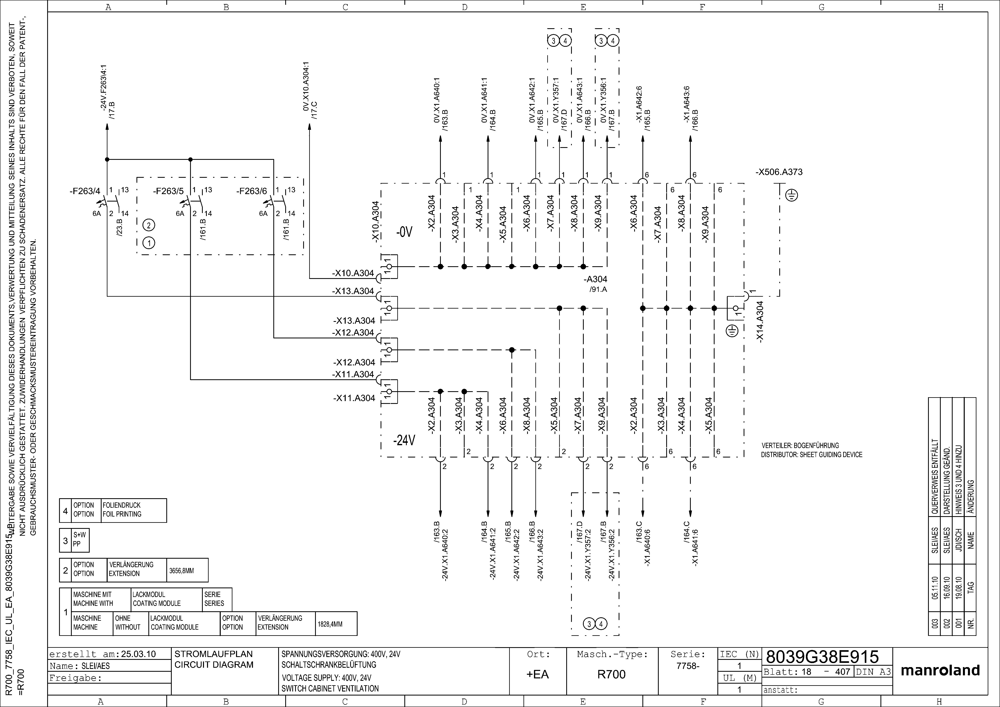

# +EA — Sheet 18 of 407 — SPANNUNGSVERSORGUNG: 400V, 24V

**SCHALTSCHRANKBELÜFTUNG**

> Part of the manroland **R700** printing press IEC/UL circuit diagrams.
> Drawing class: **Stromlaufplan / Circuit diagram** (DIN A3).
> Document `+EA` covers the **Printing unit** machine section.

## At a glance

| Field | Value |
|---|---|
| Document | `+EA`  (8039G38E915) |
| Sheet | **18** of 407 |
| Section (DE) | SPANNUNGSVERSORGUNG: 400V, 24V |
| Section (EN) | SCHALTSCHRANKBELÜFTUNG |
| Section type | POWER_SUPPLY — Voltage supply |
| Machine type | `R700` |
| Series | `7758` |
| Created | 25.03.10 |
| Replaces | — |
| Columns used | A, B, C, D, E, F, G, H |
| Path numbers | — |
| Labels on sheet | 187 |
| Cross-refs out | 22 |
| Cross-refs in | 46 |

**Previous:** [+EA sheet 17](SHEET_0017.md) · **Next:** [+EA sheet 19](SHEET_0019.md) · **Document TOC:** [_TOC.md](_TOC.md)  (+EA) · **Master TOC:** [all sheets](../_MASTER_TOC.md)

## Sheet image (300 DPI, exact vector render)



_Rendered directly from the PDF vector layer at 300 DPI (1-bit), no OCR and no resampling. Use it to confirm anything ambiguous in the text below._

## Cross-references on this sheet

Each entry is a wire leaving this sheet. The printed token is `/sheet.column`; the link resolves to that sheet inside the same document.

| Ref | Target sheet | Col | Path | Destination on target | Target section | From col |
|---|---|---|---|---|---|---|
| `/17.C` | [+EA sheet 17](SHEET_0017.md) | C | — | 0V.X10.A304:1 | SPANNUNGSVERSORGUNG: 400V, 24V | C |
| `/17.B` | [+EA sheet 17](SHEET_0017.md) | B | — | 24V.F263\4:1 | SPANNUNGSVERSORGUNG: 400V, 24V | A |
| `/163.B` | [+EA sheet 163](SHEET_0163.md) | B | — | 0V.X1.A640:1 | VERLÄNGERUNG 1828,4MM | D |
| `/164.B` | [+EA sheet 164](SHEET_0164.md) | B | — | 0V.X1.A641:1 | VERLÄNGERUNG 1828,4MM | D |
| `/165.B` | [+EA sheet 165](SHEET_0165.md) | B | — | 0V.X1.A642:1 | VERLÄNGERUNG 1828,4MM | E |
| `/167.D` | [+EA sheet 167](SHEET_0167.md) | D | — | 0V.X1.Y357:1 | BOGENFÜHRUNGSELEMENT (BLASROHRE) | E |
| `/166.B` | [+EA sheet 166](SHEET_0166.md) | B | — | 0V.X1.A643:1 | VERLÄNGERUNG 1828,4MM | E |
| `/167.D` | [+EA sheet 167](SHEET_0167.md) | D | — | 0V.X1.A643:1 | BOGENFÜHRUNGSELEMENT (BLASROHRE) | E |
| `/167.B` | [+EA sheet 167](SHEET_0167.md) | B | — | 0V.X1.Y356:1 | BOGENFÜHRUNGSELEMENT (BLASROHRE) | E |
| `/165.B` | [+EA sheet 165](SHEET_0165.md) | B | — | X1.A642:6 | VERLÄNGERUNG 1828,4MM | F |
| `/166.B` | [+EA sheet 166](SHEET_0166.md) | B | — | X1.A643:6 | VERLÄNGERUNG 1828,4MM | F |
| `/23.B` | [+EA sheet 23](SHEET_0023.md) | B | — | — | SPANNUNGSVERSORGUNG: 400V, 24V | A |
| `/161.B` | [+EA sheet 161](SHEET_0161.md) | B | — | — | VERLÄNGERUNG 1828,4MM | B |
| `/161.B` | [+EA sheet 161](SHEET_0161.md) | B | — | — | VERLÄNGERUNG 1828,4MM | C |
| `/91.A` | [+EA sheet 91](SHEET_0091.md) | A | — | — | BLASROHRE (BLASRAHMEN) | E |
| `/163.B` | [+EA sheet 163](SHEET_0163.md) | B | — | — | VERLÄNGERUNG 1828,4MM | D |
| `/164.B` | [+EA sheet 164](SHEET_0164.md) | B | — | — | VERLÄNGERUNG 1828,4MM | D |
| `/165.B` | [+EA sheet 165](SHEET_0165.md) | B | — | — | VERLÄNGERUNG 1828,4MM | D |
| `/166.B` | [+EA sheet 166](SHEET_0166.md) | B | — | — | VERLÄNGERUNG 1828,4MM | E |
| `/167.B` | [+EA sheet 167](SHEET_0167.md) | B | — | — | BOGENFÜHRUNGSELEMENT (BLASROHRE) | E |
| `/163.C` | [+EA sheet 163](SHEET_0163.md) | C | — | — | VERLÄNGERUNG 1828,4MM | E |
| `/164.C` | [+EA sheet 164](SHEET_0164.md) | C | — | — | VERLÄNGERUNG 1828,4MM | F |

### Incoming references (sheets that point here)

Every other sheet that sends a wire to this one. `Back-ref` is the token printed on *that* sheet; `Path` is its line number.

| From sheet | Cols | Back-ref | Path | Refs | What continues there |
|---|---|---|---|---|---|
| [+EA#17](SHEET_0017.md) | B, C | `/17.B`, `/17.C` | — | 2 | 0V.X10.A304:1; 24V.F263\4:1 |
| [+EA#23](SHEET_0023.md) | A | `/23.A` | — | 1 | — |
| [+EA#91](SHEET_0091.md) | A | `/91.A` | — | 1 | — |
| [+EA#161](SHEET_0161.md) | B | `/161.B` | — | 2 | — |
| [+EA#163](SHEET_0163.md) | A, B, C | `/163.A`, `/163.B`, `/163.C` | — | 3 | 0V.X1.A640:1; 24V.X1.A640:2; X1.A640:6 |
| [+EA#164](SHEET_0164.md) | A, B, E | `/164.A`, `/164.B`, `/164.E` | — | 3 | 0V.X1.A641:1; 24V.X1.A641:2; X1.A641:6 X4.A304 3 4 5 |
| [+EA#165](SHEET_0165.md) | A | `/165.A` | — | 3 | 0V.X1.A642:1; 24V.X1.A642:2; X1.A642:6 |
| [+EA#166](SHEET_0166.md) | A | `/166.A` | — | 3 | 0V.X1.A643:1; 24V.X1.A643:2; X1.A643:6 |
| [+EA#167](SHEET_0167.md) | B | `/167.B` | — | 4 | 0V.X1.Y356:1 0V.X1.Y357:1; 24V.X1.Y356:2 24V.X1.Y357:2 |
| [+EA#224](SHEET_0224.md) | B | `/224.B` | — | 3 | — |
| [+EA#233](SHEET_0233.md) | H | `/233.H` | — | 3 | — |
| [+EA#236](SHEET_0236.md) | E | `/236.E` | — | 3 | — |
| [+EA#240](SHEET_0240.md) | A | `/240.A` | — | 3 | — |
| [+EA#244](SHEET_0244.md) | C | `/244.C` | — | 3 | — |
| [+EA#246](SHEET_0246.md) | E | `/246.E` | — | 3 | — |
| [+EA#249](SHEET_0249.md) | B | `/249.B` | — | 3 | — |
| [+EA#251](SHEET_0251.md) | F | `/251.F` | — | 3 | — |


## Devices on this sheet

| Tag | Class | Class meaning (IEC) | Col | Sub | Terminal | Sign |
|---|---|---|---|---|---|---|
| `A304` | A | Baugruppe / assembly, module, PC board | E | — | — | — |
| `F263/5` | F | Schutz / protection device (fuse, circuit breaker) | B | 5 | — | — |
| `F263/6` | F | Schutz / protection device (fuse, circuit breaker) | B | 6 | — | — |
| `F263/4` | F | Schutz / protection device (fuse, circuit breaker) | A | 4 | — | — |
| `NR.` | — | cross-device reference | H | — | — | — |
| `19.08.10` | — | cross-device reference | H | — | — | — |
| `X4.A304` | — | cross-device reference | D | — | — | — |
| `X12.A304` | — | cross-device reference | C | — | — | — |
| `X4.A304` | — | cross-device reference | D | — | — | — |
| `X2.A304` | — | cross-device reference | D | — | — | — |
| `X6.A304` | — | cross-device reference | E | — | — | — |
| `X2.A304` | — | cross-device reference | D | — | — | — |
| `X6.A304` | — | cross-device reference | D | — | — | — |
| `X8.A304` | — | cross-device reference | E | — | — | — |
| `X8.A304` | — | cross-device reference | E | — | — | — |
| `X6.A304` | — | cross-device reference | E | — | — | — |
| `X2.A304` | — | cross-device reference | E | — | — | — |
| `X4.A304` | — | cross-device reference | F | — | — | — |
| `X8.A304` | — | cross-device reference | F | — | — | — |
| `X7.A304` | — | cross-device reference | E | — | — | — |
| `X9.A304` | — | cross-device reference | E | — | — | — |
| `X7.A304` | — | cross-device reference | E | — | — | — |
| `X9.A304` | — | cross-device reference | E | — | — | — |
| `X11.A304` | — | cross-device reference | C | — | — | — |
| `X13.A304` | — | cross-device reference | C | — | — | — |
| `X10.A304` | — | cross-device reference | C | — | — | — |
| `16.09.10` | — | cross-device reference | H | — | — | — |
| `05.11.10` | — | cross-device reference | H | — | — | — |
| `X14.A304` | — | cross-device reference | F | — | — | — |
| `X1.A640:6` | — | cross-device reference | F | — | 6 | — |
| `X1.A643:6` | — | cross-device reference | F | — | 6 | — |
| `X1.A642:6` | — | cross-device reference | E | — | 6 | — |
| `X1.A641:6` | — | cross-device reference | F | — | 6 | — |
| `X12.A304` | — | cross-device reference | C | — | — | — |
| `X5.A304` | — | cross-device reference | D | — | — | — |
| `X3.A304` | — | cross-device reference | D | — | — | — |
| `X3.A304` | — | cross-device reference | D | — | — | — |
| `X3.A304` | — | cross-device reference | F | — | — | — |
| `X5.A304` | — | cross-device reference | E | — | — | — |
| `X5.A304` | — | cross-device reference | F | — | — | — |
| `X11.A304` | — | cross-device reference | C | — | — | — |
| `X13.A304` | — | cross-device reference | C | — | — | — |
| `X10.A304` | — | cross-device reference | C | — | — | — |
| `X7.A304` | — | cross-device reference | F | — | — | — |
| `X9.A304` | — | cross-device reference | F | — | — | — |
| `X506.A373` | — | cross-device reference | G | — | — | — |

## Potentials / nets

| Potential | Count | Columns | Attached devices | Terminals |
|---|---|---|---|---|
| `0V` | 8 | C, D, E | `A304`, `A640`, `A641`, `A642`, `A643`, `X1`, `X10`, `Y356`, `Y357` | `1` |
| `24V` | 8 | A, C, D, E | `A640`, `A641`, `A642`, `A643`, `F263\4`, `X1`, `Y356`, `Y357` | `1`, `2` |


A potential such as `L24+/4` or `M24+` is a named supply/return rail; every place it appears on this sheet is electrically common.

## Wire-end annotations (grouped as printed)

A wire that continues elsewhere is annotated with a small cluster: the destination description, the path/line number `#NN`, and the `/sheet.column` cross reference. Each row below is one such cluster exactly as it is grouped on the drawing.

| Col | Y | Path | Cross-ref | Text on the wire |
|---|---|---|---|---|
| E | 45.6 | — | — | `3 4 3 4` |
| C | 72.8 | — | `/17.C` | `0V.X10.A304:1` |
| A | 76.5 | — | `/17.B` | `24V.F263\4:1` |
| D | 91.8 | — | `/163.B` | `0V.X1.A640:1` |
| D | 91.8 | — | `/164.B` | `0V.X1.A641:1` |
| E | 91.8 | — | `/165.B` | `0V.X1.A642:1` |
| E | 91.8 | — | `/167.D` | `0V.X1.Y357:1` |
| E | 91.8 | — | `/166.B`, `/167.D` | `0V.X1.A643:1` |
| E | 91.8 | — | `/167.B` | `0V.X1.Y356:1` |
| F | 102.3 | — | `/165.B` | `X1.A642:6` |
| F | 102.3 | — | `/166.B` | `X1.A643:6` |
| G | 200.1 | — | — | `X506.A373` |
| D | 204.4 | — | — | `1` |
| D | 204.4 | — | — | `1` |
| E | 204.4 | — | — | `1` |
| E | 204.4 | — | — | `1` |
| E | 204.4 | — | — | `1` |
| E | 204.4 | — | — | `1` |
| F | 204.4 | — | — | `6` |
| F | 204.4 | — | — | `6` |
| A | 222.1 | — | — | `1` |
| A | 222.1 | — | — | `13` |
| B | 222.1 | — | — | `1` |
| B | 222.1 | — | — | `13` |
| B | 222.1 | — | — | `1` |
| C | 222.1 | — | — | `13` |
| D | 222.1 | — | — | `1 1` |
| F | 222.1 | — | — | `6 6` |
| A | 222.8 | — | — | `F263/4` |
| B | 222.8 | — | — | `F263/5` |
| B | 222.8 | — | — | `F263/6` |
| D | 231.9 | — | — | `X2.A304` |
| D | 231.9 | — | — | `X4.A304` |
| E | 231.9 | — | — | `X6.A304` |
| E | 231.9 | — | — | `X7.A304` |
| E | 231.9 | — | — | `X8.A304` |
| E | 231.9 | — | — | `X9.A304` |
| E | 231.9 | — | — | `X6.A304` |
| F | 231.9 | — | — | `X8.A304` |
| C | 239.0 | — | — | `X10.A304` |
| D | 245.2 | — | — | `X3.A304 X3.A304` |
| D | 245.2 | — | — | `X5.A304` |
| F | 245.2 | — | — | `X7.A304` |
| F | 245.2 | — | — | `X9.A304` |
| A | 250.5 | — | — | `6A 2` |
| A | 250.5 | — | — | `14` |
| B | 250.5 | — | — | `6A 2` |
| B | 250.5 | — | — | `14` |
| B | 250.5 | — | — | `6A 2` |
| C | 250.5 | — | — | `14` |
| A | 260.5 | — | `/23.B` | — |
| B | 260.5 | — | `/161.B` | — |
| C | 260.5 | — | `/161.B` | — |
| A | 265.3 | — | — | `2` |
| C | 270.6 | — | — | `0V` |
| A | 286.1 | — | — | `1` |
| C | 307.0 | — | — | `1` |
| C | 320.6 | — | — | `X10.A304` |
| C | 321.2 | — | — | `1` |
| E | 327.7 | — | — | `A304` |
| E | 340.8 | — | `/91.A` | — |
| C | 341.9 | — | — | `X13.A304` |
| F | 343.8 | — | — | `1 X14.A304` |
| C | 356.6 | — | — | `1` |
| C | 370.8 | — | — | `1` |
| F | 370.8 | — | — | `1` |
| C | 377.3 | — | — | `X13.A304` |
| C | 391.5 | — | — | `X12.A304` |
| C | 406.2 | — | — | `1` |
| C | 420.4 | — | — | `1 1` |
| C | 426.9 | — | — | `X12.A304` |
| C | 441.1 | — | — | `X11.A304` |
| C | 455.8 | — | — | `1` |
| C | 469.4 | — | — | `X11.A304` |
| D | 472.8 | — | — | `X2.A304` |
| D | 472.8 | — | — | `X4.A304` |
| D | 472.8 | — | — | `X6.A304` |
| E | 472.8 | — | — | `X8.A304` |
| E | 472.8 | — | — | `X5.A304` |
| E | 472.8 | — | — | `X7.A304` |
| E | 472.8 | — | — | `X9.A304` |
| E | 472.8 | — | — | `X2.A304` |
| F | 472.8 | — | — | `X3.A304` |
| F | 472.8 | — | — | `X4.A304` |
| F | 472.8 | — | — | `X5.A304` |
| C | 518.6 | — | — | `24V` |
| H | 522.5 | — | — | `QUERVERWEIS ENTFÄLLT SLEI/AES 003 05.11.10` |
| G | 527.9 | — | — | `DISTRIBUTOR: SHEET GUIDING DEVICE VERTEILER: BOGENFÜHRUNG` |
| H | 529.8 | — | — | `001 JDI/SCH HINWEIS 3 UND 4 HINZU 19.08.10` |
| H | 531.8 | — | — | `DARSTELLUNG GEÄND. 16.09.10 SLEI/AES 002` |
| E | 534.0 | — | — | `2 2 6 6` |
| D | 551.7 | — | — | `2` |
| D | 551.7 | — | — | `2` |
| D | 551.7 | — | — | `2` |
| E | 551.7 | — | — | `2` |
| E | 551.7 | — | — | `2` |
| E | 551.7 | — | — | `2` |
| F | 551.7 | — | — | `6` |
| F | 551.7 | — | — | `6` |
| H | 571.4 | — | — | `NR. NAME TAG ÄNDERUNG` |
| A | 598.7 | — | — | `OPTION OPTION` |
| A | 598.8 | — | — | `4 FOLIENDRUCK FOIL PRINTING` |
| D | 620.5 | — | `/163.B` | — |
| D | 620.5 | — | `/164.B` | — |
| D | 620.5 | — | `/165.B` | — |
| E | 620.5 | — | `/166.B` | — |
| E | 620.5 | — | `/167.B` | — |
| E | 620.5 | — | `/163.C` | — |
| F | 620.5 | — | `/164.C` | — |
| D | 628.7 | — | — | `24V.X1.A641:2` |
| D | 630.1 | — | — | `24V.X1.A640:2` |
| D | 630.1 | — | — | `24V.X1.A642:2` |
| E | 630.1 | — | — | `24V.X1.A643:2` |
| E | 630.1 | — | — | `24V.X1.Y357:2` |
| E | 630.1 | — | — | `24V.X1.Y356:2` |
| F | 630.4 | — | — | `X1.A640:6` |
| F | 630.4 | — | — | `X1.A641:6` |
| A | 634.0 | — | — | `3 PP S+W` |
| A | 669.6 | — | — | `2 OPTION OPTION` |
| A | 669.6 | — | — | `EXTENSION VERLÄNGERUNG 3656,8MM` |
| A | 705.0 | — | — | `MASCHINE MIT MACHINE WITH` |
| A | 705.0 | — | — | `LACKMODUL` |
| B | 705.0 | — | — | `SERIE SERIES` |
| A | 715.7 | — | — | `COATING MODULE` |
| A | 724.5 | — | — | `1` |
| A | 733.4 | — | — | `MASCHINE MACHINE` |
| A | 733.4 | — | — | `OHNE WITHOUT` |
| A | 733.4 | — | — | `LACKMODUL` |
| B | 733.4 | — | — | `OPTION OPTION` |
| B | 733.4 | — | — | `EXTENSION VERLÄNGERUNG` |
| E | 740.1 | — | — | `3 4` |
| C | 740.5 | — | — | `1828,4MM` |
| B | 744.0 | — | — | `COATING MODULE` |


## Reconstructed tables

This sheet carries tabular content (pin map / terminal assignment / index). The grid below was rebuilt from the drawing's own rule lines, so each row is exactly one physical row of the table.

### Table 1 — 7 data rows × 18 columns (at x=127.6, y=189.9)

| 1 13 F263/5 2 14 6A /23.B 2 1 | 1 13 F263/6 2 14 6A /161.B | 1 13 2 14 /161.B | X10.A304 1 | X2.A304 0V | 1 X3.A304 | 1 X4.A304 | 1 X5.A304 | 1 X6.A304 | 1 X7.A304 | 1 X8.A304 | 1 X9.A304 | 1 X6.A304 | 6 X7.A304 | 6 X8.A304 | 6 X9.A304 | 6 | X506.A373 |
|---|---|---|---|---|---|---|---|---|---|---|---|---|---|---|---|---|---|
|  |  |  | `X10.A304 1` |  |  |  |  |  |  |  |  |  |  |  |  |  |  |
|  |  |  | `X13.A304` |  |  |  |  |  |  |  | `A304 /91.A` |  |  |  |  |  | `1` |
|  |  |  | `1` |  |  |  |  |  |  |  |  |  |  |  |  |  |  |
|  |  |  | `1 X13.A304 X12.A304` |  |  |  |  |  |  |  |  |  |  |  |  |  | `X14.A304 1` |
|  |  |  | `1` |  |  |  |  |  |  |  |  |  |  |  |  |  |  |
|  |  |  | `1 X12.A304 X11.A304` |  |  |  |  |  |  |  |  |  |  |  |  |  |  |
|  |  |  | `1` |  |  |  |  |  |  |  |  |  |  |  |  |  |  |


## Notes and free text on this sheet

| Text | Col | Y (pt) |
|---|---|---|
| `TAG` | H | 692.75 |
| `NAME` | H | 633.34 |
| `ÄNDERUNG` | H | 571.36 |
| `JDI/SCH` | H | 629.43 |
| `HINWEIS 3 UND 4 HINZU` | H | 529.82 |
| `VERTEILER: BOGENFÜHRUNG` | G | 527.88 |
| `DISTRIBUTOR: SHEET GUIDING DEVICE` | G | 538.5 |
| `6A` | B | 250.69 |
| `6A` | A | 250.69 |
| `SLEI/AES` | H | 627.9 |
| `DARSTELLUNG GEÄND.` | H | 531.75 |
| `QUERVERWEIS ENTFÄLLT` | H | 522.54 |
| `MASCHINE MIT` | A | 705.04 |
| `MACHINE WITH` | A | 715.63 |
| `MASCHINE` | A | 733.38 |
| `MACHINE` | A | 744.02 |
| `LACKMODUL` | A | 705.05 |
| `COATING MODULE` | A | 715.69 |
| `OHNE` | A | 733.37 |
| `WITHOUT` | A | 743.97 |
| `COATING MODULE` | B | 744.03 |
| `SERIE` | B | 704.98 |
| `SERIES` | B | 715.62 |
| `OPTION` | B | 733.35 |
| `VERLÄNGERUNG` | B | 733.4 |
| `EXTENSION` | B | 743.98 |
| `1828,4MM` | C | 740.49 |
| `OPTION` | A | 669.57 |
| `VERLÄNGERUNG` | A | 669.62 |
| `EXTENSION` | A | 680.2 |
| `3656,8MM` | B | 676.73 |
| `S+W` | A | 634.03 |
| `PP` | A | 644.66 |
| `FOLIENDRUCK` | A | 598.75 |
| `FOIL PRINTING` | A | 609.35 |

## Complete label inventory (exact text from the drawing)

Every text object inside the drawing area of this sheet, in DIN reading order (column A→H, then top→bottom). This is the authoritative list: if a string is not here it is not printed on this sheet.

| Col | Y | X | Dir | Type | Text |
|---|---|---|---|---|---|
| A | 76.5 | 119.3 | ↕ | potential | `24V.F263\4:1` |
| A | 121.0 | 129.2 | ↕ | cross-reference | `/17.B` |
| A | 222.1 | 129.5 | → | number | `1` |
| A | 222.1 | 143.7 | → | number | `13` |
| A | 222.8 | 83.1 | → | device tag | `F263/4` |
| A | 250.5 | 130.1 | → | number | `2` |
| A | 250.5 | 143.7 | → | number | `14` |
| A | 250.7 | 110.3 | → | text | `6A` |
| A | 260.5 | 138.4 | ↕ | cross-reference | `/23.B` |
| A | 265.3 | 175.2 | → | number | `2` |
| A | 286.1 | 175.4 | → | number | `1` |
| A | 598.7 | 87.6 | → | text | `OPTION` |
| A | 598.8 | 122.5 | → | text | `FOLIENDRUCK` |
| A | 604.1 | 75.1 | → | number | `4` |
| A | 609.3 | 87.6 | → | text | `OPTION` |
| A | 609.4 | 122.5 | → | text | `FOIL PRINTING` |
| A | 634.0 | 87.6 | → | text | `S+W` |
| A | 639.5 | 75.0 | → | number | `3` |
| A | 644.7 | 87.0 | → | text | `PP` |
| A | 669.6 | 87.6 | → | text | `OPTION` |
| A | 669.6 | 130.4 | → | text | `VERLÄNGERUNG` |
| A | 674.9 | 75.1 | → | number | `2` |
| A | 680.2 | 87.6 | → | text | `OPTION` |
| A | 680.2 | 129.5 | → | text | `EXTENSION` |
| A | 705.0 | 87.3 | → | text | `MASCHINE MIT` |
| A | 705.1 | 157.9 | → | text | `LACKMODUL` |
| A | 715.6 | 87.3 | → | text | `MACHINE WITH` |
| A | 715.7 | 158.5 | → | text | `COATING MODULE` |
| A | 724.5 | 75.4 | → | number | `1` |
| A | 733.4 | 87.3 | → | text | `MASCHINE` |
| A | 733.4 | 137.2 | → | text | `OHNE` |
| A | 733.4 | 179.1 | → | text | `LACKMODUL` |
| A | 744.0 | 87.3 | → | text | `MACHINE` |
| A | 744.0 | 137.5 | → | text | `WITHOUT` |
| B | 222.1 | 228.8 | → | number | `1` |
| B | 222.1 | 242.9 | → | number | `13` |
| B | 222.1 | 328.0 | → | number | `1` |
| B | 222.8 | 182.3 | → | device tag | `F263/5` |
| B | 222.8 | 281.5 | → | device tag | `F263/6` |
| B | 250.5 | 229.3 | → | number | `2` |
| B | 250.5 | 242.9 | → | number | `14` |
| B | 250.5 | 328.5 | → | number | `2` |
| B | 250.7 | 209.5 | → | text | `6A` |
| B | 250.7 | 308.7 | → | text | `6A` |
| B | 260.5 | 237.7 | ↕ | cross-reference | `/161.B` |
| B | 676.7 | 201.7 | → | text | `3656,8MM` |
| B | 705.0 | 243.5 | → | text | `SERIE` |
| B | 715.6 | 243.5 | → | text | `SERIES` |
| B | 733.4 | 264.8 | → | text | `OPTION` |
| B | 733.4 | 307.6 | → | text | `VERLÄNGERUNG` |
| B | 744.0 | 179.7 | → | text | `COATING MODULE` |
| B | 744.0 | 264.8 | → | text | `OPTION` |
| B | 744.0 | 306.7 | → | text | `EXTENSION` |
| C | 72.9 | 360.3 | ↕ | potential | `0V.X10.A304:1` |
| C | 120.8 | 370.2 | ↕ | cross-reference | `/17.C` |
| C | 222.1 | 342.1 | → | number | `13` |
| C | 239.0 | 442.5 | ↕ | device ref | `X10.A304` |
| C | 250.5 | 342.1 | → | number | `14` |
| C | 260.5 | 336.9 | ↕ | cross-reference | `/161.B` |
| C | 270.6 | 471.8 | → | potential | `0V` |
| C | 307.0 | 456.6 | ↕ | number | `1` |
| C | 320.6 | 395.4 | → | device ref | `X10.A304` |
| C | 321.2 | 456.6 | ↕ | number | `1` |
| C | 341.9 | 395.4 | → | device ref | `X13.A304` |
| C | 356.6 | 456.6 | ↕ | number | `1` |
| C | 370.8 | 456.6 | ↕ | number | `1` |
| C | 377.3 | 396.9 | → | device ref | `X13.A304` |
| C | 391.5 | 395.4 | → | device ref | `X12.A304` |
| C | 406.2 | 456.6 | ↕ | number | `1` |
| C | 420.4 | 456.6 | ↕ | number | `1` |
| C | 426.9 | 396.9 | → | device ref | `X12.A304` |
| C | 441.1 | 395.4 | → | device ref | `X11.A304` |
| C | 455.8 | 456.6 | ↕ | number | `1` |
| C | 469.4 | 396.9 | → | device ref | `X11.A304` |
| C | 470.0 | 456.6 | ↕ | number | `1` |
| C | 518.6 | 468.3 | → | potential | `24V` |
| C | 740.5 | 378.3 | → | text | `1828,4MM` |
| D | 91.8 | 516.2 | ↕ | potential | `0V.X1.A640:1` |
| D | 91.8 | 572.9 | ↕ | potential | `0V.X1.A641:1` |
| D | 130.4 | 526.1 | ↕ | cross-reference | `/163.B` |
| D | 130.4 | 582.8 | ↕ | cross-reference | `/164.B` |
| D | 204.4 | 526.4 | → | number | `1` |
| D | 204.4 | 583.1 | → | number | `1` |
| D | 222.1 | 557.9 | → | number | `1` |
| D | 222.1 | 614.6 | → | number | `1` |
| D | 231.9 | 509.1 | ↕ | device ref | `X2.A304` |
| D | 231.9 | 565.8 | ↕ | device ref | `X4.A304` |
| D | 245.2 | 537.5 | ↕ | device ref | `X3.A304` |
| D | 245.2 | 594.2 | ↕ | device ref | `X5.A304` |
| D | 472.8 | 509.1 | ↕ | device ref | `X2.A304` |
| D | 472.8 | 541.7 | ↕ | device ref | `X3.A304` |
| D | 472.8 | 565.8 | ↕ | device ref | `X4.A304` |
| D | 472.8 | 594.2 | ↕ | device ref | `X6.A304` |
| D | 533.9 | 555.6 | → | number | `2` |
| D | 551.7 | 527.0 | → | number | `2` |
| D | 551.7 | 583.7 | → | number | `2` |
| D | 551.7 | 612.0 | → | number | `2` |
| D | 620.5 | 516.2 | ↕ | cross-reference | `/163.B` |
| D | 620.5 | 572.9 | ↕ | cross-reference | `/164.B` |
| D | 620.5 | 601.2 | ↕ | cross-reference | `/165.B` |
| D | 628.7 | 582.8 | ↕ | potential | `24V.X1.A641:2` |
| D | 630.1 | 526.1 | ↕ | potential | `24V.X1.A640:2` |
| D | 630.1 | 611.1 | ↕ | potential | `24V.X1.A642:2` |
| E | 45.6 | 657.1 | → | number | `3` |
| E | 45.6 | 671.2 | → | number | `4` |
| E | 45.6 | 713.8 | → | number | `3` |
| E | 45.6 | 727.9 | → | number | `4` |
| E | 91.8 | 629.6 | ↕ | potential | `0V.X1.A642:1` |
| E | 91.8 | 657.9 | ↕ | potential | `0V.X1.Y357:1` |
| E | 91.8 | 686.2 | ↕ | potential | `0V.X1.A643:1` |
| E | 91.8 | 714.6 | ↕ | potential | `0V.X1.Y356:1` |
| E | 102.3 | 757.1 | ↕ | device ref | `X1.A642:6` |
| E | 130.1 | 667.8 | ↕ | cross-reference | `/167.D` |
| E | 130.4 | 639.5 | ↕ | cross-reference | `/165.B` |
| E | 130.4 | 696.2 | ↕ | cross-reference | `/166.B` |
| E | 130.4 | 724.5 | ↕ | cross-reference | `/167.B` |
| E | 204.4 | 639.8 | → | number | `1` |
| E | 204.4 | 668.1 | → | number | `1` |
| E | 204.4 | 696.5 | → | number | `1` |
| E | 204.4 | 724.8 | → | number | `1` |
| E | 231.9 | 622.5 | ↕ | device ref | `X6.A304` |
| E | 231.9 | 650.9 | ↕ | device ref | `X7.A304` |
| E | 231.9 | 679.2 | ↕ | device ref | `X8.A304` |
| E | 231.9 | 707.6 | ↕ | device ref | `X9.A304` |
| E | 231.9 | 750.1 | ↕ | device ref | `X6.A304` |
| E | 327.7 | 695.1 | → | device tag | `A304` |
| E | 340.8 | 702.1 | → | cross-reference | `/91.A` |
| E | 472.8 | 622.5 | ↕ | device ref | `X8.A304` |
| E | 472.8 | 655.1 | ↕ | device ref | `X5.A304` |
| E | 472.8 | 683.5 | ↕ | device ref | `X7.A304` |
| E | 472.8 | 711.8 | ↕ | device ref | `X9.A304` |
| E | 472.8 | 750.1 | ↕ | device ref | `X2.A304` |
| E | 533.9 | 669.0 | → | number | `2` |
| E | 551.7 | 640.3 | → | number | `2` |
| E | 551.7 | 697.0 | → | number | `2` |
| E | 551.7 | 725.4 | → | number | `2` |
| E | 620.5 | 629.6 | ↕ | cross-reference | `/166.B` |
| E | 620.5 | 686.3 | ↕ | cross-reference | `/167.D` |
| E | 620.5 | 714.6 | ↕ | cross-reference | `/167.B` |
| E | 620.5 | 757.1 | ↕ | cross-reference | `/163.C` |
| E | 630.1 | 639.5 | ↕ | potential | `24V.X1.A643:2` |
| E | 630.1 | 696.2 | ↕ | potential | `24V.X1.Y357:2` |
| E | 630.1 | 724.5 | ↕ | potential | `24V.X1.Y356:2` |
| E | 740.1 | 699.6 | → | number | `3` |
| E | 740.1 | 713.8 | → | number | `4` |
| F | 102.3 | 813.8 | ↕ | device ref | `X1.A643:6` |
| F | 130.4 | 767.0 | ↕ | cross-reference | `/165.B` |
| F | 130.4 | 823.7 | ↕ | cross-reference | `/166.B` |
| F | 204.4 | 767.9 | → | number | `6` |
| F | 204.4 | 824.6 | → | number | `6` |
| F | 222.1 | 798.4 | → | number | `6` |
| F | 222.1 | 855.1 | → | number | `6` |
| F | 231.9 | 806.8 | ↕ | device ref | `X8.A304` |
| F | 245.2 | 778.4 | ↕ | device ref | `X7.A304` |
| F | 245.2 | 835.1 | ↕ | device ref | `X9.A304` |
| F | 343.8 | 891.8 | ↕ | number | `1` |
| F | 358.0 | 900.3 | ↕ | device ref | `X14.A304` |
| F | 370.8 | 874.8 | ↕ | number | `1` |
| F | 472.8 | 782.7 | ↕ | device ref | `X3.A304` |
| F | 472.8 | 806.8 | ↕ | device ref | `X4.A304` |
| F | 472.8 | 839.4 | ↕ | device ref | `X5.A304` |
| F | 533.9 | 796.3 | → | number | `6` |
| F | 533.9 | 852.9 | → | number | `6` |
| F | 551.7 | 767.9 | → | number | `6` |
| F | 551.7 | 824.6 | → | number | `6` |
| F | 620.5 | 813.8 | ↕ | cross-reference | `/164.C` |
| F | 630.4 | 767.1 | ↕ | device ref | `X1.A640:6` |
| F | 630.4 | 823.7 | ↕ | device ref | `X1.A641:6` |
| G | 200.1 | 899.7 | → | device ref | `X506.A373` |
| G | 527.9 | 907.1 | → | text | `VERTEILER: BOGENFÜHRUNG` |
| G | 538.5 | 906.2 | → | text | `DISTRIBUTOR: SHEET GUIDING DEVICE` |
| H | 522.5 | 1110.1 | ↕ | text | `QUERVERWEIS ENTFÄLLT` |
| H | 529.8 | 1138.5 | ↕ | text | `HINWEIS 3 UND 4 HINZU` |
| H | 531.8 | 1124.3 | ↕ | text | `DARSTELLUNG GEÄND.` |
| H | 571.4 | 1152.7 | ↕ | text | `ÄNDERUNG` |
| H | 627.9 | 1110.1 | ↕ | text | `SLEI/AES` |
| H | 627.9 | 1124.3 | ↕ | text | `SLEI/AES` |
| H | 629.4 | 1138.4 | ↕ | text | `JDI/SCH` |
| H | 633.3 | 1152.6 | ↕ | text | `NAME` |
| H | 686.6 | 1110.1 | ↕ | device ref | `05.11.10` |
| H | 686.8 | 1124.3 | ↕ | device ref | `16.09.10` |
| H | 686.8 | 1138.5 | ↕ | device ref | `19.08.10` |
| H | 692.7 | 1152.6 | ↕ | text | `TAG` |
| H | 735.8 | 1138.4 | ↕ | number | `001` |
| H | 736.2 | 1152.5 | ↕ | device ref | `NR.` |
| H | 736.9 | 1110.1 | ↕ | number | `003` |
| H | 736.9 | 1124.3 | ↕ | number | `002` |

## Reading-order text block

The same content as a plain block, grouped by DIN column — convenient to paste or to match against a visual description.

```text
=== Column A ===
  76.5  119.3  net          24V.F263\4:1
 121.0  129.2  xref         /17.B
 222.1  129.5  numeric      1
 222.1  143.7  numeric      13
 222.8   83.1  devtag       F263/4
 250.5  130.1  numeric      2
 250.5  143.7  numeric      14
 250.7  110.3  text         6A
 260.5  138.4  xref         /23.B
 265.3  175.2  numeric      2
 286.1  175.4  numeric      1
 598.7   87.6  text         OPTION
 598.8  122.5  text         FOLIENDRUCK
 604.1   75.1  numeric      4
 609.3   87.6  text         OPTION
 609.4  122.5  text         FOIL PRINTING
 634.0   87.6  text         S+W
 639.5   75.0  numeric      3
 644.7   87.0  text         PP
 669.6   87.6  text         OPTION
 669.6  130.4  text         VERLÄNGERUNG
 674.9   75.1  numeric      2
 680.2   87.6  text         OPTION
 680.2  129.5  text         EXTENSION
 705.0   87.3  text         MASCHINE MIT
 705.1  157.9  text         LACKMODUL
 715.6   87.3  text         MACHINE WITH
 715.7  158.5  text         COATING MODULE
 724.5   75.4  numeric      1
 733.4   87.3  text         MASCHINE
 733.4  137.2  text         OHNE
 733.4  179.1  text         LACKMODUL
 744.0   87.3  text         MACHINE
 744.0  137.5  text         WITHOUT
=== Column B ===
 222.1  228.8  numeric      1
 222.1  242.9  numeric      13
 222.1  328.0  numeric      1
 222.8  182.3  devtag       F263/5
 222.8  281.5  devtag       F263/6
 250.5  229.3  numeric      2
 250.5  242.9  numeric      14
 250.5  328.5  numeric      2
 250.7  209.5  text         6A
 250.7  308.7  text         6A
 260.5  237.7  xref         /161.B
 676.7  201.7  text         3656,8MM
 705.0  243.5  text         SERIE
 715.6  243.5  text         SERIES
 733.4  264.8  text         OPTION
 733.4  307.6  text         VERLÄNGERUNG
 744.0  179.7  text         COATING MODULE
 744.0  264.8  text         OPTION
 744.0  306.7  text         EXTENSION
=== Column C ===
  72.9  360.3  net          0V.X10.A304:1
 120.8  370.2  xref         /17.C
 222.1  342.1  numeric      13
 239.0  442.5  devref       X10.A304
 250.5  342.1  numeric      14
 260.5  336.9  xref         /161.B
 270.6  471.8  net          0V
 307.0  456.6  numeric      1
 320.6  395.4  devref       X10.A304
 321.2  456.6  numeric      1
 341.9  395.4  devref       X13.A304
 356.6  456.6  numeric      1
 370.8  456.6  numeric      1
 377.3  396.9  devref       X13.A304
 391.5  395.4  devref       X12.A304
 406.2  456.6  numeric      1
 420.4  456.6  numeric      1
 426.9  396.9  devref       X12.A304
 441.1  395.4  devref       X11.A304
 455.8  456.6  numeric      1
 469.4  396.9  devref       X11.A304
 470.0  456.6  numeric      1
 518.6  468.3  net          24V
 740.5  378.3  text         1828,4MM
=== Column D ===
  91.8  516.2  net          0V.X1.A640:1
  91.8  572.9  net          0V.X1.A641:1
 130.4  526.1  xref         /163.B
 130.4  582.8  xref         /164.B
 204.4  526.4  numeric      1
 204.4  583.1  numeric      1
 222.1  557.9  numeric      1
 222.1  614.6  numeric      1
 231.9  509.1  devref       X2.A304
 231.9  565.8  devref       X4.A304
 245.2  537.5  devref       X3.A304
 245.2  594.2  devref       X5.A304
 472.8  509.1  devref       X2.A304
 472.8  541.7  devref       X3.A304
 472.8  565.8  devref       X4.A304
 472.8  594.2  devref       X6.A304
 533.9  555.6  numeric      2
 551.7  527.0  numeric      2
 551.7  583.7  numeric      2
 551.7  612.0  numeric      2
 620.5  516.2  xref         /163.B
 620.5  572.9  xref         /164.B
 620.5  601.2  xref         /165.B
 628.7  582.8  net          24V.X1.A641:2
 630.1  526.1  net          24V.X1.A640:2
 630.1  611.1  net          24V.X1.A642:2
=== Column E ===
  45.6  657.1  numeric      3
  45.6  671.2  numeric      4
  45.6  713.8  numeric      3
  45.6  727.9  numeric      4
  91.8  629.6  net          0V.X1.A642:1
  91.8  657.9  net          0V.X1.Y357:1
  91.8  686.2  net          0V.X1.A643:1
  91.8  714.6  net          0V.X1.Y356:1
 102.3  757.1  devref       X1.A642:6
 130.1  667.8  xref         /167.D
 130.4  639.5  xref         /165.B
 130.4  696.2  xref         /166.B
 130.4  724.5  xref         /167.B
 204.4  639.8  numeric      1
 204.4  668.1  numeric      1
 204.4  696.5  numeric      1
 204.4  724.8  numeric      1
 231.9  622.5  devref       X6.A304
 231.9  650.9  devref       X7.A304
 231.9  679.2  devref       X8.A304
 231.9  707.6  devref       X9.A304
 231.9  750.1  devref       X6.A304
 327.7  695.1  devtag       A304
 340.8  702.1  xref         /91.A
 472.8  622.5  devref       X8.A304
 472.8  655.1  devref       X5.A304
 472.8  683.5  devref       X7.A304
 472.8  711.8  devref       X9.A304
 472.8  750.1  devref       X2.A304
 533.9  669.0  numeric      2
 551.7  640.3  numeric      2
 551.7  697.0  numeric      2
 551.7  725.4  numeric      2
 620.5  629.6  xref         /166.B
 620.5  686.3  xref         /167.D
 620.5  714.6  xref         /167.B
 620.5  757.1  xref         /163.C
 630.1  639.5  net          24V.X1.A643:2
 630.1  696.2  net          24V.X1.Y357:2
 630.1  724.5  net          24V.X1.Y356:2
 740.1  699.6  numeric      3
 740.1  713.8  numeric      4
=== Column F ===
 102.3  813.8  devref       X1.A643:6
 130.4  767.0  xref         /165.B
 130.4  823.7  xref         /166.B
 204.4  767.9  numeric      6
 204.4  824.6  numeric      6
 222.1  798.4  numeric      6
 222.1  855.1  numeric      6
 231.9  806.8  devref       X8.A304
 245.2  778.4  devref       X7.A304
 245.2  835.1  devref       X9.A304
 343.8  891.8  numeric      1
 358.0  900.3  devref       X14.A304
 370.8  874.8  numeric      1
 472.8  782.7  devref       X3.A304
 472.8  806.8  devref       X4.A304
 472.8  839.4  devref       X5.A304
 533.9  796.3  numeric      6
 533.9  852.9  numeric      6
 551.7  767.9  numeric      6
 551.7  824.6  numeric      6
 620.5  813.8  xref         /164.C
 630.4  767.1  devref       X1.A640:6
 630.4  823.7  devref       X1.A641:6
=== Column G ===
 200.1  899.7  devref       X506.A373
 527.9  907.1  text         VERTEILER: BOGENFÜHRUNG
 538.5  906.2  text         DISTRIBUTOR: SHEET GUIDING DEVICE
=== Column H ===
 522.5 1110.1  text         QUERVERWEIS ENTFÄLLT
 529.8 1138.5  text         HINWEIS 3 UND 4 HINZU
 531.8 1124.3  text         DARSTELLUNG GEÄND.
 571.4 1152.7  text         ÄNDERUNG
 627.9 1110.1  text         SLEI/AES
 627.9 1124.3  text         SLEI/AES
 629.4 1138.4  text         JDI/SCH
 633.3 1152.6  text         NAME
 686.6 1110.1  devref       05.11.10
 686.8 1124.3  devref       16.09.10
 686.8 1138.5  devref       19.08.10
 692.7 1152.6  text         TAG
 735.8 1138.4  numeric      001
 736.2 1152.5  devref       NR.
 736.9 1110.1  numeric      003
 736.9 1124.3  numeric      002
```

---
_Generated from the PDF vector text layer; no OCR. Source: `R700_7758_IEC_UL_EA_8039G38E915_p`, sheet 18._
