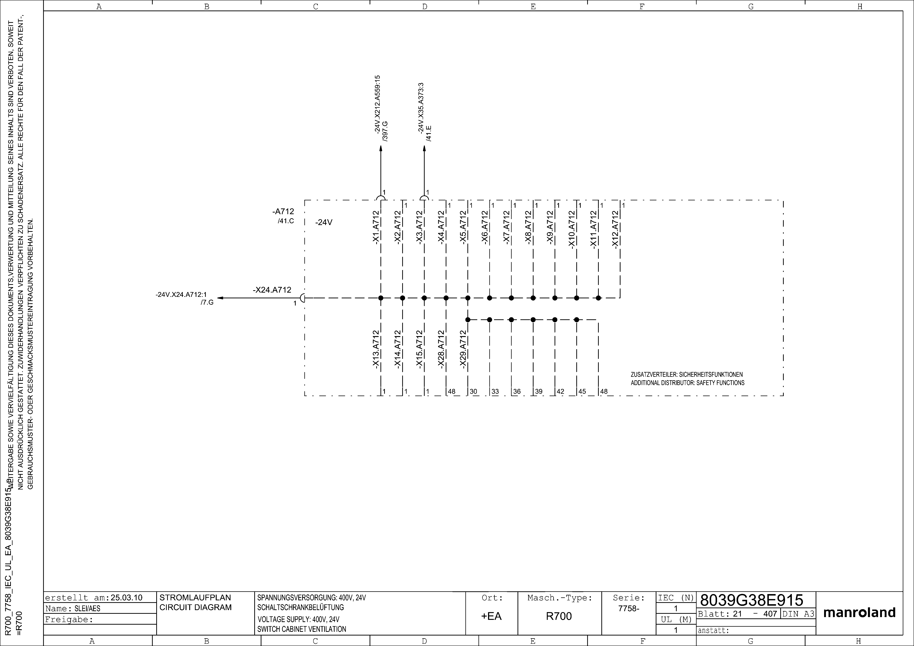

# +EA — Sheet 21 of 407 — SPANNUNGSVERSORGUNG: 400V, 24V

**SCHALTSCHRANKBELÜFTUNG**

> Part of the manroland **R700** printing press IEC/UL circuit diagrams.
> Drawing class: **Stromlaufplan / Circuit diagram** (DIN A3).
> Document `+EA` covers the **Printing unit** machine section.

## At a glance

| Field | Value |
|---|---|
| Document | `+EA`  (8039G38E915) |
| Sheet | **21** of 407 |
| Section (DE) | SPANNUNGSVERSORGUNG: 400V, 24V |
| Section (EN) | SCHALTSCHRANKBELÜFTUNG |
| Section type | POWER_SUPPLY — Voltage supply |
| Machine type | `R700` |
| Series | `7758` |
| Created | 25.03.10 |
| Replaces | — |
| Columns used | B, C, D, E, F |
| Path numbers | — |
| Labels on sheet | 53 |
| Cross-refs out | 4 |
| Cross-refs in | 28 |

**Previous:** [+EA sheet 20](SHEET_0020.md) · **Next:** [+EA sheet 22](SHEET_0022.md) · **Document TOC:** [_TOC.md](_TOC.md)  (+EA) · **Master TOC:** [all sheets](../_MASTER_TOC.md)

## Sheet image (300 DPI, exact vector render)



_Rendered directly from the PDF vector layer at 300 DPI (1-bit), no OCR and no resampling. Use it to confirm anything ambiguous in the text below._

## Cross-references on this sheet

Each entry is a wire leaving this sheet. The printed token is `/sheet.column`; the link resolves to that sheet inside the same document.

| Ref | Target sheet | Col | Path | Destination on target | Target section | From col |
|---|---|---|---|---|---|---|
| `/397.G` | [+EA sheet 397](SHEET_0397.md) | G | — | 24V.X212.A559:15 | OPTION: ZWISCHENTROCKNER VORBEREITUNG; | D |
| `/41.E` | [+EA sheet 41](SHEET_0041.md) | E | — | 24V.X35.A373:3 | BUSVERBINDUNGEN: STOP SICHERN | D |
| `/41.C` | [+EA sheet 41](SHEET_0041.md) | C | — | — | BUSVERBINDUNGEN: STOP SICHERN | C |
| `/7.G` | [+EA sheet 7](SHEET_0007.md) | G | — | 24V.X24.A712:1 | SPANNUNGSVERSORGUNG: 400V, 24V | B |

### Incoming references (sheets that point here)

Every other sheet that sends a wire to this one. `Back-ref` is the token printed on *that* sheet; `Path` is its line number.

| From sheet | Cols | Back-ref | Path | Refs | What continues there |
|---|---|---|---|---|---|
| [+EA#7](SHEET_0007.md) | H | `/7.H` | — | 1 | 24V.X24.A712:1 |
| [+EA#41](SHEET_0041.md) | C | `/41.C` | — | 2 | 24V.X35.A373:1 24V.X35.A373:3 |
| [+EA#214](SHEET_0214.md) | B | `/214.B` | — | 1 | — |
| [+EA#230](SHEET_0230.md) | G | `/230.G` | — | 1 | — |
| [+EA#235](SHEET_0235.md) | G | `/235.G` | — | 1 | — |
| [+EA#238](SHEET_0238.md) | D | `/238.D` | — | 1 | STROMPFAD PIN 1 2 |
| [+EA#243](SHEET_0243.md) | D | `/243.D` | — | 1 | STROMPFAD PIN 1 2 |
| [+EA#245](SHEET_0245.md) | H | `/245.H` | — | 1 | STROMPFAD PIN 1 2 |
| [+EA#247](SHEET_0247.md) | H | `/247.H` | — | 1 | STROMPFAD PIN 1 2 |
| [+EA#250](SHEET_0250.md) | H | `/250.H` | — | 1 | STROMPFAD PIN 1 2 |
| [+EA#253](SHEET_0253.md) | C | `/253.C` | — | 1 | STROMPFAD PIN 1 2 |
| [+EA#254](SHEET_0254.md) | H | `/254.H` | — | 1 | STROMPFAD PIN 1 2 |
| [+EA#256](SHEET_0256.md) | H | `/256.H` | — | 1 | STROMPFAD PIN 1 2 |
| [+EA#257](SHEET_0257.md) | H | `/257.H` | — | 1 | STROMPFAD PIN 1 2 |
| [+EA#259](SHEET_0259.md) | C | `/259.C` | — | 1 | STROMPFAD PIN 1 2 |
| [+EA#260](SHEET_0260.md) | C | `/260.C` | — | 1 | STROMPFAD PIN 1 2 |
| [+EA#261](SHEET_0261.md) | C | `/261.C` | — | 1 | STROMPFAD PIN 1 2 |
| [+EA#266](SHEET_0266.md) | H | `/266.H` | — | 1 | STROMPFAD PIN 1 2 |
| [+EA#273](SHEET_0273.md) | D | `/273.D` | — | 1 | — |
| [+EA#274](SHEET_0274.md) | H | `/274.H` | — | 7 | — |
| [+EA#397](SHEET_0397.md) | G | `/397.G` | — | 1 | — |


## Devices on this sheet

| Tag | Class | Class meaning (IEC) | Col | Sub | Terminal | Sign |
|---|---|---|---|---|---|---|
| `A712` | A | Baugruppe / assembly, module, PC board | C | — | — | — |
| `X1.A712` | — | cross-device reference | D | — | — | — |
| `X3.A712` | — | cross-device reference | D | — | — | — |
| `X24.A712` | — | cross-device reference | C | — | — | — |
| `X5.A712` | — | cross-device reference | D | — | — | — |
| `X6.A712` | — | cross-device reference | E | — | — | — |
| `X7.A712` | — | cross-device reference | E | — | — | — |
| `X4.A712` | — | cross-device reference | D | — | — | — |
| `X9.A712` | — | cross-device reference | E | — | — | — |
| `X10.A712` | — | cross-device reference | E | — | — | — |
| `X8.A712` | — | cross-device reference | E | — | — | — |
| `X11.A712` | — | cross-device reference | F | — | — | — |
| `X12.A712` | — | cross-device reference | F | — | — | — |
| `X14.A712` | — | cross-device reference | D | — | — | — |
| `X15.A712` | — | cross-device reference | D | — | — | — |
| `X13.A712` | — | cross-device reference | D | — | — | — |
| `X28.A712` | — | cross-device reference | D | — | — | — |
| `X29.A712` | — | cross-device reference | D | — | — | — |
| `X2.A712` | — | cross-device reference | D | — | — | — |

## Potentials / nets

| Potential | Count | Columns | Attached devices | Terminals |
|---|---|---|---|---|
| `24V` | 4 | B, C, D | `A373`, `A559`, `A712`, `X212`, `X24`, `X35` | `1`, `15`, `3` |


A potential such as `L24+/4` or `M24+` is a named supply/return rail; every place it appears on this sheet is electrically common.

## Wire-end annotations (grouped as printed)

A wire that continues elsewhere is annotated with a small cluster: the destination description, the path/line number `#NN`, and the `/sheet.column` cross reference. Each row below is one such cluster exactly as it is grouped on the drawing.

| Col | Y | Path | Cross-ref | Text on the wire |
|---|---|---|---|---|
| D | 98.1 | — | `/397.G` | `24V.X212.A559:15` |
| D | 107.7 | — | `/41.E` | `24V.X35.A373:3` |
| D | 246.9 | — | — | `1` |
| D | 246.9 | — | — | `1` |
| D | 263.9 | — | — | `1 1` |
| E | 263.9 | — | — | `1 1 1 1 1 1 1 1` |
| C | 271.0 | — | — | `A712` |
| D | 274.4 | — | — | `X1.A712` |
| D | 274.4 | — | — | `X2.A712` |
| D | 274.4 | — | — | `X3.A712` |
| D | 274.4 | — | — | `X4.A712` |
| D | 274.4 | — | — | `X5.A712` |
| E | 274.4 | — | — | `X6.A712` |
| E | 274.4 | — | — | `X7.A712` |
| E | 274.4 | — | — | `X8.A712` |
| E | 274.4 | — | — | `X9.A712` |
| E | 274.4 | — | — | `X10.A712` |
| F | 274.4 | — | — | `X11.A712` |
| F | 274.4 | — | — | `X12.A712` |
| C | 284.1 | — | `/41.C` | — |
| C | 285.2 | — | — | `24V` |
| C | 373.1 | — | — | `X24.A712` |
| B | 380.1 | — | `/7.G` | `24V.X24.A712:1` |
| C | 391.5 | — | — | `1` |
| D | 430.3 | — | — | `X13.A712` |
| D | 430.3 | — | — | `X14.A712` |
| D | 430.3 | — | — | `X15.A712` |
| D | 430.3 | — | — | `X28.A712` |
| D | 430.3 | — | — | `X29.A712` |
| F | 485.4 | — | — | `ZUSATZVERTEILER: SICHERHEITSFUNKTIONEN ADDITIONAL DISTRIBUTOR: SAFETY FUNCTIONS` |
| E | 506.3 | — | — | `1 1 1 48 30 33 36 39 42 45 48` |


## Reconstructed tables

This sheet carries tabular content (pin map / terminal assignment / index). The grid below was rebuilt from the drawing's own rule lines, so each row is exactly one physical row of the table.

### Table 1 — 5 data rows × 18 columns (at x=204.1, y=0.0) — **24V.X24.A712:1 24V.X212.A559:15 A712 X1.A712 /41.C 24V X24.A712 /397.G 1 X2.A712 24V.X35.A373:3 1 X3.A712 /41.E 1 X4.A712 1 X5.A712 1 X6.A712 1 X7.A712 1 X8.A712 1 X9.A712 1 X10.A712 1 X11.A712 1 X12.A712 /7.G X13.A712 X14.A712 1 X15.A712 1 X28.A712 1 X29.A712 48 30 33 36 39 42 45 48 ZUSATZVERTEILER: ADDITIONAL DISTRIBUTOR: SICHERHEITSFUNKTIONEN SAFETY FUNCTIONS**

| STROMLAUFPLAN | SPANNUNGSVERSORGUNG: 400V, 24V |  |  |  |  |  | Ort: |  |  |  | Masch. Type: |  |  |  | Serie: | IEC (N) | 8039G38E915 |
|---|---|---|---|---|---|---|---|---|---|---|---|---|---|---|---|---|---|
| `CIRCUIT DIAGRAM` |  |  |  |  |  |  |  |  |  |  |  |  |  |  |  |  |  |
|  | `SCHALTSCHRANKBELÜFTUNG` |  |  |  |  |  |  |  |  |  |  |  |  |  | `7758` | `1` |  |
|  |  |  |  |  |  |  | `+EA` |  |  |  | `R700` |  |  |  |  |  | `Blatt: DIN A3 21 407` |
|  | `VOLTAGE SUPPLY: 400V, 24V` |  |  |  |  |  |  |  |  |  |  |  |  |  |  | `UL (M)` |  |
|  | `SWITCH CABINET VENTILATION` |  |  |  |  |  |  |  |  |  |  |  |  |  |  | `1` | `anstatt:` |


## Notes and free text on this sheet

| Text | Col | Y (pt) |
|---|---|---|
| `ZUSATZVERTEILER: SICHERHEITSFUNKTIONEN` | F | 485.35 |
| `ADDITIONAL DISTRIBUTOR: SAFETY FUNCTIONS` | F | 495.99 |

## Complete label inventory (exact text from the drawing)

Every text object inside the drawing area of this sheet, in DIN reading order (column A→H, then top→bottom). This is the authoritative list: if a string is not here it is not printed on this sheet.

| Col | Y | X | Dir | Type | Text |
|---|---|---|---|---|---|
| B | 380.1 | 202.7 | → | potential | `24V.X24.A712:1` |
| B | 390.0 | 261.6 | → | cross-reference | `/7.G` |
| C | 271.0 | 354.9 | → | device tag | `A712` |
| C | 284.1 | 362.0 | → | cross-reference | `/41.C` |
| C | 285.2 | 410.7 | → | potential | `24V` |
| C | 373.1 | 329.4 | → | device ref | `X24.A712` |
| C | 391.5 | 381.8 | → | number | `1` |
| D | 98.1 | 487.8 | ↕ | potential | `24V.X212.A559:15` |
| D | 107.7 | 544.5 | ↕ | potential | `24V.X35.A373:3` |
| D | 157.9 | 497.8 | ↕ | cross-reference | `/397.G` |
| D | 163.6 | 554.4 | ↕ | cross-reference | `/41.E` |
| D | 246.9 | 498.0 | → | number | `1` |
| D | 246.9 | 554.7 | → | number | `1` |
| D | 263.9 | 526.4 | → | number | `1` |
| D | 263.9 | 583.1 | → | number | `1` |
| D | 263.9 | 611.4 | → | number | `1` |
| D | 274.4 | 485.0 | ↕ | device ref | `X1.A712` |
| D | 274.4 | 513.4 | ↕ | device ref | `X2.A712` |
| D | 274.4 | 541.7 | ↕ | device ref | `X3.A712` |
| D | 274.4 | 570.1 | ↕ | device ref | `X4.A712` |
| D | 274.4 | 598.4 | ↕ | device ref | `X5.A712` |
| D | 430.3 | 485.0 | ↕ | device ref | `X13.A712` |
| D | 430.3 | 513.4 | ↕ | device ref | `X14.A712` |
| D | 430.3 | 541.7 | ↕ | device ref | `X15.A712` |
| D | 430.3 | 570.1 | ↕ | device ref | `X28.A712` |
| D | 430.3 | 598.4 | ↕ | device ref | `X29.A712` |
| D | 506.3 | 498.0 | → | number | `1` |
| D | 506.3 | 526.4 | → | number | `1` |
| D | 506.3 | 554.7 | → | number | `1` |
| D | 506.3 | 583.7 | → | number | `48` |
| D | 506.3 | 612.0 | → | number | `30` |
| E | 263.9 | 639.8 | → | number | `1` |
| E | 263.9 | 668.1 | → | number | `1` |
| E | 263.9 | 696.5 | → | number | `1` |
| E | 263.9 | 724.8 | → | number | `1` |
| E | 263.9 | 753.2 | → | number | `1` |
| E | 274.4 | 626.8 | ↕ | device ref | `X6.A712` |
| E | 274.4 | 655.1 | ↕ | device ref | `X7.A712` |
| E | 274.4 | 683.5 | ↕ | device ref | `X8.A712` |
| E | 274.4 | 711.8 | ↕ | device ref | `X9.A712` |
| E | 274.4 | 740.1 | ↕ | device ref | `X10.A712` |
| E | 506.3 | 640.3 | → | number | `33` |
| E | 506.3 | 668.7 | → | number | `36` |
| E | 506.3 | 697.0 | → | number | `39` |
| E | 506.3 | 725.4 | → | number | `42` |
| E | 506.3 | 753.7 | → | number | `45` |
| F | 263.9 | 781.5 | → | number | `1` |
| F | 263.9 | 809.9 | → | number | `1` |
| F | 274.4 | 768.5 | ↕ | device ref | `X11.A712` |
| F | 274.4 | 796.8 | ↕ | device ref | `X12.A712` |
| F | 485.4 | 822.0 | → | text | `ZUSATZVERTEILER: SICHERHEITSFUNKTIONEN` |
| F | 496.0 | 822.0 | → | text | `ADDITIONAL DISTRIBUTOR: SAFETY FUNCTIONS` |
| F | 506.3 | 782.1 | → | number | `48` |

## Reading-order text block

The same content as a plain block, grouped by DIN column — convenient to paste or to match against a visual description.

```text
=== Column B ===
 380.1  202.7  net          24V.X24.A712:1
 390.0  261.6  xref         /7.G
=== Column C ===
 271.0  354.9  devtag       A712
 284.1  362.0  xref         /41.C
 285.2  410.7  net          24V
 373.1  329.4  devref       X24.A712
 391.5  381.8  numeric      1
=== Column D ===
  98.1  487.8  net          24V.X212.A559:15
 107.7  544.5  net          24V.X35.A373:3
 157.9  497.8  xref         /397.G
 163.6  554.4  xref         /41.E
 246.9  498.0  numeric      1
 246.9  554.7  numeric      1
 263.9  526.4  numeric      1
 263.9  583.1  numeric      1
 263.9  611.4  numeric      1
 274.4  485.0  devref       X1.A712
 274.4  513.4  devref       X2.A712
 274.4  541.7  devref       X3.A712
 274.4  570.1  devref       X4.A712
 274.4  598.4  devref       X5.A712
 430.3  485.0  devref       X13.A712
 430.3  513.4  devref       X14.A712
 430.3  541.7  devref       X15.A712
 430.3  570.1  devref       X28.A712
 430.3  598.4  devref       X29.A712
 506.3  498.0  numeric      1
 506.3  526.4  numeric      1
 506.3  554.7  numeric      1
 506.3  583.7  numeric      48
 506.3  612.0  numeric      30
=== Column E ===
 263.9  639.8  numeric      1
 263.9  668.1  numeric      1
 263.9  696.5  numeric      1
 263.9  724.8  numeric      1
 263.9  753.2  numeric      1
 274.4  626.8  devref       X6.A712
 274.4  655.1  devref       X7.A712
 274.4  683.5  devref       X8.A712
 274.4  711.8  devref       X9.A712
 274.4  740.1  devref       X10.A712
 506.3  640.3  numeric      33
 506.3  668.7  numeric      36
 506.3  697.0  numeric      39
 506.3  725.4  numeric      42
 506.3  753.7  numeric      45
=== Column F ===
 263.9  781.5  numeric      1
 263.9  809.9  numeric      1
 274.4  768.5  devref       X11.A712
 274.4  796.8  devref       X12.A712
 485.4  822.0  text         ZUSATZVERTEILER: SICHERHEITSFUNKTIONEN
 496.0  822.0  text         ADDITIONAL DISTRIBUTOR: SAFETY FUNCTIONS
 506.3  782.1  numeric      48
```

---
_Generated from the PDF vector text layer; no OCR. Source: `R700_7758_IEC_UL_EA_8039G38E915_p`, sheet 21._
