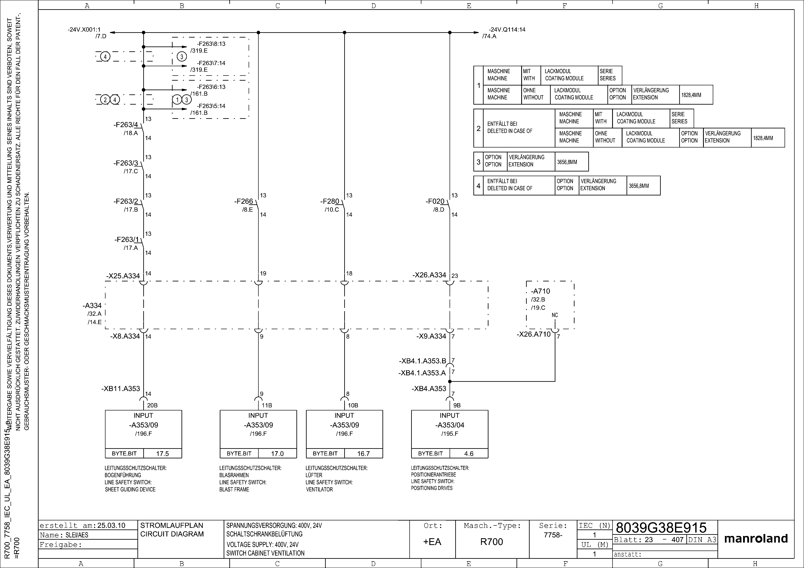

# +EA — Sheet 23 of 407 — SPANNUNGSVERSORGUNG: 400V, 24V

**SCHALTSCHRANKBELÜFTUNG**

> Part of the manroland **R700** printing press IEC/UL circuit diagrams.
> Drawing class: **Stromlaufplan / Circuit diagram** (DIN A3).
> Document `+EA` covers the **Printing unit** machine section.

## At a glance

| Field | Value |
|---|---|
| Document | `+EA`  (8039G38E915) |
| Sheet | **23** of 407 |
| Section (DE) | SPANNUNGSVERSORGUNG: 400V, 24V |
| Section (EN) | SCHALTSCHRANKBELÜFTUNG |
| Section type | POWER_SUPPLY — Voltage supply |
| Machine type | `R700` |
| Series | `7758` |
| Created | 25.03.10 |
| Replaces | — |
| Columns used | A, B, C, D, E, F, G, H |
| Path numbers | — |
| Labels on sheet | 173 |
| Cross-refs out | 21 |
| Cross-refs in | 36 |

**Previous:** [+EA sheet 22](SHEET_0022.md) · **Next:** [+EA sheet 24](SHEET_0024.md) · **Document TOC:** [_TOC.md](_TOC.md)  (+EA) · **Master TOC:** [all sheets](../_MASTER_TOC.md)

## Sheet image (300 DPI, exact vector render)



_Rendered directly from the PDF vector layer at 300 DPI (1-bit), no OCR and no resampling. Use it to confirm anything ambiguous in the text below._

## Cross-references on this sheet

Each entry is a wire leaving this sheet. The printed token is `/sheet.column`; the link resolves to that sheet inside the same document.

| Ref | Target sheet | Col | Path | Destination on target | Target section | From col |
|---|---|---|---|---|---|---|
| `/7.D` | [+EA sheet 7](SHEET_0007.md) | D | — | 24V.X001:1 24V.Q114:14 | SPANNUNGSVERSORGUNG: 400V, 24V | C |
| `/74.A` | [+EA sheet 74](SHEET_0074.md) | A | — | — | AUSLEGERSTAPELSTEUERUNG | E |
| `/319.E` | [+EA sheet 319](SHEET_0319.md) | E | — | — | OPTION: VERLÄNGERUNG 3656,8MM | B |
| `/319.E` | [+EA sheet 319](SHEET_0319.md) | E | — | — | OPTION: VERLÄNGERUNG 3656,8MM | B |
| `/161.B` | [+EA sheet 161](SHEET_0161.md) | B | — | — | VERLÄNGERUNG 1828,4MM | B |
| `/161.B` | [+EA sheet 161](SHEET_0161.md) | B | — | — | VERLÄNGERUNG 1828,4MM | B |
| `/18.A` | [+EA sheet 18](SHEET_0018.md) | A | — | — | SPANNUNGSVERSORGUNG: 400V, 24V | A |
| `/17.C` | [+EA sheet 17](SHEET_0017.md) | C | — | — | SPANNUNGSVERSORGUNG: 400V, 24V | A |
| `/8.E` | [+EA sheet 8](SHEET_0008.md) | E | — | — | SPANNUNGSVERSORGUNG: 400V, 24V | C |
| `/17.B` | [+EA sheet 17](SHEET_0017.md) | B | — | — | SPANNUNGSVERSORGUNG: 400V, 24V | A |
| `/8.D` | [+EA sheet 8](SHEET_0008.md) | D | — | — | SPANNUNGSVERSORGUNG: 400V, 24V | E |
| `/10.C` | [+EA sheet 10](SHEET_0010.md) | C | — | — | SPANNUNGSVERSORGUNG: 400V, 24V | D |
| `/17.A` | [+EA sheet 17](SHEET_0017.md) | A | — | — | SPANNUNGSVERSORGUNG: 400V, 24V | A |
| `/32.B` | [+EA sheet 32](SHEET_0032.md) | B | — | A710 | BUSVERBINDUNGEN: NOT AUS | F |
| `/19.C` | [+EA sheet 19](SHEET_0019.md) | C | — | A710 | SPANNUNGSVERSORGUNG: 400V, 24V | F |
| `/32.A` | [+EA sheet 32](SHEET_0032.md) | A | — | — | BUSVERBINDUNGEN: NOT AUS | A |
| `/14.E` | [+EA sheet 14](SHEET_0014.md) | E | — | — | SPANNUNGSVERSORGUNG: 400V, 24V | A |
| `/196.F` | [+EA sheet 196](SHEET_0196.md) | F | — | — | REFERENZMODUL | B |
| `/196.F` | [+EA sheet 196](SHEET_0196.md) | F | — | — | REFERENZMODUL | C |
| `/196.F` | [+EA sheet 196](SHEET_0196.md) | F | — | — | REFERENZMODUL | D |
| `/195.F` | [+EA sheet 195](SHEET_0195.md) | F | — | — | REFERENZMODUL | E |

### Incoming references (sheets that point here)

Every other sheet that sends a wire to this one. `Back-ref` is the token printed on *that* sheet; `Path` is its line number.

| From sheet | Cols | Back-ref | Path | Refs | What continues there |
|---|---|---|---|---|---|
| [+EA#7](SHEET_0007.md) | D | `/7.D` | — | 1 | 24V.X001:1 |
| [+EA#8](SHEET_0008.md) | C, E | `/8.C`, `/8.E` | — | 2 | — |
| [+EA#10](SHEET_0010.md) | C | `/10.C` | — | 1 | — |
| [+EA#14](SHEET_0014.md) | E | `/14.E` | — | 1 | — |
| [+EA#17](SHEET_0017.md) | A, B, C | `/17.A`, `/17.B`, `/17.C` | — | 3 | — |
| [+EA#18](SHEET_0018.md) | A | `/18.A` | — | 1 | — |
| [+EA#19](SHEET_0019.md) | C | `/19.C` | — | 1 | — |
| [+EA#32](SHEET_0032.md) | A, B | `/32.A`, `/32.B` | — | 2 | — |
| [+EA#74](SHEET_0074.md) | B | `/74.B` | — | 1 | 24V.Q114:14 24V.Q105:14 |
| [+EA#161](SHEET_0161.md) | B | `/161.B` | — | 2 | F263\5:14; F263\6:13 |
| [+EA#195](SHEET_0195.md) | F | `/195.F` | — | 1 | — |
| [+EA#196](SHEET_0196.md) | F | `/196.F` | — | 3 | — |
| [+EA#237](SHEET_0237.md) | A, B, C | `/237.A`, `/237.B`, `/237.C` | — | 3 | — |
| [+EA#249](SHEET_0249.md) | D | `/249.D` | — | 3 | — |
| [+EA#252](SHEET_0252.md) | A | `/252.A` | — | 1 | — |
| [+EA#256](SHEET_0256.md) | A | `/256.A` | — | 3 | — |
| [+EA#267](SHEET_0267.md) | B | `/267.B` | — | 3 | — |
| [+EA#269](SHEET_0269.md) | B | `/269.B` | — | 1 | — |
| [+EA#270](SHEET_0270.md) | C | `/270.C` | — | 1 | — |
| [+EA#319](SHEET_0319.md) | D | `/319.D` | — | 2 | F263\7:14; F263\8:13 |


## Devices on this sheet

| Tag | Class | Class meaning (IEC) | Col | Sub | Terminal | Sign |
|---|---|---|---|---|---|---|
| `F263/1` | F | Schutz / protection device (fuse, circuit breaker) | A | 1 | — | — |
| `F263/2` | F | Schutz / protection device (fuse, circuit breaker) | A | 2 | — | — |
| `A334` | A | Baugruppe / assembly, module, PC board | A | — | — | — |
| `F263/3` | F | Schutz / protection device (fuse, circuit breaker) | A | 3 | — | — |
| `F263/4` | F | Schutz / protection device (fuse, circuit breaker) | A | 4 | — | — |
| `F266` | F | Schutz / protection device (fuse, circuit breaker) | C | — | — | — |
| `F280` | F | Schutz / protection device (fuse, circuit breaker) | D | — | — | — |
| `F020` | F | Schutz / protection device (fuse, circuit breaker) | E | — | — | — |
| `A353/09` | A | Baugruppe / assembly, module, PC board | B | 09 | — | — |
| `A353/09` | A | Baugruppe / assembly, module, PC board | C | 09 | — | — |
| `A353/09` | A | Baugruppe / assembly, module, PC board | D | 09 | — | — |
| `A353/04` | A | Baugruppe / assembly, module, PC board | E | 04 | — | — |
| `A710` | A | Baugruppe / assembly, module, PC board | F | — | — | — |
| `X25.A334` | — | cross-device reference | A | — | — | — |
| `X8.A334` | — | cross-device reference | A | — | — | — |
| `X26.A334` | — | cross-device reference | E | — | — | — |
| `X9.A334` | — | cross-device reference | E | — | — | — |
| `17.5` | — | cross-device reference | B | — | — | — |
| `XB11.A353` | — | cross-device reference | A | — | — | — |
| `17.0` | — | cross-device reference | C | — | — | — |
| `16.7` | — | cross-device reference | D | — | — | — |
| `4.6` | — | cross-device reference | E | — | — | — |
| `XB4.A353` | — | cross-device reference | E | — | — | — |
| `XB4.1.A353.B` | — | cross-device reference | E | — | — | — |
| `XB4.1.A353.A` | — | cross-device reference | E | — | — | — |
| `X26.A710` | — | cross-device reference | F | — | — | — |

## Potentials / nets

| Potential | Count | Columns | Attached devices | Terminals |
|---|---|---|---|---|
| `24V` | 2 | A, E | `Q114`, `X001` | `1`, `14` |


A potential such as `L24+/4` or `M24+` is a named supply/return rail; every place it appears on this sheet is electrically common.

## Wire-end annotations (grouped as printed)

A wire that continues elsewhere is annotated with a small cluster: the destination description, the path/line number `#NN`, and the `/sheet.column` cross reference. Each row below is one such cluster exactly as it is grouped on the drawing.

| Col | Y | Path | Cross-ref | Text on the wire |
|---|---|---|---|---|
| C | 40.0 | — | `/7.D` | `24V.X001:1 24V.Q114:14` |
| E | 49.9 | — | `/74.A` | — |
| B | 61.2 | — | — | `F263\8:13` |
| B | 71.1 | — | `/319.E` | — |
| A | 81.1 | — | — | `4` |
| B | 81.1 | — | — | `3` |
| B | 89.6 | — | — | `F263\7:14` |
| B | 99.5 | — | `/319.E` | — |
| F | 102.6 | — | — | `MIT` |
| F | 102.6 | — | — | `SERIE SERIES` |
| E | 102.7 | — | — | `MASCHINE MACHINE` |
| F | 102.7 | — | — | `LACKMODUL` |
| F | 113.2 | — | — | `WITH` |
| F | 113.3 | — | — | `COATING MODULE` |
| E | 122.2 | — | — | `1` |
| B | 125.0 | — | — | `F263\6:13` |
| E | 131.0 | — | — | `MASCHINE MACHINE` |
| F | 131.0 | — | — | `OHNE WITHOUT` |
| F | 131.0 | — | — | `LACKMODUL` |
| G | 131.0 | — | — | `OPTION OPTION` |
| G | 131.0 | — | — | `EXTENSION VERLÄNGERUNG 1828,4MM` |
| B | 134.9 | — | `/161.B` | — |
| F | 141.7 | — | — | `COATING MODULE` |
| B | 144.3 | — | — | `1 3` |
| A | 144.9 | — | — | `2` |
| A | 144.9 | — | — | `4` |
| B | 153.4 | — | — | `F263\5:14` |
| B | 163.3 | — | `/161.B` | — |
| F | 166.4 | — | — | `2 SERIE SERIES` |
| F | 166.4 | — | — | `MASCHINE MACHINE` |
| F | 166.4 | — | — | `MIT` |
| G | 166.5 | — | — | `LACKMODUL` |
| B | 172.5 | — | — | `13` |
| F | 177.0 | — | — | `WITH` |
| G | 177.1 | — | — | `COATING MODULE` |
| A | 180.3 | — | — | `F263/4` |
| E | 180.6 | — | — | `ENTFÄLLT BEI DELETED IN CASE OF` |
| A | 193.4 | — | `/18.A` | — |
| F | 194.8 | — | — | `MASCHINE MACHINE` |
| F | 194.8 | — | — | `OHNE WITHOUT` |
| G | 194.8 | — | — | `LACKMODUL` |
| G | 194.8 | — | — | `OPTION OPTION` |
| H | 194.8 | — | — | `EXTENSION VERLÄNGERUNG 1828,4MM` |
| B | 200.9 | — | — | `14` |
| G | 205.4 | — | — | `COATING MODULE` |
| B | 229.2 | — | — | `13` |
| E | 230.2 | — | — | `3 OPTION OPTION` |
| F | 230.2 | — | — | `EXTENSION VERLÄNGERUNG 3656,8MM` |
| A | 237.0 | — | — | `F263/3` |
| A | 250.1 | — | `/17.C` | — |
| B | 257.6 | — | — | `14` |
| E | 265.6 | — | — | `4 ENTFÄLLT BEI DELETED IN CASE OF` |
| F | 265.6 | — | — | `OPTION OPTION` |
| G | 265.7 | — | — | `EXTENSION VERLÄNGERUNG 3656,8MM` |
| B | 285.9 | — | — | `13` |
| C | 285.9 | — | — | `13` |
| D | 285.9 | — | — | `13` |
| E | 285.9 | — | — | `13` |
| A | 293.7 | — | — | `F263/2` |
| C | 293.7 | — | — | `F266` |
| D | 293.7 | — | — | `F280` |
| E | 293.7 | — | — | `F020` |
| A | 306.7 | — | `/17.B` | — |
| C | 306.7 | — | `/8.E` | — |
| D | 306.8 | — | `/10.C` | — |
| E | 306.8 | — | `/8.D` | — |
| B | 314.3 | — | — | `14` |
| C | 314.3 | — | — | `14` |
| D | 314.3 | — | — | `14` |
| E | 314.3 | — | — | `14` |
| B | 342.6 | — | — | `13` |
| A | 350.4 | — | — | `F263/1` |
| A | 363.4 | — | `/17.A` | — |
| B | 370.9 | — | — | `14` |
| A | 401.4 | — | — | `X25.A334 14` |
| C | 401.4 | — | — | `19` |
| D | 401.4 | — | — | `18` |
| E | 402.8 | — | — | `X26.A334 23` |
| F | 426.9 | — | `/32.B`, `/19.C` | `A710` |
| A | 448.2 | — | — | `A334` |
| A | 461.2 | — | `/32.A` | — |
| F | 464.1 | — | — | `NC` |
| A | 473.6 | — | `/14.E` | — |
| F | 490.7 | — | — | `X26.A710 7` |
| A | 493.5 | — | — | `X8.A334 14` |
| E | 493.5 | — | — | `X9.A334 7` |
| C | 495.0 | — | — | `9` |
| D | 495.0 | — | — | `8` |
| E | 530.4 | — | — | `XB4.1.A353.B 7` |
| E | 547.4 | — | — | `XB4.1.A353.A 7` |
| A | 571.5 | — | — | `XB11.A353 14` |
| E | 571.5 | — | — | `XB4.A353 7` |
| C | 580.0 | — | — | `9` |
| D | 580.0 | — | — | `8` |
| B | 597.0 | — | — | `20B` |
| C | 597.0 | — | — | `11B` |
| D | 597.0 | — | — | `10B` |
| E | 597.0 | — | — | `9B` |
| B | 611.5 | — | — | `INPUT` |
| C | 611.5 | — | — | `INPUT` |
| D | 611.5 | — | — | `INPUT` |
| E | 611.5 | — | — | `INPUT` |
| B | 625.3 | — | — | `A353/09` |
| C | 625.3 | — | — | `A353/09` |
| D | 625.3 | — | — | `A353/09` |
| E | 625.3 | — | — | `A353/04` |
| B | 639.1 | — | `/196.F` | — |
| C | 639.1 | — | `/196.F` | — |
| D | 639.1 | — | `/196.F` | — |
| E | 639.1 | — | `/195.F` | — |
| B | 668.2 | — | — | `BYTE.BIT 17.5` |
| C | 668.2 | — | — | `BYTE.BIT 17.0` |
| D | 668.2 | — | — | `BYTE.BIT 16.7` |
| E | 668.2 | — | — | `BYTE.BIT 4.6` |
| B | 690.9 | — | — | `LEITUNGSSCHUTZSCHALTER: BOGENFÜHRUNG LINE SAFETY SWITCH:` |
| C | 690.9 | — | — | `LEITUNGSSCHUTZSCHALTER: BLASRAHMEN LINE SAFETY SWITCH: BLAST FRAME` |
| D | 690.9 | — | — | `LEITUNGSSCHUTZSCHALTER: LÜFTER LINE SAFETY SWITCH:` |
| E | 691.0 | — | — | `LEITUNGSSCHUTZSCHALTER: POSITIONIERANTRIEBE LINE SAFETY SWITCH: POSITIONING DRIVES` |
| A | 722.8 | — | — | `SHEET GUIDING DEVICE` |
| C | 722.8 | — | — | `VENTILATOR` |


## Reconstructed tables

This sheet carries tabular content (pin map / terminal assignment / index). The grid below was rebuilt from the drawing's own rule lines, so each row is exactly one physical row of the table.

### Table 1 — 6 data rows × 5 columns (at x=155.9, y=48.2) — **F263\8:13**

| 4 | 3 | /319.E F263\7:14 |  |  |
|---|---|---|---|---|
|  |  | `/319.E F263\6:13` |  |  |
| `2 4` | `1` | `/161.B 3 F263\5:14` |  |  |
| `F263/4 /18.A F263/3 /17.C F263/2 /17.B F263/1 /17.A X25.A334 X8.A334` | `13 14 13 14 13 14 13 14 14 14` | `/161.B` | `F266 /8.E` | `13 14 19 9` |
| `XB11.A353` | `14 20B` |  |  | `9 11B` |
| `INPUT` | `A353/09 /196.F` |  | `INPUT` | `A353/09 /196.F` |
| `BYTE.BIT` | `17.5` |  | `BYTE.BIT` | `17.0` |


### Table 2 — 3 data rows × 2 columns (at x=453.5, y=48.2)

| F280 /10.C | 13 14 18 8 |
|---|---|
|  | `8 10B` |
| `INPUT` | `A353/09 /196.F` |
| `BYTE.BIT` | `16.7` |


### Table 3 — 5 data rows × 3 columns (at x=609.4, y=48.2) — **/74.A**

|  | 1 | MIT MASCHINE WITH MACHINE COATING |
|---|---|---|
|  |  | `OHNE MASCHINE WITHOUT MACHINE` |
| `F020 /8.D X26.A334 X9.A334 XB4.1.A353.B XB4.1.A353.A` | `2 3 4 13 14 23 7 7 7` | `ENTFÄLLT BEI DELETED IN CASE OF OPTION VERLÄNGERUNG EXTENSION OPTION ENTFÄLLT BEI DELETED IN CASE OF A710 /32.B /19.C NC X26.A710` |
| `XB4.A353` | `7 9B` |  |
| `INPUT` | `A353/04 /195.F` |  |
| `BYTE.BIT` | `4.6` |  |


## Notes and free text on this sheet

| Text | Col | Y (pt) |
|---|---|---|
| `20B` | B | 596.98 |
| `INPUT` | B | 611.5 |
| `BYTE.BIT` | A | 668.75 |
| `LEITUNGSSCHUTZSCHALTER:` | B | 690.87 |
| `BOGENFÜHRUNG` | A | 701.51 |
| `LINE SAFETY SWITCH:` | A | 712.08 |
| `SHEET GUIDING DEVICE` | A | 722.75 |
| `11B` | C | 596.98 |
| `INPUT` | C | 611.5 |
| `BYTE.BIT` | C | 668.75 |
| `LEITUNGSSCHUTZSCHALTER:` | C | 690.87 |
| `BLASRAHMEN` | C | 701.48 |
| `LINE SAFETY SWITCH:` | C | 712.08 |
| `BLAST FRAME` | C | 722.74 |
| `10B` | D | 596.98 |
| `INPUT` | D | 611.5 |
| `LEITUNGSSCHUTZSCHALTER:` | D | 690.87 |
| `LÜFTER` | C | 701.48 |
| `LINE SAFETY SWITCH:` | D | 712.08 |
| `VENTILATOR` | C | 722.76 |
| `9B` | E | 596.96 |
| `INPUT` | E | 611.5 |
| `BYTE.BIT` | E | 668.75 |
| `LEITUNGSSCHUTZSCHALTER:` | E | 691 |
| `POSITIONIERANTRIEBE` | E | 700.97 |
| `LINE SAFETY SWITCH:` | E | 710.89 |
| `POSITIONING DRIVES` | E | 720.87 |
| `F263\6:13` | B | 125.02 |
| `F263\5:14` | B | 153.37 |
| `F263\7:14` | B | 89.59 |
| `F263\8:13` | B | 61.24 |
| `ENTFÄLLT BEI` | E | 180.59 |
| `DELETED IN CASE OF` | E | 191.24 |
| `MASCHINE` | F | 166.45 |
| `MACHINE` | F | 177.09 |
| `MIT` | F | 166.42 |
| `WITH` | F | 176.96 |
| `LACKMODUL` | G | 166.47 |
| `COATING MODULE` | G | 177.1 |
| `OHNE` | F | 194.79 |
| `WITHOUT` | F | 205.39 |
| `OPTION` | G | 194.77 |
| `VERLÄNGERUNG` | H | 194.82 |
| `EXTENSION` | H | 205.39 |
| `1828,4MM` | H | 201.91 |
| `SERIE` | G | 166.4 |
| `SERIES` | G | 177.04 |
| `MASCHINE` | E | 102.67 |
| `MACHINE` | E | 113.31 |
| `LACKMODUL` | F | 102.69 |
| `COATING MODULE` | F | 113.32 |
| `VERLÄNGERUNG` | G | 131.04 |
| `EXTENSION` | G | 141.61 |
| `1828,4MM` | G | 138.13 |
| `SERIE` | F | 102.62 |
| `SERIES` | F | 113.26 |
| `OPTION` | E | 230.2 |
| `VERLÄNGERUNG` | F | 230.25 |
| `EXTENSION` | F | 240.83 |
| `3656,8MM` | F | 237.36 |
| `OPTION` | F | 265.64 |
| `3656,8MM` | G | 272.79 |
| `NC` | F | 464.05 |

## Complete label inventory (exact text from the drawing)

Every text object inside the drawing area of this sheet, in DIN reading order (column A→H, then top→bottom). This is the authoritative list: if a string is not here it is not printed on this sheet.

| Col | Y | X | Dir | Type | Text |
|---|---|---|---|---|---|
| A | 40.0 | 100.3 | → | potential | `24V.X001:1` |
| A | 49.9 | 141.4 | → | cross-reference | `/7.D` |
| A | 81.1 | 153.9 | → | number | `4` |
| A | 144.9 | 153.9 | → | number | `2` |
| A | 144.9 | 168.1 | → | number | `4` |
| A | 180.3 | 168.1 | → | device tag | `F263/4` |
| A | 193.4 | 183.4 | → | cross-reference | `/18.A` |
| A | 237.0 | 168.1 | → | device tag | `F263/3` |
| A | 250.1 | 183.4 | → | cross-reference | `/17.C` |
| A | 293.7 | 168.1 | → | device tag | `F263/2` |
| A | 306.7 | 183.7 | → | cross-reference | `/17.B` |
| A | 350.4 | 169.5 | → | device tag | `F263/1` |
| A | 363.4 | 183.4 | → | cross-reference | `/17.A` |
| A | 404.2 | 157.3 | → | device ref | `X25.A334` |
| A | 448.2 | 122.5 | → | device tag | `A334` |
| A | 461.2 | 129.5 | → | cross-reference | `/32.A` |
| A | 473.6 | 130.1 | → | cross-reference | `/14.E` |
| A | 493.5 | 163.3 | → | device ref | `X8.A334` |
| A | 571.5 | 150.2 | → | device ref | `XB11.A353` |
| A | 668.8 | 165.8 | → | text | `BYTE.BIT` |
| A | 701.5 | 155.1 | → | text | `BOGENFÜHRUNG` |
| A | 712.1 | 155.1 | → | text | `LINE SAFETY SWITCH:` |
| A | 722.8 | 155.6 | → | text | `SHEET GUIDING DEVICE` |
| B | 61.2 | 291.7 | → | text | `F263\8:13` |
| B | 71.1 | 282.0 | → | cross-reference | `/319.E` |
| B | 81.1 | 267.3 | → | number | `3` |
| B | 89.6 | 291.7 | → | text | `F263\7:14` |
| B | 99.5 | 282.0 | → | cross-reference | `/319.E` |
| B | 125.0 | 291.7 | → | text | `F263\6:13` |
| B | 134.9 | 282.0 | → | cross-reference | `/161.B` |
| B | 144.3 | 260.4 | → | number | `1` |
| B | 144.9 | 274.4 | → | number | `3` |
| B | 153.4 | 291.7 | → | text | `F263\5:14` |
| B | 163.3 | 282.0 | → | cross-reference | `/161.B` |
| B | 172.5 | 214.6 | → | number | `13` |
| B | 200.9 | 214.6 | → | number | `14` |
| B | 229.2 | 214.6 | → | number | `13` |
| B | 257.6 | 214.6 | → | number | `14` |
| B | 285.9 | 214.6 | → | number | `13` |
| B | 314.3 | 214.6 | → | number | `14` |
| B | 342.6 | 214.6 | → | number | `13` |
| B | 371.0 | 214.6 | → | number | `14` |
| B | 401.4 | 214.6 | → | number | `14` |
| B | 495.0 | 214.6 | → | number | `14` |
| B | 580.0 | 214.6 | → | number | `14` |
| B | 597.0 | 218.0 | → | text | `20B` |
| B | 611.5 | 197.7 | → | text | `INPUT` |
| B | 625.3 | 191.2 | → | device tag | `A353/09` |
| B | 639.1 | 200.3 | → | cross-reference | `/196.F` |
| B | 668.2 | 231.2 | → | device ref | `17.5` |
| B | 690.9 | 155.1 | → | text | `LEITUNGSSCHUTZSCHALTER:` |
| C | 285.9 | 384.7 | → | number | `13` |
| C | 293.7 | 347.0 | → | device tag | `F266` |
| C | 306.7 | 358.9 | → | cross-reference | `/8.E` |
| C | 314.3 | 384.7 | → | number | `14` |
| C | 401.4 | 384.7 | → | number | `19` |
| C | 495.0 | 385.2 | → | number | `9` |
| C | 580.0 | 385.2 | → | number | `9` |
| C | 597.0 | 387.5 | → | text | `11B` |
| C | 611.5 | 367.8 | → | text | `INPUT` |
| C | 625.3 | 361.3 | → | device tag | `A353/09` |
| C | 639.1 | 370.3 | → | cross-reference | `/196.F` |
| C | 668.2 | 401.2 | → | device ref | `17.0` |
| C | 668.8 | 335.9 | → | text | `BYTE.BIT` |
| C | 668.8 | 463.5 | → | text | `BYTE.BIT` |
| C | 690.9 | 325.1 | → | text | `LEITUNGSSCHUTZSCHALTER:` |
| C | 701.5 | 325.1 | → | text | `BLASRAHMEN` |
| C | 701.5 | 452.7 | → | text | `LÜFTER` |
| C | 712.1 | 325.1 | → | text | `LINE SAFETY SWITCH:` |
| C | 722.7 | 325.1 | → | text | `BLAST FRAME` |
| C | 722.8 | 453.5 | → | text | `VENTILATOR` |
| D | 285.9 | 512.2 | → | number | `13` |
| D | 293.7 | 474.5 | → | device tag | `F280` |
| D | 306.8 | 481.0 | → | cross-reference | `/10.C` |
| D | 314.3 | 512.2 | → | number | `14` |
| D | 401.4 | 512.2 | → | number | `18` |
| D | 495.0 | 512.8 | → | number | `8` |
| D | 580.0 | 512.8 | → | number | `8` |
| D | 597.0 | 515.1 | → | text | `10B` |
| D | 611.5 | 495.4 | → | text | `INPUT` |
| D | 625.3 | 488.8 | → | device tag | `A353/09` |
| D | 639.1 | 497.9 | → | cross-reference | `/196.F` |
| D | 668.2 | 528.8 | → | device ref | `16.7` |
| D | 690.9 | 452.7 | → | text | `LEITUNGSSCHUTZSCHALTER:` |
| D | 712.1 | 452.7 | → | text | `LINE SAFETY SWITCH:` |
| E | 40.0 | 724.0 | → | potential | `24V.Q114:14` |
| E | 49.9 | 714.3 | → | cross-reference | `/74.A` |
| E | 102.7 | 722.3 | → | text | `MASCHINE` |
| E | 113.3 | 722.3 | → | text | `MACHINE` |
| E | 122.2 | 706.1 | → | number | `1` |
| E | 131.0 | 722.3 | → | text | `MASCHINE` |
| E | 141.7 | 722.3 | → | text | `MACHINE` |
| E | 180.6 | 722.0 | → | text | `ENTFÄLLT BEI` |
| E | 185.9 | 705.8 | → | number | `2` |
| E | 191.2 | 722.0 | → | text | `DELETED IN CASE OF` |
| E | 230.2 | 718.3 | → | text | `OPTION` |
| E | 235.5 | 705.7 | → | number | `3` |
| E | 240.8 | 718.3 | → | text | `OPTION` |
| E | 265.6 | 722.0 | → | text | `ENTFÄLLT BEI` |
| E | 271.0 | 705.8 | → | number | `4` |
| E | 276.3 | 722.0 | → | text | `DELETED IN CASE OF` |
| E | 285.9 | 668.1 | → | number | `13` |
| E | 293.7 | 630.4 | → | device tag | `F020` |
| E | 306.8 | 641.8 | → | cross-reference | `/8.D` |
| E | 314.3 | 668.1 | → | number | `14` |
| E | 402.8 | 610.9 | → | device ref | `X26.A334` |
| E | 405.0 | 668.7 | → | number | `23` |
| E | 493.5 | 616.8 | → | device ref | `X9.A334` |
| E | 495.0 | 668.7 | → | number | `7` |
| E | 530.4 | 591.0 | → | device ref | `XB4.1.A353.B` |
| E | 530.4 | 668.7 | → | number | `7` |
| E | 547.4 | 668.7 | → | number | `7` |
| E | 548.1 | 590.2 | → | device ref | `XB4.1.A353.A` |
| E | 571.5 | 609.7 | → | device ref | `XB4.A353` |
| E | 580.0 | 668.7 | → | number | `7` |
| E | 597.0 | 671.5 | → | text | `9B` |
| E | 611.5 | 651.3 | → | text | `INPUT` |
| E | 625.3 | 644.7 | → | device tag | `A353/04` |
| E | 639.1 | 653.8 | → | cross-reference | `/195.F` |
| E | 668.2 | 687.7 | → | device ref | `4.6` |
| E | 668.8 | 619.4 | → | text | `BYTE.BIT` |
| E | 691.0 | 608.9 | → | text | `LEITUNGSSCHUTZSCHALTER:` |
| E | 701.0 | 608.9 | → | text | `POSITIONIERANTRIEBE` |
| E | 710.9 | 608.9 | → | text | `LINE SAFETY SWITCH:` |
| E | 720.9 | 608.9 | → | text | `POSITIONING DRIVES` |
| F | 102.6 | 774.7 | → | text | `MIT` |
| F | 102.6 | 888.4 | → | text | `SERIE` |
| F | 102.7 | 807.0 | → | text | `LACKMODUL` |
| F | 113.2 | 775.3 | → | text | `WITH` |
| F | 113.3 | 807.6 | → | text | `COATING MODULE` |
| F | 113.3 | 888.4 | → | text | `SERIES` |
| F | 131.0 | 775.0 | → | text | `OHNE` |
| F | 131.0 | 821.2 | → | text | `LACKMODUL` |
| F | 141.6 | 775.3 | → | text | `WITHOUT` |
| F | 141.7 | 821.8 | → | text | `COATING MODULE` |
| F | 166.4 | 828.6 | → | text | `MASCHINE` |
| F | 166.4 | 881.0 | → | text | `MIT` |
| F | 177.0 | 881.6 | → | text | `WITH` |
| F | 177.1 | 828.6 | → | text | `MACHINE` |
| F | 194.8 | 828.6 | → | text | `MASCHINE` |
| F | 194.8 | 881.3 | → | text | `OHNE` |
| F | 205.4 | 828.6 | → | text | `MACHINE` |
| F | 205.4 | 881.6 | → | text | `WITHOUT` |
| F | 230.2 | 754.0 | → | text | `VERLÄNGERUNG` |
| F | 237.4 | 825.3 | → | text | `3656,8MM` |
| F | 240.8 | 753.2 | → | text | `EXTENSION` |
| F | 265.6 | 824.6 | → | text | `OPTION` |
| F | 265.7 | 860.3 | → | text | `VERLÄNGERUNG` |
| F | 276.3 | 824.6 | → | text | `OPTION` |
| F | 276.3 | 859.5 | → | text | `EXTENSION` |
| F | 426.9 | 786.3 | → | device tag | `A710` |
| F | 440.0 | 786.6 | → | cross-reference | `/32.B` |
| F | 452.4 | 786.6 | → | cross-reference | `/19.C` |
| F | 464.0 | 817.2 | → | text | `NC` |
| F | 490.7 | 765.4 | → | device ref | `X26.A710` |
| F | 495.0 | 824.6 | → | number | `7` |
| G | 131.0 | 902.6 | → | text | `OPTION` |
| G | 131.0 | 938.3 | → | text | `VERLÄNGERUNG` |
| G | 138.1 | 1009.0 | → | text | `1828,4MM` |
| G | 141.6 | 902.6 | → | text | `OPTION` |
| G | 141.6 | 937.4 | → | text | `EXTENSION` |
| G | 166.4 | 994.7 | → | text | `SERIE` |
| G | 166.5 | 913.3 | → | text | `LACKMODUL` |
| G | 177.0 | 994.7 | → | text | `SERIES` |
| G | 177.1 | 913.9 | → | text | `COATING MODULE` |
| G | 194.8 | 927.5 | → | text | `LACKMODUL` |
| G | 194.8 | 1008.9 | → | text | `OPTION` |
| G | 205.4 | 928.1 | → | text | `COATING MODULE` |
| G | 205.4 | 1008.9 | → | text | `OPTION` |
| G | 272.8 | 931.6 | → | text | `3656,8MM` |
| H | 194.8 | 1044.6 | → | text | `VERLÄNGERUNG` |
| H | 201.9 | 1115.3 | → | text | `1828,4MM` |
| H | 205.4 | 1043.7 | → | text | `EXTENSION` |

## Reading-order text block

The same content as a plain block, grouped by DIN column — convenient to paste or to match against a visual description.

```text
=== Column A ===
  40.0  100.3  net          24V.X001:1
  49.9  141.4  xref         /7.D
  81.1  153.9  numeric      4
 144.9  153.9  numeric      2
 144.9  168.1  numeric      4
 180.3  168.1  devtag       F263/4
 193.4  183.4  xref         /18.A
 237.0  168.1  devtag       F263/3
 250.1  183.4  xref         /17.C
 293.7  168.1  devtag       F263/2
 306.7  183.7  xref         /17.B
 350.4  169.5  devtag       F263/1
 363.4  183.4  xref         /17.A
 404.2  157.3  devref       X25.A334
 448.2  122.5  devtag       A334
 461.2  129.5  xref         /32.A
 473.6  130.1  xref         /14.E
 493.5  163.3  devref       X8.A334
 571.5  150.2  devref       XB11.A353
 668.8  165.8  text         BYTE.BIT
 701.5  155.1  text         BOGENFÜHRUNG
 712.1  155.1  text         LINE SAFETY SWITCH:
 722.8  155.6  text         SHEET GUIDING DEVICE
=== Column B ===
  61.2  291.7  text         F263\8:13
  71.1  282.0  xref         /319.E
  81.1  267.3  numeric      3
  89.6  291.7  text         F263\7:14
  99.5  282.0  xref         /319.E
 125.0  291.7  text         F263\6:13
 134.9  282.0  xref         /161.B
 144.3  260.4  numeric      1
 144.9  274.4  numeric      3
 153.4  291.7  text         F263\5:14
 163.3  282.0  xref         /161.B
 172.5  214.6  numeric      13
 200.9  214.6  numeric      14
 229.2  214.6  numeric      13
 257.6  214.6  numeric      14
 285.9  214.6  numeric      13
 314.3  214.6  numeric      14
 342.6  214.6  numeric      13
 371.0  214.6  numeric      14
 401.4  214.6  numeric      14
 495.0  214.6  numeric      14
 580.0  214.6  numeric      14
 597.0  218.0  text         20B
 611.5  197.7  text         INPUT
 625.3  191.2  devtag       A353/09
 639.1  200.3  xref         /196.F
 668.2  231.2  devref       17.5
 690.9  155.1  text         LEITUNGSSCHUTZSCHALTER:
=== Column C ===
 285.9  384.7  numeric      13
 293.7  347.0  devtag       F266
 306.7  358.9  xref         /8.E
 314.3  384.7  numeric      14
 401.4  384.7  numeric      19
 495.0  385.2  numeric      9
 580.0  385.2  numeric      9
 597.0  387.5  text         11B
 611.5  367.8  text         INPUT
 625.3  361.3  devtag       A353/09
 639.1  370.3  xref         /196.F
 668.2  401.2  devref       17.0
 668.8  335.9  text         BYTE.BIT
 668.8  463.5  text         BYTE.BIT
 690.9  325.1  text         LEITUNGSSCHUTZSCHALTER:
 701.5  325.1  text         BLASRAHMEN
 701.5  452.7  text         LÜFTER
 712.1  325.1  text         LINE SAFETY SWITCH:
 722.7  325.1  text         BLAST FRAME
 722.8  453.5  text         VENTILATOR
=== Column D ===
 285.9  512.2  numeric      13
 293.7  474.5  devtag       F280
 306.8  481.0  xref         /10.C
 314.3  512.2  numeric      14
 401.4  512.2  numeric      18
 495.0  512.8  numeric      8
 580.0  512.8  numeric      8
 597.0  515.1  text         10B
 611.5  495.4  text         INPUT
 625.3  488.8  devtag       A353/09
 639.1  497.9  xref         /196.F
 668.2  528.8  devref       16.7
 690.9  452.7  text         LEITUNGSSCHUTZSCHALTER:
 712.1  452.7  text         LINE SAFETY SWITCH:
=== Column E ===
  40.0  724.0  net          24V.Q114:14
  49.9  714.3  xref         /74.A
 102.7  722.3  text         MASCHINE
 113.3  722.3  text         MACHINE
 122.2  706.1  numeric      1
 131.0  722.3  text         MASCHINE
 141.7  722.3  text         MACHINE
 180.6  722.0  text         ENTFÄLLT BEI
 185.9  705.8  numeric      2
 191.2  722.0  text         DELETED IN CASE OF
 230.2  718.3  text         OPTION
 235.5  705.7  numeric      3
 240.8  718.3  text         OPTION
 265.6  722.0  text         ENTFÄLLT BEI
 271.0  705.8  numeric      4
 276.3  722.0  text         DELETED IN CASE OF
 285.9  668.1  numeric      13
 293.7  630.4  devtag       F020
 306.8  641.8  xref         /8.D
 314.3  668.1  numeric      14
 402.8  610.9  devref       X26.A334
 405.0  668.7  numeric      23
 493.5  616.8  devref       X9.A334
 495.0  668.7  numeric      7
 530.4  591.0  devref       XB4.1.A353.B
 530.4  668.7  numeric      7
 547.4  668.7  numeric      7
 548.1  590.2  devref       XB4.1.A353.A
 571.5  609.7  devref       XB4.A353
 580.0  668.7  numeric      7
 597.0  671.5  text         9B
 611.5  651.3  text         INPUT
 625.3  644.7  devtag       A353/04
 639.1  653.8  xref         /195.F
 668.2  687.7  devref       4.6
 668.8  619.4  text         BYTE.BIT
 691.0  608.9  text         LEITUNGSSCHUTZSCHALTER:
 701.0  608.9  text         POSITIONIERANTRIEBE
 710.9  608.9  text         LINE SAFETY SWITCH:
 720.9  608.9  text         POSITIONING DRIVES
=== Column F ===
 102.6  774.7  text         MIT
 102.6  888.4  text         SERIE
 102.7  807.0  text         LACKMODUL
 113.2  775.3  text         WITH
 113.3  807.6  text         COATING MODULE
 113.3  888.4  text         SERIES
 131.0  775.0  text         OHNE
 131.0  821.2  text         LACKMODUL
 141.6  775.3  text         WITHOUT
 141.7  821.8  text         COATING MODULE
 166.4  828.6  text         MASCHINE
 166.4  881.0  text         MIT
 177.0  881.6  text         WITH
 177.1  828.6  text         MACHINE
 194.8  828.6  text         MASCHINE
 194.8  881.3  text         OHNE
 205.4  828.6  text         MACHINE
 205.4  881.6  text         WITHOUT
 230.2  754.0  text         VERLÄNGERUNG
 237.4  825.3  text         3656,8MM
 240.8  753.2  text         EXTENSION
 265.6  824.6  text         OPTION
 265.7  860.3  text         VERLÄNGERUNG
 276.3  824.6  text         OPTION
 276.3  859.5  text         EXTENSION
 426.9  786.3  devtag       A710
 440.0  786.6  xref         /32.B
 452.4  786.6  xref         /19.C
 464.0  817.2  text         NC
 490.7  765.4  devref       X26.A710
 495.0  824.6  numeric      7
=== Column G ===
 131.0  902.6  text         OPTION
 131.0  938.3  text         VERLÄNGERUNG
 138.1 1009.0  text         1828,4MM
 141.6  902.6  text         OPTION
 141.6  937.4  text         EXTENSION
 166.4  994.7  text         SERIE
 166.5  913.3  text         LACKMODUL
 177.0  994.7  text         SERIES
 177.1  913.9  text         COATING MODULE
 194.8  927.5  text         LACKMODUL
 194.8 1008.9  text         OPTION
 205.4  928.1  text         COATING MODULE
 205.4 1008.9  text         OPTION
 272.8  931.6  text         3656,8MM
=== Column H ===
 194.8 1044.6  text         VERLÄNGERUNG
 201.9 1115.3  text         1828,4MM
 205.4 1043.7  text         EXTENSION
```

---
_Generated from the PDF vector text layer; no OCR. Source: `R700_7758_IEC_UL_EA_8039G38E915_p`, sheet 23._
