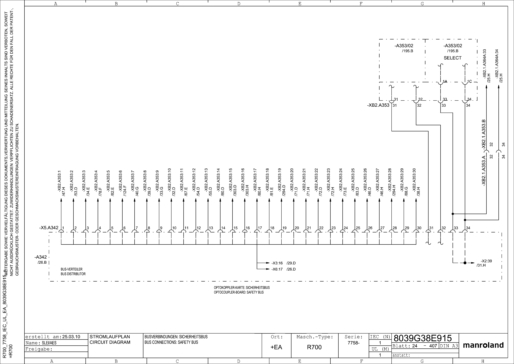

# +EA — Sheet 24 of 407 — BUSVERBINDUNGEN: SICHERHEITSBUS

**BUS CONNECTIONS: SAFETY BUS**

> Part of the manroland **R700** printing press IEC/UL circuit diagrams.
> Drawing class: **Stromlaufplan / Circuit diagram** (DIN A3).
> Document `+EA` covers the **Printing unit** machine section.

## At a glance

| Field | Value |
|---|---|
| Document | `+EA`  (8039G38E915) |
| Sheet | **24** of 407 |
| Section (DE) | BUSVERBINDUNGEN: SICHERHEITSBUS |
| Section (EN) | BUS CONNECTIONS: SAFETY BUS |
| Section type | CIRCUIT — Circuit diagram |
| Machine type | `R700` |
| Series | `7758` |
| Created | 25.03.10 |
| Replaces | — |
| Columns used | A, B, C, D, E, F, G, H |
| Path numbers | — |
| Labels on sheet | 133 |
| Cross-refs out | 38 |
| Cross-refs in | 80 |

**Previous:** [+EA sheet 23](SHEET_0023.md) · **Next:** [+EA sheet 25](SHEET_0025.md) · **Document TOC:** [_TOC.md](_TOC.md)  (+EA) · **Master TOC:** [all sheets](../_MASTER_TOC.md)

## Sheet image (300 DPI, exact vector render)



_Rendered directly from the PDF vector layer at 300 DPI (1-bit), no OCR and no resampling. Use it to confirm anything ambiguous in the text below._

## Cross-references on this sheet

Each entry is a wire leaving this sheet. The printed token is `/sheet.column`; the link resolves to that sheet inside the same document.

| Ref | Target sheet | Col | Path | Destination on target | Target section | From col |
|---|---|---|---|---|---|---|
| `/25.H` | [+EA sheet 25](SHEET_0025.md) | H | — | XB2.1.A364A:33 | BUSVERBINDUNGEN: SICHERHEITSBUS | H |
| `/25.H` | [+EA sheet 25](SHEET_0025.md) | H | — | XB2.1.A364A:34 | BUSVERBINDUNGEN: SICHERHEITSBUS | H |
| `/195.B` | [+EA sheet 195](SHEET_0195.md) | B | — | — | REFERENZMODUL | G |
| `/195.B` | [+EA sheet 195](SHEET_0195.md) | B | — | — | REFERENZMODUL | G |
| `/32.D` | [+EA sheet 32](SHEET_0032.md) | D | — | XB2.A353:10 | BUSVERBINDUNGEN: NOT AUS | C |
| `/67.E` | [+EA sheet 67](SHEET_0067.md) | E | — | XB2.A353:11 | LEITSTANDSFUNKTIONEN | C |
| `/54.D` | [+EA sheet 54](SHEET_0054.md) | D | — | XB2.A353:12 | MASCHINENBEDIENUNG: LAUFKOMMANDOS | C |
| `/55.D` | [+EA sheet 55](SHEET_0055.md) | D | — | XB2.A353:13 | MASCHINENBEDIENUNG: LAUFKOMMANDOS | D |
| `/80.D` | [+EA sheet 80](SHEET_0080.md) | D | — | XB2.A353:14 | AUSLEGERSTAPELSTEUERUNG: BEDIENKOMMANDOS | D |
| `/303.D` | [+EA sheet 303](SHEET_0303.md) | D | — | XB2.A353:15 | OPTION: ZWISCHENSTAPEL / | D |
| `/303.H` | [+EA sheet 303](SHEET_0303.md) | H | — | XB2.A353:16 | OPTION: ZWISCHENSTAPEL / | D |
| `/80.H` | [+EA sheet 80](SHEET_0080.md) | H | — | XB2.A353:17 | AUSLEGERSTAPELSTEUERUNG: BEDIENKOMMANDOS | D |
| `/81.E` | [+EA sheet 81](SHEET_0081.md) | E | — | XB2.A353:18 | AUSLEGERSTAPELSTEUERUNG: BEDIENKOMMANDOS | E |
| `/294.D` | [+EA sheet 294](SHEET_0294.md) | D | — | XB2.A353:19 | OPTION: ZWISCHENSTAPEL / | E |
| `/71.D` | [+EA sheet 71](SHEET_0071.md) | D | — | XB2.A353:20 | AUSLEGERSTAPELSTEUERUNG | E |
| `/71.H` | [+EA sheet 71](SHEET_0071.md) | H | — | XB2.A353:21 | AUSLEGERSTAPELSTEUERUNG | E |
| `/72.D` | [+EA sheet 72](SHEET_0072.md) | D | — | XB2.A353:22 | AUSLEGERSTAPELSTEUERUNG | E |
| `/72.H` | [+EA sheet 72](SHEET_0072.md) | H | — | XB2.A353:23 | AUSLEGERSTAPELSTEUERUNG | F |
| `/73.E` | [+EA sheet 73](SHEET_0073.md) | E | — | XB2.A353:24 | AUSLEGERSTAPELSTEUERUNG | F |
| `/83.D` | [+EA sheet 83](SHEET_0083.md) | D | — | XB2.A353:25 | AUSLEGERSTAPELSTEUERUNG: PROGRAMMSCHALTWERK | F |
| `/46.D` | [+EA sheet 46](SHEET_0046.md) | D | — | XB2.A353:26 | SCHUTZ | F |
| `/46.H` | [+EA sheet 46](SHEET_0046.md) | H | — | XB2.A353:27 | SCHUTZ | F |
| `/294.H` | [+EA sheet 294](SHEET_0294.md) | H | — | XB2.A353:28 | OPTION: ZWISCHENSTAPEL / | G |
| `/88.G` | [+EA sheet 88](SHEET_0088.md) | G | — | XB2.A353:29 | SAUGWALZE | G |
| `/38.H` | [+EA sheet 38](SHEET_0038.md) | H | — | XB2.A353:30 | BUSVERBINDUNGEN: NOT AUS | G |
| `/47.H` | [+EA sheet 47](SHEET_0047.md) | H | — | XB2.A353:1 | SCHUTZ | A |
| `/53.D` | [+EA sheet 53](SHEET_0053.md) | D | — | XB2.A353:2 | MASCHINENBEDIENUNG: LAUFKOMMANDOS | A |
| `/34.E` | [+EA sheet 34](SHEET_0034.md) | E | — | XB2.A353:3 | BUSVERBINDUNGEN: NOT AUS | B |
| `/78.F` | [+EA sheet 78](SHEET_0078.md) | F | — | XB2.A353:4 | AUSLEGERSTAPELSTEUERUNG | B |
| `/82.E` | [+EA sheet 82](SHEET_0082.md) | E | — | XB2.A353:5 | AUSLEGERSTAPELSTEUERUNG: PROGRAMMSCHALTWERK | B |
| `/124.F` | [+EA sheet 124](SHEET_0124.md) | F | — | XB2.A353:6 | TROCKENBESTÄUBER | B |
| `/40.G` | [+EA sheet 40](SHEET_0040.md) | G | — | XB2.A353:7 | BUSVERBINDUNGEN: STOP SICHERN | B |
| `/39.D` | [+EA sheet 39](SHEET_0039.md) | D | — | XB2.A353:8 | BUSVERBINDUNGEN: STOP SICHERN | C |
| `/33.G` | [+EA sheet 33](SHEET_0033.md) | G | — | XB2.A353:9 | BUSVERBINDUNGEN: NOT AUS | C |
| `/26.B` | [+EA sheet 26](SHEET_0026.md) | B | — | — | BUSVERBINDUNGEN: SICHERHEITSBUS | A |
| `/29.D` | [+EA sheet 29](SHEET_0029.md) | D | — | X3:16 | BUSVERBINDUNGEN: SICHERHEITSBUS | E |
| `/31.H` | [+EA sheet 31](SHEET_0031.md) | H | — | — | BUSVERBINDUNGEN: SICHERHEITSBUS | H |
| `/26.D` | [+EA sheet 26](SHEET_0026.md) | D | — | X6:17 | BUSVERBINDUNGEN: SICHERHEITSBUS | E |

### Incoming references (sheets that point here)

Every other sheet that sends a wire to this one. `Back-ref` is the token printed on *that* sheet; `Path` is its line number.

| From sheet | Cols | Back-ref | Path | Refs | What continues there |
|---|---|---|---|---|---|
| [+EA#25](SHEET_0025.md) | H | `/25.H` | — | 2 | — |
| [+EA#26](SHEET_0026.md) | A, D | `/26.A`, `/26.D` | — | 2 | BUS VERTEILER BUS DISTRIBUTOR; X6:17 |
| [+EA#29](SHEET_0029.md) | D | `/29.D` | — | 1 | X3:16 |
| [+EA#31](SHEET_0031.md) | H | `/31.H` | — | 1 | — |
| [+EA#32](SHEET_0032.md) | D | `/32.D` | — | 1 | XB2.A353:10 |
| [+EA#33](SHEET_0033.md) | G | `/33.G` | — | 1 | XB2.A353:9 |
| [+EA#34](SHEET_0034.md) | E | `/34.E` | — | 1 | XB2.A353:3 |
| [+EA#38](SHEET_0038.md) | H | `/38.H` | — | 1 | XB2.A353:30 |
| [+EA#39](SHEET_0039.md) | D | `/39.D` | — | 1 | XB2.A353:8 |
| [+EA#40](SHEET_0040.md) | G | `/40.G` | — | 1 | XB2.A353:7 |
| [+EA#46](SHEET_0046.md) | D, H | `/46.D`, `/46.H` | — | 2 | XB2.A353:26; XB2.A353:27 |
| [+EA#47](SHEET_0047.md) | H | `/47.H` | — | 1 | XB2.A353:1 |
| [+EA#53](SHEET_0053.md) | D | `/53.D` | — | 1 | XB2.A353:2 |
| [+EA#54](SHEET_0054.md) | D | `/54.D` | — | 1 | XB2.A353:12 |
| [+EA#55](SHEET_0055.md) | D | `/55.D` | — | 1 | XB2.A353:13 |
| [+EA#67](SHEET_0067.md) | E | `/67.E` | — | 1 | XB2.A353:11 |
| [+EA#71](SHEET_0071.md) | D, H | `/71.D`, `/71.H` | — | 2 | XB2.A353:20; XB2.A353:21 |
| [+EA#72](SHEET_0072.md) | D, H | `/72.D`, `/72.H` | — | 2 | XB2.A353:22; XB2.A353:23 |
| [+EA#73](SHEET_0073.md) | E | `/73.E` | — | 1 | XB2.A353:24 |
| [+EA#78](SHEET_0078.md) | F | `/78.F` | — | 1 | XB2.A353:4 |
| [+EA#80](SHEET_0080.md) | D, H | `/80.D`, `/80.H` | — | 2 | XB2.A353:14; XB2.A353:17 |
| [+EA#81](SHEET_0081.md) | E | `/81.E` | — | 1 | XB2.A353:18 |
| [+EA#82](SHEET_0082.md) | E | `/82.E` | — | 1 | XB2.A353:5 |
| [+EA#83](SHEET_0083.md) | D | `/83.D` | — | 1 | XB2.A353:25 |
| [+EA#88](SHEET_0088.md) | G | `/88.G` | — | 1 | XB2.A353:29 |
| [+EA#124](SHEET_0124.md) | F | `/124.F` | — | 1 | XB2.A353:6 |
| [+EA#195](SHEET_0195.md) | B | `/195.B` | — | 2 | — |
| [+EA#224](SHEET_0224.md) | H | `/224.H` | — | 4 | — |
| [+EA#225](SHEET_0225.md) | B, D | `/225.B`, `/225.D` | — | 4 | — |
| [+EA#240](SHEET_0240.md) | C, D | `/240.C`, `/240.D` | — | 34 | — |
| [+EA#294](SHEET_0294.md) | D, H | `/294.D`, `/294.H` | — | 2 | XB2.A353:19; XB2.A353:28 |
| [+EA#303](SHEET_0303.md) | D, H | `/303.D`, `/303.H` | — | 2 | XB2.A353:15; XB2.A353:16 |


## Devices on this sheet

| Tag | Class | Class meaning (IEC) | Col | Sub | Terminal | Sign |
|---|---|---|---|---|---|---|
| `A342` | A | Baugruppe / assembly, module, PC board | A | — | — | — |
| `A353/02` | A | Baugruppe / assembly, module, PC board | G | 02 | — | — |
| `A353/02` | A | Baugruppe / assembly, module, PC board | G | 02 | — | — |
| `X2:39` | X | Klemme / terminal, plug connector | H | — | 39 | — |
| `X3:16` | X | Klemme / terminal, plug connector | E | — | 16 | — |
| `X6:17` | X | Klemme / terminal, plug connector | E | — | 17 | — |
| `XB2.1.A353.A` | — | cross-device reference | H | — | — | — |
| `XB2.1.A353.B` | — | cross-device reference | H | — | — | — |
| `X5.A342` | — | cross-device reference | A | — | — | — |
| `XB2.A353` | — | cross-device reference | F | — | — | — |
| `XB2.A353:20` | — | cross-device reference | E | — | 20 | — |
| `XB2.A353:19` | — | cross-device reference | E | — | 19 | — |
| `XB2.A353:18` | — | cross-device reference | D | — | 18 | — |
| `XB2.A353:17` | — | cross-device reference | D | — | 17 | — |
| `XB2.A353:21` | — | cross-device reference | E | — | 21 | — |
| `XB2.A353:25` | — | cross-device reference | F | — | 25 | — |
| `XB2.A353:24` | — | cross-device reference | F | — | 24 | — |
| `XB2.A353:23` | — | cross-device reference | E | — | 23 | — |
| `XB2.A353:22` | — | cross-device reference | E | — | 22 | — |
| `XB2.A353:16` | — | cross-device reference | D | — | 16 | — |
| `XB2.A353:10` | — | cross-device reference | C | — | 10 | — |
| `XB2.A353:9` | — | cross-device reference | C | — | 9 | — |
| `XB2.A353:8` | — | cross-device reference | B | — | 8 | — |
| `XB2.A353:7` | — | cross-device reference | B | — | 7 | — |
| `XB2.A353:11` | — | cross-device reference | C | — | 11 | — |
| `XB2.A353:15` | — | cross-device reference | D | — | 15 | — |
| `XB2.A353:14` | — | cross-device reference | D | — | 14 | — |
| `XB2.A353:13` | — | cross-device reference | C | — | 13 | — |
| `XB2.A353:12` | — | cross-device reference | C | — | 12 | — |
| `XB2.A353:26` | — | cross-device reference | F | — | 26 | — |
| `XB2.A353:30` | — | cross-device reference | G | — | 30 | — |
| `XB2.A353:29` | — | cross-device reference | G | — | 29 | — |
| `XB2.A353:28` | — | cross-device reference | F | — | 28 | — |
| `XB2.A353:27` | — | cross-device reference | F | — | 27 | — |
| `XB2.A353:6` | — | cross-device reference | B | — | 6 | — |
| `XB2.A353:5` | — | cross-device reference | B | — | 5 | — |
| `XB2.1.A364A:33` | — | cross-device reference | H | — | 33 | — |
| `XB2.1.A364A:34` | — | cross-device reference | H | — | 34 | — |
| `XB2.A353:4` | — | cross-device reference | B | — | 4 | — |
| `XB2.A353:3` | — | cross-device reference | A | — | 3 | — |
| `XB2.A353:2` | — | cross-device reference | A | — | 2 | — |
| `XB2.A353:1` | — | cross-device reference | A | — | 1 | — |

## Potentials / nets

_No named potentials on this sheet._

## Wire-end annotations (grouped as printed)

A wire that continues elsewhere is annotated with a small cluster: the destination description, the path/line number `#NN`, and the `/sheet.column` cross reference. Each row below is one such cluster exactly as it is grouped on the drawing.

| Col | Y | Path | Cross-ref | Text on the wire |
|---|---|---|---|---|
| G | 100.9 | — | — | `A353/02` |
| G | 100.9 | — | — | `A353/02` |
| H | 113.7 | — | `/25.H` | `XB2.1.A364A:33` |
| H | 113.7 | — | `/25.H` | `XB2.1.A364A:34` |
| G | 114.0 | — | `/195.B` | — |
| G | 114.0 | — | `/195.B` | — |
| G | 129.3 | — | — | `SELECT` |
| H | 184.5 | — | — | `1A 1C` |
| G | 225.7 | — | — | `31 32` |
| H | 225.7 | — | — | `33 34` |
| G | 238.4 | — | — | `XB2.A353 31 32` |
| H | 239.8 | — | — | `33 34` |
| H | 276.1 | — | — | `XB2.1.A353.B` |
| H | 329.4 | — | — | `32` |
| H | 329.4 | — | — | `34 34` |
| H | 357.7 | — | — | `32` |
| H | 360.3 | — | — | `XB2.1.A353.A` |
| C | 389.2 | — | `/32.D` | `XB2.A353:10` |
| C | 389.2 | — | `/67.E` | `XB2.A353:11` |
| C | 389.2 | — | `/54.D` | `XB2.A353:12` |
| D | 389.2 | — | `/55.D` | `XB2.A353:13` |
| D | 389.2 | — | `/80.D` | `XB2.A353:14` |
| D | 389.2 | — | `/303.D` | `XB2.A353:15` |
| D | 389.2 | — | `/303.H` | `XB2.A353:16` |
| D | 389.2 | — | `/80.H` | `XB2.A353:17` |
| E | 389.2 | — | `/81.E` | `XB2.A353:18` |
| E | 389.2 | — | `/294.D` | `XB2.A353:19` |
| E | 389.2 | — | `/71.D` | `XB2.A353:20` |
| E | 389.2 | — | `/71.H` | `XB2.A353:21` |
| E | 389.2 | — | `/72.D` | `XB2.A353:22` |
| F | 389.2 | — | `/72.H` | `XB2.A353:23` |
| F | 389.2 | — | `/73.E` | `XB2.A353:24` |
| F | 389.2 | — | `/83.D` | `XB2.A353:25` |
| F | 389.2 | — | `/46.D` | `XB2.A353:26` |
| F | 389.2 | — | `/46.H` | `XB2.A353:27` |
| G | 389.2 | — | `/294.H` | `XB2.A353:28` |
| G | 389.2 | — | `/88.G` | `XB2.A353:29` |
| G | 389.2 | — | `/38.H` | `XB2.A353:30` |
| A | 394.0 | — | `/47.H` | `XB2.A353:1` |
| A | 394.0 | — | `/53.D` | `XB2.A353:2` |
| B | 394.0 | — | `/34.E` | `XB2.A353:3` |
| B | 394.0 | — | `/78.F` | `XB2.A353:4` |
| B | 394.0 | — | `/82.E` | `XB2.A353:5` |
| B | 394.0 | — | `/124.F` | `XB2.A353:6` |
| B | 394.0 | — | `/40.G` | `XB2.A353:7` |
| C | 394.0 | — | `/39.D` | `XB2.A353:8` |
| C | 394.0 | — | `/33.G` | `XB2.A353:9` |
| D | 521.9 | — | — | `X5.A342 1 2 3 4 5 6 7 8 9 10 11 12 13 14 15 16 17 18 19 20 21 22 23 24 25 26 27 28 29 30 31 32 33 34` |
| A | 589.9 | — | — | `A342` |
| H | 599.8 | — | — | `X2:39` |
| A | 603.0 | — | `/26.B` | — |
| E | 604.8 | — | `/29.D` | `X3:16` |
| H | 609.7 | — | `/31.H` | — |
| E | 618.9 | — | `/26.D` | `X6:17` |
| A | 620.0 | — | — | `BUS VERTEILER BUS DISTRIBUTOR` |
| D | 662.5 | — | — | `OPTOKOPPLER KARTE: SICHERHEITSBUS OPTOCOUPLER BOARD: SAFETY BUS` |


## Reconstructed tables

This sheet carries tabular content (pin map / terminal assignment / index). The grid below was rebuilt from the drawing's own rule lines, so each row is exactly one physical row of the table.

### Table 1 — 3 data rows × 30 columns (at x=141.7, y=90.7) — **A353/02 /195.B**

|  |  |  |  |  |  |  |  |  |  |  |  |  |  |  |  |  |  |  |  |  |  |  |  |  |  |  | 31 |  | 32 |
|---|---|---|---|---|---|---|---|---|---|---|---|---|---|---|---|---|---|---|---|---|---|---|---|---|---|---|---|---|---|
|  |  |  |  |  |  |  |  |  |  |  |  |  |  |  |  |  |  |  |  |  |  |  |  |  | `XB2.A353` |  | `31` |  | `32` |
| `XB2.A353:2 /47.H` | `XB2.A353:3 /53.D` | `XB2.A353:4 /34.E` | `XB2.A353:5 /78.F` | `XB2.A353:6 /82.E` | `XB2.A353:7 /124.F` | `XB2.A353:8 /40.G` | `XB2.A353:9 /39.D` | `XB2.A353:10 /33.G` | `XB2.A353:11 /32.D` | `XB2.A353:12 /67.E` | `XB2.A353:13 /54.D` | `XB2.A353:14 /55.D` | `XB2.A353:15 /80.D` | `XB2.A353:16 /303.D` | `XB2.A353:17 /303.H` | `XB2.A353:18 /80.H` | `XB2.A353:19 /81.E` | `XB2.A353:20 /294.D` | `XB2.A353:21 /71.D` | `XB2.A353:22 /71.H` | `XB2.A353:23 /72.D` | `XB2.A353:24 /72.H` | `XB2.A353:25 /73.E` | `XB2.A353:26 /83.D` | `XB2.A353:27 /46.D` | `XB2.A353:28 /46.H` | `XB2.A353:29 /294.H` | `XB2.A353:30 /88.G` | `/38.H` |
| `1` | `2` | `3` | `4` | `5` | `6` | `7` | `8` | `9` | `10` | `11` | `12` | `13` | `14` | `15` | `16` | `17` | `18` | `19` | `20` | `21` | `22` | `23` | `24` | `25` | `26` | `27` | `28` | `29` | `30` |


### Table 2 — 4 data rows × 6 columns (at x=992.1, y=90.7)

|  | SELECT 1A | A353/02 /195.B | 1C | XB2.1.A364A:33 | XB2.1.A364A:34 /25.H |
|---|---|---|---|---|---|
|  | `33` |  | `34` |  |  |
|  | `33` |  | `34` |  |  |
|  |  |  |  | `XB2.1.A353.B XB2.1.A353.A` | `32 32` |
| `31` | `32` | `33` | `34` |  |  |


## Notes and free text on this sheet

| Text | Col | Y (pt) |
|---|---|---|
| `BUS VERTEILER` | A | 619.98 |
| `BUS DISTRIBUTOR` | A | 630.62 |
| `SELECT` | G | 129.27 |
| `1A` | G | 184.52 |
| `1C` | H | 184.58 |
| `OPTOKOPPLER KARTE: SICHERHEITSBUS` | D | 662.51 |
| `OPTOCOUPLER BOARD: SAFETY BUS` | D | 673.15 |

## Complete label inventory (exact text from the drawing)

Every text object inside the drawing area of this sheet, in DIN reading order (column A→H, then top→bottom). This is the authoritative list: if a string is not here it is not printed on this sheet.

| Col | Y | X | Dir | Type | Text |
|---|---|---|---|---|---|
| A | 394.0 | 133.5 | ↕ | device ref | `XB2.A353:1` |
| A | 394.0 | 161.8 | ↕ | device ref | `XB2.A353:2` |
| A | 394.0 | 190.2 | ↕ | device ref | `XB2.A353:3` |
| A | 432.6 | 143.4 | ↕ | cross-reference | `/47.H` |
| A | 432.6 | 171.8 | ↕ | cross-reference | `/53.D` |
| A | 521.9 | 91.0 | → | device ref | `X5.A342` |
| A | 523.3 | 143.7 | → | number | `1` |
| A | 523.3 | 172.6 | → | number | `2` |
| A | 589.9 | 79.9 | → | device tag | `A342` |
| A | 603.0 | 87.3 | → | cross-reference | `/26.B` |
| A | 620.0 | 140.9 | → | text | `BUS VERTEILER` |
| A | 630.6 | 140.9 | → | text | `BUS DISTRIBUTOR` |
| B | 394.0 | 218.5 | ↕ | device ref | `XB2.A353:4` |
| B | 394.0 | 246.9 | ↕ | device ref | `XB2.A353:5` |
| B | 394.0 | 275.2 | ↕ | device ref | `XB2.A353:6` |
| B | 394.0 | 303.6 | ↕ | device ref | `XB2.A353:7` |
| B | 394.0 | 331.9 | ↕ | device ref | `XB2.A353:8` |
| B | 428.6 | 285.2 | ↕ | cross-reference | `/124.F` |
| B | 432.0 | 313.5 | ↕ | cross-reference | `/40.G` |
| B | 432.9 | 200.1 | ↕ | cross-reference | `/34.E` |
| B | 432.9 | 256.8 | ↕ | cross-reference | `/82.E` |
| B | 433.4 | 228.4 | ↕ | cross-reference | `/78.F` |
| B | 523.3 | 201.0 | → | number | `3` |
| B | 523.3 | 229.3 | → | number | `4` |
| B | 523.3 | 257.7 | → | number | `5` |
| B | 523.3 | 286.0 | → | number | `6` |
| B | 523.3 | 314.4 | → | number | `7` |
| C | 389.2 | 388.6 | ↕ | device ref | `XB2.A353:10` |
| C | 389.2 | 417.0 | ↕ | device ref | `XB2.A353:11` |
| C | 389.2 | 445.3 | ↕ | device ref | `XB2.A353:12` |
| C | 389.2 | 473.7 | ↕ | device ref | `XB2.A353:13` |
| C | 394.0 | 360.3 | ↕ | device ref | `XB2.A353:9` |
| C | 432.0 | 370.2 | ↕ | cross-reference | `/33.G` |
| C | 432.6 | 341.9 | ↕ | cross-reference | `/39.D` |
| C | 432.6 | 398.5 | ↕ | cross-reference | `/32.D` |
| C | 432.6 | 455.2 | ↕ | cross-reference | `/54.D` |
| C | 432.9 | 426.9 | ↕ | cross-reference | `/67.E` |
| C | 523.3 | 342.7 | → | number | `8` |
| C | 523.3 | 371.1 | → | number | `9` |
| C | 523.3 | 398.8 | → | number | `10` |
| C | 523.3 | 427.2 | → | number | `11` |
| C | 523.3 | 455.5 | → | number | `12` |
| D | 389.2 | 502.0 | ↕ | device ref | `XB2.A353:14` |
| D | 389.2 | 530.4 | ↕ | device ref | `XB2.A353:15` |
| D | 389.2 | 558.7 | ↕ | device ref | `XB2.A353:16` |
| D | 389.2 | 587.0 | ↕ | device ref | `XB2.A353:17` |
| D | 389.2 | 615.4 | ↕ | device ref | `XB2.A353:18` |
| D | 427.8 | 540.3 | ↕ | cross-reference | `/303.D` |
| D | 427.8 | 568.6 | ↕ | cross-reference | `/303.H` |
| D | 432.6 | 483.6 | ↕ | cross-reference | `/55.D` |
| D | 432.6 | 511.9 | ↕ | cross-reference | `/80.D` |
| D | 432.6 | 597.0 | ↕ | cross-reference | `/80.H` |
| D | 523.3 | 483.9 | → | number | `13` |
| D | 523.3 | 512.2 | → | number | `14` |
| D | 523.3 | 540.6 | → | number | `15` |
| D | 523.3 | 568.9 | → | number | `16` |
| D | 523.3 | 597.3 | → | number | `17` |
| D | 662.5 | 495.8 | → | text | `OPTOKOPPLER KARTE: SICHERHEITSBUS` |
| D | 673.1 | 495.8 | → | text | `OPTOCOUPLER BOARD: SAFETY BUS` |
| E | 389.2 | 643.7 | ↕ | device ref | `XB2.A353:19` |
| E | 389.2 | 672.1 | ↕ | device ref | `XB2.A353:20` |
| E | 389.2 | 700.4 | ↕ | device ref | `XB2.A353:21` |
| E | 389.2 | 728.8 | ↕ | device ref | `XB2.A353:22` |
| E | 389.2 | 757.1 | ↕ | device ref | `XB2.A353:23` |
| E | 427.8 | 653.7 | ↕ | cross-reference | `/294.D` |
| E | 432.6 | 682.0 | ↕ | cross-reference | `/71.D` |
| E | 432.6 | 710.4 | ↕ | cross-reference | `/71.H` |
| E | 432.6 | 738.7 | ↕ | cross-reference | `/72.D` |
| E | 432.9 | 625.3 | ↕ | cross-reference | `/81.E` |
| E | 523.3 | 625.6 | → | number | `18` |
| E | 523.3 | 654.0 | → | number | `19` |
| E | 523.3 | 682.9 | → | number | `20` |
| E | 523.3 | 711.2 | → | number | `21` |
| E | 523.3 | 739.6 | → | number | `22` |
| E | 604.8 | 629.0 | → | device tag | `X3:16` |
| E | 604.8 | 664.0 | → | cross-reference | `/29.D` |
| E | 618.9 | 664.0 | → | cross-reference | `/26.D` |
| E | 619.0 | 629.0 | → | device tag | `X6:17` |
| F | 238.4 | 850.7 | → | device ref | `XB2.A353` |
| F | 389.2 | 785.5 | ↕ | device ref | `XB2.A353:24` |
| F | 389.2 | 813.8 | ↕ | device ref | `XB2.A353:25` |
| F | 389.2 | 842.2 | ↕ | device ref | `XB2.A353:26` |
| F | 389.2 | 870.5 | ↕ | device ref | `XB2.A353:27` |
| F | 389.2 | 898.9 | ↕ | device ref | `XB2.A353:28` |
| F | 432.6 | 767.1 | ↕ | cross-reference | `/72.H` |
| F | 432.6 | 823.7 | ↕ | cross-reference | `/83.D` |
| F | 432.6 | 852.1 | ↕ | cross-reference | `/46.D` |
| F | 432.6 | 880.4 | ↕ | cross-reference | `/46.H` |
| F | 432.9 | 795.4 | ↕ | cross-reference | `/73.E` |
| F | 523.3 | 767.9 | → | number | `23` |
| F | 523.3 | 796.3 | → | number | `24` |
| F | 523.3 | 824.6 | → | number | `25` |
| F | 523.3 | 852.9 | → | number | `26` |
| F | 523.3 | 881.3 | → | number | `27` |
| G | 100.9 | 914.2 | → | device tag | `A353/02` |
| G | 100.9 | 1027.4 | → | device tag | `A353/02` |
| G | 114.0 | 931.5 | → | cross-reference | `/195.B` |
| G | 114.0 | 1036.2 | → | cross-reference | `/195.B` |
| G | 129.3 | 1028.0 | → | text | `SELECT` |
| G | 184.5 | 1025.3 | → | text | `1A` |
| G | 225.7 | 912.5 | → | number | `31` |
| G | 225.7 | 969.2 | → | number | `32` |
| G | 225.7 | 1025.9 | → | number | `33` |
| G | 239.9 | 909.6 | → | number | `31` |
| G | 239.9 | 966.3 | → | number | `32` |
| G | 239.9 | 1023.0 | → | number | `33` |
| G | 389.2 | 927.2 | ↕ | device ref | `XB2.A353:29` |
| G | 389.2 | 955.6 | ↕ | device ref | `XB2.A353:30` |
| G | 427.8 | 908.8 | ↕ | cross-reference | `/294.H` |
| G | 432.0 | 937.1 | ↕ | cross-reference | `/88.G` |
| G | 432.6 | 965.5 | ↕ | cross-reference | `/38.H` |
| G | 523.3 | 909.6 | → | number | `28` |
| G | 523.3 | 938.0 | → | number | `29` |
| G | 523.3 | 966.3 | → | number | `30` |
| G | 523.3 | 994.7 | → | number | `31` |
| G | 523.3 | 1023.0 | → | number | `32` |
| H | 113.7 | 1118.5 | ↕ | device ref | `XB2.1.A364A:33` |
| H | 113.7 | 1146.9 | ↕ | device ref | `XB2.1.A364A:34` |
| H | 170.4 | 1128.5 | ↕ | cross-reference | `/25.H` |
| H | 170.4 | 1156.8 | ↕ | cross-reference | `/25.H` |
| H | 184.6 | 1082.0 | → | text | `1C` |
| H | 225.7 | 1082.6 | → | number | `34` |
| H | 239.9 | 1079.7 | → | number | `34` |
| H | 276.1 | 1115.8 | ↕ | device ref | `XB2.1.A353.B` |
| H | 329.4 | 1134.2 | ↕ | number | `32` |
| H | 329.4 | 1162.5 | ↕ | number | `34` |
| H | 357.7 | 1134.2 | ↕ | number | `32` |
| H | 357.7 | 1162.5 | ↕ | number | `34` |
| H | 360.3 | 1115.8 | ↕ | device ref | `XB2.1.A353.A` |
| H | 523.3 | 1051.4 | → | number | `33` |
| H | 523.3 | 1079.7 | → | number | `34` |
| H | 599.8 | 1113.7 | → | device tag | `X2:39` |
| H | 609.7 | 1104.1 | → | cross-reference | `/31.H` |

## Reading-order text block

The same content as a plain block, grouped by DIN column — convenient to paste or to match against a visual description.

```text
=== Column A ===
 394.0  133.5  devref       XB2.A353:1
 394.0  161.8  devref       XB2.A353:2
 394.0  190.2  devref       XB2.A353:3
 432.6  143.4  xref         /47.H
 432.6  171.8  xref         /53.D
 521.9   91.0  devref       X5.A342
 523.3  143.7  numeric      1
 523.3  172.6  numeric      2
 589.9   79.9  devtag       A342
 603.0   87.3  xref         /26.B
 620.0  140.9  text         BUS VERTEILER
 630.6  140.9  text         BUS DISTRIBUTOR
=== Column B ===
 394.0  218.5  devref       XB2.A353:4
 394.0  246.9  devref       XB2.A353:5
 394.0  275.2  devref       XB2.A353:6
 394.0  303.6  devref       XB2.A353:7
 394.0  331.9  devref       XB2.A353:8
 428.6  285.2  xref         /124.F
 432.0  313.5  xref         /40.G
 432.9  200.1  xref         /34.E
 432.9  256.8  xref         /82.E
 433.4  228.4  xref         /78.F
 523.3  201.0  numeric      3
 523.3  229.3  numeric      4
 523.3  257.7  numeric      5
 523.3  286.0  numeric      6
 523.3  314.4  numeric      7
=== Column C ===
 389.2  388.6  devref       XB2.A353:10
 389.2  417.0  devref       XB2.A353:11
 389.2  445.3  devref       XB2.A353:12
 389.2  473.7  devref       XB2.A353:13
 394.0  360.3  devref       XB2.A353:9
 432.0  370.2  xref         /33.G
 432.6  341.9  xref         /39.D
 432.6  398.5  xref         /32.D
 432.6  455.2  xref         /54.D
 432.9  426.9  xref         /67.E
 523.3  342.7  numeric      8
 523.3  371.1  numeric      9
 523.3  398.8  numeric      10
 523.3  427.2  numeric      11
 523.3  455.5  numeric      12
=== Column D ===
 389.2  502.0  devref       XB2.A353:14
 389.2  530.4  devref       XB2.A353:15
 389.2  558.7  devref       XB2.A353:16
 389.2  587.0  devref       XB2.A353:17
 389.2  615.4  devref       XB2.A353:18
 427.8  540.3  xref         /303.D
 427.8  568.6  xref         /303.H
 432.6  483.6  xref         /55.D
 432.6  511.9  xref         /80.D
 432.6  597.0  xref         /80.H
 523.3  483.9  numeric      13
 523.3  512.2  numeric      14
 523.3  540.6  numeric      15
 523.3  568.9  numeric      16
 523.3  597.3  numeric      17
 662.5  495.8  text         OPTOKOPPLER KARTE: SICHERHEITSBUS
 673.1  495.8  text         OPTOCOUPLER BOARD: SAFETY BUS
=== Column E ===
 389.2  643.7  devref       XB2.A353:19
 389.2  672.1  devref       XB2.A353:20
 389.2  700.4  devref       XB2.A353:21
 389.2  728.8  devref       XB2.A353:22
 389.2  757.1  devref       XB2.A353:23
 427.8  653.7  xref         /294.D
 432.6  682.0  xref         /71.D
 432.6  710.4  xref         /71.H
 432.6  738.7  xref         /72.D
 432.9  625.3  xref         /81.E
 523.3  625.6  numeric      18
 523.3  654.0  numeric      19
 523.3  682.9  numeric      20
 523.3  711.2  numeric      21
 523.3  739.6  numeric      22
 604.8  629.0  devtag       X3:16
 604.8  664.0  xref         /29.D
 618.9  664.0  xref         /26.D
 619.0  629.0  devtag       X6:17
=== Column F ===
 238.4  850.7  devref       XB2.A353
 389.2  785.5  devref       XB2.A353:24
 389.2  813.8  devref       XB2.A353:25
 389.2  842.2  devref       XB2.A353:26
 389.2  870.5  devref       XB2.A353:27
 389.2  898.9  devref       XB2.A353:28
 432.6  767.1  xref         /72.H
 432.6  823.7  xref         /83.D
 432.6  852.1  xref         /46.D
 432.6  880.4  xref         /46.H
 432.9  795.4  xref         /73.E
 523.3  767.9  numeric      23
 523.3  796.3  numeric      24
 523.3  824.6  numeric      25
 523.3  852.9  numeric      26
 523.3  881.3  numeric      27
=== Column G ===
 100.9  914.2  devtag       A353/02
 100.9 1027.4  devtag       A353/02
 114.0  931.5  xref         /195.B
 114.0 1036.2  xref         /195.B
 129.3 1028.0  text         SELECT
 184.5 1025.3  text         1A
 225.7  912.5  numeric      31
 225.7  969.2  numeric      32
 225.7 1025.9  numeric      33
 239.9  909.6  numeric      31
 239.9  966.3  numeric      32
 239.9 1023.0  numeric      33
 389.2  927.2  devref       XB2.A353:29
 389.2  955.6  devref       XB2.A353:30
 427.8  908.8  xref         /294.H
 432.0  937.1  xref         /88.G
 432.6  965.5  xref         /38.H
 523.3  909.6  numeric      28
 523.3  938.0  numeric      29
 523.3  966.3  numeric      30
 523.3  994.7  numeric      31
 523.3 1023.0  numeric      32
=== Column H ===
 113.7 1118.5  devref       XB2.1.A364A:33
 113.7 1146.9  devref       XB2.1.A364A:34
 170.4 1128.5  xref         /25.H
 170.4 1156.8  xref         /25.H
 184.6 1082.0  text         1C
 225.7 1082.6  numeric      34
 239.9 1079.7  numeric      34
 276.1 1115.8  devref       XB2.1.A353.B
 329.4 1134.2  numeric      32
 329.4 1162.5  numeric      34
 357.7 1134.2  numeric      32
 357.7 1162.5  numeric      34
 360.3 1115.8  devref       XB2.1.A353.A
 523.3 1051.4  numeric      33
 523.3 1079.7  numeric      34
 599.8 1113.7  devtag       X2:39
 609.7 1104.1  xref         /31.H
```

---
_Generated from the PDF vector text layer; no OCR. Source: `R700_7758_IEC_UL_EA_8039G38E915_p`, sheet 24._
