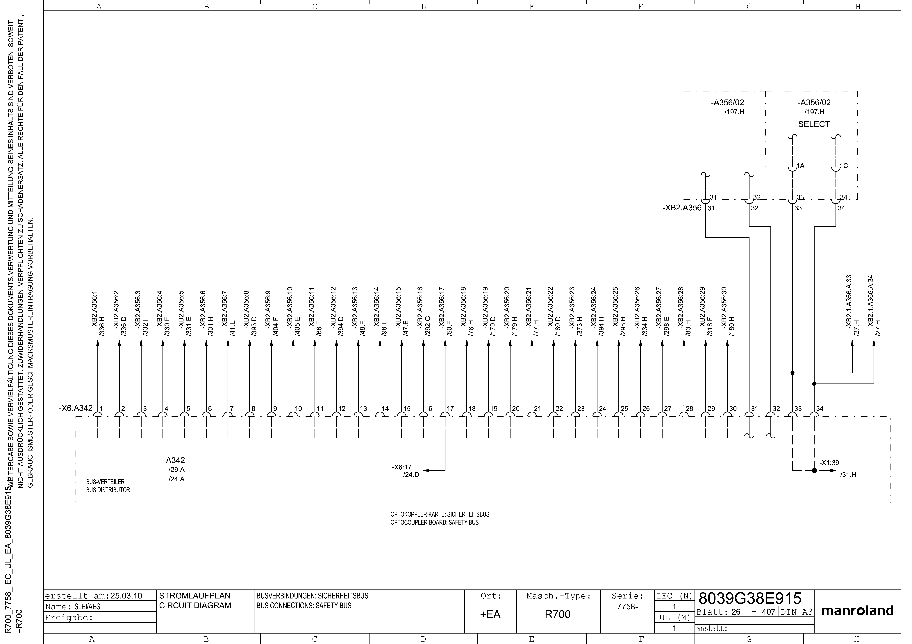

# +EA — Sheet 26 of 407 — BUSVERBINDUNGEN: SICHERHEITSBUS

**BUS CONNECTIONS: SAFETY BUS**

> Part of the manroland **R700** printing press IEC/UL circuit diagrams.
> Drawing class: **Stromlaufplan / Circuit diagram** (DIN A3).
> Document `+EA` covers the **Printing unit** machine section.

## At a glance

| Field | Value |
|---|---|
| Document | `+EA`  (8039G38E915) |
| Sheet | **26** of 407 |
| Section (DE) | BUSVERBINDUNGEN: SICHERHEITSBUS |
| Section (EN) | BUS CONNECTIONS: SAFETY BUS |
| Section type | CIRCUIT — Circuit diagram |
| Machine type | `R700` |
| Series | `7758` |
| Created | 25.03.10 |
| Replaces | — |
| Columns used | A, B, C, D, E, F, G, H |
| Path numbers | — |
| Labels on sheet | 126 |
| Cross-refs out | 38 |
| Cross-refs in | 76 |

**Previous:** [+EA sheet 25](SHEET_0025.md) · **Next:** [+EA sheet 27](SHEET_0027.md) · **Document TOC:** [_TOC.md](_TOC.md)  (+EA) · **Master TOC:** [all sheets](../_MASTER_TOC.md)

## Sheet image (300 DPI, exact vector render)



_Rendered directly from the PDF vector layer at 300 DPI (1-bit), no OCR and no resampling. Use it to confirm anything ambiguous in the text below._

## Cross-references on this sheet

Each entry is a wire leaving this sheet. The printed token is `/sheet.column`; the link resolves to that sheet inside the same document.

| Ref | Target sheet | Col | Path | Destination on target | Target section | From col |
|---|---|---|---|---|---|---|
| `/197.H` | [+EA sheet 197](SHEET_0197.md) | H | — | — | REFERENZMODUL | G |
| `/197.H` | [+EA sheet 197](SHEET_0197.md) | H | — | — | REFERENZMODUL | H |
| `/27.H` | [+EA sheet 27](SHEET_0027.md) | H | — | XB2.1.A356.A:33 | BUSVERBINDUNGEN: SICHERHEITSBUS | H |
| `/27.H` | [+EA sheet 27](SHEET_0027.md) | H | — | XB2.1.A356.A:34 | BUSVERBINDUNGEN: SICHERHEITSBUS | H |
| `/405.E` | [+EA sheet 405](SHEET_0405.md) | E | — | XB2.A356:10 | OPTION: SCHNITTSTELLE UV ENDTROCKNER | C |
| `/68.F` | [+EA sheet 68](SHEET_0068.md) | F | — | XB2.A356:11 | LEITSTANDSFUNKTIONEN | C |
| `/394.D` | [+EA sheet 394](SHEET_0394.md) | D | — | XB2.A356:12 | OPTION: ZWISCHENTROCKNER VORBEREITUNG; | C |
| `/48.F` | [+EA sheet 48](SHEET_0048.md) | F | — | XB2.A356:13 | SCHUTZ | C |
| `/98.E` | [+EA sheet 98](SHEET_0098.md) | E | — | XB2.A356:14 | BOGENFÜHRUNGSELEMENT | D |
| `/47.E` | [+EA sheet 47](SHEET_0047.md) | E | — | XB2.A356:15 | SCHUTZ | D |
| `/292.G` | [+EA sheet 292](SHEET_0292.md) | G | — | XB2.A356:16 | OPTION: PROBEBOGENENTNAHME HALBAUTOMATISCH | D |
| `/50.F` | [+EA sheet 50](SHEET_0050.md) | F | — | XB2.A356:17 | SCHUTZ | D |
| `/76.H` | [+EA sheet 76](SHEET_0076.md) | H | — | XB2.A356:18 | AUSLEGERSTAPELSTEUERUNG | D |
| `/179.D` | [+EA sheet 179](SHEET_0179.md) | D | — | XB2.A356:19 | RESERVE | E |
| `/179.H` | [+EA sheet 179](SHEET_0179.md) | H | — | XB2.A356:20 | RESERVE | E |
| `/77.H` | [+EA sheet 77](SHEET_0077.md) | H | — | XB2.A356:21 | AUSLEGERSTAPELSTEUERUNG | E |
| `/180.D` | [+EA sheet 180](SHEET_0180.md) | D | — | XB2.A356:22 | RESERVE | E |
| `/373.H` | [+EA sheet 373](SHEET_0373.md) | H | — | XB2.A356:23 | OPTION: ENDTROCKNER 1 VORBEREITUNG; | E |
| `/394.H` | [+EA sheet 394](SHEET_0394.md) | H | — | XB2.A356:24 | OPTION: ZWISCHENTROCKNER VORBEREITUNG; | F |
| `/298.H` | [+EA sheet 298](SHEET_0298.md) | H | — | XB2.A356:25 | OPTION: ZWISCHENSTAPEL / | F |
| `/334.H` | [+EA sheet 334](SHEET_0334.md) | H | — | XB2.A356:26 | OPTION: BOGENWEICHE | F |
| `/298.E` | [+EA sheet 298](SHEET_0298.md) | E | — | XB2.A356:27 | OPTION: ZWISCHENSTAPEL / | F |
| `/83.H` | [+EA sheet 83](SHEET_0083.md) | H | — | XB2.A356:28 | AUSLEGERSTAPELSTEUERUNG: PROGRAMMSCHALTWERK | F |
| `/318.F` | [+EA sheet 318](SHEET_0318.md) | F | — | XB2.A356:29 | OPTION: LOGISTIK, AUSLEGER | G |
| `/180.H` | [+EA sheet 180](SHEET_0180.md) | H | — | XB2.A356:30 | RESERVE | G |
| `/336.H` | [+EA sheet 336](SHEET_0336.md) | H | — | XB2.A356:1 | OPTION: BOGENWEICHE | A |
| `/336.D` | [+EA sheet 336](SHEET_0336.md) | D | — | XB2.A356:2 | OPTION: BOGENWEICHE | A |
| `/332.F` | [+EA sheet 332](SHEET_0332.md) | F | — | XB2.A356:3 | OPTION: BOGENWEICHE | A |
| `/330.E` | [+EA sheet 330](SHEET_0330.md) | E | — | XB2.A356:4 | OPTION: BOGENWEICHE | B |
| `/331.E` | [+EA sheet 331](SHEET_0331.md) | E | — | XB2.A356:5 | OPTION: BOGENWEICHE | B |
| `/331.H` | [+EA sheet 331](SHEET_0331.md) | H | — | XB2.A356:6 | OPTION: BOGENWEICHE | B |
| `/41.E` | [+EA sheet 41](SHEET_0041.md) | E | — | XB2.A356:7 | BUSVERBINDUNGEN: STOP SICHERN | B |
| `/393.D` | [+EA sheet 393](SHEET_0393.md) | D | — | XB2.A356:8 | OPTION: ZWISCHENTROCKNER VORBEREITUNG; | B |
| `/404.F` | [+EA sheet 404](SHEET_0404.md) | F | — | XB2.A356:9 | OPTION: SCHNITTSTELLE UV ENDTROCKNER | C |
| `/24.D` | [+EA sheet 24](SHEET_0024.md) | D | — | X6:17 | BUSVERBINDUNGEN: SICHERHEITSBUS | D |
| `/29.A` | [+EA sheet 29](SHEET_0029.md) | A | — | BUS VERTEILER BUS DISTRIBUTOR | BUSVERBINDUNGEN: SICHERHEITSBUS | A |
| `/24.A` | [+EA sheet 24](SHEET_0024.md) | A | — | BUS VERTEILER BUS DISTRIBUTOR | BUSVERBINDUNGEN: SICHERHEITSBUS | A |
| `/31.H` | [+EA sheet 31](SHEET_0031.md) | H | — | — | BUSVERBINDUNGEN: SICHERHEITSBUS | H |

### Incoming references (sheets that point here)

Every other sheet that sends a wire to this one. `Back-ref` is the token printed on *that* sheet; `Path` is its line number.

| From sheet | Cols | Back-ref | Path | Refs | What continues there |
|---|---|---|---|---|---|
| [+EA#24](SHEET_0024.md) | A, E | `/24.A`, `/24.E` | — | 2 | X6:17 |
| [+EA#27](SHEET_0027.md) | H | `/27.H` | — | 2 | XB2.1.A356.A:33; XB2.1.A356.A:34 |
| [+EA#29](SHEET_0029.md) | A | `/29.A` | — | 1 | — |
| [+EA#31](SHEET_0031.md) | H | `/31.H` | — | 1 | X1:39 |
| [+EA#41](SHEET_0041.md) | E | `/41.E` | — | 1 | XB2.A356:7 |
| [+EA#47](SHEET_0047.md) | E | `/47.E` | — | 1 | XB2.A356:15 |
| [+EA#48](SHEET_0048.md) | F | `/48.F` | — | 1 | XB2.A356:13 |
| [+EA#50](SHEET_0050.md) | F | `/50.F` | — | 1 | XB2.A356:17 |
| [+EA#68](SHEET_0068.md) | F | `/68.F` | — | 1 | XB2.A356:11 |
| [+EA#76](SHEET_0076.md) | H | `/76.H` | — | 1 | XB2.A356:18 |
| [+EA#77](SHEET_0077.md) | H | `/77.H` | — | 1 | XB2.A356:21 |
| [+EA#83](SHEET_0083.md) | H | `/83.H` | — | 1 | XB2.A356:28 |
| [+EA#98](SHEET_0098.md) | E | `/98.E` | — | 1 | XB2.A356:14 |
| [+EA#179](SHEET_0179.md) | D, H | `/179.D`, `/179.H` | — | 2 | XB2.A356:19; XB2.A356:20 |
| [+EA#180](SHEET_0180.md) | D, H | `/180.D`, `/180.H` | — | 2 | XB2.A356:22; XB2.A356:30 |
| [+EA#197](SHEET_0197.md) | H | `/197.H` | — | 2 | — |
| [+EA#225](SHEET_0225.md) | G | `/225.G` | — | 4 | — |
| [+EA#245](SHEET_0245.md) | D, E | `/245.D`, `/245.E` | — | 34 | — |
| [+EA#292](SHEET_0292.md) | G | `/292.G` | — | 1 | XB2.A356:16 |
| [+EA#298](SHEET_0298.md) | E, H | `/298.E`, `/298.H` | — | 2 | XB2.A356:25; XB2.A356:27 |
| [+EA#318](SHEET_0318.md) | F | `/318.F` | — | 1 | XB2.A356:29 |
| [+EA#330](SHEET_0330.md) | E | `/330.E` | — | 1 | XB2.A356:4 |
| [+EA#331](SHEET_0331.md) | E, H | `/331.E`, `/331.H` | — | 2 | XB2.A356:5; XB2.A356:6 |
| [+EA#332](SHEET_0332.md) | F | `/332.F` | — | 1 | XB2.A356:3 |
| [+EA#334](SHEET_0334.md) | H | `/334.H` | — | 1 | XB2.A356:26 |
| [+EA#336](SHEET_0336.md) | D, H | `/336.D`, `/336.H` | — | 2 | XB2.A356:1; XB2.A356:2 |
| [+EA#373](SHEET_0373.md) | H | `/373.H` | — | 1 | XB2.A356:23 |
| [+EA#393](SHEET_0393.md) | D | `/393.D` | — | 1 | XB2.A356:8 |
| [+EA#394](SHEET_0394.md) | D, H | `/394.D`, `/394.H` | — | 2 | XB2.A356:12; XB2.A356:24 |
| [+EA#404](SHEET_0404.md) | F | `/404.F` | — | 1 | XB2.A356:9 |
| [+EA#405](SHEET_0405.md) | E | `/405.E` | — | 1 | XB2.A356:10 |


## Devices on this sheet

| Tag | Class | Class meaning (IEC) | Col | Sub | Terminal | Sign |
|---|---|---|---|---|---|---|
| `A342` | A | Baugruppe / assembly, module, PC board | B | — | — | — |
| `A356/02` | A | Baugruppe / assembly, module, PC board | H | 02 | — | — |
| `A356/02` | A | Baugruppe / assembly, module, PC board | G | 02 | — | — |
| `X1:39` | X | Klemme / terminal, plug connector | H | — | 39 | — |
| `X6:17` | X | Klemme / terminal, plug connector | D | — | 17 | — |
| `X6.A342` | — | cross-device reference | A | — | — | — |
| `XB2.A356` | — | cross-device reference | F | — | — | — |
| `XB2.A356:11` | — | cross-device reference | C | — | 11 | — |
| `XB2.A356:10` | — | cross-device reference | C | — | 10 | — |
| `XB2.A356:9` | — | cross-device reference | C | — | 9 | — |
| `XB2.A356:8` | — | cross-device reference | B | — | 8 | — |
| `XB2.A356:12` | — | cross-device reference | C | — | 12 | — |
| `XB2.A356:16` | — | cross-device reference | D | — | 16 | — |
| `XB2.A356:15` | — | cross-device reference | D | — | 15 | — |
| `XB2.A356:14` | — | cross-device reference | D | — | 14 | — |
| `XB2.A356:13` | — | cross-device reference | C | — | 13 | — |
| `XB2.A356:7` | — | cross-device reference | B | — | 7 | — |
| `XB2.A356:6` | — | cross-device reference | B | — | 6 | — |
| `XB2.A356:1` | — | cross-device reference | A | — | 1 | — |
| `XB2.A356:5` | — | cross-device reference | B | — | 5 | — |
| `XB2.A356:4` | — | cross-device reference | B | — | 4 | — |
| `XB2.A356:3` | — | cross-device reference | A | — | 3 | — |
| `XB2.A356:2` | — | cross-device reference | A | — | 2 | — |
| `XB2.1.A356.A:34` | — | cross-device reference | H | — | 34 | — |
| `XB2.1.A356.A:33` | — | cross-device reference | H | — | 33 | — |
| `XB2.A356:17` | — | cross-device reference | D | — | 17 | — |
| `XB2.A356:30` | — | cross-device reference | G | — | 30 | — |
| `XB2.A356:29` | — | cross-device reference | G | — | 29 | — |
| `XB2.A356:28` | — | cross-device reference | F | — | 28 | — |
| `XB2.A356:27` | — | cross-device reference | F | — | 27 | — |
| `XB2.A356:21` | — | cross-device reference | E | — | 21 | — |
| `XB2.A356:20` | — | cross-device reference | E | — | 20 | — |
| `XB2.A356:19` | — | cross-device reference | E | — | 19 | — |
| `XB2.A356:18` | — | cross-device reference | D | — | 18 | — |
| `XB2.A356:22` | — | cross-device reference | E | — | 22 | — |
| `XB2.A356:26` | — | cross-device reference | F | — | 26 | — |
| `XB2.A356:25` | — | cross-device reference | F | — | 25 | — |
| `XB2.A356:24` | — | cross-device reference | F | — | 24 | — |
| `XB2.A356:23` | — | cross-device reference | E | — | 23 | — |

## Potentials / nets

_No named potentials on this sheet._

## Wire-end annotations (grouped as printed)

A wire that continues elsewhere is annotated with a small cluster: the destination description, the path/line number `#NN`, and the `/sheet.column` cross reference. Each row below is one such cluster exactly as it is grouped on the drawing.

| Col | Y | Path | Cross-ref | Text on the wire |
|---|---|---|---|---|
| G | 129.3 | — | — | `A356/02` |
| H | 129.3 | — | — | `A356/02` |
| G | 142.4 | — | `/197.H` | — |
| H | 142.4 | — | `/197.H` | — |
| H | 157.6 | — | — | `SELECT` |
| H | 212.9 | — | — | `1A 1C` |
| G | 254.0 | — | — | `31 32` |
| H | 254.0 | — | — | `33 34` |
| G | 266.8 | — | — | `XB2.A356 31 32` |
| H | 268.2 | — | — | `33 34` |
| H | 359.1 | — | `/27.H` | `XB2.1.A356.A:33` |
| H | 359.1 | — | `/27.H` | `XB2.1.A356.A:34` |
| C | 375.0 | — | `/405.E` | `XB2.A356:10` |
| C | 375.0 | — | `/68.F` | `XB2.A356:11` |
| C | 375.0 | — | `/394.D` | `XB2.A356:12` |
| C | 375.0 | — | `/48.F` | `XB2.A356:13` |
| D | 375.0 | — | `/98.E` | `XB2.A356:14` |
| D | 375.0 | — | `/47.E` | `XB2.A356:15` |
| D | 375.0 | — | `/292.G` | `XB2.A356:16` |
| D | 375.0 | — | `/50.F` | `XB2.A356:17` |
| D | 375.0 | — | `/76.H` | `XB2.A356:18` |
| E | 375.0 | — | `/179.D` | `XB2.A356:19` |
| E | 375.0 | — | `/179.H` | `XB2.A356:20` |
| E | 375.0 | — | `/77.H` | `XB2.A356:21` |
| E | 375.0 | — | `/180.D` | `XB2.A356:22` |
| E | 375.0 | — | `/373.H` | `XB2.A356:23` |
| F | 375.0 | — | `/394.H` | `XB2.A356:24` |
| F | 375.0 | — | `/298.H` | `XB2.A356:25` |
| F | 375.0 | — | `/334.H` | `XB2.A356:26` |
| F | 375.0 | — | `/298.E` | `XB2.A356:27` |
| F | 375.0 | — | `/83.H` | `XB2.A356:28` |
| G | 375.0 | — | `/318.F` | `XB2.A356:29` |
| G | 375.0 | — | `/180.H` | `XB2.A356:30` |
| A | 379.8 | — | `/336.H` | `XB2.A356:1` |
| A | 379.8 | — | `/336.D` | `XB2.A356:2` |
| A | 379.8 | — | `/332.F` | `XB2.A356:3` |
| B | 379.8 | — | `/330.E` | `XB2.A356:4` |
| B | 379.8 | — | `/331.E` | `XB2.A356:5` |
| B | 379.8 | — | `/331.H` | `XB2.A356:6` |
| B | 379.8 | — | `/41.E` | `XB2.A356:7` |
| B | 379.8 | — | `/393.D` | `XB2.A356:8` |
| C | 379.8 | — | `/404.F` | `XB2.A356:9` |
| D | 529.0 | — | — | `X6.A342 1 2 3 4 5 6 7 8 9 10 11 12 13 14 15 16 17 18 19 20 21 22 23 24 25 26 27 28 29 30 31 32 33 34` |
| B | 597.0 | — | — | `A342` |
| H | 601.2 | — | — | `X1:39` |
| D | 606.9 | — | `/24.D` | `X6:17` |
| A | 610.0 | — | `/29.A`, `/24.A` | `BUS VERTEILER BUS DISTRIBUTOR` |
| H | 616.8 | — | `/31.H` | — |
| D | 669.6 | — | — | `OPTOKOPPLER KARTE: SICHERHEITSBUS OPTOCOUPLER BOARD: SAFETY BUS` |


## Reconstructed tables

This sheet carries tabular content (pin map / terminal assignment / index). The grid below was rebuilt from the drawing's own rule lines, so each row is exactly one physical row of the table.

### Table 1 — 4 data rows × 31 columns (at x=127.6, y=119.1) — **A356/02 /197.H**

|  |  |  |  |  |  |  |  |  |  |  |  |  |  |  |  |  |  |  |  |  |  |  |  |  |  |  |  | 31 |  | 32 |
|---|---|---|---|---|---|---|---|---|---|---|---|---|---|---|---|---|---|---|---|---|---|---|---|---|---|---|---|---|---|---|
|  |  |  |  |  |  |  |  |  |  |  |  |  |  |  |  |  |  |  |  |  |  |  |  |  |  | `XB2.A356` |  | `31` |  | `32` |
| `XB2.A356:2 /336.H` | `XB2.A356:3 /336.D` | `XB2.A356:4 /332.F` | `XB2.A356:5 /330.E` | `XB2.A356:6 /331.E` | `XB2.A356:7 /331.H` | `XB2.A356:8 /41.E` | `XB2.A356:9 /393.D` | `XB2.A356:10 /404.F` | `XB2.A356:11 /405.E` | `XB2.A356:12 /68.F` | `XB2.A356:13 /394.D` | `XB2.A356:14 /48.F` | `XB2.A356:15 /98.E` | `XB2.A356:16 /47.E` | `XB2.A356:17 /292.G` | `XB2.A356:18 /50.F` | `XB2.A356:19 /76.H` | `XB2.A356:20 /179.D` | `XB2.A356:21 /179.H` | `XB2.A356:22 /77.H` | `XB2.A356:23 /180.D` | `XB2.A356:24 /373.H` | `XB2.A356:25 /394.H` | `XB2.A356:26 /298.H` | `XB2.A356:27 /334.H` | `XB2.A356:28 /298.E` | `XB2.A356:29 /83.H` | `XB2.A356:30 /318.F` | `/180.H` |  |
| `1` | `2` | `3` | `4` | `5` | `6` | `7` | `8` | `9` | `10` | `11` | `12` | `13` | `14` | `15` | `16` | `17` | `18` | `19` | `20` | `21` | `22` | `23` | `24` | `25` | `26` | `27` | `28` | `29` | `30` | `31` |
|  |  |  | `A342 /29.A` |  |  |  |  |  |  |  |  |  |  | `X6:17` |  |  |  |  |  |  |  |  |  |  |  |  |  |  |  |  |


### Table 2 — 5 data rows × 6 columns (at x=1006.3, y=119.1)

|  | SELECT 1A | A356/02 /197.H | 1C |  |  |
|---|---|---|---|---|---|
|  | `33` |  | `34` |  |  |
|  | `33` |  | `34` |  |  |
|  |  |  | `XB2.1.A356.A:33` | `/27.H` | `XB2.1.A356.A:34` |
| `32` | `33` | `34` |  |  |  |
|  |  | `X1:39` |  |  |  |


## Notes and free text on this sheet

| Text | Col | Y (pt) |
|---|---|---|
| `BUS VERTEILER` | A | 627.07 |
| `BUS DISTRIBUTOR` | A | 637.71 |
| `SELECT` | H | 157.62 |
| `1A` | G | 212.87 |
| `1C` | H | 212.93 |
| `OPTOKOPPLER KARTE: SICHERHEITSBUS` | D | 669.6 |
| `OPTOCOUPLER BOARD: SAFETY BUS` | D | 680.24 |

## Complete label inventory (exact text from the drawing)

Every text object inside the drawing area of this sheet, in DIN reading order (column A→H, then top→bottom). This is the authoritative list: if a string is not here it is not printed on this sheet.

| Col | Y | X | Dir | Type | Text |
|---|---|---|---|---|---|
| A | 379.8 | 119.3 | ↕ | device ref | `XB2.A356:1` |
| A | 379.8 | 147.7 | ↕ | device ref | `XB2.A356:2` |
| A | 379.8 | 176.0 | ↕ | device ref | `XB2.A356:3` |
| A | 413.6 | 129.3 | ↕ | cross-reference | `/336.H` |
| A | 413.6 | 157.6 | ↕ | cross-reference | `/336.D` |
| A | 414.4 | 185.9 | ↕ | cross-reference | `/332.F` |
| A | 529.0 | 76.8 | → | device ref | `X6.A342` |
| A | 530.4 | 129.5 | → | number | `1` |
| A | 530.4 | 158.5 | → | number | `2` |
| A | 530.4 | 186.8 | → | number | `3` |
| A | 627.1 | 112.5 | → | text | `BUS VERTEILER` |
| A | 637.7 | 112.5 | → | text | `BUS DISTRIBUTOR` |
| B | 379.8 | 204.4 | ↕ | device ref | `XB2.A356:4` |
| B | 379.8 | 232.7 | ↕ | device ref | `XB2.A356:5` |
| B | 379.8 | 261.1 | ↕ | device ref | `XB2.A356:6` |
| B | 379.8 | 289.4 | ↕ | device ref | `XB2.A356:7` |
| B | 379.8 | 317.8 | ↕ | device ref | `XB2.A356:8` |
| B | 413.6 | 271.0 | ↕ | cross-reference | `/331.H` |
| B | 413.6 | 327.7 | ↕ | cross-reference | `/393.D` |
| B | 413.9 | 214.3 | ↕ | cross-reference | `/330.E` |
| B | 413.9 | 242.6 | ↕ | cross-reference | `/331.E` |
| B | 418.7 | 299.3 | ↕ | cross-reference | `/41.E` |
| B | 530.4 | 215.1 | → | number | `4` |
| B | 530.4 | 243.5 | → | number | `5` |
| B | 530.4 | 271.8 | → | number | `6` |
| B | 530.4 | 300.2 | → | number | `7` |
| B | 530.4 | 328.5 | → | number | `8` |
| B | 597.0 | 213.2 | → | device tag | `A342` |
| B | 610.1 | 220.3 | → | cross-reference | `/29.A` |
| B | 622.5 | 220.3 | → | cross-reference | `/24.A` |
| C | 375.0 | 374.5 | ↕ | device ref | `XB2.A356:10` |
| C | 375.0 | 402.8 | ↕ | device ref | `XB2.A356:11` |
| C | 375.0 | 431.1 | ↕ | device ref | `XB2.A356:12` |
| C | 375.0 | 459.5 | ↕ | device ref | `XB2.A356:13` |
| C | 379.8 | 346.1 | ↕ | device ref | `XB2.A356:9` |
| C | 413.6 | 441.1 | ↕ | cross-reference | `/394.D` |
| C | 413.9 | 384.4 | ↕ | cross-reference | `/405.E` |
| C | 414.4 | 356.0 | ↕ | cross-reference | `/404.F` |
| C | 419.2 | 412.7 | ↕ | cross-reference | `/68.F` |
| C | 419.2 | 469.4 | ↕ | cross-reference | `/48.F` |
| C | 530.4 | 356.9 | → | number | `9` |
| C | 530.4 | 384.7 | → | number | `10` |
| C | 530.4 | 413.0 | → | number | `11` |
| C | 530.4 | 441.4 | → | number | `12` |
| C | 530.4 | 469.7 | → | number | `13` |
| D | 375.0 | 487.8 | ↕ | device ref | `XB2.A356:14` |
| D | 375.0 | 516.2 | ↕ | device ref | `XB2.A356:15` |
| D | 375.0 | 544.5 | ↕ | device ref | `XB2.A356:16` |
| D | 375.0 | 572.9 | ↕ | device ref | `XB2.A356:17` |
| D | 375.0 | 601.2 | ↕ | device ref | `XB2.A356:18` |
| D | 413.0 | 554.5 | ↕ | cross-reference | `/292.G` |
| D | 418.4 | 611.1 | ↕ | cross-reference | `/76.H` |
| D | 418.7 | 497.7 | ↕ | cross-reference | `/98.E` |
| D | 418.7 | 526.1 | ↕ | cross-reference | `/47.E` |
| D | 419.2 | 582.8 | ↕ | cross-reference | `/50.F` |
| D | 530.4 | 498.0 | → | number | `14` |
| D | 530.4 | 526.4 | → | number | `15` |
| D | 530.4 | 554.7 | → | number | `16` |
| D | 530.4 | 583.1 | → | number | `17` |
| D | 530.4 | 611.4 | → | number | `18` |
| D | 606.9 | 511.7 | → | device tag | `X6:17` |
| D | 616.8 | 526.4 | → | cross-reference | `/24.D` |
| D | 669.6 | 510.0 | → | text | `OPTOKOPPLER KARTE: SICHERHEITSBUS` |
| D | 680.2 | 510.0 | → | text | `OPTOCOUPLER BOARD: SAFETY BUS` |
| E | 375.0 | 629.6 | ↕ | device ref | `XB2.A356:19` |
| E | 375.0 | 657.9 | ↕ | device ref | `XB2.A356:20` |
| E | 375.0 | 686.3 | ↕ | device ref | `XB2.A356:21` |
| E | 375.0 | 714.6 | ↕ | device ref | `XB2.A356:22` |
| E | 375.0 | 743.0 | ↕ | device ref | `XB2.A356:23` |
| E | 413.6 | 639.5 | ↕ | cross-reference | `/179.D` |
| E | 413.6 | 667.8 | ↕ | cross-reference | `/179.H` |
| E | 413.6 | 724.5 | ↕ | cross-reference | `/180.D` |
| E | 413.6 | 752.9 | ↕ | cross-reference | `/373.H` |
| E | 418.4 | 696.2 | ↕ | cross-reference | `/77.H` |
| E | 530.4 | 639.8 | → | number | `19` |
| E | 530.4 | 668.7 | → | number | `20` |
| E | 530.4 | 697.0 | → | number | `21` |
| E | 530.4 | 725.4 | → | number | `22` |
| E | 530.4 | 753.7 | → | number | `23` |
| F | 266.8 | 864.9 | → | device ref | `XB2.A356` |
| F | 375.0 | 771.3 | ↕ | device ref | `XB2.A356:24` |
| F | 375.0 | 799.6 | ↕ | device ref | `XB2.A356:25` |
| F | 375.0 | 828.0 | ↕ | device ref | `XB2.A356:26` |
| F | 375.0 | 856.3 | ↕ | device ref | `XB2.A356:27` |
| F | 375.0 | 884.7 | ↕ | device ref | `XB2.A356:28` |
| F | 413.6 | 781.2 | ↕ | cross-reference | `/394.H` |
| F | 413.6 | 809.6 | ↕ | cross-reference | `/298.H` |
| F | 413.6 | 837.9 | ↕ | cross-reference | `/334.H` |
| F | 413.9 | 866.2 | ↕ | cross-reference | `/298.E` |
| F | 418.4 | 894.6 | ↕ | cross-reference | `/83.H` |
| F | 530.4 | 782.1 | → | number | `24` |
| F | 530.4 | 810.4 | → | number | `25` |
| F | 530.4 | 838.8 | → | number | `26` |
| F | 530.4 | 867.1 | → | number | `27` |
| F | 530.4 | 895.5 | → | number | `28` |
| G | 129.3 | 928.3 | → | device tag | `A356/02` |
| G | 142.4 | 945.9 | → | cross-reference | `/197.H` |
| G | 212.9 | 1039.5 | → | text | `1A` |
| G | 254.0 | 926.6 | → | number | `31` |
| G | 254.0 | 983.3 | → | number | `32` |
| G | 254.0 | 1040.0 | → | number | `33` |
| G | 268.2 | 923.8 | → | number | `31` |
| G | 268.2 | 980.5 | → | number | `32` |
| G | 268.2 | 1037.2 | → | number | `33` |
| G | 375.0 | 913.0 | ↕ | device ref | `XB2.A356:29` |
| G | 375.0 | 941.4 | ↕ | device ref | `XB2.A356:30` |
| G | 413.6 | 951.3 | ↕ | cross-reference | `/180.H` |
| G | 414.4 | 923.0 | ↕ | cross-reference | `/318.F` |
| G | 530.4 | 923.8 | → | number | `29` |
| G | 530.4 | 952.2 | → | number | `30` |
| G | 530.4 | 980.5 | → | number | `31` |
| G | 530.4 | 1008.9 | → | number | `32` |
| G | 530.4 | 1037.2 | → | number | `33` |
| H | 129.3 | 1041.6 | → | device tag | `A356/02` |
| H | 142.4 | 1050.5 | → | cross-reference | `/197.H` |
| H | 157.6 | 1042.2 | → | text | `SELECT` |
| H | 212.9 | 1096.2 | → | text | `1C` |
| H | 254.0 | 1096.7 | → | number | `34` |
| H | 268.2 | 1093.9 | → | number | `34` |
| H | 359.1 | 1104.4 | ↕ | device ref | `XB2.1.A356.A:33` |
| H | 359.1 | 1132.7 | ↕ | device ref | `XB2.1.A356.A:34` |
| H | 418.4 | 1114.3 | ↕ | cross-reference | `/27.H` |
| H | 418.4 | 1142.6 | ↕ | cross-reference | `/27.H` |
| H | 530.4 | 1065.5 | → | number | `34` |
| H | 601.2 | 1069.8 | → | device tag | `X1:39` |
| H | 616.8 | 1097.0 | → | cross-reference | `/31.H` |

## Reading-order text block

The same content as a plain block, grouped by DIN column — convenient to paste or to match against a visual description.

```text
=== Column A ===
 379.8  119.3  devref       XB2.A356:1
 379.8  147.7  devref       XB2.A356:2
 379.8  176.0  devref       XB2.A356:3
 413.6  129.3  xref         /336.H
 413.6  157.6  xref         /336.D
 414.4  185.9  xref         /332.F
 529.0   76.8  devref       X6.A342
 530.4  129.5  numeric      1
 530.4  158.5  numeric      2
 530.4  186.8  numeric      3
 627.1  112.5  text         BUS VERTEILER
 637.7  112.5  text         BUS DISTRIBUTOR
=== Column B ===
 379.8  204.4  devref       XB2.A356:4
 379.8  232.7  devref       XB2.A356:5
 379.8  261.1  devref       XB2.A356:6
 379.8  289.4  devref       XB2.A356:7
 379.8  317.8  devref       XB2.A356:8
 413.6  271.0  xref         /331.H
 413.6  327.7  xref         /393.D
 413.9  214.3  xref         /330.E
 413.9  242.6  xref         /331.E
 418.7  299.3  xref         /41.E
 530.4  215.1  numeric      4
 530.4  243.5  numeric      5
 530.4  271.8  numeric      6
 530.4  300.2  numeric      7
 530.4  328.5  numeric      8
 597.0  213.2  devtag       A342
 610.1  220.3  xref         /29.A
 622.5  220.3  xref         /24.A
=== Column C ===
 375.0  374.5  devref       XB2.A356:10
 375.0  402.8  devref       XB2.A356:11
 375.0  431.1  devref       XB2.A356:12
 375.0  459.5  devref       XB2.A356:13
 379.8  346.1  devref       XB2.A356:9
 413.6  441.1  xref         /394.D
 413.9  384.4  xref         /405.E
 414.4  356.0  xref         /404.F
 419.2  412.7  xref         /68.F
 419.2  469.4  xref         /48.F
 530.4  356.9  numeric      9
 530.4  384.7  numeric      10
 530.4  413.0  numeric      11
 530.4  441.4  numeric      12
 530.4  469.7  numeric      13
=== Column D ===
 375.0  487.8  devref       XB2.A356:14
 375.0  516.2  devref       XB2.A356:15
 375.0  544.5  devref       XB2.A356:16
 375.0  572.9  devref       XB2.A356:17
 375.0  601.2  devref       XB2.A356:18
 413.0  554.5  xref         /292.G
 418.4  611.1  xref         /76.H
 418.7  497.7  xref         /98.E
 418.7  526.1  xref         /47.E
 419.2  582.8  xref         /50.F
 530.4  498.0  numeric      14
 530.4  526.4  numeric      15
 530.4  554.7  numeric      16
 530.4  583.1  numeric      17
 530.4  611.4  numeric      18
 606.9  511.7  devtag       X6:17
 616.8  526.4  xref         /24.D
 669.6  510.0  text         OPTOKOPPLER KARTE: SICHERHEITSBUS
 680.2  510.0  text         OPTOCOUPLER BOARD: SAFETY BUS
=== Column E ===
 375.0  629.6  devref       XB2.A356:19
 375.0  657.9  devref       XB2.A356:20
 375.0  686.3  devref       XB2.A356:21
 375.0  714.6  devref       XB2.A356:22
 375.0  743.0  devref       XB2.A356:23
 413.6  639.5  xref         /179.D
 413.6  667.8  xref         /179.H
 413.6  724.5  xref         /180.D
 413.6  752.9  xref         /373.H
 418.4  696.2  xref         /77.H
 530.4  639.8  numeric      19
 530.4  668.7  numeric      20
 530.4  697.0  numeric      21
 530.4  725.4  numeric      22
 530.4  753.7  numeric      23
=== Column F ===
 266.8  864.9  devref       XB2.A356
 375.0  771.3  devref       XB2.A356:24
 375.0  799.6  devref       XB2.A356:25
 375.0  828.0  devref       XB2.A356:26
 375.0  856.3  devref       XB2.A356:27
 375.0  884.7  devref       XB2.A356:28
 413.6  781.2  xref         /394.H
 413.6  809.6  xref         /298.H
 413.6  837.9  xref         /334.H
 413.9  866.2  xref         /298.E
 418.4  894.6  xref         /83.H
 530.4  782.1  numeric      24
 530.4  810.4  numeric      25
 530.4  838.8  numeric      26
 530.4  867.1  numeric      27
 530.4  895.5  numeric      28
=== Column G ===
 129.3  928.3  devtag       A356/02
 142.4  945.9  xref         /197.H
 212.9 1039.5  text         1A
 254.0  926.6  numeric      31
 254.0  983.3  numeric      32
 254.0 1040.0  numeric      33
 268.2  923.8  numeric      31
 268.2  980.5  numeric      32
 268.2 1037.2  numeric      33
 375.0  913.0  devref       XB2.A356:29
 375.0  941.4  devref       XB2.A356:30
 413.6  951.3  xref         /180.H
 414.4  923.0  xref         /318.F
 530.4  923.8  numeric      29
 530.4  952.2  numeric      30
 530.4  980.5  numeric      31
 530.4 1008.9  numeric      32
 530.4 1037.2  numeric      33
=== Column H ===
 129.3 1041.6  devtag       A356/02
 142.4 1050.5  xref         /197.H
 157.6 1042.2  text         SELECT
 212.9 1096.2  text         1C
 254.0 1096.7  numeric      34
 268.2 1093.9  numeric      34
 359.1 1104.4  devref       XB2.1.A356.A:33
 359.1 1132.7  devref       XB2.1.A356.A:34
 418.4 1114.3  xref         /27.H
 418.4 1142.6  xref         /27.H
 530.4 1065.5  numeric      34
 601.2 1069.8  devtag       X1:39
 616.8 1097.0  xref         /31.H
```

---
_Generated from the PDF vector text layer; no OCR. Source: `R700_7758_IEC_UL_EA_8039G38E915_p`, sheet 26._
