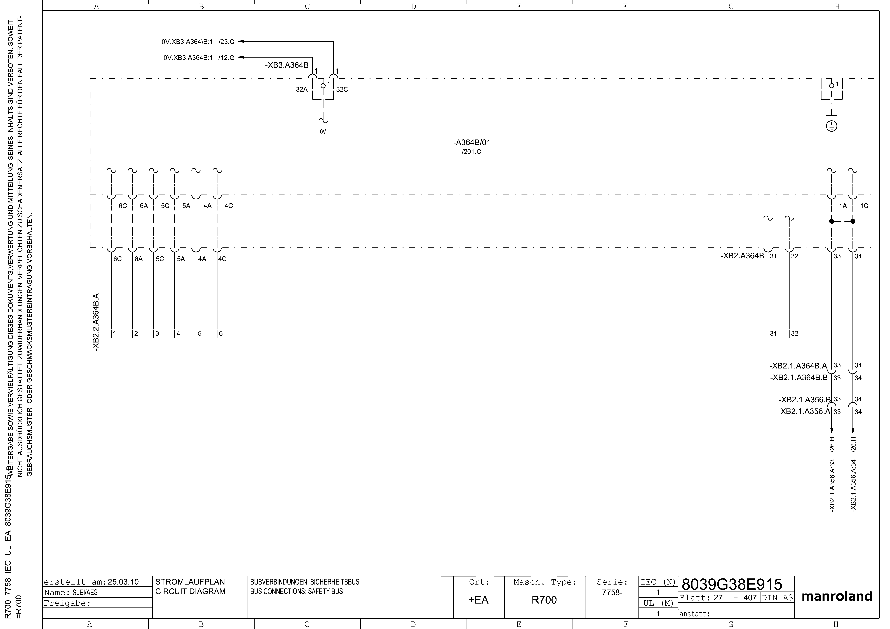

# +EA — Sheet 27 of 407 — BUSVERBINDUNGEN: SICHERHEITSBUS

**BUS CONNECTIONS: SAFETY BUS**

> Part of the manroland **R700** printing press IEC/UL circuit diagrams.
> Drawing class: **Stromlaufplan / Circuit diagram** (DIN A3).
> Document `+EA` covers the **Printing unit** machine section.

## At a glance

| Field | Value |
|---|---|
| Document | `+EA`  (8039G38E915) |
| Sheet | **27** of 407 |
| Section (DE) | BUSVERBINDUNGEN: SICHERHEITSBUS |
| Section (EN) | BUS CONNECTIONS: SAFETY BUS |
| Section type | CIRCUIT — Circuit diagram |
| Machine type | `R700` |
| Series | `7758` |
| Created | 25.03.10 |
| Replaces | — |
| Columns used | A, B, C, E, G, H |
| Path numbers | — |
| Labels on sheet | 58 |
| Cross-refs out | 5 |
| Cross-refs in | 33 |

**Previous:** [+EA sheet 26](SHEET_0026.md) · **Next:** [+EA sheet 28](SHEET_0028.md) · **Document TOC:** [_TOC.md](_TOC.md)  (+EA) · **Master TOC:** [all sheets](../_MASTER_TOC.md)

## Sheet image (300 DPI, exact vector render)



_Rendered directly from the PDF vector layer at 300 DPI (1-bit), no OCR and no resampling. Use it to confirm anything ambiguous in the text below._

## Cross-references on this sheet

Each entry is a wire leaving this sheet. The printed token is `/sheet.column`; the link resolves to that sheet inside the same document.

| Ref | Target sheet | Col | Path | Destination on target | Target section | From col |
|---|---|---|---|---|---|---|
| `/25.C` | [+EA sheet 25](SHEET_0025.md) | C | — | 0V.XB3.A364\B:1 | BUSVERBINDUNGEN: SICHERHEITSBUS | B |
| `/12.G` | [+EA sheet 12](SHEET_0012.md) | G | — | 0V.XB3.A364B:1 | SPANNUNGSVERSORGUNG: 400V, 24V | B |
| `/201.C` | [+EA sheet 201](SHEET_0201.md) | C | — | — | REFERENZMODUL | E |
| `/26.H` | [+EA sheet 26](SHEET_0026.md) | H | — | XB2.1.A356.A:33 | BUSVERBINDUNGEN: SICHERHEITSBUS | H |
| `/26.H` | [+EA sheet 26](SHEET_0026.md) | H | — | XB2.1.A356.A:34 | BUSVERBINDUNGEN: SICHERHEITSBUS | H |

### Incoming references (sheets that point here)

Every other sheet that sends a wire to this one. `Back-ref` is the token printed on *that* sheet; `Path` is its line number.

| From sheet | Cols | Back-ref | Path | Refs | What continues there |
|---|---|---|---|---|---|
| [+EA#12](SHEET_0012.md) | G | `/12.G` | — | 1 | 0V.XB3.A364B:1 |
| [+EA#25](SHEET_0025.md) | C | `/25.C` | — | 1 | 0V.XB3.A364\B:1 |
| [+EA#26](SHEET_0026.md) | H | `/26.H` | — | 2 | XB2.1.A356.A:33; XB2.1.A356.A:34 |
| [+EA#201](SHEET_0201.md) | C | `/201.C` | — | 1 | — |
| [+EA#226](SHEET_0226.md) | B, D | `/226.B`, `/226.D` | — | 4 | — |
| [+EA#227](SHEET_0227.md) | C | `/227.C` | — | 4 | — |
| [+EA#229](SHEET_0229.md) | B, C, D | `/229.B`, `/229.C`, `/229.D` | — | 20 | — |


## Devices on this sheet

| Tag | Class | Class meaning (IEC) | Col | Sub | Terminal | Sign |
|---|---|---|---|---|---|---|
| `XB3.A364B` | — | cross-device reference | C | — | — | — |
| `XB2.A364B` | — | cross-device reference | G | — | — | — |
| `XB2.2.A364B.A` | — | cross-device reference | A | — | — | — |
| `XB2.1.A364B.A` | — | cross-device reference | H | — | — | — |
| `XB2.1.A364B.B` | — | cross-device reference | H | — | — | — |
| `XB2.1.A356.B` | — | cross-device reference | H | — | — | — |
| `XB2.1.A356.A` | — | cross-device reference | H | — | — | — |
| `XB2.1.A356.A:34` | — | cross-device reference | H | — | 34 | — |
| `XB2.1.A356.A:33` | — | cross-device reference | H | — | 33 | — |

## Potentials / nets

| Potential | Count | Columns | Attached devices | Terminals |
|---|---|---|---|---|
| `0V` | 2 | B, C | `A364B`, `XB3` | `1` |


A potential such as `L24+/4` or `M24+` is a named supply/return rail; every place it appears on this sheet is electrically common.

## Wire-end annotations (grouped as printed)

A wire that continues elsewhere is annotated with a small cluster: the destination description, the path/line number `#NN`, and the `/sheet.column` cross reference. Each row below is one such cluster exactly as it is grouped on the drawing.

| Col | Y | Path | Cross-ref | Text on the wire |
|---|---|---|---|---|
| B | 52.0 | — | `/25.C` | `0V.XB3.A364\B:1` |
| B | 73.2 | — | `/12.G` | `0V.XB3.A364B:1` |
| C | 82.5 | — | — | `XB3.A364B 1` |
| C | 91.0 | — | — | `1` |
| C | 108.8 | — | — | `32A 1 32C` |
| H | 108.8 | — | — | `1` |
| C | 173.5 | — | — | `0V` |
| E | 186.0 | — | — | `A364B/01` |
| E | 199.1 | — | `/201.C` | — |
| B | 271.7 | — | — | `6C 6A 5C 5A 4A 4C` |
| H | 271.7 | — | — | `1A 1C` |
| H | 337.6 | — | — | `XB2.A364B 31 32 33 34` |
| B | 342.6 | — | — | `6C 6A 5C 5A 4A 4C` |
| A | 392.6 | — | — | `XB2.2.A364B.A` |
| D | 442.5 | — | — | `1 2 3 4 5 6 31 32` |
| H | 485.0 | — | — | `XB2.1.A364B.A 33` |
| H | 485.1 | — | — | `34` |
| H | 500.6 | — | — | `XB2.1.A364B.B 33` |
| H | 502.1 | — | — | `34` |
| H | 530.4 | — | — | `XB2.1.A356.B 33` |
| H | 530.4 | — | — | `34` |
| H | 546.0 | — | — | `XB2.1.A356.A 33` |
| H | 547.4 | — | — | `34` |
| H | 584.5 | — | `/26.H` | `XB2.1.A356.A:33` |
| H | 584.5 | — | `/26.H` | `XB2.1.A356.A:34` |


## Reconstructed tables

This sheet carries tabular content (pin map / terminal assignment / index). The grid below was rebuilt from the drawing's own rule lines, so each row is exactly one physical row of the table.

### Table 1 — 0 data rows × 2 columns (at x=1112.6, y=104.9) — **1**

_none_


## Notes and free text on this sheet

| Text | Col | Y (pt) |
|---|---|---|
| `6C` | A | 271.75 |
| `6A` | A | 271.69 |
| `5C` | B | 271.75 |
| `5A` | B | 271.69 |
| `4A` | B | 271.69 |
| `4C` | B | 271.75 |
| `32C` | C | 115.84 |
| `32A` | C | 115.8 |
| `1A` | H | 271.69 |
| `1C` | H | 271.75 |
| `A364B/01` | E | 185.97 |
| `0V.XB3.A364\B:1` | B | 51.99 |

## Complete label inventory (exact text from the drawing)

Every text object inside the drawing area of this sheet, in DIN reading order (column A→H, then top→bottom). This is the authoritative list: if a string is not here it is not printed on this sheet.

| Col | Y | X | Dir | Type | Text |
|---|---|---|---|---|---|
| A | 271.7 | 158.9 | → | text | `6C` |
| A | 271.7 | 187.2 | → | text | `6A` |
| A | 342.6 | 151.8 | → | text | `6C` |
| A | 342.6 | 180.1 | → | text | `6A` |
| A | 392.6 | 123.6 | ↕ | device ref | `XB2.2.A364B.A` |
| A | 442.5 | 150.8 | → | number | `1` |
| A | 442.5 | 179.7 | → | number | `2` |
| B | 52.0 | 216.3 | → | text | `0V.XB3.A364\B:1` |
| B | 52.0 | 292.5 | → | cross-reference | `/25.C` |
| B | 73.3 | 218.8 | → | potential | `0V.XB3.A364B:1` |
| B | 73.3 | 292.3 | → | cross-reference | `/12.G` |
| B | 271.7 | 215.6 | → | text | `5C` |
| B | 271.7 | 243.9 | → | text | `5A` |
| B | 271.7 | 272.3 | → | text | `4A` |
| B | 271.7 | 300.6 | → | text | `4C` |
| B | 342.6 | 208.5 | → | text | `5C` |
| B | 342.6 | 236.8 | → | text | `5A` |
| B | 342.6 | 265.2 | → | text | `4A` |
| B | 342.6 | 292.1 | → | text | `4C` |
| B | 442.5 | 208.1 | → | number | `3` |
| B | 442.5 | 236.4 | → | number | `4` |
| B | 442.5 | 264.8 | → | number | `5` |
| B | 442.5 | 293.1 | → | number | `6` |
| C | 82.5 | 354.6 | → | device ref | `XB3.A364B` |
| C | 91.0 | 419.8 | → | number | `1` |
| C | 91.0 | 448.2 | → | number | `1` |
| C | 108.7 | 437.4 | → | number | `1` |
| C | 115.8 | 396.0 | → | text | `32A` |
| C | 115.8 | 449.9 | → | text | `32C` |
| C | 173.5 | 428.3 | → | potential | `0V` |
| E | 186.0 | 606.5 | → | text | `A364B/01` |
| E | 199.1 | 618.0 | → | cross-reference | `/201.C` |
| G | 337.6 | 964.1 | → | device ref | `XB2.A364B` |
| G | 339.1 | 1030.1 | → | number | `31` |
| G | 442.5 | 1030.1 | → | number | `31` |
| H | 108.7 | 1117.7 | → | number | `1` |
| H | 271.7 | 1122.4 | → | text | `1A` |
| H | 271.7 | 1150.7 | → | text | `1C` |
| H | 339.1 | 1058.5 | → | number | `32` |
| H | 339.1 | 1115.1 | → | number | `33` |
| H | 339.1 | 1143.5 | → | number | `34` |
| H | 442.5 | 1058.5 | → | number | `32` |
| H | 485.0 | 1029.5 | → | device ref | `XB2.1.A364B.A` |
| H | 485.0 | 1115.1 | → | number | `33` |
| H | 485.0 | 1143.5 | → | number | `34` |
| H | 500.6 | 1030.4 | → | device ref | `XB2.1.A364B.B` |
| H | 502.1 | 1115.1 | → | number | `33` |
| H | 502.1 | 1143.5 | → | number | `34` |
| H | 530.4 | 1041.7 | → | device ref | `XB2.1.A356.B` |
| H | 530.4 | 1115.1 | → | number | `33` |
| H | 530.4 | 1143.5 | → | number | `34` |
| H | 546.0 | 1040.9 | → | device ref | `XB2.1.A356.A` |
| H | 547.4 | 1115.1 | → | number | `33` |
| H | 547.4 | 1143.5 | → | number | `34` |
| H | 584.5 | 1109.3 | ↕ | cross-reference | `/26.H` |
| H | 584.5 | 1137.7 | ↕ | cross-reference | `/26.H` |
| H | 614.8 | 1109.3 | ↕ | device ref | `XB2.1.A356.A:33` |
| H | 614.8 | 1137.7 | ↕ | device ref | `XB2.1.A356.A:34` |

## Reading-order text block

The same content as a plain block, grouped by DIN column — convenient to paste or to match against a visual description.

```text
=== Column A ===
 271.7  158.9  text         6C
 271.7  187.2  text         6A
 342.6  151.8  text         6C
 342.6  180.1  text         6A
 392.6  123.6  devref       XB2.2.A364B.A
 442.5  150.8  numeric      1
 442.5  179.7  numeric      2
=== Column B ===
  52.0  216.3  text         0V.XB3.A364\B:1
  52.0  292.5  xref         /25.C
  73.3  218.8  net          0V.XB3.A364B:1
  73.3  292.3  xref         /12.G
 271.7  215.6  text         5C
 271.7  243.9  text         5A
 271.7  272.3  text         4A
 271.7  300.6  text         4C
 342.6  208.5  text         5C
 342.6  236.8  text         5A
 342.6  265.2  text         4A
 342.6  292.1  text         4C
 442.5  208.1  numeric      3
 442.5  236.4  numeric      4
 442.5  264.8  numeric      5
 442.5  293.1  numeric      6
=== Column C ===
  82.5  354.6  devref       XB3.A364B
  91.0  419.8  numeric      1
  91.0  448.2  numeric      1
 108.7  437.4  numeric      1
 115.8  396.0  text         32A
 115.8  449.9  text         32C
 173.5  428.3  net          0V
=== Column E ===
 186.0  606.5  text         A364B/01
 199.1  618.0  xref         /201.C
=== Column G ===
 337.6  964.1  devref       XB2.A364B
 339.1 1030.1  numeric      31
 442.5 1030.1  numeric      31
=== Column H ===
 108.7 1117.7  numeric      1
 271.7 1122.4  text         1A
 271.7 1150.7  text         1C
 339.1 1058.5  numeric      32
 339.1 1115.1  numeric      33
 339.1 1143.5  numeric      34
 442.5 1058.5  numeric      32
 485.0 1029.5  devref       XB2.1.A364B.A
 485.0 1115.1  numeric      33
 485.0 1143.5  numeric      34
 500.6 1030.4  devref       XB2.1.A364B.B
 502.1 1115.1  numeric      33
 502.1 1143.5  numeric      34
 530.4 1041.7  devref       XB2.1.A356.B
 530.4 1115.1  numeric      33
 530.4 1143.5  numeric      34
 546.0 1040.9  devref       XB2.1.A356.A
 547.4 1115.1  numeric      33
 547.4 1143.5  numeric      34
 584.5 1109.3  xref         /26.H
 584.5 1137.7  xref         /26.H
 614.8 1109.3  devref       XB2.1.A356.A:33
 614.8 1137.7  devref       XB2.1.A356.A:34
```

---
_Generated from the PDF vector text layer; no OCR. Source: `R700_7758_IEC_UL_EA_8039G38E915_p`, sheet 27._
