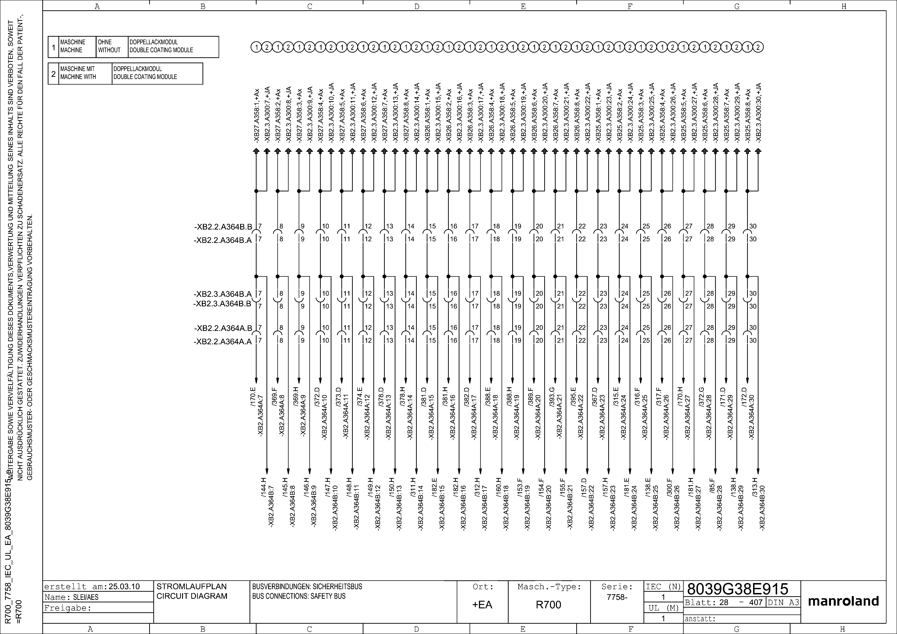

# +EA — Sheet 28 of 407 — BUSVERBINDUNGEN: SICHERHEITSBUS

**BUS CONNECTIONS: SAFETY BUS**

> Part of the manroland **R700** printing press IEC/UL circuit diagrams.
> Drawing class: **Stromlaufplan / Circuit diagram** (DIN A3).
> Document `+EA` covers the **Printing unit** machine section.

## At a glance

| Field | Value |
|---|---|
| Document | `+EA`  (8039G38E915) |
| Sheet | **28** of 407 |
| Section (DE) | BUSVERBINDUNGEN: SICHERHEITSBUS |
| Section (EN) | BUS CONNECTIONS: SAFETY BUS |
| Section type | CIRCUIT — Circuit diagram |
| Machine type | `R700` |
| Series | `7758` |
| Created | 25.03.10 |
| Replaces | — |
| Columns used | A, B, C, D, E, F, G |
| Path numbers | — |
| Labels on sheet | 354 |
| Cross-refs out | 48 |
| Cross-refs in | 192 |

**Previous:** [+EA sheet 27](SHEET_0027.md) · **Next:** [+EA sheet 29](SHEET_0029.md) · **Document TOC:** [_TOC.md](_TOC.md)  (+EA) · **Master TOC:** [all sheets](../_MASTER_TOC.md)

## Sheet image (300 DPI, exact vector render)



_Rendered directly from the PDF vector layer at 300 DPI (1-bit), no OCR and no resampling. Use it to confirm anything ambiguous in the text below._

## Cross-references on this sheet

Each entry is a wire leaving this sheet. The printed token is `/sheet.column`; the link resolves to that sheet inside the same document.

| Ref | Target sheet | Col | Path | Destination on target | Target section | From col |
|---|---|---|---|---|---|---|
| `/369.H` | [+EA sheet 369](SHEET_0369.md) | H | — | — | OPTION: ENDTROCKNER 1 VORBEREITUNG; | C |
| `/378.H` | [+EA sheet 378](SHEET_0378.md) | H | — | — | OPTION: ENDTROCKNER 2 VORBEREITUNG | D |
| `/381.H` | [+EA sheet 381](SHEET_0381.md) | H | — | — | OPTION: ENDTROCKNER 2 VORBEREITUNG | D |
| `/388.H` | [+EA sheet 388](SHEET_0388.md) | H | — | — | OPTION: ZWISCHENTROCKNER VORBEREITUNG; | E |
| `/170.H` | [+EA sheet 170](SHEET_0170.md) | H | — | — | RESERVE | F |
| `/170.E` | [+EA sheet 170](SHEET_0170.md) | E | — | — | RESERVE | B |
| `/374.E` | [+EA sheet 374](SHEET_0374.md) | E | — | — | OPTION: ENDTROCKNER 1 VORBEREITUNG; | C |
| `/388.E` | [+EA sheet 388](SHEET_0388.md) | E | — | — | OPTION: ZWISCHENTROCKNER VORBEREITUNG; | E |
| `/393.G` | [+EA sheet 393](SHEET_0393.md) | G | — | — | OPTION: ZWISCHENTROCKNER VORBEREITUNG; | E |
| `/395.E` | [+EA sheet 395](SHEET_0395.md) | E | — | — | OPTION: ZWISCHENTROCKNER VORBEREITUNG; | E |
| `/315.E` | [+EA sheet 315](SHEET_0315.md) | E | — | — | OPTION: LOGISTIK, AUSLEGER | F |
| `/372.G` | [+EA sheet 372](SHEET_0372.md) | G | — | — | OPTION: ENDTROCKNER 1 VORBEREITUNG; | G |
| `/369.F` | [+EA sheet 369](SHEET_0369.md) | F | — | — | OPTION: ENDTROCKNER 1 VORBEREITUNG; | C |
| `/372.D` | [+EA sheet 372](SHEET_0372.md) | D | — | — | OPTION: ENDTROCKNER 1 VORBEREITUNG; | C |
| `/373.D` | [+EA sheet 373](SHEET_0373.md) | D | — | — | OPTION: ENDTROCKNER 1 VORBEREITUNG; | C |
| `/378.D` | [+EA sheet 378](SHEET_0378.md) | D | — | — | OPTION: ENDTROCKNER 2 VORBEREITUNG | D |
| `/381.D` | [+EA sheet 381](SHEET_0381.md) | D | — | — | OPTION: ENDTROCKNER 2 VORBEREITUNG | D |
| `/382.D` | [+EA sheet 382](SHEET_0382.md) | D | — | — | OPTION: ENDTROCKNER 2 VORBEREITUNG | D |
| `/389.F` | [+EA sheet 389](SHEET_0389.md) | F | — | — | OPTION: ZWISCHENTROCKNER VORBEREITUNG; | E |
| `/367.D` | [+EA sheet 367](SHEET_0367.md) | D | — | — | OPTION: TROCKNER VORBEREITUNG; | F |
| `/316.F` | [+EA sheet 316](SHEET_0316.md) | F | — | — | OPTION: LOGISTIK, AUSLEGER | F |
| `/317.F` | [+EA sheet 317](SHEET_0317.md) | F | — | — | OPTION: LOGISTIK, AUSLEGER | F |
| `/171.D` | [+EA sheet 171](SHEET_0171.md) | D | — | — | RESERVE | G |
| `/172.D` | [+EA sheet 172](SHEET_0172.md) | D | — | — | RESERVE | G |
| `/144.H` | [+EA sheet 144](SHEET_0144.md) | H | — | — | ZUGANGSABSICHERUNG | C |
| `/145.H` | [+EA sheet 145](SHEET_0145.md) | H | — | — | ZUGANGSABSICHERUNG | C |
| `/146.H` | [+EA sheet 146](SHEET_0146.md) | H | — | — | ZUGANGSABSICHERUNG | C |
| `/147.H` | [+EA sheet 147](SHEET_0147.md) | H | — | — | ZUGANGSABSICHERUNG | C |
| `/148.H` | [+EA sheet 148](SHEET_0148.md) | H | — | — | ZUGANGSABSICHERUNG | C |
| `/149.H` | [+EA sheet 149](SHEET_0149.md) | H | — | — | ZUGANGSABSICHERUNG | D |
| `/150.H` | [+EA sheet 150](SHEET_0150.md) | H | — | — | ZUGANGSABSICHERUNG | D |
| `/311.H` | [+EA sheet 311](SHEET_0311.md) | H | — | — | OPTION: AUTOMATISCHE STAPELAUFFAHRT STOP / | D |
| `/182.H` | [+EA sheet 182](SHEET_0182.md) | H | — | — | RESERVE | D |
| `/312.H` | [+EA sheet 312](SHEET_0312.md) | H | — | — | OPTION: LOGISTIK, AUSLEGER | E |
| `/160.H` | [+EA sheet 160](SHEET_0160.md) | H | — | — | ZUGANGSABSICHERUNG | E |
| `/157.H` | [+EA sheet 157](SHEET_0157.md) | H | — | — | ZUGANGSABSICHERUNG | F |
| `/181.H` | [+EA sheet 181](SHEET_0181.md) | H | — | — | RESERVE | G |
| `/138.H` | [+EA sheet 138](SHEET_0138.md) | H | — | — | ZUGANGSABSICHERUNG | G |
| `/313.H` | [+EA sheet 313](SHEET_0313.md) | H | — | — | OPTION: LOGISTIK, AUSLEGER | G |
| `/182.E` | [+EA sheet 182](SHEET_0182.md) | E | — | — | RESERVE | D |
| `/181.E` | [+EA sheet 181](SHEET_0181.md) | E | — | — | RESERVE | F |
| `/138.E` | [+EA sheet 138](SHEET_0138.md) | E | — | — | ZUGANGSABSICHERUNG | F |
| `/153.F` | [+EA sheet 153](SHEET_0153.md) | F | — | — | ZUGANGSABSICHERUNG | E |
| `/154.F` | [+EA sheet 154](SHEET_0154.md) | F | — | — | ZUGANGSABSICHERUNG | E |
| `/155.F` | [+EA sheet 155](SHEET_0155.md) | F | — | — | ZUGANGSABSICHERUNG | E |
| `/157.D` | [+EA sheet 157](SHEET_0157.md) | D | — | — | ZUGANGSABSICHERUNG | F |
| `/300.F` | [+EA sheet 300](SHEET_0300.md) | F | — | — | OPTION: ZWISCHENSTAPEL / | F |
| `/85.F` | [+EA sheet 85](SHEET_0085.md) | F | — | — | AUSLEGERSTAPELSTEUERUNG: PROGRAMMSCHALTWERK | G |

### Incoming references (sheets that point here)

Every other sheet that sends a wire to this one. `Back-ref` is the token printed on *that* sheet; `Path` is its line number.

| From sheet | Cols | Back-ref | Path | Refs | What continues there |
|---|---|---|---|---|---|
| [+EA#85](SHEET_0085.md) | F | `/85.F` | — | 1 | XB2.A364B:28 |
| [+EA#138](SHEET_0138.md) | E, H | `/138.E`, `/138.H` | — | 2 | XB2.A364B:25; XB2.A364B:29 |
| [+EA#144](SHEET_0144.md) | H | `/144.H` | — | 1 | XB2.A364B:7 |
| [+EA#145](SHEET_0145.md) | H | `/145.H` | — | 1 | XB2.A364B:8 |
| [+EA#146](SHEET_0146.md) | H | `/146.H` | — | 1 | XB2.A364B:9 |
| [+EA#147](SHEET_0147.md) | H | `/147.H` | — | 1 | XB2.A364B:10 |
| [+EA#148](SHEET_0148.md) | H | `/148.H` | — | 1 | XB2.A364B:11 |
| [+EA#149](SHEET_0149.md) | H | `/149.H` | — | 1 | XB2.A364B:12 |
| [+EA#150](SHEET_0150.md) | H | `/150.H` | — | 1 | XB2.A364B:13 |
| [+EA#153](SHEET_0153.md) | F | `/153.F` | — | 1 | XB2.A364B:19 |
| [+EA#154](SHEET_0154.md) | F | `/154.F` | — | 1 | XB2.A364B:20 |
| [+EA#155](SHEET_0155.md) | F | `/155.F` | — | 1 | XB2.A364B:21 |
| [+EA#157](SHEET_0157.md) | D, H | `/157.D`, `/157.H` | — | 2 | XB2.A364B:22; XB2.A364B:23 |
| [+EA#160](SHEET_0160.md) | H | `/160.H` | — | 1 | XB2.A364B:18 |
| [+EA#170](SHEET_0170.md) | E, H | `/170.E`, `/170.H` | — | 2 | XB2.A364A:27; XB2.A364A:7 |
| [+EA#171](SHEET_0171.md) | D | `/171.D` | — | 1 | XB2.A364A:29 |
| [+EA#172](SHEET_0172.md) | D | `/172.D` | — | 1 | XB2.A364A:30 |
| [+EA#181](SHEET_0181.md) | E, H | `/181.E`, `/181.H` | — | 2 | XB2.A364B:24; XB2.A364B:27 |
| [+EA#182](SHEET_0182.md) | D, H | `/182.D`, `/182.H` | — | 2 | XB2.A364B:15; XB2.A364B:16 |
| [+EA#228](SHEET_0228.md) | A, B, C, D | `/228.A`, `/228.B`, `/228.C`, `/228.D` | — | 96 | — |
| [+EA#229](SHEET_0229.md) | C, D | `/229.C`, `/229.D` | — | 48 | — |
| [+EA#300](SHEET_0300.md) | F | `/300.F` | — | 1 | XB2.A364B:26 |
| [+EA#311](SHEET_0311.md) | H | `/311.H` | — | 1 | XB2.A364B:14 |
| [+EA#312](SHEET_0312.md) | H | `/312.H` | — | 1 | XB2.A364B:17 |
| [+EA#313](SHEET_0313.md) | H | `/313.H` | — | 1 | XB2.A364B:30 |
| [+EA#315](SHEET_0315.md) | E | `/315.E` | — | 1 | XB2.A364A:24 |
| [+EA#316](SHEET_0316.md) | F | `/316.F` | — | 1 | XB2.A364A:25 |
| [+EA#317](SHEET_0317.md) | F | `/317.F` | — | 1 | XB2.A364A:26 |
| [+EA#367](SHEET_0367.md) | D | `/367.D` | — | 1 | XB2.A364A:23 |
| [+EA#369](SHEET_0369.md) | F, H | `/369.F`, `/369.H` | — | 2 | XB2.A364A:8; XB2.A364A:9 |
| [+EA#372](SHEET_0372.md) | D, G | `/372.D`, `/372.G` | — | 2 | XB2.A364A:10; XB2.A364A:28 |
| [+EA#373](SHEET_0373.md) | D | `/373.D` | — | 1 | XB2.A364A:11 |
| [+EA#374](SHEET_0374.md) | E | `/374.E` | — | 1 | XB2.A364A:12 |
| [+EA#378](SHEET_0378.md) | D, H | `/378.D`, `/378.H` | — | 2 | XB2.A364A:13; XB2.A364A:14 |
| [+EA#381](SHEET_0381.md) | D, H | `/381.D`, `/381.H` | — | 2 | XB2.A364A:15; XB2.A364A:16 |
| [+EA#382](SHEET_0382.md) | D | `/382.D` | — | 1 | XB2.A364A:17 |
| [+EA#388](SHEET_0388.md) | E, H | `/388.E`, `/388.H` | — | 2 | XB2.A364A:18; XB2.A364A:19 |
| [+EA#389](SHEET_0389.md) | F | `/389.F` | — | 1 | XB2.A364A:20 |
| [+EA#393](SHEET_0393.md) | G | `/393.G` | — | 1 | XB2.A364A:21 |
| [+EA#395](SHEET_0395.md) | E | `/395.E` | — | 1 | XB2.A364A:22 |


## Devices on this sheet

| Tag | Class | Class meaning (IEC) | Col | Sub | Terminal | Sign |
|---|---|---|---|---|---|---|
| `XB2.3.A364B.A` | — | cross-device reference | B | — | — | — |
| `XB2.3.A364B.B` | — | cross-device reference | B | — | — | — |
| `XB2.2.A364A.B` | — | cross-device reference | B | — | — | — |
| `XB2.2.A364A.A` | — | cross-device reference | B | — | — | — |
| `XB2.2.A364B.B` | — | cross-device reference | B | — | — | — |
| `XB2.2.A364B.A` | — | cross-device reference | B | — | — | — |
| `XB2.A364B:18` | — | cross-device reference | E | — | 18 | — |
| `XB2.A364B:19` | — | cross-device reference | E | — | 19 | — |
| `XB2.A364B:20` | — | cross-device reference | E | — | 20 | — |
| `XB2.A364B:21` | — | cross-device reference | E | — | 21 | — |
| `XB2.A364B:17` | — | cross-device reference | E | — | 17 | — |
| `XB2.A364B:13` | — | cross-device reference | D | — | 13 | — |
| `XB2.A364B:14` | — | cross-device reference | D | — | 14 | — |
| `XB2.A364B:15` | — | cross-device reference | D | — | 15 | — |
| `XB2.A364B:16` | — | cross-device reference | D | — | 16 | — |
| `XB2.A364B:22` | — | cross-device reference | F | — | 22 | — |
| `XB2.A364B:23` | — | cross-device reference | F | — | 23 | — |
| `XB2.A364B:29` | — | cross-device reference | G | — | 29 | — |
| `XB2.A364B:30` | — | cross-device reference | G | — | 30 | — |
| `XB2.A364B:28` | — | cross-device reference | G | — | 28 | — |
| `XB2.A364B:24` | — | cross-device reference | F | — | 24 | — |
| `XB2.A364B:25` | — | cross-device reference | F | — | 25 | — |
| `XB2.A364B:26` | — | cross-device reference | F | — | 26 | — |
| `XB2.A364B:27` | — | cross-device reference | G | — | 27 | — |
| `XB2.A364B:12` | — | cross-device reference | D | — | 12 | — |
| `XB2.A364B:8` | — | cross-device reference | C | — | 8 | — |
| `XB2.A364B:9` | — | cross-device reference | C | — | 9 | — |
| `XB2.A364B:10` | — | cross-device reference | C | — | 10 | — |
| `XB2.A364A:26` | — | cross-device reference | F | — | 26 | — |
| `XB2.A364B:7` | — | cross-device reference | C | — | 7 | — |
| `XB2.A364A:27` | — | cross-device reference | G | — | 27 | — |
| `XB2.A364A:28` | — | cross-device reference | G | — | 28 | — |
| `XB2.A364A:29` | — | cross-device reference | G | — | 29 | — |
| `XB2.A364A:30` | — | cross-device reference | G | — | 30 | — |
| `XB2.A364A:25` | — | cross-device reference | F | — | 25 | — |
| `XB2.A364A:19` | — | cross-device reference | E | — | 19 | — |
| `XB2.A364A:18` | — | cross-device reference | E | — | 18 | — |
| `XB2.A364A:17` | — | cross-device reference | E | — | 17 | — |
| `XB2.A364B:11` | — | cross-device reference | C | — | 11 | — |
| `XB2.A364A:20` | — | cross-device reference | E | — | 20 | — |
| `XB2.A364A:24` | — | cross-device reference | F | — | 24 | — |
| `XB2.A364A:23` | — | cross-device reference | F | — | 23 | — |
| `XB2.A364A:22` | — | cross-device reference | F | — | 22 | — |
| `XB2.A364A:21` | — | cross-device reference | E | — | 21 | — |
| `XB2.A364A:16` | — | cross-device reference | D | — | 16 | — |
| `XB2.A364A:7` | — | cross-device reference | C | — | 7 | — |
| `XB2.A364A:10` | — | cross-device reference | C | — | 10 | — |
| `XB2.A364A:9` | — | cross-device reference | C | — | 9 | — |
| `XB2.A364A:8` | — | cross-device reference | C | — | 8 | — |
| `XB2.A364A:11` | — | cross-device reference | C | — | 11 | — |
| `XB2.A364A:15` | — | cross-device reference | D | — | 15 | — |
| `XB2.A364A:14` | — | cross-device reference | D | — | 14 | — |
| `XB2.A364A:13` | — | cross-device reference | D | — | 13 | — |
| `XB2.A364A:12` | — | cross-device reference | D | — | 12 | — |

## Potentials / nets

_No named potentials on this sheet._

## Wire-end annotations (grouped as printed)

A wire that continues elsewhere is annotated with a small cluster: the destination description, the path/line number `#NN`, and the `/sheet.column` cross reference. Each row below is one such cluster exactly as it is grouped on the drawing.

| Col | Y | Path | Cross-ref | Text on the wire |
|---|---|---|---|---|
| A | 53.1 | — | — | `1 MASCHINE MACHINE` |
| A | 53.1 | — | — | `OHNE WITHOUT` |
| D | 53.1 | — | — | `DOPPELLACKMODUL DOUBLE COATING MODULE 1 2 1 2 1 2 1 2 1 2 1 2 1 2 1 2 1 2 1 2 1 2 1 2 1 2 1 2 1 2 1 2 1 2 1 2 1 2 1 2 1 2 1 2 1 2 1 2` |
| A | 88.5 | — | — | `2 DOPPELLACKMODUL DOUBLE COATING MODULE` |
| A | 88.5 | — | — | `MASCHINE MIT MACHINE WITH` |
| C | 110.0 | — | — | `XB2.3.A300:10,+JA` |
| C | 110.0 | — | — | `XB2.3.A300:11,+JA` |
| D | 110.0 | — | — | `XB2.3.A300:12,+JA` |
| D | 110.0 | — | — | `XB2.3.A300:13,+JA` |
| D | 110.0 | — | — | `XB2.3.A300:14,+JA` |
| D | 110.0 | — | — | `XB2.3.A300:15,+JA` |
| D | 110.0 | — | — | `XB2.3.A300:16,+JA` |
| E | 110.0 | — | — | `XB2.3.A300:17,+JA` |
| E | 110.0 | — | — | `XB2.3.A300:18,+JA` |
| E | 110.0 | — | — | `XB2.3.A300:19,+JA` |
| E | 110.0 | — | — | `XB2.3.A300:20,+JA` |
| E | 110.0 | — | — | `XB2.3.A300:21,+JA` |
| F | 110.0 | — | — | `XB2.3.A300:22,+JA` |
| F | 110.0 | — | — | `XB2.3.A300:23,+JA` |
| F | 110.0 | — | — | `XB2.3.A300:24,+JA` |
| F | 110.0 | — | — | `XB2.3.A300:25,+JA` |
| F | 110.0 | — | — | `XB2.3.A300:26,+JA` |
| G | 110.0 | — | — | `XB2.3.A300:27,+JA` |
| G | 110.0 | — | — | `XB2.3.A300:28,+JA` |
| G | 110.0 | — | — | `XB2.3.A300:29,+JA` |
| G | 110.0 | — | — | `XB2.3.A300:30,+JA` |
| C | 114.8 | — | — | `XB2.3.A300:7,+JA` |
| C | 114.8 | — | — | `XB2.3.A300:8,+JA` |
| C | 114.8 | — | — | `XB2.3.A300:9,+JA` |
| C | 117.9 | — | — | `XB27.A358:1,+Ax` |
| C | 117.9 | — | — | `XB27.A358:2,+Ax` |
| C | 117.9 | — | — | `XB27.A358:3,+Ax` |
| C | 117.9 | — | — | `XB27.A358:4,+Ax` |
| C | 117.9 | — | — | `XB27.A358:5,+Ax` |
| D | 117.9 | — | — | `XB27.A358:6,+Ax` |
| D | 117.9 | — | — | `XB27.A358:7,+Ax` |
| D | 117.9 | — | — | `XB27.A358:8,+Ax` |
| D | 117.9 | — | — | `XB26.A358:1,+Ax` |
| D | 117.9 | — | — | `XB26.A358:2,+Ax` |
| E | 117.9 | — | — | `XB26.A358:3,+Ax` |
| E | 117.9 | — | — | `XB26.A358:4,+Ax` |
| E | 117.9 | — | — | `XB26.A358:5,+Ax` |
| E | 117.9 | — | — | `XB26.A358:6,+Ax` |
| E | 117.9 | — | — | `XB26.A358:7,+Ax` |
| F | 117.9 | — | — | `XB26.A358:8,+Ax` |
| F | 117.9 | — | — | `XB25.A358:1,+Ax` |
| F | 117.9 | — | — | `XB25.A358:2,+Ax` |
| F | 117.9 | — | — | `XB25.A358:3,+Ax` |
| F | 117.9 | — | — | `XB25.A358:4,+Ax` |
| G | 117.9 | — | — | `XB25.A358:5,+Ax` |
| G | 117.9 | — | — | `XB25.A358:6,+Ax` |
| G | 117.9 | — | — | `XB25.A358:7,+Ax` |
| G | 117.9 | — | — | `XB25.A358:8,+Ax` |
| B | 296.5 | — | — | `XB2.2.A364B.B 7` |
| C | 296.5 | — | — | `8` |
| C | 296.5 | — | — | `9` |
| C | 296.5 | — | — | `10` |
| C | 296.5 | — | — | `11` |
| D | 296.5 | — | — | `12` |
| D | 296.5 | — | — | `13` |
| D | 296.5 | — | — | `14` |
| D | 296.5 | — | — | `15` |
| D | 296.5 | — | — | `16` |
| E | 296.5 | — | — | `17` |
| E | 296.5 | — | — | `18` |
| E | 296.5 | — | — | `19` |
| E | 296.5 | — | — | `20` |
| E | 296.5 | — | — | `21` |
| F | 296.5 | — | — | `22` |
| F | 296.5 | — | — | `23` |
| F | 296.5 | — | — | `24` |
| F | 296.5 | — | — | `25` |
| F | 296.5 | — | — | `26` |
| G | 296.5 | — | — | `27` |
| G | 296.5 | — | — | `28` |
| G | 296.5 | — | — | `29` |
| G | 296.5 | — | — | `30` |
| B | 313.6 | — | — | `XB2.2.A364B.A 7` |
| C | 313.6 | — | — | `8` |
| C | 313.6 | — | — | `9` |
| C | 313.6 | — | — | `10` |
| C | 313.6 | — | — | `11` |
| D | 313.6 | — | — | `12` |
| D | 313.6 | — | — | `13` |
| D | 313.6 | — | — | `14` |
| D | 313.6 | — | — | `15` |
| D | 313.6 | — | — | `16` |
| E | 313.6 | — | — | `17` |
| E | 313.6 | — | — | `18` |
| E | 313.6 | — | — | `19` |
| E | 313.6 | — | — | `20` |
| E | 313.6 | — | — | `21` |
| F | 313.6 | — | — | `22` |
| F | 313.6 | — | — | `23` |
| F | 313.6 | — | — | `24` |
| F | 313.6 | — | — | `25` |
| F | 313.6 | — | — | `26` |
| G | 313.6 | — | — | `27` |
| G | 313.6 | — | — | `28` |
| G | 313.6 | — | — | `29` |
| G | 313.6 | — | — | `30` |
| E | 385.8 | — | — | `XB2.3.A364B.A 7 8 9 10 11 12 13 14 15 16 17 18 19 20 21 22 23 24 25 26 27 28 29 30` |
| E | 398.6 | — | — | `XB2.3.A364B.B 7 8 9 10 11 12 13 14 15 16 17 18 19 20 21 22 23 24 25 26 27 28 29 30` |
| B | 431.2 | — | — | `XB2.2.A364A.B 7` |
| C | 431.2 | — | — | `8` |
| C | 431.2 | — | — | `9` |
| C | 431.2 | — | — | `10` |
| C | 431.2 | — | — | `11` |
| D | 431.2 | — | — | `12` |
| D | 431.2 | — | — | `13` |
| D | 431.2 | — | — | `14` |
| D | 431.2 | — | — | `15` |
| D | 431.2 | — | — | `16` |
| E | 431.2 | — | — | `17` |
| E | 431.2 | — | — | `18` |
| E | 431.2 | — | — | `19` |
| E | 431.2 | — | — | `20` |
| E | 431.2 | — | — | `21` |
| F | 431.2 | — | — | `22` |
| F | 431.2 | — | — | `23` |
| F | 431.2 | — | — | `24` |
| F | 431.2 | — | — | `25` |
| F | 431.2 | — | — | `26` |
| G | 431.2 | — | — | `27` |
| G | 431.2 | — | — | `28` |
| G | 431.2 | — | — | `29` |
| G | 431.2 | — | — | `30` |
| B | 448.2 | — | — | `XB2.2.A364A.A 7` |
| C | 448.2 | — | — | `8` |
| C | 448.2 | — | — | `9` |
| C | 448.2 | — | — | `10` |
| C | 448.2 | — | — | `11` |
| D | 448.2 | — | — | `12` |
| D | 448.2 | — | — | `13` |
| D | 448.2 | — | — | `14` |
| D | 448.2 | — | — | `15` |
| D | 448.2 | — | — | `16` |
| E | 448.2 | — | — | `17` |
| E | 448.2 | — | — | `18` |
| E | 448.2 | — | — | `19` |
| E | 448.2 | — | — | `20` |
| E | 448.2 | — | — | `21` |
| F | 448.2 | — | — | `22` |
| F | 448.2 | — | — | `23` |
| F | 448.2 | — | — | `24` |
| F | 448.2 | — | — | `25` |
| F | 448.2 | — | — | `26` |
| G | 448.2 | — | — | `27` |
| G | 448.2 | — | — | `28` |
| G | 448.2 | — | — | `29` |
| G | 448.2 | — | — | `30` |
| C | 513.6 | — | `/369.H` | — |
| D | 513.6 | — | `/378.H` | — |
| D | 513.6 | — | `/381.H` | — |
| E | 513.6 | — | `/388.H` | — |
| F | 513.6 | — | `/170.H` | — |
| B | 513.9 | — | `/170.E` | — |
| C | 513.9 | — | `/374.E` | — |
| E | 513.9 | — | `/388.E` | — |
| E | 513.9 | — | `/393.G` | — |
| E | 513.9 | — | `/395.E` | — |
| F | 513.9 | — | `/315.E` | — |
| G | 513.9 | — | `/372.G` | — |
| C | 514.2 | — | `/369.F` | — |
| C | 514.2 | — | `/372.D` | — |
| C | 514.2 | — | `/373.D` | — |
| D | 514.2 | — | `/378.D` | — |
| D | 514.2 | — | `/381.D` | — |
| D | 514.2 | — | `/382.D` | — |
| E | 514.2 | — | `/389.F` | — |
| F | 514.2 | — | `/367.D` | — |
| F | 514.2 | — | `/316.F` | — |
| F | 514.2 | — | `/317.F` | — |
| G | 514.2 | — | `/171.D` | — |
| G | 514.2 | — | `/172.D` | — |
| C | 522.7 | — | — | `XB2.A364A:11` |
| E | 522.7 | — | — | `XB2.A364A:21` |
| D | 523.9 | — | — | `XB2.A364A:12` |
| F | 523.9 | — | — | `XB2.A364A:22` |
| C | 524.1 | — | — | `XB2.A364A:7` |
| C | 524.1 | — | — | `XB2.A364A:8` |
| C | 524.1 | — | — | `XB2.A364A:9` |
| C | 524.1 | — | — | `XB2.A364A:10` |
| D | 524.1 | — | — | `XB2.A364A:13` |
| D | 524.1 | — | — | `XB2.A364A:14` |
| D | 524.1 | — | — | `XB2.A364A:15` |
| D | 524.1 | — | — | `XB2.A364A:16` |
| E | 524.1 | — | — | `XB2.A364A:17` |
| E | 524.1 | — | — | `XB2.A364A:18` |
| E | 524.1 | — | — | `XB2.A364A:19` |
| E | 524.1 | — | — | `XB2.A364A:20` |
| F | 524.1 | — | — | `XB2.A364A:23` |
| F | 524.1 | — | — | `XB2.A364A:24` |
| F | 524.1 | — | — | `XB2.A364A:25` |
| F | 524.1 | — | — | `XB2.A364A:26` |
| G | 524.1 | — | — | `XB2.A364A:27` |
| G | 524.1 | — | — | `XB2.A364A:28` |
| G | 524.1 | — | — | `XB2.A364A:29` |
| G | 524.1 | — | — | `XB2.A364A:30` |
| C | 634.1 | — | `/144.H` | — |
| C | 634.1 | — | `/145.H` | — |
| C | 634.1 | — | `/146.H` | — |
| C | 634.1 | — | `/147.H` | — |
| C | 634.1 | — | `/148.H` | — |
| D | 634.1 | — | `/149.H` | — |
| D | 634.1 | — | `/150.H` | — |
| D | 634.1 | — | `/311.H` | — |
| D | 634.1 | — | `/182.H` | — |
| E | 634.1 | — | `/312.H` | — |
| E | 634.1 | — | `/160.H` | — |
| F | 634.1 | — | `/157.H` | — |
| G | 634.1 | — | `/181.H` | — |
| G | 634.1 | — | `/138.H` | — |
| G | 634.1 | — | `/313.H` | — |
| D | 634.4 | — | `/182.E` | — |
| F | 634.4 | — | `/181.E` | — |
| F | 634.4 | — | `/138.E` | — |
| E | 634.7 | — | `/153.F` | — |
| E | 634.7 | — | `/154.F` | — |
| E | 634.7 | — | `/155.F` | — |
| F | 634.7 | — | `/157.D` | — |
| F | 634.7 | — | `/300.F` | — |
| G | 634.7 | — | `/85.F` | — |
| C | 643.2 | — | — | `XB2.A364B:11` |
| E | 643.2 | — | — | `XB2.A364B:21` |
| D | 644.3 | — | — | `XB2.A364B:12` |
| F | 644.3 | — | — | `XB2.A364B:22` |
| C | 644.6 | — | — | `XB2.A364B:7` |
| C | 644.6 | — | — | `XB2.A364B:8` |
| C | 644.6 | — | — | `XB2.A364B:9` |
| C | 644.6 | — | — | `XB2.A364B:10` |
| D | 644.6 | — | — | `XB2.A364B:13` |
| D | 644.6 | — | — | `XB2.A364B:14` |
| D | 644.6 | — | — | `XB2.A364B:15` |
| D | 644.6 | — | — | `XB2.A364B:16` |
| E | 644.6 | — | — | `XB2.A364B:17` |
| E | 644.6 | — | — | `XB2.A364B:18` |
| E | 644.6 | — | — | `XB2.A364B:19` |
| E | 644.6 | — | — | `XB2.A364B:20` |
| F | 644.6 | — | — | `XB2.A364B:23` |
| F | 644.6 | — | — | `XB2.A364B:24` |
| F | 644.6 | — | — | `XB2.A364B:25` |
| F | 644.6 | — | — | `XB2.A364B:26` |
| G | 644.6 | — | — | `XB2.A364B:27` |
| G | 644.6 | — | — | `XB2.A364B:28` |
| G | 644.6 | — | — | `XB2.A364B:29` |
| G | 644.6 | — | — | `XB2.A364B:30` |


## Reconstructed tables

This sheet carries tabular content (pin map / terminal assignment / index). The grid below was rebuilt from the drawing's own rule lines, so each row is exactly one physical row of the table.

### Table 1 — 5 data rows × 53 columns (at x=204.1, y=0.0) — **DOPPELLACKMODUL COATING MODULE MODULE XB2.2.A364B.B XB2.2.A364B.A XB2.3.A364B.A XB2.3.A364B.B XB2.2.A364A.B XB2.2.A364A.A /170.E 1 XB27.A358:1,+Ax 7 7 7 7 7 7 XB2.A364A:7 /144.H 2 XB2.3.A300:7,+JA /369.F XB2.A364B:7 1 2 XB27.A358:2,+Ax 8 8 8 8 8 8 XB2.A364A:8 /145.H XB2.3.A300:8,+JA /369.H XB2.A364B:8 1 XB27.A358:3,+Ax 9 9 9 9 9 9 XB2.A364A:9 /146.H 2 XB2.3.A300:9,+JA /372.D XB2.A364B:9 1 2 XB27.A358:4,+Ax 10 10 10 10 10 10 XB2.A364A:10 /147.H XB2.3.A300:10,+JA /373.D XB2.A364B:10 1 XB27.A358:5,+Ax 11 11 11 11 11 11 XB2.A364A:11 /148.H 2 XB2.3.A300:11,+JA /374.E XB2.A364B:11 1 2 XB27.A358:6,+Ax 12 12 12 12 12 12 XB2.A364A:12 /149.H XB2.3.A300:12,+JA /378.D XB2.A364B:12 1 XB27.A358:7,+Ax 13 13 13 13 13 13 XB2.A364A:13 /150.H 2 XB2.3.A300:13,+JA /378.H XB2.A364B:13 1 2 XB27.A358:8,+Ax 14 14 14 14 14 14 XB2.A364A:14 /311.H XB2.3.A300:14,+JA /381.D XB2.A364B:14 1 XB26.A358:1,+Ax 15 15 15 15 15 15 XB2.A364A:15 /182.E 2 XB2.3.A300:15,+JA /381.H XB2.A364B:15 1 XB26.A358:2,+Ax 16 16 16 16 16 16 XB2.A364A:16 /182.H 2 XB2.3.A300:16,+JA /382.D XB2.A364B:16 1 2 XB26.A358:3,+Ax 17 17 17 17 17 17 XB2.A364A:17 /312.H XB2.3.A300:17,+JA /388.E XB2.A364B:17 1 XB26.A358:4,+Ax 18 18 18 18 18 18 XB2.A364A:18 /160.H 2 XB2.3.A300:18,+JA XB2.A364B:18 /388.H 1 2 XB26.A358:5,+Ax 19 19 19 19 19 19 XB2.A364A:19 /153.F XB2.3.A300:19,+JA /389.F XB2.A364B:19 1 XB26.A358:6,+Ax 20 20 20 20 20 20 XB2.A364A:20 /154.F 2 XB2.3.A300:20,+JA /393.G XB2.A364B:20 1 2 XB26.A358:7,+Ax 21 21 21 21 21 21 XB2.A364A:21 /155.F XB2.3.A300:21,+JA /395.E XB2.A364B:21 1 XB26.A358:8,+Ax 22 22 22 22 22 22 XB2.A364A:22 /157.D 2 XB2.3.A300:22,+JA /367.D XB2.A364B:22 1 2 XB25.A358:1,+Ax 23 23 23 23 23 23 XB2.A364A:23 /157.H XB2.3.A300:23,+JA /315.E XB2.A364B:23 1 XB25.A358:2,+Ax 24 24 24 24 24 24 XB2.A364A:24 /181.E 2 XB2.3.A300:24,+JA /316.F XB2.A364B:24 1 XB25.A358:3,+Ax 2 25 25 25 25 25 25 XB2.A364A:25 /138.E XB2.3.A300:25,+JA /317.F XB2.A364B:25 1 XB25.A358:4,+Ax 26 26 26 26 26 26 XB2.A364A:26 /300.F 2 XB2.3.A300:26,+JA /170.H XB2.A364B:26 1 2 XB25.A358:5,+Ax 27 27 27 27 27 27 XB2.A364A:27 /181.H XB2.3.A300:27,+JA /372.G XB2.A364B:27 1 XB25.A358:6,+Ax 28 28 28 28 28 28 XB2.A364A:28 /85.F 2 XB2.3.A300:28,+JA /171.D XB2.A364B:28 1 2 XB25.A358:7,+Ax 29 29 29 29 29 29 XB2.A364A:29 /138.H XB2.3.A300:29,+JA /172.D XB2.A364B:29 1 2 XB25.A358:8,+Ax 30 30 30 30 30 30 XB2.A364A:30 /313.H XB2.3.A300:30,+JA XB2.A364B:30**

| STROMLAUFPLAN |  |  |  | BUSVERBINDUNGEN: |  |  |  |  | SICHERHEITSBUS |  |  |  |  |  |  |  |  |  |  |  |  |  | Ort: |  |  |  |  |  |  | Masch. Type: |  |  |  |  |  |  | Serie: |  |  |  |  | IEC |  | (N) |  |  |  |  |  | 8039G38E915 |  |  |
|---|---|---|---|---|---|---|---|---|---|---|---|---|---|---|---|---|---|---|---|---|---|---|---|---|---|---|---|---|---|---|---|---|---|---|---|---|---|---|---|---|---|---|---|---|---|---|---|---|---|---|---|---|
| `CIRCUIT DIAGRAM` |  |  |  |  |  |  |  |  |  |  |  |  |  |  |  |  |  |  |  |  |  |  |  |  |  |  |  |  |  |  |  |  |  |  |  |  |  |  |  |  |  |  |  |  |  |  |  |  |  |  |  |  |
|  |  | `BUS` |  | `CONNECTIONS:` |  |  |  | `SAFETY` | `BUS` |  |  |  |  |  |  |  |  |  |  |  |  |  |  |  |  |  |  |  |  |  |  |  |  |  |  |  | `7758` |  |  |  |  |  | `1` |  |  |  |  |  |  |  |  |  |
|  |  |  |  |  |  |  |  |  |  |  |  |  |  |  |  |  |  |  |  |  |  |  | `+EA` |  |  |  |  |  |  | `R700` |  |  |  |  |  |  |  |  |  |  |  |  |  |  |  | `Blatt:` |  | `28` |  |  | `407` | `DIN A3` |
|  |  |  |  |  |  |  |  |  |  |  |  |  |  |  |  |  |  |  |  |  |  |  |  |  |  |  |  |  |  |  |  |  |  |  |  |  |  |  |  |  |  | `UL` | `(M)` |  |  |  |  |  |  |  |  |  |
|  |  |  |  |  |  |  |  |  |  |  |  |  |  |  |  |  |  |  |  |  |  |  |  |  |  |  |  |  |  |  |  |  |  |  |  |  |  |  |  |  |  |  | `1` |  |  | `anstatt:` |  |  |  |  |  |  |


## Notes and free text on this sheet

| Text | Col | Y (pt) |
|---|---|---|
| `XB27.A358:1,+Ax` | C | 117.92 |
| `XB2.3.A300:7,+JA` | C | 114.81 |
| `XB27.A358:2,+Ax` | C | 117.92 |
| `XB2.3.A300:8,+JA` | C | 114.81 |
| `XB27.A358:3,+Ax` | C | 117.92 |
| `XB2.3.A300:9,+JA` | C | 114.81 |
| `XB27.A358:4,+Ax` | C | 117.92 |
| `XB2.3.A300:10,+JA` | C | 109.99 |
| `XB27.A358:5,+Ax` | C | 117.92 |
| `XB2.3.A300:11,+JA` | C | 109.99 |
| `XB27.A358:6,+Ax` | D | 117.92 |
| `XB2.3.A300:12,+JA` | D | 109.99 |
| `XB27.A358:7,+Ax` | D | 117.92 |
| `XB2.3.A300:13,+JA` | D | 109.99 |
| `XB27.A358:8,+Ax` | D | 117.92 |
| `XB2.3.A300:14,+JA` | D | 109.99 |
| `XB26.A358:1,+Ax` | D | 117.92 |
| `XB2.3.A300:15,+JA` | D | 109.99 |
| `XB26.A358:2,+Ax` | D | 117.92 |
| `XB2.3.A300:16,+JA` | D | 109.99 |
| `XB26.A358:3,+Ax` | E | 117.92 |
| `XB2.3.A300:17,+JA` | E | 109.99 |
| `XB26.A358:4,+Ax` | E | 117.92 |
| `XB2.3.A300:18,+JA` | E | 109.99 |
| `XB26.A358:5,+Ax` | E | 117.92 |
| `XB2.3.A300:19,+JA` | E | 109.99 |
| `XB26.A358:6,+Ax` | E | 117.92 |
| `XB2.3.A300:20,+JA` | E | 109.99 |
| `XB26.A358:7,+Ax` | E | 117.92 |
| `XB2.3.A300:21,+JA` | E | 109.99 |
| `XB26.A358:8,+Ax` | F | 117.92 |
| `XB2.3.A300:22,+JA` | F | 109.99 |
| `XB25.A358:1,+Ax` | F | 117.92 |
| `XB2.3.A300:23,+JA` | F | 109.99 |
| `XB25.A358:2,+Ax` | F | 117.92 |
| `XB2.3.A300:24,+JA` | F | 109.99 |
| `XB25.A358:3,+Ax` | F | 117.92 |
| `XB2.3.A300:25,+JA` | F | 109.99 |
| `XB25.A358:4,+Ax` | F | 117.92 |
| `XB2.3.A300:26,+JA` | F | 109.99 |
| `XB25.A358:5,+Ax` | G | 117.92 |
| `XB2.3.A300:27,+JA` | G | 109.99 |
| `XB25.A358:6,+Ax` | G | 117.92 |
| `XB2.3.A300:28,+JA` | G | 109.99 |
| `XB25.A358:7,+Ax` | G | 117.92 |
| `XB2.3.A300:29,+JA` | G | 109.99 |
| `XB25.A358:8,+Ax` | G | 117.92 |
| `XB2.3.A300:30,+JA` | G | 109.99 |
| `MASCHINE MIT` | A | 88.51 |
| `MACHINE WITH` | A | 99.09 |
| `DOPPELLACKMODUL` | A | 88.51 |
| `DOUBLE COATING MODULE` | A | 99.14 |
| `MASCHINE` | A | 53.06 |
| `MACHINE` | A | 63.7 |
| `OHNE` | A | 53.06 |
| `WITHOUT` | A | 63.66 |
| `DOPPELLACKMODUL` | B | 53.08 |
| `DOUBLE COATING MODULE` | B | 63.71 |

## Complete label inventory (exact text from the drawing)

Every text object inside the drawing area of this sheet, in DIN reading order (column A→H, then top→bottom). This is the authoritative list: if a string is not here it is not printed on this sheet.

| Col | Y | X | Dir | Type | Text |
|---|---|---|---|---|---|
| A | 53.1 | 80.2 | → | text | `MASCHINE` |
| A | 53.1 | 130.1 | → | text | `OHNE` |
| A | 58.4 | 68.3 | → | number | `1` |
| A | 63.7 | 80.2 | → | text | `MACHINE` |
| A | 63.7 | 130.4 | → | text | `WITHOUT` |
| A | 88.5 | 80.2 | → | text | `MASCHINE MIT` |
| A | 88.5 | 150.8 | → | text | `DOPPELLACKMODUL` |
| A | 93.8 | 68.0 | → | number | `2` |
| A | 99.1 | 80.2 | → | text | `MACHINE WITH` |
| A | 99.1 | 150.8 | → | text | `DOUBLE COATING MODULE` |
| B | 53.1 | 172.1 | → | text | `DOPPELLACKMODUL` |
| B | 63.7 | 172.1 | → | text | `DOUBLE COATING MODULE` |
| B | 296.5 | 258.0 | → | device ref | `XB2.2.A364B.B` |
| B | 314.3 | 257.1 | → | device ref | `XB2.2.A364B.A` |
| B | 385.8 | 257.1 | → | device ref | `XB2.3.A364B.A` |
| B | 398.6 | 256.5 | → | device ref | `XB2.3.A364B.B` |
| B | 431.2 | 258.0 | → | device ref | `XB2.2.A364A.B` |
| B | 448.9 | 257.1 | → | device ref | `XB2.2.A364A.A` |
| B | 513.9 | 331.9 | ↕ | cross-reference | `/170.E` |
| C | 59.3 | 338.4 | → | number | `1` |
| C | 59.3 | 366.7 | → | number | `1` |
| C | 59.3 | 395.1 | → | number | `1` |
| C | 59.3 | 423.4 | → | number | `1` |
| C | 59.3 | 451.8 | → | number | `1` |
| C | 59.8 | 352.3 | → | number | `2` |
| C | 59.8 | 380.7 | → | number | `2` |
| C | 59.8 | 409.0 | → | number | `2` |
| C | 59.8 | 437.4 | → | number | `2` |
| C | 59.8 | 465.7 | → | number | `2` |
| C | 110.0 | 436.1 | ↕ | text | `XB2.3.A300:10,+JA` |
| C | 110.0 | 464.4 | ↕ | text | `XB2.3.A300:11,+JA` |
| C | 114.8 | 351.0 | ↕ | text | `XB2.3.A300:7,+JA` |
| C | 114.8 | 379.4 | ↕ | text | `XB2.3.A300:8,+JA` |
| C | 114.8 | 407.7 | ↕ | text | `XB2.3.A300:9,+JA` |
| C | 117.9 | 336.9 | ↕ | text | `XB27.A358:1,+Ax` |
| C | 117.9 | 365.3 | ↕ | text | `XB27.A358:2,+Ax` |
| C | 117.9 | 393.6 | ↕ | text | `XB27.A358:3,+Ax` |
| C | 117.9 | 421.9 | ↕ | text | `XB27.A358:4,+Ax` |
| C | 117.9 | 450.3 | ↕ | text | `XB27.A358:5,+Ax` |
| C | 296.5 | 342.7 | → | number | `7` |
| C | 296.5 | 371.1 | → | number | `8` |
| C | 296.5 | 399.4 | → | number | `9` |
| C | 296.5 | 427.2 | → | number | `10` |
| C | 296.5 | 455.5 | → | number | `11` |
| C | 313.6 | 342.7 | → | number | `7` |
| C | 313.6 | 371.1 | → | number | `8` |
| C | 313.6 | 399.4 | → | number | `9` |
| C | 313.6 | 427.2 | → | number | `10` |
| C | 313.6 | 455.5 | → | number | `11` |
| C | 385.8 | 342.7 | → | number | `7` |
| C | 385.8 | 371.1 | → | number | `8` |
| C | 385.8 | 399.4 | → | number | `9` |
| C | 385.8 | 427.2 | → | number | `10` |
| C | 385.8 | 455.5 | → | number | `11` |
| C | 402.8 | 342.7 | → | number | `7` |
| C | 402.8 | 371.1 | → | number | `8` |
| C | 402.8 | 399.4 | → | number | `9` |
| C | 402.8 | 427.2 | → | number | `10` |
| C | 402.8 | 455.5 | → | number | `11` |
| C | 431.2 | 342.7 | → | number | `7` |
| C | 431.2 | 371.1 | → | number | `8` |
| C | 431.2 | 399.4 | → | number | `9` |
| C | 431.2 | 427.2 | → | number | `10` |
| C | 431.2 | 455.5 | → | number | `11` |
| C | 448.2 | 342.7 | → | number | `7` |
| C | 448.2 | 371.1 | → | number | `8` |
| C | 448.2 | 399.4 | → | number | `9` |
| C | 448.2 | 427.2 | → | number | `10` |
| C | 448.2 | 455.5 | → | number | `11` |
| C | 513.6 | 388.6 | ↕ | cross-reference | `/369.H` |
| C | 513.9 | 473.6 | ↕ | cross-reference | `/374.E` |
| C | 514.2 | 360.3 | ↕ | cross-reference | `/369.F` |
| C | 514.2 | 417.0 | ↕ | cross-reference | `/372.D` |
| C | 514.2 | 445.3 | ↕ | cross-reference | `/373.D` |
| C | 522.7 | 455.2 | ↕ | device ref | `XB2.A364A:11` |
| C | 524.1 | 341.8 | ↕ | device ref | `XB2.A364A:7` |
| C | 524.1 | 370.2 | ↕ | device ref | `XB2.A364A:8` |
| C | 524.1 | 398.5 | ↕ | device ref | `XB2.A364A:9` |
| C | 524.1 | 426.9 | ↕ | device ref | `XB2.A364A:10` |
| C | 634.1 | 346.1 | ↕ | cross-reference | `/144.H` |
| C | 634.1 | 374.5 | ↕ | cross-reference | `/145.H` |
| C | 634.1 | 402.8 | ↕ | cross-reference | `/146.H` |
| C | 634.1 | 431.2 | ↕ | cross-reference | `/147.H` |
| C | 634.1 | 459.5 | ↕ | cross-reference | `/148.H` |
| C | 643.2 | 469.4 | ↕ | device ref | `XB2.A364B:11` |
| C | 644.6 | 356.0 | ↕ | device ref | `XB2.A364B:7` |
| C | 644.6 | 384.4 | ↕ | device ref | `XB2.A364B:8` |
| C | 644.6 | 412.7 | ↕ | device ref | `XB2.A364B:9` |
| C | 644.6 | 441.1 | ↕ | device ref | `XB2.A364B:10` |
| D | 59.3 | 480.1 | → | number | `1` |
| D | 59.3 | 508.5 | → | number | `1` |
| D | 59.3 | 536.8 | → | number | `1` |
| D | 59.3 | 565.2 | → | number | `1` |
| D | 59.3 | 593.5 | → | number | `1` |
| D | 59.8 | 494.1 | → | number | `2` |
| D | 59.8 | 522.4 | → | number | `2` |
| D | 59.8 | 550.8 | → | number | `2` |
| D | 59.8 | 579.1 | → | number | `2` |
| D | 59.8 | 607.5 | → | number | `2` |
| D | 110.0 | 492.8 | ↕ | text | `XB2.3.A300:12,+JA` |
| D | 110.0 | 521.1 | ↕ | text | `XB2.3.A300:13,+JA` |
| D | 110.0 | 549.5 | ↕ | text | `XB2.3.A300:14,+JA` |
| D | 110.0 | 577.8 | ↕ | text | `XB2.3.A300:15,+JA` |
| D | 110.0 | 606.2 | ↕ | text | `XB2.3.A300:16,+JA` |
| D | 117.9 | 478.6 | ↕ | text | `XB27.A358:6,+Ax` |
| D | 117.9 | 507.0 | ↕ | text | `XB27.A358:7,+Ax` |
| D | 117.9 | 535.3 | ↕ | text | `XB27.A358:8,+Ax` |
| D | 117.9 | 563.7 | ↕ | text | `XB26.A358:1,+Ax` |
| D | 117.9 | 592.0 | ↕ | text | `XB26.A358:2,+Ax` |
| D | 296.5 | 483.9 | → | number | `12` |
| D | 296.5 | 512.2 | → | number | `13` |
| D | 296.5 | 540.6 | → | number | `14` |
| D | 296.5 | 568.9 | → | number | `15` |
| D | 296.5 | 597.3 | → | number | `16` |
| D | 313.6 | 483.9 | → | number | `12` |
| D | 313.6 | 512.2 | → | number | `13` |
| D | 313.6 | 540.6 | → | number | `14` |
| D | 313.6 | 568.9 | → | number | `15` |
| D | 313.6 | 597.3 | → | number | `16` |
| D | 385.8 | 483.9 | → | number | `12` |
| D | 385.8 | 512.2 | → | number | `13` |
| D | 385.8 | 540.6 | → | number | `14` |
| D | 385.8 | 568.9 | → | number | `15` |
| D | 385.8 | 597.3 | → | number | `16` |
| D | 402.8 | 483.9 | → | number | `12` |
| D | 402.8 | 512.2 | → | number | `13` |
| D | 402.8 | 540.6 | → | number | `14` |
| D | 402.8 | 568.9 | → | number | `15` |
| D | 402.8 | 597.3 | → | number | `16` |
| D | 431.2 | 483.9 | → | number | `12` |
| D | 431.2 | 512.2 | → | number | `13` |
| D | 431.2 | 540.6 | → | number | `14` |
| D | 431.2 | 568.9 | → | number | `15` |
| D | 431.2 | 597.3 | → | number | `16` |
| D | 448.2 | 483.9 | → | number | `12` |
| D | 448.2 | 512.2 | → | number | `13` |
| D | 448.2 | 540.6 | → | number | `14` |
| D | 448.2 | 568.9 | → | number | `15` |
| D | 448.2 | 597.3 | → | number | `16` |
| D | 513.6 | 530.4 | ↕ | cross-reference | `/378.H` |
| D | 513.6 | 587.1 | ↕ | cross-reference | `/381.H` |
| D | 514.2 | 502.0 | ↕ | cross-reference | `/378.D` |
| D | 514.2 | 558.7 | ↕ | cross-reference | `/381.D` |
| D | 514.2 | 615.4 | ↕ | cross-reference | `/382.D` |
| D | 523.8 | 483.6 | ↕ | device ref | `XB2.A364A:12` |
| D | 524.1 | 511.9 | ↕ | device ref | `XB2.A364A:13` |
| D | 524.1 | 540.3 | ↕ | device ref | `XB2.A364A:14` |
| D | 524.1 | 568.6 | ↕ | device ref | `XB2.A364A:15` |
| D | 524.1 | 597.0 | ↕ | device ref | `XB2.A364A:16` |
| D | 634.1 | 487.8 | ↕ | cross-reference | `/149.H` |
| D | 634.1 | 516.2 | ↕ | cross-reference | `/150.H` |
| D | 634.1 | 544.5 | ↕ | cross-reference | `/311.H` |
| D | 634.1 | 601.2 | ↕ | cross-reference | `/182.H` |
| D | 634.4 | 572.9 | ↕ | cross-reference | `/182.E` |
| D | 644.3 | 497.8 | ↕ | device ref | `XB2.A364B:12` |
| D | 644.6 | 526.1 | ↕ | device ref | `XB2.A364B:13` |
| D | 644.6 | 554.4 | ↕ | device ref | `XB2.A364B:14` |
| D | 644.6 | 582.8 | ↕ | device ref | `XB2.A364B:15` |
| D | 644.6 | 611.1 | ↕ | device ref | `XB2.A364B:16` |
| E | 59.3 | 621.9 | → | number | `1` |
| E | 59.3 | 650.2 | → | number | `1` |
| E | 59.3 | 678.6 | → | number | `1` |
| E | 59.3 | 706.9 | → | number | `1` |
| E | 59.3 | 735.3 | → | number | `1` |
| E | 59.8 | 635.8 | → | number | `2` |
| E | 59.8 | 664.1 | → | number | `2` |
| E | 59.8 | 692.5 | → | number | `2` |
| E | 59.8 | 720.8 | → | number | `2` |
| E | 59.8 | 749.2 | → | number | `2` |
| E | 110.0 | 634.5 | ↕ | text | `XB2.3.A300:17,+JA` |
| E | 110.0 | 662.9 | ↕ | text | `XB2.3.A300:18,+JA` |
| E | 110.0 | 691.2 | ↕ | text | `XB2.3.A300:19,+JA` |
| E | 110.0 | 719.6 | ↕ | text | `XB2.3.A300:20,+JA` |
| E | 110.0 | 747.9 | ↕ | text | `XB2.3.A300:21,+JA` |
| E | 117.9 | 620.4 | ↕ | text | `XB26.A358:3,+Ax` |
| E | 117.9 | 648.7 | ↕ | text | `XB26.A358:4,+Ax` |
| E | 117.9 | 677.1 | ↕ | text | `XB26.A358:5,+Ax` |
| E | 117.9 | 705.4 | ↕ | text | `XB26.A358:6,+Ax` |
| E | 117.9 | 733.8 | ↕ | text | `XB26.A358:7,+Ax` |
| E | 296.5 | 625.6 | → | number | `17` |
| E | 296.5 | 654.0 | → | number | `18` |
| E | 296.5 | 682.3 | → | number | `19` |
| E | 296.5 | 711.2 | → | number | `20` |
| E | 296.5 | 739.6 | → | number | `21` |
| E | 313.6 | 625.6 | → | number | `17` |
| E | 313.6 | 654.0 | → | number | `18` |
| E | 313.6 | 682.3 | → | number | `19` |
| E | 313.6 | 711.2 | → | number | `20` |
| E | 313.6 | 739.6 | → | number | `21` |
| E | 385.8 | 625.6 | → | number | `17` |
| E | 385.8 | 654.0 | → | number | `18` |
| E | 385.8 | 682.3 | → | number | `19` |
| E | 385.8 | 711.2 | → | number | `20` |
| E | 385.8 | 739.6 | → | number | `21` |
| E | 402.8 | 625.6 | → | number | `17` |
| E | 402.8 | 654.0 | → | number | `18` |
| E | 402.8 | 682.3 | → | number | `19` |
| E | 402.8 | 711.2 | → | number | `20` |
| E | 402.8 | 739.6 | → | number | `21` |
| E | 431.2 | 625.6 | → | number | `17` |
| E | 431.2 | 654.0 | → | number | `18` |
| E | 431.2 | 682.3 | → | number | `19` |
| E | 431.2 | 711.2 | → | number | `20` |
| E | 431.2 | 739.6 | → | number | `21` |
| E | 448.2 | 625.6 | → | number | `17` |
| E | 448.2 | 654.0 | → | number | `18` |
| E | 448.2 | 682.3 | → | number | `19` |
| E | 448.2 | 711.2 | → | number | `20` |
| E | 448.2 | 739.6 | → | number | `21` |
| E | 513.6 | 672.1 | ↕ | cross-reference | `/388.H` |
| E | 513.9 | 643.7 | ↕ | cross-reference | `/388.E` |
| E | 513.9 | 728.8 | ↕ | cross-reference | `/393.G` |
| E | 513.9 | 757.1 | ↕ | cross-reference | `/395.E` |
| E | 514.2 | 700.4 | ↕ | cross-reference | `/389.F` |
| E | 522.7 | 738.7 | ↕ | device ref | `XB2.A364A:21` |
| E | 524.1 | 625.3 | ↕ | device ref | `XB2.A364A:17` |
| E | 524.1 | 653.7 | ↕ | device ref | `XB2.A364A:18` |
| E | 524.1 | 682.0 | ↕ | device ref | `XB2.A364A:19` |
| E | 524.1 | 710.4 | ↕ | device ref | `XB2.A364A:20` |
| E | 634.1 | 629.6 | ↕ | cross-reference | `/312.H` |
| E | 634.1 | 657.9 | ↕ | cross-reference | `/160.H` |
| E | 634.7 | 686.3 | ↕ | cross-reference | `/153.F` |
| E | 634.7 | 714.6 | ↕ | cross-reference | `/154.F` |
| E | 634.7 | 743.0 | ↕ | cross-reference | `/155.F` |
| E | 643.2 | 752.9 | ↕ | device ref | `XB2.A364B:21` |
| E | 644.6 | 639.5 | ↕ | device ref | `XB2.A364B:17` |
| E | 644.6 | 667.8 | ↕ | device ref | `XB2.A364B:18` |
| E | 644.6 | 696.2 | ↕ | device ref | `XB2.A364B:19` |
| E | 644.6 | 724.5 | ↕ | device ref | `XB2.A364B:20` |
| F | 59.3 | 763.6 | → | number | `1` |
| F | 59.3 | 791.9 | → | number | `1` |
| F | 59.3 | 820.3 | → | number | `1` |
| F | 59.3 | 848.6 | → | number | `1` |
| F | 59.3 | 877.0 | → | number | `1` |
| F | 59.8 | 777.5 | → | number | `2` |
| F | 59.8 | 805.9 | → | number | `2` |
| F | 59.8 | 834.2 | → | number | `2` |
| F | 59.8 | 862.6 | → | number | `2` |
| F | 59.8 | 890.9 | → | number | `2` |
| F | 110.0 | 776.2 | ↕ | text | `XB2.3.A300:22,+JA` |
| F | 110.0 | 804.6 | ↕ | text | `XB2.3.A300:23,+JA` |
| F | 110.0 | 832.9 | ↕ | text | `XB2.3.A300:24,+JA` |
| F | 110.0 | 861.3 | ↕ | text | `XB2.3.A300:25,+JA` |
| F | 110.0 | 889.6 | ↕ | text | `XB2.3.A300:26,+JA` |
| F | 117.9 | 762.1 | ↕ | text | `XB26.A358:8,+Ax` |
| F | 117.9 | 790.4 | ↕ | text | `XB25.A358:1,+Ax` |
| F | 117.9 | 818.8 | ↕ | text | `XB25.A358:2,+Ax` |
| F | 117.9 | 847.1 | ↕ | text | `XB25.A358:3,+Ax` |
| F | 117.9 | 875.5 | ↕ | text | `XB25.A358:4,+Ax` |
| F | 296.5 | 767.9 | → | number | `22` |
| F | 296.5 | 796.3 | → | number | `23` |
| F | 296.5 | 824.6 | → | number | `24` |
| F | 296.5 | 852.9 | → | number | `25` |
| F | 296.5 | 881.3 | → | number | `26` |
| F | 313.6 | 767.9 | → | number | `22` |
| F | 313.6 | 796.3 | → | number | `23` |
| F | 313.6 | 824.6 | → | number | `24` |
| F | 313.6 | 852.9 | → | number | `25` |
| F | 313.6 | 881.3 | → | number | `26` |
| F | 385.8 | 767.9 | → | number | `22` |
| F | 385.8 | 796.3 | → | number | `23` |
| F | 385.8 | 824.6 | → | number | `24` |
| F | 385.8 | 852.9 | → | number | `25` |
| F | 385.8 | 881.3 | → | number | `26` |
| F | 402.8 | 767.9 | → | number | `22` |
| F | 402.8 | 796.3 | → | number | `23` |
| F | 402.8 | 824.6 | → | number | `24` |
| F | 402.8 | 852.9 | → | number | `25` |
| F | 402.8 | 881.3 | → | number | `26` |
| F | 431.2 | 767.9 | → | number | `22` |
| F | 431.2 | 796.3 | → | number | `23` |
| F | 431.2 | 824.6 | → | number | `24` |
| F | 431.2 | 852.9 | → | number | `25` |
| F | 431.2 | 881.3 | → | number | `26` |
| F | 448.2 | 767.9 | → | number | `22` |
| F | 448.2 | 796.3 | → | number | `23` |
| F | 448.2 | 824.6 | → | number | `24` |
| F | 448.2 | 852.9 | → | number | `25` |
| F | 448.2 | 881.3 | → | number | `26` |
| F | 513.6 | 898.9 | ↕ | cross-reference | `/170.H` |
| F | 513.9 | 813.8 | ↕ | cross-reference | `/315.E` |
| F | 514.2 | 785.5 | ↕ | cross-reference | `/367.D` |
| F | 514.2 | 842.2 | ↕ | cross-reference | `/316.F` |
| F | 514.2 | 870.5 | ↕ | cross-reference | `/317.F` |
| F | 523.8 | 767.0 | ↕ | device ref | `XB2.A364A:22` |
| F | 524.1 | 795.4 | ↕ | device ref | `XB2.A364A:23` |
| F | 524.1 | 823.7 | ↕ | device ref | `XB2.A364A:24` |
| F | 524.1 | 852.1 | ↕ | device ref | `XB2.A364A:25` |
| F | 524.1 | 880.4 | ↕ | device ref | `XB2.A364A:26` |
| F | 634.1 | 799.7 | ↕ | cross-reference | `/157.H` |
| F | 634.4 | 828.0 | ↕ | cross-reference | `/181.E` |
| F | 634.4 | 856.3 | ↕ | cross-reference | `/138.E` |
| F | 634.7 | 771.3 | ↕ | cross-reference | `/157.D` |
| F | 634.7 | 884.7 | ↕ | cross-reference | `/300.F` |
| F | 644.3 | 781.2 | ↕ | device ref | `XB2.A364B:22` |
| F | 644.6 | 809.6 | ↕ | device ref | `XB2.A364B:23` |
| F | 644.6 | 837.9 | ↕ | device ref | `XB2.A364B:24` |
| F | 644.6 | 866.3 | ↕ | device ref | `XB2.A364B:25` |
| F | 644.6 | 894.6 | ↕ | device ref | `XB2.A364B:26` |
| G | 59.3 | 905.3 | → | number | `1` |
| G | 59.3 | 933.7 | → | number | `1` |
| G | 59.3 | 962.0 | → | number | `1` |
| G | 59.3 | 990.4 | → | number | `1` |
| G | 59.8 | 919.3 | → | number | `2` |
| G | 59.8 | 947.6 | → | number | `2` |
| G | 59.8 | 976.0 | → | number | `2` |
| G | 59.8 | 1004.3 | → | number | `2` |
| G | 110.0 | 918.0 | ↕ | text | `XB2.3.A300:27,+JA` |
| G | 110.0 | 946.3 | ↕ | text | `XB2.3.A300:28,+JA` |
| G | 110.0 | 974.7 | ↕ | text | `XB2.3.A300:29,+JA` |
| G | 110.0 | 1003.0 | ↕ | text | `XB2.3.A300:30,+JA` |
| G | 117.9 | 903.8 | ↕ | text | `XB25.A358:5,+Ax` |
| G | 117.9 | 932.2 | ↕ | text | `XB25.A358:6,+Ax` |
| G | 117.9 | 960.5 | ↕ | text | `XB25.A358:7,+Ax` |
| G | 117.9 | 988.9 | ↕ | text | `XB25.A358:8,+Ax` |
| G | 296.5 | 909.6 | → | number | `27` |
| G | 296.5 | 938.0 | → | number | `28` |
| G | 296.5 | 966.3 | → | number | `29` |
| G | 296.5 | 994.7 | → | number | `30` |
| G | 313.6 | 909.6 | → | number | `27` |
| G | 313.6 | 938.0 | → | number | `28` |
| G | 313.6 | 966.3 | → | number | `29` |
| G | 313.6 | 994.7 | → | number | `30` |
| G | 385.8 | 909.6 | → | number | `27` |
| G | 385.8 | 938.0 | → | number | `28` |
| G | 385.8 | 966.3 | → | number | `29` |
| G | 385.8 | 994.7 | → | number | `30` |
| G | 402.8 | 909.6 | → | number | `27` |
| G | 402.8 | 938.0 | → | number | `28` |
| G | 402.8 | 966.3 | → | number | `29` |
| G | 402.8 | 994.7 | → | number | `30` |
| G | 431.2 | 909.6 | → | number | `27` |
| G | 431.2 | 938.0 | → | number | `28` |
| G | 431.2 | 966.3 | → | number | `29` |
| G | 431.2 | 994.7 | → | number | `30` |
| G | 448.2 | 909.6 | → | number | `27` |
| G | 448.2 | 938.0 | → | number | `28` |
| G | 448.2 | 966.3 | → | number | `29` |
| G | 448.2 | 994.7 | → | number | `30` |
| G | 513.9 | 927.2 | ↕ | cross-reference | `/372.G` |
| G | 514.2 | 955.6 | ↕ | cross-reference | `/171.D` |
| G | 514.2 | 983.9 | ↕ | cross-reference | `/172.D` |
| G | 524.1 | 908.8 | ↕ | device ref | `XB2.A364A:27` |
| G | 524.1 | 937.1 | ↕ | device ref | `XB2.A364A:28` |
| G | 524.1 | 965.5 | ↕ | device ref | `XB2.A364A:29` |
| G | 524.1 | 993.8 | ↕ | device ref | `XB2.A364A:30` |
| G | 634.1 | 913.0 | ↕ | cross-reference | `/181.H` |
| G | 634.1 | 969.7 | ↕ | cross-reference | `/138.H` |
| G | 634.1 | 998.1 | ↕ | cross-reference | `/313.H` |
| G | 634.7 | 941.4 | ↕ | cross-reference | `/85.F` |
| G | 644.6 | 922.9 | ↕ | device ref | `XB2.A364B:27` |
| G | 644.6 | 951.3 | ↕ | device ref | `XB2.A364B:28` |
| G | 644.6 | 979.6 | ↕ | device ref | `XB2.A364B:29` |
| G | 644.6 | 1008.0 | ↕ | device ref | `XB2.A364B:30` |

## Reading-order text block

The same content as a plain block, grouped by DIN column — convenient to paste or to match against a visual description.

```text
=== Column A ===
  53.1   80.2  text         MASCHINE
  53.1  130.1  text         OHNE
  58.4   68.3  numeric      1
  63.7   80.2  text         MACHINE
  63.7  130.4  text         WITHOUT
  88.5   80.2  text         MASCHINE MIT
  88.5  150.8  text         DOPPELLACKMODUL
  93.8   68.0  numeric      2
  99.1   80.2  text         MACHINE WITH
  99.1  150.8  text         DOUBLE COATING MODULE
=== Column B ===
  53.1  172.1  text         DOPPELLACKMODUL
  63.7  172.1  text         DOUBLE COATING MODULE
 296.5  258.0  devref       XB2.2.A364B.B
 314.3  257.1  devref       XB2.2.A364B.A
 385.8  257.1  devref       XB2.3.A364B.A
 398.6  256.5  devref       XB2.3.A364B.B
 431.2  258.0  devref       XB2.2.A364A.B
 448.9  257.1  devref       XB2.2.A364A.A
 513.9  331.9  xref         /170.E
=== Column C ===
  59.3  338.4  numeric      1
  59.3  366.7  numeric      1
  59.3  395.1  numeric      1
  59.3  423.4  numeric      1
  59.3  451.8  numeric      1
  59.8  352.3  numeric      2
  59.8  380.7  numeric      2
  59.8  409.0  numeric      2
  59.8  437.4  numeric      2
  59.8  465.7  numeric      2
 110.0  436.1  text         XB2.3.A300:10,+JA
 110.0  464.4  text         XB2.3.A300:11,+JA
 114.8  351.0  text         XB2.3.A300:7,+JA
 114.8  379.4  text         XB2.3.A300:8,+JA
 114.8  407.7  text         XB2.3.A300:9,+JA
 117.9  336.9  text         XB27.A358:1,+Ax
 117.9  365.3  text         XB27.A358:2,+Ax
 117.9  393.6  text         XB27.A358:3,+Ax
 117.9  421.9  text         XB27.A358:4,+Ax
 117.9  450.3  text         XB27.A358:5,+Ax
 296.5  342.7  numeric      7
 296.5  371.1  numeric      8
 296.5  399.4  numeric      9
 296.5  427.2  numeric      10
 296.5  455.5  numeric      11
 313.6  342.7  numeric      7
 313.6  371.1  numeric      8
 313.6  399.4  numeric      9
 313.6  427.2  numeric      10
 313.6  455.5  numeric      11
 385.8  342.7  numeric      7
 385.8  371.1  numeric      8
 385.8  399.4  numeric      9
 385.8  427.2  numeric      10
 385.8  455.5  numeric      11
 402.8  342.7  numeric      7
 402.8  371.1  numeric      8
 402.8  399.4  numeric      9
 402.8  427.2  numeric      10
 402.8  455.5  numeric      11
 431.2  342.7  numeric      7
 431.2  371.1  numeric      8
 431.2  399.4  numeric      9
 431.2  427.2  numeric      10
 431.2  455.5  numeric      11
 448.2  342.7  numeric      7
 448.2  371.1  numeric      8
 448.2  399.4  numeric      9
 448.2  427.2  numeric      10
 448.2  455.5  numeric      11
 513.6  388.6  xref         /369.H
 513.9  473.6  xref         /374.E
 514.2  360.3  xref         /369.F
 514.2  417.0  xref         /372.D
 514.2  445.3  xref         /373.D
 522.7  455.2  devref       XB2.A364A:11
 524.1  341.8  devref       XB2.A364A:7
 524.1  370.2  devref       XB2.A364A:8
 524.1  398.5  devref       XB2.A364A:9
 524.1  426.9  devref       XB2.A364A:10
 634.1  346.1  xref         /144.H
 634.1  374.5  xref         /145.H
 634.1  402.8  xref         /146.H
 634.1  431.2  xref         /147.H
 634.1  459.5  xref         /148.H
 643.2  469.4  devref       XB2.A364B:11
 644.6  356.0  devref       XB2.A364B:7
 644.6  384.4  devref       XB2.A364B:8
 644.6  412.7  devref       XB2.A364B:9
 644.6  441.1  devref       XB2.A364B:10
=== Column D ===
  59.3  480.1  numeric      1
  59.3  508.5  numeric      1
  59.3  536.8  numeric      1
  59.3  565.2  numeric      1
  59.3  593.5  numeric      1
  59.8  494.1  numeric      2
  59.8  522.4  numeric      2
  59.8  550.8  numeric      2
  59.8  579.1  numeric      2
  59.8  607.5  numeric      2
 110.0  492.8  text         XB2.3.A300:12,+JA
 110.0  521.1  text         XB2.3.A300:13,+JA
 110.0  549.5  text         XB2.3.A300:14,+JA
 110.0  577.8  text         XB2.3.A300:15,+JA
 110.0  606.2  text         XB2.3.A300:16,+JA
 117.9  478.6  text         XB27.A358:6,+Ax
 117.9  507.0  text         XB27.A358:7,+Ax
 117.9  535.3  text         XB27.A358:8,+Ax
 117.9  563.7  text         XB26.A358:1,+Ax
 117.9  592.0  text         XB26.A358:2,+Ax
 296.5  483.9  numeric      12
 296.5  512.2  numeric      13
 296.5  540.6  numeric      14
 296.5  568.9  numeric      15
 296.5  597.3  numeric      16
 313.6  483.9  numeric      12
 313.6  512.2  numeric      13
 313.6  540.6  numeric      14
 313.6  568.9  numeric      15
 313.6  597.3  numeric      16
 385.8  483.9  numeric      12
 385.8  512.2  numeric      13
 385.8  540.6  numeric      14
 385.8  568.9  numeric      15
 385.8  597.3  numeric      16
 402.8  483.9  numeric      12
 402.8  512.2  numeric      13
 402.8  540.6  numeric      14
 402.8  568.9  numeric      15
 402.8  597.3  numeric      16
 431.2  483.9  numeric      12
 431.2  512.2  numeric      13
 431.2  540.6  numeric      14
 431.2  568.9  numeric      15
 431.2  597.3  numeric      16
 448.2  483.9  numeric      12
 448.2  512.2  numeric      13
 448.2  540.6  numeric      14
 448.2  568.9  numeric      15
 448.2  597.3  numeric      16
 513.6  530.4  xref         /378.H
 513.6  587.1  xref         /381.H
 514.2  502.0  xref         /378.D
 514.2  558.7  xref         /381.D
 514.2  615.4  xref         /382.D
 523.8  483.6  devref       XB2.A364A:12
 524.1  511.9  devref       XB2.A364A:13
 524.1  540.3  devref       XB2.A364A:14
 524.1  568.6  devref       XB2.A364A:15
 524.1  597.0  devref       XB2.A364A:16
 634.1  487.8  xref         /149.H
 634.1  516.2  xref         /150.H
 634.1  544.5  xref         /311.H
 634.1  601.2  xref         /182.H
 634.4  572.9  xref         /182.E
 644.3  497.8  devref       XB2.A364B:12
 644.6  526.1  devref       XB2.A364B:13
 644.6  554.4  devref       XB2.A364B:14
 644.6  582.8  devref       XB2.A364B:15
 644.6  611.1  devref       XB2.A364B:16
=== Column E ===
  59.3  621.9  numeric      1
  59.3  650.2  numeric      1
  59.3  678.6  numeric      1
  59.3  706.9  numeric      1
  59.3  735.3  numeric      1
  59.8  635.8  numeric      2
  59.8  664.1  numeric      2
  59.8  692.5  numeric      2
  59.8  720.8  numeric      2
  59.8  749.2  numeric      2
 110.0  634.5  text         XB2.3.A300:17,+JA
 110.0  662.9  text         XB2.3.A300:18,+JA
 110.0  691.2  text         XB2.3.A300:19,+JA
 110.0  719.6  text         XB2.3.A300:20,+JA
 110.0  747.9  text         XB2.3.A300:21,+JA
 117.9  620.4  text         XB26.A358:3,+Ax
 117.9  648.7  text         XB26.A358:4,+Ax
 117.9  677.1  text         XB26.A358:5,+Ax
 117.9  705.4  text         XB26.A358:6,+Ax
 117.9  733.8  text         XB26.A358:7,+Ax
 296.5  625.6  numeric      17
 296.5  654.0  numeric      18
 296.5  682.3  numeric      19
 296.5  711.2  numeric      20
 296.5  739.6  numeric      21
 313.6  625.6  numeric      17
 313.6  654.0  numeric      18
 313.6  682.3  numeric      19
 313.6  711.2  numeric      20
 313.6  739.6  numeric      21
 385.8  625.6  numeric      17
 385.8  654.0  numeric      18
 385.8  682.3  numeric      19
 385.8  711.2  numeric      20
 385.8  739.6  numeric      21
 402.8  625.6  numeric      17
 402.8  654.0  numeric      18
 402.8  682.3  numeric      19
 402.8  711.2  numeric      20
 402.8  739.6  numeric      21
 431.2  625.6  numeric      17
 431.2  654.0  numeric      18
 431.2  682.3  numeric      19
 431.2  711.2  numeric      20
 431.2  739.6  numeric      21
 448.2  625.6  numeric      17
 448.2  654.0  numeric      18
 448.2  682.3  numeric      19
 448.2  711.2  numeric      20
 448.2  739.6  numeric      21
 513.6  672.1  xref         /388.H
 513.9  643.7  xref         /388.E
 513.9  728.8  xref         /393.G
 513.9  757.1  xref         /395.E
 514.2  700.4  xref         /389.F
 522.7  738.7  devref       XB2.A364A:21
 524.1  625.3  devref       XB2.A364A:17
 524.1  653.7  devref       XB2.A364A:18
 524.1  682.0  devref       XB2.A364A:19
 524.1  710.4  devref       XB2.A364A:20
 634.1  629.6  xref         /312.H
 634.1  657.9  xref         /160.H
 634.7  686.3  xref         /153.F
 634.7  714.6  xref         /154.F
 634.7  743.0  xref         /155.F
 643.2  752.9  devref       XB2.A364B:21
 644.6  639.5  devref       XB2.A364B:17
 644.6  667.8  devref       XB2.A364B:18
 644.6  696.2  devref       XB2.A364B:19
 644.6  724.5  devref       XB2.A364B:20
=== Column F ===
  59.3  763.6  numeric      1
  59.3  791.9  numeric      1
  59.3  820.3  numeric      1
  59.3  848.6  numeric      1
  59.3  877.0  numeric      1
  59.8  777.5  numeric      2
  59.8  805.9  numeric      2
  59.8  834.2  numeric      2
  59.8  862.6  numeric      2
  59.8  890.9  numeric      2
 110.0  776.2  text         XB2.3.A300:22,+JA
 110.0  804.6  text         XB2.3.A300:23,+JA
 110.0  832.9  text         XB2.3.A300:24,+JA
 110.0  861.3  text         XB2.3.A300:25,+JA
 110.0  889.6  text         XB2.3.A300:26,+JA
 117.9  762.1  text         XB26.A358:8,+Ax
 117.9  790.4  text         XB25.A358:1,+Ax
 117.9  818.8  text         XB25.A358:2,+Ax
 117.9  847.1  text         XB25.A358:3,+Ax
 117.9  875.5  text         XB25.A358:4,+Ax
 296.5  767.9  numeric      22
 296.5  796.3  numeric      23
 296.5  824.6  numeric      24
 296.5  852.9  numeric      25
 296.5  881.3  numeric      26
 313.6  767.9  numeric      22
 313.6  796.3  numeric      23
 313.6  824.6  numeric      24
 313.6  852.9  numeric      25
 313.6  881.3  numeric      26
 385.8  767.9  numeric      22
 385.8  796.3  numeric      23
 385.8  824.6  numeric      24
 385.8  852.9  numeric      25
 385.8  881.3  numeric      26
 402.8  767.9  numeric      22
 402.8  796.3  numeric      23
 402.8  824.6  numeric      24
 402.8  852.9  numeric      25
 402.8  881.3  numeric      26
 431.2  767.9  numeric      22
 431.2  796.3  numeric      23
 431.2  824.6  numeric      24
 431.2  852.9  numeric      25
 431.2  881.3  numeric      26
 448.2  767.9  numeric      22
 448.2  796.3  numeric      23
 448.2  824.6  numeric      24
 448.2  852.9  numeric      25
 448.2  881.3  numeric      26
 513.6  898.9  xref         /170.H
 513.9  813.8  xref         /315.E
 514.2  785.5  xref         /367.D
 514.2  842.2  xref         /316.F
 514.2  870.5  xref         /317.F
 523.8  767.0  devref       XB2.A364A:22
 524.1  795.4  devref       XB2.A364A:23
 524.1  823.7  devref       XB2.A364A:24
 524.1  852.1  devref       XB2.A364A:25
 524.1  880.4  devref       XB2.A364A:26
 634.1  799.7  xref         /157.H
 634.4  828.0  xref         /181.E
 634.4  856.3  xref         /138.E
 634.7  771.3  xref         /157.D
 634.7  884.7  xref         /300.F
 644.3  781.2  devref       XB2.A364B:22
 644.6  809.6  devref       XB2.A364B:23
 644.6  837.9  devref       XB2.A364B:24
 644.6  866.3  devref       XB2.A364B:25
 644.6  894.6  devref       XB2.A364B:26
=== Column G ===
  59.3  905.3  numeric      1
  59.3  933.7  numeric      1
  59.3  962.0  numeric      1
  59.3  990.4  numeric      1
  59.8  919.3  numeric      2
  59.8  947.6  numeric      2
  59.8  976.0  numeric      2
  59.8 1004.3  numeric      2
 110.0  918.0  text         XB2.3.A300:27,+JA
 110.0  946.3  text         XB2.3.A300:28,+JA
 110.0  974.7  text         XB2.3.A300:29,+JA
 110.0 1003.0  text         XB2.3.A300:30,+JA
 117.9  903.8  text         XB25.A358:5,+Ax
 117.9  932.2  text         XB25.A358:6,+Ax
 117.9  960.5  text         XB25.A358:7,+Ax
 117.9  988.9  text         XB25.A358:8,+Ax
 296.5  909.6  numeric      27
 296.5  938.0  numeric      28
 296.5  966.3  numeric      29
 296.5  994.7  numeric      30
 313.6  909.6  numeric      27
 313.6  938.0  numeric      28
 313.6  966.3  numeric      29
 313.6  994.7  numeric      30
 385.8  909.6  numeric      27
 385.8  938.0  numeric      28
 385.8  966.3  numeric      29
 385.8  994.7  numeric      30
 402.8  909.6  numeric      27
 402.8  938.0  numeric      28
 402.8  966.3  numeric      29
 402.8  994.7  numeric      30
 431.2  909.6  numeric      27
 431.2  938.0  numeric      28
 431.2  966.3  numeric      29
 431.2  994.7  numeric      30
 448.2  909.6  numeric      27
 448.2  938.0  numeric      28
 448.2  966.3  numeric      29
 448.2  994.7  numeric      30
 513.9  927.2  xref         /372.G
 514.2  955.6  xref         /171.D
 514.2  983.9  xref         /172.D
 524.1  908.8  devref       XB2.A364A:27
 524.1  937.1  devref       XB2.A364A:28
 524.1  965.5  devref       XB2.A364A:29
 524.1  993.8  devref       XB2.A364A:30
 634.1  913.0  xref         /181.H
 634.1  969.7  xref         /138.H
 634.1  998.1  xref         /313.H
 634.7  941.4  xref         /85.F
 644.6  922.9  devref       XB2.A364B:27
 644.6  951.3  devref       XB2.A364B:28
 644.6  979.6  devref       XB2.A364B:29
 644.6 1008.0  devref       XB2.A364B:30
```

---
_Generated from the PDF vector text layer; no OCR. Source: `R700_7758_IEC_UL_EA_8039G38E915_p`, sheet 28._
