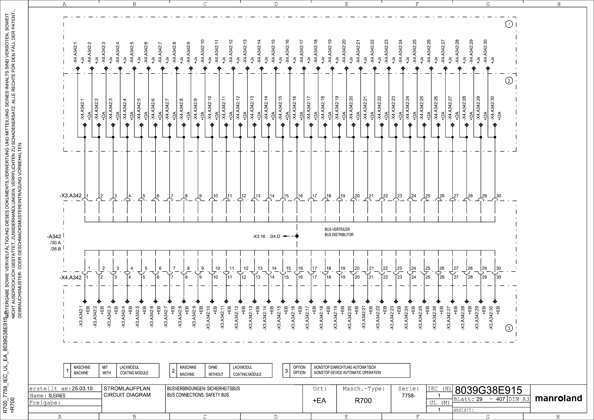

# +EA — Sheet 29 of 407 — BUSVERBINDUNGEN: SICHERHEITSBUS

**BUS CONNECTIONS: SAFETY BUS**

> Part of the manroland **R700** printing press IEC/UL circuit diagrams.
> Drawing class: **Stromlaufplan / Circuit diagram** (DIN A3).
> Document `+EA` covers the **Printing unit** machine section.

## At a glance

| Field | Value |
|---|---|
| Document | `+EA`  (8039G38E915) |
| Sheet | **29** of 407 |
| Section (DE) | BUSVERBINDUNGEN: SICHERHEITSBUS |
| Section (EN) | BUS CONNECTIONS: SAFETY BUS |
| Section type | CIRCUIT — Circuit diagram |
| Machine type | `R700` |
| Series | `7758` |
| Created | 25.03.10 |
| Replaces | — |
| Columns used | A, B, C, D, E, F, G |
| Path numbers | — |
| Labels on sheet | 301 |
| Cross-refs out | 3 |
| Cross-refs in | 63 |

**Previous:** [+EA sheet 28](SHEET_0028.md) · **Next:** [+EA sheet 30](SHEET_0030.md) · **Document TOC:** [_TOC.md](_TOC.md)  (+EA) · **Master TOC:** [all sheets](../_MASTER_TOC.md)

## Sheet image (300 DPI, exact vector render)



_Rendered directly from the PDF vector layer at 300 DPI (1-bit), no OCR and no resampling. Use it to confirm anything ambiguous in the text below._

## Cross-references on this sheet

Each entry is a wire leaving this sheet. The printed token is `/sheet.column`; the link resolves to that sheet inside the same document.

| Ref | Target sheet | Col | Path | Destination on target | Target section | From col |
|---|---|---|---|---|---|---|
| `/24.D` | [+EA sheet 24](SHEET_0024.md) | D | — | X3:16 | BUSVERBINDUNGEN: SICHERHEITSBUS | D |
| `/30.A` | [+EA sheet 30](SHEET_0030.md) | A | — | — | BUSVERBINDUNGEN: SICHERHEITSBUS | A |
| `/26.B` | [+EA sheet 26](SHEET_0026.md) | B | — | — | BUSVERBINDUNGEN: SICHERHEITSBUS | A |

### Incoming references (sheets that point here)

Every other sheet that sends a wire to this one. `Back-ref` is the token printed on *that* sheet; `Path` is its line number.

| From sheet | Cols | Back-ref | Path | Refs | What continues there |
|---|---|---|---|---|---|
| [+EA#24](SHEET_0024.md) | E | `/24.E` | — | 1 | X3:16 |
| [+EA#26](SHEET_0026.md) | A | `/26.A` | — | 1 | BUS VERTEILER BUS DISTRIBUTOR |
| [+EA#30](SHEET_0030.md) | A | `/30.A` | — | 1 | — |
| [+EA#234](SHEET_0234.md) | A, B | `/234.A`, `/234.B` | — | 30 | — |
| [+EA#236](SHEET_0236.md) | G, H | `/236.G`, `/236.H` | — | 30 | — |


## Devices on this sheet

| Tag | Class | Class meaning (IEC) | Col | Sub | Terminal | Sign |
|---|---|---|---|---|---|---|
| `A342` | A | Baugruppe / assembly, module, PC board | A | — | — | — |
| `X3:16` | X | Klemme / terminal, plug connector | D | — | 16 | — |
| `X4.A342:1` | — | cross-device reference | A | — | 1 | — |
| `X4.A342:2` | — | cross-device reference | A | — | 2 | — |
| `X4.A342:3` | — | cross-device reference | B | — | 3 | — |
| `X4.A342:4` | — | cross-device reference | B | — | 4 | — |
| `X4.A342:5` | — | cross-device reference | B | — | 5 | — |
| `X4.A342:6` | — | cross-device reference | B | — | 6 | — |
| `X4.A342:7` | — | cross-device reference | B | — | 7 | — |
| `X4.A342:8` | — | cross-device reference | C | — | 8 | — |
| `X4.A342:9` | — | cross-device reference | C | — | 9 | — |
| `X4.A342:10` | — | cross-device reference | C | — | 10 | — |
| `X4.A342:11` | — | cross-device reference | C | — | 11 | — |
| `X4.A342:12` | — | cross-device reference | C | — | 12 | — |
| `X4.A342:13` | — | cross-device reference | D | — | 13 | — |
| `X4.A342:14` | — | cross-device reference | D | — | 14 | — |
| `X4.A342:15` | — | cross-device reference | D | — | 15 | — |
| `X4.A342:16` | — | cross-device reference | D | — | 16 | — |
| `X4.A342:17` | — | cross-device reference | D | — | 17 | — |
| `X4.A342:1` | — | cross-device reference | A | — | 1 | — |
| `X4.A342:2` | — | cross-device reference | A | — | 2 | — |
| `X4.A342:3` | — | cross-device reference | B | — | 3 | — |
| `X4.A342:4` | — | cross-device reference | B | — | 4 | — |
| `X4.A342:5` | — | cross-device reference | B | — | 5 | — |
| `X4.A342:6` | — | cross-device reference | B | — | 6 | — |
| `X4.A342:7` | — | cross-device reference | B | — | 7 | — |
| `X4.A342:8` | — | cross-device reference | C | — | 8 | — |
| `X4.A342:9` | — | cross-device reference | C | — | 9 | — |
| `X4.A342:10` | — | cross-device reference | C | — | 10 | — |
| `X4.A342:11` | — | cross-device reference | C | — | 11 | — |
| `X4.A342:12` | — | cross-device reference | C | — | 12 | — |
| `X4.A342:13` | — | cross-device reference | D | — | 13 | — |
| `X4.A342:14` | — | cross-device reference | D | — | 14 | — |
| `X4.A342:15` | — | cross-device reference | D | — | 15 | — |
| `X4.A342:16` | — | cross-device reference | D | — | 16 | — |
| `X4.A342:17` | — | cross-device reference | D | — | 17 | — |
| `X4.A342:18` | — | cross-device reference | E | — | 18 | — |
| `X4.A342:19` | — | cross-device reference | E | — | 19 | — |
| `X4.A342:20` | — | cross-device reference | E | — | 20 | — |
| `X4.A342:21` | — | cross-device reference | E | — | 21 | — |
| `X4.A342:22` | — | cross-device reference | E | — | 22 | — |
| `X4.A342:23` | — | cross-device reference | F | — | 23 | — |
| `X4.A342:24` | — | cross-device reference | F | — | 24 | — |
| `X4.A342:25` | — | cross-device reference | F | — | 25 | — |
| `X4.A342:26` | — | cross-device reference | F | — | 26 | — |
| `X4.A342:27` | — | cross-device reference | F | — | 27 | — |
| `X4.A342:28` | — | cross-device reference | G | — | 28 | — |
| `X4.A342:29` | — | cross-device reference | G | — | 29 | — |
| `X4.A342:30` | — | cross-device reference | G | — | 30 | — |
| `X4.A342:18` | — | cross-device reference | E | — | 18 | — |
| `X4.A342:19` | — | cross-device reference | E | — | 19 | — |
| `X4.A342:20` | — | cross-device reference | E | — | 20 | — |
| `X4.A342:21` | — | cross-device reference | E | — | 21 | — |
| `X4.A342:22` | — | cross-device reference | E | — | 22 | — |
| `X4.A342:23` | — | cross-device reference | F | — | 23 | — |
| `X4.A342:24` | — | cross-device reference | F | — | 24 | — |
| `X4.A342:25` | — | cross-device reference | F | — | 25 | — |
| `X4.A342:26` | — | cross-device reference | F | — | 26 | — |
| `X4.A342:27` | — | cross-device reference | F | — | 27 | — |
| `X4.A342:28` | — | cross-device reference | G | — | 28 | — |
| `X4.A342:29` | — | cross-device reference | G | — | 29 | — |
| `X4.A342:30` | — | cross-device reference | G | — | 30 | — |
| `X3.A342:1` | — | cross-device reference | A | — | 1 | — |
| `X3.A342:2` | — | cross-device reference | A | — | 2 | — |
| `X3.A342:3` | — | cross-device reference | B | — | 3 | — |
| `X3.A342:4` | — | cross-device reference | B | — | 4 | — |
| `X3.A342:5` | — | cross-device reference | B | — | 5 | — |
| `X3.A342:6` | — | cross-device reference | B | — | 6 | — |
| `X3.A342:7` | — | cross-device reference | B | — | 7 | — |
| `X3.A342:8` | — | cross-device reference | C | — | 8 | — |
| `X3.A342:9` | — | cross-device reference | C | — | 9 | — |
| `X3.A342:10` | — | cross-device reference | C | — | 10 | — |
| `X3.A342:11` | — | cross-device reference | C | — | 11 | — |
| `X3.A342:12` | — | cross-device reference | C | — | 12 | — |
| `X3.A342:13` | — | cross-device reference | D | — | 13 | — |
| `X3.A342:14` | — | cross-device reference | D | — | 14 | — |
| `X3.A342:15` | — | cross-device reference | D | — | 15 | — |
| `X3.A342:16` | — | cross-device reference | D | — | 16 | — |
| `X3.A342:17` | — | cross-device reference | D | — | 17 | — |
| `X3.A342:18` | — | cross-device reference | E | — | 18 | — |
| `X3.A342:19` | — | cross-device reference | E | — | 19 | — |
| `X3.A342:20` | — | cross-device reference | E | — | 20 | — |
| `X3.A342:21` | — | cross-device reference | E | — | 21 | — |
| `X3.A342:22` | — | cross-device reference | E | — | 22 | — |
| `X3.A342:23` | — | cross-device reference | F | — | 23 | — |
| `X3.A342:24` | — | cross-device reference | F | — | 24 | — |
| `X3.A342:25` | — | cross-device reference | F | — | 25 | — |
| `X3.A342:26` | — | cross-device reference | F | — | 26 | — |
| `X3.A342:27` | — | cross-device reference | F | — | 27 | — |
| `X3.A342:28` | — | cross-device reference | G | — | 28 | — |
| `X3.A342:29` | — | cross-device reference | G | — | 29 | — |
| `X3.A342:30` | — | cross-device reference | G | — | 30 | — |
| `X3.A342` | — | cross-device reference | A | — | — | — |
| `X4.A342` | — | cross-device reference | A | — | — | — |

## Potentials / nets

_No named potentials on this sheet._

## Wire-end annotations (grouped as printed)

A wire that continues elsewhere is annotated with a small cluster: the destination description, the path/line number `#NN`, and the `/sheet.column` cross reference. Each row below is one such cluster exactly as it is grouped on the drawing.

| Col | Y | Path | Cross-ref | Text on the wire |
|---|---|---|---|---|
| G | 46.0 | — | — | `1` |
| C | 79.1 | — | — | `X4.A342:10` |
| C | 79.1 | — | — | `X4.A342:11` |
| C | 79.1 | — | — | `X4.A342:12` |
| D | 79.1 | — | — | `X4.A342:13` |
| D | 79.1 | — | — | `X4.A342:14` |
| D | 79.1 | — | — | `X4.A342:15` |
| D | 79.1 | — | — | `X4.A342:16` |
| D | 79.1 | — | — | `X4.A342:17` |
| E | 79.1 | — | — | `X4.A342:18` |
| E | 79.1 | — | — | `X4.A342:19` |
| E | 79.1 | — | — | `X4.A342:20` |
| E | 79.1 | — | — | `X4.A342:21` |
| E | 79.1 | — | — | `X4.A342:22` |
| F | 79.1 | — | — | `X4.A342:23` |
| F | 79.1 | — | — | `X4.A342:24` |
| F | 79.1 | — | — | `X4.A342:25` |
| F | 79.1 | — | — | `X4.A342:26` |
| F | 79.1 | — | — | `X4.A342:27` |
| G | 79.1 | — | — | `X4.A342:28` |
| G | 79.1 | — | — | `X4.A342:29` |
| G | 79.1 | — | — | `X4.A342:30` |
| A | 83.9 | — | — | `X4.A342:1` |
| A | 83.9 | — | — | `X4.A342:2` |
| B | 83.9 | — | — | `X4.A342:3` |
| B | 83.9 | — | — | `X4.A342:4` |
| B | 83.9 | — | — | `X4.A342:5` |
| B | 83.9 | — | — | `X4.A342:6` |
| B | 83.9 | — | — | `X4.A342:7` |
| C | 83.9 | — | — | `X4.A342:8` |
| C | 83.9 | — | — | `X4.A342:9` |
| A | 114.2 | — | — | `+Jx` |
| A | 114.2 | — | — | `+Jx` |
| B | 114.2 | — | — | `+Jx` |
| B | 114.2 | — | — | `+Jx` |
| B | 114.2 | — | — | `+Jx` |
| B | 114.2 | — | — | `+Jx` |
| B | 114.2 | — | — | `+Jx` |
| C | 114.2 | — | — | `+Jx` |
| C | 114.2 | — | — | `+Jx` |
| C | 114.2 | — | — | `+Jx` |
| C | 114.2 | — | — | `+Jx` |
| C | 114.2 | — | — | `+Jx` |
| D | 114.2 | — | — | `+Jx` |
| D | 114.2 | — | — | `+Jx` |
| D | 114.2 | — | — | `+Jx` |
| D | 114.2 | — | — | `+Jx` |
| D | 114.2 | — | — | `+Jx` |
| E | 114.2 | — | — | `+Jx` |
| E | 114.2 | — | — | `+Jx` |
| E | 114.2 | — | — | `+Jx` |
| E | 114.2 | — | — | `+Jx` |
| E | 114.2 | — | — | `+Jx` |
| F | 114.2 | — | — | `+Jx` |
| F | 114.2 | — | — | `+Jx` |
| F | 114.2 | — | — | `+Jx` |
| F | 114.2 | — | — | `+Jx` |
| F | 114.2 | — | — | `+Jx` |
| G | 114.2 | — | — | `+Jx` |
| G | 114.2 | — | — | `+Jx` |
| G | 114.2 | — | — | `+Jx` |
| G | 159.0 | — | — | `2` |
| C | 192.5 | — | — | `X4.A342:10` |
| C | 192.5 | — | — | `X4.A342:11` |
| C | 192.5 | — | — | `X4.A342:12` |
| D | 192.5 | — | — | `X4.A342:13` |
| D | 192.5 | — | — | `X4.A342:14` |
| D | 192.5 | — | — | `X4.A342:15` |
| D | 192.5 | — | — | `X4.A342:16` |
| D | 192.5 | — | — | `X4.A342:17` |
| E | 192.5 | — | — | `X4.A342:18` |
| E | 192.5 | — | — | `X4.A342:19` |
| E | 192.5 | — | — | `X4.A342:20` |
| E | 192.5 | — | — | `X4.A342:21` |
| E | 192.5 | — | — | `X4.A342:22` |
| F | 192.5 | — | — | `X4.A342:23` |
| F | 192.5 | — | — | `X4.A342:24` |
| F | 192.5 | — | — | `X4.A342:25` |
| F | 192.5 | — | — | `X4.A342:26` |
| F | 192.5 | — | — | `X4.A342:27` |
| G | 192.5 | — | — | `X4.A342:28` |
| G | 192.5 | — | — | `X4.A342:29` |
| G | 192.5 | — | — | `X4.A342:30` |
| A | 197.3 | — | — | `X4.A342:1` |
| A | 197.3 | — | — | `X4.A342:2` |
| B | 197.3 | — | — | `X4.A342:3` |
| B | 197.3 | — | — | `X4.A342:4` |
| B | 197.3 | — | — | `X4.A342:5` |
| B | 197.3 | — | — | `X4.A342:6` |
| B | 197.3 | — | — | `X4.A342:7` |
| C | 197.3 | — | — | `X4.A342:8` |
| C | 197.3 | — | — | `X4.A342:9` |
| A | 223.9 | — | — | `+DA` |
| B | 223.9 | — | — | `+DA` |
| B | 223.9 | — | — | `+DA` |
| B | 223.9 | — | — | `+DA` |
| B | 223.9 | — | — | `+DA` |
| B | 223.9 | — | — | `+DA` |
| C | 223.9 | — | — | `+DA` |
| C | 223.9 | — | — | `+DA` |
| C | 223.9 | — | — | `+DA` |
| C | 223.9 | — | — | `+DA` |
| C | 223.9 | — | — | `+DA` |
| D | 223.9 | — | — | `+DA` |
| D | 223.9 | — | — | `+DA` |
| D | 223.9 | — | — | `+DA` |
| D | 223.9 | — | — | `+DA` |
| D | 223.9 | — | — | `+DA` |
| E | 223.9 | — | — | `+DA` |
| E | 223.9 | — | — | `+DA` |
| E | 223.9 | — | — | `+DA` |
| E | 223.9 | — | — | `+DA` |
| E | 223.9 | — | — | `+DA` |
| F | 223.9 | — | — | `+DA` |
| F | 223.9 | — | — | `+DA` |
| F | 223.9 | — | — | `+DA` |
| F | 223.9 | — | — | `+DA` |
| F | 223.9 | — | — | `+DA` |
| G | 223.9 | — | — | `+DA` |
| G | 223.9 | — | — | `+DA` |
| G | 223.9 | — | — | `+DA` |
| G | 223.9 | — | — | `+DA` |
| D | 387.2 | — | — | `X3.A342 1 2 3 4 5 6 7 8 9 10 11 12 13 14 15 16 17 18 19 20 21 22 23 24 25 26 27 28 29 30` |
| E | 457.0 | — | — | `BUS VERTEILER BUS DISTRIBUTOR` |
| A | 469.4 | — | — | `A342` |
| D | 470.1 | — | `/24.D` | `X3:16` |
| A | 482.5 | — | `/30.A`, `/26.B` | — |
| D | 534.0 | — | — | `1 2 3 4 5 6 7 8 9 10 11 12 13 14 15 16 17 18 19 20 21 22 23 24 25 26 27 28 29 30` |
| A | 551.6 | — | — | `X4.A342` |
| D | 551.7 | — | — | `1 2 3 4 5 6 7 8 9 10 11 12 13 14 15 16 17 18 19 20 21 22 23 24 25 26 27 28 29 30` |
| A | 612.0 | — | — | `X3.A342:1` |
| C | 612.0 | — | — | `X3.A342:11` |
| E | 612.0 | — | — | `X3.A342:21` |
| A | 613.1 | — | — | `X3.A342:2` |
| C | 613.1 | — | — | `X3.A342:12` |
| E | 613.1 | — | — | `X3.A342:22` |
| A | 613.4 | — | — | `+EB` |
| B | 613.4 | — | — | `+EB` |
| B | 613.4 | — | — | `X3.A342:3` |
| B | 613.4 | — | — | `+EB` |
| B | 613.4 | — | — | `X3.A342:4` |
| B | 613.4 | — | — | `+EB` |
| B | 613.4 | — | — | `X3.A342:5` |
| B | 613.4 | — | — | `+EB` |
| B | 613.4 | — | — | `X3.A342:6` |
| B | 613.4 | — | — | `+EB` |
| B | 613.4 | — | — | `X3.A342:7` |
| C | 613.4 | — | — | `+EB` |
| C | 613.4 | — | — | `X3.A342:8` |
| C | 613.4 | — | — | `+EB` |
| C | 613.4 | — | — | `X3.A342:9` |
| C | 613.4 | — | — | `+EB` |
| C | 613.4 | — | — | `X3.A342:10` |
| C | 613.4 | — | — | `+EB` |
| C | 613.4 | — | — | `+EB` |
| D | 613.4 | — | — | `+EB` |
| D | 613.4 | — | — | `X3.A342:13` |
| D | 613.4 | — | — | `+EB` |
| D | 613.4 | — | — | `X3.A342:14` |
| D | 613.4 | — | — | `+EB` |
| D | 613.4 | — | — | `X3.A342:15` |
| D | 613.4 | — | — | `+EB` |
| D | 613.4 | — | — | `X3.A342:16` |
| D | 613.4 | — | — | `+EB` |
| D | 613.4 | — | — | `X3.A342:17` |
| E | 613.4 | — | — | `+EB` |
| E | 613.4 | — | — | `X3.A342:18` |
| E | 613.4 | — | — | `+EB` |
| E | 613.4 | — | — | `X3.A342:19` |
| E | 613.4 | — | — | `+EB` |
| E | 613.4 | — | — | `X3.A342:20` |
| E | 613.4 | — | — | `+EB` |
| E | 613.4 | — | — | `+EB` |
| F | 613.4 | — | — | `+EB` |
| F | 613.4 | — | — | `X3.A342:23` |
| F | 613.4 | — | — | `+EB` |
| F | 613.4 | — | — | `X3.A342:24` |
| F | 613.4 | — | — | `+EB` |
| F | 613.4 | — | — | `X3.A342:25` |
| F | 613.4 | — | — | `+EB` |
| F | 613.4 | — | — | `X3.A342:26` |
| F | 613.4 | — | — | `+EB` |
| F | 613.4 | — | — | `X3.A342:27` |
| G | 613.4 | — | — | `+EB` |
| G | 613.4 | — | — | `X3.A342:28` |
| G | 613.4 | — | — | `+EB` |
| G | 613.4 | — | — | `X3.A342:29` |
| G | 613.4 | — | — | `+EB` |
| G | 613.4 | — | — | `X3.A342:30` |
| G | 613.4 | — | — | `+EB` |
| G | 655.1 | — | — | `3` |
| B | 733.4 | — | — | `1 COATING MODULE MASCHINE` |
| A | 733.4 | — | — | `MASCHINE` |
| B | 733.4 | — | — | `MIT` |
| B | 733.4 | — | — | `LACKMODUL` |
| D | 733.4 | — | — | `2 COATING MODULE 3 OPTION OPTION NONSTOP EINRICHTUNG AUTOMATISCH NONSTOP DEVICE AUTOMATIC OPERATION` |
| C | 733.4 | — | — | `OHNE` |
| D | 733.4 | — | — | `LACKMODUL` |
| B | 744.6 | — | — | `WITH` |
| A | 744.7 | — | — | `MACHINE` |
| C | 747.5 | — | — | `WITHOUT` |
| C | 747.6 | — | — | `MACHINE` |


## Reconstructed tables

This sheet carries tabular content (pin map / terminal assignment / index). The grid below was rebuilt from the drawing's own rule lines, so each row is exactly one physical row of the table.

### Table 1 — 3 data rows × 61 columns (at x=127.6, y=34.0)

| X4.A342:1 | +Jx | X4.A342:2 | +Jx | X4.A342:3 | +Jx | X4.A342:4 | +Jx | X4.A342:5 | +Jx | X4.A342:6 | +Jx | X4.A342:7 | +Jx | X4.A342:8 | +Jx | X4.A342:9 | +Jx | X4.A342:10 | +Jx | X4.A342:11 | +Jx | X4.A342:12 | +Jx | X4.A342:13 | +Jx | X4.A342:14 | +Jx | X4.A342:15 | +Jx | X4.A342:16 | +Jx | X4.A342:17 | +Jx | X4.A342:18 | +Jx | X4.A342:19 | +Jx | X4.A342:20 | +Jx | X4.A342:21 | +Jx | X4.A342:22 | +Jx | X4.A342:23 | +Jx | X4.A342:24 | +Jx | X4.A342:25 | +Jx | X4.A342:26 | +Jx | X4.A342:27 | +Jx | X4.A342:28 | +Jx | X4.A342:29 | +Jx | X4.A342:30 | +Jx | 1 |
|---|---|---|---|---|---|---|---|---|---|---|---|---|---|---|---|---|---|---|---|---|---|---|---|---|---|---|---|---|---|---|---|---|---|---|---|---|---|---|---|---|---|---|---|---|---|---|---|---|---|---|---|---|---|---|---|---|---|---|---|---|
|  | `X4.A342:1` | `+DA` | `X4.A342:2` | `+DA` | `X4.A342:3` | `+DA` | `X4.A342:4` | `+DA` | `X4.A342:5` | `+DA` | `X4.A342:6` | `+DA` | `X4.A342:7` | `+DA` | `X4.A342:8` | `+DA` | `X4.A342:9` | `+DA` | `X4.A342:10` | `+DA` | `X4.A342:11` | `+DA` | `X4.A342:12` | `+DA` | `X4.A342:13` | `+DA` | `X4.A342:14` | `+DA` | `X4.A342:15` | `+DA` | `X4.A342:16` | `+DA` | `X4.A342:17` | `+DA` | `X4.A342:18` | `+DA` | `X4.A342:19` | `+DA` | `X4.A342:20` | `+DA` | `X4.A342:21` | `+DA` | `X4.A342:22` | `+DA` | `X4.A342:23` | `+DA` | `X4.A342:24` | `+DA` | `X4.A342:25` | `+DA` | `X4.A342:26` | `+DA` | `X4.A342:27` | `+DA` | `X4.A342:28` | `+DA` | `X4.A342:29` | `+DA` | `X4.A342:30` | `2 +DA` |
| `X3.A342` |  | `1` |  | `2` |  | `3` |  | `4` |  | `5` |  | `6` |  | `7` |  | `8` |  | `9` |  | `10` |  | `11` |  | `12` |  | `13` |  | `14` |  | `15` |  | `16` |  | `17` |  | `18` |  | `19` |  | `20` |  | `21` |  | `22` |  | `23` |  | `24` |  | `25` |  | `26` |  | `27` |  | `28` |  | `29` |  | `30` |
|  |  |  |  |  |  |  |  |  |  |  |  |  |  |  |  |  |  |  |  |  |  |  |  |  |  | `X3:16` |  | `/24.D` |  |  |  |  |  |  |  | `BUS` | `BUS VERTEILER` | `DISTRIBUTOR` |  |  |  |  |  |  |  |  |  |  |  |  |  |  |  |  |  |  |  |  |  |  |


## Notes and free text on this sheet

| Text | Col | Y (pt) |
|---|---|---|
| `+Jx` | A | 114.24 |
| `+Jx` | B | 114.24 |
| `+Jx` | C | 114.24 |
| `+Jx` | D | 114.24 |
| `+DA` | A | 223.94 |
| `+DA` | B | 223.94 |
| `+DA` | C | 223.94 |
| `+DA` | D | 223.94 |
| `+DA` | E | 223.94 |
| `+DA` | F | 223.94 |
| `+DA` | G | 223.94 |
| `+Jx` | E | 114.24 |
| `+Jx` | F | 114.24 |
| `+Jx` | G | 114.24 |
| `+EB` | A | 613.42 |
| `+EB` | B | 613.42 |
| `+EB` | C | 613.42 |
| `+EB` | D | 613.42 |
| `+EB` | E | 613.42 |
| `+EB` | F | 613.42 |
| `+EB` | G | 613.42 |
| `BUS VERTEILER` | E | 456.99 |
| `BUS DISTRIBUTOR` | E | 467.63 |
| `MASCHINE` | A | 733.38 |
| `MACHINE` | A | 744.72 |
| `MIT` | B | 733.35 |
| `WITH` | B | 744.59 |
| `LACKMODUL` | B | 733.4 |
| `COATING MODULE` | B | 744.74 |
| `MASCHINE` | C | 733.38 |
| `MACHINE` | C | 747.56 |
| `OHNE` | C | 733.37 |
| `WITHOUT` | C | 747.52 |
| `LACKMODUL` | D | 733.4 |
| `COATING MODULE` | D | 747.57 |
| `OPTION` | D | 733.35 |
| `NONSTOP EINRICHTUNG AUTOMATISCH` | E | 733.39 |
| `NONSTOP DEVICE AUTOMATIC OPERATION` | E | 744.01 |

## Complete label inventory (exact text from the drawing)

Every text object inside the drawing area of this sheet, in DIN reading order (column A→H, then top→bottom). This is the authoritative list: if a string is not here it is not printed on this sheet.

| Col | Y | X | Dir | Type | Text |
|---|---|---|---|---|---|
| A | 83.9 | 147.0 | ↕ | device ref | `X4.A342:1` |
| A | 83.9 | 175.3 | ↕ | device ref | `X4.A342:2` |
| A | 114.2 | 161.2 | ↕ | text | `+Jx` |
| A | 114.2 | 189.6 | ↕ | text | `+Jx` |
| A | 197.3 | 161.1 | ↕ | device ref | `X4.A342:1` |
| A | 197.3 | 189.5 | ↕ | device ref | `X4.A342:2` |
| A | 223.9 | 175.3 | ↕ | text | `+DA` |
| A | 387.2 | 119.3 | → | device ref | `X3.A342` |
| A | 388.7 | 172.1 | → | number | `1` |
| A | 469.4 | 94.1 | → | device tag | `A342` |
| A | 482.5 | 101.2 | → | cross-reference | `/30.A` |
| A | 494.9 | 101.5 | → | cross-reference | `/26.B` |
| A | 533.9 | 176.3 | → | number | `1` |
| A | 551.6 | 119.3 | → | device ref | `X4.A342` |
| A | 551.7 | 172.1 | → | number | `1` |
| A | 612.0 | 158.3 | ↕ | device ref | `X3.A342:1` |
| A | 613.1 | 186.7 | ↕ | device ref | `X3.A342:2` |
| A | 613.4 | 172.5 | ↕ | text | `+EB` |
| A | 733.4 | 148.3 | → | text | `MASCHINE` |
| A | 738.7 | 132.1 | → | number | `1` |
| A | 744.7 | 148.3 | → | text | `MACHINE` |
| B | 83.9 | 203.7 | ↕ | device ref | `X4.A342:3` |
| B | 83.9 | 232.0 | ↕ | device ref | `X4.A342:4` |
| B | 83.9 | 260.4 | ↕ | device ref | `X4.A342:5` |
| B | 83.9 | 288.7 | ↕ | device ref | `X4.A342:6` |
| B | 83.9 | 317.1 | ↕ | device ref | `X4.A342:7` |
| B | 114.2 | 217.9 | ↕ | text | `+Jx` |
| B | 114.2 | 246.3 | ↕ | text | `+Jx` |
| B | 114.2 | 274.6 | ↕ | text | `+Jx` |
| B | 114.2 | 303.0 | ↕ | text | `+Jx` |
| B | 114.2 | 331.3 | ↕ | text | `+Jx` |
| B | 197.3 | 217.8 | ↕ | device ref | `X4.A342:3` |
| B | 197.3 | 246.2 | ↕ | device ref | `X4.A342:4` |
| B | 197.3 | 274.5 | ↕ | device ref | `X4.A342:5` |
| B | 197.3 | 302.9 | ↕ | device ref | `X4.A342:6` |
| B | 197.3 | 331.2 | ↕ | device ref | `X4.A342:7` |
| B | 223.9 | 203.7 | ↕ | text | `+DA` |
| B | 223.9 | 232.0 | ↕ | text | `+DA` |
| B | 223.9 | 260.4 | ↕ | text | `+DA` |
| B | 223.9 | 288.7 | ↕ | text | `+DA` |
| B | 223.9 | 317.1 | ↕ | text | `+DA` |
| B | 388.7 | 201.0 | → | number | `2` |
| B | 388.7 | 229.3 | → | number | `3` |
| B | 388.7 | 257.7 | → | number | `4` |
| B | 388.7 | 286.0 | → | number | `5` |
| B | 388.7 | 314.4 | → | number | `6` |
| B | 533.9 | 205.2 | → | number | `2` |
| B | 533.9 | 233.6 | → | number | `3` |
| B | 533.9 | 261.9 | → | number | `4` |
| B | 533.9 | 290.3 | → | number | `5` |
| B | 533.9 | 318.6 | → | number | `6` |
| B | 551.7 | 201.0 | → | number | `2` |
| B | 551.7 | 229.3 | → | number | `3` |
| B | 551.7 | 257.7 | → | number | `4` |
| B | 551.7 | 286.0 | → | number | `5` |
| B | 551.7 | 314.4 | → | number | `6` |
| B | 613.4 | 200.8 | ↕ | text | `+EB` |
| B | 613.4 | 215.0 | ↕ | device ref | `X3.A342:3` |
| B | 613.4 | 229.1 | ↕ | text | `+EB` |
| B | 613.4 | 243.4 | ↕ | device ref | `X3.A342:4` |
| B | 613.4 | 257.5 | ↕ | text | `+EB` |
| B | 613.4 | 271.7 | ↕ | device ref | `X3.A342:5` |
| B | 613.4 | 285.8 | ↕ | text | `+EB` |
| B | 613.4 | 300.0 | ↕ | device ref | `X3.A342:6` |
| B | 613.4 | 314.2 | ↕ | text | `+EB` |
| B | 613.4 | 328.4 | ↕ | device ref | `X3.A342:7` |
| B | 733.4 | 204.9 | → | text | `MIT` |
| B | 733.4 | 240.1 | → | text | `LACKMODUL` |
| B | 744.6 | 205.5 | → | text | `WITH` |
| B | 744.7 | 240.7 | → | text | `COATING MODULE` |
| C | 79.1 | 402.1 | ↕ | device ref | `X4.A342:10` |
| C | 79.1 | 430.4 | ↕ | device ref | `X4.A342:11` |
| C | 79.1 | 458.8 | ↕ | device ref | `X4.A342:12` |
| C | 83.9 | 345.4 | ↕ | device ref | `X4.A342:8` |
| C | 83.9 | 373.7 | ↕ | device ref | `X4.A342:9` |
| C | 114.2 | 359.6 | ↕ | text | `+Jx` |
| C | 114.2 | 388.0 | ↕ | text | `+Jx` |
| C | 114.2 | 416.3 | ↕ | text | `+Jx` |
| C | 114.2 | 444.7 | ↕ | text | `+Jx` |
| C | 114.2 | 473.0 | ↕ | text | `+Jx` |
| C | 192.5 | 416.3 | ↕ | device ref | `X4.A342:10` |
| C | 192.5 | 444.6 | ↕ | device ref | `X4.A342:11` |
| C | 192.5 | 473.0 | ↕ | device ref | `X4.A342:12` |
| C | 197.3 | 359.6 | ↕ | device ref | `X4.A342:8` |
| C | 197.3 | 387.9 | ↕ | device ref | `X4.A342:9` |
| C | 223.9 | 345.4 | ↕ | text | `+DA` |
| C | 223.9 | 373.8 | ↕ | text | `+DA` |
| C | 223.9 | 402.1 | ↕ | text | `+DA` |
| C | 223.9 | 430.4 | ↕ | text | `+DA` |
| C | 223.9 | 458.8 | ↕ | text | `+DA` |
| C | 388.7 | 342.7 | → | number | `7` |
| C | 388.7 | 371.1 | → | number | `8` |
| C | 388.7 | 399.4 | → | number | `9` |
| C | 388.7 | 427.2 | → | number | `10` |
| C | 388.7 | 455.5 | → | number | `11` |
| C | 533.9 | 347.0 | → | number | `7` |
| C | 533.9 | 375.3 | → | number | `8` |
| C | 533.9 | 403.7 | → | number | `9` |
| C | 533.9 | 431.4 | → | number | `10` |
| C | 533.9 | 459.8 | → | number | `11` |
| C | 551.7 | 342.7 | → | number | `7` |
| C | 551.7 | 371.1 | → | number | `8` |
| C | 551.7 | 399.4 | → | number | `9` |
| C | 551.7 | 427.2 | → | number | `10` |
| C | 551.7 | 455.5 | → | number | `11` |
| C | 612.0 | 441.8 | ↕ | device ref | `X3.A342:11` |
| C | 613.1 | 470.1 | ↕ | device ref | `X3.A342:12` |
| C | 613.4 | 342.5 | ↕ | text | `+EB` |
| C | 613.4 | 356.7 | ↕ | device ref | `X3.A342:8` |
| C | 613.4 | 370.9 | ↕ | text | `+EB` |
| C | 613.4 | 385.1 | ↕ | device ref | `X3.A342:9` |
| C | 613.4 | 399.2 | ↕ | text | `+EB` |
| C | 613.4 | 413.4 | ↕ | device ref | `X3.A342:10` |
| C | 613.4 | 427.6 | ↕ | text | `+EB` |
| C | 613.4 | 455.9 | ↕ | text | `+EB` |
| C | 733.4 | 360.9 | → | text | `MASCHINE` |
| C | 733.4 | 417.8 | → | text | `OHNE` |
| C | 738.7 | 344.4 | → | number | `2` |
| C | 747.5 | 418.1 | → | text | `WITHOUT` |
| C | 747.6 | 360.9 | → | text | `MACHINE` |
| D | 79.1 | 487.1 | ↕ | device ref | `X4.A342:13` |
| D | 79.1 | 515.5 | ↕ | device ref | `X4.A342:14` |
| D | 79.1 | 543.8 | ↕ | device ref | `X4.A342:15` |
| D | 79.1 | 572.2 | ↕ | device ref | `X4.A342:16` |
| D | 79.1 | 600.5 | ↕ | device ref | `X4.A342:17` |
| D | 114.2 | 501.4 | ↕ | text | `+Jx` |
| D | 114.2 | 529.7 | ↕ | text | `+Jx` |
| D | 114.2 | 558.1 | ↕ | text | `+Jx` |
| D | 114.2 | 586.4 | ↕ | text | `+Jx` |
| D | 114.2 | 614.8 | ↕ | text | `+Jx` |
| D | 192.5 | 501.3 | ↕ | device ref | `X4.A342:13` |
| D | 192.5 | 529.7 | ↕ | device ref | `X4.A342:14` |
| D | 192.5 | 558.0 | ↕ | device ref | `X4.A342:15` |
| D | 192.5 | 586.3 | ↕ | device ref | `X4.A342:16` |
| D | 192.5 | 614.7 | ↕ | device ref | `X4.A342:17` |
| D | 223.9 | 487.1 | ↕ | text | `+DA` |
| D | 223.9 | 515.5 | ↕ | text | `+DA` |
| D | 223.9 | 543.8 | ↕ | text | `+DA` |
| D | 223.9 | 572.2 | ↕ | text | `+DA` |
| D | 223.9 | 600.5 | ↕ | text | `+DA` |
| D | 388.7 | 483.9 | → | number | `12` |
| D | 388.7 | 512.2 | → | number | `13` |
| D | 388.7 | 540.6 | → | number | `14` |
| D | 388.7 | 568.9 | → | number | `15` |
| D | 388.7 | 597.3 | → | number | `16` |
| D | 470.1 | 506.0 | → | device tag | `X3:16` |
| D | 470.1 | 540.6 | → | cross-reference | `/24.D` |
| D | 533.9 | 488.1 | → | number | `12` |
| D | 533.9 | 516.5 | → | number | `13` |
| D | 533.9 | 544.8 | → | number | `14` |
| D | 533.9 | 573.2 | → | number | `15` |
| D | 533.9 | 597.3 | → | number | `16` |
| D | 551.7 | 483.9 | → | number | `12` |
| D | 551.7 | 512.2 | → | number | `13` |
| D | 551.7 | 540.6 | → | number | `14` |
| D | 551.7 | 568.9 | → | number | `15` |
| D | 551.7 | 597.3 | → | number | `16` |
| D | 613.4 | 484.3 | ↕ | text | `+EB` |
| D | 613.4 | 498.5 | ↕ | device ref | `X3.A342:13` |
| D | 613.4 | 512.6 | ↕ | text | `+EB` |
| D | 613.4 | 526.8 | ↕ | device ref | `X3.A342:14` |
| D | 613.4 | 541.0 | ↕ | text | `+EB` |
| D | 613.4 | 555.2 | ↕ | device ref | `X3.A342:15` |
| D | 613.4 | 569.3 | ↕ | text | `+EB` |
| D | 613.4 | 583.5 | ↕ | device ref | `X3.A342:16` |
| D | 613.4 | 597.6 | ↕ | text | `+EB` |
| D | 613.4 | 611.9 | ↕ | device ref | `X3.A342:17` |
| D | 733.4 | 466.9 | → | text | `LACKMODUL` |
| D | 733.4 | 587.9 | → | text | `OPTION` |
| D | 738.7 | 571.0 | → | number | `3` |
| D | 744.0 | 587.9 | → | text | `OPTION` |
| D | 747.6 | 467.4 | → | text | `COATING MODULE` |
| E | 79.1 | 628.9 | ↕ | device ref | `X4.A342:18` |
| E | 79.1 | 657.2 | ↕ | device ref | `X4.A342:19` |
| E | 79.1 | 685.6 | ↕ | device ref | `X4.A342:20` |
| E | 79.1 | 713.9 | ↕ | device ref | `X4.A342:21` |
| E | 79.1 | 742.3 | ↕ | device ref | `X4.A342:22` |
| E | 114.2 | 643.1 | ↕ | text | `+Jx` |
| E | 114.2 | 671.5 | ↕ | text | `+Jx` |
| E | 114.2 | 699.8 | ↕ | text | `+Jx` |
| E | 114.2 | 728.2 | ↕ | text | `+Jx` |
| E | 114.2 | 756.5 | ↕ | text | `+Jx` |
| E | 192.5 | 643.0 | ↕ | device ref | `X4.A342:18` |
| E | 192.5 | 671.4 | ↕ | device ref | `X4.A342:19` |
| E | 192.5 | 699.7 | ↕ | device ref | `X4.A342:20` |
| E | 192.5 | 728.1 | ↕ | device ref | `X4.A342:21` |
| E | 192.5 | 756.4 | ↕ | device ref | `X4.A342:22` |
| E | 223.9 | 628.9 | ↕ | text | `+DA` |
| E | 223.9 | 657.2 | ↕ | text | `+DA` |
| E | 223.9 | 685.6 | ↕ | text | `+DA` |
| E | 223.9 | 713.9 | ↕ | text | `+DA` |
| E | 223.9 | 742.3 | ↕ | text | `+DA` |
| E | 388.7 | 625.6 | → | number | `17` |
| E | 388.7 | 654.0 | → | number | `18` |
| E | 388.7 | 682.3 | → | number | `19` |
| E | 388.7 | 711.2 | → | number | `20` |
| E | 388.7 | 739.6 | → | number | `21` |
| E | 457.0 | 651.1 | → | text | `BUS VERTEILER` |
| E | 467.6 | 651.1 | → | text | `BUS DISTRIBUTOR` |
| E | 533.9 | 625.6 | → | number | `17` |
| E | 533.9 | 654.0 | → | number | `18` |
| E | 533.9 | 682.3 | → | number | `19` |
| E | 533.9 | 710.9 | → | number | `20` |
| E | 533.9 | 740.0 | → | number | `21` |
| E | 551.7 | 625.6 | → | number | `17` |
| E | 551.7 | 654.0 | → | number | `18` |
| E | 551.7 | 682.3 | → | number | `19` |
| E | 551.7 | 711.2 | → | number | `20` |
| E | 551.7 | 739.6 | → | number | `21` |
| E | 612.0 | 725.2 | ↕ | device ref | `X3.A342:21` |
| E | 613.1 | 753.6 | ↕ | device ref | `X3.A342:22` |
| E | 613.4 | 626.0 | ↕ | text | `+EB` |
| E | 613.4 | 640.2 | ↕ | device ref | `X3.A342:18` |
| E | 613.4 | 654.3 | ↕ | text | `+EB` |
| E | 613.4 | 668.6 | ↕ | device ref | `X3.A342:19` |
| E | 613.4 | 682.7 | ↕ | text | `+EB` |
| E | 613.4 | 696.9 | ↕ | device ref | `X3.A342:20` |
| E | 613.4 | 711.0 | ↕ | text | `+EB` |
| E | 613.4 | 739.4 | ↕ | text | `+EB` |
| E | 733.4 | 629.9 | → | text | `NONSTOP EINRICHTUNG AUTOMATISCH` |
| E | 744.0 | 629.9 | → | text | `NONSTOP DEVICE AUTOMATIC OPERATION` |
| F | 79.1 | 770.6 | ↕ | device ref | `X4.A342:23` |
| F | 79.1 | 798.9 | ↕ | device ref | `X4.A342:24` |
| F | 79.1 | 827.3 | ↕ | device ref | `X4.A342:25` |
| F | 79.1 | 855.6 | ↕ | device ref | `X4.A342:26` |
| F | 79.1 | 884.0 | ↕ | device ref | `X4.A342:27` |
| F | 114.2 | 784.8 | ↕ | text | `+Jx` |
| F | 114.2 | 813.2 | ↕ | text | `+Jx` |
| F | 114.2 | 841.5 | ↕ | text | `+Jx` |
| F | 114.2 | 869.9 | ↕ | text | `+Jx` |
| F | 114.2 | 898.2 | ↕ | text | `+Jx` |
| F | 192.5 | 784.8 | ↕ | device ref | `X4.A342:23` |
| F | 192.5 | 813.1 | ↕ | device ref | `X4.A342:24` |
| F | 192.5 | 841.5 | ↕ | device ref | `X4.A342:25` |
| F | 192.5 | 869.8 | ↕ | device ref | `X4.A342:26` |
| F | 192.5 | 898.2 | ↕ | device ref | `X4.A342:27` |
| F | 223.9 | 770.6 | ↕ | text | `+DA` |
| F | 223.9 | 798.9 | ↕ | text | `+DA` |
| F | 223.9 | 827.3 | ↕ | text | `+DA` |
| F | 223.9 | 855.6 | ↕ | text | `+DA` |
| F | 223.9 | 884.0 | ↕ | text | `+DA` |
| F | 388.7 | 767.9 | → | number | `22` |
| F | 388.7 | 796.3 | → | number | `23` |
| F | 388.7 | 824.6 | → | number | `24` |
| F | 388.7 | 852.9 | → | number | `25` |
| F | 388.7 | 881.3 | → | number | `26` |
| F | 533.9 | 767.8 | → | number | `22` |
| F | 533.9 | 796.0 | → | number | `23` |
| F | 533.9 | 824.3 | → | number | `24` |
| F | 533.9 | 852.7 | → | number | `25` |
| F | 533.9 | 881.0 | → | number | `26` |
| F | 551.7 | 767.9 | → | number | `22` |
| F | 551.7 | 796.3 | → | number | `23` |
| F | 551.7 | 824.6 | → | number | `24` |
| F | 551.7 | 852.9 | → | number | `25` |
| F | 551.7 | 881.3 | → | number | `26` |
| F | 613.4 | 767.7 | ↕ | text | `+EB` |
| F | 613.4 | 781.9 | ↕ | device ref | `X3.A342:23` |
| F | 613.4 | 796.1 | ↕ | text | `+EB` |
| F | 613.4 | 810.3 | ↕ | device ref | `X3.A342:24` |
| F | 613.4 | 824.4 | ↕ | text | `+EB` |
| F | 613.4 | 838.6 | ↕ | device ref | `X3.A342:25` |
| F | 613.4 | 852.8 | ↕ | text | `+EB` |
| F | 613.4 | 867.0 | ↕ | device ref | `X3.A342:26` |
| F | 613.4 | 881.1 | ↕ | text | `+EB` |
| F | 613.4 | 895.3 | ↕ | device ref | `X3.A342:27` |
| G | 45.9 | 1019.2 | → | number | `1` |
| G | 79.1 | 912.3 | ↕ | device ref | `X4.A342:28` |
| G | 79.1 | 940.7 | ↕ | device ref | `X4.A342:29` |
| G | 79.1 | 969.0 | ↕ | device ref | `X4.A342:30` |
| G | 114.2 | 926.6 | ↕ | text | `+Jx` |
| G | 114.2 | 954.9 | ↕ | text | `+Jx` |
| G | 114.2 | 983.3 | ↕ | text | `+Jx` |
| G | 159.0 | 1018.5 | → | number | `2` |
| G | 192.5 | 926.5 | ↕ | device ref | `X4.A342:28` |
| G | 192.5 | 954.9 | ↕ | device ref | `X4.A342:29` |
| G | 192.5 | 983.2 | ↕ | device ref | `X4.A342:30` |
| G | 223.9 | 912.3 | ↕ | text | `+DA` |
| G | 223.9 | 940.7 | ↕ | text | `+DA` |
| G | 223.9 | 969.0 | ↕ | text | `+DA` |
| G | 223.9 | 997.4 | ↕ | text | `+DA` |
| G | 388.7 | 909.6 | → | number | `27` |
| G | 388.7 | 938.0 | → | number | `28` |
| G | 388.7 | 966.3 | → | number | `29` |
| G | 388.7 | 994.7 | → | number | `30` |
| G | 533.9 | 909.4 | → | number | `27` |
| G | 533.9 | 937.7 | → | number | `28` |
| G | 533.9 | 966.0 | → | number | `29` |
| G | 533.9 | 994.4 | → | number | `30` |
| G | 551.7 | 909.6 | → | number | `27` |
| G | 551.7 | 938.0 | → | number | `28` |
| G | 551.7 | 966.3 | → | number | `29` |
| G | 551.7 | 994.7 | → | number | `30` |
| G | 613.4 | 909.5 | ↕ | text | `+EB` |
| G | 613.4 | 923.7 | ↕ | device ref | `X3.A342:28` |
| G | 613.4 | 937.8 | ↕ | text | `+EB` |
| G | 613.4 | 952.0 | ↕ | device ref | `X3.A342:29` |
| G | 613.4 | 966.2 | ↕ | text | `+EB` |
| G | 613.4 | 980.4 | ↕ | device ref | `X3.A342:30` |
| G | 613.4 | 994.5 | ↕ | text | `+EB` |
| G | 655.1 | 1018.5 | → | number | `3` |

## Reading-order text block

The same content as a plain block, grouped by DIN column — convenient to paste or to match against a visual description.

```text
=== Column A ===
  83.9  147.0  devref       X4.A342:1
  83.9  175.3  devref       X4.A342:2
 114.2  161.2  text         +Jx
 114.2  189.6  text         +Jx
 197.3  161.1  devref       X4.A342:1
 197.3  189.5  devref       X4.A342:2
 223.9  175.3  text         +DA
 387.2  119.3  devref       X3.A342
 388.7  172.1  numeric      1
 469.4   94.1  devtag       A342
 482.5  101.2  xref         /30.A
 494.9  101.5  xref         /26.B
 533.9  176.3  numeric      1
 551.6  119.3  devref       X4.A342
 551.7  172.1  numeric      1
 612.0  158.3  devref       X3.A342:1
 613.1  186.7  devref       X3.A342:2
 613.4  172.5  text         +EB
 733.4  148.3  text         MASCHINE
 738.7  132.1  numeric      1
 744.7  148.3  text         MACHINE
=== Column B ===
  83.9  203.7  devref       X4.A342:3
  83.9  232.0  devref       X4.A342:4
  83.9  260.4  devref       X4.A342:5
  83.9  288.7  devref       X4.A342:6
  83.9  317.1  devref       X4.A342:7
 114.2  217.9  text         +Jx
 114.2  246.3  text         +Jx
 114.2  274.6  text         +Jx
 114.2  303.0  text         +Jx
 114.2  331.3  text         +Jx
 197.3  217.8  devref       X4.A342:3
 197.3  246.2  devref       X4.A342:4
 197.3  274.5  devref       X4.A342:5
 197.3  302.9  devref       X4.A342:6
 197.3  331.2  devref       X4.A342:7
 223.9  203.7  text         +DA
 223.9  232.0  text         +DA
 223.9  260.4  text         +DA
 223.9  288.7  text         +DA
 223.9  317.1  text         +DA
 388.7  201.0  numeric      2
 388.7  229.3  numeric      3
 388.7  257.7  numeric      4
 388.7  286.0  numeric      5
 388.7  314.4  numeric      6
 533.9  205.2  numeric      2
 533.9  233.6  numeric      3
 533.9  261.9  numeric      4
 533.9  290.3  numeric      5
 533.9  318.6  numeric      6
 551.7  201.0  numeric      2
 551.7  229.3  numeric      3
 551.7  257.7  numeric      4
 551.7  286.0  numeric      5
 551.7  314.4  numeric      6
 613.4  200.8  text         +EB
 613.4  215.0  devref       X3.A342:3
 613.4  229.1  text         +EB
 613.4  243.4  devref       X3.A342:4
 613.4  257.5  text         +EB
 613.4  271.7  devref       X3.A342:5
 613.4  285.8  text         +EB
 613.4  300.0  devref       X3.A342:6
 613.4  314.2  text         +EB
 613.4  328.4  devref       X3.A342:7
 733.4  204.9  text         MIT
 733.4  240.1  text         LACKMODUL
 744.6  205.5  text         WITH
 744.7  240.7  text         COATING MODULE
=== Column C ===
  79.1  402.1  devref       X4.A342:10
  79.1  430.4  devref       X4.A342:11
  79.1  458.8  devref       X4.A342:12
  83.9  345.4  devref       X4.A342:8
  83.9  373.7  devref       X4.A342:9
 114.2  359.6  text         +Jx
 114.2  388.0  text         +Jx
 114.2  416.3  text         +Jx
 114.2  444.7  text         +Jx
 114.2  473.0  text         +Jx
 192.5  416.3  devref       X4.A342:10
 192.5  444.6  devref       X4.A342:11
 192.5  473.0  devref       X4.A342:12
 197.3  359.6  devref       X4.A342:8
 197.3  387.9  devref       X4.A342:9
 223.9  345.4  text         +DA
 223.9  373.8  text         +DA
 223.9  402.1  text         +DA
 223.9  430.4  text         +DA
 223.9  458.8  text         +DA
 388.7  342.7  numeric      7
 388.7  371.1  numeric      8
 388.7  399.4  numeric      9
 388.7  427.2  numeric      10
 388.7  455.5  numeric      11
 533.9  347.0  numeric      7
 533.9  375.3  numeric      8
 533.9  403.7  numeric      9
 533.9  431.4  numeric      10
 533.9  459.8  numeric      11
 551.7  342.7  numeric      7
 551.7  371.1  numeric      8
 551.7  399.4  numeric      9
 551.7  427.2  numeric      10
 551.7  455.5  numeric      11
 612.0  441.8  devref       X3.A342:11
 613.1  470.1  devref       X3.A342:12
 613.4  342.5  text         +EB
 613.4  356.7  devref       X3.A342:8
 613.4  370.9  text         +EB
 613.4  385.1  devref       X3.A342:9
 613.4  399.2  text         +EB
 613.4  413.4  devref       X3.A342:10
 613.4  427.6  text         +EB
 613.4  455.9  text         +EB
 733.4  360.9  text         MASCHINE
 733.4  417.8  text         OHNE
 738.7  344.4  numeric      2
 747.5  418.1  text         WITHOUT
 747.6  360.9  text         MACHINE
=== Column D ===
  79.1  487.1  devref       X4.A342:13
  79.1  515.5  devref       X4.A342:14
  79.1  543.8  devref       X4.A342:15
  79.1  572.2  devref       X4.A342:16
  79.1  600.5  devref       X4.A342:17
 114.2  501.4  text         +Jx
 114.2  529.7  text         +Jx
 114.2  558.1  text         +Jx
 114.2  586.4  text         +Jx
 114.2  614.8  text         +Jx
 192.5  501.3  devref       X4.A342:13
 192.5  529.7  devref       X4.A342:14
 192.5  558.0  devref       X4.A342:15
 192.5  586.3  devref       X4.A342:16
 192.5  614.7  devref       X4.A342:17
 223.9  487.1  text         +DA
 223.9  515.5  text         +DA
 223.9  543.8  text         +DA
 223.9  572.2  text         +DA
 223.9  600.5  text         +DA
 388.7  483.9  numeric      12
 388.7  512.2  numeric      13
 388.7  540.6  numeric      14
 388.7  568.9  numeric      15
 388.7  597.3  numeric      16
 470.1  506.0  devtag       X3:16
 470.1  540.6  xref         /24.D
 533.9  488.1  numeric      12
 533.9  516.5  numeric      13
 533.9  544.8  numeric      14
 533.9  573.2  numeric      15
 533.9  597.3  numeric      16
 551.7  483.9  numeric      12
 551.7  512.2  numeric      13
 551.7  540.6  numeric      14
 551.7  568.9  numeric      15
 551.7  597.3  numeric      16
 613.4  484.3  text         +EB
 613.4  498.5  devref       X3.A342:13
 613.4  512.6  text         +EB
 613.4  526.8  devref       X3.A342:14
 613.4  541.0  text         +EB
 613.4  555.2  devref       X3.A342:15
 613.4  569.3  text         +EB
 613.4  583.5  devref       X3.A342:16
 613.4  597.6  text         +EB
 613.4  611.9  devref       X3.A342:17
 733.4  466.9  text         LACKMODUL
 733.4  587.9  text         OPTION
 738.7  571.0  numeric      3
 744.0  587.9  text         OPTION
 747.6  467.4  text         COATING MODULE
=== Column E ===
  79.1  628.9  devref       X4.A342:18
  79.1  657.2  devref       X4.A342:19
  79.1  685.6  devref       X4.A342:20
  79.1  713.9  devref       X4.A342:21
  79.1  742.3  devref       X4.A342:22
 114.2  643.1  text         +Jx
 114.2  671.5  text         +Jx
 114.2  699.8  text         +Jx
 114.2  728.2  text         +Jx
 114.2  756.5  text         +Jx
 192.5  643.0  devref       X4.A342:18
 192.5  671.4  devref       X4.A342:19
 192.5  699.7  devref       X4.A342:20
 192.5  728.1  devref       X4.A342:21
 192.5  756.4  devref       X4.A342:22
 223.9  628.9  text         +DA
 223.9  657.2  text         +DA
 223.9  685.6  text         +DA
 223.9  713.9  text         +DA
 223.9  742.3  text         +DA
 388.7  625.6  numeric      17
 388.7  654.0  numeric      18
 388.7  682.3  numeric      19
 388.7  711.2  numeric      20
 388.7  739.6  numeric      21
 457.0  651.1  text         BUS VERTEILER
 467.6  651.1  text         BUS DISTRIBUTOR
 533.9  625.6  numeric      17
 533.9  654.0  numeric      18
 533.9  682.3  numeric      19
 533.9  710.9  numeric      20
 533.9  740.0  numeric      21
 551.7  625.6  numeric      17
 551.7  654.0  numeric      18
 551.7  682.3  numeric      19
 551.7  711.2  numeric      20
 551.7  739.6  numeric      21
 612.0  725.2  devref       X3.A342:21
 613.1  753.6  devref       X3.A342:22
 613.4  626.0  text         +EB
 613.4  640.2  devref       X3.A342:18
 613.4  654.3  text         +EB
 613.4  668.6  devref       X3.A342:19
 613.4  682.7  text         +EB
 613.4  696.9  devref       X3.A342:20
 613.4  711.0  text         +EB
 613.4  739.4  text         +EB
 733.4  629.9  text         NONSTOP EINRICHTUNG AUTOMATISCH
 744.0  629.9  text         NONSTOP DEVICE AUTOMATIC OPERATION
=== Column F ===
  79.1  770.6  devref       X4.A342:23
  79.1  798.9  devref       X4.A342:24
  79.1  827.3  devref       X4.A342:25
  79.1  855.6  devref       X4.A342:26
  79.1  884.0  devref       X4.A342:27
 114.2  784.8  text         +Jx
 114.2  813.2  text         +Jx
 114.2  841.5  text         +Jx
 114.2  869.9  text         +Jx
 114.2  898.2  text         +Jx
 192.5  784.8  devref       X4.A342:23
 192.5  813.1  devref       X4.A342:24
 192.5  841.5  devref       X4.A342:25
 192.5  869.8  devref       X4.A342:26
 192.5  898.2  devref       X4.A342:27
 223.9  770.6  text         +DA
 223.9  798.9  text         +DA
 223.9  827.3  text         +DA
 223.9  855.6  text         +DA
 223.9  884.0  text         +DA
 388.7  767.9  numeric      22
 388.7  796.3  numeric      23
 388.7  824.6  numeric      24
 388.7  852.9  numeric      25
 388.7  881.3  numeric      26
 533.9  767.8  numeric      22
 533.9  796.0  numeric      23
 533.9  824.3  numeric      24
 533.9  852.7  numeric      25
 533.9  881.0  numeric      26
 551.7  767.9  numeric      22
 551.7  796.3  numeric      23
 551.7  824.6  numeric      24
 551.7  852.9  numeric      25
 551.7  881.3  numeric      26
 613.4  767.7  text         +EB
 613.4  781.9  devref       X3.A342:23
 613.4  796.1  text         +EB
 613.4  810.3  devref       X3.A342:24
 613.4  824.4  text         +EB
 613.4  838.6  devref       X3.A342:25
 613.4  852.8  text         +EB
 613.4  867.0  devref       X3.A342:26
 613.4  881.1  text         +EB
 613.4  895.3  devref       X3.A342:27
=== Column G ===
  45.9 1019.2  numeric      1
  79.1  912.3  devref       X4.A342:28
  79.1  940.7  devref       X4.A342:29
  79.1  969.0  devref       X4.A342:30
 114.2  926.6  text         +Jx
 114.2  954.9  text         +Jx
 114.2  983.3  text         +Jx
 159.0 1018.5  numeric      2
 192.5  926.5  devref       X4.A342:28
 192.5  954.9  devref       X4.A342:29
 192.5  983.2  devref       X4.A342:30
 223.9  912.3  text         +DA
 223.9  940.7  text         +DA
 223.9  969.0  text         +DA
 223.9  997.4  text         +DA
 388.7  909.6  numeric      27
 388.7  938.0  numeric      28
 388.7  966.3  numeric      29
 388.7  994.7  numeric      30
 533.9  909.4  numeric      27
 533.9  937.7  numeric      28
 533.9  966.0  numeric      29
 533.9  994.4  numeric      30
 551.7  909.6  numeric      27
 551.7  938.0  numeric      28
 551.7  966.3  numeric      29
 551.7  994.7  numeric      30
 613.4  909.5  text         +EB
 613.4  923.7  devref       X3.A342:28
 613.4  937.8  text         +EB
 613.4  952.0  devref       X3.A342:29
 613.4  966.2  text         +EB
 613.4  980.4  devref       X3.A342:30
 613.4  994.5  text         +EB
 655.1 1018.5  numeric      3
```

---
_Generated from the PDF vector text layer; no OCR. Source: `R700_7758_IEC_UL_EA_8039G38E915_p`, sheet 29._
