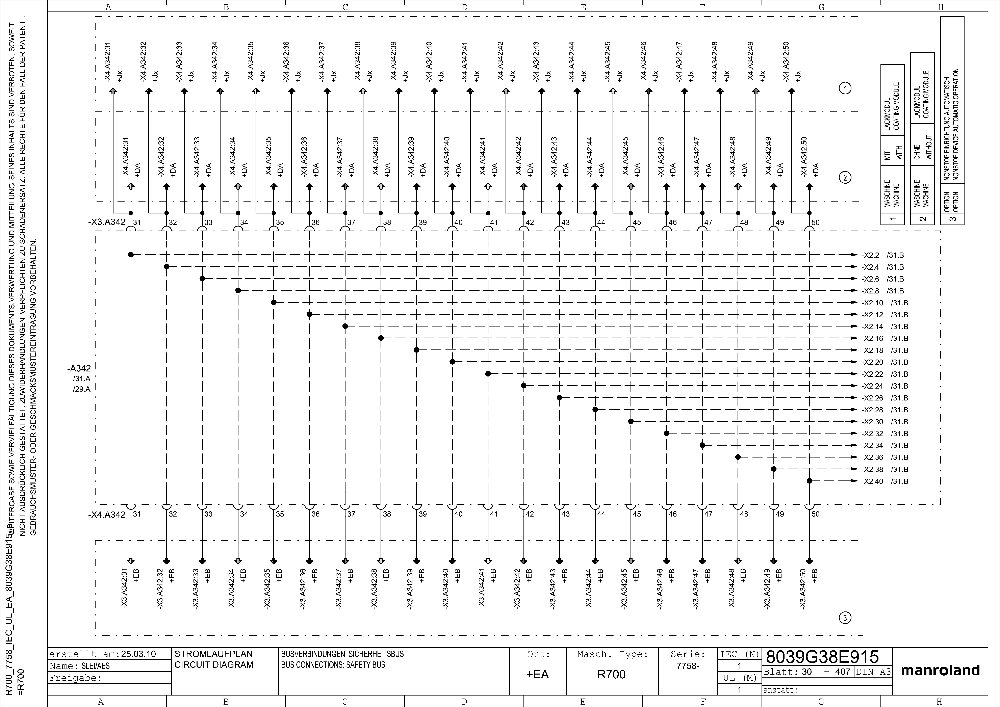

# +EA — Sheet 30 of 407 — BUSVERBINDUNGEN: SICHERHEITSBUS

**BUS CONNECTIONS: SAFETY BUS**

> Part of the manroland **R700** printing press IEC/UL circuit diagrams.
> Drawing class: **Stromlaufplan / Circuit diagram** (DIN A3).
> Document `+EA` covers the **Printing unit** machine section.

## At a glance

| Field | Value |
|---|---|
| Document | `+EA`  (8039G38E915) |
| Sheet | **30** of 407 |
| Section (DE) | BUSVERBINDUNGEN: SICHERHEITSBUS |
| Section (EN) | BUS CONNECTIONS: SAFETY BUS |
| Section type | CIRCUIT — Circuit diagram |
| Machine type | `R700` |
| Series | `7758` |
| Created | 25.03.10 |
| Replaces | — |
| Columns used | A, B, C, D, E, F, G, H |
| Path numbers | — |
| Labels on sheet | 227 |
| Cross-refs out | 22 |
| Cross-refs in | 62 |

**Previous:** [+EA sheet 29](SHEET_0029.md) · **Next:** [+EA sheet 31](SHEET_0031.md) · **Document TOC:** [_TOC.md](_TOC.md)  (+EA) · **Master TOC:** [all sheets](../_MASTER_TOC.md)

## Sheet image (300 DPI, exact vector render)



_Rendered directly from the PDF vector layer at 300 DPI (1-bit), no OCR and no resampling. Use it to confirm anything ambiguous in the text below._

## Cross-references on this sheet

Each entry is a wire leaving this sheet. The printed token is `/sheet.column`; the link resolves to that sheet inside the same document.

| Ref | Target sheet | Col | Path | Destination on target | Target section | From col |
|---|---|---|---|---|---|---|
| `/31.B` | [+EA sheet 31](SHEET_0031.md) | B | — | X2.2 | BUSVERBINDUNGEN: SICHERHEITSBUS | H |
| `/31.B` | [+EA sheet 31](SHEET_0031.md) | B | — | X2.4 | BUSVERBINDUNGEN: SICHERHEITSBUS | H |
| `/31.B` | [+EA sheet 31](SHEET_0031.md) | B | — | X2.6 | BUSVERBINDUNGEN: SICHERHEITSBUS | H |
| `/31.B` | [+EA sheet 31](SHEET_0031.md) | B | — | X2.8 | BUSVERBINDUNGEN: SICHERHEITSBUS | H |
| `/31.B` | [+EA sheet 31](SHEET_0031.md) | B | — | X2.10 | BUSVERBINDUNGEN: SICHERHEITSBUS | H |
| `/31.B` | [+EA sheet 31](SHEET_0031.md) | B | — | X2.12 | BUSVERBINDUNGEN: SICHERHEITSBUS | H |
| `/31.B` | [+EA sheet 31](SHEET_0031.md) | B | — | X2.14 | BUSVERBINDUNGEN: SICHERHEITSBUS | H |
| `/31.B` | [+EA sheet 31](SHEET_0031.md) | B | — | X2.16 | BUSVERBINDUNGEN: SICHERHEITSBUS | H |
| `/31.B` | [+EA sheet 31](SHEET_0031.md) | B | — | X2.18 | BUSVERBINDUNGEN: SICHERHEITSBUS | H |
| `/31.B` | [+EA sheet 31](SHEET_0031.md) | B | — | X2.20 | BUSVERBINDUNGEN: SICHERHEITSBUS | H |
| `/31.B` | [+EA sheet 31](SHEET_0031.md) | B | — | X2.22 | BUSVERBINDUNGEN: SICHERHEITSBUS | H |
| `/31.A` | [+EA sheet 31](SHEET_0031.md) | A | — | — | BUSVERBINDUNGEN: SICHERHEITSBUS | A |
| `/29.A` | [+EA sheet 29](SHEET_0029.md) | A | — | — | BUSVERBINDUNGEN: SICHERHEITSBUS | A |
| `/31.B` | [+EA sheet 31](SHEET_0031.md) | B | — | X2.24 | BUSVERBINDUNGEN: SICHERHEITSBUS | H |
| `/31.B` | [+EA sheet 31](SHEET_0031.md) | B | — | X2.26 | BUSVERBINDUNGEN: SICHERHEITSBUS | H |
| `/31.B` | [+EA sheet 31](SHEET_0031.md) | B | — | X2.28 | BUSVERBINDUNGEN: SICHERHEITSBUS | H |
| `/31.B` | [+EA sheet 31](SHEET_0031.md) | B | — | X2.30 | BUSVERBINDUNGEN: SICHERHEITSBUS | H |
| `/31.B` | [+EA sheet 31](SHEET_0031.md) | B | — | X2.32 | BUSVERBINDUNGEN: SICHERHEITSBUS | H |
| `/31.B` | [+EA sheet 31](SHEET_0031.md) | B | — | X2.34 | BUSVERBINDUNGEN: SICHERHEITSBUS | H |
| `/31.B` | [+EA sheet 31](SHEET_0031.md) | B | — | X2.36 | BUSVERBINDUNGEN: SICHERHEITSBUS | H |
| `/31.B` | [+EA sheet 31](SHEET_0031.md) | B | — | X2.38 | BUSVERBINDUNGEN: SICHERHEITSBUS | H |
| `/31.B` | [+EA sheet 31](SHEET_0031.md) | B | — | X2.40 | BUSVERBINDUNGEN: SICHERHEITSBUS | H |

### Incoming references (sheets that point here)

Every other sheet that sends a wire to this one. `Back-ref` is the token printed on *that* sheet; `Path` is its line number.

| From sheet | Cols | Back-ref | Path | Refs | What continues there |
|---|---|---|---|---|---|
| [+EA#29](SHEET_0029.md) | A | `/29.A` | — | 1 | — |
| [+EA#31](SHEET_0031.md) | A | `/31.A` | — | 21 | X2.10; X2.12; X2.14; X2.16; X2.18; X2.2; X2.20; X2.22; X2.24; X2.26; X2.28; X2.30; X2.32; X2.34; X2.36; X2.38; X2.4; X2.40; X2.6; X2.8 |
| [+EA#234](SHEET_0234.md) | B | `/234.B` | — | 20 | — |
| [+EA#236](SHEET_0236.md) | H | `/236.H` | — | 20 | — |


## Devices on this sheet

| Tag | Class | Class meaning (IEC) | Col | Sub | Terminal | Sign |
|---|---|---|---|---|---|---|
| `A342` | A | Baugruppe / assembly, module, PC board | A | — | — | — |
| `X3.A342` | — | cross-device reference | A | — | — | — |
| `X4.A342:31` | — | cross-device reference | A | — | 31 | — |
| `X4.A342:32` | — | cross-device reference | A | — | 32 | — |
| `X4.A342:33` | — | cross-device reference | B | — | 33 | — |
| `X4.A342:34` | — | cross-device reference | B | — | 34 | — |
| `X4.A342:35` | — | cross-device reference | B | — | 35 | — |
| `X4.A342:36` | — | cross-device reference | C | — | 36 | — |
| `X4.A342:37` | — | cross-device reference | C | — | 37 | — |
| `X4.A342:38` | — | cross-device reference | C | — | 38 | — |
| `X4.A342:39` | — | cross-device reference | C | — | 39 | — |
| `X4.A342:40` | — | cross-device reference | D | — | 40 | — |
| `X4.A342:41` | — | cross-device reference | D | — | 41 | — |
| `X4.A342:42` | — | cross-device reference | D | — | 42 | — |
| `X4.A342:43` | — | cross-device reference | E | — | 43 | — |
| `X4.A342:44` | — | cross-device reference | E | — | 44 | — |
| `X4.A342:45` | — | cross-device reference | E | — | 45 | — |
| `X4.A342:46` | — | cross-device reference | F | — | 46 | — |
| `X4.A342:47` | — | cross-device reference | F | — | 47 | — |
| `X4.A342:48` | — | cross-device reference | F | — | 48 | — |
| `X4.A342:49` | — | cross-device reference | F | — | 49 | — |
| `X4.A342:50` | — | cross-device reference | G | — | 50 | — |
| `X4.A342:31` | — | cross-device reference | A | — | 31 | — |
| `X4.A342:32` | — | cross-device reference | A | — | 32 | — |
| `X4.A342:33` | — | cross-device reference | B | — | 33 | — |
| `X4.A342:34` | — | cross-device reference | B | — | 34 | — |
| `X4.A342:35` | — | cross-device reference | B | — | 35 | — |
| `X4.A342:36` | — | cross-device reference | C | — | 36 | — |
| `X4.A342:37` | — | cross-device reference | C | — | 37 | — |
| `X4.A342:38` | — | cross-device reference | C | — | 38 | — |
| `X4.A342:39` | — | cross-device reference | D | — | 39 | — |
| `X4.A342:40` | — | cross-device reference | D | — | 40 | — |
| `X4.A342:41` | — | cross-device reference | D | — | 41 | — |
| `X4.A342:42` | — | cross-device reference | D | — | 42 | — |
| `X4.A342:43` | — | cross-device reference | E | — | 43 | — |
| `X4.A342:44` | — | cross-device reference | E | — | 44 | — |
| `X4.A342:45` | — | cross-device reference | E | — | 45 | — |
| `X4.A342:46` | — | cross-device reference | F | — | 46 | — |
| `X4.A342:47` | — | cross-device reference | F | — | 47 | — |
| `X4.A342:48` | — | cross-device reference | F | — | 48 | — |
| `X4.A342:49` | — | cross-device reference | G | — | 49 | — |
| `X4.A342:50` | — | cross-device reference | G | — | 50 | — |
| `X3.A342:31` | — | cross-device reference | A | — | 31 | — |
| `X3.A342:32` | — | cross-device reference | A | — | 32 | — |
| `X3.A342:33` | — | cross-device reference | B | — | 33 | — |
| `X3.A342:34` | — | cross-device reference | B | — | 34 | — |
| `X3.A342:35` | — | cross-device reference | B | — | 35 | — |
| `X3.A342:36` | — | cross-device reference | C | — | 36 | — |
| `X3.A342:37` | — | cross-device reference | C | — | 37 | — |
| `X3.A342:38` | — | cross-device reference | C | — | 38 | — |
| `X3.A342:39` | — | cross-device reference | D | — | 39 | — |
| `X3.A342:40` | — | cross-device reference | D | — | 40 | — |
| `X3.A342:41` | — | cross-device reference | D | — | 41 | — |
| `X3.A342:42` | — | cross-device reference | D | — | 42 | — |
| `X3.A342:43` | — | cross-device reference | E | — | 43 | — |
| `X3.A342:44` | — | cross-device reference | E | — | 44 | — |
| `X3.A342:45` | — | cross-device reference | E | — | 45 | — |
| `X3.A342:46` | — | cross-device reference | F | — | 46 | — |
| `X3.A342:47` | — | cross-device reference | F | — | 47 | — |
| `X3.A342:48` | — | cross-device reference | F | — | 48 | — |
| `X3.A342:49` | — | cross-device reference | G | — | 49 | — |
| `X3.A342:50` | — | cross-device reference | G | — | 50 | — |
| `X2.18` | — | cross-device reference | G | — | — | — |
| `X2.16` | — | cross-device reference | G | — | — | — |
| `X2.14` | — | cross-device reference | G | — | — | — |
| `X2.12` | — | cross-device reference | G | — | — | — |
| `X2.2` | — | cross-device reference | G | — | — | — |
| `X2.10` | — | cross-device reference | G | — | — | — |
| `X2.8` | — | cross-device reference | G | — | — | — |
| `X2.6` | — | cross-device reference | G | — | — | — |
| `X2.4` | — | cross-device reference | G | — | — | — |
| `X2.20` | — | cross-device reference | G | — | — | — |
| `X2.22` | — | cross-device reference | G | — | — | — |
| `X2.40` | — | cross-device reference | G | — | — | — |
| `X2.30` | — | cross-device reference | G | — | — | — |
| `X2.28` | — | cross-device reference | G | — | — | — |
| `X2.26` | — | cross-device reference | G | — | — | — |
| `X2.24` | — | cross-device reference | G | — | — | — |
| `X2.38` | — | cross-device reference | G | — | — | — |
| `X2.36` | — | cross-device reference | G | — | — | — |
| `X2.34` | — | cross-device reference | G | — | — | — |
| `X2.32` | — | cross-device reference | G | — | — | — |
| `X4.A342` | — | cross-device reference | A | — | — | — |

## Potentials / nets

_No named potentials on this sheet._

## Wire-end annotations (grouped as printed)

A wire that continues elsewhere is annotated with a small cluster: the destination description, the path/line number `#NN`, and the `/sheet.column` cross reference. Each row below is one such cluster exactly as it is grouped on the drawing.

| Col | Y | Path | Cross-ref | Text on the wire |
|---|---|---|---|---|
| A | 49.3 | — | — | `X4.A342:31` |
| A | 49.3 | — | — | `X4.A342:32` |
| B | 49.3 | — | — | `X4.A342:33` |
| B | 49.3 | — | — | `X4.A342:34` |
| B | 49.3 | — | — | `X4.A342:35` |
| C | 49.3 | — | — | `X4.A342:36` |
| C | 49.3 | — | — | `X4.A342:37` |
| C | 49.3 | — | — | `X4.A342:38` |
| C | 49.3 | — | — | `X4.A342:39` |
| D | 49.3 | — | — | `X4.A342:40` |
| D | 49.3 | — | — | `X4.A342:41` |
| D | 49.3 | — | — | `X4.A342:42` |
| E | 49.3 | — | — | `X4.A342:43` |
| E | 49.3 | — | — | `X4.A342:44` |
| E | 49.3 | — | — | `X4.A342:45` |
| F | 49.3 | — | — | `X4.A342:46` |
| F | 49.3 | — | — | `X4.A342:47` |
| F | 49.3 | — | — | `X4.A342:48` |
| F | 49.3 | — | — | `X4.A342:49` |
| G | 49.3 | — | — | `X4.A342:50` |
| H | 81.3 | — | — | `NONSTOP DEVICE AUTOMATIC OPERATION` |
| H | 83.8 | — | — | `COATING MODULE` |
| A | 84.5 | — | — | `+Jx` |
| A | 84.5 | — | — | `+Jx` |
| B | 84.5 | — | — | `+Jx` |
| B | 84.5 | — | — | `+Jx` |
| B | 84.5 | — | — | `+Jx` |
| C | 84.5 | — | — | `+Jx` |
| C | 84.5 | — | — | `+Jx` |
| C | 84.5 | — | — | `+Jx` |
| D | 84.5 | — | — | `+Jx` |
| D | 84.5 | — | — | `+Jx` |
| D | 84.5 | — | — | `+Jx` |
| D | 84.5 | — | — | `+Jx` |
| E | 84.5 | — | — | `+Jx` |
| E | 84.5 | — | — | `+Jx` |
| E | 84.5 | — | — | `+Jx` |
| F | 84.5 | — | — | `+Jx` |
| F | 84.5 | — | — | `+Jx` |
| F | 84.5 | — | — | `+Jx` |
| G | 84.5 | — | — | `+Jx` |
| G | 84.5 | — | — | `+Jx` |
| H | 91.6 | — | — | `NONSTOP EINRICHTUNG AUTOMATISCH OPTION` |
| H | 98.0 | — | — | `COATING MODULE` |
| G | 101.8 | — | — | `1` |
| H | 102.4 | — | — | `LACKMODUL` |
| H | 116.6 | — | — | `LACKMODUL` |
| H | 160.3 | — | — | `WITHOUT` |
| A | 162.7 | — | — | `X4.A342:31` |
| A | 162.7 | — | — | `X4.A342:32` |
| B | 162.7 | — | — | `X4.A342:33` |
| B | 162.7 | — | — | `X4.A342:34` |
| B | 162.7 | — | — | `X4.A342:35` |
| C | 162.7 | — | — | `X4.A342:36` |
| C | 162.7 | — | — | `X4.A342:37` |
| C | 162.7 | — | — | `X4.A342:38` |
| D | 162.7 | — | — | `X4.A342:39` |
| D | 162.7 | — | — | `X4.A342:40` |
| D | 162.7 | — | — | `X4.A342:41` |
| D | 162.7 | — | — | `X4.A342:42` |
| E | 162.7 | — | — | `X4.A342:43` |
| E | 162.7 | — | — | `X4.A342:44` |
| E | 162.7 | — | — | `X4.A342:45` |
| F | 162.7 | — | — | `X4.A342:46` |
| F | 162.7 | — | — | `X4.A342:47` |
| F | 162.7 | — | — | `X4.A342:48` |
| G | 162.7 | — | — | `X4.A342:49` |
| G | 162.7 | — | — | `X4.A342:50` |
| H | 172.1 | — | — | `OHNE 2 MACHINE` |
| H | 173.2 | — | — | `WITH` |
| H | 179.6 | — | — | `MIT 1 MACHINE` |
| A | 194.2 | — | — | `+DA` |
| B | 194.2 | — | — | `+DA` |
| B | 194.2 | — | — | `+DA` |
| B | 194.2 | — | — | `+DA` |
| B | 194.2 | — | — | `+DA` |
| C | 194.2 | — | — | `+DA` |
| C | 194.2 | — | — | `+DA` |
| C | 194.2 | — | — | `+DA` |
| D | 194.2 | — | — | `+DA` |
| D | 194.2 | — | — | `+DA` |
| D | 194.2 | — | — | `+DA` |
| E | 194.2 | — | — | `+DA` |
| E | 194.2 | — | — | `+DA` |
| E | 194.2 | — | — | `+DA` |
| E | 194.2 | — | — | `+DA` |
| F | 194.2 | — | — | `+DA` |
| F | 194.2 | — | — | `+DA` |
| F | 194.2 | — | — | `+DA` |
| G | 194.2 | — | — | `+DA` |
| G | 194.2 | — | — | `+DA` |
| G | 208.6 | — | — | `2` |
| H | 214.1 | — | — | `MASCHINE` |
| H | 214.1 | — | — | `MASCHINE` |
| H | 228.3 | — | — | `OPTION 3` |
| D | 259.7 | — | — | `X3.A342 31 32 33 34 35 36 37 38 39 40 41 42 43 44 45 46 47 48 49 50` |
| H | 300.0 | — | `/31.B` | `X2.2` |
| H | 314.2 | — | `/31.B` | `X2.4` |
| H | 328.4 | — | `/31.B` | `X2.6` |
| H | 342.5 | — | `/31.B` | `X2.8` |
| H | 356.7 | — | `/31.B` | `X2.10` |
| H | 370.9 | — | `/31.B` | `X2.12` |
| H | 385.1 | — | `/31.B` | `X2.14` |
| H | 399.2 | — | `/31.B` | `X2.16` |
| H | 413.4 | — | `/31.B` | `X2.18` |
| H | 427.6 | — | `/31.B` | `X2.20` |
| A | 434.0 | — | — | `A342` |
| H | 441.7 | — | `/31.B` | `X2.22` |
| A | 447.1 | — | `/31.A`, `/29.A` | — |
| H | 455.9 | — | `/31.B` | `X2.24` |
| H | 470.1 | — | `/31.B` | `X2.26` |
| H | 484.3 | — | `/31.B` | `X2.28` |
| H | 498.4 | — | `/31.B` | `X2.30` |
| H | 512.6 | — | `/31.B` | `X2.32` |
| H | 526.8 | — | `/31.B` | `X2.34` |
| H | 541.0 | — | `/31.B` | `X2.36` |
| H | 555.1 | — | `/31.B` | `X2.38` |
| H | 569.3 | — | `/31.B` | `X2.40` |
| A | 608.3 | — | — | `X4.A342` |
| D | 608.4 | — | — | `31 32 33 34 35 36 37 38 39 40 41 42 43 44 45 46 47 48 49 50` |
| A | 675.8 | — | — | `X3.A342:31` |
| D | 675.8 | — | — | `X3.A342:41` |
| A | 676.9 | — | — | `X3.A342:32` |
| D | 676.9 | — | — | `X3.A342:42` |
| A | 677.2 | — | — | `+EB` |
| B | 677.2 | — | — | `+EB` |
| B | 677.2 | — | — | `X3.A342:33` |
| B | 677.2 | — | — | `+EB` |
| B | 677.2 | — | — | `X3.A342:34` |
| B | 677.2 | — | — | `+EB` |
| B | 677.2 | — | — | `X3.A342:35` |
| B | 677.2 | — | — | `+EB` |
| C | 677.2 | — | — | `X3.A342:36` |
| C | 677.2 | — | — | `+EB` |
| C | 677.2 | — | — | `X3.A342:37` |
| C | 677.2 | — | — | `+EB` |
| C | 677.2 | — | — | `X3.A342:38` |
| C | 677.2 | — | — | `+EB` |
| D | 677.2 | — | — | `X3.A342:39` |
| D | 677.2 | — | — | `+EB` |
| D | 677.2 | — | — | `X3.A342:40` |
| D | 677.2 | — | — | `+EB` |
| D | 677.2 | — | — | `+EB` |
| E | 677.2 | — | — | `+EB` |
| E | 677.2 | — | — | `X3.A342:43` |
| E | 677.2 | — | — | `+EB` |
| E | 677.2 | — | — | `X3.A342:44` |
| E | 677.2 | — | — | `+EB` |
| E | 677.2 | — | — | `X3.A342:45` |
| E | 677.2 | — | — | `+EB` |
| F | 677.2 | — | — | `X3.A342:46` |
| F | 677.2 | — | — | `+EB` |
| F | 677.2 | — | — | `X3.A342:47` |
| F | 677.2 | — | — | `+EB` |
| F | 677.2 | — | — | `X3.A342:48` |
| F | 677.2 | — | — | `+EB` |
| G | 677.2 | — | — | `X3.A342:49` |
| G | 677.2 | — | — | `+EB` |
| G | 677.2 | — | — | `X3.A342:50` |
| G | 677.2 | — | — | `+EB` |
| G | 733.0 | — | — | `3` |


## Reconstructed tables

This sheet carries tabular content (pin map / terminal assignment / index). The grid below was rebuilt from the drawing's own rule lines, so each row is exactly one physical row of the table.

### Table 1 — 26 data rows × 46 columns (at x=134.6, y=0.0)

| +Jx X4.A342:31 | X4.A342:32 +DA 31 | +Jx X4.A342:32 |  | X4.A342:33 +DA 32 | +Jx X4.A342:33 | X4.A342:34 +DA 33 | +Jx X4.A342:34 | X4.A342:35 +DA 34 | +Jx X4.A342:35 |  | X4.A342:36 +DA 35 | +Jx X4.A342:36 | X4.A342:37 +DA 36 | +Jx X4.A342:37 | X4.A342:38 +DA 37 | +Jx X4.A342:38 | X4.A342:39 +DA 38 | +Jx X4.A342:39 | X4.A342:40 +DA 39 | +Jx X4.A342:40 | X4.A342:41 +DA 40 | +Jx X4.A342:41 | X4.A342:42 +DA 41 |  | +Jx X4.A342:42 | X4.A342:43 +DA 42 | +Jx X4.A342:43 | +DA 43 | X4.A342:44 | +Jx X4.A342:44 | X4.A342:45 +DA 44 | +Jx X4.A342:45 | X4.A342:46 +DA 45 | +Jx | X4.A342:46 | X4.A342:47 +DA 46 | +Jx X4.A342:47 | X4.A342:48 +DA 47 | +Jx X4.A342:48 | X4.A342:49 +DA 48 |  | +Jx X4.A342:49 | X4.A342:50 +DA 49 | +Jx X4.A342:50 | 1 LACKMODUL MIT +DA 2 MASCHINE 50 |
|---|---|---|---|---|---|---|---|---|---|---|---|---|---|---|---|---|---|---|---|---|---|---|---|---|---|---|---|---|---|---|---|---|---|---|---|---|---|---|---|---|---|---|---|---|---|
|  |  |  |  |  |  |  |  |  |  |  |  |  |  |  |  |  |  |  |  |  |  |  |  |  |  |  |  |  |  |  |  |  |  |  |  |  |  |  |  |  |  |  |  |  | `X2.2` |
|  |  |  |  |  |  |  |  |  |  |  |  |  |  |  |  |  |  |  |  |  |  |  |  |  |  |  |  |  |  |  |  |  |  |  |  |  |  |  |  |  |  |  |  |  | `X2.4` |
|  |  |  |  |  |  |  |  |  |  |  |  |  |  |  |  |  |  |  |  |  |  |  |  |  |  |  |  |  |  |  |  |  |  |  |  |  |  |  |  |  |  |  |  |  | `X2.6` |
|  |  |  |  |  |  |  |  |  |  |  |  |  |  |  |  |  |  |  |  |  |  |  |  |  |  |  |  |  |  |  |  |  |  |  |  |  |  |  |  |  |  |  |  |  | `X2.8` |
|  |  |  |  |  |  |  |  |  |  |  |  |  |  |  |  |  |  |  |  |  |  |  |  |  |  |  |  |  |  |  |  |  |  |  |  |  |  |  |  |  |  |  |  |  | `X2.10` |
|  |  |  |  |  |  |  |  |  |  |  |  |  |  |  |  |  |  |  |  |  |  |  |  |  |  |  |  |  |  |  |  |  |  |  |  |  |  |  |  |  |  |  |  |  | `X2.12` |
|  |  |  |  |  |  |  |  |  |  |  |  |  |  |  |  |  |  |  |  |  |  |  |  |  |  |  |  |  |  |  |  |  |  |  |  |  |  |  |  |  |  |  |  |  | `X2.14` |
|  |  |  |  |  |  |  |  |  |  |  |  |  |  |  |  |  |  |  |  |  |  |  |  |  |  |  |  |  |  |  |  |  |  |  |  |  |  |  |  |  |  |  |  |  | `X2.16` |
|  |  |  |  |  |  |  |  |  |  |  |  |  |  |  |  |  |  |  |  |  |  |  |  |  |  |  |  |  |  |  |  |  |  |  |  |  |  |  |  |  |  |  |  |  | `X2.18` |
|  |  |  |  |  |  |  |  |  |  |  |  |  |  |  |  |  |  |  |  |  |  |  |  |  |  |  |  |  |  |  |  |  |  |  |  |  |  |  |  |  |  |  |  |  | `X2.20` |
|  |  |  |  |  |  |  |  |  |  |  |  |  |  |  |  |  |  |  |  |  |  |  |  |  |  |  |  |  |  |  |  |  |  |  |  |  |  |  |  |  |  |  |  |  | `X2.22` |
|  |  |  |  |  |  |  |  |  |  |  |  |  |  |  |  |  |  |  |  |  |  |  |  |  |  |  |  |  |  |  |  |  |  |  |  |  |  |  |  |  |  |  |  |  | `X2.24` |
|  |  |  |  |  |  |  |  |  |  |  |  |  |  |  |  |  |  |  |  |  |  |  |  |  |  |  |  |  |  |  |  |  |  |  |  |  |  |  |  |  |  |  |  |  | `X2.26` |
|  |  |  |  |  |  |  |  |  |  |  |  |  |  |  |  |  |  |  |  |  |  |  |  |  |  |  |  |  |  |  |  |  |  |  |  |  |  |  |  |  |  |  |  |  | `X2.28` |
|  |  |  |  |  |  |  |  |  |  |  |  |  |  |  |  |  |  |  |  |  |  |  |  |  |  |  |  |  |  |  |  |  |  |  |  |  |  |  |  |  |  |  |  |  | `X2.30` |
|  |  |  |  |  |  |  |  |  |  |  |  |  |  |  |  |  |  |  |  |  |  |  |  |  |  |  |  |  |  |  |  |  |  |  |  |  |  |  |  |  |  |  |  |  | `X2.32` |
|  |  |  |  |  |  |  |  |  |  |  |  |  |  |  |  |  |  |  |  |  |  |  |  |  |  |  |  |  |  |  |  |  |  |  |  |  |  |  |  |  |  |  |  |  | `X2.34` |
|  |  |  |  |  |  |  |  |  |  |  |  |  |  |  |  |  |  |  |  |  |  |  |  |  |  |  |  |  |  |  |  |  |  |  |  |  |  |  |  |  |  |  |  |  | `X2.36` |
|  |  |  |  |  |  |  |  |  |  |  |  |  |  |  |  |  |  |  |  |  |  |  |  |  |  |  |  |  |  |  |  |  |  |  |  |  |  |  |  |  |  |  |  |  | `X2.38` |
| `X3.A342:31` | `31 +EB` | `X3.A342:32` |  | `32 +EB` | `X3.A342:33` | `33 +EB` | `X3.A342:34` | `34 +EB` | `X3.A342:35` |  | `35 +EB` | `X3.A342:36` | `36 +EB` | `X3.A342:37` | `37 +EB` | `X3.A342:38` | `38 +EB` | `X3.A342:39` | `39 +EB` | `X3.A342:40` | `40 +EB` | `X3.A342:41` | `41 +EB` |  | `X3.A342:42` | `42 +EB` | `X3.A342:43` | `43 +EB` |  | `X3.A342:44` | `44 +EB` | `X3.A342:45` | `45 +EB` |  | `X3.A342:46` | `46 +EB` | `X3.A342:47` | `47 +EB` | `X3.A342:48` | `48 +EB` |  | `X3.A342:49` | `49 +EB` | `X3.A342:50` | `X2.40 50 +EB 3` |
|  | `25.03.10` |  |  |  |  | `STROMLAUFPLAN` |  |  |  |  |  |  | `BUSVERBINDUNGEN:` |  |  | `SICHERHEITSBUS` |  |  |  |  |  |  |  |  |  | `Ort:` |  |  |  |  |  | `Masch. Type:` |  |  |  |  | `Serie:` |  | `IEC` | `(N)` |  |  |  |  | `8039G38E915` |
|  |  |  |  |  | `CIRCUIT` |  | `DIAGRAM` |  |  |  |  |  |  |  |  |  |  |  |  |  |  |  |  |  |  |  |  |  |  |  |  |  |  |  |  |  |  |  |  |  |  |  |  |  |  |
|  |  |  |  |  |  |  |  |  |  |  | `BUS` |  | `CONNECTIONS:` |  | `SAFETY` | `BUS` |  |  |  |  |  |  |  |  |  |  |  |  |  |  |  |  |  |  |  |  | `7758` |  |  | `1` |  |  |  |  |  |
|  |  |  |  |  |  |  |  |  |  |  |  |  |  |  |  |  |  |  |  |  |  |  |  |  |  | `+EA` |  |  |  |  | `R700` |  |  |  |  |  |  |  |  |  |  |  | `Blatt:` | `30` | `DIN A3 407` |
|  |  |  |  |  |  |  |  |  |  |  |  |  |  |  |  |  |  |  |  |  |  |  |  |  |  |  |  |  |  |  |  |  |  |  |  |  |  |  | `UL` | `(M)` |  |  |  |  |  |
|  |  |  |  |  |  |  |  |  |  |  |  |  |  |  |  |  |  |  |  |  |  |  |  |  |  |  |  |  |  |  |  |  |  |  |  |  |  |  |  | `1` |  |  | `anstatt:` |  |  |


## Notes and free text on this sheet

| Text | Col | Y (pt) |
|---|---|---|
| `+Jx` | A | 84.47 |
| `+Jx` | B | 84.47 |
| `+Jx` | C | 84.47 |
| `+Jx` | D | 84.47 |
| `+Jx` | E | 84.47 |
| `+Jx` | F | 84.47 |
| `+Jx` | G | 84.47 |
| `+DA` | A | 194.18 |
| `+DA` | B | 194.18 |
| `+DA` | C | 194.18 |
| `+DA` | D | 194.18 |
| `+DA` | E | 194.18 |
| `+DA` | F | 194.18 |
| `+DA` | G | 194.18 |
| `+EB` | A | 677.2 |
| `+EB` | B | 677.2 |
| `+EB` | C | 677.2 |
| `+EB` | D | 677.2 |
| `+EB` | E | 677.2 |
| `+EB` | F | 677.2 |
| `+EB` | G | 677.2 |
| `MASCHINE` | H | 214.05 |
| `MACHINE` | H | 218.28 |
| `OHNE` | H | 172.05 |
| `WITHOUT` | H | 160.26 |
| `LACKMODUL` | H | 102.4 |
| `COATING MODULE` | H | 83.8 |
| `OPTION` | H | 228.29 |
| `NONSTOP EINRICHTUNG AUTOMATISCH` | H | 91.6 |
| `NONSTOP DEVICE AUTOMATIC OPERATION` | H | 81.34 |
| `MIT` | H | 179.58 |
| `WITH` | H | 173.17 |

## Complete label inventory (exact text from the drawing)

Every text object inside the drawing area of this sheet, in DIN reading order (column A→H, then top→bottom). This is the authoritative list: if a string is not here it is not printed on this sheet.

| Col | Y | X | Dir | Type | Text |
|---|---|---|---|---|---|
| A | 49.3 | 124.3 | ↕ | device ref | `X4.A342:31` |
| A | 49.3 | 166.8 | ↕ | device ref | `X4.A342:32` |
| A | 84.5 | 138.5 | ↕ | text | `+Jx` |
| A | 84.5 | 181.1 | ↕ | text | `+Jx` |
| A | 162.7 | 145.6 | ↕ | device ref | `X4.A342:31` |
| A | 162.7 | 188.1 | ↕ | device ref | `X4.A342:32` |
| A | 194.2 | 159.7 | ↕ | text | `+DA` |
| A | 259.7 | 105.2 | → | device ref | `X3.A342` |
| A | 261.1 | 158.5 | → | number | `31` |
| A | 434.0 | 79.9 | → | device tag | `A342` |
| A | 447.1 | 87.0 | → | cross-reference | `/31.A` |
| A | 459.5 | 87.0 | → | cross-reference | `/29.A` |
| A | 608.3 | 105.2 | → | device ref | `X4.A342` |
| A | 608.4 | 158.5 | → | number | `31` |
| A | 675.8 | 144.1 | ↕ | device ref | `X3.A342:31` |
| A | 676.9 | 186.7 | ↕ | device ref | `X3.A342:32` |
| A | 677.2 | 158.3 | ↕ | text | `+EB` |
| B | 49.3 | 209.3 | ↕ | device ref | `X4.A342:33` |
| B | 49.3 | 251.9 | ↕ | device ref | `X4.A342:34` |
| B | 49.3 | 294.4 | ↕ | device ref | `X4.A342:35` |
| B | 84.5 | 223.6 | ↕ | text | `+Jx` |
| B | 84.5 | 266.1 | ↕ | text | `+Jx` |
| B | 84.5 | 308.6 | ↕ | text | `+Jx` |
| B | 162.7 | 230.6 | ↕ | device ref | `X4.A342:33` |
| B | 162.7 | 273.1 | ↕ | device ref | `X4.A342:34` |
| B | 162.7 | 315.6 | ↕ | device ref | `X4.A342:35` |
| B | 194.2 | 202.3 | ↕ | text | `+DA` |
| B | 194.2 | 244.8 | ↕ | text | `+DA` |
| B | 194.2 | 287.3 | ↕ | text | `+DA` |
| B | 194.2 | 329.8 | ↕ | text | `+DA` |
| B | 261.1 | 201.0 | → | number | `32` |
| B | 261.1 | 243.5 | → | number | `33` |
| B | 261.1 | 286.0 | → | number | `34` |
| B | 261.1 | 328.5 | → | number | `35` |
| B | 608.4 | 201.0 | → | number | `32` |
| B | 608.4 | 243.5 | → | number | `33` |
| B | 608.4 | 286.0 | → | number | `34` |
| B | 608.4 | 328.5 | → | number | `35` |
| B | 677.2 | 200.8 | ↕ | text | `+EB` |
| B | 677.2 | 229.2 | ↕ | device ref | `X3.A342:33` |
| B | 677.2 | 243.3 | ↕ | text | `+EB` |
| B | 677.2 | 271.7 | ↕ | device ref | `X3.A342:34` |
| B | 677.2 | 285.8 | ↕ | text | `+EB` |
| B | 677.2 | 314.2 | ↕ | device ref | `X3.A342:35` |
| B | 677.2 | 328.4 | ↕ | text | `+EB` |
| C | 49.3 | 336.9 | ↕ | device ref | `X4.A342:36` |
| C | 49.3 | 379.4 | ↕ | device ref | `X4.A342:37` |
| C | 49.3 | 421.9 | ↕ | device ref | `X4.A342:38` |
| C | 49.3 | 464.5 | ↕ | device ref | `X4.A342:39` |
| C | 84.5 | 351.1 | ↕ | text | `+Jx` |
| C | 84.5 | 393.7 | ↕ | text | `+Jx` |
| C | 84.5 | 436.2 | ↕ | text | `+Jx` |
| C | 162.7 | 358.2 | ↕ | device ref | `X4.A342:36` |
| C | 162.7 | 400.7 | ↕ | device ref | `X4.A342:37` |
| C | 162.7 | 443.2 | ↕ | device ref | `X4.A342:38` |
| C | 194.2 | 372.3 | ↕ | text | `+DA` |
| C | 194.2 | 414.9 | ↕ | text | `+DA` |
| C | 194.2 | 457.4 | ↕ | text | `+DA` |
| C | 261.1 | 371.1 | → | number | `36` |
| C | 261.1 | 413.6 | → | number | `37` |
| C | 261.1 | 456.1 | → | number | `38` |
| C | 608.4 | 371.1 | → | number | `36` |
| C | 608.4 | 413.6 | → | number | `37` |
| C | 608.4 | 456.1 | → | number | `38` |
| C | 677.2 | 356.7 | ↕ | device ref | `X3.A342:36` |
| C | 677.2 | 370.9 | ↕ | text | `+EB` |
| C | 677.2 | 399.3 | ↕ | device ref | `X3.A342:37` |
| C | 677.2 | 413.4 | ↕ | text | `+EB` |
| C | 677.2 | 441.8 | ↕ | device ref | `X3.A342:38` |
| C | 677.2 | 455.9 | ↕ | text | `+EB` |
| D | 49.3 | 507.0 | ↕ | device ref | `X4.A342:40` |
| D | 49.3 | 549.5 | ↕ | device ref | `X4.A342:41` |
| D | 49.3 | 592.0 | ↕ | device ref | `X4.A342:42` |
| D | 84.5 | 478.7 | ↕ | text | `+Jx` |
| D | 84.5 | 521.2 | ↕ | text | `+Jx` |
| D | 84.5 | 563.7 | ↕ | text | `+Jx` |
| D | 84.5 | 606.3 | ↕ | text | `+Jx` |
| D | 162.7 | 485.7 | ↕ | device ref | `X4.A342:39` |
| D | 162.7 | 528.2 | ↕ | device ref | `X4.A342:40` |
| D | 162.7 | 570.8 | ↕ | device ref | `X4.A342:41` |
| D | 162.7 | 613.3 | ↕ | device ref | `X4.A342:42` |
| D | 194.2 | 499.9 | ↕ | text | `+DA` |
| D | 194.2 | 542.4 | ↕ | text | `+DA` |
| D | 194.2 | 584.9 | ↕ | text | `+DA` |
| D | 261.1 | 498.6 | → | number | `39` |
| D | 261.1 | 541.1 | → | number | `40` |
| D | 261.1 | 583.7 | → | number | `41` |
| D | 608.4 | 498.6 | → | number | `39` |
| D | 608.4 | 541.1 | → | number | `40` |
| D | 608.4 | 583.7 | → | number | `41` |
| D | 675.8 | 569.3 | ↕ | device ref | `X3.A342:41` |
| D | 676.9 | 611.9 | ↕ | device ref | `X3.A342:42` |
| D | 677.2 | 484.3 | ↕ | device ref | `X3.A342:39` |
| D | 677.2 | 498.4 | ↕ | text | `+EB` |
| D | 677.2 | 526.8 | ↕ | device ref | `X3.A342:40` |
| D | 677.2 | 541.0 | ↕ | text | `+EB` |
| D | 677.2 | 583.5 | ↕ | text | `+EB` |
| E | 49.3 | 634.5 | ↕ | device ref | `X4.A342:43` |
| E | 49.3 | 677.1 | ↕ | device ref | `X4.A342:44` |
| E | 49.3 | 719.6 | ↕ | device ref | `X4.A342:45` |
| E | 84.5 | 648.8 | ↕ | text | `+Jx` |
| E | 84.5 | 691.3 | ↕ | text | `+Jx` |
| E | 84.5 | 733.8 | ↕ | text | `+Jx` |
| E | 162.7 | 655.8 | ↕ | device ref | `X4.A342:43` |
| E | 162.7 | 698.3 | ↕ | device ref | `X4.A342:44` |
| E | 162.7 | 740.8 | ↕ | device ref | `X4.A342:45` |
| E | 194.2 | 627.5 | ↕ | text | `+DA` |
| E | 194.2 | 670.0 | ↕ | text | `+DA` |
| E | 194.2 | 712.5 | ↕ | text | `+DA` |
| E | 194.2 | 755.0 | ↕ | text | `+DA` |
| E | 261.1 | 626.2 | → | number | `42` |
| E | 261.1 | 668.7 | → | number | `43` |
| E | 261.1 | 711.2 | → | number | `44` |
| E | 261.1 | 753.7 | → | number | `45` |
| E | 608.4 | 626.2 | → | number | `42` |
| E | 608.4 | 668.7 | → | number | `43` |
| E | 608.4 | 711.2 | → | number | `44` |
| E | 608.4 | 753.7 | → | number | `45` |
| E | 677.2 | 626.0 | ↕ | text | `+EB` |
| E | 677.2 | 654.4 | ↕ | device ref | `X3.A342:43` |
| E | 677.2 | 668.5 | ↕ | text | `+EB` |
| E | 677.2 | 696.9 | ↕ | device ref | `X3.A342:44` |
| E | 677.2 | 711.0 | ↕ | text | `+EB` |
| E | 677.2 | 739.4 | ↕ | device ref | `X3.A342:45` |
| E | 677.2 | 753.6 | ↕ | text | `+EB` |
| F | 49.3 | 762.1 | ↕ | device ref | `X4.A342:46` |
| F | 49.3 | 804.6 | ↕ | device ref | `X4.A342:47` |
| F | 49.3 | 847.1 | ↕ | device ref | `X4.A342:48` |
| F | 49.3 | 889.7 | ↕ | device ref | `X4.A342:49` |
| F | 84.5 | 776.3 | ↕ | text | `+Jx` |
| F | 84.5 | 818.9 | ↕ | text | `+Jx` |
| F | 84.5 | 861.4 | ↕ | text | `+Jx` |
| F | 162.7 | 783.4 | ↕ | device ref | `X4.A342:46` |
| F | 162.7 | 825.9 | ↕ | device ref | `X4.A342:47` |
| F | 162.7 | 868.4 | ↕ | device ref | `X4.A342:48` |
| F | 194.2 | 797.5 | ↕ | text | `+DA` |
| F | 194.2 | 840.1 | ↕ | text | `+DA` |
| F | 194.2 | 882.6 | ↕ | text | `+DA` |
| F | 261.1 | 796.3 | → | number | `46` |
| F | 261.1 | 838.8 | → | number | `47` |
| F | 261.1 | 881.3 | → | number | `48` |
| F | 608.4 | 796.3 | → | number | `46` |
| F | 608.4 | 838.8 | → | number | `47` |
| F | 608.4 | 881.3 | → | number | `48` |
| F | 677.2 | 781.9 | ↕ | device ref | `X3.A342:46` |
| F | 677.2 | 796.1 | ↕ | text | `+EB` |
| F | 677.2 | 824.5 | ↕ | device ref | `X3.A342:47` |
| F | 677.2 | 838.6 | ↕ | text | `+EB` |
| F | 677.2 | 867.0 | ↕ | device ref | `X3.A342:48` |
| F | 677.2 | 881.1 | ↕ | text | `+EB` |
| G | 49.3 | 932.2 | ↕ | device ref | `X4.A342:50` |
| G | 84.5 | 903.9 | ↕ | text | `+Jx` |
| G | 84.5 | 946.4 | ↕ | text | `+Jx` |
| G | 101.8 | 1004.5 | → | number | `1` |
| G | 162.7 | 910.9 | ↕ | device ref | `X4.A342:49` |
| G | 162.7 | 953.4 | ↕ | device ref | `X4.A342:50` |
| G | 194.2 | 925.1 | ↕ | text | `+DA` |
| G | 194.2 | 967.6 | ↕ | text | `+DA` |
| G | 208.6 | 1004.3 | → | number | `2` |
| G | 261.1 | 923.8 | → | number | `49` |
| G | 261.1 | 966.3 | → | number | `50` |
| G | 300.0 | 1025.9 | → | device ref | `X2.2` |
| G | 314.2 | 1025.9 | → | device ref | `X2.4` |
| G | 328.4 | 1025.9 | → | device ref | `X2.6` |
| G | 342.6 | 1025.9 | → | device ref | `X2.8` |
| G | 356.7 | 1025.9 | → | device ref | `X2.10` |
| G | 370.9 | 1025.9 | → | device ref | `X2.12` |
| G | 385.1 | 1025.9 | → | device ref | `X2.14` |
| G | 399.3 | 1025.9 | → | device ref | `X2.16` |
| G | 413.4 | 1025.9 | → | device ref | `X2.18` |
| G | 427.6 | 1025.9 | → | device ref | `X2.20` |
| G | 441.8 | 1025.9 | → | device ref | `X2.22` |
| G | 456.0 | 1025.9 | → | device ref | `X2.24` |
| G | 470.1 | 1025.9 | → | device ref | `X2.26` |
| G | 484.3 | 1025.9 | → | device ref | `X2.28` |
| G | 498.5 | 1025.9 | → | device ref | `X2.30` |
| G | 512.7 | 1025.9 | → | device ref | `X2.32` |
| G | 526.8 | 1025.9 | → | device ref | `X2.34` |
| G | 541.0 | 1025.9 | → | device ref | `X2.36` |
| G | 555.2 | 1025.9 | → | device ref | `X2.38` |
| G | 569.3 | 1025.9 | → | device ref | `X2.40` |
| G | 608.4 | 923.8 | → | number | `49` |
| G | 608.4 | 966.3 | → | number | `50` |
| G | 677.2 | 909.5 | ↕ | device ref | `X3.A342:49` |
| G | 677.2 | 923.6 | ↕ | text | `+EB` |
| G | 677.2 | 952.0 | ↕ | device ref | `X3.A342:50` |
| G | 677.2 | 966.2 | ↕ | text | `+EB` |
| G | 733.0 | 1004.3 | → | number | `3` |
| H | 81.3 | 1135.2 | ↕ | text | `NONSTOP DEVICE AUTOMATIC OPERATION` |
| H | 83.8 | 1099.8 | ↕ | text | `COATING MODULE` |
| H | 91.6 | 1124.6 | ↕ | text | `NONSTOP EINRICHTUNG AUTOMATISCH` |
| H | 98.0 | 1064.3 | ↕ | text | `COATING MODULE` |
| H | 102.4 | 1089.1 | ↕ | text | `LACKMODUL` |
| H | 116.6 | 1053.7 | ↕ | text | `LACKMODUL` |
| H | 160.3 | 1103.3 | ↕ | text | `WITHOUT` |
| H | 172.0 | 1089.1 | ↕ | text | `OHNE` |
| H | 173.2 | 1067.7 | ↕ | text | `WITH` |
| H | 179.6 | 1053.7 | ↕ | text | `MIT` |
| H | 214.0 | 1053.7 | ↕ | text | `MASCHINE` |
| H | 214.0 | 1089.1 | ↕ | text | `MASCHINE` |
| H | 218.3 | 1064.3 | ↕ | text | `MACHINE` |
| H | 218.3 | 1099.8 | ↕ | text | `MACHINE` |
| H | 228.3 | 1124.5 | ↕ | text | `OPTION` |
| H | 228.3 | 1135.2 | ↕ | text | `OPTION` |
| H | 257.4 | 1059.0 | ↕ | number | `1` |
| H | 257.7 | 1094.4 | ↕ | number | `2` |
| H | 257.8 | 1129.9 | ↕ | number | `3` |
| H | 300.0 | 1055.9 | → | cross-reference | `/31.B` |
| H | 314.2 | 1055.9 | → | cross-reference | `/31.B` |
| H | 328.4 | 1055.9 | → | cross-reference | `/31.B` |
| H | 342.5 | 1055.9 | → | cross-reference | `/31.B` |
| H | 356.7 | 1060.9 | → | cross-reference | `/31.B` |
| H | 370.9 | 1060.9 | → | cross-reference | `/31.B` |
| H | 385.1 | 1060.9 | → | cross-reference | `/31.B` |
| H | 399.2 | 1060.9 | → | cross-reference | `/31.B` |
| H | 413.4 | 1060.9 | → | cross-reference | `/31.B` |
| H | 427.6 | 1060.9 | → | cross-reference | `/31.B` |
| H | 441.7 | 1060.9 | → | cross-reference | `/31.B` |
| H | 455.9 | 1060.9 | → | cross-reference | `/31.B` |
| H | 470.1 | 1060.9 | → | cross-reference | `/31.B` |
| H | 484.3 | 1060.9 | → | cross-reference | `/31.B` |
| H | 498.4 | 1060.9 | → | cross-reference | `/31.B` |
| H | 512.6 | 1060.9 | → | cross-reference | `/31.B` |
| H | 526.8 | 1060.9 | → | cross-reference | `/31.B` |
| H | 541.0 | 1060.9 | → | cross-reference | `/31.B` |
| H | 555.1 | 1060.9 | → | cross-reference | `/31.B` |
| H | 569.3 | 1060.9 | → | cross-reference | `/31.B` |

## Reading-order text block

The same content as a plain block, grouped by DIN column — convenient to paste or to match against a visual description.

```text
=== Column A ===
  49.3  124.3  devref       X4.A342:31
  49.3  166.8  devref       X4.A342:32
  84.5  138.5  text         +Jx
  84.5  181.1  text         +Jx
 162.7  145.6  devref       X4.A342:31
 162.7  188.1  devref       X4.A342:32
 194.2  159.7  text         +DA
 259.7  105.2  devref       X3.A342
 261.1  158.5  numeric      31
 434.0   79.9  devtag       A342
 447.1   87.0  xref         /31.A
 459.5   87.0  xref         /29.A
 608.3  105.2  devref       X4.A342
 608.4  158.5  numeric      31
 675.8  144.1  devref       X3.A342:31
 676.9  186.7  devref       X3.A342:32
 677.2  158.3  text         +EB
=== Column B ===
  49.3  209.3  devref       X4.A342:33
  49.3  251.9  devref       X4.A342:34
  49.3  294.4  devref       X4.A342:35
  84.5  223.6  text         +Jx
  84.5  266.1  text         +Jx
  84.5  308.6  text         +Jx
 162.7  230.6  devref       X4.A342:33
 162.7  273.1  devref       X4.A342:34
 162.7  315.6  devref       X4.A342:35
 194.2  202.3  text         +DA
 194.2  244.8  text         +DA
 194.2  287.3  text         +DA
 194.2  329.8  text         +DA
 261.1  201.0  numeric      32
 261.1  243.5  numeric      33
 261.1  286.0  numeric      34
 261.1  328.5  numeric      35
 608.4  201.0  numeric      32
 608.4  243.5  numeric      33
 608.4  286.0  numeric      34
 608.4  328.5  numeric      35
 677.2  200.8  text         +EB
 677.2  229.2  devref       X3.A342:33
 677.2  243.3  text         +EB
 677.2  271.7  devref       X3.A342:34
 677.2  285.8  text         +EB
 677.2  314.2  devref       X3.A342:35
 677.2  328.4  text         +EB
=== Column C ===
  49.3  336.9  devref       X4.A342:36
  49.3  379.4  devref       X4.A342:37
  49.3  421.9  devref       X4.A342:38
  49.3  464.5  devref       X4.A342:39
  84.5  351.1  text         +Jx
  84.5  393.7  text         +Jx
  84.5  436.2  text         +Jx
 162.7  358.2  devref       X4.A342:36
 162.7  400.7  devref       X4.A342:37
 162.7  443.2  devref       X4.A342:38
 194.2  372.3  text         +DA
 194.2  414.9  text         +DA
 194.2  457.4  text         +DA
 261.1  371.1  numeric      36
 261.1  413.6  numeric      37
 261.1  456.1  numeric      38
 608.4  371.1  numeric      36
 608.4  413.6  numeric      37
 608.4  456.1  numeric      38
 677.2  356.7  devref       X3.A342:36
 677.2  370.9  text         +EB
 677.2  399.3  devref       X3.A342:37
 677.2  413.4  text         +EB
 677.2  441.8  devref       X3.A342:38
 677.2  455.9  text         +EB
=== Column D ===
  49.3  507.0  devref       X4.A342:40
  49.3  549.5  devref       X4.A342:41
  49.3  592.0  devref       X4.A342:42
  84.5  478.7  text         +Jx
  84.5  521.2  text         +Jx
  84.5  563.7  text         +Jx
  84.5  606.3  text         +Jx
 162.7  485.7  devref       X4.A342:39
 162.7  528.2  devref       X4.A342:40
 162.7  570.8  devref       X4.A342:41
 162.7  613.3  devref       X4.A342:42
 194.2  499.9  text         +DA
 194.2  542.4  text         +DA
 194.2  584.9  text         +DA
 261.1  498.6  numeric      39
 261.1  541.1  numeric      40
 261.1  583.7  numeric      41
 608.4  498.6  numeric      39
 608.4  541.1  numeric      40
 608.4  583.7  numeric      41
 675.8  569.3  devref       X3.A342:41
 676.9  611.9  devref       X3.A342:42
 677.2  484.3  devref       X3.A342:39
 677.2  498.4  text         +EB
 677.2  526.8  devref       X3.A342:40
 677.2  541.0  text         +EB
 677.2  583.5  text         +EB
=== Column E ===
  49.3  634.5  devref       X4.A342:43
  49.3  677.1  devref       X4.A342:44
  49.3  719.6  devref       X4.A342:45
  84.5  648.8  text         +Jx
  84.5  691.3  text         +Jx
  84.5  733.8  text         +Jx
 162.7  655.8  devref       X4.A342:43
 162.7  698.3  devref       X4.A342:44
 162.7  740.8  devref       X4.A342:45
 194.2  627.5  text         +DA
 194.2  670.0  text         +DA
 194.2  712.5  text         +DA
 194.2  755.0  text         +DA
 261.1  626.2  numeric      42
 261.1  668.7  numeric      43
 261.1  711.2  numeric      44
 261.1  753.7  numeric      45
 608.4  626.2  numeric      42
 608.4  668.7  numeric      43
 608.4  711.2  numeric      44
 608.4  753.7  numeric      45
 677.2  626.0  text         +EB
 677.2  654.4  devref       X3.A342:43
 677.2  668.5  text         +EB
 677.2  696.9  devref       X3.A342:44
 677.2  711.0  text         +EB
 677.2  739.4  devref       X3.A342:45
 677.2  753.6  text         +EB
=== Column F ===
  49.3  762.1  devref       X4.A342:46
  49.3  804.6  devref       X4.A342:47
  49.3  847.1  devref       X4.A342:48
  49.3  889.7  devref       X4.A342:49
  84.5  776.3  text         +Jx
  84.5  818.9  text         +Jx
  84.5  861.4  text         +Jx
 162.7  783.4  devref       X4.A342:46
 162.7  825.9  devref       X4.A342:47
 162.7  868.4  devref       X4.A342:48
 194.2  797.5  text         +DA
 194.2  840.1  text         +DA
 194.2  882.6  text         +DA
 261.1  796.3  numeric      46
 261.1  838.8  numeric      47
 261.1  881.3  numeric      48
 608.4  796.3  numeric      46
 608.4  838.8  numeric      47
 608.4  881.3  numeric      48
 677.2  781.9  devref       X3.A342:46
 677.2  796.1  text         +EB
 677.2  824.5  devref       X3.A342:47
 677.2  838.6  text         +EB
 677.2  867.0  devref       X3.A342:48
 677.2  881.1  text         +EB
=== Column G ===
  49.3  932.2  devref       X4.A342:50
  84.5  903.9  text         +Jx
  84.5  946.4  text         +Jx
 101.8 1004.5  numeric      1
 162.7  910.9  devref       X4.A342:49
 162.7  953.4  devref       X4.A342:50
 194.2  925.1  text         +DA
 194.2  967.6  text         +DA
 208.6 1004.3  numeric      2
 261.1  923.8  numeric      49
 261.1  966.3  numeric      50
 300.0 1025.9  devref       X2.2
 314.2 1025.9  devref       X2.4
 328.4 1025.9  devref       X2.6
 342.6 1025.9  devref       X2.8
 356.7 1025.9  devref       X2.10
 370.9 1025.9  devref       X2.12
 385.1 1025.9  devref       X2.14
 399.3 1025.9  devref       X2.16
 413.4 1025.9  devref       X2.18
 427.6 1025.9  devref       X2.20
 441.8 1025.9  devref       X2.22
 456.0 1025.9  devref       X2.24
 470.1 1025.9  devref       X2.26
 484.3 1025.9  devref       X2.28
 498.5 1025.9  devref       X2.30
 512.7 1025.9  devref       X2.32
 526.8 1025.9  devref       X2.34
 541.0 1025.9  devref       X2.36
 555.2 1025.9  devref       X2.38
 569.3 1025.9  devref       X2.40
 608.4  923.8  numeric      49
 608.4  966.3  numeric      50
 677.2  909.5  devref       X3.A342:49
 677.2  923.6  text         +EB
 677.2  952.0  devref       X3.A342:50
 677.2  966.2  text         +EB
 733.0 1004.3  numeric      3
=== Column H ===
  81.3 1135.2  text         NONSTOP DEVICE AUTOMATIC OPERATION
  83.8 1099.8  text         COATING MODULE
  91.6 1124.6  text         NONSTOP EINRICHTUNG AUTOMATISCH
  98.0 1064.3  text         COATING MODULE
 102.4 1089.1  text         LACKMODUL
 116.6 1053.7  text         LACKMODUL
 160.3 1103.3  text         WITHOUT
 172.0 1089.1  text         OHNE
 173.2 1067.7  text         WITH
 179.6 1053.7  text         MIT
 214.0 1053.7  text         MASCHINE
 214.0 1089.1  text         MASCHINE
 218.3 1064.3  text         MACHINE
 218.3 1099.8  text         MACHINE
 228.3 1124.5  text         OPTION
 228.3 1135.2  text         OPTION
 257.4 1059.0  numeric      1
 257.7 1094.4  numeric      2
 257.8 1129.9  numeric      3
 300.0 1055.9  xref         /31.B
 314.2 1055.9  xref         /31.B
 328.4 1055.9  xref         /31.B
 342.5 1055.9  xref         /31.B
 356.7 1060.9  xref         /31.B
 370.9 1060.9  xref         /31.B
 385.1 1060.9  xref         /31.B
 399.2 1060.9  xref         /31.B
 413.4 1060.9  xref         /31.B
 427.6 1060.9  xref         /31.B
 441.7 1060.9  xref         /31.B
 455.9 1060.9  xref         /31.B
 470.1 1060.9  xref         /31.B
 484.3 1060.9  xref         /31.B
 498.4 1060.9  xref         /31.B
 512.6 1060.9  xref         /31.B
 526.8 1060.9  xref         /31.B
 541.0 1060.9  xref         /31.B
 555.1 1060.9  xref         /31.B
 569.3 1060.9  xref         /31.B
```

---
_Generated from the PDF vector text layer; no OCR. Source: `R700_7758_IEC_UL_EA_8039G38E915_p`, sheet 30._
