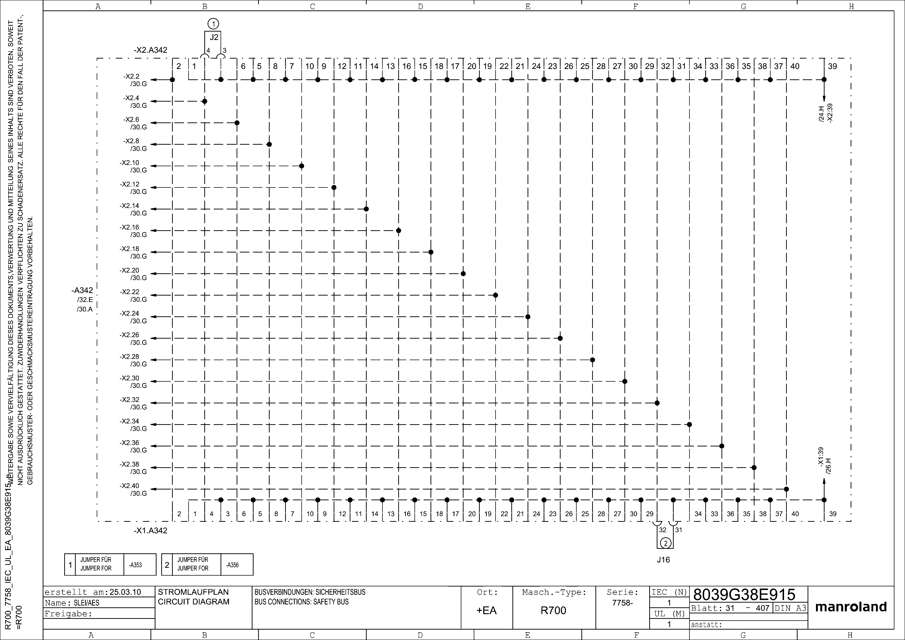

# +EA — Sheet 31 of 407 — BUSVERBINDUNGEN: SICHERHEITSBUS

**BUS CONNECTIONS: SAFETY BUS**

> Part of the manroland **R700** printing press IEC/UL circuit diagrams.
> Drawing class: **Stromlaufplan / Circuit diagram** (DIN A3).
> Document `+EA` covers the **Printing unit** machine section.

## At a glance

| Field | Value |
|---|---|
| Document | `+EA`  (8039G38E915) |
| Sheet | **31** of 407 |
| Section (DE) | BUSVERBINDUNGEN: SICHERHEITSBUS |
| Section (EN) | BUS CONNECTIONS: SAFETY BUS |
| Section type | CIRCUIT — Circuit diagram |
| Machine type | `R700` |
| Series | `7758` |
| Created | 25.03.10 |
| Replaces | — |
| Columns used | A, B, C, D, E, F, G, H |
| Path numbers | — |
| Labels on sheet | 141 |
| Cross-refs out | 24 |
| Cross-refs in | 104 |

**Previous:** [+EA sheet 30](SHEET_0030.md) · **Next:** [+EA sheet 32](SHEET_0032.md) · **Document TOC:** [_TOC.md](_TOC.md)  (+EA) · **Master TOC:** [all sheets](../_MASTER_TOC.md)

## Sheet image (300 DPI, exact vector render)



_Rendered directly from the PDF vector layer at 300 DPI (1-bit), no OCR and no resampling. Use it to confirm anything ambiguous in the text below._

## Cross-references on this sheet

Each entry is a wire leaving this sheet. The printed token is `/sheet.column`; the link resolves to that sheet inside the same document.

| Ref | Target sheet | Col | Path | Destination on target | Target section | From col |
|---|---|---|---|---|---|---|
| `/30.G` | [+EA sheet 30](SHEET_0030.md) | G | — | X2.2 | BUSVERBINDUNGEN: SICHERHEITSBUS | A |
| `/30.G` | [+EA sheet 30](SHEET_0030.md) | G | — | X2.4 | BUSVERBINDUNGEN: SICHERHEITSBUS | A |
| `/24.H` | [+EA sheet 24](SHEET_0024.md) | H | — | — | BUSVERBINDUNGEN: SICHERHEITSBUS | H |
| `/30.G` | [+EA sheet 30](SHEET_0030.md) | G | — | X2.6 | BUSVERBINDUNGEN: SICHERHEITSBUS | A |
| `/30.G` | [+EA sheet 30](SHEET_0030.md) | G | — | X2.8 | BUSVERBINDUNGEN: SICHERHEITSBUS | A |
| `/30.G` | [+EA sheet 30](SHEET_0030.md) | G | — | X2.10 | BUSVERBINDUNGEN: SICHERHEITSBUS | A |
| `/30.G` | [+EA sheet 30](SHEET_0030.md) | G | — | X2.12 | BUSVERBINDUNGEN: SICHERHEITSBUS | A |
| `/30.G` | [+EA sheet 30](SHEET_0030.md) | G | — | X2.14 | BUSVERBINDUNGEN: SICHERHEITSBUS | A |
| `/30.G` | [+EA sheet 30](SHEET_0030.md) | G | — | X2.16 | BUSVERBINDUNGEN: SICHERHEITSBUS | A |
| `/30.G` | [+EA sheet 30](SHEET_0030.md) | G | — | X2.18 | BUSVERBINDUNGEN: SICHERHEITSBUS | A |
| `/30.G` | [+EA sheet 30](SHEET_0030.md) | G | — | X2.20 | BUSVERBINDUNGEN: SICHERHEITSBUS | A |
| `/30.G` | [+EA sheet 30](SHEET_0030.md) | G | — | X2.22 | BUSVERBINDUNGEN: SICHERHEITSBUS | A |
| `/32.E` | [+EA sheet 32](SHEET_0032.md) | E | — | — | BUSVERBINDUNGEN: NOT AUS | A |
| `/30.A` | [+EA sheet 30](SHEET_0030.md) | A | — | — | BUSVERBINDUNGEN: SICHERHEITSBUS | A |
| `/30.G` | [+EA sheet 30](SHEET_0030.md) | G | — | X2.24 | BUSVERBINDUNGEN: SICHERHEITSBUS | A |
| `/30.G` | [+EA sheet 30](SHEET_0030.md) | G | — | X2.26 | BUSVERBINDUNGEN: SICHERHEITSBUS | A |
| `/30.G` | [+EA sheet 30](SHEET_0030.md) | G | — | X2.28 | BUSVERBINDUNGEN: SICHERHEITSBUS | A |
| `/30.G` | [+EA sheet 30](SHEET_0030.md) | G | — | X2.30 | BUSVERBINDUNGEN: SICHERHEITSBUS | A |
| `/30.G` | [+EA sheet 30](SHEET_0030.md) | G | — | X2.32 | BUSVERBINDUNGEN: SICHERHEITSBUS | A |
| `/30.G` | [+EA sheet 30](SHEET_0030.md) | G | — | X2.34 | BUSVERBINDUNGEN: SICHERHEITSBUS | A |
| `/30.G` | [+EA sheet 30](SHEET_0030.md) | G | — | X2.36 | BUSVERBINDUNGEN: SICHERHEITSBUS | A |
| `/26.H` | [+EA sheet 26](SHEET_0026.md) | H | — | X1:39 | BUSVERBINDUNGEN: SICHERHEITSBUS | H |
| `/30.G` | [+EA sheet 30](SHEET_0030.md) | G | — | X2.38 | BUSVERBINDUNGEN: SICHERHEITSBUS | A |
| `/30.G` | [+EA sheet 30](SHEET_0030.md) | G | — | X2.40 | BUSVERBINDUNGEN: SICHERHEITSBUS | A |

### Incoming references (sheets that point here)

Every other sheet that sends a wire to this one. `Back-ref` is the token printed on *that* sheet; `Path` is its line number.

| From sheet | Cols | Back-ref | Path | Refs | What continues there |
|---|---|---|---|---|---|
| [+EA#24](SHEET_0024.md) | H | `/24.H` | — | 1 | — |
| [+EA#26](SHEET_0026.md) | H | `/26.H` | — | 1 | — |
| [+EA#30](SHEET_0030.md) | A, H | `/30.A`, `/30.H` | — | 21 | X2.10; X2.12; X2.14; X2.16; X2.18; X2.2; X2.20; X2.22; X2.24; X2.26; X2.28; X2.30; X2.32; X2.34; X2.36; X2.38; X2.4; X2.40; X2.6; X2.8 |
| [+EA#32](SHEET_0032.md) | D | `/32.D` | — | 1 | — |
| [+EA#209](SHEET_0209.md) | B, C | `/209.B`, `/209.C` | — | 40 | — |
| [+EA#224](SHEET_0224.md) | E, F | `/224.E`, `/224.F` | — | 40 | — |


## Devices on this sheet

| Tag | Class | Class meaning (IEC) | Col | Sub | Terminal | Sign |
|---|---|---|---|---|---|---|
| `A342` | A | Baugruppe / assembly, module, PC board | A | — | — | — |
| `X1:39` | X | Klemme / terminal, plug connector | H | — | 39 | — |
| `X2:39` | X | Klemme / terminal, plug connector | H | — | 39 | — |
| `A353` | A | Baugruppe / assembly, module, PC board | A | — | — | — |
| `A356` | A | Baugruppe / assembly, module, PC board | B | — | — | — |
| `J2` | J |  | B | — | — | — |
| `J16` | J |  | F | — | — | — |
| `X2.14` | — | cross-device reference | A | — | — | — |
| `X2.18` | — | cross-device reference | A | — | — | — |
| `X2.16` | — | cross-device reference | A | — | — | — |
| `X2.12` | — | cross-device reference | A | — | — | — |
| `X2.10` | — | cross-device reference | A | — | — | — |
| `X2.8` | — | cross-device reference | A | — | — | — |
| `X2.6` | — | cross-device reference | A | — | — | — |
| `X2.4` | — | cross-device reference | A | — | — | — |
| `X2.2` | — | cross-device reference | A | — | — | — |
| `X2.20` | — | cross-device reference | A | — | — | — |
| `X2.40` | — | cross-device reference | A | — | — | — |
| `X2.28` | — | cross-device reference | A | — | — | — |
| `X2.26` | — | cross-device reference | A | — | — | — |
| `X2.24` | — | cross-device reference | A | — | — | — |
| `X2.22` | — | cross-device reference | A | — | — | — |
| `X2.38` | — | cross-device reference | A | — | — | — |
| `X2.36` | — | cross-device reference | A | — | — | — |
| `X2.34` | — | cross-device reference | A | — | — | — |
| `X2.32` | — | cross-device reference | A | — | — | — |
| `X2.30` | — | cross-device reference | A | — | — | — |
| `X1.A342` | — | cross-device reference | A | — | — | — |
| `X2.A342` | — | cross-device reference | A | — | — | — |

## Potentials / nets

_No named potentials on this sheet._

## Wire-end annotations (grouped as printed)

A wire that continues elsewhere is annotated with a small cluster: the destination description, the path/line number `#NN`, and the `/sheet.column` cross reference. Each row below is one such cluster exactly as it is grouped on the drawing.

| Col | Y | Path | Cross-ref | Text on the wire |
|---|---|---|---|---|
| B | 28.1 | — | — | `1` |
| B | 44.2 | — | — | `J2` |
| A | 61.2 | — | — | `X2.A342` |
| B | 62.7 | — | — | `4 3` |
| E | 82.5 | — | — | `2 1 6 5 8 7 10 9 12 11 14 13 16 15 18 17 20 19 22 21 24 23 26 25 28 27 30 29 32 31 34 33 36 35 38 37 40 39` |
| A | 96.7 | — | `/30.G` | `X2.2` |
| A | 125.0 | — | `/30.G` | `X2.4` |
| H | 136.1 | — | — | `X2:39` |
| H | 139.5 | — | `/24.H` | — |
| A | 153.3 | — | `/30.G` | `X2.6` |
| A | 181.7 | — | `/30.G` | `X2.8` |
| A | 210.1 | — | `/30.G` | `X2.10` |
| A | 238.4 | — | `/30.G` | `X2.12` |
| A | 266.8 | — | `/30.G` | `X2.14` |
| A | 295.1 | — | `/30.G` | `X2.16` |
| A | 323.4 | — | `/30.G` | `X2.18` |
| A | 351.8 | — | `/30.G` | `X2.20` |
| A | 377.3 | — | — | `A342` |
| A | 380.1 | — | `/30.G` | `X2.22` |
| A | 390.4 | — | `/32.E`, `/30.A` | — |
| A | 408.5 | — | `/30.G` | `X2.24` |
| A | 436.8 | — | `/30.G` | `X2.26` |
| A | 465.2 | — | `/30.G` | `X2.28` |
| A | 493.5 | — | `/30.G` | `X2.30` |
| A | 521.9 | — | `/30.G` | `X2.32` |
| A | 550.2 | — | `/30.G` | `X2.34` |
| A | 578.6 | — | `/30.G` | `X2.36` |
| H | 588.2 | — | `/26.H` | `X1:39` |
| A | 606.9 | — | `/30.G` | `X2.38` |
| A | 635.2 | — | `/30.G` | `X2.40` |
| E | 672.1 | — | — | `2 1 4 3 6 5 8 7 10 9 12 11 14 13 16 15 18 17 20 19 22 21 24 23 26 25 28 27 34 33 36 35 38 37 40 39` |
| F | 672.1 | — | — | `30 29` |
| A | 693.4 | — | — | `X1.A342` |
| F | 693.4 | — | — | `32 31` |
| F | 711.8 | — | — | `2` |
| F | 731.6 | — | — | `J16` |
| A | 733.4 | — | — | `JUMPER FÜR` |
| B | 733.4 | — | — | `JUMPER FÜR` |
| A | 738.7 | — | — | `1 JUMPER FOR A353` |
| B | 738.7 | — | — | `2 JUMPER FOR A356` |


## Reconstructed tables

This sheet carries tabular content (pin map / terminal assignment / index). The grid below was rebuilt from the drawing's own rule lines, so each row is exactly one physical row of the table.

### Table 1 — 2 data rows × 1 columns (at x=1034.6, y=104.9)

| C1 |
|---|
| `/24.H` |
| `X1:39` |


## Notes and free text on this sheet

| Text | Col | Y (pt) |
|---|---|---|
| `JUMPER FÜR` | A | 733.4 |
| `JUMPER FOR` | A | 744.73 |
| `JUMPER FÜR` | B | 733.4 |
| `JUMPER FOR` | B | 744.73 |

## Complete label inventory (exact text from the drawing)

Every text object inside the drawing area of this sheet, in DIN reading order (column A→H, then top→bottom). This is the authoritative list: if a string is not here it is not printed on this sheet.

| Col | Y | X | Dir | Type | Text |
|---|---|---|---|---|---|
| A | 61.3 | 176.0 | → | device ref | `X2.A342` |
| A | 96.7 | 162.4 | → | device ref | `X2.2` |
| A | 106.6 | 171.8 | → | cross-reference | `/30.G` |
| A | 125.0 | 162.1 | → | device ref | `X2.4` |
| A | 134.9 | 171.8 | → | cross-reference | `/30.G` |
| A | 153.4 | 162.1 | → | device ref | `X2.6` |
| A | 163.3 | 171.8 | → | cross-reference | `/30.G` |
| A | 181.7 | 162.1 | → | device ref | `X2.8` |
| A | 191.6 | 171.8 | → | cross-reference | `/30.G` |
| A | 210.1 | 157.3 | → | device ref | `X2.10` |
| A | 220.0 | 171.8 | → | cross-reference | `/30.G` |
| A | 238.4 | 157.6 | → | device ref | `X2.12` |
| A | 248.3 | 171.8 | → | cross-reference | `/30.G` |
| A | 266.7 | 157.3 | → | device ref | `X2.14` |
| A | 276.6 | 171.8 | → | cross-reference | `/30.G` |
| A | 295.1 | 157.3 | → | device ref | `X2.16` |
| A | 305.0 | 171.8 | → | cross-reference | `/30.G` |
| A | 323.4 | 157.3 | → | device ref | `X2.18` |
| A | 333.3 | 171.8 | → | cross-reference | `/30.G` |
| A | 351.8 | 157.3 | → | device ref | `X2.20` |
| A | 361.7 | 171.8 | → | cross-reference | `/30.G` |
| A | 377.3 | 94.1 | → | device tag | `A342` |
| A | 380.1 | 157.6 | → | device ref | `X2.22` |
| A | 390.0 | 171.8 | → | cross-reference | `/30.G` |
| A | 390.4 | 101.8 | → | cross-reference | `/32.E` |
| A | 402.8 | 101.2 | → | cross-reference | `/30.A` |
| A | 408.5 | 157.3 | → | device ref | `X2.24` |
| A | 418.4 | 171.8 | → | cross-reference | `/30.G` |
| A | 436.8 | 157.3 | → | device ref | `X2.26` |
| A | 446.7 | 171.8 | → | cross-reference | `/30.G` |
| A | 465.2 | 157.3 | → | device ref | `X2.28` |
| A | 475.1 | 171.8 | → | cross-reference | `/30.G` |
| A | 493.5 | 157.3 | → | device ref | `X2.30` |
| A | 503.4 | 171.8 | → | cross-reference | `/30.G` |
| A | 521.9 | 157.6 | → | device ref | `X2.32` |
| A | 531.8 | 171.8 | → | cross-reference | `/30.G` |
| A | 550.2 | 157.3 | → | device ref | `X2.34` |
| A | 560.1 | 171.8 | → | cross-reference | `/30.G` |
| A | 578.6 | 157.3 | → | device ref | `X2.36` |
| A | 588.5 | 171.8 | → | cross-reference | `/30.G` |
| A | 606.9 | 157.3 | → | device ref | `X2.38` |
| A | 616.8 | 171.8 | → | cross-reference | `/30.G` |
| A | 635.3 | 157.3 | → | device ref | `X2.40` |
| A | 645.2 | 171.8 | → | cross-reference | `/30.G` |
| A | 693.4 | 176.0 | → | device ref | `X1.A342` |
| A | 733.4 | 106.0 | → | text | `JUMPER FÜR` |
| A | 738.7 | 89.6 | → | number | `1` |
| A | 740.5 | 169.8 | → | device tag | `A353` |
| A | 744.7 | 106.0 | → | text | `JUMPER FOR` |
| B | 28.1 | 278.9 | → | number | `1` |
| B | 44.2 | 276.1 | → | device tag | `J2` |
| B | 62.7 | 271.8 | → | number | `4` |
| B | 62.7 | 293.1 | → | number | `3` |
| B | 82.5 | 232.2 | → | number | `2` |
| B | 82.5 | 252.6 | → | number | `1` |
| B | 82.5 | 317.2 | → | number | `6` |
| B | 672.1 | 233.6 | → | number | `2` |
| B | 672.1 | 254.3 | → | number | `1` |
| B | 672.1 | 276.1 | → | number | `4` |
| B | 672.1 | 297.4 | → | number | `3` |
| B | 672.1 | 318.6 | → | number | `6` |
| B | 733.4 | 233.6 | → | text | `JUMPER FÜR` |
| B | 738.7 | 216.9 | → | number | `2` |
| B | 740.5 | 297.4 | → | device tag | `A356` |
| B | 744.7 | 233.6 | → | text | `JUMPER FOR` |
| C | 82.5 | 338.2 | → | number | `5` |
| C | 82.5 | 359.4 | → | number | `8` |
| C | 82.5 | 381.0 | → | number | `7` |
| C | 82.5 | 401.4 | → | number | `10` |
| C | 82.5 | 423.2 | → | number | `9` |
| C | 82.5 | 443.9 | → | number | `12` |
| C | 82.5 | 465.2 | → | number | `11` |
| C | 672.1 | 339.9 | → | number | `5` |
| C | 672.1 | 361.1 | → | number | `8` |
| C | 672.1 | 382.4 | → | number | `7` |
| C | 672.1 | 403.1 | → | number | `10` |
| C | 672.1 | 424.9 | → | number | `9` |
| C | 672.1 | 445.6 | → | number | `12` |
| C | 672.1 | 466.9 | → | number | `11` |
| D | 82.5 | 486.4 | → | number | `14` |
| D | 82.5 | 507.7 | → | number | `13` |
| D | 82.5 | 528.9 | → | number | `16` |
| D | 82.5 | 550.2 | → | number | `15` |
| D | 82.5 | 571.5 | → | number | `18` |
| D | 82.5 | 592.7 | → | number | `17` |
| D | 82.5 | 614.8 | → | number | `20` |
| D | 672.1 | 488.1 | → | number | `14` |
| D | 672.1 | 509.4 | → | number | `13` |
| D | 672.1 | 530.6 | → | number | `16` |
| D | 672.1 | 551.9 | → | number | `15` |
| D | 672.1 | 573.2 | → | number | `18` |
| D | 672.1 | 594.4 | → | number | `17` |
| D | 672.1 | 616.3 | → | number | `20` |
| E | 82.5 | 635.2 | → | number | `19` |
| E | 82.5 | 657.4 | → | number | `22` |
| E | 82.5 | 678.6 | → | number | `21` |
| E | 82.5 | 699.9 | → | number | `24` |
| E | 82.5 | 721.1 | → | number | `23` |
| E | 82.5 | 742.4 | → | number | `26` |
| E | 672.1 | 636.9 | → | number | `19` |
| E | 672.1 | 658.8 | → | number | `22` |
| E | 672.1 | 680.0 | → | number | `21` |
| E | 672.1 | 701.3 | → | number | `24` |
| E | 672.1 | 722.6 | → | number | `23` |
| E | 672.1 | 743.8 | → | number | `26` |
| F | 82.5 | 763.7 | → | number | `25` |
| F | 82.5 | 784.9 | → | number | `28` |
| F | 82.5 | 806.2 | → | number | `27` |
| F | 82.5 | 827.1 | → | number | `30` |
| F | 82.5 | 848.7 | → | number | `29` |
| F | 82.5 | 869.7 | → | number | `32` |
| F | 82.5 | 890.9 | → | number | `31` |
| F | 672.1 | 765.1 | → | number | `25` |
| F | 672.1 | 786.3 | → | number | `28` |
| F | 672.1 | 807.6 | → | number | `27` |
| F | 672.1 | 828.9 | → | number | `30` |
| F | 672.1 | 850.1 | → | number | `29` |
| F | 693.4 | 867.1 | → | number | `32` |
| F | 693.4 | 888.4 | → | number | `31` |
| F | 711.8 | 873.9 | → | number | `2` |
| F | 731.6 | 864.3 | → | device tag | `J16` |
| G | 82.5 | 912.2 | → | number | `34` |
| G | 82.5 | 933.4 | → | number | `33` |
| G | 82.5 | 954.7 | → | number | `36` |
| G | 82.5 | 976.0 | → | number | `35` |
| G | 82.5 | 997.2 | → | number | `38` |
| G | 82.5 | 1018.5 | → | number | `37` |
| G | 82.5 | 1040.0 | → | number | `40` |
| G | 672.1 | 913.9 | → | number | `34` |
| G | 672.1 | 935.1 | → | number | `33` |
| G | 672.1 | 956.4 | → | number | `36` |
| G | 672.1 | 977.7 | → | number | `35` |
| G | 672.1 | 998.9 | → | number | `38` |
| G | 672.1 | 1020.2 | → | number | `37` |
| G | 672.1 | 1041.4 | → | number | `40` |
| H | 82.5 | 1089.4 | → | number | `39` |
| H | 136.1 | 1088.1 | ↕ | device tag | `X2:39` |
| H | 139.5 | 1076.9 | ↕ | cross-reference | `/24.H` |
| H | 588.2 | 1076.0 | ↕ | device tag | `X1:39` |
| H | 602.6 | 1086.0 | ↕ | cross-reference | `/26.H` |
| H | 672.1 | 1091.1 | → | number | `39` |

## Reading-order text block

The same content as a plain block, grouped by DIN column — convenient to paste or to match against a visual description.

```text
=== Column A ===
  61.3  176.0  devref       X2.A342
  96.7  162.4  devref       X2.2
 106.6  171.8  xref         /30.G
 125.0  162.1  devref       X2.4
 134.9  171.8  xref         /30.G
 153.4  162.1  devref       X2.6
 163.3  171.8  xref         /30.G
 181.7  162.1  devref       X2.8
 191.6  171.8  xref         /30.G
 210.1  157.3  devref       X2.10
 220.0  171.8  xref         /30.G
 238.4  157.6  devref       X2.12
 248.3  171.8  xref         /30.G
 266.7  157.3  devref       X2.14
 276.6  171.8  xref         /30.G
 295.1  157.3  devref       X2.16
 305.0  171.8  xref         /30.G
 323.4  157.3  devref       X2.18
 333.3  171.8  xref         /30.G
 351.8  157.3  devref       X2.20
 361.7  171.8  xref         /30.G
 377.3   94.1  devtag       A342
 380.1  157.6  devref       X2.22
 390.0  171.8  xref         /30.G
 390.4  101.8  xref         /32.E
 402.8  101.2  xref         /30.A
 408.5  157.3  devref       X2.24
 418.4  171.8  xref         /30.G
 436.8  157.3  devref       X2.26
 446.7  171.8  xref         /30.G
 465.2  157.3  devref       X2.28
 475.1  171.8  xref         /30.G
 493.5  157.3  devref       X2.30
 503.4  171.8  xref         /30.G
 521.9  157.6  devref       X2.32
 531.8  171.8  xref         /30.G
 550.2  157.3  devref       X2.34
 560.1  171.8  xref         /30.G
 578.6  157.3  devref       X2.36
 588.5  171.8  xref         /30.G
 606.9  157.3  devref       X2.38
 616.8  171.8  xref         /30.G
 635.3  157.3  devref       X2.40
 645.2  171.8  xref         /30.G
 693.4  176.0  devref       X1.A342
 733.4  106.0  text         JUMPER FÜR
 738.7   89.6  numeric      1
 740.5  169.8  devtag       A353
 744.7  106.0  text         JUMPER FOR
=== Column B ===
  28.1  278.9  numeric      1
  44.2  276.1  devtag       J2
  62.7  271.8  numeric      4
  62.7  293.1  numeric      3
  82.5  232.2  numeric      2
  82.5  252.6  numeric      1
  82.5  317.2  numeric      6
 672.1  233.6  numeric      2
 672.1  254.3  numeric      1
 672.1  276.1  numeric      4
 672.1  297.4  numeric      3
 672.1  318.6  numeric      6
 733.4  233.6  text         JUMPER FÜR
 738.7  216.9  numeric      2
 740.5  297.4  devtag       A356
 744.7  233.6  text         JUMPER FOR
=== Column C ===
  82.5  338.2  numeric      5
  82.5  359.4  numeric      8
  82.5  381.0  numeric      7
  82.5  401.4  numeric      10
  82.5  423.2  numeric      9
  82.5  443.9  numeric      12
  82.5  465.2  numeric      11
 672.1  339.9  numeric      5
 672.1  361.1  numeric      8
 672.1  382.4  numeric      7
 672.1  403.1  numeric      10
 672.1  424.9  numeric      9
 672.1  445.6  numeric      12
 672.1  466.9  numeric      11
=== Column D ===
  82.5  486.4  numeric      14
  82.5  507.7  numeric      13
  82.5  528.9  numeric      16
  82.5  550.2  numeric      15
  82.5  571.5  numeric      18
  82.5  592.7  numeric      17
  82.5  614.8  numeric      20
 672.1  488.1  numeric      14
 672.1  509.4  numeric      13
 672.1  530.6  numeric      16
 672.1  551.9  numeric      15
 672.1  573.2  numeric      18
 672.1  594.4  numeric      17
 672.1  616.3  numeric      20
=== Column E ===
  82.5  635.2  numeric      19
  82.5  657.4  numeric      22
  82.5  678.6  numeric      21
  82.5  699.9  numeric      24
  82.5  721.1  numeric      23
  82.5  742.4  numeric      26
 672.1  636.9  numeric      19
 672.1  658.8  numeric      22
 672.1  680.0  numeric      21
 672.1  701.3  numeric      24
 672.1  722.6  numeric      23
 672.1  743.8  numeric      26
=== Column F ===
  82.5  763.7  numeric      25
  82.5  784.9  numeric      28
  82.5  806.2  numeric      27
  82.5  827.1  numeric      30
  82.5  848.7  numeric      29
  82.5  869.7  numeric      32
  82.5  890.9  numeric      31
 672.1  765.1  numeric      25
 672.1  786.3  numeric      28
 672.1  807.6  numeric      27
 672.1  828.9  numeric      30
 672.1  850.1  numeric      29
 693.4  867.1  numeric      32
 693.4  888.4  numeric      31
 711.8  873.9  numeric      2
 731.6  864.3  devtag       J16
=== Column G ===
  82.5  912.2  numeric      34
  82.5  933.4  numeric      33
  82.5  954.7  numeric      36
  82.5  976.0  numeric      35
  82.5  997.2  numeric      38
  82.5 1018.5  numeric      37
  82.5 1040.0  numeric      40
 672.1  913.9  numeric      34
 672.1  935.1  numeric      33
 672.1  956.4  numeric      36
 672.1  977.7  numeric      35
 672.1  998.9  numeric      38
 672.1 1020.2  numeric      37
 672.1 1041.4  numeric      40
=== Column H ===
  82.5 1089.4  numeric      39
 136.1 1088.1  devtag       X2:39
 139.5 1076.9  xref         /24.H
 588.2 1076.0  devtag       X1:39
 602.6 1086.0  xref         /26.H
 672.1 1091.1  numeric      39
```

---
_Generated from the PDF vector text layer; no OCR. Source: `R700_7758_IEC_UL_EA_8039G38E915_p`, sheet 31._
