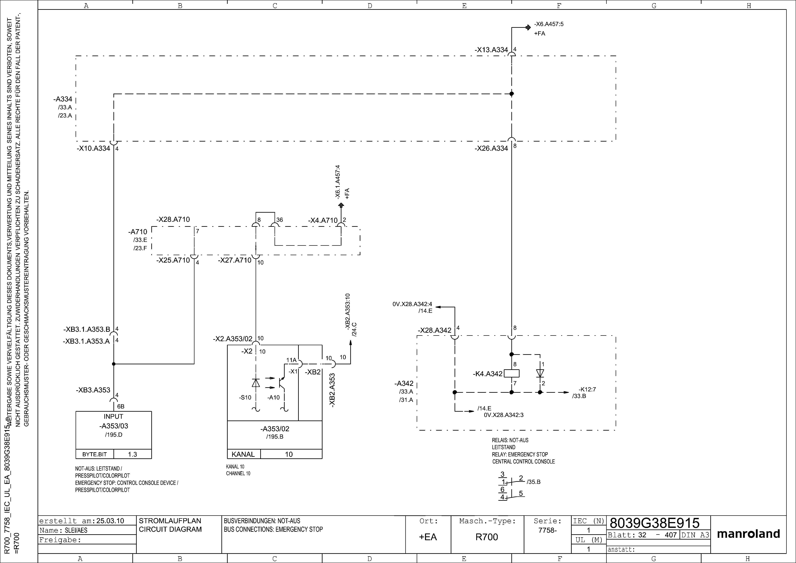

# +EA — Sheet 32 of 407 — BUSVERBINDUNGEN: NOT AUS

**BUS CONNECTIONS: EMERGENCY STOP**

> Part of the manroland **R700** printing press IEC/UL circuit diagrams.
> Drawing class: **Stromlaufplan / Circuit diagram** (DIN A3).
> Document `+EA` covers the **Printing unit** machine section.

## At a glance

| Field | Value |
|---|---|
| Document | `+EA`  (8039G38E915) |
| Sheet | **32** of 407 |
| Section (DE) | BUSVERBINDUNGEN: NOT AUS |
| Section (EN) | BUS CONNECTIONS: EMERGENCY STOP |
| Section type | CIRCUIT — Circuit diagram |
| Machine type | `R700` |
| Series | `7758` |
| Created | 25.03.10 |
| Replaces | — |
| Columns used | A, B, C, D, E, F |
| Path numbers | — |
| Labels on sheet | 90 |
| Cross-refs out | 13 |
| Cross-refs in | 29 |

**Previous:** [+EA sheet 31](SHEET_0031.md) · **Next:** [+EA sheet 33](SHEET_0033.md) · **Document TOC:** [_TOC.md](_TOC.md)  (+EA) · **Master TOC:** [all sheets](../_MASTER_TOC.md)

## Sheet image (300 DPI, exact vector render)



_Rendered directly from the PDF vector layer at 300 DPI (1-bit), no OCR and no resampling. Use it to confirm anything ambiguous in the text below._

## Cross-references on this sheet

Each entry is a wire leaving this sheet. The printed token is `/sheet.column`; the link resolves to that sheet inside the same document.

| Ref | Target sheet | Col | Path | Destination on target | Target section | From col |
|---|---|---|---|---|---|---|
| `/33.A` | [+EA sheet 33](SHEET_0033.md) | A | — | — | BUSVERBINDUNGEN: NOT AUS | A |
| `/23.A` | [+EA sheet 23](SHEET_0023.md) | A | — | — | SPANNUNGSVERSORGUNG: 400V, 24V | A |
| `/33.E` | [+EA sheet 33](SHEET_0033.md) | E | — | — | BUSVERBINDUNGEN: NOT AUS | B |
| `/23.F` | [+EA sheet 23](SHEET_0023.md) | F | — | — | SPANNUNGSVERSORGUNG: 400V, 24V | B |
| `/24.C` | [+EA sheet 24](SHEET_0024.md) | C | — | XB2.A353:10 | BUSVERBINDUNGEN: SICHERHEITSBUS | D |
| `/14.E` | [+EA sheet 14](SHEET_0014.md) | E | — | 0V.X28.A342:4 | SPANNUNGSVERSORGUNG: 400V, 24V | D |
| `/33.A` | [+EA sheet 33](SHEET_0033.md) | A | — | — | BUSVERBINDUNGEN: NOT AUS | D |
| `/31.A` | [+EA sheet 31](SHEET_0031.md) | A | — | — | BUSVERBINDUNGEN: SICHERHEITSBUS | D |
| `/33.B` | [+EA sheet 33](SHEET_0033.md) | B | — | — | BUSVERBINDUNGEN: NOT AUS | F |
| `/14.E` | [+EA sheet 14](SHEET_0014.md) | E | — | — | SPANNUNGSVERSORGUNG: 400V, 24V | E |
| `/195.D` | [+EA sheet 195](SHEET_0195.md) | D | — | — | REFERENZMODUL | A |
| `/195.B` | [+EA sheet 195](SHEET_0195.md) | B | — | — | REFERENZMODUL | C |
| `/35.B` | [+EA sheet 35](SHEET_0035.md) | B | — | — | BUSVERBINDUNGEN: NOT AUS | F |

### Incoming references (sheets that point here)

Every other sheet that sends a wire to this one. `Back-ref` is the token printed on *that* sheet; `Path` is its line number.

| From sheet | Cols | Back-ref | Path | Refs | What continues there |
|---|---|---|---|---|---|
| [+EA#14](SHEET_0014.md) | E | `/14.E` | — | 2 | 0V.X28.A342:3; 0V.X28.A342:4 |
| [+EA#23](SHEET_0023.md) | A, F | `/23.A`, `/23.F` | — | 2 | A710 |
| [+EA#24](SHEET_0024.md) | C | `/24.C` | — | 1 | XB2.A353:10 |
| [+EA#31](SHEET_0031.md) | A | `/31.A` | — | 1 | — |
| [+EA#33](SHEET_0033.md) | A, E | `/33.A`, `/33.E` | — | 4 | K12:7 |
| [+EA#35](SHEET_0035.md) | A | `/35.A` | — | 1 | — |
| [+EA#195](SHEET_0195.md) | B, D | `/195.B`, `/195.D` | — | 2 | — |
| [+EA#224](SHEET_0224.md) | G | `/224.G` | — | 1 | — |
| [+EA#225](SHEET_0225.md) | C | `/225.C` | — | 1 | — |
| [+EA#234](SHEET_0234.md) | C, D, F | `/234.C`, `/234.D`, `/234.F` | — | 3 | — |
| [+EA#238](SHEET_0238.md) | E | `/238.E` | — | 1 | — |
| [+EA#253](SHEET_0253.md) | H | `/253.H` | — | 1 | — |
| [+EA#258](SHEET_0258.md) | C | `/258.C` | — | 1 | — |
| [+EA#268](SHEET_0268.md) | C | `/268.C` | — | 1 | — |
| [+EA#269](SHEET_0269.md) | B | `/269.B` | — | 1 | — |
| [+EA#271](SHEET_0271.md) | B | `/271.B` | — | 1 | — |
| [+EA#272](SHEET_0272.md) | E, G, H | `/272.E`, `/272.G`, `/272.H` | — | 5 | — |


## Devices on this sheet

| Tag | Class | Class meaning (IEC) | Col | Sub | Terminal | Sign |
|---|---|---|---|---|---|---|
| `A342` | A | Baugruppe / assembly, module, PC board | D | — | — | — |
| `S10` | S | Schalter / switch | C | — | — | — |
| `A10` | A | Baugruppe / assembly, module, PC board | C | — | — | — |
| `X1` | X | Klemme / terminal, plug connector | C | — | — | — |
| `X2` | X | Klemme / terminal, plug connector | C | — | — | — |
| `XB2` | XB |  | C | — | — | — |
| `A353/02` | A | Baugruppe / assembly, module, PC board | C | 02 | — | — |
| `A353/03` | A | Baugruppe / assembly, module, PC board | A | 03 | — | — |
| `A334` | A | Baugruppe / assembly, module, PC board | A | — | — | — |
| `A710` | A | Baugruppe / assembly, module, PC board | B | — | — | — |
| `K12:7` | K | Relais / relay, contactor | F | — | 7 | — |
| `X28.A342` | — | cross-device reference | E | — | — | — |
| `K4.A342` | — | cross-device reference | E | — | — | — |
| `XB2.A353` | — | cross-device reference | D | — | — | — |
| `1.3` | — | cross-device reference | A | — | — | — |
| `XB3.A353` | — | cross-device reference | A | — | — | — |
| `XB3.1.A353.B` | — | cross-device reference | A | — | — | — |
| `XB3.1.A353.A` | — | cross-device reference | A | — | — | — |
| `X10.A334` | — | cross-device reference | A | — | — | — |
| `X13.A334` | — | cross-device reference | E | — | — | — |
| `X26.A334` | — | cross-device reference | E | — | — | — |
| `X27.A710` | — | cross-device reference | C | — | — | — |
| `X25.A710` | — | cross-device reference | B | — | — | — |
| `X4.A710` | — | cross-device reference | D | — | — | — |
| `X6.1.A457:4` | — | cross-device reference | D | — | 4 | — |
| `X6.A457:5` | — | cross-device reference | F | — | 5 | — |
| `XB2.A353:10` | — | cross-device reference | D | — | 10 | — |
| `X28.A710` | — | cross-device reference | B | — | — | — |

## Potentials / nets

| Potential | Count | Columns | Attached devices | Terminals |
|---|---|---|---|---|
| `0V` | 2 | D, E | `A342`, `X28` | `3`, `4` |


A potential such as `L24+/4` or `M24+` is a named supply/return rail; every place it appears on this sheet is electrically common.

## Wire-end annotations (grouped as printed)

A wire that continues elsewhere is annotated with a small cluster: the destination description, the path/line number `#NN`, and the `/sheet.column` cross reference. Each row below is one such cluster exactly as it is grouped on the drawing.

| Col | Y | Path | Cross-ref | Text on the wire |
|---|---|---|---|---|
| F | 32.2 | — | — | `X6.A457:5` |
| F | 46.3 | — | — | `+FA` |
| E | 69.8 | — | — | `X13.A334 4` |
| A | 143.4 | — | — | `A334` |
| A | 156.5 | — | `/33.A`, `/23.A` | — |
| E | 214.3 | — | — | `X26.A334 8` |
| A | 217.2 | — | — | `X10.A334 4` |
| D | 246.6 | — | — | `X6.1.A457:4` |
| D | 281.5 | — | — | `+FA` |
| B | 323.4 | — | — | `X28.A710` |
| C | 324.9 | — | — | `8` |
| C | 324.9 | — | — | `36` |
| D | 324.9 | — | — | `X4.A710 2` |
| B | 341.9 | — | — | `A710` |
| B | 341.9 | — | — | `7` |
| B | 354.9 | — | `/33.E`, `/23.F` | — |
| B | 384.4 | — | — | `X25.A710 4 X27.A710 10` |
| D | 438.8 | — | `/24.C` | `XB2.A353:10` |
| D | 451.0 | — | `/14.E` | `0V.X28.A342:4` |
| E | 486.5 | — | — | `X28.A342 4` |
| F | 486.5 | — | — | `8` |
| A | 487.9 | — | — | `XB3.1.A353.B 4` |
| C | 502.0 | — | — | `X2.A353/02 10` |
| A | 504.9 | — | — | `XB3.1.A353.A 4` |
| C | 520.5 | — | — | `X2` |
| C | 521.9 | — | — | `10 10` |
| D | 530.4 | — | — | `10` |
| C | 534.6 | — | — | `11A` |
| F | 541.0 | — | — | `8` |
| F | 541.0 | — | — | `1` |
| C | 551.6 | — | — | `X1` |
| C | 551.7 | — | — | `XB2` |
| E | 554.5 | — | — | `K4.A342 7` |
| D | 557.9 | — | — | `XB2.A353` |
| D | 568.6 | — | — | `A342` |
| F | 569.4 | — | — | `2` |
| A | 578.6 | — | — | `XB3.A353 4` |
| F | 578.6 | — | — | `K12:7` |
| D | 581.7 | — | `/33.A`, `/31.A` | — |
| F | 588.4 | — | `/33.B` | — |
| C | 590.6 | — | — | `S10 A10` |
| A | 604.0 | — | — | `6B` |
| E | 606.9 | — | `/14.E` | — |
| E | 616.8 | — | — | `0V.X28.A342:3` |
| A | 618.6 | — | — | `INPUT` |
| A | 632.4 | — | — | `A353/03` |
| C | 636.7 | — | — | `A353/02` |
| A | 646.2 | — | `/195.D` | — |
| C | 649.0 | — | `/195.B` | — |
| F | 655.4 | — | — | `RELAIS: NOT AUS LEITSTAND RELAY: EMERGENCY STOP` |
| C | 674.9 | — | — | `KANAL 10` |
| A | 675.3 | — | — | `BYTE.BIT 1.3` |
| F | 687.4 | — | — | `CENTRAL CONTROL CONSOLE` |
| C | 695.3 | — | — | `KANAL 10 CHANNEL 10` |
| A | 697.9 | — | — | `NOT AUS: LEITSTAND / PRESSPILOT/COLORPILOT EMERGENCY STOP: CONTROL CONSOLE DEVICE / PRESSPILOT/COLORPILOT` |
| E | 704.7 | — | — | `3 6 4 1` |
| F | 710.4 | — | — | `2` |
| F | 716.7 | — | `/35.B` | — |
| F | 733.0 | — | — | `5` |


## Reconstructed tables

This sheet carries tabular content (pin map / terminal assignment / index). The grid below was rebuilt from the drawing's own rule lines, so each row is exactly one physical row of the table.

### Table 1 — 6 data rows × 9 columns (at x=113.4, y=140.3)

| X10.A334 | 4 A710 /33.E | X28.A710 | 7 |  | 8 36 |  |  | X6.1.A457:4 +FA X4.A710 2 |
|---|---|---|---|---|---|---|---|---|
| `XB3.1.A353.B XB3.1.A353.A` | `/23.F 4 4` | `X25.A710` | `4` | `X27.A710 X2.A353/02` | `10 10` |  |  | `XB2.A353:10` |
|  |  |  |  | `X2` | `10` | `11A` |  | `10 10` |
| `XB3.A353` | `4 6B` |  |  | `S10` | `A10` | `X1` | `XB2` | `XB2.A353` |
| `INPUT` |  |  |  |  |  |  |  |  |
|  | `A353/03 /195.D` |  |  |  | `A353/02 /195.B` |  |  |  |
| `BYTE.BIT` | `1.3` |  |  | `KANAL` |  | `10` |  |  |


### Table 2 — 1 data rows × 2 columns (at x=680.3, y=140.3)

| X26.A334 4 | 8 8 |
|---|---|
| `K4.A342` | `8 7` |


## Notes and free text on this sheet

| Text | Col | Y (pt) |
|---|---|---|
| `RELAIS: NOT AUS` | E | 655.41 |
| `LEITSTAND` | E | 666.04 |
| `RELAY: EMERGENCY STOP` | F | 676.69 |
| `CENTRAL CONTROL CONSOLE` | F | 687.35 |
| `KANAL 10` | C | 695.27 |
| `CHANNEL 10` | C | 705.22 |
| `11A` | C | 534.62 |
| `KANAL` | C | 674.94 |
| `X2.A353/02` | C | 502.04 |
| `6B` | A | 604.05 |
| `INPUT` | A | 618.59 |
| `BYTE.BIT` | A | 675.84 |
| `NOT AUS: LEITSTAND /` | A | 697.94 |
| `PRESSPILOT/COLORPILOT` | A | 708.58 |
| `EMERGENCY STOP: CONTROL CONSOLE DEVICE /` | A | 719.22 |
| `+FA` | D | 281.48 |
| `+FA` | F | 46.32 |

## Complete label inventory (exact text from the drawing)

Every text object inside the drawing area of this sheet, in DIN reading order (column A→H, then top→bottom). This is the authoritative list: if a string is not here it is not printed on this sheet.

| Col | Y | X | Dir | Type | Text |
|---|---|---|---|---|---|
| A | 143.5 | 79.9 | → | device tag | `A334` |
| A | 156.5 | 87.0 | → | cross-reference | `/33.A` |
| A | 168.9 | 87.0 | → | cross-reference | `/23.A` |
| A | 217.2 | 114.8 | → | device ref | `X10.A334` |
| A | 218.6 | 172.6 | → | number | `4` |
| A | 487.9 | 95.0 | → | device ref | `XB3.1.A353.B` |
| A | 487.9 | 172.6 | → | number | `4` |
| A | 504.9 | 172.6 | → | number | `4` |
| A | 505.6 | 94.1 | → | device ref | `XB3.1.A353.A` |
| A | 578.6 | 113.7 | → | device ref | `XB3.A353` |
| A | 587.1 | 172.6 | → | number | `4` |
| A | 604.0 | 175.5 | → | text | `6B` |
| A | 618.6 | 155.2 | → | text | `INPUT` |
| A | 632.4 | 148.7 | → | device tag | `A353/03` |
| A | 646.2 | 157.3 | → | cross-reference | `/195.D` |
| A | 675.3 | 191.3 | → | device ref | `1.3` |
| A | 675.8 | 123.3 | → | text | `BYTE.BIT` |
| A | 697.9 | 112.5 | → | text | `NOT AUS: LEITSTAND /` |
| A | 708.6 | 112.5 | → | text | `PRESSPILOT/COLORPILOT` |
| A | 719.2 | 112.5 | → | text | `EMERGENCY STOP: CONTROL CONSOLE DEVICE /` |
| A | 729.8 | 112.5 | → | text | `PRESSPILOT/COLORPILOT` |
| B | 323.5 | 233.9 | → | device ref | `X28.A710` |
| B | 341.9 | 191.9 | → | device tag | `A710` |
| B | 341.9 | 293.1 | → | number | `7` |
| B | 354.9 | 199.6 | → | cross-reference | `/33.E` |
| B | 367.3 | 199.8 | → | cross-reference | `/23.F` |
| B | 384.4 | 233.9 | → | device ref | `X25.A710` |
| B | 388.7 | 293.1 | → | number | `4` |
| C | 324.9 | 385.2 | → | number | `8` |
| C | 324.9 | 413.6 | → | number | `36` |
| C | 384.4 | 326.0 | → | device ref | `X27.A710` |
| C | 388.7 | 384.7 | → | number | `10` |
| C | 502.0 | 318.6 | → | text | `X2.A353/02` |
| C | 502.1 | 384.7 | → | number | `10` |
| C | 520.5 | 361.1 | → | device tag | `X2` |
| C | 521.9 | 387.5 | → | number | `10` |
| C | 534.6 | 428.0 | → | text | `11A` |
| C | 551.6 | 431.7 | → | device tag | `X1` |
| C | 551.7 | 456.1 | → | device tag | `XB2` |
| C | 590.6 | 357.4 | → | device tag | `S10` |
| C | 590.6 | 400.0 | → | device tag | `A10` |
| C | 636.7 | 389.6 | → | device tag | `A353/02` |
| C | 649.0 | 398.4 | → | cross-reference | `/195.B` |
| C | 674.9 | 346.4 | → | text | `KANAL` |
| C | 674.9 | 426.0 | → | number | `10` |
| C | 695.3 | 338.2 | → | text | `KANAL 10` |
| C | 705.2 | 338.5 | → | text | `CHANNEL 10` |
| D | 246.6 | 501.3 | ↕ | device ref | `X6.1.A457:4` |
| D | 281.5 | 515.5 | ↕ | text | `+FA` |
| D | 324.9 | 460.9 | → | device ref | `X4.A710` |
| D | 324.9 | 512.8 | → | number | `2` |
| D | 438.8 | 516.2 | ↕ | device ref | `XB2.A353:10` |
| D | 451.0 | 587.3 | → | potential | `0V.X28.A342:4` |
| D | 482.2 | 526.1 | ↕ | cross-reference | `/24.C` |
| D | 530.4 | 508.0 | → | number | `10` |
| D | 531.8 | 486.7 | → | number | `10` |
| D | 557.9 | 492.1 | ↕ | device ref | `XB2.A353` |
| D | 568.6 | 590.2 | → | device tag | `A342` |
| D | 581.7 | 597.3 | → | cross-reference | `/33.A` |
| D | 594.1 | 597.3 | → | cross-reference | `/31.A` |
| E | 69.8 | 710.1 | → | device ref | `X13.A334` |
| E | 217.2 | 710.1 | → | device ref | `X26.A334` |
| E | 460.9 | 626.2 | → | cross-reference | `/14.E` |
| E | 486.5 | 682.9 | → | number | `4` |
| E | 489.3 | 625.0 | → | device ref | `X28.A342` |
| E | 554.5 | 707.5 | → | device ref | `K4.A342` |
| E | 606.9 | 714.3 | → | cross-reference | `/14.E` |
| E | 616.8 | 724.0 | → | potential | `0V.X28.A342:3` |
| E | 655.4 | 736.2 | → | text | `RELAIS: NOT AUS` |
| E | 666.0 | 736.2 | → | text | `LEITSTAND` |
| E | 704.7 | 748.6 | → | number | `3` |
| E | 716.0 | 750.0 | → | number | `1` |
| E | 727.4 | 748.6 | → | number | `6` |
| E | 738.7 | 748.6 | → | number | `4` |
| F | 32.2 | 799.1 | → | device ref | `X6.A457:5` |
| F | 46.3 | 799.1 | → | text | `+FA` |
| F | 69.8 | 767.9 | → | number | `4` |
| F | 214.3 | 767.9 | → | number | `8` |
| F | 486.5 | 767.9 | → | number | `8` |
| F | 541.0 | 767.9 | → | number | `8` |
| F | 541.0 | 809.9 | → | number | `1` |
| F | 569.4 | 767.9 | → | number | `7` |
| F | 569.4 | 810.4 | → | number | `2` |
| F | 578.6 | 865.7 | → | device tag | `K12:7` |
| F | 588.4 | 856.1 | → | cross-reference | `/33.B` |
| F | 676.7 | 736.2 | → | text | `RELAY: EMERGENCY STOP` |
| F | 687.3 | 736.7 | → | text | `CENTRAL CONTROL CONSOLE` |
| F | 710.3 | 776.4 | → | number | `2` |
| F | 716.7 | 788.0 | → | cross-reference | `/35.B` |
| F | 733.0 | 776.1 | → | number | `5` |

## Reading-order text block

The same content as a plain block, grouped by DIN column — convenient to paste or to match against a visual description.

```text
=== Column A ===
 143.5   79.9  devtag       A334
 156.5   87.0  xref         /33.A
 168.9   87.0  xref         /23.A
 217.2  114.8  devref       X10.A334
 218.6  172.6  numeric      4
 487.9   95.0  devref       XB3.1.A353.B
 487.9  172.6  numeric      4
 504.9  172.6  numeric      4
 505.6   94.1  devref       XB3.1.A353.A
 578.6  113.7  devref       XB3.A353
 587.1  172.6  numeric      4
 604.0  175.5  text         6B
 618.6  155.2  text         INPUT
 632.4  148.7  devtag       A353/03
 646.2  157.3  xref         /195.D
 675.3  191.3  devref       1.3
 675.8  123.3  text         BYTE.BIT
 697.9  112.5  text         NOT AUS: LEITSTAND /
 708.6  112.5  text         PRESSPILOT/COLORPILOT
 719.2  112.5  text         EMERGENCY STOP: CONTROL CONSOLE DEVICE /
 729.8  112.5  text         PRESSPILOT/COLORPILOT
=== Column B ===
 323.5  233.9  devref       X28.A710
 341.9  191.9  devtag       A710
 341.9  293.1  numeric      7
 354.9  199.6  xref         /33.E
 367.3  199.8  xref         /23.F
 384.4  233.9  devref       X25.A710
 388.7  293.1  numeric      4
=== Column C ===
 324.9  385.2  numeric      8
 324.9  413.6  numeric      36
 384.4  326.0  devref       X27.A710
 388.7  384.7  numeric      10
 502.0  318.6  text         X2.A353/02
 502.1  384.7  numeric      10
 520.5  361.1  devtag       X2
 521.9  387.5  numeric      10
 534.6  428.0  text         11A
 551.6  431.7  devtag       X1
 551.7  456.1  devtag       XB2
 590.6  357.4  devtag       S10
 590.6  400.0  devtag       A10
 636.7  389.6  devtag       A353/02
 649.0  398.4  xref         /195.B
 674.9  346.4  text         KANAL
 674.9  426.0  numeric      10
 695.3  338.2  text         KANAL 10
 705.2  338.5  text         CHANNEL 10
=== Column D ===
 246.6  501.3  devref       X6.1.A457:4
 281.5  515.5  text         +FA
 324.9  460.9  devref       X4.A710
 324.9  512.8  numeric      2
 438.8  516.2  devref       XB2.A353:10
 451.0  587.3  net          0V.X28.A342:4
 482.2  526.1  xref         /24.C
 530.4  508.0  numeric      10
 531.8  486.7  numeric      10
 557.9  492.1  devref       XB2.A353
 568.6  590.2  devtag       A342
 581.7  597.3  xref         /33.A
 594.1  597.3  xref         /31.A
=== Column E ===
  69.8  710.1  devref       X13.A334
 217.2  710.1  devref       X26.A334
 460.9  626.2  xref         /14.E
 486.5  682.9  numeric      4
 489.3  625.0  devref       X28.A342
 554.5  707.5  devref       K4.A342
 606.9  714.3  xref         /14.E
 616.8  724.0  net          0V.X28.A342:3
 655.4  736.2  text         RELAIS: NOT AUS
 666.0  736.2  text         LEITSTAND
 704.7  748.6  numeric      3
 716.0  750.0  numeric      1
 727.4  748.6  numeric      6
 738.7  748.6  numeric      4
=== Column F ===
  32.2  799.1  devref       X6.A457:5
  46.3  799.1  text         +FA
  69.8  767.9  numeric      4
 214.3  767.9  numeric      8
 486.5  767.9  numeric      8
 541.0  767.9  numeric      8
 541.0  809.9  numeric      1
 569.4  767.9  numeric      7
 569.4  810.4  numeric      2
 578.6  865.7  devtag       K12:7
 588.4  856.1  xref         /33.B
 676.7  736.2  text         RELAY: EMERGENCY STOP
 687.3  736.7  text         CENTRAL CONTROL CONSOLE
 710.3  776.4  numeric      2
 716.7  788.0  xref         /35.B
 733.0  776.1  numeric      5
```

---
_Generated from the PDF vector text layer; no OCR. Source: `R700_7758_IEC_UL_EA_8039G38E915_p`, sheet 32._
