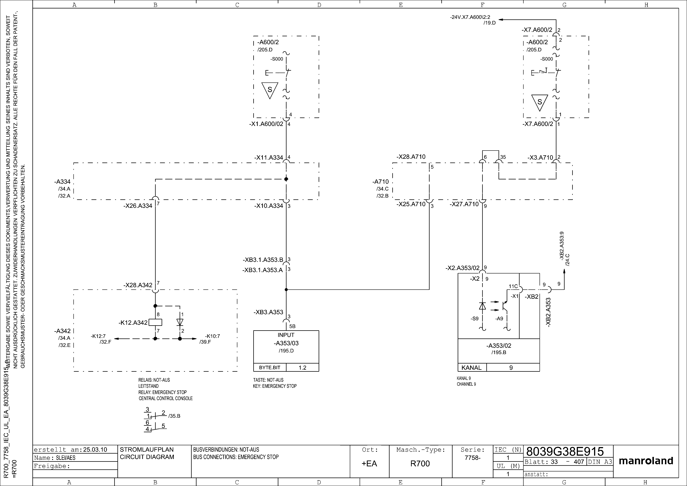

# +EA — Sheet 33 of 407 — BUSVERBINDUNGEN: NOT AUS

**BUS CONNECTIONS: EMERGENCY STOP**

> Part of the manroland **R700** printing press IEC/UL circuit diagrams.
> Drawing class: **Stromlaufplan / Circuit diagram** (DIN A3).
> Document `+EA` covers the **Printing unit** machine section.

## At a glance

| Field | Value |
|---|---|
| Document | `+EA`  (8039G38E915) |
| Sheet | **33** of 407 |
| Section (DE) | BUSVERBINDUNGEN: NOT AUS |
| Section (EN) | BUS CONNECTIONS: EMERGENCY STOP |
| Section type | CIRCUIT — Circuit diagram |
| Machine type | `R700` |
| Series | `7758` |
| Created | 25.03.10 |
| Replaces | — |
| Columns used | A, B, C, D, E, F, G |
| Path numbers | — |
| Labels on sheet | 100 |
| Cross-refs out | 15 |
| Cross-refs in | 33 |

**Previous:** [+EA sheet 32](SHEET_0032.md) · **Next:** [+EA sheet 34](SHEET_0034.md) · **Document TOC:** [_TOC.md](_TOC.md)  (+EA) · **Master TOC:** [all sheets](../_MASTER_TOC.md)

## Sheet image (300 DPI, exact vector render)



_Rendered directly from the PDF vector layer at 300 DPI (1-bit), no OCR and no resampling. Use it to confirm anything ambiguous in the text below._

## Cross-references on this sheet

Each entry is a wire leaving this sheet. The printed token is `/sheet.column`; the link resolves to that sheet inside the same document.

| Ref | Target sheet | Col | Path | Destination on target | Target section | From col |
|---|---|---|---|---|---|---|
| `/19.D` | [+EA sheet 19](SHEET_0019.md) | D | — | 24V.X7.A600\2:2 | SPANNUNGSVERSORGUNG: 400V, 24V | F |
| `/205.D` | [+EA sheet 205](SHEET_0205.md) | D | — | A600/2 | REFERENZMODUL | C |
| `/205.D` | [+EA sheet 205](SHEET_0205.md) | D | — | A600/2 | REFERENZMODUL | G |
| `/34.A` | [+EA sheet 34](SHEET_0034.md) | A | — | — | BUSVERBINDUNGEN: NOT AUS | A |
| `/32.A` | [+EA sheet 32](SHEET_0032.md) | A | — | — | BUSVERBINDUNGEN: NOT AUS | A |
| `/34.C` | [+EA sheet 34](SHEET_0034.md) | C | — | — | BUSVERBINDUNGEN: NOT AUS | E |
| `/32.B` | [+EA sheet 32](SHEET_0032.md) | B | — | — | BUSVERBINDUNGEN: NOT AUS | E |
| `/24.C` | [+EA sheet 24](SHEET_0024.md) | C | — | XB2.A353:9 | BUSVERBINDUNGEN: SICHERHEITSBUS | G |
| `/32.F` | [+EA sheet 32](SHEET_0032.md) | F | — | K12:7 | BUSVERBINDUNGEN: NOT AUS | A |
| `/34.A` | [+EA sheet 34](SHEET_0034.md) | A | — | — | BUSVERBINDUNGEN: NOT AUS | A |
| `/39.F` | [+EA sheet 39](SHEET_0039.md) | F | — | — | BUSVERBINDUNGEN: STOP SICHERN | C |
| `/32.E` | [+EA sheet 32](SHEET_0032.md) | E | — | — | BUSVERBINDUNGEN: NOT AUS | A |
| `/195.D` | [+EA sheet 195](SHEET_0195.md) | D | — | — | REFERENZMODUL | D |
| `/195.B` | [+EA sheet 195](SHEET_0195.md) | B | — | — | REFERENZMODUL | F |
| `/35.B` | [+EA sheet 35](SHEET_0035.md) | B | — | — | BUSVERBINDUNGEN: NOT AUS | B |

### Incoming references (sheets that point here)

Every other sheet that sends a wire to this one. `Back-ref` is the token printed on *that* sheet; `Path` is its line number.

| From sheet | Cols | Back-ref | Path | Refs | What continues there |
|---|---|---|---|---|---|
| [+EA#19](SHEET_0019.md) | D | `/19.D` | — | 1 | 24V.X7.A600\2:2 |
| [+EA#24](SHEET_0024.md) | C | `/24.C` | — | 1 | XB2.A353:9 |
| [+EA#32](SHEET_0032.md) | A, B, D, F | `/32.A`, `/32.B`, `/32.D`, `/32.F` | — | 4 | — |
| [+EA#34](SHEET_0034.md) | A, C | `/34.A`, `/34.C` | — | 3 | 4 |
| [+EA#35](SHEET_0035.md) | A | `/35.A` | — | 1 | — |
| [+EA#39](SHEET_0039.md) | E | `/39.E` | — | 1 | K10:7 |
| [+EA#195](SHEET_0195.md) | B, D | `/195.B`, `/195.D` | — | 2 | — |
| [+EA#205](SHEET_0205.md) | D | `/205.D` | — | 2 | — |
| [+EA#212](SHEET_0212.md) | G | `/212.G` | — | 1 | — |
| [+EA#224](SHEET_0224.md) | G | `/224.G` | — | 1 | — |
| [+EA#225](SHEET_0225.md) | C | `/225.C` | — | 1 | — |
| [+EA#234](SHEET_0234.md) | C, D, F | `/234.C`, `/234.D`, `/234.F` | — | 3 | — |
| [+EA#235](SHEET_0235.md) | G | `/235.G` | — | 1 | — |
| [+EA#247](SHEET_0247.md) | G | `/247.G` | — | 2 | — |
| [+EA#253](SHEET_0253.md) | H | `/253.H` | — | 1 | — |
| [+EA#255](SHEET_0255.md) | G | `/255.G` | — | 1 | — |
| [+EA#268](SHEET_0268.md) | C | `/268.C` | — | 1 | — |
| [+EA#269](SHEET_0269.md) | B | `/269.B` | — | 1 | — |
| [+EA#271](SHEET_0271.md) | B | `/271.B` | — | 1 | — |
| [+EA#272](SHEET_0272.md) | E, G, H | `/272.E`, `/272.G`, `/272.H` | — | 4 | — |


## Devices on this sheet

| Tag | Class | Class meaning (IEC) | Col | Sub | Terminal | Sign |
|---|---|---|---|---|---|---|
| `A342` | A | Baugruppe / assembly, module, PC board | A | — | — | — |
| `A353/03` | A | Baugruppe / assembly, module, PC board | D | 03 | — | — |
| `S9` | S | Schalter / switch | F | — | — | — |
| `A9` | A | Baugruppe / assembly, module, PC board | F | — | — | — |
| `X1` | X | Klemme / terminal, plug connector | F | — | — | — |
| `X2` | X | Klemme / terminal, plug connector | F | — | — | — |
| `XB2` | XB |  | G | — | — | — |
| `A353/02` | A | Baugruppe / assembly, module, PC board | F | 02 | — | — |
| `A334` | A | Baugruppe / assembly, module, PC board | A | — | — | — |
| `A710` | A | Baugruppe / assembly, module, PC board | E | — | — | — |
| `S000` | S | Schalter / switch | G | — | — | — |
| `A600/2` | A | Baugruppe / assembly, module, PC board | G | 2 | — | — |
| `S000` | S | Schalter / switch | C | — | — | — |
| `A600/2` | A | Baugruppe / assembly, module, PC board | C | 2 | — | — |
| `K12:7` | K | Relais / relay, contactor | A | — | 7 | — |
| `K10:7` | K | Relais / relay, contactor | C | — | 7 | — |
| `X28.A342` | — | cross-device reference | B | — | — | — |
| `K12.A342` | — | cross-device reference | B | — | — | — |
| `1.2` | — | cross-device reference | D | — | — | — |
| `XB3.A353` | — | cross-device reference | C | — | — | — |
| `XB2.A353` | — | cross-device reference | G | — | — | — |
| `XB3.1.A353.B` | — | cross-device reference | C | — | — | — |
| `XB3.1.A353.A` | — | cross-device reference | C | — | — | — |
| `X11.A334` | — | cross-device reference | C | — | — | — |
| `X10.A334` | — | cross-device reference | C | — | — | — |
| `X26.A334` | — | cross-device reference | B | — | — | — |
| `X3.A710` | — | cross-device reference | G | — | — | — |
| `X27.A710` | — | cross-device reference | F | — | — | — |
| `X25.A710` | — | cross-device reference | E | — | — | — |
| `XB2.A353:9` | — | cross-device reference | G | — | 9 | — |
| `X28.A710` | — | cross-device reference | E | — | — | — |

## Potentials / nets

| Potential | Count | Columns | Attached devices | Terminals |
|---|---|---|---|---|
| `24V` | 1 | F | `A600\2`, `X7` | `2` |


A potential such as `L24+/4` or `M24+` is a named supply/return rail; every place it appears on this sheet is electrically common.

## Wire-end annotations (grouped as printed)

A wire that continues elsewhere is annotated with a small cluster: the destination description, the path/line number `#NN`, and the `/sheet.column` cross reference. Each row below is one such cluster exactly as it is grouped on the drawing.

| Col | Y | Path | Cross-ref | Text on the wire |
|---|---|---|---|---|
| F | 25.8 | — | `/19.D` | `24V.X7.A600\2:2` |
| G | 47.1 | — | — | `X7.A600/2 2` |
| G | 65.5 | — | — | `2` |
| C | 68.3 | — | `/205.D` | `A600/2` |
| G | 68.3 | — | `/205.D` | `A600/2` |
| C | 98.5 | — | — | `S000` |
| G | 98.5 | — | — | `S000` |
| C | 149.9 | — | — | `S` |
| G | 171.2 | — | — | `S` |
| D | 194.5 | — | — | `4` |
| G | 194.5 | — | — | `1` |
| C | 210.1 | — | — | `X1.A600/02 4` |
| G | 210.1 | — | — | `X7.A600/2 1` |
| E | 266.8 | — | — | `X28.A710` |
| C | 268.2 | — | — | `X11.A334 4` |
| F | 268.2 | — | — | `6` |
| F | 268.2 | — | — | `35` |
| G | 268.2 | — | — | `X3.A710 2` |
| E | 285.2 | — | — | `5` |
| A | 310.0 | — | — | `A334` |
| E | 310.0 | — | — | `A710` |
| A | 323.0 | — | `/34.A`, `/32.A` | — |
| E | 323.1 | — | `/34.C`, `/32.B` | — |
| C | 349.0 | — | — | `X26.A334 7 X10.A334 3` |
| F | 349.0 | — | — | `X25.A710 3 X27.A710 9` |
| G | 401.1 | — | `/24.C` | `XB2.A353:9` |
| C | 445.4 | — | — | `XB3.1.A353.B 3` |
| F | 459.5 | — | — | `X2.A353/02 9` |
| C | 462.4 | — | — | `XB3.1.A353.A 3` |
| F | 478.0 | — | — | `X2` |
| F | 479.4 | — | — | `9 9` |
| B | 486.5 | — | — | `X28.A342 7` |
| G | 487.9 | — | — | `9` |
| F | 492.1 | — | — | `11C` |
| F | 509.1 | — | — | `X1` |
| G | 509.1 | — | — | `XB2` |
| G | 515.3 | — | — | `XB2.A353` |
| C | 536.1 | — | — | `XB3.A353 3` |
| B | 541.0 | — | — | `8` |
| B | 541.0 | — | — | `1` |
| F | 548.1 | — | — | `S9 A9` |
| B | 554.5 | — | — | `K12.A342 7` |
| D | 561.5 | — | — | `5B` |
| A | 568.6 | — | — | `A342` |
| B | 569.4 | — | — | `2` |
| D | 576.1 | — | — | `INPUT` |
| A | 578.6 | — | `/32.F` | `K12:7` |
| C | 578.6 | — | — | `K10:7` |
| A | 581.7 | — | `/34.A` | — |
| C | 588.5 | — | `/39.F` | — |
| D | 589.9 | — | — | `A353/03` |
| A | 594.1 | — | `/32.E` | — |
| F | 594.2 | — | — | `A353/02` |
| D | 603.7 | — | `/195.D` | — |
| F | 606.5 | — | `/195.B` | — |
| F | 632.4 | — | — | `KANAL 9` |
| D | 632.7 | — | — | `BYTE.BIT 1.2` |
| F | 652.8 | — | — | `KANAL 9 CHANNEL 9` |
| B | 655.4 | — | — | `RELAIS: NOT AUS LEITSTAND RELAY: EMERGENCY STOP` |
| C | 655.4 | — | — | `KEY: EMERGENCY STOP TASTE: NOT AUS` |
| B | 687.4 | — | — | `CENTRAL CONTROL CONSOLE` |
| B | 704.7 | — | — | `3 6 4 1` |
| B | 710.4 | — | — | `2` |
| B | 716.7 | — | `/35.B` | — |
| B | 733.0 | — | — | `5` |


## Reconstructed tables

This sheet carries tabular content (pin map / terminal assignment / index). The grid below was rebuilt from the drawing's own rule lines, so each row is exactly one physical row of the table.

### Table 1 — 5 data rows × 2 columns (at x=439.4, y=62.4)

| A600/2 /205.D S000 S | 4 |
|---|---|
| `X1.A600/02 X11.A334` | `4 4` |
| `X10.A334 XB3.1.A353.B XB3.1.A353.A` | `3 3 3` |
| `XB3.A353` | `3 5B` |
| `INPUT` | `A353/03 /195.D` |
| `BYTE.BIT` | `1.2` |


### Table 2 — 5 data rows × 4 columns (at x=744.1, y=34.0) — **/19.D**

| 5 |  | 6 35 |  |
|---|---|---|---|
| `3` | `X27.A710 X2.A353/02` | `9 9` |  |
|  | `X2` | `9` | `11C` |
|  | `S9` | `A9` | `X1` |
|  |  | `A353/02 /195.B` |  |
|  | `KANAL` |  | `9` |


### Table 3 — 5 data rows × 4 columns (at x=907.1, y=34.0)

| X7.A600/2 |  | 2 |  |
|---|---|---|---|
| `A600/2 /205.D` | `S000 S` | `2 1` |  |
| `X7.A600/2` | `X3.A710` | `1 2` |  |
|  |  | `XB2.A353:9` | `/24.C` |
|  | `9` | `9` |  |
| `XB2` | `XB2.A353` |  |  |


## Notes and free text on this sheet

| Text | Col | Y (pt) |
|---|---|---|
| `RELAIS: NOT AUS` | B | 655.41 |
| `LEITSTAND` | B | 666.04 |
| `RELAY: EMERGENCY STOP` | B | 676.69 |
| `CENTRAL CONTROL CONSOLE` | B | 687.35 |
| `5B` | D | 561.53 |
| `INPUT` | D | 576.07 |
| `BYTE.BIT` | C | 633.32 |
| `TASTE: NOT AUS` | C | 655.42 |
| `KEY: EMERGENCY STOP` | C | 666.05 |
| `KANAL 9` | F | 652.75 |
| `CHANNEL 9` | F | 662.69 |
| `11C` | F | 492.14 |
| `KANAL` | F | 632.42 |
| `X2.A353/02` | F | 459.52 |
| `X7.A600/2` | G | 210.08 |
| `X1.A600/02` | C | 210.07 |
| `S` | G | 171.17 |
| `S` | C | 149.91 |

## Complete label inventory (exact text from the drawing)

Every text object inside the drawing area of this sheet, in DIN reading order (column A→H, then top→bottom). This is the authoritative list: if a string is not here it is not printed on this sheet.

| Col | Y | X | Dir | Type | Text |
|---|---|---|---|---|---|
| A | 310.0 | 94.1 | → | device tag | `A334` |
| A | 323.0 | 101.2 | → | cross-reference | `/34.A` |
| A | 335.4 | 101.2 | → | cross-reference | `/32.A` |
| A | 568.6 | 94.1 | → | device tag | `A342` |
| A | 578.6 | 157.3 | → | device tag | `K12:7` |
| A | 581.7 | 101.2 | → | cross-reference | `/34.A` |
| A | 588.4 | 172.9 | → | cross-reference | `/32.F` |
| A | 594.1 | 101.8 | → | cross-reference | `/32.E` |
| B | 349.0 | 271.8 | → | number | `7` |
| B | 351.8 | 214.0 | → | device ref | `X26.A334` |
| B | 486.5 | 271.8 | → | number | `7` |
| B | 489.3 | 214.0 | → | device ref | `X28.A342` |
| B | 541.0 | 271.8 | → | number | `8` |
| B | 541.0 | 313.8 | → | number | `1` |
| B | 554.5 | 205.5 | → | device ref | `K12.A342` |
| B | 569.4 | 271.8 | → | number | `7` |
| B | 569.4 | 314.4 | → | number | `2` |
| B | 655.4 | 240.1 | → | text | `RELAIS: NOT AUS` |
| B | 666.0 | 240.1 | → | text | `LEITSTAND` |
| B | 676.7 | 240.1 | → | text | `RELAY: EMERGENCY STOP` |
| B | 687.3 | 240.7 | → | text | `CENTRAL CONTROL CONSOLE` |
| B | 704.7 | 252.6 | → | number | `3` |
| B | 710.3 | 280.3 | → | number | `2` |
| B | 716.0 | 254.0 | → | number | `1` |
| B | 716.7 | 292.0 | → | cross-reference | `/35.B` |
| B | 727.4 | 252.6 | → | number | `6` |
| B | 733.0 | 280.1 | → | number | `5` |
| B | 738.7 | 252.6 | → | number | `4` |
| C | 68.3 | 446.2 | → | device tag | `A600/2` |
| C | 82.1 | 446.5 | → | cross-reference | `/205.D` |
| C | 98.5 | 468.9 | → | device tag | `S000` |
| C | 149.9 | 463.6 | → | text | `S` |
| C | 210.1 | 432.0 | → | text | `X1.A600/02` |
| C | 268.2 | 440.8 | → | device ref | `X11.A334` |
| C | 351.8 | 440.8 | → | device ref | `X10.A334` |
| C | 445.4 | 420.9 | → | device ref | `XB3.1.A353.B` |
| C | 463.1 | 420.1 | → | device ref | `XB3.1.A353.A` |
| C | 536.1 | 439.7 | → | device ref | `XB3.A353` |
| C | 578.6 | 355.5 | → | device tag | `K10:7` |
| C | 588.4 | 345.8 | → | cross-reference | `/39.F` |
| C | 633.3 | 449.3 | → | text | `BYTE.BIT` |
| C | 655.4 | 439.1 | → | text | `TASTE: NOT AUS` |
| C | 666.0 | 438.5 | → | text | `KEY: EMERGENCY STOP` |
| D | 194.5 | 501.4 | → | number | `4` |
| D | 211.5 | 498.6 | → | number | `4` |
| D | 268.2 | 498.6 | → | number | `4` |
| D | 353.2 | 498.6 | → | number | `3` |
| D | 445.4 | 498.6 | → | number | `3` |
| D | 462.4 | 498.6 | → | number | `3` |
| D | 544.6 | 498.6 | → | number | `3` |
| D | 561.5 | 501.4 | → | text | `5B` |
| D | 576.1 | 481.2 | → | text | `INPUT` |
| D | 589.9 | 474.7 | → | device tag | `A353/03` |
| D | 603.7 | 483.3 | → | cross-reference | `/195.D` |
| D | 632.7 | 517.3 | → | device ref | `1.2` |
| E | 266.8 | 687.4 | → | device ref | `X28.A710` |
| E | 285.2 | 746.6 | → | number | `5` |
| E | 310.0 | 645.4 | → | device tag | `A710` |
| E | 323.1 | 652.5 | → | cross-reference | `/34.C` |
| E | 335.4 | 652.8 | → | cross-reference | `/32.B` |
| E | 349.0 | 687.4 | → | device ref | `X25.A710` |
| E | 353.2 | 746.6 | → | number | `3` |
| F | 25.8 | 780.1 | → | potential | `24V.X7.A600\2:2` |
| F | 35.7 | 838.2 | → | cross-reference | `/19.D` |
| F | 268.2 | 838.8 | → | number | `6` |
| F | 268.2 | 867.1 | → | number | `35` |
| F | 349.0 | 779.5 | → | device ref | `X27.A710` |
| F | 353.2 | 838.8 | → | number | `9` |
| F | 459.5 | 772.2 | → | text | `X2.A353/02` |
| F | 459.5 | 838.8 | → | number | `9` |
| F | 478.0 | 814.7 | → | device tag | `X2` |
| F | 479.4 | 841.6 | → | number | `9` |
| F | 492.1 | 881.6 | → | text | `11C` |
| F | 509.1 | 885.3 | → | device tag | `X1` |
| F | 548.1 | 815.8 | → | device tag | `S9` |
| F | 548.1 | 858.3 | → | device tag | `A9` |
| F | 594.2 | 843.2 | → | device tag | `A353/02` |
| F | 606.5 | 852.0 | → | cross-reference | `/195.B` |
| F | 632.4 | 799.9 | → | text | `KANAL` |
| F | 632.4 | 882.9 | → | number | `9` |
| F | 652.8 | 791.7 | → | text | `KANAL 9` |
| F | 662.7 | 792.0 | → | text | `CHANNEL 9` |
| G | 47.1 | 904.3 | → | text | `X7.A600/2` |
| G | 48.5 | 966.3 | → | number | `2` |
| G | 65.5 | 969.2 | → | number | `2` |
| G | 68.3 | 912.5 | → | device tag | `A600/2` |
| G | 82.1 | 912.8 | → | cross-reference | `/205.D` |
| G | 98.5 | 936.6 | → | device tag | `S000` |
| G | 171.2 | 931.3 | → | text | `S` |
| G | 194.5 | 968.6 | → | number | `1` |
| G | 210.1 | 905.7 | → | text | `X7.A600/2` |
| G | 211.5 | 965.8 | → | number | `1` |
| G | 268.2 | 914.5 | → | device ref | `X3.A710` |
| G | 268.2 | 966.3 | → | number | `2` |
| G | 401.1 | 969.7 | ↕ | device ref | `XB2.A353:9` |
| G | 439.7 | 979.7 | ↕ | cross-reference | `/24.C` |
| G | 487.9 | 966.3 | → | number | `9` |
| G | 489.3 | 940.8 | → | number | `9` |
| G | 509.1 | 909.6 | → | device tag | `XB2` |
| G | 515.3 | 945.7 | ↕ | device ref | `XB2.A353` |

## Reading-order text block

The same content as a plain block, grouped by DIN column — convenient to paste or to match against a visual description.

```text
=== Column A ===
 310.0   94.1  devtag       A334
 323.0  101.2  xref         /34.A
 335.4  101.2  xref         /32.A
 568.6   94.1  devtag       A342
 578.6  157.3  devtag       K12:7
 581.7  101.2  xref         /34.A
 588.4  172.9  xref         /32.F
 594.1  101.8  xref         /32.E
=== Column B ===
 349.0  271.8  numeric      7
 351.8  214.0  devref       X26.A334
 486.5  271.8  numeric      7
 489.3  214.0  devref       X28.A342
 541.0  271.8  numeric      8
 541.0  313.8  numeric      1
 554.5  205.5  devref       K12.A342
 569.4  271.8  numeric      7
 569.4  314.4  numeric      2
 655.4  240.1  text         RELAIS: NOT AUS
 666.0  240.1  text         LEITSTAND
 676.7  240.1  text         RELAY: EMERGENCY STOP
 687.3  240.7  text         CENTRAL CONTROL CONSOLE
 704.7  252.6  numeric      3
 710.3  280.3  numeric      2
 716.0  254.0  numeric      1
 716.7  292.0  xref         /35.B
 727.4  252.6  numeric      6
 733.0  280.1  numeric      5
 738.7  252.6  numeric      4
=== Column C ===
  68.3  446.2  devtag       A600/2
  82.1  446.5  xref         /205.D
  98.5  468.9  devtag       S000
 149.9  463.6  text         S
 210.1  432.0  text         X1.A600/02
 268.2  440.8  devref       X11.A334
 351.8  440.8  devref       X10.A334
 445.4  420.9  devref       XB3.1.A353.B
 463.1  420.1  devref       XB3.1.A353.A
 536.1  439.7  devref       XB3.A353
 578.6  355.5  devtag       K10:7
 588.4  345.8  xref         /39.F
 633.3  449.3  text         BYTE.BIT
 655.4  439.1  text         TASTE: NOT AUS
 666.0  438.5  text         KEY: EMERGENCY STOP
=== Column D ===
 194.5  501.4  numeric      4
 211.5  498.6  numeric      4
 268.2  498.6  numeric      4
 353.2  498.6  numeric      3
 445.4  498.6  numeric      3
 462.4  498.6  numeric      3
 544.6  498.6  numeric      3
 561.5  501.4  text         5B
 576.1  481.2  text         INPUT
 589.9  474.7  devtag       A353/03
 603.7  483.3  xref         /195.D
 632.7  517.3  devref       1.2
=== Column E ===
 266.8  687.4  devref       X28.A710
 285.2  746.6  numeric      5
 310.0  645.4  devtag       A710
 323.1  652.5  xref         /34.C
 335.4  652.8  xref         /32.B
 349.0  687.4  devref       X25.A710
 353.2  746.6  numeric      3
=== Column F ===
  25.8  780.1  net          24V.X7.A600\2:2
  35.7  838.2  xref         /19.D
 268.2  838.8  numeric      6
 268.2  867.1  numeric      35
 349.0  779.5  devref       X27.A710
 353.2  838.8  numeric      9
 459.5  772.2  text         X2.A353/02
 459.5  838.8  numeric      9
 478.0  814.7  devtag       X2
 479.4  841.6  numeric      9
 492.1  881.6  text         11C
 509.1  885.3  devtag       X1
 548.1  815.8  devtag       S9
 548.1  858.3  devtag       A9
 594.2  843.2  devtag       A353/02
 606.5  852.0  xref         /195.B
 632.4  799.9  text         KANAL
 632.4  882.9  numeric      9
 652.8  791.7  text         KANAL 9
 662.7  792.0  text         CHANNEL 9
=== Column G ===
  47.1  904.3  text         X7.A600/2
  48.5  966.3  numeric      2
  65.5  969.2  numeric      2
  68.3  912.5  devtag       A600/2
  82.1  912.8  xref         /205.D
  98.5  936.6  devtag       S000
 171.2  931.3  text         S
 194.5  968.6  numeric      1
 210.1  905.7  text         X7.A600/2
 211.5  965.8  numeric      1
 268.2  914.5  devref       X3.A710
 268.2  966.3  numeric      2
 401.1  969.7  devref       XB2.A353:9
 439.7  979.7  xref         /24.C
 487.9  966.3  numeric      9
 489.3  940.8  numeric      9
 509.1  909.6  devtag       XB2
 515.3  945.7  devref       XB2.A353
```

---
_Generated from the PDF vector text layer; no OCR. Source: `R700_7758_IEC_UL_EA_8039G38E915_p`, sheet 33._
