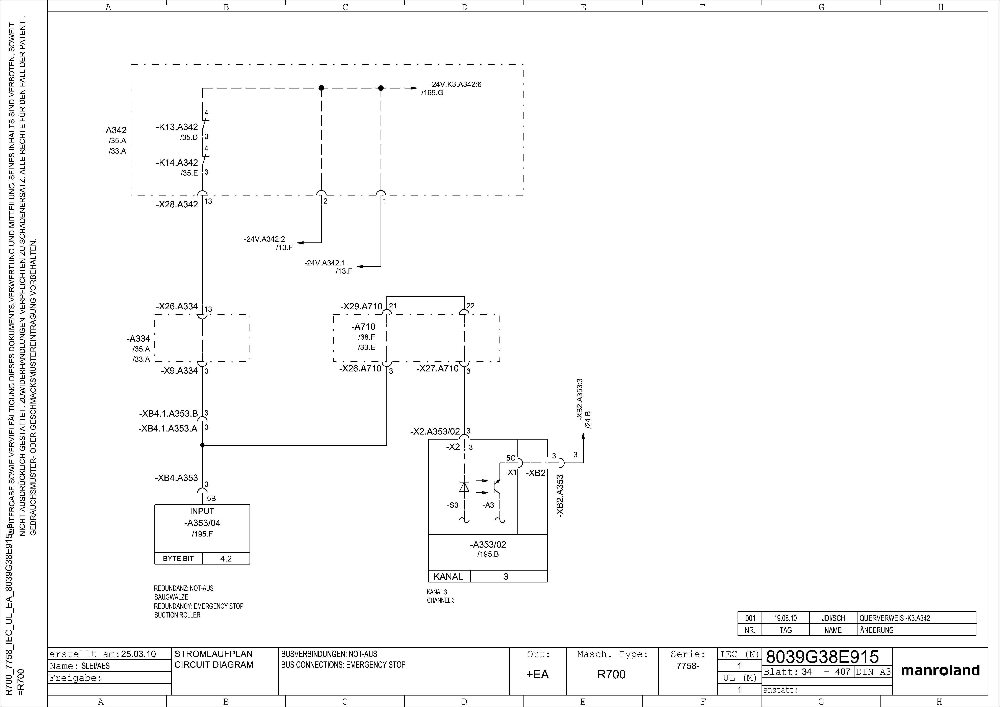

# +EA — Sheet 34 of 407 — BUSVERBINDUNGEN: NOT AUS

**BUS CONNECTIONS: EMERGENCY STOP**

> Part of the manroland **R700** printing press IEC/UL circuit diagrams.
> Drawing class: **Stromlaufplan / Circuit diagram** (DIN A3).
> Document `+EA` covers the **Printing unit** machine section.

## At a glance

| Field | Value |
|---|---|
| Document | `+EA`  (8039G38E915) |
| Sheet | **34** of 407 |
| Section (DE) | BUSVERBINDUNGEN: NOT AUS |
| Section (EN) | BUS CONNECTIONS: EMERGENCY STOP |
| Section type | CIRCUIT — Circuit diagram |
| Machine type | `R700` |
| Series | `7758` |
| Created | 25.03.10 |
| Replaces | — |
| Columns used | A, B, C, D, E, F, G, H |
| Path numbers | — |
| Labels on sheet | 82 |
| Cross-refs out | 14 |
| Cross-refs in | 28 |

**Previous:** [+EA sheet 33](SHEET_0033.md) · **Next:** [+EA sheet 35](SHEET_0035.md) · **Document TOC:** [_TOC.md](_TOC.md)  (+EA) · **Master TOC:** [all sheets](../_MASTER_TOC.md)

## Sheet image (300 DPI, exact vector render)



_Rendered directly from the PDF vector layer at 300 DPI (1-bit), no OCR and no resampling. Use it to confirm anything ambiguous in the text below._

## Cross-references on this sheet

Each entry is a wire leaving this sheet. The printed token is `/sheet.column`; the link resolves to that sheet inside the same document.

| Ref | Target sheet | Col | Path | Destination on target | Target section | From col |
|---|---|---|---|---|---|---|
| `/169.G` | [+EA sheet 169](SHEET_0169.md) | G | — | — | RESERVE | D |
| `/35.D` | [+EA sheet 35](SHEET_0035.md) | D | — | — | BUSVERBINDUNGEN: NOT AUS | B |
| `/35.A` | [+EA sheet 35](SHEET_0035.md) | A | — | 4 | BUSVERBINDUNGEN: NOT AUS | A |
| `/33.A` | [+EA sheet 33](SHEET_0033.md) | A | — | 4 | BUSVERBINDUNGEN: NOT AUS | A |
| `/35.E` | [+EA sheet 35](SHEET_0035.md) | E | — | — | BUSVERBINDUNGEN: NOT AUS | B |
| `/13.F` | [+EA sheet 13](SHEET_0013.md) | F | — | 24V.A342:2 | SPANNUNGSVERSORGUNG: 400V, 24V | B |
| `/13.F` | [+EA sheet 13](SHEET_0013.md) | F | — | 24V.A342:1 | SPANNUNGSVERSORGUNG: 400V, 24V | C |
| `/38.F` | [+EA sheet 38](SHEET_0038.md) | F | — | — | BUSVERBINDUNGEN: NOT AUS | C |
| `/33.E` | [+EA sheet 33](SHEET_0033.md) | E | — | — | BUSVERBINDUNGEN: NOT AUS | C |
| `/35.A` | [+EA sheet 35](SHEET_0035.md) | A | — | — | BUSVERBINDUNGEN: NOT AUS | A |
| `/33.A` | [+EA sheet 33](SHEET_0033.md) | A | — | — | BUSVERBINDUNGEN: NOT AUS | A |
| `/24.B` | [+EA sheet 24](SHEET_0024.md) | B | — | XB2.A353:3 | BUSVERBINDUNGEN: SICHERHEITSBUS | E |
| `/195.F` | [+EA sheet 195](SHEET_0195.md) | F | — | — | REFERENZMODUL | B |
| `/195.B` | [+EA sheet 195](SHEET_0195.md) | B | — | — | REFERENZMODUL | D |

### Incoming references (sheets that point here)

Every other sheet that sends a wire to this one. `Back-ref` is the token printed on *that* sheet; `Path` is its line number.

| From sheet | Cols | Back-ref | Path | Refs | What continues there |
|---|---|---|---|---|---|
| [+EA#13](SHEET_0013.md) | F | `/13.F` | — | 2 | 24V.A342:1; 24V.A342:2 |
| [+EA#24](SHEET_0024.md) | B | `/24.B` | — | 1 | XB2.A353:3 |
| [+EA#33](SHEET_0033.md) | A, E | `/33.A`, `/33.E` | — | 3 | — |
| [+EA#35](SHEET_0035.md) | A, D, E | `/35.A`, `/35.D`, `/35.E` | — | 4 | — |
| [+EA#38](SHEET_0038.md) | F | `/38.F` | — | 1 | — |
| [+EA#169](SHEET_0169.md) | F | `/169.F` | — | 1 | 24V.K3.A342:6 |
| [+EA#195](SHEET_0195.md) | B, F | `/195.B`, `/195.F` | — | 2 | — |
| [+EA#224](SHEET_0224.md) | G | `/224.G` | — | 1 | — |
| [+EA#225](SHEET_0225.md) | C | `/225.C` | — | 1 | — |
| [+EA#237](SHEET_0237.md) | A, B, C | `/237.A`, `/237.B`, `/237.C` | — | 3 | — |
| [+EA#252](SHEET_0252.md) | A | `/252.A` | — | 1 | — |
| [+EA#269](SHEET_0269.md) | B | `/269.B` | — | 1 | — |
| [+EA#270](SHEET_0270.md) | C | `/270.C` | — | 1 | — |
| [+EA#271](SHEET_0271.md) | B | `/271.B` | — | 1 | — |
| [+EA#272](SHEET_0272.md) | E | `/272.E` | — | 3 | — |
| [+EA#274](SHEET_0274.md) | B | `/274.B` | — | 2 | — |


## Devices on this sheet

| Tag | Class | Class meaning (IEC) | Col | Sub | Terminal | Sign |
|---|---|---|---|---|---|---|
| `A342` | A | Baugruppe / assembly, module, PC board | A | — | — | — |
| `A353/04` | A | Baugruppe / assembly, module, PC board | B | 04 | — | — |
| `S3` | S | Schalter / switch | D | — | — | — |
| `A3` | A | Baugruppe / assembly, module, PC board | D | — | — | — |
| `X1` | X | Klemme / terminal, plug connector | D | — | — | — |
| `X2` | X | Klemme / terminal, plug connector | D | — | — | — |
| `XB2` | XB |  | E | — | — | — |
| `A353/02` | A | Baugruppe / assembly, module, PC board | D | 02 | — | — |
| `A334` | A | Baugruppe / assembly, module, PC board | A | — | — | — |
| `A710` | A | Baugruppe / assembly, module, PC board | C | — | — | — |
| `K14.A342` | — | cross-device reference | B | — | — | — |
| `X28.A342` | — | cross-device reference | B | — | — | — |
| `K13.A342` | — | cross-device reference | B | — | — | — |
| `4.2` | — | cross-device reference | B | — | — | — |
| `XB4.A353` | — | cross-device reference | B | — | — | — |
| `XB2.A353` | — | cross-device reference | E | — | — | — |
| `XB4.1.A353.B` | — | cross-device reference | B | — | — | — |
| `XB4.1.A353.A` | — | cross-device reference | B | — | — | — |
| `X26.A334` | — | cross-device reference | B | — | — | — |
| `X29.A710` | — | cross-device reference | C | — | — | — |
| `X27.A710` | — | cross-device reference | D | — | — | — |
| `X26.A710` | — | cross-device reference | C | — | — | — |
| `X9.A334` | — | cross-device reference | B | — | — | — |
| `NR.` | — | cross-device reference | F | — | — | — |
| `19.08.10` | — | cross-device reference | G | — | — | — |
| `XB2.A353:3` | — | cross-device reference | E | — | 3 | — |

## Potentials / nets

| Potential | Count | Columns | Attached devices | Terminals |
|---|---|---|---|---|
| `24V` | 3 | B, C, D | `A342`, `K3` | `1`, `2`, `6` |


A potential such as `L24+/4` or `M24+` is a named supply/return rail; every place it appears on this sheet is electrically common.

## Wire-end annotations (grouped as printed)

A wire that continues elsewhere is annotated with a small cluster: the destination description, the path/line number `#NN`, and the `/sheet.column` cross reference. Each row below is one such cluster exactly as it is grouped on the drawing.

| Col | Y | Path | Cross-ref | Text on the wire |
|---|---|---|---|---|
| D | 96.7 | — | — | `24V.K3.A342:6` |
| D | 106.6 | — | `/169.G` | — |
| B | 130.3 | — | — | `4` |
| B | 146.6 | — | — | `K13.A342 3` |
| A | 150.5 | — | — | `A342` |
| B | 159.7 | — | `/35.D` | — |
| A | 163.6 | — | `/35.A`, `/33.A` | `4` |
| B | 189.1 | — | — | `K14.A342 3` |
| B | 202.2 | — | `/35.E` | — |
| C | 235.6 | — | — | `2 1` |
| B | 235.9 | — | — | `X28.A342 13` |
| B | 280.9 | — | `/13.F` | `24V.A342:2` |
| C | 309.3 | — | `/13.F` | `24V.A342:1` |
| B | 360.3 | — | — | `X26.A334 13` |
| D | 360.3 | — | — | `X29.A710 21 22` |
| C | 384.4 | — | — | `A710` |
| C | 397.5 | — | `/38.F`, `/33.E` | — |
| A | 398.6 | — | — | `A334` |
| A | 411.6 | — | `/35.A`, `/33.A` | — |
| C | 434.0 | — | — | `X9.A334 3 X26.A710 3 X27.A710 3` |
| E | 450.7 | — | `/24.B` | `XB2.A353:3` |
| B | 487.9 | — | — | `XB4.1.A353.B 3` |
| B | 504.9 | — | — | `XB4.1.A353.A 3` |
| D | 509.1 | — | — | `X2.A353/02 3` |
| D | 527.6 | — | — | `X2` |
| D | 529.0 | — | — | `3 3` |
| E | 537.5 | — | — | `3` |
| D | 541.8 | — | — | `5C` |
| D | 558.7 | — | — | `X1` |
| E | 558.7 | — | — | `XB2` |
| B | 564.4 | — | — | `XB4.A353 3` |
| E | 565.0 | — | — | `XB2.A353` |
| B | 589.9 | — | — | `5B` |
| D | 597.7 | — | — | `S3 A3` |
| B | 604.4 | — | — | `INPUT` |
| B | 618.3 | — | — | `A353/04` |
| B | 632.0 | — | `/195.F` | — |
| D | 643.8 | — | — | `A353/02` |
| D | 656.1 | — | `/195.B` | — |
| B | 661.1 | — | — | `BYTE.BIT 4.2` |
| D | 682.0 | — | — | `KANAL 3` |
| B | 697.7 | — | — | `REDUNDANZ: NOT AUS` |
| D | 702.4 | — | — | `KANAL 3 CHANNEL 3` |
| B | 708.2 | — | — | `REDUNDANCY: EMERGENCY STOP SAUGWALZE` |
| B | 729.6 | — | — | `SUCTION ROLLER` |
| G | 733.0 | — | — | `001 19.08.10 JDI/SCH QUERVERWEIS K3.A342` |
| G | 747.1 | — | — | `NR. TAG NAME ÄNDERUNG` |


## Reconstructed tables

This sheet carries tabular content (pin map / terminal assignment / index). The grid below was rebuilt from the drawing's own rule lines, so each row is exactly one physical row of the table.

### Table 1 — 6 data rows × 11 columns (at x=184.3, y=104.9)

| K13.A342 /35.D K14.A342 /35.E X28.A342 | 4 3 4 3 13 | 24V.A342:2 /13.F | 2 24V.A342:1 /13.F | 1 |  | /169.G |  |  |  |  |
|---|---|---|---|---|---|---|---|---|---|---|
| `X26.A334 X9.A334 XB4.1.A353.B XB4.1.A353.A` | `13 3 3 3` |  | `X29.A710 A710 /38.F /33.E X26.A710` |  | `21 3` | `X27.A710 X2.A353/02` | `22 3 3` |  |  | `XB2.A353:3` |
| `XB4.A353` | `3 5B` |  |  |  |  | `X2` | `3` | `5C X1` | `XB2` | `3 3 XB2.A353` |
| `INPUT` | `A353/04` |  |  |  |  | `S3` | `A3` |  |  |  |
|  | `/195.F` |  |  |  |  |  | `A353/02` |  |  |  |
| `BYTE.BIT` | `4.2` |  |  |  |  |  | `/195.B` |  |  |  |
|  |  |  |  |  |  | `KANAL` |  | `3` |  |  |


## Notes and free text on this sheet

| Text | Col | Y (pt) |
|---|---|---|
| `5B` | B | 589.88 |
| `INPUT` | B | 604.42 |
| `BYTE.BIT` | B | 661.67 |
| `REDUNDANZ: NOT AUS` | B | 697.67 |
| `SAUGWALZE` | B | 708.25 |
| `REDUNDANCY: EMERGENCY STOP` | B | 718.94 |
| `SUCTION ROLLER` | B | 729.58 |
| `KANAL 3` | D | 702.36 |
| `CHANNEL 3` | D | 712.3 |
| `5C` | D | 541.75 |
| `KANAL` | D | 682.03 |
| `X2.A353/02` | D | 509.13 |
| `TAG` | G | 747.27 |
| `NAME` | G | 747.25 |
| `ÄNDERUNG` | G | 747.31 |
| `JDI/SCH` | G | 733.1 |
| `QUERVERWEIS K3.A342` | H | 733.11 |

## Complete label inventory (exact text from the drawing)

Every text object inside the drawing area of this sheet, in DIN reading order (column A→H, then top→bottom). This is the authoritative list: if a string is not here it is not printed on this sheet.

| Col | Y | X | Dir | Type | Text |
|---|---|---|---|---|---|
| A | 150.5 | 122.5 | → | device tag | `A342` |
| A | 163.6 | 129.5 | → | cross-reference | `/35.A` |
| A | 176.0 | 129.5 | → | cross-reference | `/33.A` |
| A | 398.6 | 150.8 | → | device tag | `A334` |
| A | 411.6 | 157.9 | → | cross-reference | `/35.A` |
| A | 424.0 | 157.9 | → | cross-reference | `/33.A` |
| B | 130.3 | 243.5 | → | number | `4` |
| B | 146.6 | 185.7 | → | device ref | `K13.A342` |
| B | 158.6 | 243.5 | → | number | `3` |
| B | 159.7 | 214.6 | → | cross-reference | `/35.D` |
| B | 172.8 | 243.5 | → | number | `4` |
| B | 189.1 | 185.7 | → | device ref | `K14.A342` |
| B | 201.2 | 243.5 | → | number | `3` |
| B | 202.1 | 215.1 | → | cross-reference | `/35.E` |
| B | 235.9 | 242.9 | → | number | `13` |
| B | 238.7 | 185.7 | → | device ref | `X28.A342` |
| B | 280.9 | 290.6 | → | potential | `24V.A342:2` |
| B | 290.8 | 328.8 | → | cross-reference | `/13.F` |
| B | 360.3 | 185.7 | → | device ref | `X26.A334` |
| B | 364.6 | 242.9 | → | number | `13` |
| B | 436.8 | 191.6 | → | device ref | `X9.A334` |
| B | 438.3 | 243.5 | → | number | `3` |
| B | 487.9 | 165.8 | → | device ref | `XB4.1.A353.B` |
| B | 487.9 | 243.5 | → | number | `3` |
| B | 504.9 | 243.5 | → | number | `3` |
| B | 505.6 | 165.0 | → | device ref | `XB4.1.A353.A` |
| B | 564.4 | 184.5 | → | device ref | `XB4.A353` |
| B | 572.9 | 243.5 | → | number | `3` |
| B | 589.9 | 246.3 | → | text | `5B` |
| B | 604.4 | 226.1 | → | text | `INPUT` |
| B | 618.3 | 219.5 | → | device tag | `A353/04` |
| B | 632.0 | 228.6 | → | cross-reference | `/195.F` |
| B | 661.1 | 262.5 | → | device ref | `4.2` |
| B | 661.7 | 194.2 | → | text | `BYTE.BIT` |
| B | 697.7 | 183.4 | → | text | `REDUNDANZ: NOT AUS` |
| B | 708.2 | 184.0 | → | text | `SAUGWALZE` |
| B | 718.9 | 183.4 | → | text | `REDUNDANCY: EMERGENCY STOP` |
| B | 729.6 | 184.0 | → | text | `SUCTION ROLLER` |
| C | 235.6 | 385.2 | → | number | `2` |
| C | 235.6 | 455.5 | → | number | `1` |
| C | 309.3 | 362.6 | → | potential | `24V.A342:1` |
| C | 319.2 | 399.7 | → | cross-reference | `/13.F` |
| C | 360.3 | 405.4 | → | device ref | `X29.A710` |
| C | 360.3 | 463.2 | → | number | `21` |
| C | 384.4 | 418.7 | → | device tag | `A710` |
| C | 397.5 | 426.6 | → | cross-reference | `/38.F` |
| C | 409.9 | 426.3 | → | cross-reference | `/33.E` |
| C | 434.0 | 403.9 | → | device ref | `X26.A710` |
| C | 438.3 | 463.2 | → | number | `3` |
| D | 96.7 | 511.4 | → | potential | `24V.K3.A342:6` |
| D | 106.6 | 501.7 | → | cross-reference | `/169.G` |
| D | 360.3 | 555.3 | → | number | `22` |
| D | 434.0 | 496.1 | → | device ref | `X27.A710` |
| D | 438.3 | 555.3 | → | number | `3` |
| D | 509.1 | 488.7 | → | text | `X2.A353/02` |
| D | 509.1 | 555.3 | → | number | `3` |
| D | 527.6 | 531.2 | → | device tag | `X2` |
| D | 529.0 | 558.1 | → | number | `3` |
| D | 541.7 | 602.9 | → | text | `5C` |
| D | 558.7 | 601.8 | → | device tag | `X1` |
| D | 597.7 | 532.3 | → | device tag | `S3` |
| D | 597.7 | 574.9 | → | device tag | `A3` |
| D | 643.8 | 559.7 | → | device tag | `A353/02` |
| D | 656.1 | 568.5 | → | cross-reference | `/195.B` |
| D | 682.0 | 516.5 | → | text | `KANAL` |
| D | 682.0 | 599.4 | → | number | `3` |
| D | 702.4 | 508.3 | → | text | `KANAL 3` |
| D | 712.3 | 508.5 | → | text | `CHANNEL 3` |
| E | 450.7 | 686.3 | ↕ | device ref | `XB2.A353:3` |
| E | 489.5 | 696.2 | ↕ | cross-reference | `/24.B` |
| E | 537.5 | 682.9 | → | number | `3` |
| E | 538.9 | 657.4 | → | number | `3` |
| E | 558.7 | 626.2 | → | device tag | `XB2` |
| E | 564.9 | 662.2 | ↕ | device ref | `XB2.A353` |
| F | 733.0 | 887.7 | → | number | `001` |
| F | 747.1 | 886.7 | → | device ref | `NR.` |
| G | 733.1 | 921.5 | → | device ref | `19.08.10` |
| G | 733.1 | 978.7 | → | text | `JDI/SCH` |
| G | 747.3 | 928.3 | → | text | `TAG` |
| G | 747.3 | 981.7 | → | text | `NAME` |
| G | 747.3 | 1024.3 | → | text | `ÄNDERUNG` |
| H | 733.1 | 1023.4 | → | text | `QUERVERWEIS K3.A342` |

## Reading-order text block

The same content as a plain block, grouped by DIN column — convenient to paste or to match against a visual description.

```text
=== Column A ===
 150.5  122.5  devtag       A342
 163.6  129.5  xref         /35.A
 176.0  129.5  xref         /33.A
 398.6  150.8  devtag       A334
 411.6  157.9  xref         /35.A
 424.0  157.9  xref         /33.A
=== Column B ===
 130.3  243.5  numeric      4
 146.6  185.7  devref       K13.A342
 158.6  243.5  numeric      3
 159.7  214.6  xref         /35.D
 172.8  243.5  numeric      4
 189.1  185.7  devref       K14.A342
 201.2  243.5  numeric      3
 202.1  215.1  xref         /35.E
 235.9  242.9  numeric      13
 238.7  185.7  devref       X28.A342
 280.9  290.6  net          24V.A342:2
 290.8  328.8  xref         /13.F
 360.3  185.7  devref       X26.A334
 364.6  242.9  numeric      13
 436.8  191.6  devref       X9.A334
 438.3  243.5  numeric      3
 487.9  165.8  devref       XB4.1.A353.B
 487.9  243.5  numeric      3
 504.9  243.5  numeric      3
 505.6  165.0  devref       XB4.1.A353.A
 564.4  184.5  devref       XB4.A353
 572.9  243.5  numeric      3
 589.9  246.3  text         5B
 604.4  226.1  text         INPUT
 618.3  219.5  devtag       A353/04
 632.0  228.6  xref         /195.F
 661.1  262.5  devref       4.2
 661.7  194.2  text         BYTE.BIT
 697.7  183.4  text         REDUNDANZ: NOT AUS
 708.2  184.0  text         SAUGWALZE
 718.9  183.4  text         REDUNDANCY: EMERGENCY STOP
 729.6  184.0  text         SUCTION ROLLER
=== Column C ===
 235.6  385.2  numeric      2
 235.6  455.5  numeric      1
 309.3  362.6  net          24V.A342:1
 319.2  399.7  xref         /13.F
 360.3  405.4  devref       X29.A710
 360.3  463.2  numeric      21
 384.4  418.7  devtag       A710
 397.5  426.6  xref         /38.F
 409.9  426.3  xref         /33.E
 434.0  403.9  devref       X26.A710
 438.3  463.2  numeric      3
=== Column D ===
  96.7  511.4  net          24V.K3.A342:6
 106.6  501.7  xref         /169.G
 360.3  555.3  numeric      22
 434.0  496.1  devref       X27.A710
 438.3  555.3  numeric      3
 509.1  488.7  text         X2.A353/02
 509.1  555.3  numeric      3
 527.6  531.2  devtag       X2
 529.0  558.1  numeric      3
 541.7  602.9  text         5C
 558.7  601.8  devtag       X1
 597.7  532.3  devtag       S3
 597.7  574.9  devtag       A3
 643.8  559.7  devtag       A353/02
 656.1  568.5  xref         /195.B
 682.0  516.5  text         KANAL
 682.0  599.4  numeric      3
 702.4  508.3  text         KANAL 3
 712.3  508.5  text         CHANNEL 3
=== Column E ===
 450.7  686.3  devref       XB2.A353:3
 489.5  696.2  xref         /24.B
 537.5  682.9  numeric      3
 538.9  657.4  numeric      3
 558.7  626.2  devtag       XB2
 564.9  662.2  devref       XB2.A353
=== Column F ===
 733.0  887.7  numeric      001
 747.1  886.7  devref       NR.
=== Column G ===
 733.1  921.5  devref       19.08.10
 733.1  978.7  text         JDI/SCH
 747.3  928.3  text         TAG
 747.3  981.7  text         NAME
 747.3 1024.3  text         ÄNDERUNG
=== Column H ===
 733.1 1023.4  text         QUERVERWEIS K3.A342
```

---
_Generated from the PDF vector text layer; no OCR. Source: `R700_7758_IEC_UL_EA_8039G38E915_p`, sheet 34._
