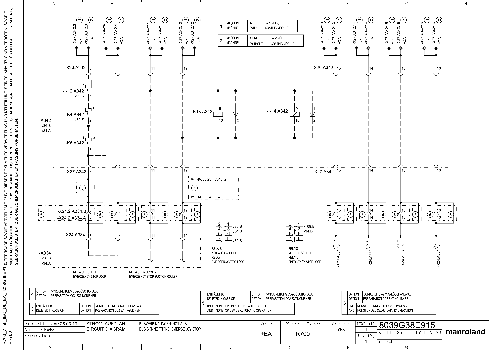

# +EA — Sheet 35 of 407 — BUSVERBINDUNGEN: NOT AUS

**BUS CONNECTIONS: EMERGENCY STOP**

> Part of the manroland **R700** printing press IEC/UL circuit diagrams.
> Drawing class: **Stromlaufplan / Circuit diagram** (DIN A3).
> Document `+EA` covers the **Printing unit** machine section.

## At a glance

| Field | Value |
|---|---|
| Document | `+EA`  (8039G38E915) |
| Sheet | **35** of 407 |
| Section (DE) | BUSVERBINDUNGEN: NOT AUS |
| Section (EN) | BUS CONNECTIONS: EMERGENCY STOP |
| Section type | CIRCUIT — Circuit diagram |
| Machine type | `R700` |
| Series | `7758` |
| Created | 25.03.10 |
| Replaces | — |
| Columns used | A, B, C, D, E, F, G, H |
| Path numbers | — |
| Labels on sheet | 230 |
| Cross-refs out | 17 |
| Cross-refs in | 53 |

**Previous:** [+EA sheet 34](SHEET_0034.md) · **Next:** [+EA sheet 36](SHEET_0036.md) · **Document TOC:** [_TOC.md](_TOC.md)  (+EA) · **Master TOC:** [all sheets](../_MASTER_TOC.md)

## Sheet image (300 DPI, exact vector render)



_Rendered directly from the PDF vector layer at 300 DPI (1-bit), no OCR and no resampling. Use it to confirm anything ambiguous in the text below._

## Cross-references on this sheet

Each entry is a wire leaving this sheet. The printed token is `/sheet.column`; the link resolves to that sheet inside the same document.

| Ref | Target sheet | Col | Path | Destination on target | Target section | From col |
|---|---|---|---|---|---|---|
| `/33.B` | [+EA sheet 33](SHEET_0033.md) | B | — | — | BUSVERBINDUNGEN: NOT AUS | A |
| `/32.F` | [+EA sheet 32](SHEET_0032.md) | F | — | — | BUSVERBINDUNGEN: NOT AUS | A |
| `/36.B` | [+EA sheet 36](SHEET_0036.md) | B | — | — | BUSVERBINDUNGEN: NOT AUS | A |
| `/34.A` | [+EA sheet 34](SHEET_0034.md) | A | — | — | BUSVERBINDUNGEN: NOT AUS | A |
| `/346.G` | [+EA sheet 346](SHEET_0346.md) | G | — | K635:23 | OPTION: VORBEREITUNG CO2 LÖSCHANLAGE | D |
| `/346.G` | [+EA sheet 346](SHEET_0346.md) | G | — | K635:24 | OPTION: VORBEREITUNG CO2 LÖSCHANLAGE | D |
| `/88.B` | [+EA sheet 88](SHEET_0088.md) | B | — | — | SAUGWALZE | D |
| `/34.B` | [+EA sheet 34](SHEET_0034.md) | B | — | — | BUSVERBINDUNGEN: NOT AUS | D |
| `/169.B` | [+EA sheet 169](SHEET_0169.md) | B | — | — | RESERVE | E |
| `/34.B` | [+EA sheet 34](SHEET_0034.md) | B | — | — | BUSVERBINDUNGEN: NOT AUS | E |
| `/36.B` | [+EA sheet 36](SHEET_0036.md) | B | — | — | BUSVERBINDUNGEN: NOT AUS | D |
| `/75.B` | [+EA sheet 75](SHEET_0075.md) | B | — | — | AUSLEGERSTAPELSTEUERUNG | F |
| `/75.B` | [+EA sheet 75](SHEET_0075.md) | B | — | — | AUSLEGERSTAPELSTEUERUNG | F |
| `/98.F` | [+EA sheet 98](SHEET_0098.md) | F | — | — | BOGENFÜHRUNGSELEMENT | G |
| `/98.F` | [+EA sheet 98](SHEET_0098.md) | F | — | — | BOGENFÜHRUNGSELEMENT | G |
| `/36.B` | [+EA sheet 36](SHEET_0036.md) | B | — | — | BUSVERBINDUNGEN: NOT AUS | A |
| `/34.A` | [+EA sheet 34](SHEET_0034.md) | A | — | — | BUSVERBINDUNGEN: NOT AUS | A |

### Incoming references (sheets that point here)

Every other sheet that sends a wire to this one. `Back-ref` is the token printed on *that* sheet; `Path` is its line number.

| From sheet | Cols | Back-ref | Path | Refs | What continues there |
|---|---|---|---|---|---|
| [+EA#32](SHEET_0032.md) | F | `/32.F` | — | 1 | — |
| [+EA#33](SHEET_0033.md) | B | `/33.B` | — | 1 | — |
| [+EA#34](SHEET_0034.md) | A, B | `/34.A`, `/34.B` | — | 4 | 4 |
| [+EA#36](SHEET_0036.md) | B | `/36.B` | — | 3 | — |
| [+EA#75](SHEET_0075.md) | A | `/75.A` | — | 2 | X24.A334:13; X24.A334:14 |
| [+EA#88](SHEET_0088.md) | A | `/88.A` | — | 1 | A342 |
| [+EA#98](SHEET_0098.md) | E | `/98.E` | — | 2 | X24.A334:15; X24.A334:16 |
| [+EA#169](SHEET_0169.md) | B | `/169.B` | — | 1 | — |
| [+EA#265](SHEET_0265.md) | F | `/265.F` | — | 4 | — |
| [+EA#266](SHEET_0266.md) | B, D | `/266.B`, `/266.D` | — | 16 | — |
| [+EA#269](SHEET_0269.md) | C | `/269.C` | — | 8 | — |
| [+EA#270](SHEET_0270.md) | G | `/270.G` | — | 8 | — |
| [+EA#346](SHEET_0346.md) | F | `/346.F` | — | 2 | K635:23; K635:24 |


## Devices on this sheet

| Tag | Class | Class meaning (IEC) | Col | Sub | Terminal | Sign |
|---|---|---|---|---|---|---|
| `A334` | A | Baugruppe / assembly, module, PC board | A | — | — | — |
| `A342` | A | Baugruppe / assembly, module, PC board | A | — | — | — |
| `K635:23` | K | Relais / relay, contactor | D | — | 23 | — |
| `K635:24` | K | Relais / relay, contactor | D | — | 24 | — |
| `K13.A342` | — | cross-device reference | D | — | — | — |
| `K14.A342` | — | cross-device reference | E | — | — | — |
| `X24.A334` | — | cross-device reference | A | — | — | — |
| `X27.A342:3` | — | cross-device reference | B | — | 3 | — |
| `X27.A342:4` | — | cross-device reference | B | — | 4 | — |
| `X27.A342:3` | — | cross-device reference | A | — | 3 | — |
| `X27.A342:4` | — | cross-device reference | B | — | 4 | — |
| `X26.A342` | — | cross-device reference | A | — | — | — |
| `K12.A342` | — | cross-device reference | A | — | — | — |
| `K4.A342` | — | cross-device reference | A | — | — | — |
| `X27.A342` | — | cross-device reference | A | — | — | — |
| `X24.2.A334.B` | — | cross-device reference | A | — | — | — |
| `X24.2.A334.A` | — | cross-device reference | A | — | — | — |
| `X27.A342:12` | — | cross-device reference | C | — | 12 | — |
| `X27.A342:12` | — | cross-device reference | C | — | 12 | — |
| `X27.A342:11` | — | cross-device reference | C | — | 11 | — |
| `X27.A342:11` | — | cross-device reference | C | — | 11 | — |
| `X27.A342:13` | — | cross-device reference | F | — | 13 | — |
| `X27.A342:13` | — | cross-device reference | F | — | 13 | — |
| `X26.A342` | — | cross-device reference | F | — | — | — |
| `X27.A342` | — | cross-device reference | F | — | — | — |
| `X27.A342:14` | — | cross-device reference | F | — | 14 | — |
| `X27.A342:14` | — | cross-device reference | F | — | 14 | — |
| `X27.A342:16` | — | cross-device reference | G | — | 16 | — |
| `X27.A342:16` | — | cross-device reference | G | — | 16 | — |
| `X27.A342:15` | — | cross-device reference | G | — | 15 | — |
| `X27.A342:15` | — | cross-device reference | G | — | 15 | — |
| `X24.A334:13` | — | cross-device reference | F | — | 13 | — |
| `X24.A334:14` | — | cross-device reference | F | — | 14 | — |
| `X24.A334:16` | — | cross-device reference | H | — | 16 | — |
| `X24.A334:15` | — | cross-device reference | G | — | 15 | — |
| `K6.A342` | — | cross-device reference | A | — | — | — |

## Potentials / nets

_No named potentials on this sheet._

## Wire-end annotations (grouped as printed)

A wire that continues elsewhere is annotated with a small cluster: the destination description, the path/line number `#NN`, and the `/sheet.column` cross reference. Each row below is one such cluster exactly as it is grouped on the drawing.

| Col | Y | Path | Cross-ref | Text on the wire |
|---|---|---|---|---|
| A | 45.3 | — | — | `1` |
| B | 45.3 | — | — | `1` |
| C | 45.3 | — | — | `1` |
| C | 45.3 | — | — | `1` |
| F | 45.3 | — | — | `1` |
| F | 45.3 | — | — | `1` |
| G | 45.3 | — | — | `1` |
| G | 45.3 | — | — | `1` |
| B | 46.2 | — | — | `2` |
| B | 46.2 | — | — | `2` |
| C | 46.2 | — | — | `2` |
| C | 46.2 | — | — | `2` |
| F | 46.2 | — | — | `2` |
| F | 46.2 | — | — | `2` |
| G | 46.2 | — | — | `2` |
| H | 46.2 | — | — | `2` |
| C | 53.0 | — | — | `X27.A342:11` |
| C | 53.0 | — | — | `X27.A342:11` |
| C | 53.0 | — | — | `X27.A342:12` |
| C | 53.0 | — | — | `X27.A342:12` |
| D | 53.0 | — | — | `MIT` |
| F | 53.0 | — | — | `X27.A342:13` |
| F | 53.0 | — | — | `X27.A342:13` |
| F | 53.0 | — | — | `X27.A342:14` |
| F | 53.0 | — | — | `X27.A342:14` |
| G | 53.0 | — | — | `X27.A342:15` |
| G | 53.0 | — | — | `X27.A342:15` |
| G | 53.0 | — | — | `X27.A342:16` |
| G | 53.0 | — | — | `X27.A342:16` |
| D | 53.1 | — | — | `MASCHINE` |
| E | 53.1 | — | — | `LACKMODUL` |
| A | 57.8 | — | — | `X27.A342:3` |
| B | 57.8 | — | — | `X27.A342:3` |
| B | 57.8 | — | — | `X27.A342:4` |
| B | 57.8 | — | — | `X27.A342:4` |
| D | 58.4 | — | — | `1 MACHINE` |
| D | 64.3 | — | — | `WITH` |
| E | 64.4 | — | — | `COATING MODULE` |
| D | 88.5 | — | — | `2 MACHINE OHNE` |
| D | 88.5 | — | — | `MASCHINE` |
| E | 88.5 | — | — | `LACKMODUL` |
| B | 89.3 | — | — | `+DA` |
| B | 89.3 | — | — | `+DA` |
| C | 89.3 | — | — | `+DA` |
| C | 89.3 | — | — | `+DA` |
| F | 89.3 | — | — | `+DA` |
| F | 89.3 | — | — | `+DA` |
| G | 89.3 | — | — | `+DA` |
| H | 89.3 | — | — | `+DA` |
| A | 93.0 | — | — | `+Jx` |
| B | 93.0 | — | — | `+Jx` |
| C | 93.0 | — | — | `+Jx` |
| C | 93.0 | — | — | `+Jx` |
| F | 93.0 | — | — | `+Jx` |
| F | 93.0 | — | — | `+Jx` |
| G | 93.0 | — | — | `+Jx` |
| G | 93.0 | — | — | `+Jx` |
| D | 102.6 | — | — | `WITHOUT` |
| E | 102.7 | — | — | `COATING MODULE` |
| B | 157.6 | — | — | `X26.A342 3 4` |
| F | 157.6 | — | — | `X26.A342 13` |
| C | 160.5 | — | — | `11` |
| C | 160.5 | — | — | `12` |
| F | 160.5 | — | — | `14` |
| G | 160.5 | — | — | `15` |
| H | 160.5 | — | — | `16` |
| A | 200.9 | — | — | `K12.A342 3` |
| B | 200.9 | — | — | `1` |
| A | 227.4 | — | `/33.B` | — |
| B | 229.2 | — | — | `2` |
| A | 257.6 | — | — | `K4.A342 3` |
| B | 257.6 | — | — | `1` |
| D | 257.6 | — | — | `9` |
| E | 257.6 | — | — | `9` |
| E | 257.6 | — | — | `1` |
| D | 257.9 | — | — | `1` |
| E | 262.5 | — | — | `K14.A342` |
| D | 263.9 | — | — | `K13.A342` |
| A | 284.1 | — | `/32.F` | — |
| A | 285.2 | — | — | `A342` |
| B | 285.9 | — | — | `2` |
| D | 285.9 | — | — | `10` |
| E | 285.9 | — | — | `10` |
| E | 285.9 | — | — | `2` |
| D | 286.2 | — | — | `2` |
| A | 298.2 | — | `/36.B`, `/34.A` | — |
| B | 327.7 | — | — | `1 3` |
| A | 339.1 | — | — | `K6.A342` |
| B | 353.2 | — | — | `2` |
| B | 405.7 | — | — | `X27.A342 3 4` |
| C | 405.7 | — | — | `11` |
| C | 405.7 | — | — | `12` |
| F | 405.7 | — | — | `X27.A342 13` |
| F | 405.7 | — | — | `14` |
| G | 405.7 | — | — | `15` |
| H | 405.7 | — | — | `16` |
| D | 427.6 | — | `/346.G` | `K635:23` |
| B | 449.6 | — | — | `3 4` |
| D | 470.1 | — | `/346.G` | `K635:24` |
| A | 502.1 | — | — | `X24.2.A334.B 3` |
| B | 502.1 | — | — | `4` |
| C | 502.1 | — | — | `11` |
| C | 502.1 | — | — | `12` |
| F | 502.1 | — | — | `13` |
| F | 502.1 | — | — | `14` |
| G | 502.1 | — | — | `15` |
| H | 502.1 | — | — | `16` |
| B | 513.4 | — | — | `6 5 6 5` |
| C | 513.4 | — | — | `6 5` |
| C | 513.4 | — | — | `6 5` |
| F | 513.4 | — | — | `6 5` |
| F | 513.4 | — | — | `6` |
| G | 513.4 | — | — | `5 6 5` |
| G | 513.4 | — | — | `6 5` |
| A | 519.1 | — | — | `X24.2.A334.A 3` |
| B | 519.1 | — | — | `4` |
| C | 519.1 | — | — | `11` |
| C | 519.1 | — | — | `12` |
| F | 519.1 | — | — | `13` |
| F | 519.1 | — | — | `14` |
| G | 519.1 | — | — | `15` |
| H | 519.1 | — | — | `16` |
| D | 534.6 | — | — | `2 4 5 7 1 3 8 6` |
| E | 534.6 | — | — | `2 4 5 7 1 3 8 6` |
| D | 541.0 | — | `/88.B`, `/34.B` | — |
| E | 541.0 | — | `/169.B`, `/34.B` | — |
| B | 560.1 | — | — | `X24.A334 3 4` |
| C | 563.0 | — | — | `11` |
| C | 563.0 | — | — | `12` |
| D | 575.0 | — | `/36.B` | — |
| F | 578.0 | — | `/75.B` | — |
| F | 578.0 | — | `/75.B` | — |
| G | 578.0 | — | `/98.F` | — |
| G | 578.0 | — | `/98.F` | — |
| F | 587.9 | — | — | `X24.A334:13` |
| F | 587.9 | — | — | `X24.A334:14` |
| G | 587.9 | — | — | `X24.A334:15` |
| H | 587.9 | — | — | `X24.A334:16` |
| D | 595.1 | — | — | `RELAIS: NOT AUS SCHLEIFE RELAY: EMERGENCY STOP LOOP` |
| E | 595.1 | — | — | `RELAIS: NOT AUS SCHLEIFE RELAY: EMERGENCY STOP LOOP` |
| A | 604.1 | — | — | `A334` |
| A | 617.1 | — | `/36.B`, `/34.A` | — |
| B | 651.9 | — | — | `NOT AUS SCHLEIFE EMERGENCY STOP LOOP` |
| C | 651.9 | — | — | `NOT AUS SAUGWALZE EMERGENCY STOP SUCTION ROLLER` |
| A | 697.9 | — | — | `4 OPTION OPTION` |
| A | 698.0 | — | — | `PREPARATION CO2 EXTINGUISHER VORBEREITUNG CO2 LÖSCHANLAGE` |
| D | 705.0 | — | — | `ENTFÄLLT BEI DELETED IN CASE OF` |
| D | 705.0 | — | — | `OPTION OPTION` |
| E | 705.0 | — | — | `PREPARATION CO2 EXTINGUISHER VORBEREITUNG CO2 LÖSCHANLAGE` |
| F | 705.0 | — | — | `OPTION OPTION` |
| G | 705.0 | — | — | `PREPARATION CO2 EXTINGUISHER VORBEREITUNG CO2 LÖSCHANLAGE` |
| E | 724.5 | — | — | `5 UND` |
| F | 724.5 | — | — | `6` |
| A | 733.4 | — | — | `3 ENTFÄLLT BEI DELETED IN CASE OF` |
| B | 733.4 | — | — | `OPTION OPTION` |
| B | 733.4 | — | — | `PREPARATION CO2 EXTINGUISHER VORBEREITUNG CO2 LÖSCHANLAGE` |
| D | 733.4 | — | — | `UND` |
| D | 733.4 | — | — | `NONSTOP EINRICHTUNG AUTOMATISCH NONSTOP DEVICE AUTOMATIC OPERATION` |
| G | 733.4 | — | — | `NONSTOP EINRICHTUNG AUTOMATISCH NONSTOP DEVICE AUTOMATIC OPERATION` |
| D | 744.0 | — | — | `AND` |
| F | 744.0 | — | — | `AND` |


## Reconstructed tables

This sheet carries tabular content (pin map / terminal assignment / index). The grid below was rebuilt from the drawing's own rule lines, so each row is exactly one physical row of the table.

### Table 1 — 5 data rows × 1 columns (at x=212.6, y=218.3)

| C1 |
|---|
| `2 3 2` |
| `3 2` |
| `3` |
| `3 5 3` |
| `3` |


### Table 2 — 5 data rows × 9 columns (at x=255.1, y=218.3)

|  |  |  |  |  |  | K13.A342 | 9 10 |  |
|---|---|---|---|---|---|---|---|---|
|  | `4` |  | `11` |  | `12` |  |  |  |
|  |  |  |  |  | `4` | `K635:23` | `/346.G` |  |
|  |  |  |  |  |  | `K635:24` | `/346.G` |  |
| `6` | `4 5 4` | `6` | `11 5 11` | `6` | `12 5 12` |  |  |  |
|  | `4` |  | `11` |  | `12` | `RELAIS: NOT AUS` | `2 4 5 7` | `1 3 6 8 SCHLEIFE` |


### Table 3 — 2 data rows × 9 columns (at x=708.7, y=218.3)

| 9 10 | 1 2 |  |  |  |  |  |  |  |
|---|---|---|---|---|---|---|---|---|
|  | `X27.A342` | `13` |  | `14` |  | `15` |  | `16` |
|  | `6` | `13 5 13` | `6` | `14 5 14` | `6` | `15 5 15` | `6` | `16 5 16` |


## Notes and free text on this sheet

| Text | Col | Y (pt) |
|---|---|---|
| `RELAIS:` | D | 595.12 |
| `NOT AUS SCHLEIFE` | D | 605.82 |
| `RELAY:` | D | 616.39 |
| `EMERGENCY STOP LOOP` | D | 627.1 |
| `RELAIS:` | E | 595.12 |
| `NOT AUS SCHLEIFE` | E | 605.82 |
| `RELAY:` | E | 616.39 |
| `EMERGENCY STOP LOOP` | E | 627.1 |
| `+DA` | B | 89.29 |
| `+Jx` | A | 92.98 |
| `+Jx` | B | 92.98 |
| `+DA` | C | 89.29 |
| `+Jx` | C | 92.98 |
| `+DA` | F | 89.29 |
| `+Jx` | F | 92.98 |
| `+DA` | H | 89.29 |
| `+Jx` | G | 92.98 |
| `+DA` | G | 89.29 |
| `MIT` | D | 53.04 |
| `WITH` | D | 64.28 |
| `LACKMODUL` | E | 53.09 |
| `COATING MODULE` | E | 64.42 |
| `MASCHINE` | D | 53.06 |
| `MACHINE` | D | 64.41 |
| `OHNE` | D | 88.49 |
| `WITHOUT` | D | 102.63 |
| `ENTFÄLLT BEI` | A | 733.35 |
| `DELETED IN CASE OF` | A | 744 |
| `OPTION` | B | 733.35 |
| `VORBEREITUNG CO2 LÖSCHANLAGE` | B | 733.4 |
| `PREPARATION CO2 EXTINGUISHER` | B | 744.01 |
| `OPTION` | A | 697.92 |
| `VORBEREITUNG CO2 LÖSCHANLAGE` | A | 697.97 |
| `PREPARATION CO2 EXTINGUISHER` | A | 708.58 |
| `NOT AUS SCHLEIFE` | B | 651.88 |
| `EMERGENCY STOP LOOP` | B | 662.52 |
| `NOT AUS SAUGWALZE` | C | 651.86 |
| `EMERGENCY STOP SUCTION ROLLER` | C | 662.53 |
| `ENTFÄLLT BEI` | D | 705 |
| `DELETED IN CASE OF` | D | 715.65 |
| `OPTION` | D | 705.01 |
| `VORBEREITUNG CO2 LÖSCHANLAGE` | E | 705.05 |
| `PREPARATION CO2 EXTINGUISHER` | E | 715.67 |
| `UND` | D | 733.38 |
| `AND` | D | 744.03 |
| `NONSTOP EINRICHTUNG AUTOMATISCH` | D | 733.39 |
| `NONSTOP DEVICE AUTOMATIC OPERATION` | D | 744.01 |
| `UND` | F | 733.38 |
| `AND` | F | 744.03 |
| `NONSTOP EINRICHTUNG AUTOMATISCH` | G | 733.39 |
| `NONSTOP DEVICE AUTOMATIC OPERATION` | G | 744.01 |
| `OPTION` | F | 705.01 |
| `VORBEREITUNG CO2 LÖSCHANLAGE` | G | 705.05 |
| `PREPARATION CO2 EXTINGUISHER` | G | 715.67 |

## Complete label inventory (exact text from the drawing)

Every text object inside the drawing area of this sheet, in DIN reading order (column A→H, then top→bottom). This is the authoritative list: if a string is not here it is not printed on this sheet.

| Col | Y | X | Dir | Type | Text |
|---|---|---|---|---|---|
| A | 45.3 | 188.3 | ↕ | number | `1` |
| A | 57.8 | 175.3 | ↕ | device ref | `X27.A342:3` |
| A | 93.0 | 189.6 | ↕ | text | `+Jx` |
| A | 157.6 | 155.9 | → | device ref | `X26.A342` |
| A | 214.3 | 151.7 | → | device ref | `K12.A342` |
| A | 227.4 | 180.9 | → | cross-reference | `/33.B` |
| A | 271.0 | 157.6 | → | device ref | `K4.A342` |
| A | 284.1 | 181.4 | → | cross-reference | `/32.F` |
| A | 285.2 | 94.1 | → | device tag | `A342` |
| A | 298.2 | 101.5 | → | cross-reference | `/36.B` |
| A | 310.6 | 101.2 | → | cross-reference | `/34.A` |
| A | 339.0 | 157.6 | → | device ref | `K6.A342` |
| A | 408.5 | 157.3 | → | device ref | `X27.A342` |
| A | 449.6 | 196.4 | → | number | `3` |
| A | 503.5 | 138.6 | → | device ref | `X24.2.A334.B` |
| A | 513.4 | 97.2 | → | number | `6` |
| A | 519.8 | 137.8 | → | device ref | `X24.2.A334.A` |
| A | 560.1 | 154.5 | → | device ref | `X24.A334` |
| A | 604.1 | 94.1 | → | device tag | `A334` |
| A | 617.1 | 101.5 | → | cross-reference | `/36.B` |
| A | 629.5 | 101.2 | → | cross-reference | `/34.A` |
| A | 697.9 | 87.6 | → | text | `OPTION` |
| A | 698.0 | 123.3 | → | text | `VORBEREITUNG CO2 LÖSCHANLAGE` |
| A | 703.3 | 75.1 | → | number | `4` |
| A | 708.6 | 87.6 | → | text | `OPTION` |
| A | 708.6 | 122.5 | → | text | `PREPARATION CO2 EXTINGUISHER` |
| A | 733.3 | 87.0 | → | text | `ENTFÄLLT BEI` |
| A | 738.7 | 75.0 | → | number | `3` |
| A | 744.0 | 87.0 | → | text | `DELETED IN CASE OF` |
| B | 45.3 | 259.1 | ↕ | number | `1` |
| B | 46.2 | 217.1 | ↕ | number | `2` |
| B | 46.2 | 288.0 | ↕ | number | `2` |
| B | 57.8 | 203.7 | ↕ | device ref | `X27.A342:3` |
| B | 57.8 | 246.2 | ↕ | device ref | `X27.A342:4` |
| B | 57.8 | 274.5 | ↕ | device ref | `X27.A342:4` |
| B | 89.3 | 217.8 | ↕ | text | `+DA` |
| B | 89.3 | 288.7 | ↕ | text | `+DA` |
| B | 93.0 | 260.4 | ↕ | text | `+Jx` |
| B | 160.5 | 215.1 | → | number | `3` |
| B | 160.5 | 286.0 | → | number | `4` |
| B | 200.9 | 199.6 | → | number | `1` |
| B | 200.9 | 222.2 | → | number | `3` |
| B | 229.2 | 215.1 | → | number | `2` |
| B | 257.6 | 199.6 | → | number | `1` |
| B | 257.6 | 222.2 | → | number | `3` |
| B | 285.9 | 215.1 | → | number | `2` |
| B | 327.7 | 198.1 | → | number | `1` |
| B | 327.7 | 223.7 | → | number | `3` |
| B | 353.2 | 215.1 | → | number | `2` |
| B | 405.7 | 215.1 | → | number | `3` |
| B | 405.7 | 286.0 | → | number | `4` |
| B | 502.1 | 215.1 | → | number | `3` |
| B | 502.1 | 286.0 | → | number | `4` |
| B | 513.4 | 239.0 | → | number | `5` |
| B | 513.4 | 267.3 | → | number | `6` |
| B | 513.4 | 316.9 | → | number | `5` |
| B | 519.1 | 215.1 | → | number | `3` |
| B | 519.1 | 286.0 | → | number | `4` |
| B | 563.0 | 215.1 | → | number | `3` |
| B | 563.0 | 286.0 | → | number | `4` |
| B | 651.9 | 176.3 | → | text | `NOT AUS SCHLEIFE` |
| B | 662.5 | 176.3 | → | text | `EMERGENCY STOP LOOP` |
| B | 733.4 | 193.9 | → | text | `OPTION` |
| B | 733.4 | 229.6 | → | text | `VORBEREITUNG CO2 LÖSCHANLAGE` |
| B | 744.0 | 193.9 | → | text | `OPTION` |
| B | 744.0 | 228.8 | → | text | `PREPARATION CO2 EXTINGUISHER` |
| C | 45.3 | 365.4 | ↕ | number | `1` |
| C | 45.3 | 443.4 | ↕ | number | `1` |
| C | 46.2 | 394.3 | ↕ | number | `2` |
| C | 46.2 | 472.3 | ↕ | number | `2` |
| C | 53.0 | 352.5 | ↕ | device ref | `X27.A342:11` |
| C | 53.0 | 380.8 | ↕ | device ref | `X27.A342:11` |
| C | 53.0 | 430.4 | ↕ | device ref | `X27.A342:12` |
| C | 53.0 | 458.8 | ↕ | device ref | `X27.A342:12` |
| C | 89.3 | 395.0 | ↕ | text | `+DA` |
| C | 89.3 | 473.0 | ↕ | text | `+DA` |
| C | 93.0 | 366.7 | ↕ | text | `+Jx` |
| C | 93.0 | 444.7 | ↕ | text | `+Jx` |
| C | 160.5 | 363.4 | → | number | `11` |
| C | 160.5 | 441.4 | → | number | `12` |
| C | 405.7 | 363.4 | → | number | `11` |
| C | 405.7 | 441.4 | → | number | `12` |
| C | 449.6 | 465.7 | → | number | `4` |
| C | 502.1 | 363.4 | → | number | `11` |
| C | 502.1 | 441.4 | → | number | `12` |
| C | 513.4 | 345.2 | → | number | `6` |
| C | 513.4 | 394.9 | → | number | `5` |
| C | 513.4 | 423.2 | → | number | `6` |
| C | 513.4 | 472.8 | → | number | `5` |
| C | 519.1 | 363.4 | → | number | `11` |
| C | 519.1 | 441.4 | → | number | `12` |
| C | 563.0 | 363.4 | → | number | `11` |
| C | 563.0 | 441.4 | → | number | `12` |
| C | 651.9 | 311.0 | → | text | `NOT AUS SAUGWALZE` |
| C | 662.5 | 311.0 | → | text | `EMERGENCY STOP SUCTION ROLLER` |
| D | 53.0 | 601.8 | → | text | `MIT` |
| D | 53.1 | 545.1 | → | text | `MASCHINE` |
| D | 58.4 | 528.9 | → | number | `1` |
| D | 64.3 | 602.4 | → | text | `WITH` |
| D | 64.4 | 545.1 | → | text | `MACHINE` |
| D | 88.5 | 545.1 | → | text | `MASCHINE` |
| D | 88.5 | 602.1 | → | text | `OHNE` |
| D | 93.8 | 528.7 | → | number | `2` |
| D | 99.8 | 545.1 | → | text | `MACHINE` |
| D | 102.6 | 602.4 | → | text | `WITHOUT` |
| D | 257.6 | 527.0 | → | number | `9` |
| D | 257.9 | 568.9 | → | number | `1` |
| D | 263.9 | 460.6 | → | device ref | `K13.A342` |
| D | 285.9 | 526.4 | → | number | `10` |
| D | 286.2 | 569.5 | → | number | `2` |
| D | 427.6 | 473.1 | → | device tag | `K635:23` |
| D | 427.6 | 518.0 | → | cross-reference | `/346.G` |
| D | 470.1 | 473.1 | → | device tag | `K635:24` |
| D | 470.1 | 518.0 | → | cross-reference | `/346.G` |
| D | 534.6 | 524.7 | → | number | `2` |
| D | 534.6 | 546.0 | → | number | `1` |
| D | 541.0 | 561.3 | → | cross-reference | `/88.B` |
| D | 545.9 | 524.7 | → | number | `4` |
| D | 545.9 | 546.5 | → | number | `3` |
| D | 552.3 | 561.3 | → | cross-reference | `/34.B` |
| D | 557.3 | 524.7 | → | number | `5` |
| D | 557.3 | 546.8 | → | number | `6` |
| D | 568.6 | 524.7 | → | number | `7` |
| D | 568.6 | 546.5 | → | number | `8` |
| D | 575.0 | 561.3 | → | cross-reference | `/36.B` |
| D | 595.1 | 509.4 | → | text | `RELAIS:` |
| D | 605.8 | 509.4 | → | text | `NOT AUS SCHLEIFE` |
| D | 616.4 | 509.4 | → | text | `RELAY:` |
| D | 627.1 | 509.4 | → | text | `EMERGENCY STOP LOOP` |
| D | 705.0 | 498.0 | → | text | `ENTFÄLLT BEI` |
| D | 705.0 | 604.9 | → | text | `OPTION` |
| D | 715.6 | 604.9 | → | text | `OPTION` |
| D | 715.7 | 498.0 | → | text | `DELETED IN CASE OF` |
| D | 724.5 | 486.0 | → | number | `5` |
| D | 733.4 | 498.0 | → | text | `UND` |
| D | 733.4 | 519.3 | → | text | `NONSTOP EINRICHTUNG AUTOMATISCH` |
| D | 744.0 | 498.9 | → | text | `AND` |
| D | 744.0 | 519.3 | → | text | `NONSTOP DEVICE AUTOMATIC OPERATION` |
| E | 53.1 | 636.9 | → | text | `LACKMODUL` |
| E | 64.4 | 637.5 | → | text | `COATING MODULE` |
| E | 88.5 | 651.1 | → | text | `LACKMODUL` |
| E | 102.7 | 651.7 | → | text | `COATING MODULE` |
| E | 257.6 | 711.2 | → | number | `9` |
| E | 257.6 | 753.2 | → | number | `1` |
| E | 262.5 | 642.0 | → | device ref | `K14.A342` |
| E | 285.9 | 710.6 | → | number | `10` |
| E | 285.9 | 753.7 | → | number | `2` |
| E | 534.6 | 694.8 | → | number | `2` |
| E | 534.6 | 716.0 | → | number | `1` |
| E | 541.0 | 731.3 | → | cross-reference | `/169.B` |
| E | 545.9 | 694.8 | → | number | `4` |
| E | 545.9 | 716.6 | → | number | `3` |
| E | 552.3 | 731.3 | → | cross-reference | `/34.B` |
| E | 557.3 | 694.8 | → | number | `5` |
| E | 557.3 | 716.9 | → | number | `6` |
| E | 568.6 | 694.8 | → | number | `7` |
| E | 568.6 | 716.6 | → | number | `8` |
| E | 595.1 | 693.6 | → | text | `RELAIS:` |
| E | 605.8 | 693.6 | → | text | `NOT AUS SCHLEIFE` |
| E | 616.4 | 693.6 | → | text | `RELAY:` |
| E | 627.1 | 693.6 | → | text | `EMERGENCY STOP LOOP` |
| E | 705.1 | 640.6 | → | text | `VORBEREITUNG CO2 LÖSCHANLAGE` |
| E | 715.7 | 639.8 | → | text | `PREPARATION CO2 EXTINGUISHER` |
| F | 45.3 | 783.6 | ↕ | number | `1` |
| F | 45.3 | 861.5 | ↕ | number | `1` |
| F | 46.2 | 812.4 | ↕ | number | `2` |
| F | 46.2 | 890.4 | ↕ | number | `2` |
| F | 53.0 | 770.6 | ↕ | device ref | `X27.A342:13` |
| F | 53.0 | 798.9 | ↕ | device ref | `X27.A342:13` |
| F | 53.0 | 848.6 | ↕ | device ref | `X27.A342:14` |
| F | 53.0 | 876.9 | ↕ | device ref | `X27.A342:14` |
| F | 89.3 | 813.1 | ↕ | text | `+DA` |
| F | 89.3 | 891.1 | ↕ | text | `+DA` |
| F | 93.0 | 784.8 | ↕ | text | `+Jx` |
| F | 93.0 | 862.8 | ↕ | text | `+Jx` |
| F | 157.6 | 751.2 | → | device ref | `X26.A342` |
| F | 160.5 | 809.9 | → | number | `13` |
| F | 160.5 | 887.8 | → | number | `14` |
| F | 405.7 | 809.9 | → | number | `13` |
| F | 405.7 | 887.8 | → | number | `14` |
| F | 408.5 | 752.6 | → | device ref | `X27.A342` |
| F | 502.1 | 809.9 | → | number | `13` |
| F | 502.1 | 887.8 | → | number | `14` |
| F | 513.4 | 791.7 | → | number | `6` |
| F | 513.4 | 841.3 | → | number | `5` |
| F | 513.4 | 869.7 | → | number | `6` |
| F | 519.1 | 809.9 | → | number | `13` |
| F | 519.1 | 887.8 | → | number | `14` |
| F | 578.0 | 799.6 | ↕ | cross-reference | `/75.B` |
| F | 578.0 | 877.6 | ↕ | cross-reference | `/75.B` |
| F | 587.9 | 809.6 | ↕ | device ref | `X24.A334:13` |
| F | 587.9 | 887.5 | ↕ | device ref | `X24.A334:14` |
| F | 705.0 | 838.8 | → | text | `OPTION` |
| F | 715.6 | 838.8 | → | text | `OPTION` |
| F | 724.5 | 826.3 | → | number | `6` |
| F | 733.4 | 838.2 | → | text | `UND` |
| F | 744.0 | 839.1 | → | text | `AND` |
| G | 45.3 | 939.5 | ↕ | number | `1` |
| G | 45.3 | 1024.5 | ↕ | number | `1` |
| G | 46.2 | 968.3 | ↕ | number | `2` |
| G | 53.0 | 926.5 | ↕ | device ref | `X27.A342:15` |
| G | 53.0 | 954.9 | ↕ | device ref | `X27.A342:15` |
| G | 53.0 | 1011.5 | ↕ | device ref | `X27.A342:16` |
| G | 53.0 | 1039.9 | ↕ | device ref | `X27.A342:16` |
| G | 89.3 | 969.0 | ↕ | text | `+DA` |
| G | 93.0 | 940.7 | ↕ | text | `+Jx` |
| G | 93.0 | 1025.8 | ↕ | text | `+Jx` |
| G | 160.5 | 965.8 | → | number | `15` |
| G | 405.7 | 965.8 | → | number | `15` |
| G | 502.1 | 965.8 | → | number | `15` |
| G | 513.4 | 919.3 | → | number | `5` |
| G | 513.4 | 947.6 | → | number | `6` |
| G | 513.4 | 997.2 | → | number | `5` |
| G | 513.4 | 1032.7 | → | number | `6` |
| G | 519.1 | 965.8 | → | number | `15` |
| G | 578.0 | 955.5 | ↕ | cross-reference | `/98.F` |
| G | 578.0 | 1040.6 | ↕ | cross-reference | `/98.F` |
| G | 587.9 | 965.5 | ↕ | device ref | `X24.A334:15` |
| G | 705.1 | 874.5 | → | text | `VORBEREITUNG CO2 LÖSCHANLAGE` |
| G | 715.7 | 873.6 | → | text | `PREPARATION CO2 EXTINGUISHER` |
| G | 733.4 | 859.5 | → | text | `NONSTOP EINRICHTUNG AUTOMATISCH` |
| G | 744.0 | 859.5 | → | text | `NONSTOP DEVICE AUTOMATIC OPERATION` |
| H | 46.2 | 1053.4 | ↕ | number | `2` |
| H | 89.3 | 1054.1 | ↕ | text | `+DA` |
| H | 160.5 | 1050.8 | → | number | `16` |
| H | 405.7 | 1050.8 | → | number | `16` |
| H | 502.1 | 1050.8 | → | number | `16` |
| H | 513.4 | 1082.3 | → | number | `5` |
| H | 519.1 | 1050.8 | → | number | `16` |
| H | 587.9 | 1050.5 | ↕ | device ref | `X24.A334:16` |

## Reading-order text block

The same content as a plain block, grouped by DIN column — convenient to paste or to match against a visual description.

```text
=== Column A ===
  45.3  188.3  numeric      1
  57.8  175.3  devref       X27.A342:3
  93.0  189.6  text         +Jx
 157.6  155.9  devref       X26.A342
 214.3  151.7  devref       K12.A342
 227.4  180.9  xref         /33.B
 271.0  157.6  devref       K4.A342
 284.1  181.4  xref         /32.F
 285.2   94.1  devtag       A342
 298.2  101.5  xref         /36.B
 310.6  101.2  xref         /34.A
 339.0  157.6  devref       K6.A342
 408.5  157.3  devref       X27.A342
 449.6  196.4  numeric      3
 503.5  138.6  devref       X24.2.A334.B
 513.4   97.2  numeric      6
 519.8  137.8  devref       X24.2.A334.A
 560.1  154.5  devref       X24.A334
 604.1   94.1  devtag       A334
 617.1  101.5  xref         /36.B
 629.5  101.2  xref         /34.A
 697.9   87.6  text         OPTION
 698.0  123.3  text         VORBEREITUNG CO2 LÖSCHANLAGE
 703.3   75.1  numeric      4
 708.6   87.6  text         OPTION
 708.6  122.5  text         PREPARATION CO2 EXTINGUISHER
 733.3   87.0  text         ENTFÄLLT BEI
 738.7   75.0  numeric      3
 744.0   87.0  text         DELETED IN CASE OF
=== Column B ===
  45.3  259.1  numeric      1
  46.2  217.1  numeric      2
  46.2  288.0  numeric      2
  57.8  203.7  devref       X27.A342:3
  57.8  246.2  devref       X27.A342:4
  57.8  274.5  devref       X27.A342:4
  89.3  217.8  text         +DA
  89.3  288.7  text         +DA
  93.0  260.4  text         +Jx
 160.5  215.1  numeric      3
 160.5  286.0  numeric      4
 200.9  199.6  numeric      1
 200.9  222.2  numeric      3
 229.2  215.1  numeric      2
 257.6  199.6  numeric      1
 257.6  222.2  numeric      3
 285.9  215.1  numeric      2
 327.7  198.1  numeric      1
 327.7  223.7  numeric      3
 353.2  215.1  numeric      2
 405.7  215.1  numeric      3
 405.7  286.0  numeric      4
 502.1  215.1  numeric      3
 502.1  286.0  numeric      4
 513.4  239.0  numeric      5
 513.4  267.3  numeric      6
 513.4  316.9  numeric      5
 519.1  215.1  numeric      3
 519.1  286.0  numeric      4
 563.0  215.1  numeric      3
 563.0  286.0  numeric      4
 651.9  176.3  text         NOT AUS SCHLEIFE
 662.5  176.3  text         EMERGENCY STOP LOOP
 733.4  193.9  text         OPTION
 733.4  229.6  text         VORBEREITUNG CO2 LÖSCHANLAGE
 744.0  193.9  text         OPTION
 744.0  228.8  text         PREPARATION CO2 EXTINGUISHER
=== Column C ===
  45.3  365.4  numeric      1
  45.3  443.4  numeric      1
  46.2  394.3  numeric      2
  46.2  472.3  numeric      2
  53.0  352.5  devref       X27.A342:11
  53.0  380.8  devref       X27.A342:11
  53.0  430.4  devref       X27.A342:12
  53.0  458.8  devref       X27.A342:12
  89.3  395.0  text         +DA
  89.3  473.0  text         +DA
  93.0  366.7  text         +Jx
  93.0  444.7  text         +Jx
 160.5  363.4  numeric      11
 160.5  441.4  numeric      12
 405.7  363.4  numeric      11
 405.7  441.4  numeric      12
 449.6  465.7  numeric      4
 502.1  363.4  numeric      11
 502.1  441.4  numeric      12
 513.4  345.2  numeric      6
 513.4  394.9  numeric      5
 513.4  423.2  numeric      6
 513.4  472.8  numeric      5
 519.1  363.4  numeric      11
 519.1  441.4  numeric      12
 563.0  363.4  numeric      11
 563.0  441.4  numeric      12
 651.9  311.0  text         NOT AUS SAUGWALZE
 662.5  311.0  text         EMERGENCY STOP SUCTION ROLLER
=== Column D ===
  53.0  601.8  text         MIT
  53.1  545.1  text         MASCHINE
  58.4  528.9  numeric      1
  64.3  602.4  text         WITH
  64.4  545.1  text         MACHINE
  88.5  545.1  text         MASCHINE
  88.5  602.1  text         OHNE
  93.8  528.7  numeric      2
  99.8  545.1  text         MACHINE
 102.6  602.4  text         WITHOUT
 257.6  527.0  numeric      9
 257.9  568.9  numeric      1
 263.9  460.6  devref       K13.A342
 285.9  526.4  numeric      10
 286.2  569.5  numeric      2
 427.6  473.1  devtag       K635:23
 427.6  518.0  xref         /346.G
 470.1  473.1  devtag       K635:24
 470.1  518.0  xref         /346.G
 534.6  524.7  numeric      2
 534.6  546.0  numeric      1
 541.0  561.3  xref         /88.B
 545.9  524.7  numeric      4
 545.9  546.5  numeric      3
 552.3  561.3  xref         /34.B
 557.3  524.7  numeric      5
 557.3  546.8  numeric      6
 568.6  524.7  numeric      7
 568.6  546.5  numeric      8
 575.0  561.3  xref         /36.B
 595.1  509.4  text         RELAIS:
 605.8  509.4  text         NOT AUS SCHLEIFE
 616.4  509.4  text         RELAY:
 627.1  509.4  text         EMERGENCY STOP LOOP
 705.0  498.0  text         ENTFÄLLT BEI
 705.0  604.9  text         OPTION
 715.6  604.9  text         OPTION
 715.7  498.0  text         DELETED IN CASE OF
 724.5  486.0  numeric      5
 733.4  498.0  text         UND
 733.4  519.3  text         NONSTOP EINRICHTUNG AUTOMATISCH
 744.0  498.9  text         AND
 744.0  519.3  text         NONSTOP DEVICE AUTOMATIC OPERATION
=== Column E ===
  53.1  636.9  text         LACKMODUL
  64.4  637.5  text         COATING MODULE
  88.5  651.1  text         LACKMODUL
 102.7  651.7  text         COATING MODULE
 257.6  711.2  numeric      9
 257.6  753.2  numeric      1
 262.5  642.0  devref       K14.A342
 285.9  710.6  numeric      10
 285.9  753.7  numeric      2
 534.6  694.8  numeric      2
 534.6  716.0  numeric      1
 541.0  731.3  xref         /169.B
 545.9  694.8  numeric      4
 545.9  716.6  numeric      3
 552.3  731.3  xref         /34.B
 557.3  694.8  numeric      5
 557.3  716.9  numeric      6
 568.6  694.8  numeric      7
 568.6  716.6  numeric      8
 595.1  693.6  text         RELAIS:
 605.8  693.6  text         NOT AUS SCHLEIFE
 616.4  693.6  text         RELAY:
 627.1  693.6  text         EMERGENCY STOP LOOP
 705.1  640.6  text         VORBEREITUNG CO2 LÖSCHANLAGE
 715.7  639.8  text         PREPARATION CO2 EXTINGUISHER
=== Column F ===
  45.3  783.6  numeric      1
  45.3  861.5  numeric      1
  46.2  812.4  numeric      2
  46.2  890.4  numeric      2
  53.0  770.6  devref       X27.A342:13
  53.0  798.9  devref       X27.A342:13
  53.0  848.6  devref       X27.A342:14
  53.0  876.9  devref       X27.A342:14
  89.3  813.1  text         +DA
  89.3  891.1  text         +DA
  93.0  784.8  text         +Jx
  93.0  862.8  text         +Jx
 157.6  751.2  devref       X26.A342
 160.5  809.9  numeric      13
 160.5  887.8  numeric      14
 405.7  809.9  numeric      13
 405.7  887.8  numeric      14
 408.5  752.6  devref       X27.A342
 502.1  809.9  numeric      13
 502.1  887.8  numeric      14
 513.4  791.7  numeric      6
 513.4  841.3  numeric      5
 513.4  869.7  numeric      6
 519.1  809.9  numeric      13
 519.1  887.8  numeric      14
 578.0  799.6  xref         /75.B
 578.0  877.6  xref         /75.B
 587.9  809.6  devref       X24.A334:13
 587.9  887.5  devref       X24.A334:14
 705.0  838.8  text         OPTION
 715.6  838.8  text         OPTION
 724.5  826.3  numeric      6
 733.4  838.2  text         UND
 744.0  839.1  text         AND
=== Column G ===
  45.3  939.5  numeric      1
  45.3 1024.5  numeric      1
  46.2  968.3  numeric      2
  53.0  926.5  devref       X27.A342:15
  53.0  954.9  devref       X27.A342:15
  53.0 1011.5  devref       X27.A342:16
  53.0 1039.9  devref       X27.A342:16
  89.3  969.0  text         +DA
  93.0  940.7  text         +Jx
  93.0 1025.8  text         +Jx
 160.5  965.8  numeric      15
 405.7  965.8  numeric      15
 502.1  965.8  numeric      15
 513.4  919.3  numeric      5
 513.4  947.6  numeric      6
 513.4  997.2  numeric      5
 513.4 1032.7  numeric      6
 519.1  965.8  numeric      15
 578.0  955.5  xref         /98.F
 578.0 1040.6  xref         /98.F
 587.9  965.5  devref       X24.A334:15
 705.1  874.5  text         VORBEREITUNG CO2 LÖSCHANLAGE
 715.7  873.6  text         PREPARATION CO2 EXTINGUISHER
 733.4  859.5  text         NONSTOP EINRICHTUNG AUTOMATISCH
 744.0  859.5  text         NONSTOP DEVICE AUTOMATIC OPERATION
=== Column H ===
  46.2 1053.4  numeric      2
  89.3 1054.1  text         +DA
 160.5 1050.8  numeric      16
 405.7 1050.8  numeric      16
 502.1 1050.8  numeric      16
 513.4 1082.3  numeric      5
 519.1 1050.8  numeric      16
 587.9 1050.5  devref       X24.A334:16
```

---
_Generated from the PDF vector text layer; no OCR. Source: `R700_7758_IEC_UL_EA_8039G38E915_p`, sheet 35._
