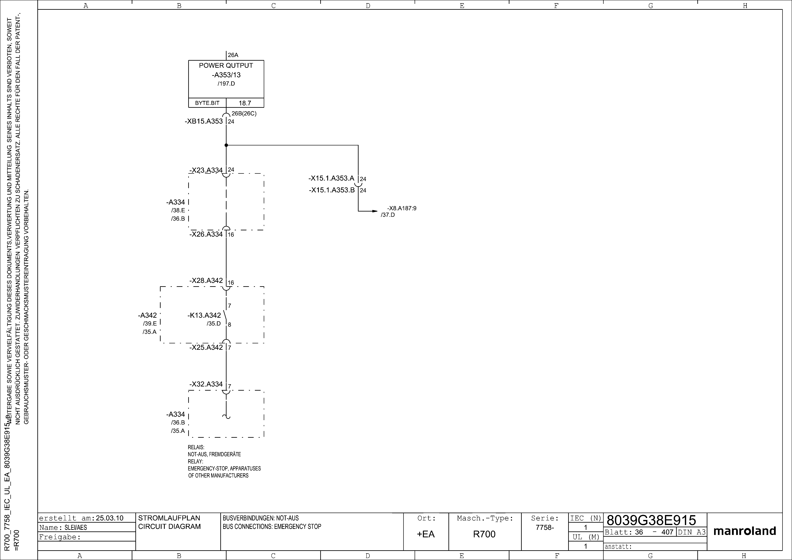

# +EA — Sheet 36 of 407 — BUSVERBINDUNGEN: NOT AUS

**BUS CONNECTIONS: EMERGENCY STOP**

> Part of the manroland **R700** printing press IEC/UL circuit diagrams.
> Drawing class: **Stromlaufplan / Circuit diagram** (DIN A3).
> Document `+EA` covers the **Printing unit** machine section.

## At a glance

| Field | Value |
|---|---|
| Document | `+EA`  (8039G38E915) |
| Sheet | **36** of 407 |
| Section (DE) | BUSVERBINDUNGEN: NOT AUS |
| Section (EN) | BUS CONNECTIONS: EMERGENCY STOP |
| Section type | CIRCUIT — Circuit diagram |
| Machine type | `R700` |
| Series | `7758` |
| Created | 25.03.10 |
| Replaces | — |
| Columns used | B, C, D |
| Path numbers | — |
| Labels on sheet | 43 |
| Cross-refs out | 9 |
| Cross-refs in | 17 |

**Previous:** [+EA sheet 35](SHEET_0035.md) · **Next:** [+EA sheet 37](SHEET_0037.md) · **Document TOC:** [_TOC.md](_TOC.md)  (+EA) · **Master TOC:** [all sheets](../_MASTER_TOC.md)

## Sheet image (300 DPI, exact vector render)



_Rendered directly from the PDF vector layer at 300 DPI (1-bit), no OCR and no resampling. Use it to confirm anything ambiguous in the text below._

## Cross-references on this sheet

Each entry is a wire leaving this sheet. The printed token is `/sheet.column`; the link resolves to that sheet inside the same document.

| Ref | Target sheet | Col | Path | Destination on target | Target section | From col |
|---|---|---|---|---|---|---|
| `/197.D` | [+EA sheet 197](SHEET_0197.md) | D | — | — | REFERENZMODUL | B |
| `/38.E` | [+EA sheet 38](SHEET_0038.md) | E | — | — | BUSVERBINDUNGEN: NOT AUS | C |
| `/37.D` | [+EA sheet 37](SHEET_0037.md) | D | — | — | BUSVERBINDUNGEN: NOT AUS | C |
| `/36.B` | [+EA sheet 36](SHEET_0036.md) | B | — | — | BUSVERBINDUNGEN: NOT AUS | C |
| `/39.E` | [+EA sheet 39](SHEET_0039.md) | E | — | — | BUSVERBINDUNGEN: STOP SICHERN | B |
| `/35.A` | [+EA sheet 35](SHEET_0035.md) | A | — | — | BUSVERBINDUNGEN: NOT AUS | B |
| `/35.D` | [+EA sheet 35](SHEET_0035.md) | D | — | — | BUSVERBINDUNGEN: NOT AUS | B |
| `/36.B` | [+EA sheet 36](SHEET_0036.md) | B | — | — | BUSVERBINDUNGEN: NOT AUS | B |
| `/35.A` | [+EA sheet 35](SHEET_0035.md) | A | — | — | BUSVERBINDUNGEN: NOT AUS | B |

### Incoming references (sheets that point here)

Every other sheet that sends a wire to this one. `Back-ref` is the token printed on *that* sheet; `Path` is its line number.

| From sheet | Cols | Back-ref | Path | Refs | What continues there |
|---|---|---|---|---|---|
| [+EA#35](SHEET_0035.md) | A, D | `/35.A`, `/35.D` | — | 3 | — |
| [+EA#36](SHEET_0036.md) | B, C | `/36.B`, `/36.C` | — | 2 | — |
| [+EA#37](SHEET_0037.md) | D | `/37.D` | — | 1 | X8.A187:9 |
| [+EA#38](SHEET_0038.md) | E | `/38.E` | — | 1 | — |
| [+EA#39](SHEET_0039.md) | E | `/39.E` | — | 1 | — |
| [+EA#197](SHEET_0197.md) | D | `/197.D` | — | 1 | — |
| [+EA#260](SHEET_0260.md) | F, G, H | `/260.F`, `/260.G`, `/260.H` | — | 3 | — |
| [+EA#265](SHEET_0265.md) | A | `/265.A` | — | 1 | — |
| [+EA#267](SHEET_0267.md) | F | `/267.F` | — | 1 | — |
| [+EA#269](SHEET_0269.md) | B | `/269.B` | — | 1 | — |
| [+EA#272](SHEET_0272.md) | E | `/272.E` | — | 1 | — |
| [+EA#276](SHEET_0276.md) | F | `/276.F` | — | 1 | — |


## Devices on this sheet

| Tag | Class | Class meaning (IEC) | Col | Sub | Terminal | Sign |
|---|---|---|---|---|---|---|
| `A353/13` | A | Baugruppe / assembly, module, PC board | B | 13 | — | — |
| `A334` | A | Baugruppe / assembly, module, PC board | B | — | — | — |
| `A342` | A | Baugruppe / assembly, module, PC board | B | — | — | — |
| `A334` | A | Baugruppe / assembly, module, PC board | B | — | — | — |
| `18.7` | — | cross-device reference | C | — | — | — |
| `XB15.A353` | — | cross-device reference | B | — | — | — |
| `X15.1.A353.B` | — | cross-device reference | D | — | — | — |
| `X15.1.A353.A` | — | cross-device reference | D | — | — | — |
| `X32.A334` | — | cross-device reference | B | — | — | — |
| `K13.A342` | — | cross-device reference | B | — | — | — |
| `X28.A342` | — | cross-device reference | B | — | — | — |
| `X25.A342` | — | cross-device reference | B | — | — | — |
| `X23.A334` | — | cross-device reference | B | — | — | — |
| `X26.A334` | — | cross-device reference | B | — | — | — |
| `X8.A187:9` | — | cross-device reference | D | — | 9 | — |

## Potentials / nets

_No named potentials on this sheet._

## Wire-end annotations (grouped as printed)

A wire that continues elsewhere is annotated with a small cluster: the destination description, the path/line number `#NN`, and the `/sheet.column` cross reference. Each row below is one such cluster exactly as it is grouped on the drawing.

| Col | Y | Path | Cross-ref | Text on the wire |
|---|---|---|---|---|
| C | 79.0 | — | — | `26A` |
| B | 94.1 | — | — | `POWER QUTPUT` |
| B | 108.0 | — | — | `A353/13` |
| B | 121.8 | — | `/197.D` | — |
| B | 150.9 | — | — | `BYTE.BIT 18.7` |
| C | 166.9 | — | — | `26B(26C)` |
| B | 177.5 | — | — | `XB15.A353 24` |
| B | 251.2 | — | — | `X23.A334 24` |
| D | 263.2 | — | — | `X15.1.A353.A 24` |
| D | 280.9 | — | — | `X15.1.A353.B 24` |
| B | 299.4 | — | — | `A334` |
| D | 309.3 | — | — | `X8.A187:9` |
| C | 312.4 | — | `/38.E`, `/37.D`, `/36.B` | — |
| B | 347.6 | — | — | `X26.A334 16` |
| B | 417.0 | — | — | `X28.A342 16` |
| C | 456.0 | — | — | `7` |
| B | 469.4 | — | — | `A342` |
| B | 469.4 | — | — | `K13.A342 8` |
| B | 482.5 | — | `/39.E`, `/35.A` | — |
| B | 482.5 | — | `/35.D` | — |
| B | 517.6 | — | — | `X25.A342 7` |
| B | 572.9 | — | — | `X32.A334 7` |
| B | 618.3 | — | — | `A334` |
| B | 631.3 | — | `/36.B`, `/35.A` | — |
| B | 669.5 | — | — | `RELAIS: NOT AUS, FREMDGERÄTE RELAY: EMERGENCY STOP, APPARATUSES` |
| B | 712.1 | — | — | `OF OTHER MANUFACTURERS` |


## Reconstructed tables

This sheet carries tabular content (pin map / terminal assignment / index). The grid below was rebuilt from the drawing's own rule lines, so each row is exactly one physical row of the table.

### Table 1 — 2 data rows × 2 columns (at x=283.5, y=90.7)

| POWER | QUTPUT A353/13 /197.D |
|---|---|
| `BYTE.BIT` | `18.7` |
| `XB15.A353` | `26B(26C) 24` |


## Notes and free text on this sheet

| Text | Col | Y (pt) |
|---|---|---|
| `26A` | C | 78.95 |
| `26B(26C)` | C | 166.86 |
| `POWER QUTPUT` | B | 94.1 |
| `BYTE.BIT` | B | 151.43 |
| `RELAIS:` | B | 669.53 |
| `NOT AUS, FREMDGERÄTE` | B | 680.24 |
| `RELAY:` | B | 690.8 |
| `EMERGENCY STOP, APPARATUSES` | B | 701.49 |
| `OF OTHER MANUFACTURERS` | B | 712.15 |

## Complete label inventory (exact text from the drawing)

Every text object inside the drawing area of this sheet, in DIN reading order (column A→H, then top→bottom). This is the authoritative list: if a string is not here it is not printed on this sheet.

| Col | Y | X | Dir | Type | Text |
|---|---|---|---|---|---|
| B | 94.1 | 299.3 | → | text | `POWER QUTPUT` |
| B | 108.0 | 318.8 | → | device tag | `A353/13` |
| B | 121.8 | 327.4 | → | cross-reference | `/197.D` |
| B | 151.4 | 293.4 | → | text | `BYTE.BIT` |
| B | 177.5 | 277.8 | → | device ref | `XB15.A353` |
| B | 251.2 | 284.9 | → | device ref | `X23.A334` |
| B | 299.4 | 250.0 | → | device tag | `A334` |
| B | 312.4 | 257.7 | → | cross-reference | `/38.E` |
| B | 324.8 | 257.4 | → | cross-reference | `/36.B` |
| B | 347.5 | 284.9 | → | device ref | `X26.A334` |
| B | 417.0 | 284.9 | → | device ref | `X28.A342` |
| B | 469.4 | 207.5 | → | device tag | `A342` |
| B | 469.4 | 282.0 | → | device ref | `K13.A342` |
| B | 482.5 | 215.1 | → | cross-reference | `/39.E` |
| B | 482.5 | 311.0 | → | cross-reference | `/35.D` |
| B | 494.9 | 214.6 | → | cross-reference | `/35.A` |
| B | 517.6 | 284.9 | → | device ref | `X25.A342` |
| B | 572.9 | 284.9 | → | device ref | `X32.A334` |
| B | 618.3 | 250.0 | → | device tag | `A334` |
| B | 631.3 | 257.4 | → | cross-reference | `/36.B` |
| B | 643.7 | 257.1 | → | cross-reference | `/35.A` |
| B | 669.5 | 282.6 | → | text | `RELAIS:` |
| B | 680.2 | 282.6 | → | text | `NOT AUS, FREMDGERÄTE` |
| B | 690.8 | 282.6 | → | text | `RELAY:` |
| B | 701.5 | 282.6 | → | text | `EMERGENCY STOP, APPARATUSES` |
| B | 712.1 | 283.2 | → | text | `OF OTHER MANUFACTURERS` |
| C | 78.9 | 342.7 | → | text | `26A` |
| C | 150.9 | 358.7 | → | device ref | `18.7` |
| C | 166.9 | 348.4 | → | text | `26B(26C)` |
| C | 178.9 | 342.7 | → | number | `24` |
| C | 251.2 | 342.7 | → | number | `24` |
| C | 349.0 | 342.1 | → | number | `16` |
| C | 421.3 | 342.1 | → | number | `16` |
| C | 456.0 | 342.7 | → | number | `7` |
| C | 484.3 | 342.7 | → | number | `8` |
| C | 519.1 | 342.7 | → | number | `7` |
| C | 577.2 | 342.7 | → | number | `7` |
| D | 263.2 | 463.7 | → | device ref | `X15.1.A353.A` |
| D | 265.4 | 541.1 | → | number | `24` |
| D | 280.9 | 464.6 | → | device ref | `X15.1.A353.B` |
| D | 282.4 | 541.1 | → | number | `24` |
| D | 309.3 | 582.2 | → | device ref | `X8.A187:9` |
| D | 319.2 | 572.6 | → | cross-reference | `/37.D` |

## Reading-order text block

The same content as a plain block, grouped by DIN column — convenient to paste or to match against a visual description.

```text
=== Column B ===
  94.1  299.3  text         POWER QUTPUT
 108.0  318.8  devtag       A353/13
 121.8  327.4  xref         /197.D
 151.4  293.4  text         BYTE.BIT
 177.5  277.8  devref       XB15.A353
 251.2  284.9  devref       X23.A334
 299.4  250.0  devtag       A334
 312.4  257.7  xref         /38.E
 324.8  257.4  xref         /36.B
 347.5  284.9  devref       X26.A334
 417.0  284.9  devref       X28.A342
 469.4  207.5  devtag       A342
 469.4  282.0  devref       K13.A342
 482.5  215.1  xref         /39.E
 482.5  311.0  xref         /35.D
 494.9  214.6  xref         /35.A
 517.6  284.9  devref       X25.A342
 572.9  284.9  devref       X32.A334
 618.3  250.0  devtag       A334
 631.3  257.4  xref         /36.B
 643.7  257.1  xref         /35.A
 669.5  282.6  text         RELAIS:
 680.2  282.6  text         NOT AUS, FREMDGERÄTE
 690.8  282.6  text         RELAY:
 701.5  282.6  text         EMERGENCY STOP, APPARATUSES
 712.1  283.2  text         OF OTHER MANUFACTURERS
=== Column C ===
  78.9  342.7  text         26A
 150.9  358.7  devref       18.7
 166.9  348.4  text         26B(26C)
 178.9  342.7  numeric      24
 251.2  342.7  numeric      24
 349.0  342.1  numeric      16
 421.3  342.1  numeric      16
 456.0  342.7  numeric      7
 484.3  342.7  numeric      8
 519.1  342.7  numeric      7
 577.2  342.7  numeric      7
=== Column D ===
 263.2  463.7  devref       X15.1.A353.A
 265.4  541.1  numeric      24
 280.9  464.6  devref       X15.1.A353.B
 282.4  541.1  numeric      24
 309.3  582.2  devref       X8.A187:9
 319.2  572.6  xref         /37.D
```

---
_Generated from the PDF vector text layer; no OCR. Source: `R700_7758_IEC_UL_EA_8039G38E915_p`, sheet 36._
