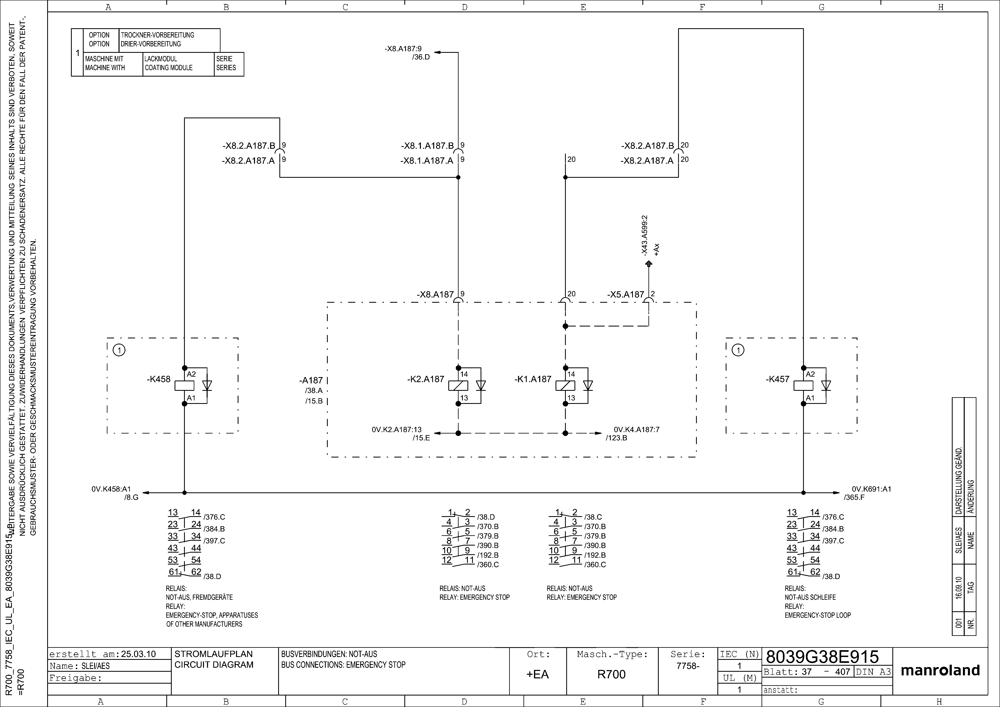

# +EA — Sheet 37 of 407 — BUSVERBINDUNGEN: NOT AUS

**BUS CONNECTIONS: EMERGENCY STOP**

> Part of the manroland **R700** printing press IEC/UL circuit diagrams.
> Drawing class: **Stromlaufplan / Circuit diagram** (DIN A3).
> Document `+EA` covers the **Printing unit** machine section.

## At a glance

| Field | Value |
|---|---|
| Document | `+EA`  (8039G38E915) |
| Sheet | **37** of 407 |
| Section (DE) | BUSVERBINDUNGEN: NOT AUS |
| Section (EN) | BUS CONNECTIONS: EMERGENCY STOP |
| Section type | CIRCUIT — Circuit diagram |
| Machine type | `R700` |
| Series | `7758` |
| Created | 25.03.10 |
| Replaces | — |
| Columns used | A, B, C, D, E, F, G, H |
| Path numbers | — |
| Labels on sheet | 147 |
| Cross-refs out | 27 |
| Cross-refs in | 37 |

**Previous:** [+EA sheet 36](SHEET_0036.md) · **Next:** [+EA sheet 38](SHEET_0038.md) · **Document TOC:** [_TOC.md](_TOC.md)  (+EA) · **Master TOC:** [all sheets](../_MASTER_TOC.md)

## Sheet image (300 DPI, exact vector render)



_Rendered directly from the PDF vector layer at 300 DPI (1-bit), no OCR and no resampling. Use it to confirm anything ambiguous in the text below._

## Cross-references on this sheet

Each entry is a wire leaving this sheet. The printed token is `/sheet.column`; the link resolves to that sheet inside the same document.

| Ref | Target sheet | Col | Path | Destination on target | Target section | From col |
|---|---|---|---|---|---|---|
| `/36.D` | [+EA sheet 36](SHEET_0036.md) | D | — | X8.A187:9 | BUSVERBINDUNGEN: NOT AUS | D |
| `/38.A` | [+EA sheet 38](SHEET_0038.md) | A | — | — | BUSVERBINDUNGEN: NOT AUS | C |
| `/15.B` | [+EA sheet 15](SHEET_0015.md) | B | — | — | SPANNUNGSVERSORGUNG: 400V, 24V | C |
| `/15.E` | [+EA sheet 15](SHEET_0015.md) | E | — | 0V.K2.A187:13 | SPANNUNGSVERSORGUNG: 400V, 24V | D |
| `/123.B` | [+EA sheet 123](SHEET_0123.md) | B | — | 0V.K2.A187:13 | TROCKENBESTÄUBER | D |
| `/8.G` | [+EA sheet 8](SHEET_0008.md) | G | — | 0V.K458:A1 | SPANNUNGSVERSORGUNG: 400V, 24V | D |
| `/365.F` | [+EA sheet 365](SHEET_0365.md) | F | — | 0V.K458:A1 | OPTION: TROCKNER VORBEREITUNG; | D |
| `/376.C` | [+EA sheet 376](SHEET_0376.md) | C | — | — | OPTION: ENDTROCKNER 1 VORBEREITUNG; | B |
| `/38.D` | [+EA sheet 38](SHEET_0038.md) | D | — | — | BUSVERBINDUNGEN: NOT AUS | D |
| `/370.B` | [+EA sheet 370](SHEET_0370.md) | B | — | — | OPTION: ENDTROCKNER 1 VORBEREITUNG; | D |
| `/379.B` | [+EA sheet 379](SHEET_0379.md) | B | — | — | OPTION: ENDTROCKNER 2 VORBEREITUNG | D |
| `/390.B` | [+EA sheet 390](SHEET_0390.md) | B | — | — | OPTION: ZWISCHENTROCKNER VORBEREITUNG; | D |
| `/192.B` | [+EA sheet 192](SHEET_0192.md) | B | — | — | RESERVE | D |
| `/360.C` | [+EA sheet 360](SHEET_0360.md) | C | — | — | OPTION: | D |
| `/38.C` | [+EA sheet 38](SHEET_0038.md) | C | — | — | BUSVERBINDUNGEN: NOT AUS | E |
| `/370.B` | [+EA sheet 370](SHEET_0370.md) | B | — | — | OPTION: ENDTROCKNER 1 VORBEREITUNG; | E |
| `/379.B` | [+EA sheet 379](SHEET_0379.md) | B | — | — | OPTION: ENDTROCKNER 2 VORBEREITUNG | E |
| `/390.B` | [+EA sheet 390](SHEET_0390.md) | B | — | — | OPTION: ZWISCHENTROCKNER VORBEREITUNG; | E |
| `/192.B` | [+EA sheet 192](SHEET_0192.md) | B | — | — | RESERVE | E |
| `/360.C` | [+EA sheet 360](SHEET_0360.md) | C | — | — | OPTION: | E |
| `/376.C` | [+EA sheet 376](SHEET_0376.md) | C | — | — | OPTION: ENDTROCKNER 1 VORBEREITUNG; | G |
| `/384.B` | [+EA sheet 384](SHEET_0384.md) | B | — | — | OPTION: ENDTROCKNER 2 VORBEREITUNG | B |
| `/384.B` | [+EA sheet 384](SHEET_0384.md) | B | — | — | OPTION: ENDTROCKNER 2 VORBEREITUNG | G |
| `/397.C` | [+EA sheet 397](SHEET_0397.md) | C | — | — | OPTION: ZWISCHENTROCKNER VORBEREITUNG; | B |
| `/397.C` | [+EA sheet 397](SHEET_0397.md) | C | — | — | OPTION: ZWISCHENTROCKNER VORBEREITUNG; | G |
| `/38.D` | [+EA sheet 38](SHEET_0038.md) | D | — | — | BUSVERBINDUNGEN: NOT AUS | B |
| `/38.D` | [+EA sheet 38](SHEET_0038.md) | D | — | — | BUSVERBINDUNGEN: NOT AUS | G |

### Incoming references (sheets that point here)

Every other sheet that sends a wire to this one. `Back-ref` is the token printed on *that* sheet; `Path` is its line number.

| From sheet | Cols | Back-ref | Path | Refs | What continues there |
|---|---|---|---|---|---|
| [+EA#8](SHEET_0008.md) | G | `/8.G` | — | 1 | 0V.K458:A1 |
| [+EA#15](SHEET_0015.md) | B, F | `/15.B`, `/15.F` | — | 2 | 0V.K2.A187:13 |
| [+EA#36](SHEET_0036.md) | C | `/36.C` | — | 1 | — |
| [+EA#38](SHEET_0038.md) | A, B, D | `/38.A`, `/38.B`, `/38.D` | — | 5 | — |
| [+EA#123](SHEET_0123.md) | B | `/123.B` | — | 1 | 0V.K4.A187:7 |
| [+EA#192](SHEET_0192.md) | B | `/192.B` | — | 2 | — |
| [+EA#239](SHEET_0239.md) | B | `/239.B` | — | 1 | — |
| [+EA#248](SHEET_0248.md) | C, E, F, G, H | `/248.C`, `/248.E`, `/248.F`, `/248.G`, `/248.H` | — | 9 | — |
| [+EA#360](SHEET_0360.md) | C | `/360.C` | — | 2 | — |
| [+EA#365](SHEET_0365.md) | E | `/365.E` | — | 1 | 0V.K691:A1 0V.K692:A1 0V.K7.A187\1:13 |
| [+EA#370](SHEET_0370.md) | B | `/370.B` | — | 2 | — |
| [+EA#376](SHEET_0376.md) | B | `/376.B` | — | 2 | — |
| [+EA#379](SHEET_0379.md) | B | `/379.B` | — | 2 | — |
| [+EA#384](SHEET_0384.md) | B | `/384.B` | — | 2 | — |
| [+EA#390](SHEET_0390.md) | B | `/390.B` | — | 2 | — |
| [+EA#397](SHEET_0397.md) | B | `/397.B` | — | 2 | — |


## Devices on this sheet

| Tag | Class | Class meaning (IEC) | Col | Sub | Terminal | Sign |
|---|---|---|---|---|---|---|
| `A187` | A | Baugruppe / assembly, module, PC board | C | — | — | — |
| `A2` | A | Baugruppe / assembly, module, PC board | B | — | — | — |
| `A1` | A | Baugruppe / assembly, module, PC board | B | — | — | — |
| `K458` | K | Relais / relay, contactor | A | — | — | — |
| `A2` | A | Baugruppe / assembly, module, PC board | G | — | — | — |
| `A1` | A | Baugruppe / assembly, module, PC board | G | — | — | — |
| `K457` | K | Relais / relay, contactor | G | — | — | — |
| `X8.1.A187.A` | — | cross-device reference | D | — | — | — |
| `X8.1.A187.B` | — | cross-device reference | D | — | — | — |
| `X8.2.A187.A` | — | cross-device reference | B | — | — | — |
| `X8.2.A187.B` | — | cross-device reference | B | — | — | — |
| `X8.A187` | — | cross-device reference | D | — | — | — |
| `X5.A187` | — | cross-device reference | E | — | — | — |
| `K2.A187` | — | cross-device reference | D | — | — | — |
| `K1.A187` | — | cross-device reference | E | — | — | — |
| `X43.A599:2` | — | cross-device reference | F | — | 2 | — |
| `X8.2.A187.A` | — | cross-device reference | F | — | — | — |
| `X8.2.A187.B` | — | cross-device reference | F | — | — | — |
| `NR.` | — | cross-device reference | H | — | — | — |
| `16.09.10` | — | cross-device reference | H | — | — | — |
| `X8.A187:9` | — | cross-device reference | C | — | 9 | — |

## Potentials / nets

| Potential | Count | Columns | Attached devices | Terminals |
|---|---|---|---|---|
| `0V` | 4 | A, C, E, G | `A187`, `K2`, `K4`, `K458`, `K691` | `13`, `7`, `A1` |


A potential such as `L24+/4` or `M24+` is a named supply/return rail; every place it appears on this sheet is electrically common.

## Wire-end annotations (grouped as printed)

A wire that continues elsewhere is annotated with a small cluster: the destination description, the path/line number `#NN`, and the `/sheet.column` cross reference. Each row below is one such cluster exactly as it is grouped on the drawing.

| Col | Y | Path | Cross-ref | Text on the wire |
|---|---|---|---|---|
| A | 38.9 | — | — | `OPTION OPTION` |
| A | 38.9 | — | — | `DRIER VORBEREITUNG TROCKNER VORBEREITUNG` |
| D | 54.1 | — | `/36.D` | `X8.A187:9` |
| A | 58.4 | — | — | `1` |
| A | 67.2 | — | — | `MASCHINE MIT MACHINE WITH` |
| B | 67.2 | — | — | `SERIE SERIES` |
| A | 67.3 | — | — | `LACKMODUL` |
| B | 77.9 | — | — | `COATING MODULE` |
| B | 169.0 | — | — | `X8.2.A187.B 9` |
| D | 169.0 | — | — | `X8.1.A187.B 9` |
| F | 169.0 | — | — | `X8.2.A187.B 20` |
| B | 186.0 | — | — | `X8.2.A187.A 9` |
| D | 186.0 | — | — | `X8.1.A187.A 9` |
| E | 186.0 | — | — | `20` |
| F | 186.0 | — | — | `X8.2.A187.A 20` |
| F | 256.2 | — | — | `X43.A599:2` |
| F | 290.0 | — | — | `+Ax` |
| E | 346.1 | — | — | `X8.A187 9 20 X5.A187 2` |
| D | 413.6 | — | — | `1 1` |
| B | 441.8 | — | — | `A2` |
| D | 441.8 | — | — | `14` |
| E | 441.8 | — | — | `14` |
| G | 441.8 | — | — | `A2` |
| A | 446.8 | — | — | `K458` |
| D | 446.8 | — | — | `K2.A187` |
| E | 446.8 | — | — | `K1.A187` |
| G | 446.8 | — | — | `K457` |
| C | 448.2 | — | — | `A187` |
| C | 461.2 | — | `/38.A`, `/15.B` | — |
| B | 470.1 | — | — | `A1` |
| G | 470.1 | — | — | `A1` |
| D | 470.2 | — | — | `13` |
| E | 470.2 | — | — | `13` |
| D | 507.7 | — | `/15.E`, `/123.B` | `0V.K2.A187:13` |
| E | 507.7 | — | — | `0V.K4.A187:7` |
| H | 531.8 | — | — | `001 DARSTELLUNG GEÄND. 16.09.10 SLEI/AES` |
| H | 571.4 | — | — | `NR. NAME TAG ÄNDERUNG` |
| D | 578.5 | — | `/8.G`, `/365.F` | `0V.K458:A1` |
| G | 578.5 | — | — | `0V.K691:A1` |
| B | 605.5 | — | — | `13 23 14 24` |
| D | 605.5 | — | — | `1 2` |
| E | 605.5 | — | — | `1 2` |
| G | 605.5 | — | — | `13 23 14 24` |
| B | 611.9 | — | `/376.C` | — |
| D | 611.9 | — | `/38.D`, `/370.B`, `/379.B`, `/390.B`, `/192.B`, `/360.C` | — |
| E | 611.9 | — | `/38.C`, `/370.B`, `/379.B`, `/390.B`, `/192.B`, `/360.C` | — |
| G | 611.9 | — | `/376.C` | — |
| D | 616.8 | — | — | `4 6 3 5` |
| E | 616.8 | — | — | `4 6 3 5` |
| B | 626.0 | — | `/384.B` | — |
| G | 626.0 | — | `/384.B` | — |
| B | 633.8 | — | — | `33 43 53 34 54 44` |
| G | 633.8 | — | — | `33 43 53 34 54 44` |
| D | 639.5 | — | — | `8` |
| D | 639.5 | — | — | `7` |
| E | 639.5 | — | — | `8` |
| E | 639.5 | — | — | `7` |
| B | 640.2 | — | `/397.C` | — |
| G | 640.2 | — | `/397.C` | — |
| D | 650.8 | — | — | `10 12 11 9` |
| E | 650.8 | — | — | `10 12 11 9` |
| B | 676.3 | — | — | `61 62` |
| G | 676.3 | — | — | `61 62` |
| B | 682.7 | — | `/38.D` | — |
| G | 682.7 | — | `/38.D` | — |
| B | 697.9 | — | — | `RELAIS: NOT AUS, FREMDGERÄTE RELAY: EMERGENCY STOP, APPARATUSES` |
| D | 697.9 | — | — | `RELAIS: NOT AUS RELAY: EMERGENCY STOP` |
| E | 697.9 | — | — | `RELAIS: NOT AUS RELAY: EMERGENCY STOP` |
| G | 697.9 | — | — | `RELAIS: NOT AUS SCHLEIFE RELAY: EMERGENCY STOP LOOP` |
| B | 740.5 | — | — | `OF OTHER MANUFACTURERS` |


## Reconstructed tables

This sheet carries tabular content (pin map / terminal assignment / index). The grid below was rebuilt from the drawing's own rule lines, so each row is exactly one physical row of the table.

### Table 1 — 2 data rows × 2 columns (at x=219.7, y=140.3)

| C1 | C2 |
|---|---|
|  | `X8.2.A187.B X8.2.A187.A` |
| `A2 A1` |  |


### Table 2 — 3 data rows × 5 columns (at x=545.7, y=34.0)

| 9 9 |  | 20 | X8.2.A187.B X8.2.A187.A |  |
|---|---|---|---|---|
| `9` |  | `20` | `X43.A599:2 X5.A187` | `+Ax 2` |
| `14 13` | `K1.A187` | `14 13` | `0V.K4.A187:7` |  |
|  |  |  | `/123.B` |  |


## Notes and free text on this sheet

| Text | Col | Y (pt) |
|---|---|---|
| `RELAIS: NOT AUS` | D | 697.93 |
| `RELAY: EMERGENCY STOP` | D | 708.58 |
| `RELAIS: NOT AUS` | E | 697.93 |
| `RELAY: EMERGENCY STOP` | E | 708.58 |
| `RELAIS:` | B | 697.88 |
| `NOT AUS, FREMDGERÄTE` | B | 708.58 |
| `RELAY:` | B | 719.15 |
| `EMERGENCY STOP, APPARATUSES` | B | 729.84 |
| `OF OTHER MANUFACTURERS` | B | 740.5 |
| `+Ax` | F | 289.99 |
| `RELAIS:` | G | 697.88 |
| `NOT AUS SCHLEIFE` | G | 708.57 |
| `RELAY:` | G | 719.15 |
| `EMERGENCY STOP LOOP` | G | 729.85 |
| `TAG` | H | 692.75 |
| `NAME` | H | 633.34 |
| `ÄNDERUNG` | H | 571.36 |
| `SLEI/AES` | H | 627.9 |
| `DARSTELLUNG GEÄND.` | H | 531.75 |
| `OPTION` | A | 38.87 |
| `TROCKNER VORBEREITUNG` | A | 38.91 |
| `DRIER VORBEREITUNG` | A | 49.53 |
| `MASCHINE MIT` | A | 67.25 |
| `MACHINE WITH` | A | 77.83 |
| `LACKMODUL` | A | 67.26 |
| `COATING MODULE` | B | 77.89 |
| `SERIE` | B | 67.19 |
| `SERIES` | B | 77.82 |

## Complete label inventory (exact text from the drawing)

Every text object inside the drawing area of this sheet, in DIN reading order (column A→H, then top→bottom). This is the authoritative list: if a string is not here it is not printed on this sheet.

| Col | Y | X | Dir | Type | Text |
|---|---|---|---|---|---|
| A | 38.9 | 106.0 | → | text | `OPTION` |
| A | 38.9 | 144.3 | → | text | `TROCKNER VORBEREITUNG` |
| A | 49.5 | 106.0 | → | text | `OPTION` |
| A | 49.5 | 143.7 | → | text | `DRIER VORBEREITUNG` |
| A | 58.4 | 89.6 | → | number | `1` |
| A | 67.2 | 101.5 | → | text | `MASCHINE MIT` |
| A | 67.3 | 172.1 | → | text | `LACKMODUL` |
| A | 77.8 | 101.5 | → | text | `MACHINE WITH` |
| A | 413.6 | 140.0 | → | number | `1` |
| A | 446.8 | 174.9 | → | device tag | `K458` |
| A | 578.5 | 109.1 | → | potential | `0V.K458:A1` |
| A | 588.4 | 148.3 | → | cross-reference | `/8.G` |
| B | 67.2 | 257.7 | → | text | `SERIE` |
| B | 77.8 | 257.7 | → | text | `SERIES` |
| B | 77.9 | 172.6 | → | text | `COATING MODULE` |
| B | 169.0 | 265.0 | → | device ref | `X8.2.A187.B` |
| B | 169.0 | 335.6 | → | number | `9` |
| B | 186.0 | 335.6 | → | number | `9` |
| B | 186.7 | 264.2 | → | device ref | `X8.2.A187.A` |
| B | 441.8 | 222.5 | → | device tag | `A2` |
| B | 470.1 | 222.5 | → | device tag | `A1` |
| B | 605.5 | 199.8 | → | number | `13` |
| B | 605.5 | 227.1 | → | number | `14` |
| B | 611.9 | 242.4 | → | cross-reference | `/376.C` |
| B | 619.6 | 199.8 | → | number | `23` |
| B | 619.6 | 227.9 | → | number | `24` |
| B | 626.0 | 242.4 | → | cross-reference | `/384.B` |
| B | 633.8 | 199.8 | → | number | `33` |
| B | 633.8 | 227.6 | → | number | `34` |
| B | 640.2 | 242.4 | → | cross-reference | `/397.C` |
| B | 648.0 | 199.8 | → | number | `43` |
| B | 648.0 | 227.9 | → | number | `44` |
| B | 662.2 | 199.8 | → | number | `53` |
| B | 662.2 | 227.6 | → | number | `54` |
| B | 676.3 | 201.3 | → | number | `61` |
| B | 676.3 | 227.9 | → | number | `62` |
| B | 682.7 | 242.4 | → | cross-reference | `/38.D` |
| B | 697.9 | 197.6 | → | text | `RELAIS:` |
| B | 708.6 | 197.6 | → | text | `NOT AUS, FREMDGERÄTE` |
| B | 719.1 | 197.6 | → | text | `RELAY:` |
| B | 729.8 | 197.6 | → | text | `EMERGENCY STOP, APPARATUSES` |
| B | 740.5 | 198.1 | → | text | `OF OTHER MANUFACTURERS` |
| C | 54.1 | 458.1 | → | device ref | `X8.A187:9` |
| C | 448.2 | 356.3 | → | device tag | `A187` |
| C | 461.2 | 363.4 | → | cross-reference | `/38.A` |
| C | 473.6 | 363.7 | → | cross-reference | `/15.B` |
| C | 507.7 | 442.8 | → | potential | `0V.K2.A187:13` |
| D | 64.1 | 491.0 | → | cross-reference | `/36.D` |
| D | 169.0 | 477.6 | → | device ref | `X8.1.A187.B` |
| D | 169.0 | 548.2 | → | number | `9` |
| D | 186.0 | 548.2 | → | number | `9` |
| D | 186.7 | 476.8 | → | device ref | `X8.1.A187.A` |
| D | 346.1 | 496.3 | → | device ref | `X8.A187` |
| D | 346.2 | 548.2 | → | number | `9` |
| D | 441.8 | 547.7 | → | number | `14` |
| D | 446.8 | 485.0 | → | device ref | `K2.A187` |
| D | 470.2 | 547.7 | → | number | `13` |
| D | 517.6 | 491.5 | → | cross-reference | `/15.E` |
| D | 605.5 | 533.2 | → | number | `1` |
| D | 605.5 | 553.9 | → | number | `2` |
| D | 611.9 | 568.3 | → | cross-reference | `/38.D` |
| D | 616.8 | 531.8 | → | number | `4` |
| D | 616.8 | 553.6 | → | number | `3` |
| D | 623.2 | 568.3 | → | cross-reference | `/370.B` |
| D | 628.1 | 531.8 | → | number | `6` |
| D | 628.1 | 553.6 | → | number | `5` |
| D | 634.5 | 568.3 | → | cross-reference | `/379.B` |
| D | 639.5 | 531.8 | → | number | `8` |
| D | 639.5 | 553.9 | → | number | `7` |
| D | 645.9 | 568.3 | → | cross-reference | `/390.B` |
| D | 650.8 | 525.8 | → | number | `10` |
| D | 650.8 | 553.6 | → | number | `9` |
| D | 657.2 | 568.3 | → | cross-reference | `/192.B` |
| D | 662.2 | 525.8 | → | number | `12` |
| D | 662.2 | 553.0 | → | number | `11` |
| D | 668.6 | 568.3 | → | cross-reference | `/360.C` |
| D | 697.9 | 523.6 | → | text | `RELAIS: NOT AUS` |
| D | 708.6 | 523.6 | → | text | `RELAY: EMERGENCY STOP` |
| E | 186.0 | 675.8 | → | number | `20` |
| E | 346.1 | 723.1 | → | device ref | `X5.A187` |
| E | 346.2 | 675.8 | → | number | `20` |
| E | 441.8 | 675.2 | → | number | `14` |
| E | 446.8 | 612.6 | → | device ref | `K1.A187` |
| E | 470.2 | 675.2 | → | number | `13` |
| E | 507.7 | 731.1 | → | potential | `0V.K4.A187:7` |
| E | 517.6 | 721.4 | → | cross-reference | `/123.B` |
| E | 605.5 | 660.8 | → | number | `1` |
| E | 605.5 | 681.4 | → | number | `2` |
| E | 611.9 | 695.9 | → | cross-reference | `/38.C` |
| E | 616.8 | 659.3 | → | number | `4` |
| E | 616.8 | 681.2 | → | number | `3` |
| E | 623.2 | 695.9 | → | cross-reference | `/370.B` |
| E | 628.1 | 659.3 | → | number | `6` |
| E | 628.1 | 681.2 | → | number | `5` |
| E | 634.5 | 695.9 | → | cross-reference | `/379.B` |
| E | 639.5 | 659.3 | → | number | `8` |
| E | 639.5 | 681.4 | → | number | `7` |
| E | 645.9 | 695.9 | → | cross-reference | `/390.B` |
| E | 650.8 | 653.4 | → | number | `10` |
| E | 650.8 | 681.2 | → | number | `9` |
| E | 657.2 | 695.9 | → | cross-reference | `/192.B` |
| E | 662.2 | 653.4 | → | number | `12` |
| E | 662.2 | 680.6 | → | number | `11` |
| E | 668.6 | 695.9 | → | cross-reference | `/360.C` |
| E | 697.9 | 651.1 | → | text | `RELAIS: NOT AUS` |
| E | 708.6 | 651.1 | → | text | `RELAY: EMERGENCY STOP` |
| F | 169.0 | 739.8 | → | device ref | `X8.2.A187.B` |
| F | 169.0 | 810.4 | → | number | `20` |
| F | 186.0 | 810.4 | → | number | `20` |
| F | 186.7 | 739.0 | → | device ref | `X8.2.A187.A` |
| F | 256.3 | 763.5 | ↕ | device ref | `X43.A599:2` |
| F | 290.0 | 777.8 | ↕ | text | `+Ax` |
| F | 346.2 | 775.0 | → | number | `2` |
| F | 413.6 | 877.0 | → | number | `1` |
| G | 441.8 | 959.5 | → | device tag | `A2` |
| G | 446.8 | 911.9 | → | device tag | `K457` |
| G | 470.1 | 959.5 | → | device tag | `A1` |
| G | 578.5 | 1014.5 | → | potential | `0V.K691:A1` |
| G | 588.5 | 1004.9 | → | cross-reference | `/365.F` |
| G | 605.5 | 936.9 | → | number | `13` |
| G | 605.5 | 964.1 | → | number | `14` |
| G | 611.9 | 979.4 | → | cross-reference | `/376.C` |
| G | 619.6 | 936.9 | → | number | `23` |
| G | 619.6 | 964.9 | → | number | `24` |
| G | 626.0 | 979.4 | → | cross-reference | `/384.B` |
| G | 633.8 | 936.9 | → | number | `33` |
| G | 633.8 | 964.6 | → | number | `34` |
| G | 640.2 | 979.4 | → | cross-reference | `/397.C` |
| G | 648.0 | 936.9 | → | number | `43` |
| G | 648.0 | 964.9 | → | number | `44` |
| G | 662.2 | 936.9 | → | number | `53` |
| G | 662.2 | 964.6 | → | number | `54` |
| G | 676.3 | 938.3 | → | number | `61` |
| G | 676.3 | 964.9 | → | number | `62` |
| G | 682.7 | 979.4 | → | cross-reference | `/38.D` |
| G | 697.9 | 934.6 | → | text | `RELAIS:` |
| G | 708.6 | 934.6 | → | text | `NOT AUS SCHLEIFE` |
| G | 719.1 | 934.6 | → | text | `RELAY:` |
| G | 729.9 | 934.6 | → | text | `EMERGENCY STOP LOOP` |
| H | 531.8 | 1138.5 | ↕ | text | `DARSTELLUNG GEÄND.` |
| H | 571.4 | 1152.7 | ↕ | text | `ÄNDERUNG` |
| H | 627.9 | 1138.5 | ↕ | text | `SLEI/AES` |
| H | 633.3 | 1152.6 | ↕ | text | `NAME` |
| H | 686.8 | 1138.5 | ↕ | device ref | `16.09.10` |
| H | 692.7 | 1152.6 | ↕ | text | `TAG` |
| H | 735.8 | 1138.4 | ↕ | number | `001` |
| H | 736.2 | 1152.5 | ↕ | device ref | `NR.` |

## Reading-order text block

The same content as a plain block, grouped by DIN column — convenient to paste or to match against a visual description.

```text
=== Column A ===
  38.9  106.0  text         OPTION
  38.9  144.3  text         TROCKNER VORBEREITUNG
  49.5  106.0  text         OPTION
  49.5  143.7  text         DRIER VORBEREITUNG
  58.4   89.6  numeric      1
  67.2  101.5  text         MASCHINE MIT
  67.3  172.1  text         LACKMODUL
  77.8  101.5  text         MACHINE WITH
 413.6  140.0  numeric      1
 446.8  174.9  devtag       K458
 578.5  109.1  net          0V.K458:A1
 588.4  148.3  xref         /8.G
=== Column B ===
  67.2  257.7  text         SERIE
  77.8  257.7  text         SERIES
  77.9  172.6  text         COATING MODULE
 169.0  265.0  devref       X8.2.A187.B
 169.0  335.6  numeric      9
 186.0  335.6  numeric      9
 186.7  264.2  devref       X8.2.A187.A
 441.8  222.5  devtag       A2
 470.1  222.5  devtag       A1
 605.5  199.8  numeric      13
 605.5  227.1  numeric      14
 611.9  242.4  xref         /376.C
 619.6  199.8  numeric      23
 619.6  227.9  numeric      24
 626.0  242.4  xref         /384.B
 633.8  199.8  numeric      33
 633.8  227.6  numeric      34
 640.2  242.4  xref         /397.C
 648.0  199.8  numeric      43
 648.0  227.9  numeric      44
 662.2  199.8  numeric      53
 662.2  227.6  numeric      54
 676.3  201.3  numeric      61
 676.3  227.9  numeric      62
 682.7  242.4  xref         /38.D
 697.9  197.6  text         RELAIS:
 708.6  197.6  text         NOT AUS, FREMDGERÄTE
 719.1  197.6  text         RELAY:
 729.8  197.6  text         EMERGENCY STOP, APPARATUSES
 740.5  198.1  text         OF OTHER MANUFACTURERS
=== Column C ===
  54.1  458.1  devref       X8.A187:9
 448.2  356.3  devtag       A187
 461.2  363.4  xref         /38.A
 473.6  363.7  xref         /15.B
 507.7  442.8  net          0V.K2.A187:13
=== Column D ===
  64.1  491.0  xref         /36.D
 169.0  477.6  devref       X8.1.A187.B
 169.0  548.2  numeric      9
 186.0  548.2  numeric      9
 186.7  476.8  devref       X8.1.A187.A
 346.1  496.3  devref       X8.A187
 346.2  548.2  numeric      9
 441.8  547.7  numeric      14
 446.8  485.0  devref       K2.A187
 470.2  547.7  numeric      13
 517.6  491.5  xref         /15.E
 605.5  533.2  numeric      1
 605.5  553.9  numeric      2
 611.9  568.3  xref         /38.D
 616.8  531.8  numeric      4
 616.8  553.6  numeric      3
 623.2  568.3  xref         /370.B
 628.1  531.8  numeric      6
 628.1  553.6  numeric      5
 634.5  568.3  xref         /379.B
 639.5  531.8  numeric      8
 639.5  553.9  numeric      7
 645.9  568.3  xref         /390.B
 650.8  525.8  numeric      10
 650.8  553.6  numeric      9
 657.2  568.3  xref         /192.B
 662.2  525.8  numeric      12
 662.2  553.0  numeric      11
 668.6  568.3  xref         /360.C
 697.9  523.6  text         RELAIS: NOT AUS
 708.6  523.6  text         RELAY: EMERGENCY STOP
=== Column E ===
 186.0  675.8  numeric      20
 346.1  723.1  devref       X5.A187
 346.2  675.8  numeric      20
 441.8  675.2  numeric      14
 446.8  612.6  devref       K1.A187
 470.2  675.2  numeric      13
 507.7  731.1  net          0V.K4.A187:7
 517.6  721.4  xref         /123.B
 605.5  660.8  numeric      1
 605.5  681.4  numeric      2
 611.9  695.9  xref         /38.C
 616.8  659.3  numeric      4
 616.8  681.2  numeric      3
 623.2  695.9  xref         /370.B
 628.1  659.3  numeric      6
 628.1  681.2  numeric      5
 634.5  695.9  xref         /379.B
 639.5  659.3  numeric      8
 639.5  681.4  numeric      7
 645.9  695.9  xref         /390.B
 650.8  653.4  numeric      10
 650.8  681.2  numeric      9
 657.2  695.9  xref         /192.B
 662.2  653.4  numeric      12
 662.2  680.6  numeric      11
 668.6  695.9  xref         /360.C
 697.9  651.1  text         RELAIS: NOT AUS
 708.6  651.1  text         RELAY: EMERGENCY STOP
=== Column F ===
 169.0  739.8  devref       X8.2.A187.B
 169.0  810.4  numeric      20
 186.0  810.4  numeric      20
 186.7  739.0  devref       X8.2.A187.A
 256.3  763.5  devref       X43.A599:2
 290.0  777.8  text         +Ax
 346.2  775.0  numeric      2
 413.6  877.0  numeric      1
=== Column G ===
 441.8  959.5  devtag       A2
 446.8  911.9  devtag       K457
 470.1  959.5  devtag       A1
 578.5 1014.5  net          0V.K691:A1
 588.5 1004.9  xref         /365.F
 605.5  936.9  numeric      13
 605.5  964.1  numeric      14
 611.9  979.4  xref         /376.C
 619.6  936.9  numeric      23
 619.6  964.9  numeric      24
 626.0  979.4  xref         /384.B
 633.8  936.9  numeric      33
 633.8  964.6  numeric      34
 640.2  979.4  xref         /397.C
 648.0  936.9  numeric      43
 648.0  964.9  numeric      44
 662.2  936.9  numeric      53
 662.2  964.6  numeric      54
 676.3  938.3  numeric      61
 676.3  964.9  numeric      62
 682.7  979.4  xref         /38.D
 697.9  934.6  text         RELAIS:
 708.6  934.6  text         NOT AUS SCHLEIFE
 719.1  934.6  text         RELAY:
 729.9  934.6  text         EMERGENCY STOP LOOP
=== Column H ===
 531.8 1138.5  text         DARSTELLUNG GEÄND.
 571.4 1152.7  text         ÄNDERUNG
 627.9 1138.5  text         SLEI/AES
 633.3 1152.6  text         NAME
 686.8 1138.5  devref       16.09.10
 692.7 1152.6  text         TAG
 735.8 1138.4  numeric      001
 736.2 1152.5  devref       NR.
```

---
_Generated from the PDF vector text layer; no OCR. Source: `R700_7758_IEC_UL_EA_8039G38E915_p`, sheet 37._
