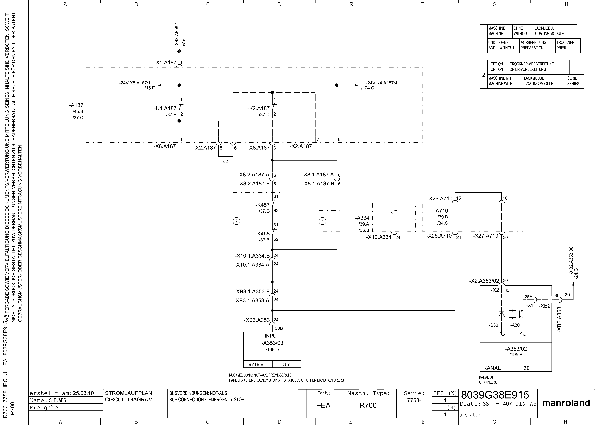

# +EA — Sheet 38 of 407 — BUSVERBINDUNGEN: NOT AUS

**BUS CONNECTIONS: EMERGENCY STOP**

> Part of the manroland **R700** printing press IEC/UL circuit diagrams.
> Drawing class: **Stromlaufplan / Circuit diagram** (DIN A3).
> Document `+EA` covers the **Printing unit** machine section.

## At a glance

| Field | Value |
|---|---|
| Document | `+EA`  (8039G38E915) |
| Sheet | **38** of 407 |
| Section (DE) | BUSVERBINDUNGEN: NOT AUS |
| Section (EN) | BUS CONNECTIONS: EMERGENCY STOP |
| Section type | CIRCUIT — Circuit diagram |
| Machine type | `R700` |
| Series | `7758` |
| Created | 25.03.10 |
| Replaces | — |
| Columns used | A, B, C, D, E, F, G, H |
| Path numbers | — |
| Labels on sheet | 127 |
| Cross-refs out | 15 |
| Cross-refs in | 38 |

**Previous:** [+EA sheet 37](SHEET_0037.md) · **Next:** [+EA sheet 39](SHEET_0039.md) · **Document TOC:** [_TOC.md](_TOC.md)  (+EA) · **Master TOC:** [all sheets](../_MASTER_TOC.md)

## Sheet image (300 DPI, exact vector render)



_Rendered directly from the PDF vector layer at 300 DPI (1-bit), no OCR and no resampling. Use it to confirm anything ambiguous in the text below._

## Cross-references on this sheet

Each entry is a wire leaving this sheet. The printed token is `/sheet.column`; the link resolves to that sheet inside the same document.

| Ref | Target sheet | Col | Path | Destination on target | Target section | From col |
|---|---|---|---|---|---|---|
| `/15.E` | [+EA sheet 15](SHEET_0015.md) | E | — | 24V.X5.A187:1 | SPANNUNGSVERSORGUNG: 400V, 24V | B |
| `/124.C` | [+EA sheet 124](SHEET_0124.md) | C | — | — | TROCKENBESTÄUBER | E |
| `/45.B` | [+EA sheet 45](SHEET_0045.md) | B | — | — | BUSVERBINDUNGEN: 20 mA SCHLEIFE | A |
| `/37.C` | [+EA sheet 37](SHEET_0037.md) | C | — | — | BUSVERBINDUNGEN: NOT AUS | A |
| `/37.E` | [+EA sheet 37](SHEET_0037.md) | E | — | — | BUSVERBINDUNGEN: NOT AUS | B |
| `/37.D` | [+EA sheet 37](SHEET_0037.md) | D | — | — | BUSVERBINDUNGEN: NOT AUS | D |
| `/37.G` | [+EA sheet 37](SHEET_0037.md) | G | — | — | BUSVERBINDUNGEN: NOT AUS | D |
| `/39.B` | [+EA sheet 39](SHEET_0039.md) | B | — | — | BUSVERBINDUNGEN: STOP SICHERN | F |
| `/34.C` | [+EA sheet 34](SHEET_0034.md) | C | — | — | BUSVERBINDUNGEN: NOT AUS | F |
| `/39.A` | [+EA sheet 39](SHEET_0039.md) | A | — | — | BUSVERBINDUNGEN: STOP SICHERN | E |
| `/36.B` | [+EA sheet 36](SHEET_0036.md) | B | — | — | BUSVERBINDUNGEN: NOT AUS | E |
| `/37.B` | [+EA sheet 37](SHEET_0037.md) | B | — | — | BUSVERBINDUNGEN: NOT AUS | D |
| `/24.G` | [+EA sheet 24](SHEET_0024.md) | G | — | XB2.A353:30 | BUSVERBINDUNGEN: SICHERHEITSBUS | H |
| `/195.D` | [+EA sheet 195](SHEET_0195.md) | D | — | — | REFERENZMODUL | D |
| `/195.B` | [+EA sheet 195](SHEET_0195.md) | B | — | — | REFERENZMODUL | G |

### Incoming references (sheets that point here)

Every other sheet that sends a wire to this one. `Back-ref` is the token printed on *that* sheet; `Path` is its line number.

| From sheet | Cols | Back-ref | Path | Refs | What continues there |
|---|---|---|---|---|---|
| [+EA#15](SHEET_0015.md) | F | `/15.F` | — | 1 | 24V.X5.A187:1 |
| [+EA#24](SHEET_0024.md) | G | `/24.G` | — | 1 | XB2.A353:30 |
| [+EA#34](SHEET_0034.md) | C | `/34.C` | — | 1 | — |
| [+EA#36](SHEET_0036.md) | C | `/36.C` | — | 1 | — |
| [+EA#37](SHEET_0037.md) | B, C, D, E, G | `/37.B`, `/37.C`, `/37.D`, `/37.E`, `/37.G` | — | 5 | — |
| [+EA#39](SHEET_0039.md) | A, B | `/39.A`, `/39.B` | — | 2 | — |
| [+EA#45](SHEET_0045.md) | A | `/45.A` | — | 1 | — |
| [+EA#124](SHEET_0124.md) | C | `/124.C` | — | 1 | 24V.K4.A187:4 |
| [+EA#195](SHEET_0195.md) | B, D | `/195.B`, `/195.D` | — | 2 | — |
| [+EA#223](SHEET_0223.md) | C | `/223.C` | — | 4 | — |
| [+EA#224](SHEET_0224.md) | H | `/224.H` | — | 1 | — |
| [+EA#225](SHEET_0225.md) | D | `/225.D` | — | 1 | — |
| [+EA#234](SHEET_0234.md) | C, D, F | `/234.C`, `/234.D`, `/234.F` | — | 3 | — |
| [+EA#239](SHEET_0239.md) | B | `/239.B` | — | 1 | — |
| [+EA#248](SHEET_0248.md) | C, E, F, G, H | `/248.C`, `/248.E`, `/248.F`, `/248.G`, `/248.H` | — | 6 | — |
| [+EA#253](SHEET_0253.md) | H | `/253.H` | — | 1 | — |
| [+EA#254](SHEET_0254.md) | A, B | `/254.A`, `/254.B` | — | 2 | — |
| [+EA#268](SHEET_0268.md) | C | `/268.C` | — | 1 | — |
| [+EA#271](SHEET_0271.md) | C | `/271.C` | — | 1 | — |
| [+EA#274](SHEET_0274.md) | B | `/274.B` | — | 2 | — |


## Devices on this sheet

| Tag | Class | Class meaning (IEC) | Col | Sub | Terminal | Sign |
|---|---|---|---|---|---|---|
| `A187` | A | Baugruppe / assembly, module, PC board | A | — | — | — |
| `A353/03` | A | Baugruppe / assembly, module, PC board | D | 03 | — | — |
| `K458` | K | Relais / relay, contactor | D | — | — | — |
| `K457` | K | Relais / relay, contactor | D | — | — | — |
| `S30` | S | Schalter / switch | G | — | — | — |
| `A30` | A | Baugruppe / assembly, module, PC board | G | — | — | — |
| `X1` | X | Klemme / terminal, plug connector | G | — | — | — |
| `X2` | X | Klemme / terminal, plug connector | G | — | — | — |
| `XB2` | XB |  | H | — | — | — |
| `A353/02` | A | Baugruppe / assembly, module, PC board | G | 02 | — | — |
| `A710` | A | Baugruppe / assembly, module, PC board | F | — | — | — |
| `A334` | A | Baugruppe / assembly, module, PC board | E | — | — | — |
| `J3` | J |  | C | — | — | — |
| `X8.A187` | — | cross-device reference | D | — | — | — |
| `X2.A187` | — | cross-device reference | C | — | — | — |
| `K1.A187` | — | cross-device reference | B | — | — | — |
| `K2.A187` | — | cross-device reference | D | — | — | — |
| `X5.A187` | — | cross-device reference | B | — | — | — |
| `X43.A599:1` | — | cross-device reference | C | — | 1 | — |
| `3.7` | — | cross-device reference | D | — | — | — |
| `XB3.A353` | — | cross-device reference | D | — | — | — |
| `X10.1.A334.A` | — | cross-device reference | D | — | — | — |
| `X10.1.A334.B` | — | cross-device reference | D | — | — | — |
| `X8.2.A187.B` | — | cross-device reference | D | — | — | — |
| `XB3.1.A353.B` | — | cross-device reference | D | — | — | — |
| `XB3.1.A353.A` | — | cross-device reference | D | — | — | — |
| `X8.2.A187.A` | — | cross-device reference | D | — | — | — |
| `X8.1.A187.A` | — | cross-device reference | E | — | — | — |
| `X8.1.A187.B` | — | cross-device reference | E | — | — | — |
| `XB2.A353` | — | cross-device reference | H | — | — | — |
| `X29.A710` | — | cross-device reference | F | — | — | — |
| `X27.A710` | — | cross-device reference | G | — | — | — |
| `X25.A710` | — | cross-device reference | F | — | — | — |
| `X10.A334` | — | cross-device reference | E | — | — | — |
| `XB2.A353:30` | — | cross-device reference | H | — | 30 | — |
| `X8.A187` | — | cross-device reference | B | — | — | — |
| `X2.A187` | — | cross-device reference | D | — | — | — |

## Potentials / nets

| Potential | Count | Columns | Attached devices | Terminals |
|---|---|---|---|---|
| `24V` | 2 | B, E | `A187`, `K4`, `X5` | `1`, `4` |


A potential such as `L24+/4` or `M24+` is a named supply/return rail; every place it appears on this sheet is electrically common.

## Wire-end annotations (grouped as printed)

A wire that continues elsewhere is annotated with a small cluster: the destination description, the path/line number `#NN`, and the `/sheet.column` cross reference. Each row below is one such cluster exactly as it is grouped on the drawing.

| Col | Y | Path | Cross-ref | Text on the wire |
|---|---|---|---|---|
| C | 43.6 | — | — | `X43.A599:1` |
| G | 53.1 | — | — | `MASCHINE MACHINE` |
| G | 53.1 | — | — | `OHNE WITHOUT` |
| H | 53.1 | — | — | `LACKMODUL` |
| H | 63.7 | — | — | `COATING MODULE` |
| G | 72.5 | — | — | `1` |
| C | 77.4 | — | — | `+Ax` |
| G | 81.4 | — | — | `UND` |
| G | 81.4 | — | — | `OHNE WITHOUT` |
| H | 81.4 | — | — | `PREPARATION VORBEREITUNG` |
| H | 81.4 | — | — | `DRIER TROCKNER` |
| G | 92.1 | — | — | `AND` |
| B | 119.4 | — | — | `X5.A187 1` |
| G | 123.9 | — | — | `OPTION OPTION` |
| H | 124.0 | — | — | `DRIER VORBEREITUNG TROCKNER VORBEREITUNG` |
| G | 143.4 | — | — | `2` |
| H | 152.2 | — | — | `SERIE SERIES` |
| G | 152.3 | — | — | `MASCHINE MIT MACHINE WITH` |
| H | 152.3 | — | — | `LACKMODUL` |
| B | 160.4 | — | `/15.E` | `24V.X5.A187:1` |
| E | 160.4 | — | — | `24V.K4.A187:4` |
| H | 162.9 | — | — | `COATING MODULE` |
| E | 170.4 | — | `/124.C` | — |
| C | 193.8 | — | — | `1` |
| D | 193.8 | — | — | `1` |
| A | 203.7 | — | — | `A187` |
| B | 210.1 | — | — | `K1.A187 2` |
| D | 210.1 | — | — | `K2.A187 2` |
| A | 216.7 | — | `/45.B`, `/37.C` | — |
| B | 223.1 | — | `/37.E` | — |
| D | 223.2 | — | `/37.D` | — |
| D | 272.4 | — | — | `1 7 8` |
| C | 285.2 | — | — | `X8.A187 X2.A187` |
| C | 288.0 | — | — | `X2.A187 5 6` |
| D | 288.0 | — | — | `X8.A187 6` |
| C | 313.5 | — | — | `J3` |
| D | 341.2 | — | — | `X8.2.A187.A 6 X8.1.A187.A 6` |
| D | 358.9 | — | — | `X8.2.A187.B 6` |
| E | 358.9 | — | — | `X8.1.A187.B 6` |
| D | 385.1 | — | — | `61` |
| G | 388.6 | — | — | `X29.A710 15 16` |
| D | 401.4 | — | — | `K457 62` |
| F | 412.7 | — | — | `A710` |
| D | 414.5 | — | `/37.G` | — |
| F | 425.8 | — | `/39.B`, `/34.C` | — |
| E | 426.9 | — | — | `A334` |
| D | 434.9 | — | — | `2 1` |
| E | 440.0 | — | `/39.A`, `/36.B` | — |
| D | 441.8 | — | — | `61` |
| D | 458.1 | — | — | `K458 62` |
| G | 462.4 | — | — | `X25.A710 24 X27.A710 30` |
| E | 465.2 | — | — | `X10.A334 24` |
| D | 471.1 | — | `/37.B` | — |
| H | 488.4 | — | `/24.G` | `XB2.A353:30` |
| D | 502.1 | — | — | `X10.1.A334.B 24` |
| D | 519.1 | — | — | `X10.1.A334.A 24` |
| G | 551.6 | — | — | `X2.A353/02 30` |
| G | 570.1 | — | — | `X2` |
| H | 571.5 | — | — | `30 30` |
| D | 572.9 | — | — | `XB3.1.A353.B 24` |
| H | 580.0 | — | — | `30` |
| G | 584.2 | — | — | `28A` |
| D | 589.9 | — | — | `XB3.1.A353.A 24` |
| G | 601.2 | — | — | `X1` |
| H | 601.3 | — | — | `XB2` |
| H | 607.5 | — | — | `XB2.A353` |
| D | 629.6 | — | — | `XB3.A353 24` |
| G | 640.2 | — | — | `S30 A30` |
| D | 646.6 | — | — | `30B` |
| D | 661.1 | — | — | `INPUT` |
| D | 675.0 | — | — | `A353/03` |
| G | 686.3 | — | — | `A353/02` |
| D | 688.8 | — | `/195.D` | — |
| G | 698.6 | — | `/195.B` | — |
| D | 717.8 | — | — | `BYTE.BIT 3.7` |
| G | 724.5 | — | — | `KANAL 30` |
| D | 740.6 | — | — | `RÜCKMELDUNG: NOT AUS, FREMDGERÄTE HANDSHAKE: EMERGENCY STOP, APPARATUSES OF OTHER MANUFACTURERS` |
| G | 744.9 | — | — | `KANAL 30 CHANNEL 30` |


## Reconstructed tables

This sheet carries tabular content (pin map / terminal assignment / index). The grid below was rebuilt from the drawing's own rule lines, so each row is exactly one physical row of the table.

### Table 1 — 7 data rows × 5 columns (at x=354.3, y=168.7)

| 1 2 |  |  | K2.A187 /37.D | 1 2 |
|---|---|---|---|---|
| `1 X2.A187` | `5` | `6` | `X8.A187` | `X2.A187 6` |
|  | `J3` | `2` | `X8.2.A187.A X8.2.A187.B K457 /37.G K458 /37.B` | `6 6 61 62 61 62` |
|  |  |  | `X10.1.A334.B X10.1.A334.A` | `24 24` |
|  |  |  | `XB3.1.A353.B XB3.1.A353.A` | `24 24` |
|  |  |  | `XB3.A353` | `24 30B` |
|  |  |  | `INPUT` | `A353/03 /195.D` |
|  |  |  | `BYTE.BIT` | `3.7` |


### Table 2 — 2 data rows × 1 columns (at x=623.6, y=168.7)

| C1 |
|---|
| `7` |
| `X8.1.A187.A X8.1.A187.B 1` |


### Table 3 — 4 data rows × 6 columns (at x=900.0, y=381.3)

| 15 24 | X27.A710 X2.A353/02 | 16 30 30 |  |  | XB2.A353:30 |
|---|---|---|---|---|---|
|  | `X2` | `30` | `28A X1` | `XB2` | `30 30` |
|  | `S30` | `A30` |  |  | `XB2.A353` |
|  |  | `A353/02 /195.B` |  |  |  |
|  | `KANAL` |  | `30` |  |  |


## Notes and free text on this sheet

| Text | Col | Y (pt) |
|---|---|---|
| `+Ax` | C | 77.39 |
| `30B` | D | 646.59 |
| `INPUT` | D | 661.11 |
| `BYTE.BIT` | D | 718.36 |
| `RÜCKMELDUNG: NOT AUS, FREMDGERÄTE` | D | 740.62 |
| `HANDSHAKE: EMERGENCY STOP, APPARATUSES OF OTHER MANUFACTURERS` | D | 750.57 |
| `KANAL 30` | G | 744.88 |
| `CHANNEL 30` | G | 754.82 |
| `28A` | G | 584.22 |
| `KANAL` | G | 724.55 |
| `X2.A353/02` | G | 551.65 |
| `MASCHINE` | G | 53.06 |
| `MACHINE` | G | 63.7 |
| `OHNE` | G | 53.06 |
| `WITHOUT` | G | 63.66 |
| `LACKMODUL` | H | 53.09 |
| `COATING MODULE` | H | 63.72 |
| `UND` | G | 81.41 |
| `AND` | G | 92.06 |
| `VORBEREITUNG` | H | 81.42 |
| `PREPARATION` | H | 92.02 |
| `TROCKNER` | H | 81.43 |
| `DRIER` | H | 92.03 |
| `OPTION` | G | 123.9 |
| `TROCKNER VORBEREITUNG` | H | 123.95 |
| `DRIER VORBEREITUNG` | G | 134.57 |
| `MASCHINE MIT` | G | 152.29 |
| `MACHINE WITH` | G | 162.87 |
| `SERIE` | H | 152.23 |
| `SERIES` | H | 162.86 |

## Complete label inventory (exact text from the drawing)

Every text object inside the drawing area of this sheet, in DIN reading order (column A→H, then top→bottom). This is the authoritative list: if a string is not here it is not printed on this sheet.

| Col | Y | X | Dir | Type | Text |
|---|---|---|---|---|---|
| A | 203.7 | 136.6 | → | device tag | `A187` |
| A | 216.7 | 144.0 | → | cross-reference | `/45.B` |
| A | 229.2 | 143.7 | → | cross-reference | `/37.C` |
| B | 119.4 | 305.0 | → | device ref | `X5.A187` |
| B | 160.4 | 235.8 | → | potential | `24V.X5.A187:1` |
| B | 170.3 | 286.0 | → | cross-reference | `/15.E` |
| B | 210.1 | 305.0 | → | device ref | `K1.A187` |
| B | 223.1 | 328.5 | → | cross-reference | `/37.E` |
| B | 285.2 | 303.6 | → | device ref | `X8.A187` |
| C | 43.7 | 345.4 | ↕ | device ref | `X43.A599:1` |
| C | 77.4 | 359.6 | ↕ | text | `+Ax` |
| C | 119.4 | 356.3 | → | number | `1` |
| C | 193.8 | 356.3 | → | number | `1` |
| C | 222.1 | 356.9 | → | number | `2` |
| C | 272.5 | 356.3 | → | number | `1` |
| C | 288.0 | 383.0 | → | device ref | `X2.A187` |
| C | 289.5 | 434.8 | → | number | `5` |
| C | 289.5 | 463.2 | → | number | `6` |
| C | 313.5 | 440.9 | → | device tag | `J3` |
| C | 435.4 | 465.7 | → | number | `2` |
| D | 193.8 | 540.6 | → | number | `1` |
| D | 210.1 | 489.3 | → | device ref | `K2.A187` |
| D | 222.1 | 541.1 | → | number | `2` |
| D | 223.2 | 512.2 | → | cross-reference | `/37.D` |
| D | 285.2 | 572.9 | → | device ref | `X2.A187` |
| D | 288.0 | 489.3 | → | device ref | `X8.A187` |
| D | 289.5 | 541.1 | → | number | `6` |
| D | 341.2 | 469.7 | → | device ref | `X8.2.A187.A` |
| D | 343.3 | 541.1 | → | number | `6` |
| D | 358.9 | 470.6 | → | device ref | `X8.2.A187.B` |
| D | 360.3 | 541.1 | → | number | `6` |
| D | 385.1 | 541.1 | → | number | `61` |
| D | 401.4 | 505.1 | → | device tag | `K457` |
| D | 413.5 | 541.1 | → | number | `62` |
| D | 414.5 | 511.9 | → | cross-reference | `/37.G` |
| D | 441.8 | 541.1 | → | number | `61` |
| D | 458.1 | 505.1 | → | device tag | `K458` |
| D | 470.2 | 541.1 | → | number | `62` |
| D | 471.2 | 512.5 | → | cross-reference | `/37.B` |
| D | 502.0 | 464.6 | → | device ref | `X10.1.A334.B` |
| D | 502.1 | 541.1 | → | number | `24` |
| D | 519.1 | 541.1 | → | number | `24` |
| D | 519.8 | 463.7 | → | device ref | `X10.1.A334.A` |
| D | 572.9 | 463.5 | → | device ref | `XB3.1.A353.B` |
| D | 572.9 | 541.1 | → | number | `24` |
| D | 589.9 | 541.1 | → | number | `24` |
| D | 590.6 | 462.6 | → | device ref | `XB3.1.A353.A` |
| D | 629.6 | 482.2 | → | device ref | `XB3.A353` |
| D | 629.6 | 541.1 | → | number | `24` |
| D | 646.6 | 544.0 | → | text | `30B` |
| D | 661.1 | 523.7 | → | text | `INPUT` |
| D | 675.0 | 517.2 | → | device tag | `A353/03` |
| D | 688.8 | 525.8 | → | cross-reference | `/195.D` |
| D | 717.8 | 560.1 | → | device ref | `3.7` |
| D | 718.4 | 491.8 | → | text | `BYTE.BIT` |
| D | 740.6 | 453.0 | → | text | `RÜCKMELDUNG: NOT AUS, FREMDGERÄTE` |
| D | 750.6 | 453.0 | → | text | `HANDSHAKE: EMERGENCY STOP, APPARATUSES OF OTHER MANUFACTURERS` |
| E | 160.4 | 724.0 | → | potential | `24V.K4.A187:4` |
| E | 170.4 | 714.3 | → | cross-reference | `/124.C` |
| E | 272.5 | 626.2 | → | number | `7` |
| E | 272.5 | 668.7 | → | number | `8` |
| E | 341.2 | 597.3 | → | device ref | `X8.1.A187.A` |
| E | 343.3 | 668.7 | → | number | `6` |
| E | 358.9 | 598.1 | → | device ref | `X8.1.A187.B` |
| E | 360.3 | 668.7 | → | number | `6` |
| E | 426.9 | 702.1 | → | device tag | `A334` |
| E | 434.9 | 636.0 | → | number | `1` |
| E | 440.0 | 709.2 | → | cross-reference | `/39.A` |
| E | 452.4 | 709.5 | → | cross-reference | `/36.B` |
| E | 465.2 | 724.3 | → | device ref | `X10.A334` |
| F | 388.7 | 844.7 | → | device ref | `X29.A710` |
| F | 388.7 | 902.0 | → | number | `15` |
| F | 412.7 | 858.0 | → | device tag | `A710` |
| F | 425.8 | 865.4 | → | cross-reference | `/39.B` |
| F | 438.2 | 865.1 | → | cross-reference | `/34.C` |
| F | 462.4 | 843.3 | → | device ref | `X25.A710` |
| F | 466.6 | 782.1 | → | number | `24` |
| G | 53.1 | 966.0 | → | text | `MASCHINE` |
| G | 53.1 | 1015.9 | → | text | `OHNE` |
| G | 63.7 | 966.0 | → | text | `MACHINE` |
| G | 63.7 | 1016.2 | → | text | `WITHOUT` |
| G | 72.6 | 954.1 | → | number | `1` |
| G | 81.4 | 965.8 | → | text | `UND` |
| G | 81.4 | 987.6 | → | text | `OHNE` |
| G | 92.0 | 987.9 | → | text | `WITHOUT` |
| G | 92.1 | 966.6 | → | text | `AND` |
| G | 123.9 | 970.6 | → | text | `OPTION` |
| G | 134.5 | 970.6 | → | text | `OPTION` |
| G | 134.6 | 1008.3 | → | text | `DRIER VORBEREITUNG` |
| G | 143.4 | 953.9 | → | number | `2` |
| G | 152.3 | 966.0 | → | text | `MASCHINE MIT` |
| G | 162.9 | 966.0 | → | text | `MACHINE WITH` |
| G | 388.7 | 994.1 | → | number | `16` |
| G | 462.4 | 935.4 | → | device ref | `X27.A710` |
| G | 466.6 | 902.6 | → | number | `24` |
| G | 466.6 | 994.7 | → | number | `30` |
| G | 551.6 | 928.1 | → | text | `X2.A353/02` |
| G | 551.7 | 994.7 | → | number | `30` |
| G | 570.1 | 970.6 | → | device tag | `X2` |
| G | 571.5 | 997.5 | → | number | `30` |
| G | 584.2 | 1037.5 | → | text | `28A` |
| G | 601.2 | 1041.2 | → | device tag | `X1` |
| G | 640.2 | 966.9 | → | device tag | `S30` |
| G | 640.2 | 1009.4 | → | device tag | `A30` |
| G | 686.3 | 999.1 | → | device tag | `A353/02` |
| G | 698.6 | 1007.9 | → | cross-reference | `/195.B` |
| G | 724.5 | 1035.8 | → | number | `30` |
| G | 724.6 | 955.8 | → | text | `KANAL` |
| G | 744.9 | 947.6 | → | text | `KANAL 30` |
| G | 754.8 | 947.9 | → | text | `CHANNEL 30` |
| H | 53.1 | 1057.9 | → | text | `LACKMODUL` |
| H | 63.7 | 1058.5 | → | text | `COATING MODULE` |
| H | 81.4 | 1030.4 | → | text | `VORBEREITUNG` |
| H | 81.4 | 1101.0 | → | text | `TROCKNER` |
| H | 92.0 | 1029.5 | → | text | `PREPARATION` |
| H | 92.0 | 1100.4 | → | text | `DRIER` |
| H | 123.9 | 1008.9 | → | text | `TROCKNER VORBEREITUNG` |
| H | 152.2 | 1122.2 | → | text | `SERIE` |
| H | 152.3 | 1036.6 | → | text | `LACKMODUL` |
| H | 162.9 | 1037.2 | → | text | `COATING MODULE` |
| H | 162.9 | 1122.2 | → | text | `SERIES` |
| H | 488.4 | 1125.6 | ↕ | device ref | `XB2.A353:30` |
| H | 531.2 | 1135.5 | ↕ | cross-reference | `/24.G` |
| H | 580.0 | 1117.4 | → | number | `30` |
| H | 581.4 | 1096.7 | → | number | `30` |
| H | 601.3 | 1065.5 | → | device tag | `XB2` |
| H | 607.5 | 1101.6 | ↕ | device ref | `XB2.A353` |

## Reading-order text block

The same content as a plain block, grouped by DIN column — convenient to paste or to match against a visual description.

```text
=== Column A ===
 203.7  136.6  devtag       A187
 216.7  144.0  xref         /45.B
 229.2  143.7  xref         /37.C
=== Column B ===
 119.4  305.0  devref       X5.A187
 160.4  235.8  net          24V.X5.A187:1
 170.3  286.0  xref         /15.E
 210.1  305.0  devref       K1.A187
 223.1  328.5  xref         /37.E
 285.2  303.6  devref       X8.A187
=== Column C ===
  43.7  345.4  devref       X43.A599:1
  77.4  359.6  text         +Ax
 119.4  356.3  numeric      1
 193.8  356.3  numeric      1
 222.1  356.9  numeric      2
 272.5  356.3  numeric      1
 288.0  383.0  devref       X2.A187
 289.5  434.8  numeric      5
 289.5  463.2  numeric      6
 313.5  440.9  devtag       J3
 435.4  465.7  numeric      2
=== Column D ===
 193.8  540.6  numeric      1
 210.1  489.3  devref       K2.A187
 222.1  541.1  numeric      2
 223.2  512.2  xref         /37.D
 285.2  572.9  devref       X2.A187
 288.0  489.3  devref       X8.A187
 289.5  541.1  numeric      6
 341.2  469.7  devref       X8.2.A187.A
 343.3  541.1  numeric      6
 358.9  470.6  devref       X8.2.A187.B
 360.3  541.1  numeric      6
 385.1  541.1  numeric      61
 401.4  505.1  devtag       K457
 413.5  541.1  numeric      62
 414.5  511.9  xref         /37.G
 441.8  541.1  numeric      61
 458.1  505.1  devtag       K458
 470.2  541.1  numeric      62
 471.2  512.5  xref         /37.B
 502.0  464.6  devref       X10.1.A334.B
 502.1  541.1  numeric      24
 519.1  541.1  numeric      24
 519.8  463.7  devref       X10.1.A334.A
 572.9  463.5  devref       XB3.1.A353.B
 572.9  541.1  numeric      24
 589.9  541.1  numeric      24
 590.6  462.6  devref       XB3.1.A353.A
 629.6  482.2  devref       XB3.A353
 629.6  541.1  numeric      24
 646.6  544.0  text         30B
 661.1  523.7  text         INPUT
 675.0  517.2  devtag       A353/03
 688.8  525.8  xref         /195.D
 717.8  560.1  devref       3.7
 718.4  491.8  text         BYTE.BIT
 740.6  453.0  text         RÜCKMELDUNG: NOT AUS, FREMDGERÄTE
 750.6  453.0  text         HANDSHAKE: EMERGENCY STOP, APPARATUSES OF OTHER MANUFACTURERS
=== Column E ===
 160.4  724.0  net          24V.K4.A187:4
 170.4  714.3  xref         /124.C
 272.5  626.2  numeric      7
 272.5  668.7  numeric      8
 341.2  597.3  devref       X8.1.A187.A
 343.3  668.7  numeric      6
 358.9  598.1  devref       X8.1.A187.B
 360.3  668.7  numeric      6
 426.9  702.1  devtag       A334
 434.9  636.0  numeric      1
 440.0  709.2  xref         /39.A
 452.4  709.5  xref         /36.B
 465.2  724.3  devref       X10.A334
=== Column F ===
 388.7  844.7  devref       X29.A710
 388.7  902.0  numeric      15
 412.7  858.0  devtag       A710
 425.8  865.4  xref         /39.B
 438.2  865.1  xref         /34.C
 462.4  843.3  devref       X25.A710
 466.6  782.1  numeric      24
=== Column G ===
  53.1  966.0  text         MASCHINE
  53.1 1015.9  text         OHNE
  63.7  966.0  text         MACHINE
  63.7 1016.2  text         WITHOUT
  72.6  954.1  numeric      1
  81.4  965.8  text         UND
  81.4  987.6  text         OHNE
  92.0  987.9  text         WITHOUT
  92.1  966.6  text         AND
 123.9  970.6  text         OPTION
 134.5  970.6  text         OPTION
 134.6 1008.3  text         DRIER VORBEREITUNG
 143.4  953.9  numeric      2
 152.3  966.0  text         MASCHINE MIT
 162.9  966.0  text         MACHINE WITH
 388.7  994.1  numeric      16
 462.4  935.4  devref       X27.A710
 466.6  902.6  numeric      24
 466.6  994.7  numeric      30
 551.6  928.1  text         X2.A353/02
 551.7  994.7  numeric      30
 570.1  970.6  devtag       X2
 571.5  997.5  numeric      30
 584.2 1037.5  text         28A
 601.2 1041.2  devtag       X1
 640.2  966.9  devtag       S30
 640.2 1009.4  devtag       A30
 686.3  999.1  devtag       A353/02
 698.6 1007.9  xref         /195.B
 724.5 1035.8  numeric      30
 724.6  955.8  text         KANAL
 744.9  947.6  text         KANAL 30
 754.8  947.9  text         CHANNEL 30
=== Column H ===
  53.1 1057.9  text         LACKMODUL
  63.7 1058.5  text         COATING MODULE
  81.4 1030.4  text         VORBEREITUNG
  81.4 1101.0  text         TROCKNER
  92.0 1029.5  text         PREPARATION
  92.0 1100.4  text         DRIER
 123.9 1008.9  text         TROCKNER VORBEREITUNG
 152.2 1122.2  text         SERIE
 152.3 1036.6  text         LACKMODUL
 162.9 1037.2  text         COATING MODULE
 162.9 1122.2  text         SERIES
 488.4 1125.6  devref       XB2.A353:30
 531.2 1135.5  xref         /24.G
 580.0 1117.4  numeric      30
 581.4 1096.7  numeric      30
 601.3 1065.5  devtag       XB2
 607.5 1101.6  devref       XB2.A353
```

---
_Generated from the PDF vector text layer; no OCR. Source: `R700_7758_IEC_UL_EA_8039G38E915_p`, sheet 38._
