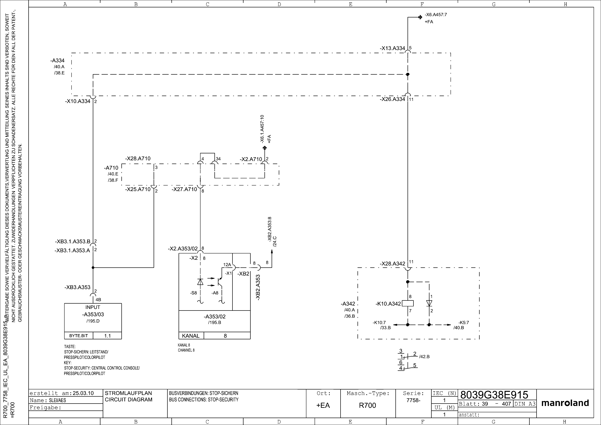

# +EA — Sheet 39 of 407 — BUSVERBINDUNGEN: STOP SICHERN

**BUS CONNECTIONS: STOP SECURITY**

> Part of the manroland **R700** printing press IEC/UL circuit diagrams.
> Drawing class: **Stromlaufplan / Circuit diagram** (DIN A3).
> Document `+EA` covers the **Printing unit** machine section.

## At a glance

| Field | Value |
|---|---|
| Document | `+EA`  (8039G38E915) |
| Sheet | **39** of 407 |
| Section (DE) | BUSVERBINDUNGEN: STOP SICHERN |
| Section (EN) | BUS CONNECTIONS: STOP SECURITY |
| Section type | CIRCUIT — Circuit diagram |
| Machine type | `R700` |
| Series | `7758` |
| Created | 25.03.10 |
| Replaces | — |
| Columns used | A, B, C, D, E, F, G |
| Path numbers | — |
| Labels on sheet | 85 |
| Cross-refs out | 12 |
| Cross-refs in | 27 |

**Previous:** [+EA sheet 38](SHEET_0038.md) · **Next:** [+EA sheet 40](SHEET_0040.md) · **Document TOC:** [_TOC.md](_TOC.md)  (+EA) · **Master TOC:** [all sheets](../_MASTER_TOC.md)

## Sheet image (300 DPI, exact vector render)



_Rendered directly from the PDF vector layer at 300 DPI (1-bit), no OCR and no resampling. Use it to confirm anything ambiguous in the text below._

## Cross-references on this sheet

Each entry is a wire leaving this sheet. The printed token is `/sheet.column`; the link resolves to that sheet inside the same document.

| Ref | Target sheet | Col | Path | Destination on target | Target section | From col |
|---|---|---|---|---|---|---|
| `/40.A` | [+EA sheet 40](SHEET_0040.md) | A | — | — | BUSVERBINDUNGEN: STOP SICHERN | A |
| `/38.E` | [+EA sheet 38](SHEET_0038.md) | E | — | — | BUSVERBINDUNGEN: NOT AUS | A |
| `/40.E` | [+EA sheet 40](SHEET_0040.md) | E | — | — | BUSVERBINDUNGEN: STOP SICHERN | B |
| `/38.F` | [+EA sheet 38](SHEET_0038.md) | F | — | — | BUSVERBINDUNGEN: NOT AUS | B |
| `/24.C` | [+EA sheet 24](SHEET_0024.md) | C | — | XB2.A353:8 | BUSVERBINDUNGEN: SICHERHEITSBUS | D |
| `/40.A` | [+EA sheet 40](SHEET_0040.md) | A | — | — | BUSVERBINDUNGEN: STOP SICHERN | E |
| `/36.B` | [+EA sheet 36](SHEET_0036.md) | B | — | — | BUSVERBINDUNGEN: NOT AUS | E |
| `/195.D` | [+EA sheet 195](SHEET_0195.md) | D | — | — | REFERENZMODUL | A |
| `/195.B` | [+EA sheet 195](SHEET_0195.md) | B | — | — | REFERENZMODUL | C |
| `/33.B` | [+EA sheet 33](SHEET_0033.md) | B | — | K10:7 | BUSVERBINDUNGEN: NOT AUS | E |
| `/40.B` | [+EA sheet 40](SHEET_0040.md) | B | — | — | BUSVERBINDUNGEN: STOP SICHERN | G |
| `/42.B` | [+EA sheet 42](SHEET_0042.md) | B | — | — | BUSVERBINDUNGEN: STOP SICHERN | F |

### Incoming references (sheets that point here)

Every other sheet that sends a wire to this one. `Back-ref` is the token printed on *that* sheet; `Path` is its line number.

| From sheet | Cols | Back-ref | Path | Refs | What continues there |
|---|---|---|---|---|---|
| [+EA#24](SHEET_0024.md) | C | `/24.C` | — | 1 | XB2.A353:8 |
| [+EA#33](SHEET_0033.md) | C | `/33.C` | — | 1 | — |
| [+EA#36](SHEET_0036.md) | B | `/36.B` | — | 1 | — |
| [+EA#38](SHEET_0038.md) | E, F | `/38.E`, `/38.F` | — | 2 | — |
| [+EA#40](SHEET_0040.md) | A, E | `/40.A`, `/40.E` | — | 4 | K5:7 |
| [+EA#42](SHEET_0042.md) | B | `/42.B` | — | 1 | — |
| [+EA#195](SHEET_0195.md) | B, D | `/195.B`, `/195.D` | — | 2 | — |
| [+EA#224](SHEET_0224.md) | G | `/224.G` | — | 1 | — |
| [+EA#225](SHEET_0225.md) | C | `/225.C` | — | 1 | — |
| [+EA#230](SHEET_0230.md) | G | `/230.G` | — | 1 | — |
| [+EA#234](SHEET_0234.md) | C, D, F | `/234.C`, `/234.D`, `/234.F` | — | 3 | — |
| [+EA#253](SHEET_0253.md) | H | `/253.H` | — | 1 | — |
| [+EA#258](SHEET_0258.md) | C | `/258.C` | — | 1 | — |
| [+EA#268](SHEET_0268.md) | C | `/268.C` | — | 1 | — |
| [+EA#269](SHEET_0269.md) | B | `/269.B` | — | 1 | — |
| [+EA#271](SHEET_0271.md) | B | `/271.B` | — | 1 | — |
| [+EA#272](SHEET_0272.md) | E, G, H | `/272.E`, `/272.G`, `/272.H` | — | 4 | — |


## Devices on this sheet

| Tag | Class | Class meaning (IEC) | Col | Sub | Terminal | Sign |
|---|---|---|---|---|---|---|
| `A353/03` | A | Baugruppe / assembly, module, PC board | A | 03 | — | — |
| `A342` | A | Baugruppe / assembly, module, PC board | E | — | — | — |
| `S8` | S | Schalter / switch | C | — | — | — |
| `A8` | A | Baugruppe / assembly, module, PC board | C | — | — | — |
| `X1` | X | Klemme / terminal, plug connector | C | — | — | — |
| `X2` | X | Klemme / terminal, plug connector | C | — | — | — |
| `XB2` | XB |  | C | — | — | — |
| `A353/02` | A | Baugruppe / assembly, module, PC board | C | 02 | — | — |
| `A710` | A | Baugruppe / assembly, module, PC board | B | — | — | — |
| `A334` | A | Baugruppe / assembly, module, PC board | A | — | — | — |
| `K10:7` | K | Relais / relay, contactor | E | — | 7 | — |
| `K5:7` | K | Relais / relay, contactor | G | — | 7 | — |
| `1.1` | — | cross-device reference | B | — | — | — |
| `XB3.A353` | — | cross-device reference | A | — | — | — |
| `K10.A342` | — | cross-device reference | F | — | — | — |
| `X28.A342` | — | cross-device reference | F | — | — | — |
| `XB2.A353` | — | cross-device reference | D | — | — | — |
| `X27.A710` | — | cross-device reference | C | — | — | — |
| `X25.A710` | — | cross-device reference | B | — | — | — |
| `X2.A710` | — | cross-device reference | D | — | — | — |
| `X6.1.A457:10` | — | cross-device reference | D | — | 10 | — |
| `XB3.1.A353.B` | — | cross-device reference | A | — | — | — |
| `XB3.1.A353.A` | — | cross-device reference | A | — | — | — |
| `X10.A334` | — | cross-device reference | A | — | — | — |
| `X13.A334` | — | cross-device reference | F | — | — | — |
| `X6.A457:7` | — | cross-device reference | F | — | 7 | — |
| `X26.A334` | — | cross-device reference | F | — | — | — |
| `XB2.A353:8` | — | cross-device reference | D | — | 8 | — |
| `X28.A710` | — | cross-device reference | B | — | — | — |

## Potentials / nets

_No named potentials on this sheet._

## Wire-end annotations (grouped as printed)

A wire that continues elsewhere is annotated with a small cluster: the destination description, the path/line number `#NN`, and the `/sheet.column` cross reference. Each row below is one such cluster exactly as it is grouped on the drawing.

| Col | Y | Path | Cross-ref | Text on the wire |
|---|---|---|---|---|
| F | 25.1 | — | — | `X6.A457:7` |
| F | 39.2 | — | — | `+FA` |
| F | 91.0 | — | — | `X13.A334 5` |
| A | 115.1 | — | — | `A334` |
| A | 128.2 | — | `/40.A` | — |
| A | 140.6 | — | `/38.E` | — |
| F | 191.6 | — | — | `X26.A334 11` |
| A | 195.9 | — | — | `X10.A334 2` |
| D | 227.6 | — | — | `X6.1.A457:10` |
| D | 267.3 | — | — | `+FA` |
| B | 309.3 | — | — | `X28.A710` |
| C | 310.7 | — | — | `4` |
| C | 310.7 | — | — | `34` |
| D | 310.7 | — | — | `X2.A710 2` |
| B | 327.7 | — | — | `A710` |
| B | 327.7 | — | — | `3` |
| B | 340.8 | — | `/40.E`, `/38.F` | — |
| B | 370.2 | — | — | `X25.A710 2 X27.A710 8` |
| D | 429.4 | — | `/24.C` | `XB2.A353:8` |
| A | 473.7 | — | — | `XB3.1.A353.B 2` |
| C | 487.9 | — | — | `X2.A353/02 8` |
| A | 490.7 | — | — | `XB3.1.A353.A 2` |
| C | 506.3 | — | — | `X2` |
| C | 507.7 | — | — | `8 8` |
| F | 514.8 | — | — | `X28.A342 11` |
| D | 516.2 | — | — | `8` |
| C | 520.4 | — | — | `12A` |
| C | 537.5 | — | — | `X1` |
| C | 537.5 | — | — | `XB2` |
| D | 543.7 | — | — | `XB2.A353` |
| A | 564.4 | — | — | `XB3.A353 2` |
| C | 576.4 | — | — | `S8 A8` |
| F | 583.5 | — | — | `8` |
| F | 583.5 | — | — | `1` |
| A | 589.9 | — | — | `4B` |
| E | 597.0 | — | — | `A342` |
| F | 597.0 | — | — | `K10.A342 7` |
| A | 604.4 | — | — | `INPUT` |
| E | 610.0 | — | `/40.A`, `/36.B` | — |
| F | 611.9 | — | — | `2` |
| A | 618.3 | — | — | `A353/03` |
| C | 622.5 | — | — | `A353/02` |
| A | 632.1 | — | `/195.D` | — |
| C | 634.9 | — | `/195.B` | — |
| E | 635.2 | — | `/33.B` | `K10:7` |
| G | 635.2 | — | — | `K5:7` |
| G | 645.1 | — | `/40.B` | — |
| C | 660.7 | — | — | `KANAL 8` |
| A | 661.1 | — | — | `BYTE.BIT 1.1` |
| C | 681.1 | — | — | `KANAL 8 CHANNEL 8` |
| A | 683.7 | — | — | `PRESSPILOT/COLORPILOT KEY: TASTE: STOP SICHERN: LEITSTAND/` |
| F | 690.5 | — | — | `3 6 4 1` |
| F | 696.2 | — | — | `2` |
| F | 702.5 | — | `/42.B` | — |
| F | 718.9 | — | — | `5` |
| B | 726.3 | — | — | `PRESSPILOT/COLORPILOT STOP SECURITY: CENTRAL CONTROL CONSOLE/` |


## Reconstructed tables

This sheet carries tabular content (pin map / terminal assignment / index). The grid below was rebuilt from the drawing's own rule lines, so each row is exactly one physical row of the table.

### Table 1 — 6 data rows × 9 columns (at x=127.6, y=147.4)

| X10.A334 | 2 A710 /40.E | X28.A710 | 3 |  | 4 34 |  |  | X6.1.A457:10 +FA X2.A710 2 |
|---|---|---|---|---|---|---|---|---|
| `XB3.1.A353.B XB3.1.A353.A` | `/38.F 2 2` | `X25.A710` | `2` | `X27.A710 X2.A353/02` | `8 8` |  |  | `XB2.A353:8` |
|  |  |  |  | `X2` | `8` | `12A` |  | `8 8` |
| `XB3.A353` | `2 4B` |  |  | `S8` | `A8` | `X1` | `XB2` | `XB2.A353` |
| `INPUT` |  |  |  |  |  |  |  |  |
|  | `A353/03 /195.D` |  |  |  | `A353/02 /195.B` |  |  |  |
| `BYTE.BIT` | `1.1` |  |  | `KANAL` |  | `8` |  |  |


## Notes and free text on this sheet

| Text | Col | Y (pt) |
|---|---|---|
| `4B` | A | 589.88 |
| `INPUT` | A | 604.42 |
| `BYTE.BIT` | A | 661.67 |
| `TASTE:` | A | 683.71 |
| `STOP SICHERN: LEITSTAND/` | A | 694.41 |
| `PRESSPILOT/COLORPILOT` | A | 705.04 |
| `KEY:` | A | 715.54 |
| `STOP SECURITY: CENTRAL CONTROL CONSOLE/` | B | 726.32 |
| `KANAL 8` | C | 681.1 |
| `CHANNEL 8` | C | 691.04 |
| `12A` | C | 520.44 |
| `KANAL` | C | 660.77 |
| `X2.A353/02` | C | 487.87 |
| `+FA` | D | 267.31 |
| `+FA` | F | 39.24 |

## Complete label inventory (exact text from the drawing)

Every text object inside the drawing area of this sheet, in DIN reading order (column A→H, then top→bottom). This is the authoritative list: if a string is not here it is not printed on this sheet.

| Col | Y | X | Dir | Type | Text |
|---|---|---|---|---|---|
| A | 115.1 | 99.8 | → | device tag | `A334` |
| A | 128.2 | 106.9 | → | cross-reference | `/40.A` |
| A | 140.6 | 107.4 | → | cross-reference | `/38.E` |
| A | 195.9 | 129.0 | → | device ref | `X10.A334` |
| A | 197.3 | 186.8 | → | number | `2` |
| A | 473.7 | 109.1 | → | device ref | `XB3.1.A353.B` |
| A | 473.7 | 186.8 | → | number | `2` |
| A | 490.7 | 186.8 | → | number | `2` |
| A | 491.4 | 108.3 | → | device ref | `XB3.1.A353.A` |
| A | 564.4 | 127.8 | → | device ref | `XB3.A353` |
| A | 572.9 | 186.8 | → | number | `2` |
| A | 589.9 | 189.6 | → | text | `4B` |
| A | 604.4 | 169.4 | → | text | `INPUT` |
| A | 618.3 | 162.9 | → | device tag | `A353/03` |
| A | 632.1 | 171.5 | → | cross-reference | `/195.D` |
| A | 661.7 | 137.5 | → | text | `BYTE.BIT` |
| A | 683.7 | 127.3 | → | text | `TASTE:` |
| A | 694.4 | 127.3 | → | text | `STOP SICHERN: LEITSTAND/` |
| A | 705.0 | 126.7 | → | text | `PRESSPILOT/COLORPILOT` |
| A | 715.5 | 126.7 | → | text | `KEY:` |
| A | 736.9 | 126.7 | → | text | `PRESSPILOT/COLORPILOT` |
| B | 309.3 | 248.0 | → | device ref | `X28.A710` |
| B | 327.7 | 206.1 | → | device tag | `A710` |
| B | 327.7 | 307.3 | → | number | `3` |
| B | 340.8 | 213.7 | → | cross-reference | `/40.E` |
| B | 353.2 | 214.0 | → | cross-reference | `/38.F` |
| B | 370.2 | 248.0 | → | device ref | `X25.A710` |
| B | 374.5 | 307.3 | → | number | `2` |
| B | 661.1 | 206.4 | → | device ref | `1.1` |
| B | 726.3 | 127.3 | → | text | `STOP SECURITY: CENTRAL CONTROL CONSOLE/` |
| C | 310.7 | 399.4 | → | number | `4` |
| C | 310.7 | 427.7 | → | number | `34` |
| C | 370.2 | 340.2 | → | device ref | `X27.A710` |
| C | 374.5 | 399.4 | → | number | `8` |
| C | 487.9 | 332.8 | → | text | `X2.A353/02` |
| C | 487.9 | 399.4 | → | number | `8` |
| C | 506.3 | 375.3 | → | device tag | `X2` |
| C | 507.7 | 402.2 | → | number | `8` |
| C | 520.4 | 442.2 | → | text | `12A` |
| C | 537.5 | 445.9 | → | device tag | `X1` |
| C | 537.5 | 470.3 | → | device tag | `XB2` |
| C | 576.4 | 376.4 | → | device tag | `S8` |
| C | 576.4 | 419.0 | → | device tag | `A8` |
| C | 622.5 | 403.8 | → | device tag | `A353/02` |
| C | 634.9 | 412.6 | → | cross-reference | `/195.B` |
| C | 660.7 | 443.5 | → | number | `8` |
| C | 660.8 | 360.6 | → | text | `KANAL` |
| C | 681.1 | 352.3 | → | text | `KANAL 8` |
| C | 691.0 | 352.6 | → | text | `CHANNEL 8` |
| D | 227.6 | 515.5 | ↕ | device ref | `X6.1.A457:10` |
| D | 267.3 | 529.6 | ↕ | text | `+FA` |
| D | 310.7 | 475.1 | → | device ref | `X2.A710` |
| D | 310.7 | 527.0 | → | number | `2` |
| D | 429.5 | 530.4 | ↕ | device ref | `XB2.A353:8` |
| D | 468.0 | 540.3 | ↕ | cross-reference | `/24.C` |
| D | 516.2 | 527.0 | → | number | `8` |
| D | 517.6 | 501.4 | → | number | `8` |
| D | 543.7 | 506.3 | ↕ | device ref | `XB2.A353` |
| E | 597.0 | 675.2 | → | device tag | `A342` |
| E | 610.1 | 682.3 | → | cross-reference | `/40.A` |
| E | 622.5 | 682.6 | → | cross-reference | `/36.B` |
| E | 635.3 | 738.4 | → | device tag | `K10:7` |
| E | 645.1 | 753.4 | → | cross-reference | `/33.B` |
| F | 25.1 | 841.6 | → | device ref | `X6.A457:7` |
| F | 39.2 | 841.6 | → | text | `+FA` |
| F | 91.0 | 752.6 | → | device ref | `X13.A334` |
| F | 91.0 | 810.4 | → | number | `5` |
| F | 191.6 | 752.6 | → | device ref | `X26.A334` |
| F | 193.1 | 809.9 | → | number | `11` |
| F | 514.8 | 809.9 | → | number | `11` |
| F | 517.6 | 752.6 | → | device ref | `X28.A342` |
| F | 583.6 | 810.4 | → | number | `8` |
| F | 583.6 | 852.4 | → | number | `1` |
| F | 597.0 | 744.1 | → | device ref | `K10.A342` |
| F | 611.9 | 810.4 | → | number | `7` |
| F | 611.9 | 852.9 | → | number | `2` |
| F | 690.5 | 791.1 | → | number | `3` |
| F | 696.2 | 818.9 | → | number | `2` |
| F | 701.8 | 792.6 | → | number | `1` |
| F | 702.5 | 830.6 | → | cross-reference | `/42.B` |
| F | 713.2 | 791.1 | → | number | `6` |
| F | 718.9 | 818.6 | → | number | `5` |
| F | 724.5 | 791.1 | → | number | `4` |
| G | 635.2 | 908.2 | → | device tag | `K5:7` |
| G | 645.1 | 898.6 | → | cross-reference | `/40.B` |

## Reading-order text block

The same content as a plain block, grouped by DIN column — convenient to paste or to match against a visual description.

```text
=== Column A ===
 115.1   99.8  devtag       A334
 128.2  106.9  xref         /40.A
 140.6  107.4  xref         /38.E
 195.9  129.0  devref       X10.A334
 197.3  186.8  numeric      2
 473.7  109.1  devref       XB3.1.A353.B
 473.7  186.8  numeric      2
 490.7  186.8  numeric      2
 491.4  108.3  devref       XB3.1.A353.A
 564.4  127.8  devref       XB3.A353
 572.9  186.8  numeric      2
 589.9  189.6  text         4B
 604.4  169.4  text         INPUT
 618.3  162.9  devtag       A353/03
 632.1  171.5  xref         /195.D
 661.7  137.5  text         BYTE.BIT
 683.7  127.3  text         TASTE:
 694.4  127.3  text         STOP SICHERN: LEITSTAND/
 705.0  126.7  text         PRESSPILOT/COLORPILOT
 715.5  126.7  text         KEY:
 736.9  126.7  text         PRESSPILOT/COLORPILOT
=== Column B ===
 309.3  248.0  devref       X28.A710
 327.7  206.1  devtag       A710
 327.7  307.3  numeric      3
 340.8  213.7  xref         /40.E
 353.2  214.0  xref         /38.F
 370.2  248.0  devref       X25.A710
 374.5  307.3  numeric      2
 661.1  206.4  devref       1.1
 726.3  127.3  text         STOP SECURITY: CENTRAL CONTROL CONSOLE/
=== Column C ===
 310.7  399.4  numeric      4
 310.7  427.7  numeric      34
 370.2  340.2  devref       X27.A710
 374.5  399.4  numeric      8
 487.9  332.8  text         X2.A353/02
 487.9  399.4  numeric      8
 506.3  375.3  devtag       X2
 507.7  402.2  numeric      8
 520.4  442.2  text         12A
 537.5  445.9  devtag       X1
 537.5  470.3  devtag       XB2
 576.4  376.4  devtag       S8
 576.4  419.0  devtag       A8
 622.5  403.8  devtag       A353/02
 634.9  412.6  xref         /195.B
 660.7  443.5  numeric      8
 660.8  360.6  text         KANAL
 681.1  352.3  text         KANAL 8
 691.0  352.6  text         CHANNEL 8
=== Column D ===
 227.6  515.5  devref       X6.1.A457:10
 267.3  529.6  text         +FA
 310.7  475.1  devref       X2.A710
 310.7  527.0  numeric      2
 429.5  530.4  devref       XB2.A353:8
 468.0  540.3  xref         /24.C
 516.2  527.0  numeric      8
 517.6  501.4  numeric      8
 543.7  506.3  devref       XB2.A353
=== Column E ===
 597.0  675.2  devtag       A342
 610.1  682.3  xref         /40.A
 622.5  682.6  xref         /36.B
 635.3  738.4  devtag       K10:7
 645.1  753.4  xref         /33.B
=== Column F ===
  25.1  841.6  devref       X6.A457:7
  39.2  841.6  text         +FA
  91.0  752.6  devref       X13.A334
  91.0  810.4  numeric      5
 191.6  752.6  devref       X26.A334
 193.1  809.9  numeric      11
 514.8  809.9  numeric      11
 517.6  752.6  devref       X28.A342
 583.6  810.4  numeric      8
 583.6  852.4  numeric      1
 597.0  744.1  devref       K10.A342
 611.9  810.4  numeric      7
 611.9  852.9  numeric      2
 690.5  791.1  numeric      3
 696.2  818.9  numeric      2
 701.8  792.6  numeric      1
 702.5  830.6  xref         /42.B
 713.2  791.1  numeric      6
 718.9  818.6  numeric      5
 724.5  791.1  numeric      4
=== Column G ===
 635.2  908.2  devtag       K5:7
 645.1  898.6  xref         /40.B
```

---
_Generated from the PDF vector text layer; no OCR. Source: `R700_7758_IEC_UL_EA_8039G38E915_p`, sheet 39._
