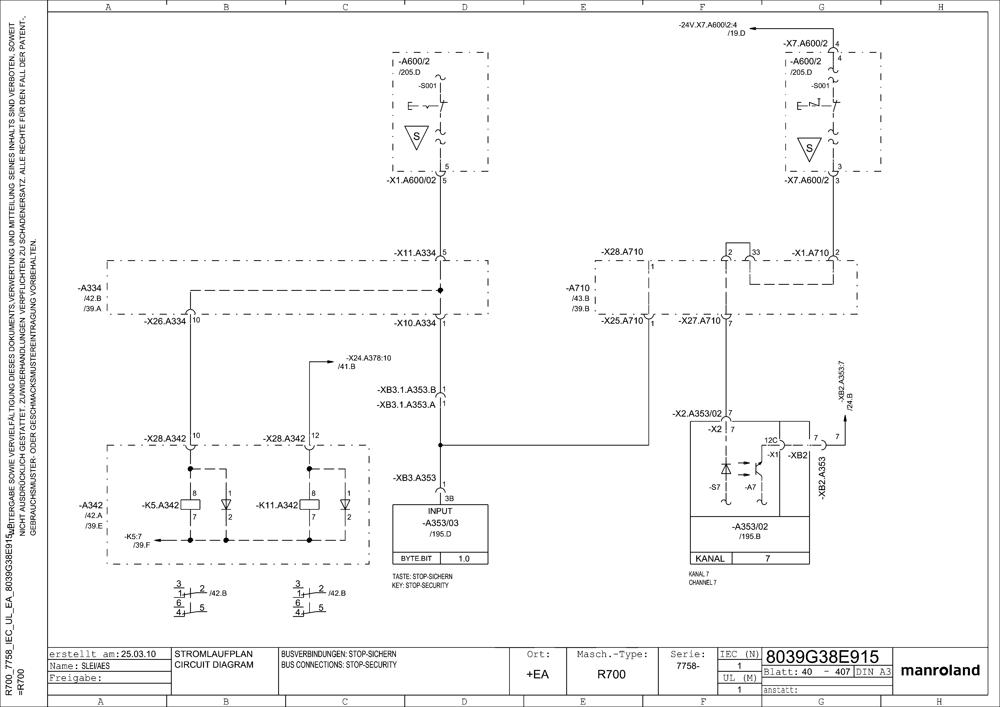

# +EA — Sheet 40 of 407 — BUSVERBINDUNGEN: STOP SICHERN

**BUS CONNECTIONS: STOP SECURITY**

> Part of the manroland **R700** printing press IEC/UL circuit diagrams.
> Drawing class: **Stromlaufplan / Circuit diagram** (DIN A3).
> Document `+EA` covers the **Printing unit** machine section.

## At a glance

| Field | Value |
|---|---|
| Document | `+EA`  (8039G38E915) |
| Sheet | **40** of 407 |
| Section (DE) | BUSVERBINDUNGEN: STOP SICHERN |
| Section (EN) | BUS CONNECTIONS: STOP SECURITY |
| Section type | CIRCUIT — Circuit diagram |
| Machine type | `R700` |
| Series | `7758` |
| Created | 25.03.10 |
| Replaces | — |
| Columns used | A, B, C, D, E, F, G |
| Path numbers | — |
| Labels on sheet | 110 |
| Cross-refs out | 16 |
| Cross-refs in | 35 |

**Previous:** [+EA sheet 39](SHEET_0039.md) · **Next:** [+EA sheet 41](SHEET_0041.md) · **Document TOC:** [_TOC.md](_TOC.md)  (+EA) · **Master TOC:** [all sheets](../_MASTER_TOC.md)

## Sheet image (300 DPI, exact vector render)



_Rendered directly from the PDF vector layer at 300 DPI (1-bit), no OCR and no resampling. Use it to confirm anything ambiguous in the text below._

## Cross-references on this sheet

Each entry is a wire leaving this sheet. The printed token is `/sheet.column`; the link resolves to that sheet inside the same document.

| Ref | Target sheet | Col | Path | Destination on target | Target section | From col |
|---|---|---|---|---|---|---|
| `/19.D` | [+EA sheet 19](SHEET_0019.md) | D | — | 24V.X7.A600\2:4 | SPANNUNGSVERSORGUNG: 400V, 24V | F |
| `/205.D` | [+EA sheet 205](SHEET_0205.md) | D | — | A600/2 | REFERENZMODUL | D |
| `/205.D` | [+EA sheet 205](SHEET_0205.md) | D | — | A600/2 | REFERENZMODUL | G |
| `/42.B` | [+EA sheet 42](SHEET_0042.md) | B | — | — | BUSVERBINDUNGEN: STOP SICHERN | A |
| `/39.A` | [+EA sheet 39](SHEET_0039.md) | A | — | — | BUSVERBINDUNGEN: STOP SICHERN | A |
| `/43.B` | [+EA sheet 43](SHEET_0043.md) | B | — | — | BUSVERBINDUNGEN: SIGNALSCHLEIFE | E |
| `/39.B` | [+EA sheet 39](SHEET_0039.md) | B | — | — | BUSVERBINDUNGEN: STOP SICHERN | E |
| `/24.B` | [+EA sheet 24](SHEET_0024.md) | B | — | XB2.A353:7 | BUSVERBINDUNGEN: SICHERHEITSBUS | G |
| `/41.B` | [+EA sheet 41](SHEET_0041.md) | B | — | — | BUSVERBINDUNGEN: STOP SICHERN | C |
| `/42.A` | [+EA sheet 42](SHEET_0042.md) | A | — | — | BUSVERBINDUNGEN: STOP SICHERN | A |
| `/39.E` | [+EA sheet 39](SHEET_0039.md) | E | — | — | BUSVERBINDUNGEN: STOP SICHERN | A |
| `/195.D` | [+EA sheet 195](SHEET_0195.md) | D | — | — | REFERENZMODUL | D |
| `/195.B` | [+EA sheet 195](SHEET_0195.md) | B | — | — | REFERENZMODUL | F |
| `/39.F` | [+EA sheet 39](SHEET_0039.md) | F | — | K5:7 | BUSVERBINDUNGEN: STOP SICHERN | A |
| `/42.B` | [+EA sheet 42](SHEET_0042.md) | B | — | — | BUSVERBINDUNGEN: STOP SICHERN | B |
| `/42.B` | [+EA sheet 42](SHEET_0042.md) | B | — | — | BUSVERBINDUNGEN: STOP SICHERN | C |

### Incoming references (sheets that point here)

Every other sheet that sends a wire to this one. `Back-ref` is the token printed on *that* sheet; `Path` is its line number.

| From sheet | Cols | Back-ref | Path | Refs | What continues there |
|---|---|---|---|---|---|
| [+EA#19](SHEET_0019.md) | D | `/19.D` | — | 1 | 24V.X7.A600\2:4 |
| [+EA#24](SHEET_0024.md) | B | `/24.B` | — | 1 | XB2.A353:7 |
| [+EA#39](SHEET_0039.md) | A, B, E, G | `/39.A`, `/39.B`, `/39.E`, `/39.G` | — | 4 | — |
| [+EA#41](SHEET_0041.md) | A | `/41.A` | — | 1 | X24.A378:10 |
| [+EA#42](SHEET_0042.md) | A, B | `/42.A`, `/42.B` | — | 4 | — |
| [+EA#43](SHEET_0043.md) | B | `/43.B` | — | 1 | A710 |
| [+EA#195](SHEET_0195.md) | B, D | `/195.B`, `/195.D` | — | 2 | — |
| [+EA#205](SHEET_0205.md) | D | `/205.D` | — | 2 | — |
| [+EA#212](SHEET_0212.md) | G | `/212.G` | — | 1 | — |
| [+EA#214](SHEET_0214.md) | B | `/214.B` | — | 1 | — |
| [+EA#224](SHEET_0224.md) | G | `/224.G` | — | 1 | — |
| [+EA#225](SHEET_0225.md) | C | `/225.C` | — | 1 | — |
| [+EA#234](SHEET_0234.md) | C, D, F | `/234.C`, `/234.D`, `/234.F` | — | 3 | — |
| [+EA#247](SHEET_0247.md) | G | `/247.G` | — | 2 | — |
| [+EA#253](SHEET_0253.md) | H | `/253.H` | — | 1 | — |
| [+EA#255](SHEET_0255.md) | G | `/255.G` | — | 1 | — |
| [+EA#268](SHEET_0268.md) | C | `/268.C` | — | 1 | — |
| [+EA#269](SHEET_0269.md) | B | `/269.B` | — | 1 | — |
| [+EA#271](SHEET_0271.md) | B | `/271.B` | — | 1 | — |
| [+EA#272](SHEET_0272.md) | E, G, H | `/272.E`, `/272.G`, `/272.H` | — | 5 | — |


## Devices on this sheet

| Tag | Class | Class meaning (IEC) | Col | Sub | Terminal | Sign |
|---|---|---|---|---|---|---|
| `A353/03` | A | Baugruppe / assembly, module, PC board | D | 03 | — | — |
| `A342` | A | Baugruppe / assembly, module, PC board | A | — | — | — |
| `S001` | S | Schalter / switch | D | — | — | — |
| `A600/2` | A | Baugruppe / assembly, module, PC board | D | 2 | — | — |
| `S7` | S | Schalter / switch | F | — | — | — |
| `A7` | A | Baugruppe / assembly, module, PC board | F | — | — | — |
| `X1` | X | Klemme / terminal, plug connector | G | — | — | — |
| `X2` | X | Klemme / terminal, plug connector | F | — | — | — |
| `XB2` | XB |  | G | — | — | — |
| `A353/02` | A | Baugruppe / assembly, module, PC board | F | 02 | — | — |
| `A710` | A | Baugruppe / assembly, module, PC board | E | — | — | — |
| `S001` | S | Schalter / switch | G | — | — | — |
| `A600/2` | A | Baugruppe / assembly, module, PC board | G | 2 | — | — |
| `A334` | A | Baugruppe / assembly, module, PC board | A | — | — | — |
| `K5:7` | K | Relais / relay, contactor | A | — | 7 | — |
| `X28.A342` | — | cross-device reference | A | — | — | — |
| `K5.A342` | — | cross-device reference | A | — | — | — |
| `X28.A342` | — | cross-device reference | B | — | — | — |
| `K11.A342` | — | cross-device reference | B | — | — | — |
| `1.0` | — | cross-device reference | D | — | — | — |
| `XB3.A353` | — | cross-device reference | D | — | — | — |
| `XB2.A353` | — | cross-device reference | G | — | — | — |
| `X1.A710` | — | cross-device reference | G | — | — | — |
| `X27.A710` | — | cross-device reference | F | — | — | — |
| `X25.A710` | — | cross-device reference | E | — | — | — |
| `XB3.1.A353.B` | — | cross-device reference | D | — | — | — |
| `XB3.1.A353.A` | — | cross-device reference | D | — | — | — |
| `X26.A334` | — | cross-device reference | A | — | — | — |
| `X10.A334` | — | cross-device reference | D | — | — | — |
| `X11.A334` | — | cross-device reference | D | — | — | — |
| `XB2.A353:7` | — | cross-device reference | G | — | 7 | — |
| `X24.A378:10` | — | cross-device reference | C | — | 10 | — |
| `X28.A710` | — | cross-device reference | E | — | — | — |

## Potentials / nets

| Potential | Count | Columns | Attached devices | Terminals |
|---|---|---|---|---|
| `24V` | 1 | F | `A600\2`, `X7` | `4` |


A potential such as `L24+/4` or `M24+` is a named supply/return rail; every place it appears on this sheet is electrically common.

## Wire-end annotations (grouped as printed)

A wire that continues elsewhere is annotated with a small cluster: the destination description, the path/line number `#NN`, and the `/sheet.column` cross reference. Each row below is one such cluster exactly as it is grouped on the drawing.

| Col | Y | Path | Cross-ref | Text on the wire |
|---|---|---|---|---|
| F | 25.8 | — | `/19.D` | `24V.X7.A600\2:4` |
| G | 47.1 | — | — | `X7.A600/2 4` |
| G | 65.5 | — | — | `4` |
| D | 68.3 | — | `/205.D` | `A600/2` |
| G | 68.3 | — | `/205.D` | `A600/2` |
| D | 98.5 | — | — | `S001` |
| G | 98.5 | — | — | `S001` |
| D | 157.0 | — | — | `S` |
| G | 171.2 | — | — | `S` |
| D | 194.5 | — | — | `5` |
| G | 194.5 | — | — | `3` |
| D | 210.1 | — | — | `X1.A600/02 5` |
| G | 210.1 | — | — | `X7.A600/2 3` |
| E | 295.1 | — | — | `X28.A710` |
| D | 296.5 | — | — | `X11.A334 5` |
| F | 296.5 | — | — | `2` |
| F | 296.5 | — | — | `33` |
| G | 296.5 | — | — | `X1.A710 2` |
| F | 313.6 | — | — | `1` |
| A | 338.3 | — | — | `A334` |
| E | 338.3 | — | — | `A710` |
| A | 351.4 | — | `/42.B`, `/39.A` | — |
| E | 351.4 | — | `/43.B`, `/39.B` | — |
| C | 377.3 | — | — | `X26.A334 10 X10.A334 1` |
| F | 377.3 | — | — | `X25.A710 1 X27.A710 7` |
| C | 422.6 | — | — | `X24.A378:10` |
| G | 429.4 | — | `/24.B` | `XB2.A353:7` |
| C | 432.5 | — | `/41.B` | — |
| D | 459.5 | — | — | `XB3.1.A353.B 1` |
| D | 476.5 | — | — | `XB3.1.A353.A 1` |
| F | 487.9 | — | — | `X2.A353/02 7` |
| F | 506.3 | — | — | `X2` |
| G | 507.7 | — | — | `7 7` |
| B | 514.8 | — | — | `X28.A342 10` |
| C | 514.8 | — | — | `X28.A342 12` |
| G | 516.2 | — | — | `7` |
| G | 520.5 | — | — | `12C` |
| G | 537.5 | — | — | `X1` |
| G | 537.5 | — | — | `XB2` |
| G | 543.7 | — | — | `XB2.A353` |
| D | 564.4 | — | — | `XB3.A353 1` |
| F | 576.4 | — | — | `S7 A7` |
| B | 583.5 | — | — | `8` |
| B | 583.5 | — | — | `1` |
| C | 583.5 | — | — | `8` |
| C | 583.5 | — | — | `1` |
| D | 589.9 | — | — | `3B` |
| A | 597.0 | — | — | `A342` |
| B | 597.0 | — | — | `K5.A342 7` |
| B | 597.0 | — | — | `K11.A342 7` |
| D | 604.4 | — | — | `INPUT` |
| A | 610.0 | — | `/42.A` | — |
| B | 611.9 | — | — | `2` |
| C | 611.9 | — | — | `2` |
| D | 618.3 | — | — | `A353/03` |
| A | 622.5 | — | `/39.E` | — |
| F | 622.5 | — | — | `A353/02` |
| D | 632.1 | — | `/195.D` | — |
| F | 634.9 | — | `/195.B` | — |
| A | 635.2 | — | `/39.F` | `K5:7` |
| F | 660.7 | — | — | `KANAL 7` |
| D | 661.1 | — | — | `BYTE.BIT 1.0` |
| F | 681.1 | — | — | `KANAL 7 CHANNEL 7` |
| D | 683.8 | — | — | `KEY: STOP SECURITY TASTE: STOP SICHERN` |
| B | 690.5 | — | — | `3 6 4 1` |
| C | 690.5 | — | — | `3 6 4 1` |
| B | 696.2 | — | — | `2` |
| C | 696.2 | — | — | `2` |
| B | 702.5 | — | `/42.B` | — |
| C | 702.5 | — | `/42.B` | — |
| B | 718.9 | — | — | `5` |
| C | 718.9 | — | — | `5` |


## Reconstructed tables

This sheet carries tabular content (pin map / terminal assignment / index). The grid below was rebuilt from the drawing's own rule lines, so each row is exactly one physical row of the table.

### Table 1 — 5 data rows × 6 columns (at x=226.8, y=62.4)

|  |  |  |  | A600/2 /205.D S001 S | 5 |
|---|---|---|---|---|---|
|  |  |  |  | `X1.A600/02 X11.A334` | `5 5` |
| `10 10` | `X28.A342` | `12` | `X24.A378:10 /41.B` | `X10.A334 XB3.1.A353.B XB3.1.A353.A` | `1 1 1` |
| `8` | `1` | `8` | `1` | `XB3.A353` | `1 3B` |
| `7` | `K11.A342 2` | `7` | `2` | `INPUT` | `A353/03 /195.D` |
|  |  |  |  | `BYTE.BIT` | `1.0` |


### Table 2 — 5 data rows × 4 columns (at x=772.4, y=34.0) — **/19.D**

| 1 |  | 2 33 |  |
|---|---|---|---|
| `1` | `X27.A710 X2.A353/02` | `7 7` |  |
|  | `X2` | `7` | `12C` |
|  | `S7` | `A7` | `X1` |
|  |  | `A353/02 /195.B` |  |
|  | `KANAL` |  | `7` |


### Table 3 — 5 data rows × 4 columns (at x=935.4, y=34.0)

| X7.A600/2 |  | 4 |  |
|---|---|---|---|
| `A600/2 /205.D S` | `S001` | `4 3` |  |
| `X7.A600/2` | `X1.A710` | `3 2` |  |
|  |  | `XB2.A353:7` | `/24.B` |
|  | `7` | `7` |  |
| `XB2` | `XB2.A353` |  |  |


## Notes and free text on this sheet

| Text | Col | Y (pt) |
|---|---|---|
| `3B` | D | 589.88 |
| `INPUT` | D | 604.42 |
| `BYTE.BIT` | D | 661.67 |
| `TASTE: STOP SICHERN` | D | 683.76 |
| `KEY: STOP SECURITY` | D | 694.39 |
| `X1.A600/02` | D | 210.07 |
| `KANAL 7` | F | 681.1 |
| `CHANNEL 7` | F | 691.04 |
| `12C` | G | 520.49 |
| `KANAL` | F | 660.77 |
| `X2.A353/02` | F | 487.87 |
| `X7.A600/2` | G | 210.08 |
| `S` | D | 156.99 |
| `S` | G | 171.17 |

## Complete label inventory (exact text from the drawing)

Every text object inside the drawing area of this sheet, in DIN reading order (column A→H, then top→bottom). This is the authoritative list: if a string is not here it is not printed on this sheet.

| Col | Y | X | Dir | Type | Text |
|---|---|---|---|---|---|
| A | 338.3 | 92.7 | → | device tag | `A334` |
| A | 351.4 | 100.1 | → | cross-reference | `/42.B` |
| A | 363.8 | 99.8 | → | cross-reference | `/39.A` |
| A | 378.0 | 171.5 | → | device ref | `X26.A334` |
| A | 517.6 | 171.5 | → | device ref | `X28.A342` |
| A | 597.0 | 94.1 | → | device tag | `A342` |
| A | 597.0 | 168.9 | → | device ref | `K5.A342` |
| A | 610.1 | 101.2 | → | cross-reference | `/42.A` |
| A | 622.5 | 101.8 | → | cross-reference | `/39.E` |
| A | 635.2 | 148.0 | → | device tag | `K5:7` |
| A | 645.1 | 158.7 | → | cross-reference | `/39.F` |
| B | 377.3 | 228.8 | → | number | `10` |
| B | 514.8 | 228.8 | → | number | `10` |
| B | 517.6 | 313.2 | → | device ref | `X28.A342` |
| B | 583.6 | 229.3 | → | number | `8` |
| B | 583.6 | 271.3 | → | number | `1` |
| B | 597.0 | 304.7 | → | device ref | `K11.A342` |
| B | 611.9 | 229.3 | → | number | `7` |
| B | 611.9 | 271.8 | → | number | `2` |
| B | 690.5 | 210.0 | → | number | `3` |
| B | 696.2 | 237.8 | → | number | `2` |
| B | 701.8 | 211.5 | → | number | `1` |
| B | 702.5 | 249.4 | → | cross-reference | `/42.B` |
| B | 713.2 | 210.0 | → | number | `6` |
| B | 718.9 | 237.5 | → | number | `5` |
| B | 724.5 | 210.0 | → | number | `4` |
| C | 422.6 | 412.2 | → | device ref | `X24.A378:10` |
| C | 432.5 | 402.5 | → | cross-reference | `/41.B` |
| C | 514.8 | 370.5 | → | number | `12` |
| C | 583.6 | 371.1 | → | number | `8` |
| C | 583.6 | 413.0 | → | number | `1` |
| C | 611.9 | 371.1 | → | number | `7` |
| C | 611.9 | 413.6 | → | number | `2` |
| C | 690.5 | 351.8 | → | number | `3` |
| C | 696.2 | 379.6 | → | number | `2` |
| C | 701.8 | 353.2 | → | number | `1` |
| C | 702.5 | 391.2 | → | cross-reference | `/42.B` |
| C | 713.2 | 351.8 | → | number | `6` |
| C | 718.9 | 379.3 | → | number | `5` |
| C | 724.5 | 351.8 | → | number | `4` |
| D | 68.3 | 474.5 | → | device tag | `A600/2` |
| D | 82.1 | 474.8 | → | cross-reference | `/205.D` |
| D | 98.5 | 498.3 | → | device tag | `S001` |
| D | 157.0 | 492.0 | → | text | `S` |
| D | 194.5 | 529.8 | → | number | `5` |
| D | 210.1 | 460.3 | → | text | `X1.A600/02` |
| D | 211.5 | 527.0 | → | number | `5` |
| D | 296.5 | 469.1 | → | device ref | `X11.A334` |
| D | 296.5 | 527.0 | → | number | `5` |
| D | 380.1 | 469.1 | → | device ref | `X10.A334` |
| D | 381.6 | 526.4 | → | number | `1` |
| D | 459.5 | 449.3 | → | device ref | `XB3.1.A353.B` |
| D | 459.5 | 526.4 | → | number | `1` |
| D | 476.5 | 526.4 | → | number | `1` |
| D | 477.2 | 448.4 | → | device ref | `XB3.1.A353.A` |
| D | 564.4 | 468.0 | → | device ref | `XB3.A353` |
| D | 572.9 | 526.4 | → | number | `1` |
| D | 589.9 | 529.8 | → | text | `3B` |
| D | 604.4 | 509.5 | → | text | `INPUT` |
| D | 618.3 | 503.0 | → | device tag | `A353/03` |
| D | 632.1 | 511.7 | → | cross-reference | `/195.D` |
| D | 661.1 | 545.7 | → | device ref | `1.0` |
| D | 661.7 | 477.6 | → | text | `BYTE.BIT` |
| D | 683.8 | 467.4 | → | text | `TASTE: STOP SICHERN` |
| D | 694.4 | 466.9 | → | text | `KEY: STOP SECURITY` |
| E | 295.1 | 715.7 | → | device ref | `X28.A710` |
| E | 338.3 | 673.8 | → | device tag | `A710` |
| E | 351.4 | 681.2 | → | cross-reference | `/43.B` |
| E | 363.8 | 681.2 | → | cross-reference | `/39.B` |
| E | 377.3 | 715.7 | → | device ref | `X25.A710` |
| F | 25.8 | 808.2 | → | potential | `24V.X7.A600\2:4` |
| F | 35.7 | 866.6 | → | cross-reference | `/19.D` |
| F | 296.5 | 867.1 | → | number | `2` |
| F | 296.5 | 895.5 | → | number | `33` |
| F | 313.6 | 774.4 | → | number | `1` |
| F | 377.3 | 807.9 | → | device ref | `X27.A710` |
| F | 381.6 | 774.4 | → | number | `1` |
| F | 381.6 | 867.1 | → | number | `7` |
| F | 487.9 | 800.5 | → | text | `X2.A353/02` |
| F | 487.9 | 867.1 | → | number | `7` |
| F | 506.3 | 843.0 | → | device tag | `X2` |
| F | 507.7 | 870.0 | → | number | `7` |
| F | 576.4 | 844.2 | → | device tag | `S7` |
| F | 576.4 | 886.7 | → | device tag | `A7` |
| F | 622.5 | 871.5 | → | device tag | `A353/02` |
| F | 634.9 | 880.3 | → | cross-reference | `/195.B` |
| F | 660.8 | 828.3 | → | text | `KANAL` |
| F | 681.1 | 820.1 | → | text | `KANAL 7` |
| F | 691.0 | 820.3 | → | text | `CHANNEL 7` |
| G | 47.1 | 932.6 | → | text | `X7.A600/2` |
| G | 48.5 | 994.7 | → | number | `4` |
| G | 65.5 | 997.5 | → | number | `4` |
| G | 68.3 | 940.8 | → | device tag | `A600/2` |
| G | 82.1 | 941.1 | → | cross-reference | `/205.D` |
| G | 98.5 | 966.0 | → | device tag | `S001` |
| G | 171.2 | 959.7 | → | text | `S` |
| G | 194.5 | 997.5 | → | number | `3` |
| G | 210.1 | 934.0 | → | text | `X7.A600/2` |
| G | 211.5 | 994.7 | → | number | `3` |
| G | 296.5 | 942.8 | → | device ref | `X1.A710` |
| G | 296.5 | 994.7 | → | number | `2` |
| G | 429.5 | 998.1 | ↕ | device ref | `XB2.A353:7` |
| G | 468.3 | 1008.0 | ↕ | cross-reference | `/24.B` |
| G | 516.2 | 994.7 | → | number | `7` |
| G | 517.6 | 969.2 | → | number | `7` |
| G | 520.5 | 909.9 | → | text | `12C` |
| G | 537.5 | 913.6 | → | device tag | `X1` |
| G | 537.5 | 938.0 | → | device tag | `XB2` |
| G | 543.7 | 974.0 | ↕ | device ref | `XB2.A353` |
| G | 660.7 | 911.3 | → | number | `7` |

## Reading-order text block

The same content as a plain block, grouped by DIN column — convenient to paste or to match against a visual description.

```text
=== Column A ===
 338.3   92.7  devtag       A334
 351.4  100.1  xref         /42.B
 363.8   99.8  xref         /39.A
 378.0  171.5  devref       X26.A334
 517.6  171.5  devref       X28.A342
 597.0   94.1  devtag       A342
 597.0  168.9  devref       K5.A342
 610.1  101.2  xref         /42.A
 622.5  101.8  xref         /39.E
 635.2  148.0  devtag       K5:7
 645.1  158.7  xref         /39.F
=== Column B ===
 377.3  228.8  numeric      10
 514.8  228.8  numeric      10
 517.6  313.2  devref       X28.A342
 583.6  229.3  numeric      8
 583.6  271.3  numeric      1
 597.0  304.7  devref       K11.A342
 611.9  229.3  numeric      7
 611.9  271.8  numeric      2
 690.5  210.0  numeric      3
 696.2  237.8  numeric      2
 701.8  211.5  numeric      1
 702.5  249.4  xref         /42.B
 713.2  210.0  numeric      6
 718.9  237.5  numeric      5
 724.5  210.0  numeric      4
=== Column C ===
 422.6  412.2  devref       X24.A378:10
 432.5  402.5  xref         /41.B
 514.8  370.5  numeric      12
 583.6  371.1  numeric      8
 583.6  413.0  numeric      1
 611.9  371.1  numeric      7
 611.9  413.6  numeric      2
 690.5  351.8  numeric      3
 696.2  379.6  numeric      2
 701.8  353.2  numeric      1
 702.5  391.2  xref         /42.B
 713.2  351.8  numeric      6
 718.9  379.3  numeric      5
 724.5  351.8  numeric      4
=== Column D ===
  68.3  474.5  devtag       A600/2
  82.1  474.8  xref         /205.D
  98.5  498.3  devtag       S001
 157.0  492.0  text         S
 194.5  529.8  numeric      5
 210.1  460.3  text         X1.A600/02
 211.5  527.0  numeric      5
 296.5  469.1  devref       X11.A334
 296.5  527.0  numeric      5
 380.1  469.1  devref       X10.A334
 381.6  526.4  numeric      1
 459.5  449.3  devref       XB3.1.A353.B
 459.5  526.4  numeric      1
 476.5  526.4  numeric      1
 477.2  448.4  devref       XB3.1.A353.A
 564.4  468.0  devref       XB3.A353
 572.9  526.4  numeric      1
 589.9  529.8  text         3B
 604.4  509.5  text         INPUT
 618.3  503.0  devtag       A353/03
 632.1  511.7  xref         /195.D
 661.1  545.7  devref       1.0
 661.7  477.6  text         BYTE.BIT
 683.8  467.4  text         TASTE: STOP SICHERN
 694.4  466.9  text         KEY: STOP SECURITY
=== Column E ===
 295.1  715.7  devref       X28.A710
 338.3  673.8  devtag       A710
 351.4  681.2  xref         /43.B
 363.8  681.2  xref         /39.B
 377.3  715.7  devref       X25.A710
=== Column F ===
  25.8  808.2  net          24V.X7.A600\2:4
  35.7  866.6  xref         /19.D
 296.5  867.1  numeric      2
 296.5  895.5  numeric      33
 313.6  774.4  numeric      1
 377.3  807.9  devref       X27.A710
 381.6  774.4  numeric      1
 381.6  867.1  numeric      7
 487.9  800.5  text         X2.A353/02
 487.9  867.1  numeric      7
 506.3  843.0  devtag       X2
 507.7  870.0  numeric      7
 576.4  844.2  devtag       S7
 576.4  886.7  devtag       A7
 622.5  871.5  devtag       A353/02
 634.9  880.3  xref         /195.B
 660.8  828.3  text         KANAL
 681.1  820.1  text         KANAL 7
 691.0  820.3  text         CHANNEL 7
=== Column G ===
  47.1  932.6  text         X7.A600/2
  48.5  994.7  numeric      4
  65.5  997.5  numeric      4
  68.3  940.8  devtag       A600/2
  82.1  941.1  xref         /205.D
  98.5  966.0  devtag       S001
 171.2  959.7  text         S
 194.5  997.5  numeric      3
 210.1  934.0  text         X7.A600/2
 211.5  994.7  numeric      3
 296.5  942.8  devref       X1.A710
 296.5  994.7  numeric      2
 429.5  998.1  devref       XB2.A353:7
 468.3 1008.0  xref         /24.B
 516.2  994.7  numeric      7
 517.6  969.2  numeric      7
 520.5  909.9  text         12C
 537.5  913.6  devtag       X1
 537.5  938.0  devtag       XB2
 543.7  974.0  devref       XB2.A353
 660.7  911.3  numeric      7
```

---
_Generated from the PDF vector text layer; no OCR. Source: `R700_7758_IEC_UL_EA_8039G38E915_p`, sheet 40._
