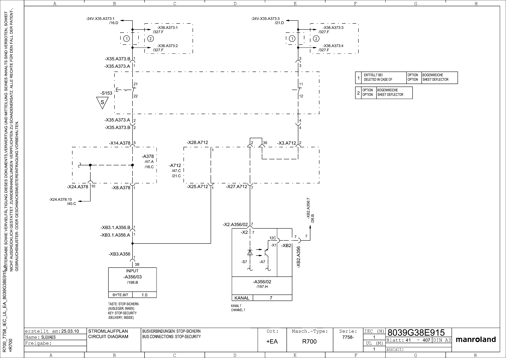

# +EA — Sheet 41 of 407 — BUSVERBINDUNGEN: STOP SICHERN

**BUS CONNECTIONS: STOP SECURITY**

> Part of the manroland **R700** printing press IEC/UL circuit diagrams.
> Drawing class: **Stromlaufplan / Circuit diagram** (DIN A3).
> Document `+EA` covers the **Printing unit** machine section.

## At a glance

| Field | Value |
|---|---|
| Document | `+EA`  (8039G38E915) |
| Sheet | **41** of 407 |
| Section (DE) | BUSVERBINDUNGEN: STOP SICHERN |
| Section (EN) | BUS CONNECTIONS: STOP SECURITY |
| Section type | CIRCUIT — Circuit diagram |
| Machine type | `R700` |
| Series | `7758` |
| Created | 25.03.10 |
| Replaces | — |
| Columns used | A, B, C, D, E, F, G |
| Path numbers | — |
| Labels on sheet | 106 |
| Cross-refs out | 14 |
| Cross-refs in | 36 |

**Previous:** [+EA sheet 40](SHEET_0040.md) · **Next:** [+EA sheet 42](SHEET_0042.md) · **Document TOC:** [_TOC.md](_TOC.md)  (+EA) · **Master TOC:** [all sheets](../_MASTER_TOC.md)

## Sheet image (300 DPI, exact vector render)



_Rendered directly from the PDF vector layer at 300 DPI (1-bit), no OCR and no resampling. Use it to confirm anything ambiguous in the text below._

## Cross-references on this sheet

Each entry is a wire leaving this sheet. The printed token is `/sheet.column`; the link resolves to that sheet inside the same document.

| Ref | Target sheet | Col | Path | Destination on target | Target section | From col |
|---|---|---|---|---|---|---|
| `/16.D` | [+EA sheet 16](SHEET_0016.md) | D | — | 24V.X35.A373:1 24V.X35.A373:3 | SPANNUNGSVERSORGUNG: 400V, 24V | C |
| `/21.D` | [+EA sheet 21](SHEET_0021.md) | D | — | 24V.X35.A373:1 24V.X35.A373:3 | SPANNUNGSVERSORGUNG: 400V, 24V | C |
| `/327.F` | [+EA sheet 327](SHEET_0327.md) | F | — | — | OPTION: BOGENWEICHE | C |
| `/327.F` | [+EA sheet 327](SHEET_0327.md) | F | — | — | OPTION: BOGENWEICHE | E |
| `/327.F` | [+EA sheet 327](SHEET_0327.md) | F | — | — | OPTION: BOGENWEICHE | C |
| `/327.F` | [+EA sheet 327](SHEET_0327.md) | F | — | — | OPTION: BOGENWEICHE | E |
| `/47.A` | [+EA sheet 47](SHEET_0047.md) | A | — | — | SCHUTZ | C |
| `/16.C` | [+EA sheet 16](SHEET_0016.md) | C | — | — | SPANNUNGSVERSORGUNG: 400V, 24V | C |
| `/47.C` | [+EA sheet 47](SHEET_0047.md) | C | — | — | SCHUTZ | C |
| `/21.C` | [+EA sheet 21](SHEET_0021.md) | C | — | — | SPANNUNGSVERSORGUNG: 400V, 24V | C |
| `/26.B` | [+EA sheet 26](SHEET_0026.md) | B | — | XB2.A356:7 | BUSVERBINDUNGEN: SICHERHEITSBUS | E |
| `/40.C` | [+EA sheet 40](SHEET_0040.md) | C | — | X24.A378:10 | BUSVERBINDUNGEN: STOP SICHERN | A |
| `/198.B` | [+EA sheet 198](SHEET_0198.md) | B | — | — | REFERENZMODUL | B |
| `/197.H` | [+EA sheet 197](SHEET_0197.md) | H | — | — | REFERENZMODUL | D |

### Incoming references (sheets that point here)

Every other sheet that sends a wire to this one. `Back-ref` is the token printed on *that* sheet; `Path` is its line number.

| From sheet | Cols | Back-ref | Path | Refs | What continues there |
|---|---|---|---|---|---|
| [+EA#16](SHEET_0016.md) | C, D | `/16.C`, `/16.D` | — | 2 | 24V.X35.A373:1 |
| [+EA#21](SHEET_0021.md) | C, D | `/21.C`, `/21.D` | — | 2 | 24V.X35.A373:3 |
| [+EA#26](SHEET_0026.md) | B | `/26.B` | — | 1 | XB2.A356:7 |
| [+EA#40](SHEET_0040.md) | C | `/40.C` | — | 1 | — |
| [+EA#47](SHEET_0047.md) | A, C | `/47.A`, `/47.C` | — | 2 | — |
| [+EA#197](SHEET_0197.md) | H | `/197.H` | — | 1 | — |
| [+EA#198](SHEET_0198.md) | B | `/198.B` | — | 1 | — |
| [+EA#225](SHEET_0225.md) | F | `/225.F` | — | 1 | — |
| [+EA#226](SHEET_0226.md) | E | `/226.E` | — | 1 | — |
| [+EA#234](SHEET_0234.md) | H | `/234.H` | — | 1 | — |
| [+EA#235](SHEET_0235.md) | A, B, G | `/235.A`, `/235.B`, `/235.G` | — | 3 | — |
| [+EA#250](SHEET_0250.md) | D | `/250.D` | — | 1 | — |
| [+EA#260](SHEET_0260.md) | A | `/260.A` | — | 1 | — |
| [+EA#266](SHEET_0266.md) | F | `/266.F` | — | 1 | — |
| [+EA#268](SHEET_0268.md) | F | `/268.F` | — | 1 | — |
| [+EA#271](SHEET_0271.md) | G | `/271.G` | — | 1 | — |
| [+EA#273](SHEET_0273.md) | C, D | `/273.C`, `/273.D` | — | 3 | — |
| [+EA#278](SHEET_0278.md) | F, G | `/278.F`, `/278.G` | — | 8 | — |
| [+EA#327](SHEET_0327.md) | E, F | `/327.E`, `/327.F` | — | 4 | X36.A373:1; X36.A373:2; X36.A373:3; X36.A373:4 |


## Devices on this sheet

| Tag | Class | Class meaning (IEC) | Col | Sub | Terminal | Sign |
|---|---|---|---|---|---|---|
| `A378` | A | Baugruppe / assembly, module, PC board | C | — | — | — |
| `A356/03` | A | Baugruppe / assembly, module, PC board | B | 03 | — | — |
| `S153` | S | Schalter / switch | B | — | — | — |
| `S7` | S | Schalter / switch | D | — | — | — |
| `A7` | A | Baugruppe / assembly, module, PC board | D | — | — | — |
| `X1` | X | Klemme / terminal, plug connector | E | — | — | — |
| `X2` | X | Klemme / terminal, plug connector | D | — | — | — |
| `XB2` | XB |  | E | — | — | — |
| `A356/02` | A | Baugruppe / assembly, module, PC board | D | 02 | — | — |
| `A712` | A | Baugruppe / assembly, module, PC board | C | — | — | — |
| `X14.A378` | — | cross-device reference | B | — | — | — |
| `X8.A378` | — | cross-device reference | B | — | — | — |
| `X24.A378` | — | cross-device reference | A | — | — | — |
| `1.0` | — | cross-device reference | B | — | — | — |
| `XB3.A356` | — | cross-device reference | B | — | — | — |
| `XB3.1.A356.B` | — | cross-device reference | B | — | — | — |
| `XB3.1.A356.A` | — | cross-device reference | B | — | — | — |
| `X35.A373.B` | — | cross-device reference | B | — | — | — |
| `X35.A373.A` | — | cross-device reference | B | — | — | — |
| `X35.A373.B` | — | cross-device reference | B | — | — | — |
| `X35.A373.A` | — | cross-device reference | B | — | — | — |
| `XB2.A356` | — | cross-device reference | E | — | — | — |
| `X27.A712` | — | cross-device reference | D | — | — | — |
| `X25.A712` | — | cross-device reference | C | — | — | — |
| `X3.A712` | — | cross-device reference | E | — | — | — |
| `XB2.A356:7` | — | cross-device reference | E | — | 7 | — |
| `X36.A373:1` | — | cross-device reference | C | — | 1 | — |
| `X36.A373:2` | — | cross-device reference | C | — | 2 | — |
| `X36.A373:4` | — | cross-device reference | F | — | 4 | — |
| `X36.A373:3` | — | cross-device reference | F | — | 3 | — |
| `X24.A378:10` | — | cross-device reference | A | — | 10 | — |
| `X28.A712` | — | cross-device reference | C | — | — | — |

## Potentials / nets

| Potential | Count | Columns | Attached devices | Terminals |
|---|---|---|---|---|
| `24V` | 2 | B, E | `A373`, `X35` | `1`, `3` |


A potential such as `L24+/4` or `M24+` is a named supply/return rail; every place it appears on this sheet is electrically common.

## Wire-end annotations (grouped as printed)

A wire that continues elsewhere is annotated with a small cluster: the destination description, the path/line number `#NN`, and the `/sheet.column` cross reference. Each row below is one such cluster exactly as it is grouped on the drawing.

| Col | Y | Path | Cross-ref | Text on the wire |
|---|---|---|---|---|
| C | 40.0 | — | `/16.D`, `/21.D` | `24V.X35.A373:1 24V.X35.A373:3` |
| C | 61.2 | — | — | `X36.A373:1` |
| F | 61.2 | — | — | `X36.A373:3` |
| C | 71.1 | — | `/327.F` | — |
| E | 71.1 | — | `/327.F` | — |
| B | 87.7 | — | — | `1 2` |
| E | 87.7 | — | — | `1 2` |
| C | 103.8 | — | — | `X36.A373:2` |
| F | 103.8 | — | — | `X36.A373:4` |
| C | 113.7 | — | `/327.F` | — |
| E | 113.7 | — | `/327.F` | — |
| B | 133.5 | — | — | `X35.A373.B 1` |
| E | 133.6 | — | — | `3` |
| B | 150.6 | — | — | `X35.A373.A 1` |
| E | 150.6 | — | — | `3` |
| F | 173.5 | — | — | `1 ENTFÄLLT BEI DELETED IN CASE OF` |
| G | 173.5 | — | — | `OPTION OPTION` |
| G | 173.5 | — | — | `BOGENWEICHE` |
| G | 184.2 | — | — | `SHEET DEFLECTOR` |
| B | 193.8 | — | — | `21` |
| E | 193.8 | — | — | `11` |
| F | 208.9 | — | — | `2 OPTION OPTION` |
| G | 208.9 | — | — | `BOGENWEICHE` |
| B | 214.3 | — | — | `S153` |
| G | 219.6 | — | — | `SHEET DEFLECTOR` |
| B | 222.1 | — | — | `22` |
| E | 222.1 | — | — | `12` |
| B | 234.9 | — | — | `S` |
| B | 277.4 | — | — | `X35.A373.A 2` |
| E | 279.5 | — | — | `4` |
| B | 295.1 | — | — | `X35.A373.B 2` |
| E | 296.5 | — | — | `4` |
| C | 330.5 | — | — | `X28.A712` |
| B | 332.0 | — | — | `X14.A378 5` |
| D | 332.0 | — | — | `2` |
| E | 332.0 | — | — | `35 X3.A712 2` |
| D | 349.0 | — | — | `1` |
| C | 363.1 | — | — | `A378` |
| C | 376.2 | — | `/47.A`, `/16.C` | — |
| C | 384.4 | — | — | `A712` |
| C | 397.5 | — | `/47.C`, `/21.C` | — |
| B | 434.0 | — | — | `X24.A378 10 X8.A378 1` |
| D | 434.0 | — | — | `X25.A712 1 X27.A712 7` |
| E | 464.9 | — | `/26.B` | `XB2.A356:7` |
| A | 465.2 | — | `/40.C` | `X24.A378:10` |
| D | 523.3 | — | — | `X2.A356/02 7` |
| B | 530.4 | — | — | `XB3.1.A356.B 1` |
| D | 541.7 | — | — | `X2` |
| E | 543.2 | — | — | `7 7` |
| B | 547.4 | — | — | `XB3.1.A356.A 1` |
| E | 551.7 | — | — | `7` |
| E | 555.9 | — | — | `12C` |
| E | 572.9 | — | — | `X1` |
| E | 572.9 | — | — | `XB2` |
| E | 579.1 | — | — | `XB2.A356` |
| B | 592.8 | — | — | `XB3.A356 1` |
| D | 611.9 | — | — | `S7 A7` |
| B | 618.2 | — | — | `3B` |
| B | 632.8 | — | — | `INPUT` |
| B | 646.6 | — | — | `A356/03` |
| D | 657.9 | — | — | `A356/02` |
| B | 660.4 | — | `/198.B` | — |
| D | 670.3 | — | `/197.H` | — |
| B | 689.4 | — | — | `BYTE.BIT 1.0` |
| D | 696.2 | — | — | `KANAL 7` |
| B | 712.1 | — | — | `KEY: STOP SECURITY (AUSLEGER, INNEN) TASTE: STOP SICHERN` |
| D | 716.5 | — | — | `KANAL 7 CHANNEL 7` |
| B | 744.0 | — | — | `/DELIVERY, INSIDE)` |


## Reconstructed tables

This sheet carries tabular content (pin map / terminal assignment / index). The grid below was rebuilt from the drawing's own rule lines, so each row is exactly one physical row of the table.

### Table 1 — 3 data rows × 3 columns (at x=212.6, y=388.3)

| 10 | X8.A378 XB3.1.A356.B XB3.1.A356.A | /16.C 1 1 1 |
|---|---|---|
|  | `XB3.A356` | `1 3B` |
|  | `INPUT` | `A356/03 /198.B` |
|  | `BYTE.BIT` | `1.0` |


### Table 2 — 4 data rows × 7 columns (at x=496.1, y=374.2)

| 1 | X27.A712 X2.A356/02 | 7 7 |  |  |  | XB2.A356:7 |
|---|---|---|---|---|---|---|
|  | `X2` | `7` | `12C` |  | `7` | `7` |
|  | `S7` | `A7` | `X1` | `XB2` |  | `XB2.A356` |
|  |  | `A356/02 /197.H` |  |  |  |  |
|  | `KANAL` |  | `7` |  |  |  |


## Notes and free text on this sheet

| Text | Col | Y (pt) |
|---|---|---|
| `3B` | B | 618.22 |
| `INPUT` | B | 632.76 |
| `BYTE.BIT` | B | 690.01 |
| `TASTE: STOP SICHERN` | B | 712.11 |
| `(AUSLEGER, INNEN)` | B | 722.76 |
| `KEY: STOP SECURITY` | B | 733.37 |
| `/DELIVERY, INSIDE)` | B | 744.01 |
| `KANAL 7` | D | 716.53 |
| `CHANNEL 7` | D | 726.47 |
| `12C` | E | 555.92 |
| `KANAL` | D | 696.2 |
| `X2.A356/02` | D | 523.3 |
| `S` | B | 234.95 |
| `ENTFÄLLT BEI` | F | 173.5 |
| `DELETED IN CASE OF` | F | 184.16 |
| `OPTION` | G | 173.51 |
| `BOGENWEICHE` | G | 173.49 |
| `SHEET DEFLECTOR` | G | 184.18 |
| `OPTION` | F | 208.94 |

## Complete label inventory (exact text from the drawing)

Every text object inside the drawing area of this sheet, in DIN reading order (column A→H, then top→bottom). This is the authoritative list: if a string is not here it is not printed on this sheet.

| Col | Y | X | Dir | Type | Text |
|---|---|---|---|---|---|
| A | 434.7 | 157.3 | → | device ref | `X24.A378` |
| A | 465.2 | 115.4 | → | device ref | `X24.A378:10` |
| A | 475.1 | 157.9 | → | cross-reference | `/40.C` |
| B | 40.0 | 202.7 | → | potential | `24V.X35.A373:1` |
| B | 49.9 | 257.1 | → | cross-reference | `/16.D` |
| B | 87.7 | 295.9 | → | number | `1` |
| B | 133.5 | 246.6 | → | device ref | `X35.A373.B` |
| B | 133.6 | 313.8 | → | number | `1` |
| B | 150.6 | 313.8 | → | number | `1` |
| B | 151.3 | 245.8 | → | device ref | `X35.A373.A` |
| B | 193.8 | 314.4 | → | number | `21` |
| B | 214.3 | 235.8 | → | device tag | `S153` |
| B | 222.1 | 314.4 | → | number | `22` |
| B | 234.9 | 236.8 | → | text | `S` |
| B | 277.4 | 245.8 | → | device ref | `X35.A373.A` |
| B | 279.5 | 314.4 | → | number | `2` |
| B | 295.1 | 246.6 | → | device ref | `X35.A373.B` |
| B | 296.5 | 314.4 | → | number | `2` |
| B | 332.0 | 256.5 | → | device ref | `X14.A378` |
| B | 332.0 | 314.4 | → | number | `5` |
| B | 434.0 | 214.6 | → | number | `10` |
| B | 436.8 | 262.5 | → | device ref | `X8.A378` |
| B | 438.3 | 313.8 | → | number | `1` |
| B | 530.4 | 236.7 | → | device ref | `XB3.1.A356.B` |
| B | 530.4 | 313.8 | → | number | `1` |
| B | 547.4 | 313.8 | → | number | `1` |
| B | 548.1 | 235.8 | → | device ref | `XB3.1.A356.A` |
| B | 592.7 | 255.4 | → | device ref | `XB3.A356` |
| B | 601.3 | 313.8 | → | number | `1` |
| B | 618.2 | 317.2 | → | text | `3B` |
| B | 632.8 | 296.9 | → | text | `INPUT` |
| B | 646.6 | 290.4 | → | device tag | `A356/03` |
| B | 660.4 | 299.2 | → | cross-reference | `/198.B` |
| B | 689.4 | 333.1 | → | device ref | `1.0` |
| B | 690.0 | 265.0 | → | text | `BYTE.BIT` |
| B | 712.1 | 254.8 | → | text | `TASTE: STOP SICHERN` |
| B | 722.8 | 254.6 | → | text | `(AUSLEGER, INNEN)` |
| B | 733.4 | 254.3 | → | text | `KEY: STOP SECURITY` |
| B | 744.0 | 255.1 | → | text | `/DELIVERY, INSIDE)` |
| C | 61.2 | 369.6 | → | device ref | `X36.A373:1` |
| C | 71.1 | 360.0 | → | cross-reference | `/327.F` |
| C | 88.2 | 352.3 | → | number | `2` |
| C | 103.7 | 369.6 | → | device ref | `X36.A373:2` |
| C | 113.7 | 360.0 | → | cross-reference | `/327.F` |
| C | 330.5 | 439.4 | → | device ref | `X28.A712` |
| C | 363.1 | 333.6 | → | device tag | `A378` |
| C | 376.2 | 340.7 | → | cross-reference | `/47.A` |
| C | 384.4 | 397.4 | → | device tag | `A712` |
| C | 388.6 | 340.7 | → | cross-reference | `/16.C` |
| C | 397.5 | 404.5 | → | cross-reference | `/47.C` |
| C | 409.9 | 404.5 | → | cross-reference | `/21.C` |
| C | 434.0 | 439.4 | → | device ref | `X25.A712` |
| D | 332.0 | 590.7 | → | number | `2` |
| D | 349.0 | 498.0 | → | number | `1` |
| D | 434.0 | 531.5 | → | device ref | `X27.A712` |
| D | 438.3 | 498.0 | → | number | `1` |
| D | 438.3 | 590.7 | → | number | `7` |
| D | 523.3 | 524.1 | → | text | `X2.A356/02` |
| D | 523.3 | 590.7 | → | number | `7` |
| D | 541.7 | 566.6 | → | device tag | `X2` |
| D | 543.2 | 593.6 | → | number | `7` |
| D | 611.9 | 567.8 | → | device tag | `S7` |
| D | 611.9 | 610.3 | → | device tag | `A7` |
| D | 657.9 | 595.1 | → | device tag | `A356/02` |
| D | 670.3 | 604.1 | → | cross-reference | `/197.H` |
| D | 696.2 | 551.9 | → | text | `KANAL` |
| D | 716.5 | 543.7 | → | text | `KANAL 7` |
| D | 726.5 | 544.0 | → | text | `CHANNEL 7` |
| E | 40.0 | 591.0 | → | potential | `24V.X35.A373:3` |
| E | 49.9 | 646.9 | → | cross-reference | `/21.D` |
| E | 71.1 | 749.8 | → | cross-reference | `/327.F` |
| E | 87.7 | 685.6 | → | number | `1` |
| E | 88.2 | 742.1 | → | number | `2` |
| E | 113.7 | 749.8 | → | cross-reference | `/327.F` |
| E | 133.6 | 704.1 | → | number | `3` |
| E | 150.6 | 704.1 | → | number | `3` |
| E | 193.8 | 703.6 | → | number | `11` |
| E | 222.1 | 703.6 | → | number | `12` |
| E | 279.5 | 704.1 | → | number | `4` |
| E | 296.5 | 704.1 | → | number | `4` |
| E | 332.0 | 619.1 | → | number | `35` |
| E | 332.0 | 652.3 | → | device ref | `X3.A712` |
| E | 332.0 | 704.1 | → | number | `2` |
| E | 464.9 | 721.7 | ↕ | device ref | `XB2.A356:7` |
| E | 503.7 | 731.6 | ↕ | cross-reference | `/26.B` |
| E | 551.7 | 718.3 | → | number | `7` |
| E | 553.1 | 692.8 | → | number | `7` |
| E | 555.9 | 633.5 | → | text | `12C` |
| E | 572.9 | 637.2 | → | device tag | `X1` |
| E | 572.9 | 661.6 | → | device tag | `XB2` |
| E | 579.1 | 697.6 | ↕ | device ref | `XB2.A356` |
| E | 696.2 | 635.0 | → | number | `7` |
| F | 61.2 | 759.4 | → | device ref | `X36.A373:3` |
| F | 103.7 | 759.4 | → | device ref | `X36.A373:4` |
| F | 173.5 | 856.6 | → | text | `ENTFÄLLT BEI` |
| F | 178.9 | 840.8 | → | number | `1` |
| F | 184.2 | 856.6 | → | text | `DELETED IN CASE OF` |
| F | 208.9 | 852.9 | → | text | `OPTION` |
| F | 214.3 | 840.5 | → | number | `2` |
| F | 219.6 | 852.9 | → | text | `OPTION` |
| G | 173.5 | 959.2 | → | text | `OPTION` |
| G | 173.5 | 994.1 | → | text | `BOGENWEICHE` |
| G | 184.1 | 959.2 | → | text | `OPTION` |
| G | 184.2 | 994.7 | → | text | `SHEET DEFLECTOR` |
| G | 208.9 | 887.8 | → | text | `BOGENWEICHE` |
| G | 219.6 | 888.4 | → | text | `SHEET DEFLECTOR` |

## Reading-order text block

The same content as a plain block, grouped by DIN column — convenient to paste or to match against a visual description.

```text
=== Column A ===
 434.7  157.3  devref       X24.A378
 465.2  115.4  devref       X24.A378:10
 475.1  157.9  xref         /40.C
=== Column B ===
  40.0  202.7  net          24V.X35.A373:1
  49.9  257.1  xref         /16.D
  87.7  295.9  numeric      1
 133.5  246.6  devref       X35.A373.B
 133.6  313.8  numeric      1
 150.6  313.8  numeric      1
 151.3  245.8  devref       X35.A373.A
 193.8  314.4  numeric      21
 214.3  235.8  devtag       S153
 222.1  314.4  numeric      22
 234.9  236.8  text         S
 277.4  245.8  devref       X35.A373.A
 279.5  314.4  numeric      2
 295.1  246.6  devref       X35.A373.B
 296.5  314.4  numeric      2
 332.0  256.5  devref       X14.A378
 332.0  314.4  numeric      5
 434.0  214.6  numeric      10
 436.8  262.5  devref       X8.A378
 438.3  313.8  numeric      1
 530.4  236.7  devref       XB3.1.A356.B
 530.4  313.8  numeric      1
 547.4  313.8  numeric      1
 548.1  235.8  devref       XB3.1.A356.A
 592.7  255.4  devref       XB3.A356
 601.3  313.8  numeric      1
 618.2  317.2  text         3B
 632.8  296.9  text         INPUT
 646.6  290.4  devtag       A356/03
 660.4  299.2  xref         /198.B
 689.4  333.1  devref       1.0
 690.0  265.0  text         BYTE.BIT
 712.1  254.8  text         TASTE: STOP SICHERN
 722.8  254.6  text         (AUSLEGER, INNEN)
 733.4  254.3  text         KEY: STOP SECURITY
 744.0  255.1  text         /DELIVERY, INSIDE)
=== Column C ===
  61.2  369.6  devref       X36.A373:1
  71.1  360.0  xref         /327.F
  88.2  352.3  numeric      2
 103.7  369.6  devref       X36.A373:2
 113.7  360.0  xref         /327.F
 330.5  439.4  devref       X28.A712
 363.1  333.6  devtag       A378
 376.2  340.7  xref         /47.A
 384.4  397.4  devtag       A712
 388.6  340.7  xref         /16.C
 397.5  404.5  xref         /47.C
 409.9  404.5  xref         /21.C
 434.0  439.4  devref       X25.A712
=== Column D ===
 332.0  590.7  numeric      2
 349.0  498.0  numeric      1
 434.0  531.5  devref       X27.A712
 438.3  498.0  numeric      1
 438.3  590.7  numeric      7
 523.3  524.1  text         X2.A356/02
 523.3  590.7  numeric      7
 541.7  566.6  devtag       X2
 543.2  593.6  numeric      7
 611.9  567.8  devtag       S7
 611.9  610.3  devtag       A7
 657.9  595.1  devtag       A356/02
 670.3  604.1  xref         /197.H
 696.2  551.9  text         KANAL
 716.5  543.7  text         KANAL 7
 726.5  544.0  text         CHANNEL 7
=== Column E ===
  40.0  591.0  net          24V.X35.A373:3
  49.9  646.9  xref         /21.D
  71.1  749.8  xref         /327.F
  87.7  685.6  numeric      1
  88.2  742.1  numeric      2
 113.7  749.8  xref         /327.F
 133.6  704.1  numeric      3
 150.6  704.1  numeric      3
 193.8  703.6  numeric      11
 222.1  703.6  numeric      12
 279.5  704.1  numeric      4
 296.5  704.1  numeric      4
 332.0  619.1  numeric      35
 332.0  652.3  devref       X3.A712
 332.0  704.1  numeric      2
 464.9  721.7  devref       XB2.A356:7
 503.7  731.6  xref         /26.B
 551.7  718.3  numeric      7
 553.1  692.8  numeric      7
 555.9  633.5  text         12C
 572.9  637.2  devtag       X1
 572.9  661.6  devtag       XB2
 579.1  697.6  devref       XB2.A356
 696.2  635.0  numeric      7
=== Column F ===
  61.2  759.4  devref       X36.A373:3
 103.7  759.4  devref       X36.A373:4
 173.5  856.6  text         ENTFÄLLT BEI
 178.9  840.8  numeric      1
 184.2  856.6  text         DELETED IN CASE OF
 208.9  852.9  text         OPTION
 214.3  840.5  numeric      2
 219.6  852.9  text         OPTION
=== Column G ===
 173.5  959.2  text         OPTION
 173.5  994.1  text         BOGENWEICHE
 184.1  959.2  text         OPTION
 184.2  994.7  text         SHEET DEFLECTOR
 208.9  887.8  text         BOGENWEICHE
 219.6  888.4  text         SHEET DEFLECTOR
```

---
_Generated from the PDF vector text layer; no OCR. Source: `R700_7758_IEC_UL_EA_8039G38E915_p`, sheet 41._
