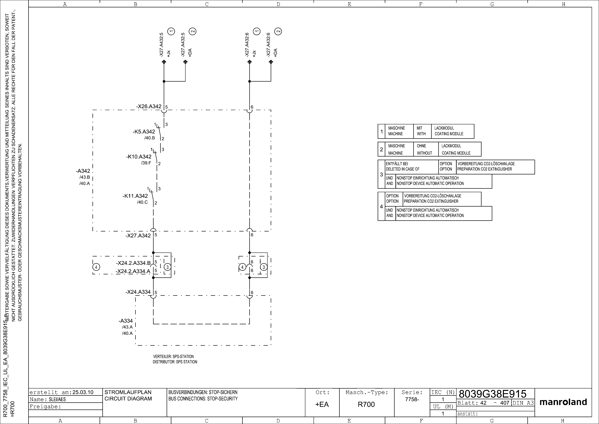

# +EA — Sheet 42 of 407 — BUSVERBINDUNGEN: STOP SICHERN

**BUS CONNECTIONS: STOP SECURITY**

> Part of the manroland **R700** printing press IEC/UL circuit diagrams.
> Drawing class: **Stromlaufplan / Circuit diagram** (DIN A3).
> Document `+EA` covers the **Printing unit** machine section.

## At a glance

| Field | Value |
|---|---|
| Document | `+EA`  (8039G38E915) |
| Sheet | **42** of 407 |
| Section (DE) | BUSVERBINDUNGEN: STOP SICHERN |
| Section (EN) | BUS CONNECTIONS: STOP SECURITY |
| Section type | CIRCUIT — Circuit diagram |
| Machine type | `R700` |
| Series | `7758` |
| Created | 25.03.10 |
| Replaces | — |
| Columns used | A, B, C, D, E, F, G |
| Path numbers | — |
| Labels on sheet | 88 |
| Cross-refs out | 7 |
| Cross-refs in | 17 |

**Previous:** [+EA sheet 41](SHEET_0041.md) · **Next:** [+EA sheet 43](SHEET_0043.md) · **Document TOC:** [_TOC.md](_TOC.md)  (+EA) · **Master TOC:** [all sheets](../_MASTER_TOC.md)

## Sheet image (300 DPI, exact vector render)



_Rendered directly from the PDF vector layer at 300 DPI (1-bit), no OCR and no resampling. Use it to confirm anything ambiguous in the text below._

## Cross-references on this sheet

Each entry is a wire leaving this sheet. The printed token is `/sheet.column`; the link resolves to that sheet inside the same document.

| Ref | Target sheet | Col | Path | Destination on target | Target section | From col |
|---|---|---|---|---|---|---|
| `/40.B` | [+EA sheet 40](SHEET_0040.md) | B | — | — | BUSVERBINDUNGEN: STOP SICHERN | B |
| `/39.F` | [+EA sheet 39](SHEET_0039.md) | F | — | — | BUSVERBINDUNGEN: STOP SICHERN | B |
| `/43.B` | [+EA sheet 43](SHEET_0043.md) | B | — | — | BUSVERBINDUNGEN: SIGNALSCHLEIFE | A |
| `/40.A` | [+EA sheet 40](SHEET_0040.md) | A | — | — | BUSVERBINDUNGEN: STOP SICHERN | A |
| `/40.C` | [+EA sheet 40](SHEET_0040.md) | C | — | — | BUSVERBINDUNGEN: STOP SICHERN | B |
| `/43.A` | [+EA sheet 43](SHEET_0043.md) | A | — | — | BUSVERBINDUNGEN: SIGNALSCHLEIFE | B |
| `/40.A` | [+EA sheet 40](SHEET_0040.md) | A | — | — | BUSVERBINDUNGEN: STOP SICHERN | B |

### Incoming references (sheets that point here)

Every other sheet that sends a wire to this one. `Back-ref` is the token printed on *that* sheet; `Path` is its line number.

| From sheet | Cols | Back-ref | Path | Refs | What continues there |
|---|---|---|---|---|---|
| [+EA#39](SHEET_0039.md) | F | `/39.F` | — | 1 | — |
| [+EA#40](SHEET_0040.md) | A, B, C | `/40.A`, `/40.B`, `/40.C` | — | 4 | — |
| [+EA#43](SHEET_0043.md) | A, B | `/43.A`, `/43.B` | — | 2 | — |
| [+EA#265](SHEET_0265.md) | F | `/265.F` | — | 2 | — |
| [+EA#266](SHEET_0266.md) | B, D | `/266.B`, `/266.D` | — | 4 | — |
| [+EA#269](SHEET_0269.md) | C | `/269.C` | — | 2 | — |
| [+EA#270](SHEET_0270.md) | G | `/270.G` | — | 2 | — |


## Devices on this sheet

| Tag | Class | Class meaning (IEC) | Col | Sub | Terminal | Sign |
|---|---|---|---|---|---|---|
| `A342` | A | Baugruppe / assembly, module, PC board | A | — | — | — |
| `A334` | A | Baugruppe / assembly, module, PC board | B | — | — | — |
| `X26.A342` | — | cross-device reference | B | — | — | — |
| `K5.A342` | — | cross-device reference | B | — | — | — |
| `K10.A342` | — | cross-device reference | B | — | — | — |
| `K11.A342` | — | cross-device reference | B | — | — | — |
| `X27.A342` | — | cross-device reference | B | — | — | — |
| `X27.A432:5` | — | cross-device reference | B | — | 5 | — |
| `X27.A432:5` | — | cross-device reference | C | — | 5 | — |
| `X27.A432:6` | — | cross-device reference | D | — | 6 | — |
| `X27.A432:6` | — | cross-device reference | D | — | 6 | — |
| `X24.A334` | — | cross-device reference | B | — | — | — |
| `X24.2.A334.B` | — | cross-device reference | B | — | — | — |
| `X24.2.A334.A` | — | cross-device reference | B | — | — | — |

## Potentials / nets

_No named potentials on this sheet._

## Wire-end annotations (grouped as printed)

A wire that continues elsewhere is annotated with a small cluster: the destination description, the path/line number `#NN`, and the `/sheet.column` cross reference. Each row below is one such cluster exactly as it is grouped on the drawing.

| Col | Y | Path | Cross-ref | Text on the wire |
|---|---|---|---|---|
| C | 59.5 | — | — | `1` |
| D | 59.5 | — | — | `1` |
| C | 60.4 | — | — | `2` |
| D | 60.4 | — | — | `2` |
| B | 64.9 | — | — | `X27.A432:5` |
| C | 64.9 | — | — | `X27.A432:5` |
| D | 64.9 | — | — | `X27.A432:6` |
| D | 64.9 | — | — | `X27.A432:6` |
| C | 96.4 | — | — | `+DA` |
| D | 96.4 | — | — | `+DA` |
| B | 100.1 | — | — | `+Jx` |
| D | 100.1 | — | — | `+Jx` |
| C | 206.5 | — | — | `X26.A342 5 6` |
| B | 243.4 | — | — | `K5.A342 3` |
| B | 243.4 | — | — | `1` |
| F | 251.5 | — | — | `MASCHINE` |
| F | 251.5 | — | — | `MIT` |
| F | 251.5 | — | — | `LACKMODUL` |
| F | 256.8 | — | — | `1 COATING MODULE` |
| F | 262.7 | — | — | `WITH` |
| F | 262.8 | — | — | `MACHINE` |
| B | 269.9 | — | `/40.B` | — |
| B | 271.7 | — | — | `2` |
| F | 286.9 | — | — | `MASCHINE` |
| F | 286.9 | — | — | `OHNE` |
| F | 286.9 | — | — | `LACKMODUL` |
| F | 292.2 | — | — | `2 COATING MODULE` |
| B | 293.0 | — | — | `K10.A342 3` |
| B | 293.0 | — | — | `1` |
| F | 301.1 | — | — | `MACHINE` |
| F | 301.1 | — | — | `WITHOUT` |
| B | 319.5 | — | `/39.F` | — |
| B | 321.4 | — | — | `2` |
| F | 322.3 | — | — | `ENTFÄLLT BEI DELETED IN CASE OF` |
| F | 322.3 | — | — | `OPTION OPTION` |
| G | 322.4 | — | — | `PREPARATION CO2 EXTINGUISHER VORBEREITUNG CO2 LÖSCHANLAGE` |
| A | 334.8 | — | — | `A342` |
| E | 341.9 | — | — | `3` |
| A | 347.9 | — | `/43.B`, `/40.A` | — |
| F | 350.7 | — | — | `UND` |
| F | 350.7 | — | — | `NONSTOP EINRICHTUNG AUTOMATISCH NONSTOP DEVICE AUTOMATIC OPERATION` |
| F | 361.4 | — | — | `AND` |
| B | 370.9 | — | — | `K11.A342 3` |
| B | 370.9 | — | — | `1` |
| F | 386.1 | — | — | `OPTION OPTION` |
| F | 386.1 | — | — | `PREPARATION CO2 EXTINGUISHER VORBEREITUNG CO2 LÖSCHANLAGE` |
| B | 397.5 | — | `/40.C` | — |
| B | 399.3 | — | — | `2` |
| E | 405.6 | — | — | `4` |
| F | 414.5 | — | — | `UND` |
| F | 414.5 | — | — | `NONSTOP EINRICHTUNG AUTOMATISCH NONSTOP DEVICE AUTOMATIC OPERATION` |
| F | 425.1 | — | — | `AND` |
| C | 462.4 | — | — | `X27.A342 5 6` |
| B | 516.2 | — | — | `X24.2.A334.B 5` |
| D | 516.2 | — | — | `6` |
| C | 527.5 | — | — | `4 3 4 3` |
| B | 533.2 | — | — | `X24.2.A334.A 5` |
| D | 533.2 | — | — | `6` |
| C | 575.0 | — | — | `X24.A334 5 6` |
| B | 632.4 | — | — | `A334` |
| B | 645.5 | — | `/43.A`, `/40.A` | — |
| C | 705.0 | — | — | `DISTRIBUTOR: SPS STATION VERTEILER: SPS STATION` |


## Reconstructed tables

This sheet carries tabular content (pin map / terminal assignment / index). The grid below was rebuilt from the drawing's own rule lines, so each row is exactly one physical row of the table.

### Table 1 — 7 data rows × 16 columns (at x=204.1, y=0.0) — **X27.A432:5 +Jx 1 X27.A432:5 2 X27.A432:6 +DA 1 +Jx X27.A432:6 2 +DA**

| X26.A342 K5.A342 /40.B 1 K10.A342 /39.F 1 K11.A342 /40.C X27.A342 X24.2.A334.B X24.2.A334.A X24.A334 A334 | 1 2 5 5 5 5 | 2 3 | 2 3 | 5 3 | 3 |  | 4 | 6 6 6 3 6 6 |  |  |  | 1 2 ENTFÄLLT DELETED 3 UND AND OPTION OPTION 4 UND AND | MIT MASCHINE WITH MACHINE OHNE MASCHINE WITHOUT MACHINE BEI IN CASE OF NONSTOP EINRICHTUNG NONSTOP DEVICE VORBEREITUNG PREPARATION NONSTOP EINRICHTUNG NONSTOP DEVICE | LACKMODUL COATING LACKMODUL COATING OPTION OPTION AUTOMATISCH AUTOMATIC OPERATION CO2 LÖSCHANLAGE CO2 EXTINGUISHER AUTOMATISCH AUTOMATIC OPERATION | MODULE MODULE VORBEREITUNG CO2 LÖSCHANLAGE PREPARATION CO2 EXTINGUISHER |
|---|---|---|---|---|---|---|---|---|---|---|---|---|---|---|---|
| `/43.A /40.A` |  |  | `VERTEILER:` | `DISTRIBUTOR:` |  | `SPS STATION SPS` | `STATION` |  |  |  |  |  |  |  |  |
| `STROMLAUFPLAN` |  |  |  |  |  |  | `BUSVERBINDUNGEN: STOP SICHERN` |  |  |  | `Ort:` | `Masch. Type:` | `Serie:` | `IEC (N)` | `8039G38E915` |
| `CIRCUIT DIAGRAM` |  |  |  |  |  |  |  |  |  |  |  |  |  |  |  |
|  |  |  |  |  |  | `BUS` | `CONNECTIONS: STOP SECURITY` |  |  |  |  |  | `7758` | `1` |  |
|  |  |  |  |  |  |  |  |  |  |  | `+EA` | `R700` |  |  | `Blatt: DIN A3 42 407` |
|  |  |  |  |  |  |  |  |  |  |  |  |  |  | `UL (M)` |  |
|  |  |  |  |  |  |  |  |  |  |  |  |  |  | `1` | `anstatt:` |


## Notes and free text on this sheet

| Text | Col | Y (pt) |
|---|---|---|
| `+Jx` | B | 100.06 |
| `+DA` | C | 96.38 |
| `+Jx` | D | 100.06 |
| `+DA` | D | 96.38 |
| `VERTEILER: SPS STATION` | C | 705.02 |
| `DISTRIBUTOR: SPS STATION` | C | 715.65 |
| `MASCHINE` | F | 251.49 |
| `MACHINE` | F | 262.83 |
| `MIT` | F | 251.46 |
| `WITH` | F | 262.7 |
| `LACKMODUL` | F | 251.51 |
| `COATING MODULE` | F | 262.85 |
| `OHNE` | F | 286.92 |
| `WITHOUT` | F | 301.06 |
| `ENTFÄLLT BEI` | F | 322.32 |
| `DELETED IN CASE OF` | F | 332.98 |
| `OPTION` | F | 322.33 |
| `VORBEREITUNG CO2 LÖSCHANLAGE` | G | 322.38 |
| `PREPARATION CO2 EXTINGUISHER` | G | 332.99 |
| `UND` | F | 350.7 |
| `AND` | F | 361.35 |
| `NONSTOP EINRICHTUNG AUTOMATISCH` | F | 350.71 |
| `NONSTOP DEVICE AUTOMATIC OPERATION` | F | 361.34 |
| `VORBEREITUNG CO2 LÖSCHANLAGE` | F | 386.15 |
| `PREPARATION CO2 EXTINGUISHER` | F | 396.77 |

## Complete label inventory (exact text from the drawing)

Every text object inside the drawing area of this sheet, in DIN reading order (column A→H, then top→bottom). This is the authoritative list: if a string is not here it is not printed on this sheet.

| Col | Y | X | Dir | Type | Text |
|---|---|---|---|---|---|
| A | 334.8 | 150.8 | → | device tag | `A342` |
| A | 347.8 | 158.2 | → | cross-reference | `/43.B` |
| A | 360.2 | 157.9 | → | cross-reference | `/40.A` |
| A | 527.5 | 189.3 | → | number | `4` |
| B | 64.9 | 317.1 | ↕ | device ref | `X27.A432:5` |
| B | 100.1 | 331.3 | ↕ | text | `+Jx` |
| B | 206.5 | 270.7 | → | device ref | `X26.A342` |
| B | 208.7 | 328.5 | → | number | `5` |
| B | 243.4 | 305.9 | → | number | `1` |
| B | 243.4 | 328.5 | → | number | `3` |
| B | 256.8 | 263.9 | → | device ref | `K5.A342` |
| B | 269.9 | 287.1 | → | cross-reference | `/40.B` |
| B | 271.7 | 321.4 | → | number | `2` |
| B | 293.0 | 298.8 | → | number | `1` |
| B | 293.0 | 321.4 | → | number | `3` |
| B | 306.4 | 250.9 | → | device ref | `K10.A342` |
| B | 319.5 | 280.6 | → | cross-reference | `/39.F` |
| B | 321.3 | 314.4 | → | number | `2` |
| B | 371.0 | 291.7 | → | number | `1` |
| B | 371.0 | 314.4 | → | number | `3` |
| B | 384.4 | 243.8 | → | device ref | `K11.A342` |
| B | 397.5 | 272.7 | → | cross-reference | `/40.C` |
| B | 399.3 | 307.3 | → | number | `2` |
| B | 462.4 | 307.3 | → | number | `5` |
| B | 463.1 | 249.4 | → | device ref | `X27.A342` |
| B | 516.2 | 307.3 | → | number | `5` |
| B | 517.6 | 230.7 | → | device ref | `X24.2.A334.B` |
| B | 527.5 | 331.1 | → | number | `3` |
| B | 533.2 | 307.3 | → | number | `5` |
| B | 533.9 | 229.9 | → | device ref | `X24.2.A334.A` |
| B | 575.0 | 249.4 | → | device ref | `X24.A334` |
| B | 577.2 | 307.3 | → | number | `5` |
| B | 632.4 | 235.8 | → | device tag | `A334` |
| B | 645.5 | 242.9 | → | cross-reference | `/43.A` |
| B | 657.9 | 242.9 | → | cross-reference | `/40.A` |
| C | 59.5 | 337.1 | ↕ | number | `1` |
| C | 60.4 | 380.1 | ↕ | number | `2` |
| C | 64.9 | 359.6 | ↕ | device ref | `X27.A432:5` |
| C | 96.4 | 373.8 | ↕ | text | `+DA` |
| C | 527.5 | 479.9 | → | number | `4` |
| C | 705.0 | 304.7 | → | text | `VERTEILER: SPS STATION` |
| C | 715.6 | 303.9 | → | text | `DISTRIBUTOR: SPS STATION` |
| D | 59.5 | 507.2 | ↕ | number | `1` |
| D | 60.4 | 550.2 | ↕ | number | `2` |
| D | 64.9 | 487.1 | ↕ | device ref | `X27.A432:6` |
| D | 64.9 | 529.7 | ↕ | device ref | `X27.A432:6` |
| D | 96.4 | 543.8 | ↕ | text | `+DA` |
| D | 100.1 | 501.4 | ↕ | text | `+Jx` |
| D | 208.7 | 498.6 | → | number | `6` |
| D | 462.4 | 498.6 | → | number | `6` |
| D | 516.2 | 498.6 | → | number | `6` |
| D | 527.5 | 522.4 | → | number | `3` |
| D | 533.2 | 498.6 | → | number | `6` |
| D | 577.2 | 498.6 | → | number | `6` |
| E | 256.8 | 755.7 | → | number | `1` |
| E | 292.2 | 755.4 | → | number | `2` |
| E | 341.8 | 755.3 | → | number | `3` |
| E | 405.6 | 755.4 | → | number | `4` |
| F | 251.5 | 771.9 | → | text | `MASCHINE` |
| F | 251.5 | 828.6 | → | text | `MIT` |
| F | 251.5 | 863.7 | → | text | `LACKMODUL` |
| F | 262.7 | 829.1 | → | text | `WITH` |
| F | 262.8 | 771.9 | → | text | `MACHINE` |
| F | 262.8 | 864.3 | → | text | `COATING MODULE` |
| F | 286.9 | 771.9 | → | text | `MASCHINE` |
| F | 286.9 | 828.9 | → | text | `OHNE` |
| F | 286.9 | 877.9 | → | text | `LACKMODUL` |
| F | 301.1 | 771.9 | → | text | `MACHINE` |
| F | 301.1 | 829.1 | → | text | `WITHOUT` |
| F | 301.1 | 878.5 | → | text | `COATING MODULE` |
| F | 322.3 | 767.3 | → | text | `ENTFÄLLT BEI` |
| F | 322.3 | 874.2 | → | text | `OPTION` |
| F | 333.0 | 767.3 | → | text | `DELETED IN CASE OF` |
| F | 333.0 | 874.2 | → | text | `OPTION` |
| F | 350.7 | 767.3 | → | text | `UND` |
| F | 350.7 | 788.6 | → | text | `NONSTOP EINRICHTUNG AUTOMATISCH` |
| F | 361.3 | 788.6 | → | text | `NONSTOP DEVICE AUTOMATIC OPERATION` |
| F | 361.4 | 768.2 | → | text | `AND` |
| F | 386.1 | 767.9 | → | text | `OPTION` |
| F | 386.2 | 803.6 | → | text | `VORBEREITUNG CO2 LÖSCHANLAGE` |
| F | 396.7 | 767.9 | → | text | `OPTION` |
| F | 396.8 | 802.8 | → | text | `PREPARATION CO2 EXTINGUISHER` |
| F | 414.5 | 767.3 | → | text | `UND` |
| F | 414.5 | 788.6 | → | text | `NONSTOP EINRICHTUNG AUTOMATISCH` |
| F | 425.1 | 768.2 | → | text | `AND` |
| F | 425.1 | 788.6 | → | text | `NONSTOP DEVICE AUTOMATIC OPERATION` |
| G | 322.4 | 909.9 | → | text | `VORBEREITUNG CO2 LÖSCHANLAGE` |
| G | 333.0 | 909.1 | → | text | `PREPARATION CO2 EXTINGUISHER` |

## Reading-order text block

The same content as a plain block, grouped by DIN column — convenient to paste or to match against a visual description.

```text
=== Column A ===
 334.8  150.8  devtag       A342
 347.8  158.2  xref         /43.B
 360.2  157.9  xref         /40.A
 527.5  189.3  numeric      4
=== Column B ===
  64.9  317.1  devref       X27.A432:5
 100.1  331.3  text         +Jx
 206.5  270.7  devref       X26.A342
 208.7  328.5  numeric      5
 243.4  305.9  numeric      1
 243.4  328.5  numeric      3
 256.8  263.9  devref       K5.A342
 269.9  287.1  xref         /40.B
 271.7  321.4  numeric      2
 293.0  298.8  numeric      1
 293.0  321.4  numeric      3
 306.4  250.9  devref       K10.A342
 319.5  280.6  xref         /39.F
 321.3  314.4  numeric      2
 371.0  291.7  numeric      1
 371.0  314.4  numeric      3
 384.4  243.8  devref       K11.A342
 397.5  272.7  xref         /40.C
 399.3  307.3  numeric      2
 462.4  307.3  numeric      5
 463.1  249.4  devref       X27.A342
 516.2  307.3  numeric      5
 517.6  230.7  devref       X24.2.A334.B
 527.5  331.1  numeric      3
 533.2  307.3  numeric      5
 533.9  229.9  devref       X24.2.A334.A
 575.0  249.4  devref       X24.A334
 577.2  307.3  numeric      5
 632.4  235.8  devtag       A334
 645.5  242.9  xref         /43.A
 657.9  242.9  xref         /40.A
=== Column C ===
  59.5  337.1  numeric      1
  60.4  380.1  numeric      2
  64.9  359.6  devref       X27.A432:5
  96.4  373.8  text         +DA
 527.5  479.9  numeric      4
 705.0  304.7  text         VERTEILER: SPS STATION
 715.6  303.9  text         DISTRIBUTOR: SPS STATION
=== Column D ===
  59.5  507.2  numeric      1
  60.4  550.2  numeric      2
  64.9  487.1  devref       X27.A432:6
  64.9  529.7  devref       X27.A432:6
  96.4  543.8  text         +DA
 100.1  501.4  text         +Jx
 208.7  498.6  numeric      6
 462.4  498.6  numeric      6
 516.2  498.6  numeric      6
 527.5  522.4  numeric      3
 533.2  498.6  numeric      6
 577.2  498.6  numeric      6
=== Column E ===
 256.8  755.7  numeric      1
 292.2  755.4  numeric      2
 341.8  755.3  numeric      3
 405.6  755.4  numeric      4
=== Column F ===
 251.5  771.9  text         MASCHINE
 251.5  828.6  text         MIT
 251.5  863.7  text         LACKMODUL
 262.7  829.1  text         WITH
 262.8  771.9  text         MACHINE
 262.8  864.3  text         COATING MODULE
 286.9  771.9  text         MASCHINE
 286.9  828.9  text         OHNE
 286.9  877.9  text         LACKMODUL
 301.1  771.9  text         MACHINE
 301.1  829.1  text         WITHOUT
 301.1  878.5  text         COATING MODULE
 322.3  767.3  text         ENTFÄLLT BEI
 322.3  874.2  text         OPTION
 333.0  767.3  text         DELETED IN CASE OF
 333.0  874.2  text         OPTION
 350.7  767.3  text         UND
 350.7  788.6  text         NONSTOP EINRICHTUNG AUTOMATISCH
 361.3  788.6  text         NONSTOP DEVICE AUTOMATIC OPERATION
 361.4  768.2  text         AND
 386.1  767.9  text         OPTION
 386.2  803.6  text         VORBEREITUNG CO2 LÖSCHANLAGE
 396.7  767.9  text         OPTION
 396.8  802.8  text         PREPARATION CO2 EXTINGUISHER
 414.5  767.3  text         UND
 414.5  788.6  text         NONSTOP EINRICHTUNG AUTOMATISCH
 425.1  768.2  text         AND
 425.1  788.6  text         NONSTOP DEVICE AUTOMATIC OPERATION
=== Column G ===
 322.4  909.9  text         VORBEREITUNG CO2 LÖSCHANLAGE
 333.0  909.1  text         PREPARATION CO2 EXTINGUISHER
```

---
_Generated from the PDF vector text layer; no OCR. Source: `R700_7758_IEC_UL_EA_8039G38E915_p`, sheet 42._
