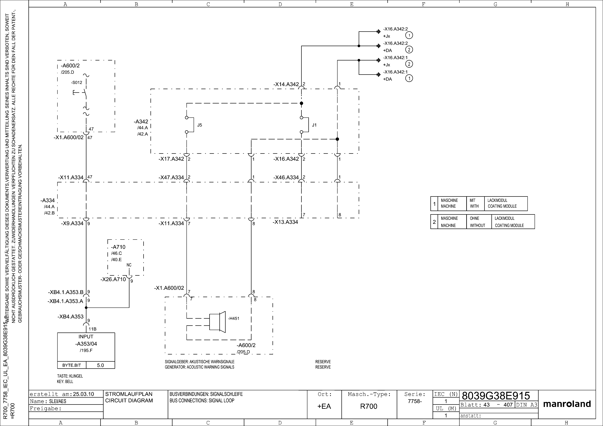

# +EA — Sheet 43 of 407 — BUSVERBINDUNGEN: SIGNALSCHLEIFE

**BUS CONNECTIONS: SIGNAL LOOP**

> Part of the manroland **R700** printing press IEC/UL circuit diagrams.
> Drawing class: **Stromlaufplan / Circuit diagram** (DIN A3).
> Document `+EA` covers the **Printing unit** machine section.

## At a glance

| Field | Value |
|---|---|
| Document | `+EA`  (8039G38E915) |
| Sheet | **43** of 407 |
| Section (DE) | BUSVERBINDUNGEN: SIGNALSCHLEIFE |
| Section (EN) | BUS CONNECTIONS: SIGNAL LOOP |
| Section type | CIRCUIT — Circuit diagram |
| Machine type | `R700` |
| Series | `7758` |
| Created | 25.03.10 |
| Replaces | — |
| Columns used | A, B, C, D, E, F, G |
| Path numbers | — |
| Labels on sheet | 97 |
| Cross-refs out | 9 |
| Cross-refs in | 32 |

**Previous:** [+EA sheet 42](SHEET_0042.md) · **Next:** [+EA sheet 44](SHEET_0044.md) · **Document TOC:** [_TOC.md](_TOC.md)  (+EA) · **Master TOC:** [all sheets](../_MASTER_TOC.md)

## Sheet image (300 DPI, exact vector render)



_Rendered directly from the PDF vector layer at 300 DPI (1-bit), no OCR and no resampling. Use it to confirm anything ambiguous in the text below._

## Cross-references on this sheet

Each entry is a wire leaving this sheet. The printed token is `/sheet.column`; the link resolves to that sheet inside the same document.

| Ref | Target sheet | Col | Path | Destination on target | Target section | From col |
|---|---|---|---|---|---|---|
| `/205.D` | [+EA sheet 205](SHEET_0205.md) | D | — | A600/2 | REFERENZMODUL | A |
| `/44.A` | [+EA sheet 44](SHEET_0044.md) | A | — | — | BUSVERBINDUNGEN: 20 mA SCHLEIFE | B |
| `/42.A` | [+EA sheet 42](SHEET_0042.md) | A | — | — | BUSVERBINDUNGEN: STOP SICHERN | B |
| `/44.A` | [+EA sheet 44](SHEET_0044.md) | A | — | — | BUSVERBINDUNGEN: 20 mA SCHLEIFE | A |
| `/42.B` | [+EA sheet 42](SHEET_0042.md) | B | — | — | BUSVERBINDUNGEN: STOP SICHERN | A |
| `/46.C` | [+EA sheet 46](SHEET_0046.md) | C | — | A710 | SCHUTZ | B |
| `/40.E` | [+EA sheet 40](SHEET_0040.md) | E | — | A710 | BUSVERBINDUNGEN: STOP SICHERN | B |
| `/205.D` | [+EA sheet 205](SHEET_0205.md) | D | — | A600/2 | REFERENZMODUL | D |
| `/195.F` | [+EA sheet 195](SHEET_0195.md) | F | — | — | REFERENZMODUL | A |

### Incoming references (sheets that point here)

Every other sheet that sends a wire to this one. `Back-ref` is the token printed on *that* sheet; `Path` is its line number.

| From sheet | Cols | Back-ref | Path | Refs | What continues there |
|---|---|---|---|---|---|
| [+EA#40](SHEET_0040.md) | E | `/40.E` | — | 1 | — |
| [+EA#42](SHEET_0042.md) | A, B | `/42.A`, `/42.B` | — | 2 | — |
| [+EA#44](SHEET_0044.md) | A | `/44.A` | — | 2 | — |
| [+EA#46](SHEET_0046.md) | C | `/46.C` | — | 1 | — |
| [+EA#195](SHEET_0195.md) | F | `/195.F` | — | 1 | — |
| [+EA#205](SHEET_0205.md) | D | `/205.D` | — | 2 | — |
| [+EA#212](SHEET_0212.md) | G, H | `/212.G`, `/212.H` | — | 3 | — |
| [+EA#237](SHEET_0237.md) | A, B, C | `/237.A`, `/237.B`, `/237.C` | — | 3 | — |
| [+EA#252](SHEET_0252.md) | A | `/252.A` | — | 1 | — |
| [+EA#255](SHEET_0255.md) | G, H | `/255.G`, `/255.H` | — | 3 | — |
| [+EA#258](SHEET_0258.md) | C | `/258.C` | — | 2 | — |
| [+EA#259](SHEET_0259.md) | D | `/259.D` | — | 2 | — |
| [+EA#261](SHEET_0261.md) | F | `/261.F` | — | 2 | — |
| [+EA#263](SHEET_0263.md) | A | `/263.A` | — | 2 | — |
| [+EA#270](SHEET_0270.md) | C | `/270.C` | — | 1 | — |
| [+EA#281](SHEET_0281.md) | H | `/281.H` | — | 2 | — |
| [+EA#282](SHEET_0282.md) | A | `/282.A` | — | 2 | — |


## Devices on this sheet

| Tag | Class | Class meaning (IEC) | Col | Sub | Terminal | Sign |
|---|---|---|---|---|---|---|
| `S012` | S | Schalter / switch | A | — | — | — |
| `A600/2` | A | Baugruppe / assembly, module, PC board | A | 2 | — | — |
| `A600/2` | A | Baugruppe / assembly, module, PC board | D | 2 | — | — |
| `A342` | A | Baugruppe / assembly, module, PC board | B | — | — | — |
| `A353/04` | A | Baugruppe / assembly, module, PC board | A | 04 | — | — |
| `A710` | A | Baugruppe / assembly, module, PC board | B | — | — | — |
| `A334` | A | Baugruppe / assembly, module, PC board | A | — | — | — |
| `J5` | J |  | C | — | — | — |
| `J1` | J |  | D | — | — | — |
| `X17.A342` | — | cross-device reference | B | — | — | — |
| `X16.A342` | — | cross-device reference | D | — | — | — |
| `X14.A342` | — | cross-device reference | D | — | — | — |
| `X16.A342:2` | — | cross-device reference | F | — | 2 | — |
| `X16.A342:2` | — | cross-device reference | F | — | 2 | — |
| `X16.A342:1` | — | cross-device reference | F | — | 1 | — |
| `X16.A342:1` | — | cross-device reference | F | — | 1 | — |
| `5.0` | — | cross-device reference | A | — | — | — |
| `XB4.A353` | — | cross-device reference | A | — | — | — |
| `XB4.1.A353.B` | — | cross-device reference | A | — | — | — |
| `XB4.1.A353.A` | — | cross-device reference | A | — | — | — |
| `X26.A710` | — | cross-device reference | B | — | — | — |
| `X11.A334` | — | cross-device reference | A | — | — | — |
| `X47.A334` | — | cross-device reference | B | — | — | — |
| `X46.A334` | — | cross-device reference | D | — | — | — |
| `X9.A334` | — | cross-device reference | A | — | — | — |
| `X11.A334` | — | cross-device reference | B | — | — | — |
| `X13.A334` | — | cross-device reference | D | — | — | — |

## Potentials / nets

| Potential | Count | Columns | Attached devices | Terminals |
|---|---|---|---|---|
| `H451` | 1 | C | — | — |


A potential such as `L24+/4` or `M24+` is a named supply/return rail; every place it appears on this sheet is electrically common.

## Wire-end annotations (grouped as printed)

A wire that continues elsewhere is annotated with a small cluster: the destination description, the path/line number `#NN`, and the `/sheet.column` cross reference. Each row below is one such cluster exactly as it is grouped on the drawing.

| Col | Y | Path | Cross-ref | Text on the wire |
|---|---|---|---|---|
| F | 53.4 | — | — | `X16.A342:2` |
| F | 67.2 | — | — | `1` |
| E | 67.7 | — | — | `+Jx` |
| F | 81.8 | — | — | `X16.A342:2` |
| F | 95.2 | — | — | `2` |
| E | 96.0 | — | — | `+DA` |
| F | 110.1 | — | — | `X16.A342:1` |
| F | 123.6 | — | — | `2` |
| E | 124.4 | — | — | `+Jx` |
| A | 125.0 | — | `/205.D` | `A600/2` |
| F | 138.5 | — | — | `X16.A342:1` |
| F | 151.4 | — | — | `1` |
| E | 152.7 | — | — | `+DA` |
| A | 159.5 | — | — | `S012` |
| D | 161.9 | — | — | `X14.A342 2` |
| E | 161.9 | — | — | `1` |
| B | 235.6 | — | — | `A342` |
| D | 243.3 | — | — | `J5 J1` |
| B | 248.6 | — | `/44.A`, `/42.A` | — |
| A | 251.2 | — | — | `47` |
| A | 266.8 | — | — | `X1.A600/02 47` |
| D | 309.3 | — | — | `X17.A342 2 1 X16.A342 2 1` |
| C | 346.1 | — | — | `X11.A334 47 X47.A334 2 1 X46.A334 2 1` |
| A | 391.5 | — | — | `A334` |
| F | 393.2 | — | — | `MASCHINE` |
| G | 393.2 | — | — | `MIT` |
| G | 393.2 | — | — | `LACKMODUL` |
| G | 398.5 | — | — | `1 COATING MODULE` |
| G | 404.4 | — | — | `WITH` |
| A | 404.5 | — | `/44.A`, `/42.B` | — |
| F | 404.6 | — | — | `MACHINE` |
| E | 420.6 | — | — | `7 8` |
| F | 428.6 | — | — | `MASCHINE` |
| G | 428.6 | — | — | `OHNE` |
| G | 428.7 | — | — | `LACKMODUL` |
| D | 434.0 | — | — | `X13.A334` |
| G | 434.0 | — | — | `2 COATING MODULE` |
| B | 436.8 | — | — | `X9.A334 9 X11.A334 7 8` |
| F | 442.8 | — | — | `MACHINE` |
| G | 442.8 | — | — | `WITHOUT` |
| B | 483.6 | — | `/46.C`, `/40.E` | `A710` |
| B | 520.7 | — | — | `NC` |
| B | 547.4 | — | — | `X26.A710 9` |
| B | 564.4 | — | — | `X1.A600/02 7` |
| A | 572.9 | — | — | `XB4.1.A353.B 9` |
| D | 572.9 | — | — | `8` |
| C | 587.1 | — | — | `7 8` |
| A | 589.9 | — | — | `XB4.1.A353.A 9` |
| A | 621.1 | — | — | `XB4.A353 9` |
| C | 625.8 | — | — | `H451` |
| A | 646.6 | — | — | `11B` |
| A | 661.1 | — | — | `INPUT` |
| A | 675.0 | — | — | `A353/04` |
| D | 677.8 | — | `/205.D` | `A600/2` |
| A | 688.7 | — | `/195.F` | — |
| C | 712.1 | — | — | `SIGNALGEBER: AKUSTISCHE WARNSIGNALE GENERATOR: ACOUSTIC WARNING SIGNALS` |
| E | 712.1 | — | — | `RESERVE RESERVE` |
| A | 717.8 | — | — | `BYTE.BIT 5.0` |
| A | 740.5 | — | — | `KEY: BELL TASTE: KLINGEL` |


## Reconstructed tables

This sheet carries tabular content (pin map / terminal assignment / index). The grid below was rebuilt from the drawing's own rule lines, so each row is exactly one physical row of the table.

### Table 1 — 4 data rows × 3 columns (at x=113.4, y=119.1)

| A600/2 /205.D S012 | 47 |  |
|---|---|---|
| `X1.A600/02 X11.A334 X9.A334 XB4.1.A353.B XB4.1.A353.A` | `47 47 9 X26.A710 9 9` | `A710 /46.C /40.E NC` |
| `XB4.A353` | `9 11B` |  |
| `INPUT` | `A353/04 /195.F` |  |
| `BYTE.BIT` | `5.0` |  |


### Table 2 — 2 data rows × 2 columns (at x=368.5, y=90.7)

| C1 | C2 |
|---|---|
|  | `J5` |
| `2 2 7 7 7` |  |


### Table 3 — 2 data rows × 5 columns (at x=445.0, y=90.7)

|  | X14.A342 | 2 |  | 1 |
|---|---|---|---|---|
|  |  |  | `J1` |  |
| `H451` | `X16.A342 1 X46.A334 1 X13.A334 8 8 8` | `2 2 7` |  | `1 1 8` |


## Notes and free text on this sheet

| Text | Col | Y (pt) |
|---|---|---|
| `X1.A600/02` | A | 266.77 |
| `SIGNALGEBER: AKUSTISCHE WARNSIGNALE` | C | 712.11 |
| `GENERATOR: ACOUSTIC WARNING SIGNALS` | C | 722.75 |
| `X1.A600/02` | B | 564.4 |
| `+Jx` | E | 67.68 |
| `+DA` | E | 95.96 |
| `11B` | A | 646.59 |
| `INPUT` | A | 661.11 |
| `BYTE.BIT` | A | 718.36 |
| `TASTE: KLINGEL` | A | 740.45 |
| `KEY: BELL` | A | 751.05 |
| `MASCHINE` | F | 393.22 |
| `MACHINE` | F | 404.56 |
| `MIT` | G | 393.19 |
| `WITH` | G | 404.43 |
| `LACKMODUL` | G | 393.24 |
| `COATING MODULE` | G | 404.58 |
| `RESERVE` | E | 712.08 |
| `OHNE` | G | 428.65 |
| `WITHOUT` | G | 442.79 |
| `NC` | B | 520.74 |

## Complete label inventory (exact text from the drawing)

Every text object inside the drawing area of this sheet, in DIN reading order (column A→H, then top→bottom). This is the authoritative list: if a string is not here it is not printed on this sheet.

| Col | Y | X | Dir | Type | Text |
|---|---|---|---|---|---|
| A | 125.0 | 120.2 | → | device tag | `A600/2` |
| A | 138.8 | 120.5 | → | cross-reference | `/205.D` |
| A | 159.5 | 140.3 | → | device tag | `S012` |
| A | 251.2 | 175.5 | → | number | `47` |
| A | 266.8 | 106.0 | → | text | `X1.A600/02` |
| A | 268.2 | 172.6 | → | number | `47` |
| A | 346.1 | 114.8 | → | device ref | `X11.A334` |
| A | 346.2 | 172.6 | → | number | `47` |
| A | 391.5 | 79.9 | → | device tag | `A334` |
| A | 404.5 | 87.0 | → | cross-reference | `/44.A` |
| A | 416.9 | 87.3 | → | cross-reference | `/42.B` |
| A | 436.8 | 120.8 | → | device ref | `X9.A334` |
| A | 438.3 | 172.6 | → | number | `9` |
| A | 572.9 | 95.0 | → | device ref | `XB4.1.A353.B` |
| A | 572.9 | 172.6 | → | number | `9` |
| A | 589.9 | 172.6 | → | number | `9` |
| A | 590.6 | 94.1 | → | device ref | `XB4.1.A353.A` |
| A | 621.1 | 113.7 | → | device ref | `XB4.A353` |
| A | 629.6 | 172.6 | → | number | `9` |
| A | 646.6 | 174.9 | → | text | `11B` |
| A | 661.1 | 155.2 | → | text | `INPUT` |
| A | 675.0 | 148.7 | → | device tag | `A353/04` |
| A | 688.7 | 157.7 | → | cross-reference | `/195.F` |
| A | 717.8 | 191.6 | → | device ref | `5.0` |
| A | 718.4 | 123.3 | → | text | `BYTE.BIT` |
| A | 740.5 | 113.1 | → | text | `TASTE: KLINGEL` |
| A | 751.1 | 112.5 | → | text | `KEY: BELL` |
| B | 235.6 | 264.2 | → | device tag | `A342` |
| B | 248.6 | 271.3 | → | cross-reference | `/44.A` |
| B | 261.0 | 271.3 | → | cross-reference | `/42.A` |
| B | 309.3 | 313.2 | → | device ref | `X17.A342` |
| B | 346.1 | 313.2 | → | device ref | `X47.A334` |
| B | 436.8 | 313.2 | → | device ref | `X11.A334` |
| B | 483.6 | 219.4 | → | device tag | `A710` |
| B | 496.7 | 219.7 | → | cross-reference | `/46.C` |
| B | 509.1 | 219.7 | → | cross-reference | `/40.E` |
| B | 520.7 | 250.2 | → | text | `NC` |
| B | 547.4 | 198.4 | → | device ref | `X26.A710` |
| B | 551.7 | 257.7 | → | number | `9` |
| B | 564.4 | 304.4 | → | text | `X1.A600/02` |
| C | 243.3 | 389.5 | → | device tag | `J5` |
| C | 310.7 | 371.1 | → | number | `2` |
| C | 346.2 | 371.1 | → | number | `2` |
| C | 438.3 | 371.1 | → | number | `7` |
| C | 572.9 | 371.1 | → | number | `7` |
| C | 587.1 | 375.3 | → | number | `7` |
| C | 625.8 | 450.4 | → | potential | `H451` |
| C | 691.6 | 467.7 | → | cross-reference | `/205.D` |
| C | 712.1 | 325.7 | → | text | `SIGNALGEBER: AKUSTISCHE WARNSIGNALE` |
| C | 722.7 | 325.7 | → | text | `GENERATOR: ACOUSTIC WARNING SIGNALS` |
| D | 161.9 | 540.0 | → | device ref | `X14.A342` |
| D | 161.9 | 597.8 | → | number | `2` |
| D | 243.3 | 616.3 | → | device tag | `J1` |
| D | 309.3 | 540.0 | → | device ref | `X16.A342` |
| D | 310.7 | 498.0 | → | number | `1` |
| D | 310.7 | 597.8 | → | number | `2` |
| D | 346.1 | 540.0 | → | device ref | `X46.A334` |
| D | 346.2 | 498.0 | → | number | `1` |
| D | 346.2 | 597.8 | → | number | `2` |
| D | 420.6 | 597.8 | → | number | `7` |
| D | 434.0 | 538.6 | → | device ref | `X13.A334` |
| D | 438.3 | 498.6 | → | number | `8` |
| D | 572.9 | 498.6 | → | number | `8` |
| D | 588.5 | 501.4 | → | number | `8` |
| D | 677.8 | 467.4 | → | device tag | `A600/2` |
| E | 67.7 | 756.6 | → | text | `+Jx` |
| E | 96.0 | 756.6 | → | text | `+DA` |
| E | 124.4 | 756.6 | → | text | `+Jx` |
| E | 152.6 | 756.6 | → | text | `+DA` |
| E | 161.9 | 668.1 | → | number | `1` |
| E | 310.7 | 668.1 | → | number | `1` |
| E | 346.2 | 668.1 | → | number | `1` |
| E | 420.6 | 668.7 | → | number | `8` |
| E | 712.1 | 622.8 | → | text | `RESERVE` |
| E | 722.7 | 622.8 | → | text | `RESERVE` |
| F | 53.4 | 756.6 | → | device ref | `X16.A342:2` |
| F | 67.2 | 806.6 | → | number | `1` |
| F | 81.8 | 756.6 | → | device ref | `X16.A342:2` |
| F | 95.3 | 805.9 | → | number | `2` |
| F | 110.1 | 756.6 | → | device ref | `X16.A342:1` |
| F | 123.6 | 805.9 | → | number | `2` |
| F | 138.5 | 756.6 | → | device ref | `X16.A342:1` |
| F | 151.4 | 806.1 | → | number | `1` |
| F | 393.2 | 871.1 | → | text | `MASCHINE` |
| F | 398.5 | 854.9 | → | number | `1` |
| F | 404.6 | 871.1 | → | text | `MACHINE` |
| F | 428.7 | 871.1 | → | text | `MASCHINE` |
| F | 434.0 | 854.6 | → | number | `2` |
| F | 442.8 | 871.1 | → | text | `MACHINE` |
| G | 393.2 | 927.8 | → | text | `MIT` |
| G | 393.2 | 962.9 | → | text | `LACKMODUL` |
| G | 404.4 | 928.3 | → | text | `WITH` |
| G | 404.6 | 963.5 | → | text | `COATING MODULE` |
| G | 428.7 | 928.1 | → | text | `OHNE` |
| G | 428.7 | 977.1 | → | text | `LACKMODUL` |
| G | 442.8 | 928.3 | → | text | `WITHOUT` |
| G | 442.8 | 977.7 | → | text | `COATING MODULE` |

## Reading-order text block

The same content as a plain block, grouped by DIN column — convenient to paste or to match against a visual description.

```text
=== Column A ===
 125.0  120.2  devtag       A600/2
 138.8  120.5  xref         /205.D
 159.5  140.3  devtag       S012
 251.2  175.5  numeric      47
 266.8  106.0  text         X1.A600/02
 268.2  172.6  numeric      47
 346.1  114.8  devref       X11.A334
 346.2  172.6  numeric      47
 391.5   79.9  devtag       A334
 404.5   87.0  xref         /44.A
 416.9   87.3  xref         /42.B
 436.8  120.8  devref       X9.A334
 438.3  172.6  numeric      9
 572.9   95.0  devref       XB4.1.A353.B
 572.9  172.6  numeric      9
 589.9  172.6  numeric      9
 590.6   94.1  devref       XB4.1.A353.A
 621.1  113.7  devref       XB4.A353
 629.6  172.6  numeric      9
 646.6  174.9  text         11B
 661.1  155.2  text         INPUT
 675.0  148.7  devtag       A353/04
 688.7  157.7  xref         /195.F
 717.8  191.6  devref       5.0
 718.4  123.3  text         BYTE.BIT
 740.5  113.1  text         TASTE: KLINGEL
 751.1  112.5  text         KEY: BELL
=== Column B ===
 235.6  264.2  devtag       A342
 248.6  271.3  xref         /44.A
 261.0  271.3  xref         /42.A
 309.3  313.2  devref       X17.A342
 346.1  313.2  devref       X47.A334
 436.8  313.2  devref       X11.A334
 483.6  219.4  devtag       A710
 496.7  219.7  xref         /46.C
 509.1  219.7  xref         /40.E
 520.7  250.2  text         NC
 547.4  198.4  devref       X26.A710
 551.7  257.7  numeric      9
 564.4  304.4  text         X1.A600/02
=== Column C ===
 243.3  389.5  devtag       J5
 310.7  371.1  numeric      2
 346.2  371.1  numeric      2
 438.3  371.1  numeric      7
 572.9  371.1  numeric      7
 587.1  375.3  numeric      7
 625.8  450.4  net          H451
 691.6  467.7  xref         /205.D
 712.1  325.7  text         SIGNALGEBER: AKUSTISCHE WARNSIGNALE
 722.7  325.7  text         GENERATOR: ACOUSTIC WARNING SIGNALS
=== Column D ===
 161.9  540.0  devref       X14.A342
 161.9  597.8  numeric      2
 243.3  616.3  devtag       J1
 309.3  540.0  devref       X16.A342
 310.7  498.0  numeric      1
 310.7  597.8  numeric      2
 346.1  540.0  devref       X46.A334
 346.2  498.0  numeric      1
 346.2  597.8  numeric      2
 420.6  597.8  numeric      7
 434.0  538.6  devref       X13.A334
 438.3  498.6  numeric      8
 572.9  498.6  numeric      8
 588.5  501.4  numeric      8
 677.8  467.4  devtag       A600/2
=== Column E ===
  67.7  756.6  text         +Jx
  96.0  756.6  text         +DA
 124.4  756.6  text         +Jx
 152.6  756.6  text         +DA
 161.9  668.1  numeric      1
 310.7  668.1  numeric      1
 346.2  668.1  numeric      1
 420.6  668.7  numeric      8
 712.1  622.8  text         RESERVE
 722.7  622.8  text         RESERVE
=== Column F ===
  53.4  756.6  devref       X16.A342:2
  67.2  806.6  numeric      1
  81.8  756.6  devref       X16.A342:2
  95.3  805.9  numeric      2
 110.1  756.6  devref       X16.A342:1
 123.6  805.9  numeric      2
 138.5  756.6  devref       X16.A342:1
 151.4  806.1  numeric      1
 393.2  871.1  text         MASCHINE
 398.5  854.9  numeric      1
 404.6  871.1  text         MACHINE
 428.7  871.1  text         MASCHINE
 434.0  854.6  numeric      2
 442.8  871.1  text         MACHINE
=== Column G ===
 393.2  927.8  text         MIT
 393.2  962.9  text         LACKMODUL
 404.4  928.3  text         WITH
 404.6  963.5  text         COATING MODULE
 428.7  928.1  text         OHNE
 428.7  977.1  text         LACKMODUL
 442.8  928.3  text         WITHOUT
 442.8  977.7  text         COATING MODULE
```

---
_Generated from the PDF vector text layer; no OCR. Source: `R700_7758_IEC_UL_EA_8039G38E915_p`, sheet 43._
