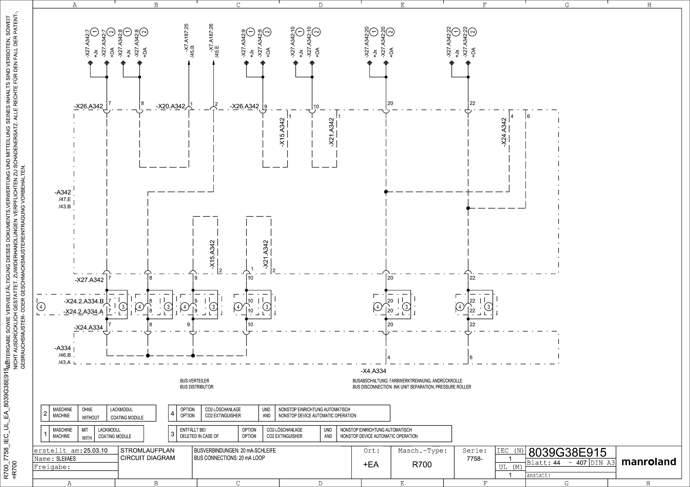

# +EA — Sheet 44 of 407 — BUSVERBINDUNGEN: 20 mA SCHLEIFE

**BUS CONNECTIONS: 20 mA LOOP**

> Part of the manroland **R700** printing press IEC/UL circuit diagrams.
> Drawing class: **Stromlaufplan / Circuit diagram** (DIN A3).
> Document `+EA` covers the **Printing unit** machine section.

## At a glance

| Field | Value |
|---|---|
| Document | `+EA`  (8039G38E915) |
| Sheet | **44** of 407 |
| Section (DE) | BUSVERBINDUNGEN: 20 mA SCHLEIFE |
| Section (EN) | BUS CONNECTIONS: 20 mA LOOP |
| Section type | CIRCUIT — Circuit diagram |
| Machine type | `R700` |
| Series | `7758` |
| Created | 25.03.10 |
| Replaces | — |
| Columns used | A, B, C, D, E, F, G |
| Path numbers | — |
| Labels on sheet | 150 |
| Cross-refs out | 6 |
| Cross-refs in | 46 |

**Previous:** [+EA sheet 43](SHEET_0043.md) · **Next:** [+EA sheet 45](SHEET_0045.md) · **Document TOC:** [_TOC.md](_TOC.md)  (+EA) · **Master TOC:** [all sheets](../_MASTER_TOC.md)

## Sheet image (300 DPI, exact vector render)



_Rendered directly from the PDF vector layer at 300 DPI (1-bit), no OCR and no resampling. Use it to confirm anything ambiguous in the text below._

## Cross-references on this sheet

Each entry is a wire leaving this sheet. The printed token is `/sheet.column`; the link resolves to that sheet inside the same document.

| Ref | Target sheet | Col | Path | Destination on target | Target section | From col |
|---|---|---|---|---|---|---|
| `/45.B` | [+EA sheet 45](SHEET_0045.md) | B | — | X7.A187:25 | BUSVERBINDUNGEN: 20 mA SCHLEIFE | B |
| `/45.E` | [+EA sheet 45](SHEET_0045.md) | E | — | X7.A187:26 | BUSVERBINDUNGEN: 20 mA SCHLEIFE | C |
| `/47.E` | [+EA sheet 47](SHEET_0047.md) | E | — | — | SCHUTZ | A |
| `/43.B` | [+EA sheet 43](SHEET_0043.md) | B | — | — | BUSVERBINDUNGEN: SIGNALSCHLEIFE | A |
| `/46.B` | [+EA sheet 46](SHEET_0046.md) | B | — | — | SCHUTZ | A |
| `/43.A` | [+EA sheet 43](SHEET_0043.md) | A | — | — | BUSVERBINDUNGEN: SIGNALSCHLEIFE | A |

### Incoming references (sheets that point here)

Every other sheet that sends a wire to this one. `Back-ref` is the token printed on *that* sheet; `Path` is its line number.

| From sheet | Cols | Back-ref | Path | Refs | What continues there |
|---|---|---|---|---|---|
| [+EA#43](SHEET_0043.md) | A, B | `/43.A`, `/43.B` | — | 2 | — |
| [+EA#45](SHEET_0045.md) | B, E | `/45.B`, `/45.E` | — | 2 | X7.A187:25; X7.A187:26 |
| [+EA#46](SHEET_0046.md) | B | `/46.B` | — | 1 | — |
| [+EA#47](SHEET_0047.md) | E | `/47.E` | — | 1 | — |
| [+EA#236](SHEET_0236.md) | F | `/236.F` | — | 2 | — |
| [+EA#260](SHEET_0260.md) | D | `/260.D` | — | 2 | — |
| [+EA#264](SHEET_0264.md) | A, D | `/264.A`, `/264.D` | — | 4 | — |
| [+EA#265](SHEET_0265.md) | F | `/265.F` | — | 6 | — |
| [+EA#266](SHEET_0266.md) | A, B, D | `/266.A`, `/266.B`, `/266.D` | — | 14 | — |
| [+EA#269](SHEET_0269.md) | C | `/269.C` | — | 6 | — |
| [+EA#270](SHEET_0270.md) | G | `/270.G` | — | 6 | — |


## Devices on this sheet

| Tag | Class | Class meaning (IEC) | Col | Sub | Terminal | Sign |
|---|---|---|---|---|---|---|
| `A334` | A | Baugruppe / assembly, module, PC board | A | — | — | — |
| `A342` | A | Baugruppe / assembly, module, PC board | A | — | — | — |
| `X26.A342` | — | cross-device reference | A | — | — | — |
| `X27.A342` | — | cross-device reference | A | — | — | — |
| `X24.A334` | — | cross-device reference | A | — | — | — |
| `X20.A342` | — | cross-device reference | B | — | — | — |
| `X26.A342` | — | cross-device reference | C | — | — | — |
| `X27.A342:7` | — | cross-device reference | A | — | 7 | — |
| `X27.A342:7` | — | cross-device reference | A | — | 7 | — |
| `X27.A342:8` | — | cross-device reference | B | — | 8 | — |
| `X27.A342:8` | — | cross-device reference | B | — | 8 | — |
| `X27.A342:9` | — | cross-device reference | C | — | 9 | — |
| `X27.A342:9` | — | cross-device reference | C | — | 9 | — |
| `X27.A342:10` | — | cross-device reference | D | — | 10 | — |
| `X27.A342:10` | — | cross-device reference | D | — | 10 | — |
| `X27.A342:20` | — | cross-device reference | E | — | 20 | — |
| `X27.A342:20` | — | cross-device reference | E | — | 20 | — |
| `X27.A342:22` | — | cross-device reference | F | — | 22 | — |
| `X27.A342:22` | — | cross-device reference | F | — | 22 | — |
| `X24.2.A334.B` | — | cross-device reference | A | — | — | — |
| `X24.2.A334.A` | — | cross-device reference | A | — | — | — |
| `X7.A187:26` | — | cross-device reference | C | — | 26 | — |
| `X7.A187:25` | — | cross-device reference | B | — | 25 | — |
| `X15.A342` | — | cross-device reference | D | — | — | — |
| `X21.A342` | — | cross-device reference | D | — | — | — |
| `X24.A342` | — | cross-device reference | F | — | — | — |
| `X4.A334` | — | cross-device reference | E | — | — | — |
| `X21.A342` | — | cross-device reference | C | — | — | — |
| `X15.A342` | — | cross-device reference | C | — | — | — |

## Potentials / nets

_No named potentials on this sheet._

## Wire-end annotations (grouped as printed)

A wire that continues elsewhere is annotated with a small cluster: the destination description, the path/line number `#NN`, and the `/sheet.column` cross reference. Each row below is one such cluster exactly as it is grouped on the drawing.

| Col | Y | Path | Cross-ref | Text on the wire |
|---|---|---|---|---|
| B | 40.8 | — | `/45.B` | `X7.A187:25` |
| C | 40.8 | — | `/45.E` | `X7.A187:26` |
| D | 45.9 | — | — | `X27.A342:10` |
| D | 45.9 | — | — | `X27.A342:10` |
| E | 45.9 | — | — | `X27.A342:20` |
| E | 45.9 | — | — | `X27.A342:20` |
| F | 45.9 | — | — | `X27.A342:22` |
| F | 45.9 | — | — | `X27.A342:22` |
| A | 50.7 | — | — | `X27.A342:7` |
| A | 50.7 | — | — | `X27.A342:7` |
| B | 50.7 | — | — | `X27.A342:8` |
| B | 50.7 | — | — | `X27.A342:8` |
| C | 50.7 | — | — | `X27.A342:9` |
| C | 50.7 | — | — | `X27.A342:9` |
| A | 52.4 | — | — | `1` |
| B | 52.4 | — | — | `1` |
| C | 52.4 | — | — | `1` |
| D | 52.4 | — | — | `1` |
| E | 52.4 | — | — | `1` |
| F | 52.4 | — | — | `1` |
| A | 53.3 | — | — | `2` |
| B | 53.3 | — | — | `2` |
| C | 53.3 | — | — | `2` |
| D | 53.3 | — | — | `2` |
| E | 53.3 | — | — | `2` |
| F | 53.3 | — | — | `2` |
| A | 82.2 | — | — | `+DA` |
| B | 82.2 | — | — | `+DA` |
| C | 82.2 | — | — | `+DA` |
| D | 82.2 | — | — | `+DA` |
| E | 82.2 | — | — | `+DA` |
| F | 82.2 | — | — | `+DA` |
| A | 85.9 | — | — | `+Jx` |
| B | 85.9 | — | — | `+Jx` |
| C | 85.9 | — | — | `+Jx` |
| D | 85.9 | — | — | `+Jx` |
| E | 85.9 | — | — | `+Jx` |
| F | 85.9 | — | — | `+Jx` |
| A | 174.7 | — | — | `X26.A342 7` |
| C | 174.7 | — | — | `8 X20.A342 1 2 X26.A342 9 10` |
| E | 174.7 | — | — | `20` |
| F | 174.7 | — | — | `22` |
| D | 197.3 | — | — | `1 1` |
| F | 197.3 | — | — | `4 6` |
| D | 203.5 | — | — | `X15.A342` |
| D | 203.5 | — | — | `X21.A342` |
| F | 203.5 | — | — | `X24.A342` |
| A | 327.7 | — | — | `A342` |
| A | 340.8 | — | `/47.E`, `/43.B` | — |
| C | 415.0 | — | — | `X15.A342` |
| C | 415.0 | — | — | `X21.A342` |
| C | 460.9 | — | — | `1 2` |
| C | 463.8 | — | — | `2` |
| A | 476.5 | — | — | `X27.A342 7` |
| B | 476.5 | — | — | `8` |
| B | 476.5 | — | — | `9` |
| C | 476.5 | — | — | `10` |
| E | 476.5 | — | — | `20` |
| F | 476.5 | — | — | `22` |
| A | 516.2 | — | — | `X24.2.A334.B 7` |
| B | 516.2 | — | — | `8` |
| B | 516.2 | — | — | `9` |
| C | 516.2 | — | — | `10` |
| E | 516.2 | — | — | `20` |
| F | 516.2 | — | — | `22` |
| B | 527.5 | — | — | `4 3 4 3 4 3` |
| C | 527.5 | — | — | `4 3` |
| E | 527.5 | — | — | `4 3 4 3` |
| A | 533.2 | — | — | `X24.2.A334.A 7` |
| B | 533.2 | — | — | `8` |
| B | 533.2 | — | — | `9` |
| C | 533.2 | — | — | `10` |
| E | 533.2 | — | — | `20` |
| F | 533.2 | — | — | `22` |
| A | 557.3 | — | — | `X24.A334 7` |
| B | 557.3 | — | — | `8` |
| B | 557.3 | — | — | `9` |
| C | 557.3 | — | — | `10` |
| E | 557.3 | — | — | `20` |
| F | 557.3 | — | — | `22` |
| A | 597.0 | — | — | `A334` |
| A | 610.0 | — | `/46.B`, `/43.A` | — |
| E | 614.0 | — | — | `4` |
| F | 614.0 | — | — | `6` |
| E | 636.7 | — | — | `X4.A334` |
| B | 655.4 | — | — | `BUS VERTEILER BUS DISTRIBUTOR` |
| E | 655.4 | — | — | `BUSABSCHALTUNG: FARBWERKTRENNUNG, ANDRÜCKROLLE BUS DISCONNECTION: INK UNIT SEPARATION, PRESSURE ROLLER` |
| A | 705.0 | — | — | `MASCHINE MACHINE` |
| A | 705.0 | — | — | `OHNE` |
| B | 705.0 | — | — | `LACKMODUL` |
| B | 705.0 | — | — | `4 OPTION OPTION` |
| C | 705.0 | — | — | `CO2 LÖSCHANLAGE CO2 EXTINGUISHER` |
| C | 705.0 | — | — | `UND` |
| D | 705.0 | — | — | `NONSTOP EINRICHTUNG AUTOMATISCH NONSTOP DEVICE AUTOMATIC OPERATION` |
| A | 710.4 | — | — | `2 COATING MODULE` |
| C | 715.7 | — | — | `AND` |
| A | 719.2 | — | — | `WITHOUT` |
| A | 740.4 | — | — | `MIT` |
| C | 740.4 | — | — | `3 ENTFÄLLT BEI DELETED IN CASE OF OPTION OPTION` |
| A | 740.5 | — | — | `MASCHINE MACHINE` |
| A | 740.5 | — | — | `LACKMODUL` |
| D | 740.5 | — | — | `CO2 LÖSCHANLAGE CO2 EXTINGUISHER` |
| D | 740.5 | — | — | `UND` |
| E | 740.5 | — | — | `NONSTOP EINRICHTUNG AUTOMATISCH NONSTOP DEVICE AUTOMATIC OPERATION` |
| A | 745.8 | — | — | `1 COATING MODULE` |
| D | 751.1 | — | — | `AND` |
| A | 754.5 | — | — | `WITH` |


## Reconstructed tables

This sheet carries tabular content (pin map / terminal assignment / index). The grid below was rebuilt from the drawing's own rule lines, so each row is exactly one physical row of the table.

### Table 1 — 3 data rows × 1 columns (at x=184.3, y=289.1)

| C1 |
|---|
| `7` |
| `7 3 7` |
| `7` |


### Table 2 — 1 data rows × 3 columns (at x=240.9, y=289.1) — **8**

| 4 | 8 3 8 | 4 |
|---|---|---|
|  | `8` | `9` |


### Table 3 — 2 data rows × 6 columns (at x=333.1, y=289.1)

| X15.A342 9 |  | 2 | 1 10 | X21.A342 | 2 |
|---|---|---|---|---|---|
| `9 9` | `3` | `4` | `10 10` | `3` |  |
|  |  |  | `10` |  |  |


### Table 4 — 2 data rows × 4 columns (at x=581.1, y=289.1)

|  | 20 |  | 22 |
|---|---|---|---|
| `4` | `20 3 20` | `4` | `22 3 22` |
|  | `20` |  | `22` |


## Notes and free text on this sheet

| Text | Col | Y (pt) |
|---|---|---|
| `+Jx` | A | 85.89 |
| `+DA` | A | 82.21 |
| `+Jx` | B | 85.89 |
| `+DA` | B | 82.21 |
| `+Jx` | C | 85.89 |
| `+DA` | C | 82.21 |
| `+Jx` | D | 85.89 |
| `+DA` | D | 82.21 |
| `+Jx` | E | 85.89 |
| `+DA` | E | 82.21 |
| `+Jx` | F | 85.89 |
| `+DA` | F | 82.21 |
| `BUS VERTEILER` | B | 655.42 |
| `BUS DISTRIBUTOR` | B | 666.05 |
| `BUSABSCHALTUNG: FARBWERKTRENNUNG, ANDRÜCKROLLE` | E | 655.43 |
| `BUS DISCONNECTION: INK UNIT SEPARATION, PRESSURE ROLLER` | E | 666.06 |
| `MASCHINE` | A | 740.47 |
| `MACHINE` | A | 751.1 |
| `MIT` | A | 740.44 |
| `WITH` | A | 754.51 |
| `LACKMODUL` | A | 740.49 |
| `COATING MODULE` | A | 751.82 |
| `OHNE` | A | 705.03 |
| `WITHOUT` | A | 719.17 |
| `LACKMODUL` | B | 705.05 |
| `COATING MODULE` | B | 719.23 |
| `ENTFÄLLT BEI` | B | 740.43 |
| `DELETED IN CASE OF` | C | 751.09 |
| `OPTION` | C | 740.44 |
| `CO2 LÖSCHANLAGE` | D | 740.49 |
| `CO2 EXTINGUISHER` | D | 751.11 |
| `UND` | D | 740.46 |
| `AND` | D | 751.12 |
| `NONSTOP EINRICHTUNG AUTOMATISCH` | E | 740.48 |
| `NONSTOP DEVICE AUTOMATIC OPERATION` | E | 751.1 |
| `OPTION` | B | 705.01 |
| `CO2 LÖSCHANLAGE` | C | 705.05 |
| `CO2 EXTINGUISHER` | C | 715.67 |
| `UND` | C | 705.03 |
| `AND` | C | 715.68 |
| `NONSTOP EINRICHTUNG AUTOMATISCH` | D | 705.04 |
| `NONSTOP DEVICE AUTOMATIC OPERATION` | D | 715.67 |

## Complete label inventory (exact text from the drawing)

Every text object inside the drawing area of this sheet, in DIN reading order (column A→H, then top→bottom). This is the authoritative list: if a string is not here it is not printed on this sheet.

| Col | Y | X | Dir | Type | Text |
|---|---|---|---|---|---|
| A | 50.7 | 147.0 | ↕ | device ref | `X27.A342:7` |
| A | 50.7 | 175.3 | ↕ | device ref | `X27.A342:7` |
| A | 52.4 | 159.9 | ↕ | number | `1` |
| A | 53.3 | 188.8 | ↕ | number | `2` |
| A | 82.2 | 189.5 | ↕ | text | `+DA` |
| A | 85.9 | 161.2 | ↕ | text | `+Jx` |
| A | 174.7 | 186.8 | → | number | `7` |
| A | 178.9 | 127.6 | → | device ref | `X26.A342` |
| A | 327.7 | 94.1 | → | device tag | `A342` |
| A | 340.8 | 101.8 | → | cross-reference | `/47.E` |
| A | 353.2 | 101.5 | → | cross-reference | `/43.B` |
| A | 476.5 | 186.8 | → | number | `7` |
| A | 479.4 | 129.0 | → | device ref | `X27.A342` |
| A | 516.2 | 110.3 | → | device ref | `X24.2.A334.B` |
| A | 516.2 | 186.8 | → | number | `7` |
| A | 527.5 | 68.9 | → | number | `4` |
| A | 533.2 | 186.8 | → | number | `7` |
| A | 533.9 | 109.4 | → | device ref | `X24.2.A334.A` |
| A | 557.3 | 186.8 | → | number | `7` |
| A | 561.6 | 127.6 | → | device ref | `X24.A334` |
| A | 597.0 | 94.1 | → | device tag | `A334` |
| A | 610.1 | 101.5 | → | cross-reference | `/46.B` |
| A | 622.5 | 101.2 | → | cross-reference | `/43.A` |
| A | 705.0 | 91.6 | → | text | `MASCHINE` |
| A | 705.0 | 141.4 | → | text | `OHNE` |
| A | 710.3 | 75.1 | → | number | `2` |
| A | 715.7 | 91.6 | → | text | `MACHINE` |
| A | 719.2 | 141.7 | → | text | `WITHOUT` |
| A | 740.4 | 141.2 | → | text | `MIT` |
| A | 740.5 | 91.6 | → | text | `MASCHINE` |
| A | 740.5 | 169.2 | → | text | `LACKMODUL` |
| A | 745.8 | 75.4 | → | number | `1` |
| A | 751.1 | 91.6 | → | text | `MACHINE` |
| A | 751.8 | 169.8 | → | text | `COATING MODULE` |
| A | 754.5 | 141.7 | → | text | `WITH` |
| B | 40.8 | 317.8 | ↕ | device ref | `X7.A187:25` |
| B | 50.7 | 203.7 | ↕ | device ref | `X27.A342:8` |
| B | 50.7 | 232.0 | ↕ | device ref | `X27.A342:8` |
| B | 52.4 | 216.6 | ↕ | number | `1` |
| B | 53.3 | 245.5 | ↕ | number | `2` |
| B | 78.5 | 327.7 | ↕ | cross-reference | `/45.B` |
| B | 82.2 | 246.2 | ↕ | text | `+DA` |
| B | 85.9 | 217.9 | ↕ | text | `+Jx` |
| B | 174.7 | 243.5 | → | number | `8` |
| B | 176.1 | 328.0 | → | number | `1` |
| B | 178.9 | 269.3 | → | device ref | `X20.A342` |
| B | 476.5 | 257.7 | → | number | `8` |
| B | 476.5 | 335.6 | → | number | `9` |
| B | 516.2 | 257.7 | → | number | `8` |
| B | 516.2 | 335.6 | → | number | `9` |
| B | 527.5 | 210.6 | → | number | `3` |
| B | 527.5 | 239.0 | → | number | `4` |
| B | 527.5 | 288.6 | → | number | `3` |
| B | 527.5 | 316.9 | → | number | `4` |
| B | 533.2 | 257.7 | → | number | `8` |
| B | 533.2 | 335.6 | → | number | `9` |
| B | 557.3 | 257.7 | → | number | `8` |
| B | 557.3 | 322.9 | → | number | `9` |
| B | 655.4 | 311.0 | → | text | `BUS VERTEILER` |
| B | 666.1 | 311.0 | → | text | `BUS DISTRIBUTOR` |
| B | 705.0 | 311.5 | → | text | `OPTION` |
| B | 705.1 | 190.5 | → | text | `LACKMODUL` |
| B | 710.3 | 294.8 | → | number | `4` |
| B | 715.6 | 311.5 | → | text | `OPTION` |
| B | 719.2 | 191.1 | → | text | `COATING MODULE` |
| B | 740.4 | 311.0 | → | text | `ENTFÄLLT BEI` |
| B | 745.8 | 294.7 | → | number | `3` |
| C | 40.8 | 360.3 | ↕ | device ref | `X7.A187:26` |
| C | 50.7 | 416.3 | ↕ | device ref | `X27.A342:9` |
| C | 50.7 | 444.6 | ↕ | device ref | `X27.A342:9` |
| C | 52.4 | 429.2 | ↕ | number | `1` |
| C | 53.3 | 458.1 | ↕ | number | `2` |
| C | 78.5 | 370.2 | ↕ | cross-reference | `/45.E` |
| C | 82.2 | 458.8 | ↕ | text | `+DA` |
| C | 85.9 | 430.5 | ↕ | text | `+Jx` |
| C | 176.1 | 371.1 | → | number | `2` |
| C | 178.9 | 396.9 | → | device ref | `X26.A342` |
| C | 180.3 | 456.1 | → | number | `9` |
| C | 415.0 | 361.7 | ↕ | device ref | `X15.A342` |
| C | 415.0 | 453.8 | ↕ | device ref | `X21.A342` |
| C | 461.0 | 432.9 | → | number | `1` |
| C | 463.8 | 378.1 | → | number | `2` |
| C | 463.8 | 470.3 | → | number | `2` |
| C | 476.5 | 427.2 | → | number | `10` |
| C | 516.2 | 427.2 | → | number | `10` |
| C | 527.5 | 366.5 | → | number | `3` |
| C | 527.5 | 409.0 | → | number | `4` |
| C | 527.5 | 458.6 | → | number | `3` |
| C | 533.2 | 427.2 | → | number | `10` |
| C | 557.3 | 427.2 | → | number | `10` |
| C | 705.0 | 452.7 | → | text | `UND` |
| C | 705.1 | 354.0 | → | text | `CO2 LÖSCHANLAGE` |
| C | 715.7 | 354.0 | → | text | `CO2 EXTINGUISHER` |
| C | 715.7 | 453.5 | → | text | `AND` |
| C | 740.4 | 417.8 | → | text | `OPTION` |
| C | 751.1 | 311.0 | → | text | `DELETED IN CASE OF` |
| C | 751.1 | 417.8 | → | text | `OPTION` |
| D | 45.9 | 501.3 | ↕ | device ref | `X27.A342:10` |
| D | 45.9 | 529.7 | ↕ | device ref | `X27.A342:10` |
| D | 52.4 | 514.3 | ↕ | number | `1` |
| D | 53.3 | 543.1 | ↕ | number | `2` |
| D | 82.2 | 543.8 | ↕ | text | `+DA` |
| D | 85.9 | 515.6 | ↕ | text | `+Jx` |
| D | 180.3 | 540.6 | → | number | `10` |
| D | 197.3 | 498.0 | → | number | `1` |
| D | 197.3 | 583.1 | → | number | `1` |
| D | 203.5 | 482.2 | ↕ | device ref | `X15.A342` |
| D | 203.5 | 567.2 | ↕ | device ref | `X21.A342` |
| D | 705.0 | 481.0 | → | text | `NONSTOP EINRICHTUNG AUTOMATISCH` |
| D | 715.7 | 481.0 | → | text | `NONSTOP DEVICE AUTOMATIC OPERATION` |
| D | 740.5 | 460.3 | → | text | `CO2 LÖSCHANLAGE` |
| D | 740.5 | 559.0 | → | text | `UND` |
| D | 751.1 | 460.3 | → | text | `CO2 EXTINGUISHER` |
| D | 751.1 | 559.8 | → | text | `AND` |
| E | 45.9 | 628.9 | ↕ | device ref | `X27.A342:20` |
| E | 45.9 | 657.2 | ↕ | device ref | `X27.A342:20` |
| E | 52.4 | 641.8 | ↕ | number | `1` |
| E | 53.3 | 670.7 | ↕ | number | `2` |
| E | 82.2 | 671.4 | ↕ | text | `+DA` |
| E | 85.9 | 643.1 | ↕ | text | `+Jx` |
| E | 174.7 | 668.7 | → | number | `20` |
| E | 476.5 | 668.7 | → | number | `20` |
| E | 516.2 | 668.7 | → | number | `20` |
| E | 527.5 | 650.0 | → | number | `4` |
| E | 527.5 | 699.6 | → | number | `3` |
| E | 533.2 | 668.7 | → | number | `20` |
| E | 557.3 | 668.7 | → | number | `20` |
| E | 614.0 | 668.7 | → | number | `4` |
| E | 636.7 | 622.5 | → | device ref | `X4.A334` |
| E | 655.4 | 608.6 | → | text | `BUSABSCHALTUNG: FARBWERKTRENNUNG, ANDRÜCKROLLE` |
| E | 666.1 | 608.6 | → | text | `BUS DISCONNECTION: INK UNIT SEPARATION, PRESSURE ROLLER` |
| E | 740.5 | 587.3 | → | text | `NONSTOP EINRICHTUNG AUTOMATISCH` |
| E | 751.1 | 587.3 | → | text | `NONSTOP DEVICE AUTOMATIC OPERATION` |
| F | 45.9 | 770.6 | ↕ | device ref | `X27.A342:22` |
| F | 45.9 | 798.9 | ↕ | device ref | `X27.A342:22` |
| F | 52.4 | 783.6 | ↕ | number | `1` |
| F | 53.3 | 812.4 | ↕ | number | `2` |
| F | 82.2 | 813.1 | ↕ | text | `+DA` |
| F | 85.9 | 784.8 | ↕ | text | `+Jx` |
| F | 174.7 | 810.4 | → | number | `22` |
| F | 197.3 | 881.3 | → | number | `4` |
| F | 203.5 | 864.9 | ↕ | device ref | `X24.A342` |
| F | 476.5 | 810.4 | → | number | `22` |
| F | 516.2 | 810.4 | → | number | `22` |
| F | 527.5 | 791.7 | → | number | `4` |
| F | 527.5 | 841.3 | → | number | `3` |
| F | 533.2 | 810.4 | → | number | `22` |
| F | 557.3 | 810.4 | → | number | `22` |
| F | 614.0 | 810.4 | → | number | `6` |
| G | 197.3 | 909.6 | → | number | `6` |

## Reading-order text block

The same content as a plain block, grouped by DIN column — convenient to paste or to match against a visual description.

```text
=== Column A ===
  50.7  147.0  devref       X27.A342:7
  50.7  175.3  devref       X27.A342:7
  52.4  159.9  numeric      1
  53.3  188.8  numeric      2
  82.2  189.5  text         +DA
  85.9  161.2  text         +Jx
 174.7  186.8  numeric      7
 178.9  127.6  devref       X26.A342
 327.7   94.1  devtag       A342
 340.8  101.8  xref         /47.E
 353.2  101.5  xref         /43.B
 476.5  186.8  numeric      7
 479.4  129.0  devref       X27.A342
 516.2  110.3  devref       X24.2.A334.B
 516.2  186.8  numeric      7
 527.5   68.9  numeric      4
 533.2  186.8  numeric      7
 533.9  109.4  devref       X24.2.A334.A
 557.3  186.8  numeric      7
 561.6  127.6  devref       X24.A334
 597.0   94.1  devtag       A334
 610.1  101.5  xref         /46.B
 622.5  101.2  xref         /43.A
 705.0   91.6  text         MASCHINE
 705.0  141.4  text         OHNE
 710.3   75.1  numeric      2
 715.7   91.6  text         MACHINE
 719.2  141.7  text         WITHOUT
 740.4  141.2  text         MIT
 740.5   91.6  text         MASCHINE
 740.5  169.2  text         LACKMODUL
 745.8   75.4  numeric      1
 751.1   91.6  text         MACHINE
 751.8  169.8  text         COATING MODULE
 754.5  141.7  text         WITH
=== Column B ===
  40.8  317.8  devref       X7.A187:25
  50.7  203.7  devref       X27.A342:8
  50.7  232.0  devref       X27.A342:8
  52.4  216.6  numeric      1
  53.3  245.5  numeric      2
  78.5  327.7  xref         /45.B
  82.2  246.2  text         +DA
  85.9  217.9  text         +Jx
 174.7  243.5  numeric      8
 176.1  328.0  numeric      1
 178.9  269.3  devref       X20.A342
 476.5  257.7  numeric      8
 476.5  335.6  numeric      9
 516.2  257.7  numeric      8
 516.2  335.6  numeric      9
 527.5  210.6  numeric      3
 527.5  239.0  numeric      4
 527.5  288.6  numeric      3
 527.5  316.9  numeric      4
 533.2  257.7  numeric      8
 533.2  335.6  numeric      9
 557.3  257.7  numeric      8
 557.3  322.9  numeric      9
 655.4  311.0  text         BUS VERTEILER
 666.1  311.0  text         BUS DISTRIBUTOR
 705.0  311.5  text         OPTION
 705.1  190.5  text         LACKMODUL
 710.3  294.8  numeric      4
 715.6  311.5  text         OPTION
 719.2  191.1  text         COATING MODULE
 740.4  311.0  text         ENTFÄLLT BEI
 745.8  294.7  numeric      3
=== Column C ===
  40.8  360.3  devref       X7.A187:26
  50.7  416.3  devref       X27.A342:9
  50.7  444.6  devref       X27.A342:9
  52.4  429.2  numeric      1
  53.3  458.1  numeric      2
  78.5  370.2  xref         /45.E
  82.2  458.8  text         +DA
  85.9  430.5  text         +Jx
 176.1  371.1  numeric      2
 178.9  396.9  devref       X26.A342
 180.3  456.1  numeric      9
 415.0  361.7  devref       X15.A342
 415.0  453.8  devref       X21.A342
 461.0  432.9  numeric      1
 463.8  378.1  numeric      2
 463.8  470.3  numeric      2
 476.5  427.2  numeric      10
 516.2  427.2  numeric      10
 527.5  366.5  numeric      3
 527.5  409.0  numeric      4
 527.5  458.6  numeric      3
 533.2  427.2  numeric      10
 557.3  427.2  numeric      10
 705.0  452.7  text         UND
 705.1  354.0  text         CO2 LÖSCHANLAGE
 715.7  354.0  text         CO2 EXTINGUISHER
 715.7  453.5  text         AND
 740.4  417.8  text         OPTION
 751.1  311.0  text         DELETED IN CASE OF
 751.1  417.8  text         OPTION
=== Column D ===
  45.9  501.3  devref       X27.A342:10
  45.9  529.7  devref       X27.A342:10
  52.4  514.3  numeric      1
  53.3  543.1  numeric      2
  82.2  543.8  text         +DA
  85.9  515.6  text         +Jx
 180.3  540.6  numeric      10
 197.3  498.0  numeric      1
 197.3  583.1  numeric      1
 203.5  482.2  devref       X15.A342
 203.5  567.2  devref       X21.A342
 705.0  481.0  text         NONSTOP EINRICHTUNG AUTOMATISCH
 715.7  481.0  text         NONSTOP DEVICE AUTOMATIC OPERATION
 740.5  460.3  text         CO2 LÖSCHANLAGE
 740.5  559.0  text         UND
 751.1  460.3  text         CO2 EXTINGUISHER
 751.1  559.8  text         AND
=== Column E ===
  45.9  628.9  devref       X27.A342:20
  45.9  657.2  devref       X27.A342:20
  52.4  641.8  numeric      1
  53.3  670.7  numeric      2
  82.2  671.4  text         +DA
  85.9  643.1  text         +Jx
 174.7  668.7  numeric      20
 476.5  668.7  numeric      20
 516.2  668.7  numeric      20
 527.5  650.0  numeric      4
 527.5  699.6  numeric      3
 533.2  668.7  numeric      20
 557.3  668.7  numeric      20
 614.0  668.7  numeric      4
 636.7  622.5  devref       X4.A334
 655.4  608.6  text         BUSABSCHALTUNG: FARBWERKTRENNUNG, ANDRÜCKROLLE
 666.1  608.6  text         BUS DISCONNECTION: INK UNIT SEPARATION, PRESSURE ROLLER
 740.5  587.3  text         NONSTOP EINRICHTUNG AUTOMATISCH
 751.1  587.3  text         NONSTOP DEVICE AUTOMATIC OPERATION
=== Column F ===
  45.9  770.6  devref       X27.A342:22
  45.9  798.9  devref       X27.A342:22
  52.4  783.6  numeric      1
  53.3  812.4  numeric      2
  82.2  813.1  text         +DA
  85.9  784.8  text         +Jx
 174.7  810.4  numeric      22
 197.3  881.3  numeric      4
 203.5  864.9  devref       X24.A342
 476.5  810.4  numeric      22
 516.2  810.4  numeric      22
 527.5  791.7  numeric      4
 527.5  841.3  numeric      3
 533.2  810.4  numeric      22
 557.3  810.4  numeric      22
 614.0  810.4  numeric      6
=== Column G ===
 197.3  909.6  numeric      6
```

---
_Generated from the PDF vector text layer; no OCR. Source: `R700_7758_IEC_UL_EA_8039G38E915_p`, sheet 44._
