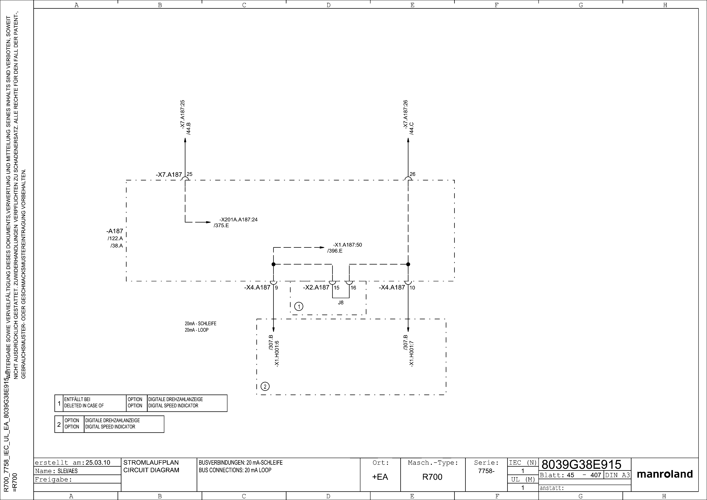

# +EA — Sheet 45 of 407 — BUSVERBINDUNGEN: 20 mA SCHLEIFE

**BUS CONNECTIONS: 20 mA LOOP**

> Part of the manroland **R700** printing press IEC/UL circuit diagrams.
> Drawing class: **Stromlaufplan / Circuit diagram** (DIN A3).
> Document `+EA` covers the **Printing unit** machine section.

## At a glance

| Field | Value |
|---|---|
| Document | `+EA`  (8039G38E915) |
| Sheet | **45** of 407 |
| Section (DE) | BUSVERBINDUNGEN: 20 mA SCHLEIFE |
| Section (EN) | BUS CONNECTIONS: 20 mA LOOP |
| Section type | CIRCUIT — Circuit diagram |
| Machine type | `R700` |
| Series | `7758` |
| Created | 25.03.10 |
| Replaces | — |
| Columns used | A, B, C, D, E |
| Path numbers | — |
| Labels on sheet | 42 |
| Cross-refs out | 8 |
| Cross-refs in | 14 |

**Previous:** [+EA sheet 44](SHEET_0044.md) · **Next:** [+EA sheet 46](SHEET_0046.md) · **Document TOC:** [_TOC.md](_TOC.md)  (+EA) · **Master TOC:** [all sheets](../_MASTER_TOC.md)

## Sheet image (300 DPI, exact vector render)



_Rendered directly from the PDF vector layer at 300 DPI (1-bit), no OCR and no resampling. Use it to confirm anything ambiguous in the text below._

## Cross-references on this sheet

Each entry is a wire leaving this sheet. The printed token is `/sheet.column`; the link resolves to that sheet inside the same document.

| Ref | Target sheet | Col | Path | Destination on target | Target section | From col |
|---|---|---|---|---|---|---|
| `/44.B` | [+EA sheet 44](SHEET_0044.md) | B | — | X7.A187:25 | BUSVERBINDUNGEN: 20 mA SCHLEIFE | B |
| `/44.C` | [+EA sheet 44](SHEET_0044.md) | C | — | X7.A187:26 | BUSVERBINDUNGEN: 20 mA SCHLEIFE | E |
| `/375.E` | [+EA sheet 375](SHEET_0375.md) | E | — | — | OPTION: ENDTROCKNER 1 VORBEREITUNG; | C |
| `/122.A` | [+EA sheet 122](SHEET_0122.md) | A | — | — | TROCKENBESTÄUBER | A |
| `/38.A` | [+EA sheet 38](SHEET_0038.md) | A | — | — | BUSVERBINDUNGEN: NOT AUS | A |
| `/396.E` | [+EA sheet 396](SHEET_0396.md) | E | — | — | OPTION: ZWISCHENTROCKNER VORBEREITUNG; | D |
| `/307.B` | [+EA sheet 307](SHEET_0307.md) | B | — | — | OPTION: DIGITALE DREHZAHLANZEIGE | C |
| `/307.B` | [+EA sheet 307](SHEET_0307.md) | B | — | — | OPTION: DIGITALE DREHZAHLANZEIGE | E |

### Incoming references (sheets that point here)

Every other sheet that sends a wire to this one. `Back-ref` is the token printed on *that* sheet; `Path` is its line number.

| From sheet | Cols | Back-ref | Path | Refs | What continues there |
|---|---|---|---|---|---|
| [+EA#38](SHEET_0038.md) | A | `/38.A` | — | 1 | — |
| [+EA#44](SHEET_0044.md) | B, C | `/44.B`, `/44.C` | — | 2 | X7.A187:25; X7.A187:26 |
| [+EA#122](SHEET_0122.md) | A | `/122.A` | — | 1 | — |
| [+EA#223](SHEET_0223.md) | C | `/223.C` | — | 2 | — |
| [+EA#236](SHEET_0236.md) | B | `/236.B` | — | 2 | — |
| [+EA#246](SHEET_0246.md) | B | `/246.B` | — | 2 | — |
| [+EA#307](SHEET_0307.md) | C | `/307.C` | — | 2 | X1.H001:6 X1.H001:7 +FA |
| [+EA#375](SHEET_0375.md) | D | `/375.D` | — | 1 | X201A.A187:24 |
| [+EA#396](SHEET_0396.md) | E | `/396.E` | — | 1 | X1.A187:50 |


## Devices on this sheet

| Tag | Class | Class meaning (IEC) | Col | Sub | Terminal | Sign |
|---|---|---|---|---|---|---|
| `A187` | A | Baugruppe / assembly, module, PC board | A | — | — | — |
| `J8` | J |  | D | — | — | — |
| `X7.A187` | — | cross-device reference | B | — | — | — |
| `X4.A187` | — | cross-device reference | C | — | — | — |
| `X2.A187` | — | cross-device reference | D | — | — | — |
| `X4.A187` | — | cross-device reference | E | — | — | — |
| `X1.H001:7` | — | cross-device reference | E | — | 7 | — |
| `X1.H001:6` | — | cross-device reference | C | — | 6 | — |
| `X1.A187:50` | — | cross-device reference | D | — | 50 | — |
| `X201A.A187:24` | — | cross-device reference | C | — | 24 | — |
| `X7.A187:26` | — | cross-device reference | E | — | 26 | — |
| `X7.A187:25` | — | cross-device reference | B | — | 25 | — |

## Potentials / nets

_No named potentials on this sheet._

## Wire-end annotations (grouped as printed)

A wire that continues elsewhere is annotated with a small cluster: the destination description, the path/line number `#NN`, and the `/sheet.column` cross reference. Each row below is one such cluster exactly as it is grouped on the drawing.

| Col | Y | Path | Cross-ref | Text on the wire |
|---|---|---|---|---|
| B | 168.4 | — | `/44.B` | `X7.A187:25` |
| E | 168.4 | — | `/44.C` | `X7.A187:26` |
| B | 289.4 | — | — | `X7.A187 25` |
| E | 289.5 | — | — | `26` |
| C | 365.9 | — | — | `X201A.A187:24` |
| C | 375.9 | — | `/375.E` | — |
| A | 384.4 | — | — | `A187` |
| A | 397.5 | — | `/122.A` | — |
| D | 408.5 | — | — | `X1.A187:50` |
| A | 409.9 | — | `/38.A` | — |
| D | 418.4 | — | `/396.E` | — |
| D | 479.4 | — | — | `X4.A187 9 X2.A187 15 16 X4.A187 10` |
| D | 505.5 | — | — | `J8` |
| D | 512.9 | — | — | `1` |
| B | 542.0 | — | — | `20mA SCHLEIFE 20mA LOOP` |
| C | 563.8 | — | `/307.B` | — |
| E | 563.8 | — | `/307.B` | — |
| C | 573.7 | — | — | `X1.H001:6` |
| E | 573.7 | — | — | `X1.H001:7` |
| C | 648.0 | — | — | `2` |
| A | 669.6 | — | — | `1 ENTFÄLLT BEI DELETED IN CASE OF` |
| B | 669.6 | — | — | `OPTION OPTION` |
| B | 669.6 | — | — | `DIGITALE DREHZAHLANZEIGE DIGITAL SPEED INDICATOR` |
| A | 705.0 | — | — | `2 OPTION OPTION` |
| A | 705.0 | — | — | `DIGITALE DREHZAHLANZEIGE DIGITAL SPEED INDICATOR` |


## Reconstructed tables

This sheet carries tabular content (pin map / terminal assignment / index). The grid below was rebuilt from the drawing's own rule lines, so each row is exactly one physical row of the table.

### Table 1 — 5 data rows × 10 columns (at x=204.1, y=0.0) — **X7.A187:25 X7.A187 /44.B 25 X201A.A187:24 /375.E X1.A187:50 X7.A187:26 /44.C 26 /396.E OPTION DIGITALE DREHZAHLANZEIGE OPTION DIGITAL SPEED DREHZAHLANZEIGE INDICATOR 20mA 20mA INDICATOR X4.A187 SCHLEIFE LOOP /307.B 2 X2.A187 9 15 16 J8 1 X1.H001:6 X4.A187 /307.B 10 X1.H001:7**

| STROMLAUFPLAN |  | BUSVERBINDUNGEN: 20 mA SCHLEIFE |  | Ort: |  | Masch. Type: | Serie: | IEC (N) | 8039G38E915 |
|---|---|---|---|---|---|---|---|---|---|
| `CIRCUIT DIAGRAM` |  |  |  |  |  |  |  |  |  |
|  |  | `BUS CONNECTIONS: 20 mA LOOP` |  |  |  |  | `7758` | `1` |  |
|  |  |  |  | `+EA` |  | `R700` |  |  | `Blatt: DIN A3 45 407` |
|  |  |  |  |  |  |  |  | `UL (M)` |  |
|  |  |  |  |  |  |  |  | `1` | `anstatt:` |


## Notes and free text on this sheet

| Text | Col | Y (pt) |
|---|---|---|
| `20mA SCHLEIFE` | B | 542.02 |
| `20mA LOOP` | B | 552.66 |
| `ENTFÄLLT BEI` | A | 669.57 |
| `DELETED IN CASE OF` | A | 680.22 |
| `OPTION` | B | 669.57 |
| `DIGITALE DREHZAHLANZEIGE` | B | 669.6 |
| `DIGITAL SPEED INDICATOR` | B | 680.23 |
| `OPTION` | A | 705.01 |
| `DIGITALE DREHZAHLANZEIGE` | A | 705.03 |
| `DIGITAL SPEED INDICATOR` | A | 715.66 |

## Complete label inventory (exact text from the drawing)

Every text object inside the drawing area of this sheet, in DIN reading order (column A→H, then top→bottom). This is the authoritative list: if a string is not here it is not printed on this sheet.

| Col | Y | X | Dir | Type | Text |
|---|---|---|---|---|---|
| A | 384.4 | 179.1 | → | device tag | `A187` |
| A | 397.5 | 181.4 | → | cross-reference | `/122.A` |
| A | 409.9 | 186.2 | → | cross-reference | `/38.A` |
| A | 669.6 | 108.3 | → | text | `ENTFÄLLT BEI` |
| A | 674.9 | 96.7 | → | number | `1` |
| A | 680.2 | 108.3 | → | text | `DELETED IN CASE OF` |
| A | 705.0 | 108.9 | → | text | `OPTION` |
| A | 705.0 | 143.7 | → | text | `DIGITALE DREHZAHLANZEIGE` |
| A | 710.3 | 96.4 | → | number | `2` |
| A | 715.6 | 108.9 | → | text | `OPTION` |
| A | 715.7 | 143.7 | → | text | `DIGITAL SPEED INDICATOR` |
| B | 168.4 | 303.6 | ↕ | device ref | `X7.A187:25` |
| B | 206.1 | 313.5 | ↕ | cross-reference | `/44.B` |
| B | 289.4 | 262.5 | → | device ref | `X7.A187` |
| B | 289.5 | 314.4 | → | number | `25` |
| B | 542.0 | 311.5 | → | text | `20mA SCHLEIFE` |
| B | 552.7 | 311.5 | → | text | `20mA LOOP` |
| B | 669.6 | 215.1 | → | text | `OPTION` |
| B | 669.6 | 250.0 | → | text | `DIGITALE DREHZAHLANZEIGE` |
| B | 680.2 | 215.1 | → | text | `OPTION` |
| B | 680.2 | 250.0 | → | text | `DIGITAL SPEED INDICATOR` |
| C | 366.0 | 369.6 | → | device ref | `X201A.A187:24` |
| C | 375.9 | 360.0 | → | cross-reference | `/375.E` |
| C | 479.4 | 411.3 | → | device ref | `X4.A187` |
| C | 480.8 | 463.2 | → | number | `9` |
| C | 563.8 | 452.4 | ↕ | cross-reference | `/307.B` |
| C | 573.7 | 462.3 | ↕ | device ref | `X1.H001:6` |
| C | 648.0 | 444.5 | → | number | `2` |
| D | 408.5 | 561.0 | → | device ref | `X1.A187:50` |
| D | 418.4 | 551.3 | → | cross-reference | `/396.E` |
| D | 479.4 | 510.5 | → | device ref | `X2.A187` |
| D | 480.8 | 561.8 | → | number | `15` |
| D | 480.8 | 590.2 | → | number | `16` |
| D | 505.5 | 569.3 | → | device tag | `J8` |
| D | 512.8 | 501.4 | → | number | `1` |
| E | 168.4 | 679.2 | ↕ | device ref | `X7.A187:26` |
| E | 205.8 | 689.1 | ↕ | cross-reference | `/44.C` |
| E | 289.5 | 690.0 | → | number | `26` |
| E | 479.4 | 638.1 | → | device ref | `X4.A187` |
| E | 480.8 | 689.4 | → | number | `10` |
| E | 563.8 | 679.2 | ↕ | cross-reference | `/307.B` |
| E | 573.7 | 689.1 | ↕ | device ref | `X1.H001:7` |

## Reading-order text block

The same content as a plain block, grouped by DIN column — convenient to paste or to match against a visual description.

```text
=== Column A ===
 384.4  179.1  devtag       A187
 397.5  181.4  xref         /122.A
 409.9  186.2  xref         /38.A
 669.6  108.3  text         ENTFÄLLT BEI
 674.9   96.7  numeric      1
 680.2  108.3  text         DELETED IN CASE OF
 705.0  108.9  text         OPTION
 705.0  143.7  text         DIGITALE DREHZAHLANZEIGE
 710.3   96.4  numeric      2
 715.6  108.9  text         OPTION
 715.7  143.7  text         DIGITAL SPEED INDICATOR
=== Column B ===
 168.4  303.6  devref       X7.A187:25
 206.1  313.5  xref         /44.B
 289.4  262.5  devref       X7.A187
 289.5  314.4  numeric      25
 542.0  311.5  text         20mA SCHLEIFE
 552.7  311.5  text         20mA LOOP
 669.6  215.1  text         OPTION
 669.6  250.0  text         DIGITALE DREHZAHLANZEIGE
 680.2  215.1  text         OPTION
 680.2  250.0  text         DIGITAL SPEED INDICATOR
=== Column C ===
 366.0  369.6  devref       X201A.A187:24
 375.9  360.0  xref         /375.E
 479.4  411.3  devref       X4.A187
 480.8  463.2  numeric      9
 563.8  452.4  xref         /307.B
 573.7  462.3  devref       X1.H001:6
 648.0  444.5  numeric      2
=== Column D ===
 408.5  561.0  devref       X1.A187:50
 418.4  551.3  xref         /396.E
 479.4  510.5  devref       X2.A187
 480.8  561.8  numeric      15
 480.8  590.2  numeric      16
 505.5  569.3  devtag       J8
 512.8  501.4  numeric      1
=== Column E ===
 168.4  679.2  devref       X7.A187:26
 205.8  689.1  xref         /44.C
 289.5  690.0  numeric      26
 479.4  638.1  devref       X4.A187
 480.8  689.4  numeric      10
 563.8  679.2  xref         /307.B
 573.7  689.1  devref       X1.H001:7
```

---
_Generated from the PDF vector text layer; no OCR. Source: `R700_7758_IEC_UL_EA_8039G38E915_p`, sheet 45._
