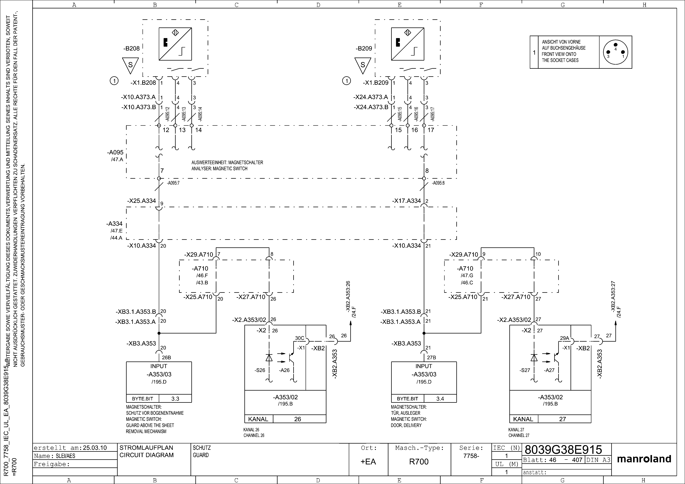

# +EA — Sheet 46 of 407 — SCHUTZ

**GUARD**

> Part of the manroland **R700** printing press IEC/UL circuit diagrams.
> Drawing class: **Stromlaufplan / Circuit diagram** (DIN A3).
> Document `+EA` covers the **Printing unit** machine section.

## At a glance

| Field | Value |
|---|---|
| Document | `+EA`  (8039G38E915) |
| Sheet | **46** of 407 |
| Section (DE) | SCHUTZ |
| Section (EN) | GUARD |
| Section type | CIRCUIT — Circuit diagram |
| Machine type | `R700` |
| Series | `7758` |
| Created | 25.03.10 |
| Replaces | — |
| Columns used | A, B, C, D, E, F, G, H |
| Path numbers | — |
| Labels on sheet | 162 |
| Cross-refs out | 13 |
| Cross-refs in | 53 |

**Previous:** [+EA sheet 45](SHEET_0045.md) · **Next:** [+EA sheet 47](SHEET_0047.md) · **Document TOC:** [_TOC.md](_TOC.md)  (+EA) · **Master TOC:** [all sheets](../_MASTER_TOC.md)

## Sheet image (300 DPI, exact vector render)



_Rendered directly from the PDF vector layer at 300 DPI (1-bit), no OCR and no resampling. Use it to confirm anything ambiguous in the text below._

## Cross-references on this sheet

Each entry is a wire leaving this sheet. The printed token is `/sheet.column`; the link resolves to that sheet inside the same document.

| Ref | Target sheet | Col | Path | Destination on target | Target section | From col |
|---|---|---|---|---|---|---|
| `/47.A` | [+EA sheet 47](SHEET_0047.md) | A | — | AUSWERTEEINHEIT: MAGNETSCHALTER ANALYSER: MAGNETIC SWITCH | SCHUTZ | B |
| `/47.E` | [+EA sheet 47](SHEET_0047.md) | E | — | — | SCHUTZ | B |
| `/44.A` | [+EA sheet 44](SHEET_0044.md) | A | — | — | BUSVERBINDUNGEN: 20 mA SCHLEIFE | B |
| `/46.F` | [+EA sheet 46](SHEET_0046.md) | F | — | — | SCHUTZ | C |
| `/43.B` | [+EA sheet 43](SHEET_0043.md) | B | — | — | BUSVERBINDUNGEN: SIGNALSCHLEIFE | C |
| `/47.G` | [+EA sheet 47](SHEET_0047.md) | G | — | — | SCHUTZ | F |
| `/46.C` | [+EA sheet 46](SHEET_0046.md) | C | — | — | SCHUTZ | F |
| `/24.F` | [+EA sheet 24](SHEET_0024.md) | F | — | XB2.A353:26 | BUSVERBINDUNGEN: SICHERHEITSBUS | D |
| `/24.F` | [+EA sheet 24](SHEET_0024.md) | F | — | XB2.A353:27 | BUSVERBINDUNGEN: SICHERHEITSBUS | H |
| `/195.D` | [+EA sheet 195](SHEET_0195.md) | D | — | — | REFERENZMODUL | B |
| `/195.D` | [+EA sheet 195](SHEET_0195.md) | D | — | — | REFERENZMODUL | E |
| `/195.B` | [+EA sheet 195](SHEET_0195.md) | B | — | — | REFERENZMODUL | D |
| `/195.B` | [+EA sheet 195](SHEET_0195.md) | B | — | — | REFERENZMODUL | G |

### Incoming references (sheets that point here)

Every other sheet that sends a wire to this one. `Back-ref` is the token printed on *that* sheet; `Path` is its line number.

| From sheet | Cols | Back-ref | Path | Refs | What continues there |
|---|---|---|---|---|---|
| [+EA#24](SHEET_0024.md) | F | `/24.F` | — | 2 | XB2.A353:26; XB2.A353:27 |
| [+EA#43](SHEET_0043.md) | B | `/43.B` | — | 1 | A710 |
| [+EA#44](SHEET_0044.md) | A | `/44.A` | — | 1 | — |
| [+EA#46](SHEET_0046.md) | C, F | `/46.C`, `/46.F` | — | 2 | — |
| [+EA#47](SHEET_0047.md) | A, E, F | `/47.A`, `/47.E`, `/47.F` | — | 3 | — |
| [+EA#195](SHEET_0195.md) | B, D | `/195.B`, `/195.D` | — | 4 | — |
| [+EA#216](SHEET_0216.md) | E, F | `/216.E`, `/216.F` | — | 6 | — |
| [+EA#224](SHEET_0224.md) | H | `/224.H` | — | 2 | — |
| [+EA#225](SHEET_0225.md) | D | `/225.D` | — | 2 | — |
| [+EA#234](SHEET_0234.md) | C, D, F | `/234.C`, `/234.D`, `/234.F` | — | 6 | — |
| [+EA#253](SHEET_0253.md) | H | `/253.H` | — | 2 | — |
| [+EA#254](SHEET_0254.md) | F | `/254.F` | — | 6 | — |
| [+EA#263](SHEET_0263.md) | A | `/263.A` | — | 1 | — |
| [+EA#266](SHEET_0266.md) | E | `/266.E` | — | 6 | — |
| [+EA#267](SHEET_0267.md) | B | `/267.B` | — | 1 | — |
| [+EA#268](SHEET_0268.md) | C | `/268.C` | — | 2 | — |
| [+EA#271](SHEET_0271.md) | C | `/271.C` | — | 2 | — |
| [+EA#274](SHEET_0274.md) | B | `/274.B` | — | 4 | — |


## Devices on this sheet

| Tag | Class | Class meaning (IEC) | Col | Sub | Terminal | Sign |
|---|---|---|---|---|---|---|
| `A353/03` | A | Baugruppe / assembly, module, PC board | B | 03 | — | — |
| `B208` | B | Umformer / transducer, sensor | B | — | — | — |
| `A095` | A | Baugruppe / assembly, module, PC board | B | — | — | — |
| `A334` | A | Baugruppe / assembly, module, PC board | A | — | — | — |
| `A353/03` | A | Baugruppe / assembly, module, PC board | E | 03 | — | — |
| `B209` | B | Umformer / transducer, sensor | E | — | — | — |
| `A710` | A | Baugruppe / assembly, module, PC board | C | — | — | — |
| `S26` | S | Schalter / switch | C | — | — | — |
| `A26` | A | Baugruppe / assembly, module, PC board | D | — | — | — |
| `X1` | X | Klemme / terminal, plug connector | D | — | — | — |
| `X2` | X | Klemme / terminal, plug connector | C | — | — | — |
| `XB2` | XB |  | D | — | — | — |
| `A353/02` | A | Baugruppe / assembly, module, PC board | D | 02 | — | — |
| `A710` | A | Baugruppe / assembly, module, PC board | F | — | — | — |
| `S27` | S | Schalter / switch | G | — | — | — |
| `A27` | A | Baugruppe / assembly, module, PC board | G | — | — | — |
| `X1` | X | Klemme / terminal, plug connector | G | — | — | — |
| `X2` | X | Klemme / terminal, plug connector | G | — | — | — |
| `XB2` | XB |  | G | — | — | — |
| `A353/02` | A | Baugruppe / assembly, module, PC board | G | 02 | — | — |
| `A095:7` | A | Baugruppe / assembly, module, PC board | B | — | 7 | — |
| `A095:12` | A | Baugruppe / assembly, module, PC board | B | — | 12 | — |
| `A095:14` | A | Baugruppe / assembly, module, PC board | C | — | 14 | — |
| `A095:13` | A | Baugruppe / assembly, module, PC board | B | — | 13 | — |
| `A095:8` | A | Baugruppe / assembly, module, PC board | E | — | 8 | — |
| `A095:17` | A | Baugruppe / assembly, module, PC board | E | — | 17 | — |
| `A095:16` | A | Baugruppe / assembly, module, PC board | E | — | 16 | — |
| `A095:15` | A | Baugruppe / assembly, module, PC board | E | — | 15 | — |
| `3.3` | — | cross-device reference | B | — | — | — |
| `XB3.A353` | — | cross-device reference | B | — | — | — |
| `X1.B208` | — | cross-device reference | B | — | — | — |
| `X10.A373.B` | — | cross-device reference | B | — | — | — |
| `X10.A373.A` | — | cross-device reference | B | — | — | — |
| `X25.A334` | — | cross-device reference | B | — | — | — |
| `X10.A334` | — | cross-device reference | B | — | — | — |
| `3.4` | — | cross-device reference | F | — | — | — |
| `XB3.A353` | — | cross-device reference | E | — | — | — |
| `X1.B209` | — | cross-device reference | E | — | — | — |
| `X24.A373.B` | — | cross-device reference | E | — | — | — |
| `X24.A373.A` | — | cross-device reference | E | — | — | — |
| `X17.A334` | — | cross-device reference | E | — | — | — |
| `X10.A334` | — | cross-device reference | E | — | — | — |
| `XB3.1.A353.B` | — | cross-device reference | B | — | — | — |
| `XB3.1.A353.A` | — | cross-device reference | B | — | — | — |
| `X29.A710` | — | cross-device reference | C | — | — | — |
| `X27.A710` | — | cross-device reference | C | — | — | — |
| `X25.A710` | — | cross-device reference | C | — | — | — |
| `XB2.A353` | — | cross-device reference | D | — | — | — |
| `X29.A710` | — | cross-device reference | F | — | — | — |
| `X27.A710` | — | cross-device reference | F | — | — | — |
| `X25.A710` | — | cross-device reference | F | — | — | — |
| `XB2.A353` | — | cross-device reference | G | — | — | — |
| `XB3.1.A353.B` | — | cross-device reference | E | — | — | — |
| `XB3.1.A353.A` | — | cross-device reference | E | — | — | — |
| `XB2.A353:26` | — | cross-device reference | D | — | 26 | — |
| `XB2.A353:27` | — | cross-device reference | H | — | 27 | — |

## Potentials / nets

_No named potentials on this sheet._

## Wire-end annotations (grouped as printed)

A wire that continues elsewhere is annotated with a small cluster: the destination description, the path/line number `#NN`, and the `/sheet.column` cross reference. Each row below is one such cluster exactly as it is grouped on the drawing.

| Col | Y | Path | Cross-ref | Text on the wire |
|---|---|---|---|---|
| G | 70.1 | — | — | `FRONT VIEW ONTO ANSICHT VON VORNE AUF BUCHSENGEHÄUSE` |
| B | 79.7 | — | — | `B208` |
| E | 79.7 | — | — | `B209` |
| H | 82.4 | — | — | `4` |
| G | 86.7 | — | — | `1 THE SOCKET CASES` |
| H | 95.1 | — | — | `3 1` |
| B | 107.4 | — | — | `S` |
| E | 107.4 | — | — | `S` |
| A | 137.3 | — | — | `1` |
| D | 137.3 | — | — | `1` |
| B | 139.2 | — | — | `X1.B208 1 4 3` |
| E | 139.2 | — | — | `X1.B209 1 4 3` |
| B | 164.0 | — | — | `X10.A373.A 1 4 3` |
| E | 164.0 | — | — | `X24.A373.A 1 4 3` |
| B | 181.7 | — | — | `X10.A373.B 1 4 3` |
| E | 181.7 | — | — | `X24.A373.B 1 4 3` |
| B | 186.1 | — | — | `A095:12` |
| B | 186.1 | — | — | `A095:13` |
| C | 186.1 | — | — | `A095:14` |
| E | 186.1 | — | — | `A095:15` |
| E | 186.1 | — | — | `A095:16` |
| E | 186.1 | — | — | `A095:17` |
| B | 221.4 | — | — | `12 13 14` |
| E | 221.4 | — | — | `15 16 17` |
| B | 260.4 | — | — | `A095` |
| B | 273.4 | — | `/47.A` | `AUSWERTEEINHEIT: MAGNETSCHALTER ANALYSER: MAGNETIC SWITCH` |
| B | 292.2 | — | — | `7` |
| E | 292.2 | — | — | `8` |
| B | 315.3 | — | — | `A095:7` |
| E | 315.3 | — | — | `A095:8` |
| B | 344.7 | — | — | `X25.A334 9` |
| E | 344.7 | — | — | `X17.A334 2` |
| A | 384.4 | — | — | `A334` |
| B | 397.4 | — | `/47.E`, `/44.A` | — |
| B | 422.7 | — | — | `X10.A334 20` |
| E | 422.7 | — | — | `X10.A334 21` |
| C | 438.3 | — | — | `X29.A710 7 8` |
| F | 438.3 | — | — | `X29.A710 9 10` |
| C | 462.4 | — | — | `A710` |
| F | 462.4 | — | — | `A710` |
| C | 475.4 | — | `/46.F`, `/43.B` | — |
| F | 475.4 | — | `/47.G`, `/46.C` | — |
| D | 488.4 | — | `/24.F` | `XB2.A353:26` |
| H | 488.4 | — | `/24.F` | `XB2.A353:27` |
| C | 512.0 | — | — | `X25.A710 20 X27.A710 26` |
| F | 512.0 | — | — | `X25.A710 21 X27.A710 27` |
| B | 537.5 | — | — | `XB3.1.A353.B 20` |
| E | 537.5 | — | — | `XB3.1.A353.B 21` |
| C | 551.6 | — | — | `X2.A353/02 26` |
| F | 551.6 | — | — | `X2.A353/02 27` |
| B | 554.5 | — | — | `XB3.1.A353.A 20` |
| E | 554.5 | — | — | `XB3.1.A353.A 21` |
| C | 570.1 | — | — | `X2` |
| G | 570.1 | — | — | `X2` |
| D | 571.5 | — | — | `26 26` |
| G | 571.5 | — | — | `27 27` |
| D | 580.0 | — | — | `26` |
| H | 580.0 | — | — | `27` |
| G | 584.2 | — | — | `29A` |
| D | 584.3 | — | — | `30C` |
| B | 592.8 | — | — | `XB3.A353 20` |
| E | 592.8 | — | — | `XB3.A353 21` |
| D | 601.2 | — | — | `X1` |
| G | 601.2 | — | — | `X1` |
| D | 601.3 | — | — | `XB2` |
| G | 601.3 | — | — | `XB2` |
| D | 607.5 | — | — | `XB2.A353` |
| G | 607.5 | — | — | `XB2.A353` |
| B | 618.2 | — | — | `26B` |
| E | 618.2 | — | — | `27B` |
| B | 632.8 | — | — | `INPUT` |
| E | 632.8 | — | — | `INPUT` |
| C | 640.2 | — | — | `S26 A26` |
| G | 640.2 | — | — | `S27 A27` |
| B | 646.6 | — | — | `A353/03` |
| E | 646.6 | — | — | `A353/03` |
| B | 660.4 | — | `/195.D` | — |
| E | 660.4 | — | `/195.D` | — |
| D | 686.3 | — | — | `A353/02` |
| G | 686.3 | — | — | `A353/02` |
| B | 689.4 | — | — | `BYTE.BIT 3.3` |
| E | 689.4 | — | — | `BYTE.BIT 3.4` |
| D | 698.6 | — | `/195.B` | — |
| G | 698.6 | — | `/195.B` | — |
| B | 705.0 | — | — | `REMOVAL MECHANISM MAGNETSCHALTER: MAGNETIC SWITCH: SCHUTZ VOR BOGENENTNAHME GUARD ABOVE THE SHEET` |
| E | 705.0 | — | — | `DOOR, DELIVERY MAGNETSCHALTER: MAGNETIC SWITCH: TÜR, AUSLEGER` |
| C | 724.5 | — | — | `KANAL 26` |
| G | 724.5 | — | — | `KANAL 27` |
| C | 744.9 | — | — | `KANAL 26 CHANNEL 26` |
| F | 744.9 | — | — | `KANAL 27 CHANNEL 27` |


## Reconstructed tables

This sheet carries tabular content (pin map / terminal assignment / index). The grid below was rebuilt from the drawing's own rule lines, so each row is exactly one physical row of the table.

### Table 1 — 9 data rows × 22 columns (at x=219.7, y=48.2)

| B208 |  |  |  |  |  |  |  |  | B209 |  |  |  |  |  | 1 | ANSICHT AUF FRONT | VON BUCHSENGEHÄUSE VIEW | VORNE ONTO |  | 4 3 | 1 |
|---|---|---|---|---|---|---|---|---|---|---|---|---|---|---|---|---|---|---|---|---|---|
| `S` |  |  |  |  |  |  |  |  | `S` |  |  |  |  |  |  | `THE SOCKET` |  | `CASES` |  |  |  |
| `X1.B208 X10.A373.A X10.A373.B X25.A334 X10.A334` | `1 4 1 4 1 4 A095:12 A095:13 12 13 7 A095:7 9 20` | `3 3 3 A095:14 14 AUSWERTEEINHEIT: ANALYSER:` | `MAGNETIC SWITCH` | `MAGNETSCHALTER` |  |  |  | `1` | `X1.B209 X24.A373.A X24.A373.B` | `1 4 1 4 1 4 A095:15 A095:16 15 16 X17.A334 X10.A334` | `3 3 3 A095:17 17 8 A095:8 2 21` |  |  |  |  |  |  |  |  |  |  |
| `XB3.1.A353.B XB3.1.A353.A` | `20 20` | `X29.A710 A710 /46.F /43.B X25.A710` | `7 20` | `X27.A710 X2.A353/02` | `8 26 26` |  |  | `XB2.A353:26` | `/24.F` | `XB3.1.A353.B XB3.1.A353.A` | `21 21` | `X29.A710 A710 /47.G /46.C X25.A710` | `9 21` | `X27.A710 X2.A353/02` | `10` | `27 27` |  |  |  | `XB2.A353:27` | `/24.F` |
|  |  |  |  | `X2` | `26` |  |  |  |  |  |  |  |  | `X2` |  | `27` |  |  |  |  |  |
| `XB3.A353` | `20 26B` |  |  |  |  | `30C X1` | `XB2` | `26 26` |  | `XB3.A353` | `21 27B` |  |  |  |  |  | `29A X1` | `XB2` | `27` | `27` |  |
| `INPUT` | `A353/03 /195.D` |  |  | `S26` | `A26` |  |  | `XB2.A353` |  | `INPUT` | `A353/03 /195.D` |  |  | `S27` |  | `A27` |  |  |  | `XB2.A353` |  |
| `BYTE.BIT` | `3.3` |  |  |  | `A353/02` |  |  |  |  | `BYTE.BIT` | `3.4` |  |  |  |  | `A353/02` |  |  |  |  |  |
| `MAGNETSCHALTER: SCHUTZ VOR` | `BOGENENTNAHME` |  |  |  | `/195.B` |  |  |  |  | `MAGNETSCHALTER: TÜR, AUSLEGER` |  |  |  |  |  | `/195.B` |  |  |  |  |  |
| `MAGNETIC SWITCH:` |  |  |  | `KANAL` |  | `26` |  |  |  | `MAGNETIC SWITCH:` |  |  |  | `KANAL` |  |  | `27` |  |  |  |  |


## Notes and free text on this sheet

| Text | Col | Y (pt) |
|---|---|---|
| `26B` | B | 618.24 |
| `INPUT` | B | 632.76 |
| `BYTE.BIT` | B | 690.01 |
| `MAGNETSCHALTER:` | B | 705.04 |
| `SCHUTZ VOR BOGENENTNAHME` | B | 715.68 |
| `MAGNETIC SWITCH:` | B | 726.27 |
| `GUARD ABOVE THE SHEET` | B | 736.93 |
| `REMOVAL MECHANISM` | B | 747.58 |
| `AUSWERTEEINHEIT: MAGNETSCHALTER` | C | 279.83 |
| `ANALYSER: MAGNETIC SWITCH` | C | 290.46 |
| `27B` | E | 618.24 |
| `INPUT` | E | 632.76 |
| `BYTE.BIT` | E | 690.01 |
| `MAGNETSCHALTER:` | E | 705.04 |
| `TÜR, AUSLEGER` | E | 715.67 |
| `MAGNETIC SWITCH:` | E | 726.27 |
| `DOOR, DELIVERY` | E | 736.93 |
| `KANAL 26` | C | 744.88 |
| `CHANNEL 26` | C | 754.82 |
| `30C` | D | 584.27 |
| `KANAL` | C | 724.55 |
| `X2.A353/02` | C | 551.65 |
| `KANAL 27` | F | 744.88 |
| `CHANNEL 27` | F | 754.82 |
| `29A` | G | 584.22 |
| `KANAL` | G | 724.55 |
| `X2.A353/02` | F | 551.65 |
| `ANSICHT VON VORNE` | G | 70.08 |
| `AUF BUCHSENGEHÄUSE` | G | 80.71 |
| `FRONT VIEW ONTO` | G | 91.31 |
| `THE SOCKET CASES` | G | 101.96 |
| `S` | B | 107.39 |
| `S` | E | 107.39 |

## Complete label inventory (exact text from the drawing)

Every text object inside the drawing area of this sheet, in DIN reading order (column A→H, then top→bottom). This is the authoritative list: if a string is not here it is not printed on this sheet.

| Col | Y | X | Dir | Type | Text |
|---|---|---|---|---|---|
| A | 137.3 | 196.7 | → | number | `1` |
| A | 384.4 | 184.8 | → | device tag | `A334` |
| B | 79.7 | 214.6 | → | device tag | `B208` |
| B | 107.4 | 222.7 | → | text | `S` |
| B | 139.2 | 227.1 | → | device ref | `X1.B208` |
| B | 140.6 | 278.4 | → | number | `1` |
| B | 140.6 | 307.3 | → | number | `4` |
| B | 140.6 | 335.6 | → | number | `3` |
| B | 164.0 | 210.3 | → | device ref | `X10.A373.A` |
| B | 166.2 | 278.4 | → | number | `1` |
| B | 166.2 | 307.3 | → | number | `4` |
| B | 166.2 | 335.6 | → | number | `3` |
| B | 181.7 | 211.2 | → | device ref | `X10.A373.B` |
| B | 183.2 | 278.4 | → | number | `1` |
| B | 183.2 | 307.3 | → | number | `4` |
| B | 183.2 | 335.6 | → | number | `3` |
| B | 186.1 | 288.3 | ↕ | device tag | `A095:12` |
| B | 186.1 | 316.7 | ↕ | device tag | `A095:13` |
| B | 221.4 | 282.3 | → | number | `12` |
| B | 221.4 | 310.7 | → | number | `13` |
| B | 260.4 | 186.2 | → | device tag | `A095` |
| B | 273.4 | 193.3 | → | cross-reference | `/47.A` |
| B | 292.2 | 278.9 | → | number | `7` |
| B | 315.3 | 290.3 | → | device tag | `A095:7` |
| B | 344.7 | 221.1 | → | device ref | `X25.A334` |
| B | 350.4 | 278.9 | → | number | `9` |
| B | 397.5 | 192.5 | → | cross-reference | `/47.E` |
| B | 409.9 | 191.9 | → | cross-reference | `/44.A` |
| B | 422.7 | 221.1 | → | device ref | `X10.A334` |
| B | 424.1 | 278.9 | → | number | `20` |
| B | 537.5 | 201.3 | → | device ref | `XB3.1.A353.B` |
| B | 537.5 | 278.9 | → | number | `20` |
| B | 554.5 | 278.9 | → | number | `20` |
| B | 555.2 | 200.4 | → | device ref | `XB3.1.A353.A` |
| B | 592.7 | 220.0 | → | device ref | `XB3.A353` |
| B | 601.3 | 278.9 | → | number | `20` |
| B | 618.2 | 281.8 | → | text | `26B` |
| B | 632.8 | 261.5 | → | text | `INPUT` |
| B | 646.6 | 255.0 | → | device tag | `A353/03` |
| B | 660.4 | 263.6 | → | cross-reference | `/195.D` |
| B | 689.4 | 297.9 | → | device ref | `3.3` |
| B | 690.0 | 229.6 | → | text | `BYTE.BIT` |
| B | 705.0 | 219.1 | → | text | `MAGNETSCHALTER:` |
| B | 715.7 | 219.4 | → | text | `SCHUTZ VOR BOGENENTNAHME` |
| B | 726.3 | 219.1 | → | text | `MAGNETIC SWITCH:` |
| B | 736.9 | 219.4 | → | text | `GUARD ABOVE THE SHEET` |
| B | 747.6 | 218.8 | → | text | `REMOVAL MECHANISM` |
| C | 186.1 | 345.0 | ↕ | device tag | `A095:14` |
| C | 221.4 | 339.0 | → | number | `14` |
| C | 279.8 | 333.1 | → | text | `AUSWERTEEINHEIT: MAGNETSCHALTER` |
| C | 290.5 | 333.1 | → | text | `ANALYSER: MAGNETIC SWITCH` |
| C | 438.3 | 320.3 | → | device ref | `X29.A710` |
| C | 438.3 | 378.1 | → | number | `7` |
| C | 438.3 | 470.3 | → | number | `8` |
| C | 462.3 | 333.6 | → | device tag | `A710` |
| C | 475.4 | 341.6 | → | cross-reference | `/46.F` |
| C | 487.8 | 341.0 | → | cross-reference | `/43.B` |
| C | 512.0 | 318.9 | → | device ref | `X25.A710` |
| C | 512.0 | 411.0 | → | device ref | `X27.A710` |
| C | 516.2 | 378.1 | → | number | `20` |
| C | 516.2 | 470.3 | → | number | `26` |
| C | 551.6 | 403.7 | → | text | `X2.A353/02` |
| C | 551.7 | 470.3 | → | number | `26` |
| C | 570.1 | 446.2 | → | device tag | `X2` |
| C | 571.5 | 473.1 | → | number | `26` |
| C | 640.2 | 442.5 | → | device tag | `S26` |
| C | 724.6 | 431.4 | → | text | `KANAL` |
| C | 744.9 | 423.2 | → | text | `KANAL 26` |
| C | 754.8 | 423.5 | → | text | `CHANNEL 26` |
| D | 137.3 | 600.6 | → | number | `1` |
| D | 488.4 | 601.2 | ↕ | device ref | `XB2.A353:26` |
| D | 532.6 | 611.1 | ↕ | cross-reference | `/24.F` |
| D | 580.0 | 593.0 | → | number | `26` |
| D | 581.4 | 572.3 | → | number | `26` |
| D | 584.3 | 513.1 | → | text | `30C` |
| D | 601.2 | 516.8 | → | device tag | `X1` |
| D | 601.3 | 541.1 | → | device tag | `XB2` |
| D | 607.5 | 577.2 | ↕ | device ref | `XB2.A353` |
| D | 640.2 | 485.0 | → | device tag | `A26` |
| D | 686.3 | 474.7 | → | device tag | `A353/02` |
| D | 698.6 | 483.4 | → | cross-reference | `/195.B` |
| D | 724.5 | 511.5 | → | number | `26` |
| E | 79.7 | 618.5 | → | device tag | `B209` |
| E | 107.4 | 626.6 | → | text | `S` |
| E | 139.2 | 631.0 | → | device ref | `X1.B209` |
| E | 140.6 | 682.3 | → | number | `1` |
| E | 140.6 | 711.2 | → | number | `4` |
| E | 140.6 | 739.6 | → | number | `3` |
| E | 164.0 | 614.3 | → | device ref | `X24.A373.A` |
| E | 166.2 | 682.3 | → | number | `1` |
| E | 166.2 | 711.2 | → | number | `4` |
| E | 166.2 | 739.6 | → | number | `3` |
| E | 181.7 | 615.1 | → | device ref | `X24.A373.B` |
| E | 183.2 | 682.3 | → | number | `1` |
| E | 183.2 | 711.2 | → | number | `4` |
| E | 183.2 | 739.6 | → | number | `3` |
| E | 186.1 | 692.3 | ↕ | device tag | `A095:15` |
| E | 186.1 | 720.6 | ↕ | device tag | `A095:16` |
| E | 186.1 | 749.0 | ↕ | device tag | `A095:17` |
| E | 221.4 | 686.3 | → | number | `15` |
| E | 221.4 | 714.6 | → | number | `16` |
| E | 221.4 | 743.0 | → | number | `17` |
| E | 292.2 | 739.3 | → | number | `8` |
| E | 315.3 | 750.9 | → | device tag | `A095:8` |
| E | 344.7 | 681.7 | → | device ref | `X17.A334` |
| E | 346.2 | 739.6 | → | number | `2` |
| E | 422.7 | 681.7 | → | device ref | `X10.A334` |
| E | 424.1 | 739.6 | → | number | `21` |
| E | 537.5 | 661.9 | → | device ref | `XB3.1.A353.B` |
| E | 537.5 | 739.6 | → | number | `21` |
| E | 554.5 | 739.6 | → | number | `21` |
| E | 555.2 | 661.0 | → | device ref | `XB3.1.A353.A` |
| E | 592.7 | 680.6 | → | device ref | `XB3.A353` |
| E | 601.3 | 739.6 | → | number | `21` |
| E | 618.2 | 742.4 | → | text | `27B` |
| E | 632.8 | 722.1 | → | text | `INPUT` |
| E | 646.6 | 715.6 | → | device tag | `A353/03` |
| E | 660.4 | 724.3 | → | cross-reference | `/195.D` |
| E | 690.0 | 690.2 | → | text | `BYTE.BIT` |
| E | 705.0 | 679.7 | → | text | `MAGNETSCHALTER:` |
| E | 715.7 | 680.0 | → | text | `TÜR, AUSLEGER` |
| E | 726.3 | 679.7 | → | text | `MAGNETIC SWITCH:` |
| E | 736.9 | 679.5 | → | text | `DOOR, DELIVERY` |
| F | 438.3 | 780.9 | → | device ref | `X29.A710` |
| F | 438.3 | 838.8 | → | number | `9` |
| F | 462.3 | 794.3 | → | device tag | `A710` |
| F | 475.4 | 801.1 | → | cross-reference | `/47.G` |
| F | 487.8 | 801.4 | → | cross-reference | `/46.C` |
| F | 512.0 | 779.5 | → | device ref | `X25.A710` |
| F | 512.0 | 871.7 | → | device ref | `X27.A710` |
| F | 516.2 | 838.8 | → | number | `21` |
| F | 551.6 | 864.3 | → | text | `X2.A353/02` |
| F | 689.4 | 758.6 | → | device ref | `3.4` |
| F | 744.9 | 883.8 | → | text | `KANAL 27` |
| F | 754.8 | 884.1 | → | text | `CHANNEL 27` |
| G | 70.1 | 942.5 | → | text | `ANSICHT VON VORNE` |
| G | 80.7 | 942.5 | → | text | `AUF BUCHSENGEHÄUSE` |
| G | 86.7 | 925.8 | → | number | `1` |
| G | 91.3 | 941.7 | → | text | `FRONT VIEW ONTO` |
| G | 102.0 | 942.2 | → | text | `THE SOCKET CASES` |
| G | 438.3 | 930.3 | → | number | `10` |
| G | 516.2 | 930.9 | → | number | `27` |
| G | 551.7 | 930.9 | → | number | `27` |
| G | 570.1 | 906.8 | → | device tag | `X2` |
| G | 571.5 | 933.7 | → | number | `27` |
| G | 581.4 | 1032.9 | → | number | `27` |
| G | 584.2 | 973.7 | → | text | `29A` |
| G | 601.2 | 977.4 | → | device tag | `X1` |
| G | 601.3 | 1001.8 | → | device tag | `XB2` |
| G | 607.5 | 1037.8 | ↕ | device ref | `XB2.A353` |
| G | 640.2 | 903.1 | → | device tag | `S27` |
| G | 640.2 | 945.6 | → | device tag | `A27` |
| G | 686.3 | 935.3 | → | device tag | `A353/02` |
| G | 698.6 | 944.1 | → | cross-reference | `/195.B` |
| G | 724.5 | 972.1 | → | number | `27` |
| G | 724.6 | 892.1 | → | text | `KANAL` |
| H | 82.4 | 1068.1 | → | number | `4` |
| H | 95.1 | 1055.3 | → | number | `3` |
| H | 95.1 | 1081.3 | → | number | `1` |
| H | 488.4 | 1061.9 | ↕ | device ref | `XB2.A353:27` |
| H | 532.6 | 1071.8 | ↕ | cross-reference | `/24.F` |
| H | 580.0 | 1053.6 | → | number | `27` |

## Reading-order text block

The same content as a plain block, grouped by DIN column — convenient to paste or to match against a visual description.

```text
=== Column A ===
 137.3  196.7  numeric      1
 384.4  184.8  devtag       A334
=== Column B ===
  79.7  214.6  devtag       B208
 107.4  222.7  text         S
 139.2  227.1  devref       X1.B208
 140.6  278.4  numeric      1
 140.6  307.3  numeric      4
 140.6  335.6  numeric      3
 164.0  210.3  devref       X10.A373.A
 166.2  278.4  numeric      1
 166.2  307.3  numeric      4
 166.2  335.6  numeric      3
 181.7  211.2  devref       X10.A373.B
 183.2  278.4  numeric      1
 183.2  307.3  numeric      4
 183.2  335.6  numeric      3
 186.1  288.3  devtag       A095:12
 186.1  316.7  devtag       A095:13
 221.4  282.3  numeric      12
 221.4  310.7  numeric      13
 260.4  186.2  devtag       A095
 273.4  193.3  xref         /47.A
 292.2  278.9  numeric      7
 315.3  290.3  devtag       A095:7
 344.7  221.1  devref       X25.A334
 350.4  278.9  numeric      9
 397.5  192.5  xref         /47.E
 409.9  191.9  xref         /44.A
 422.7  221.1  devref       X10.A334
 424.1  278.9  numeric      20
 537.5  201.3  devref       XB3.1.A353.B
 537.5  278.9  numeric      20
 554.5  278.9  numeric      20
 555.2  200.4  devref       XB3.1.A353.A
 592.7  220.0  devref       XB3.A353
 601.3  278.9  numeric      20
 618.2  281.8  text         26B
 632.8  261.5  text         INPUT
 646.6  255.0  devtag       A353/03
 660.4  263.6  xref         /195.D
 689.4  297.9  devref       3.3
 690.0  229.6  text         BYTE.BIT
 705.0  219.1  text         MAGNETSCHALTER:
 715.7  219.4  text         SCHUTZ VOR BOGENENTNAHME
 726.3  219.1  text         MAGNETIC SWITCH:
 736.9  219.4  text         GUARD ABOVE THE SHEET
 747.6  218.8  text         REMOVAL MECHANISM
=== Column C ===
 186.1  345.0  devtag       A095:14
 221.4  339.0  numeric      14
 279.8  333.1  text         AUSWERTEEINHEIT: MAGNETSCHALTER
 290.5  333.1  text         ANALYSER: MAGNETIC SWITCH
 438.3  320.3  devref       X29.A710
 438.3  378.1  numeric      7
 438.3  470.3  numeric      8
 462.3  333.6  devtag       A710
 475.4  341.6  xref         /46.F
 487.8  341.0  xref         /43.B
 512.0  318.9  devref       X25.A710
 512.0  411.0  devref       X27.A710
 516.2  378.1  numeric      20
 516.2  470.3  numeric      26
 551.6  403.7  text         X2.A353/02
 551.7  470.3  numeric      26
 570.1  446.2  devtag       X2
 571.5  473.1  numeric      26
 640.2  442.5  devtag       S26
 724.6  431.4  text         KANAL
 744.9  423.2  text         KANAL 26
 754.8  423.5  text         CHANNEL 26
=== Column D ===
 137.3  600.6  numeric      1
 488.4  601.2  devref       XB2.A353:26
 532.6  611.1  xref         /24.F
 580.0  593.0  numeric      26
 581.4  572.3  numeric      26
 584.3  513.1  text         30C
 601.2  516.8  devtag       X1
 601.3  541.1  devtag       XB2
 607.5  577.2  devref       XB2.A353
 640.2  485.0  devtag       A26
 686.3  474.7  devtag       A353/02
 698.6  483.4  xref         /195.B
 724.5  511.5  numeric      26
=== Column E ===
  79.7  618.5  devtag       B209
 107.4  626.6  text         S
 139.2  631.0  devref       X1.B209
 140.6  682.3  numeric      1
 140.6  711.2  numeric      4
 140.6  739.6  numeric      3
 164.0  614.3  devref       X24.A373.A
 166.2  682.3  numeric      1
 166.2  711.2  numeric      4
 166.2  739.6  numeric      3
 181.7  615.1  devref       X24.A373.B
 183.2  682.3  numeric      1
 183.2  711.2  numeric      4
 183.2  739.6  numeric      3
 186.1  692.3  devtag       A095:15
 186.1  720.6  devtag       A095:16
 186.1  749.0  devtag       A095:17
 221.4  686.3  numeric      15
 221.4  714.6  numeric      16
 221.4  743.0  numeric      17
 292.2  739.3  numeric      8
 315.3  750.9  devtag       A095:8
 344.7  681.7  devref       X17.A334
 346.2  739.6  numeric      2
 422.7  681.7  devref       X10.A334
 424.1  739.6  numeric      21
 537.5  661.9  devref       XB3.1.A353.B
 537.5  739.6  numeric      21
 554.5  739.6  numeric      21
 555.2  661.0  devref       XB3.1.A353.A
 592.7  680.6  devref       XB3.A353
 601.3  739.6  numeric      21
 618.2  742.4  text         27B
 632.8  722.1  text         INPUT
 646.6  715.6  devtag       A353/03
 660.4  724.3  xref         /195.D
 690.0  690.2  text         BYTE.BIT
 705.0  679.7  text         MAGNETSCHALTER:
 715.7  680.0  text         TÜR, AUSLEGER
 726.3  679.7  text         MAGNETIC SWITCH:
 736.9  679.5  text         DOOR, DELIVERY
=== Column F ===
 438.3  780.9  devref       X29.A710
 438.3  838.8  numeric      9
 462.3  794.3  devtag       A710
 475.4  801.1  xref         /47.G
 487.8  801.4  xref         /46.C
 512.0  779.5  devref       X25.A710
 512.0  871.7  devref       X27.A710
 516.2  838.8  numeric      21
 551.6  864.3  text         X2.A353/02
 689.4  758.6  devref       3.4
 744.9  883.8  text         KANAL 27
 754.8  884.1  text         CHANNEL 27
=== Column G ===
  70.1  942.5  text         ANSICHT VON VORNE
  80.7  942.5  text         AUF BUCHSENGEHÄUSE
  86.7  925.8  numeric      1
  91.3  941.7  text         FRONT VIEW ONTO
 102.0  942.2  text         THE SOCKET CASES
 438.3  930.3  numeric      10
 516.2  930.9  numeric      27
 551.7  930.9  numeric      27
 570.1  906.8  devtag       X2
 571.5  933.7  numeric      27
 581.4 1032.9  numeric      27
 584.2  973.7  text         29A
 601.2  977.4  devtag       X1
 601.3 1001.8  devtag       XB2
 607.5 1037.8  devref       XB2.A353
 640.2  903.1  devtag       S27
 640.2  945.6  devtag       A27
 686.3  935.3  devtag       A353/02
 698.6  944.1  xref         /195.B
 724.5  972.1  numeric      27
 724.6  892.1  text         KANAL
=== Column H ===
  82.4 1068.1  numeric      4
  95.1 1055.3  numeric      3
  95.1 1081.3  numeric      1
 488.4 1061.9  devref       XB2.A353:27
 532.6 1071.8  xref         /24.F
 580.0 1053.6  numeric      27
```

---
_Generated from the PDF vector text layer; no OCR. Source: `R700_7758_IEC_UL_EA_8039G38E915_p`, sheet 46._
