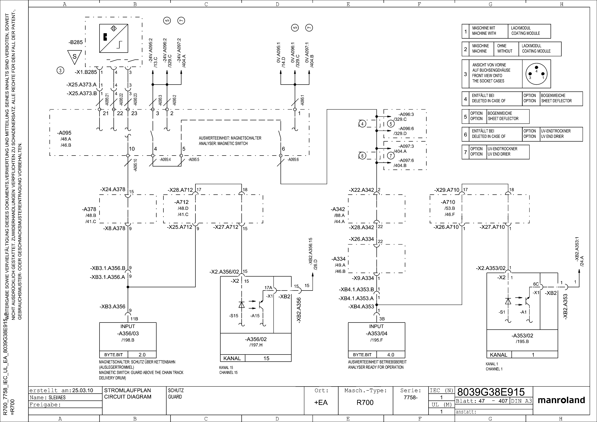

# +EA — Sheet 47 of 407 — SCHUTZ

**GUARD**

> Part of the manroland **R700** printing press IEC/UL circuit diagrams.
> Drawing class: **Stromlaufplan / Circuit diagram** (DIN A3).
> Document `+EA` covers the **Printing unit** machine section.

## At a glance

| Field | Value |
|---|---|
| Document | `+EA`  (8039G38E915) |
| Sheet | **47** of 407 |
| Section (DE) | SCHUTZ |
| Section (EN) | GUARD |
| Section type | CIRCUIT — Circuit diagram |
| Machine type | `R700` |
| Series | `7758` |
| Created | 25.03.10 |
| Replaces | — |
| Columns used | A, B, C, D, E, F, G, H |
| Path numbers | — |
| Labels on sheet | 223 |
| Cross-refs out | 28 |
| Cross-refs in | 61 |

**Previous:** [+EA sheet 46](SHEET_0046.md) · **Next:** [+EA sheet 48](SHEET_0048.md) · **Document TOC:** [_TOC.md](_TOC.md)  (+EA) · **Master TOC:** [all sheets](../_MASTER_TOC.md)

## Sheet image (300 DPI, exact vector render)



_Rendered directly from the PDF vector layer at 300 DPI (1-bit), no OCR and no resampling. Use it to confirm anything ambiguous in the text below._

## Cross-references on this sheet

Each entry is a wire leaving this sheet. The printed token is `/sheet.column`; the link resolves to that sheet inside the same document.

| Ref | Target sheet | Col | Path | Destination on target | Target section | From col |
|---|---|---|---|---|---|---|
| `/13.C` | [+EA sheet 13](SHEET_0013.md) | C | — | 24V.A095:2 | SPANNUNGSVERSORGUNG: 400V, 24V | B |
| `/329.C` | [+EA sheet 329](SHEET_0329.md) | C | — | 24V.A096:2 | OPTION: BOGENWEICHE | B |
| `/404.A` | [+EA sheet 404](SHEET_0404.md) | A | — | 24V.A097:2 | OPTION: SCHNITTSTELLE UV ENDTROCKNER | C |
| `/14.D` | [+EA sheet 14](SHEET_0014.md) | D | — | 0V.A095:1 | SPANNUNGSVERSORGUNG: 400V, 24V | D |
| `/329.C` | [+EA sheet 329](SHEET_0329.md) | C | — | 0V.A096:1 | OPTION: BOGENWEICHE | D |
| `/404.B` | [+EA sheet 404](SHEET_0404.md) | B | — | 0V.A097:1 | OPTION: SCHNITTSTELLE UV ENDTROCKNER | D |
| `/329.C` | [+EA sheet 329](SHEET_0329.md) | C | — | — | OPTION: BOGENWEICHE | F |
| `/329.D` | [+EA sheet 329](SHEET_0329.md) | D | — | — | OPTION: BOGENWEICHE | F |
| `/48.A` | [+EA sheet 48](SHEET_0048.md) | A | — | — | SCHUTZ | A |
| `/46.B` | [+EA sheet 46](SHEET_0046.md) | B | — | — | SCHUTZ | A |
| `/404.A` | [+EA sheet 404](SHEET_0404.md) | A | — | — | OPTION: SCHNITTSTELLE UV ENDTROCKNER | F |
| `/404.B` | [+EA sheet 404](SHEET_0404.md) | B | — | — | OPTION: SCHNITTSTELLE UV ENDTROCKNER | F |
| `/53.B` | [+EA sheet 53](SHEET_0053.md) | B | — | — | MASCHINENBEDIENUNG: LAUFKOMMANDOS | F |
| `/48.D` | [+EA sheet 48](SHEET_0048.md) | D | — | — | SCHUTZ | C |
| `/41.C` | [+EA sheet 41](SHEET_0041.md) | C | — | — | BUSVERBINDUNGEN: STOP SICHERN | C |
| `/46.F` | [+EA sheet 46](SHEET_0046.md) | F | — | — | SCHUTZ | F |
| `/48.B` | [+EA sheet 48](SHEET_0048.md) | B | — | — | SCHUTZ | A |
| `/41.C` | [+EA sheet 41](SHEET_0041.md) | C | — | — | BUSVERBINDUNGEN: STOP SICHERN | A |
| `/88.A` | [+EA sheet 88](SHEET_0088.md) | A | — | — | SAUGWALZE | E |
| `/44.A` | [+EA sheet 44](SHEET_0044.md) | A | — | — | BUSVERBINDUNGEN: 20 mA SCHLEIFE | E |
| `/24.A` | [+EA sheet 24](SHEET_0024.md) | A | — | XB2.A353:1 | BUSVERBINDUNGEN: SICHERHEITSBUS | H |
| `/26.D` | [+EA sheet 26](SHEET_0026.md) | D | — | XB2.A356:15 | BUSVERBINDUNGEN: SICHERHEITSBUS | E |
| `/49.A` | [+EA sheet 49](SHEET_0049.md) | A | — | — | SCHUTZ | E |
| `/46.B` | [+EA sheet 46](SHEET_0046.md) | B | — | — | SCHUTZ | E |
| `/198.B` | [+EA sheet 198](SHEET_0198.md) | B | — | — | REFERENZMODUL | B |
| `/195.F` | [+EA sheet 195](SHEET_0195.md) | F | — | — | REFERENZMODUL | E |
| `/195.B` | [+EA sheet 195](SHEET_0195.md) | B | — | — | REFERENZMODUL | G |
| `/197.H` | [+EA sheet 197](SHEET_0197.md) | H | — | — | REFERENZMODUL | D |

### Incoming references (sheets that point here)

Every other sheet that sends a wire to this one. `Back-ref` is the token printed on *that* sheet; `Path` is its line number.

| From sheet | Cols | Back-ref | Path | Refs | What continues there |
|---|---|---|---|---|---|
| [+EA#13](SHEET_0013.md) | C | `/13.C` | — | 1 | 24V.A095:2 |
| [+EA#14](SHEET_0014.md) | D | `/14.D` | — | 1 | 0V.A095:1 |
| [+EA#24](SHEET_0024.md) | A | `/24.A` | — | 1 | XB2.A353:1 |
| [+EA#26](SHEET_0026.md) | D | `/26.D` | — | 1 | XB2.A356:15 |
| [+EA#41](SHEET_0041.md) | C | `/41.C` | — | 2 | — |
| [+EA#44](SHEET_0044.md) | A | `/44.A` | — | 1 | — |
| [+EA#46](SHEET_0046.md) | B, F | `/46.B`, `/46.F` | — | 3 | AUSWERTEEINHEIT: MAGNETSCHALTER ANALYSER: MAGNETIC SWITCH |
| [+EA#48](SHEET_0048.md) | A, B, D | `/48.A`, `/48.B`, `/48.D` | — | 3 | — |
| [+EA#49](SHEET_0049.md) | A | `/49.A` | — | 1 | — |
| [+EA#53](SHEET_0053.md) | B | `/53.B` | — | 1 | — |
| [+EA#88](SHEET_0088.md) | A | `/88.A` | — | 1 | — |
| [+EA#195](SHEET_0195.md) | B, F | `/195.B`, `/195.F` | — | 2 | — |
| [+EA#197](SHEET_0197.md) | H | `/197.H` | — | 1 | — |
| [+EA#198](SHEET_0198.md) | B | `/198.B` | — | 1 | — |
| [+EA#216](SHEET_0216.md) | F | `/216.F` | — | 3 | — |
| [+EA#224](SHEET_0224.md) | G | `/224.G` | — | 1 | — |
| [+EA#225](SHEET_0225.md) | C, F | `/225.C`, `/225.F` | — | 2 | — |
| [+EA#226](SHEET_0226.md) | E | `/226.E` | — | 1 | — |
| [+EA#234](SHEET_0234.md) | H | `/234.H` | — | 1 | — |
| [+EA#235](SHEET_0235.md) | A, B | `/235.A`, `/235.B` | — | 2 | — |
| [+EA#237](SHEET_0237.md) | A, B, C | `/237.A`, `/237.B`, `/237.C` | — | 3 | — |
| [+EA#250](SHEET_0250.md) | D | `/250.D` | — | 1 | — |
| [+EA#252](SHEET_0252.md) | A | `/252.A` | — | 1 | — |
| [+EA#264](SHEET_0264.md) | G | `/264.G` | — | 1 | — |
| [+EA#266](SHEET_0266.md) | F | `/266.F` | — | 1 | — |
| [+EA#267](SHEET_0267.md) | G | `/267.G` | — | 6 | — |
| [+EA#268](SHEET_0268.md) | F | `/268.F` | — | 1 | — |
| [+EA#269](SHEET_0269.md) | B | `/269.B` | — | 1 | — |
| [+EA#270](SHEET_0270.md) | C | `/270.C` | — | 1 | — |
| [+EA#271](SHEET_0271.md) | B, G | `/271.B`, `/271.G` | — | 2 | — |
| [+EA#272](SHEET_0272.md) | E | `/272.E` | — | 1 | — |
| [+EA#273](SHEET_0273.md) | C | `/273.C` | — | 2 | — |
| [+EA#274](SHEET_0274.md) | B | `/274.B` | — | 2 | — |
| [+EA#329](SHEET_0329.md) | B, C, D | `/329.B`, `/329.C`, `/329.D` | — | 4 | 0V.A096:1; 24V.A096:2; A096:3; A096:6 |
| [+EA#404](SHEET_0404.md) | A, B | `/404.A`, `/404.B` | — | 4 | 0V.A097:1; 24V.A097:2; A097:3; A097:6 |


## Devices on this sheet

| Tag | Class | Class meaning (IEC) | Col | Sub | Terminal | Sign |
|---|---|---|---|---|---|---|
| `A095` | A | Baugruppe / assembly, module, PC board | A | — | — | — |
| `A378` | A | Baugruppe / assembly, module, PC board | A | — | — | — |
| `B285` | B | Umformer / transducer, sensor | A | — | — | — |
| `A356/03` | A | Baugruppe / assembly, module, PC board | B | 03 | — | — |
| `S15` | S | Schalter / switch | C | — | — | — |
| `A15` | A | Baugruppe / assembly, module, PC board | D | — | — | — |
| `X1` | X | Klemme / terminal, plug connector | D | — | — | — |
| `X2` | X | Klemme / terminal, plug connector | C | — | — | — |
| `XB2` | XB |  | D | — | — | — |
| `A356/02` | A | Baugruppe / assembly, module, PC board | D | 02 | — | — |
| `A712` | A | Baugruppe / assembly, module, PC board | C | — | — | — |
| `A710` | A | Baugruppe / assembly, module, PC board | F | — | — | — |
| `A342` | A | Baugruppe / assembly, module, PC board | E | — | — | — |
| `A353/04` | A | Baugruppe / assembly, module, PC board | E | 04 | — | — |
| `A334` | A | Baugruppe / assembly, module, PC board | E | — | — | — |
| `S1` | S | Schalter / switch | G | — | — | — |
| `A1` | A | Baugruppe / assembly, module, PC board | G | — | — | — |
| `X1` | X | Klemme / terminal, plug connector | H | — | — | — |
| `X2` | X | Klemme / terminal, plug connector | G | — | — | — |
| `XB2` | XB |  | H | — | — | — |
| `A353/02` | A | Baugruppe / assembly, module, PC board | G | 02 | — | — |
| `A097:6` | A | Baugruppe / assembly, module, PC board | F | — | 6 | — |
| `A097:3` | A | Baugruppe / assembly, module, PC board | F | — | 3 | — |
| `A096:3` | A | Baugruppe / assembly, module, PC board | F | — | 3 | — |
| `A096:6` | A | Baugruppe / assembly, module, PC board | F | — | 6 | — |
| `A095:10` | A | Baugruppe / assembly, module, PC board | B | — | 10 | — |
| `A095:23` | A | Baugruppe / assembly, module, PC board | B | — | 23 | — |
| `A095:22` | A | Baugruppe / assembly, module, PC board | B | — | 22 | — |
| `A095:21` | A | Baugruppe / assembly, module, PC board | B | — | 21 | — |
| `A095:2` | A | Baugruppe / assembly, module, PC board | C | — | 2 | — |
| `A095:4` | A | Baugruppe / assembly, module, PC board | B | — | 4 | — |
| `A095:3` | A | Baugruppe / assembly, module, PC board | B | — | 3 | — |
| `A095:5` | A | Baugruppe / assembly, module, PC board | C | — | 5 | — |
| `A095:1` | A | Baugruppe / assembly, module, PC board | D | — | 1 | — |
| `A095:6` | A | Baugruppe / assembly, module, PC board | D | — | 6 | — |
| `X1.B285` | — | cross-device reference | A | — | — | — |
| `X25.A373.B` | — | cross-device reference | A | — | — | — |
| `X25.A373.A` | — | cross-device reference | A | — | — | — |
| `X24.A378` | — | cross-device reference | B | — | — | — |
| `2.0` | — | cross-device reference | B | — | — | — |
| `XB3.A356` | — | cross-device reference | B | — | — | — |
| `X8.A378` | — | cross-device reference | B | — | — | — |
| `XB3.1.A356.B` | — | cross-device reference | B | — | — | — |
| `XB3.1.A356.A` | — | cross-device reference | B | — | — | — |
| `XB2.A356` | — | cross-device reference | D | — | — | — |
| `X28.A712` | — | cross-device reference | C | — | — | — |
| `X27.A712` | — | cross-device reference | C | — | — | — |
| `X25.A712` | — | cross-device reference | C | — | — | — |
| `X29.A710` | — | cross-device reference | F | — | — | — |
| `X27.A710` | — | cross-device reference | G | — | — | — |
| `X26.A710` | — | cross-device reference | F | — | — | — |
| `X22.A342` | — | cross-device reference | E | — | — | — |
| `4.0` | — | cross-device reference | F | — | — | — |
| `XB4.A353` | — | cross-device reference | E | — | — | — |
| `X9.A334` | — | cross-device reference | E | — | — | — |
| `X26.A334` | — | cross-device reference | E | — | — | — |
| `X28.A342` | — | cross-device reference | E | — | — | — |
| `XB4.1.A353.B` | — | cross-device reference | E | — | — | — |
| `XB4.1.A353.A` | — | cross-device reference | E | — | — | — |
| `XB2.A353` | — | cross-device reference | H | — | — | — |
| `XB2.A356:15` | — | cross-device reference | D | — | 15 | — |
| `XB2.A353:1` | — | cross-device reference | H | — | 1 | — |

## Potentials / nets

| Potential | Count | Columns | Attached devices | Terminals |
|---|---|---|---|---|
| `0V` | 3 | D | `A095`, `A096`, `A097` | `1` |
| `24V` | 3 | B, C | `A095`, `A096`, `A097` | `2` |


A potential such as `L24+/4` or `M24+` is a named supply/return rail; every place it appears on this sheet is electrically common.

## Wire-end annotations (grouped as printed)

A wire that continues elsewhere is annotated with a small cluster: the destination description, the path/line number `#NN`, and the `/sheet.column` cross reference. Each row below is one such cluster exactly as it is grouped on the drawing.

| Col | Y | Path | Cross-ref | Text on the wire |
|---|---|---|---|---|
| B | 39.1 | — | — | `5` |
| C | 39.1 | — | — | `7` |
| G | 53.1 | — | — | `1 MASCHINE MIT MACHINE WITH` |
| G | 53.1 | — | — | `LACKMODUL` |
| D | 53.3 | — | — | `5` |
| D | 53.3 | — | — | `7` |
| G | 63.7 | — | — | `COATING MODULE` |
| B | 76.2 | — | `/13.C` | `24V.A095:2` |
| B | 76.2 | — | `/329.C` | `24V.A096:2` |
| C | 76.2 | — | `/404.A` | `24V.A097:2` |
| A | 79.7 | — | — | `B285` |
| D | 83.9 | — | `/14.D` | `0V.A095:1` |
| D | 83.9 | — | `/329.C` | `0V.A096:1` |
| D | 83.9 | — | `/404.B` | `0V.A097:1` |
| G | 88.5 | — | — | `MASCHINE MACHINE` |
| G | 88.5 | — | — | `OHNE WITHOUT` |
| H | 88.5 | — | — | `LACKMODUL` |
| G | 93.8 | — | — | `2 COATING MODULE` |
| A | 107.4 | — | — | `S` |
| G | 126.8 | — | — | `FRONT VIEW ONTO ANSICHT VON VORNE AUF BUCHSENGEHÄUSE` |
| A | 137.8 | — | — | `3` |
| H | 139.1 | — | — | `4` |
| B | 139.2 | — | — | `X1.B285 1 4 3` |
| G | 143.4 | — | — | `3 THE SOCKET CASES` |
| H | 151.8 | — | — | `3 1` |
| A | 164.0 | — | — | `X25.A373.A 1 4 3` |
| A | 181.7 | — | — | `X25.A373.B 1 4 3` |
| B | 185.7 | — | — | `A095:21` |
| B | 186.1 | — | — | `A095:22` |
| B | 186.1 | — | — | `A095:23 A095:10` |
| G | 187.7 | — | — | `4 ENTFÄLLT BEI DELETED IN CASE OF` |
| H | 187.7 | — | — | `OPTION OPTION` |
| H | 187.7 | — | — | `BOGENWEICHE` |
| D | 189.2 | — | — | `A095:1` |
| C | 189.5 | — | — | `A095:2` |
| B | 189.6 | — | — | `A095:3` |
| H | 198.3 | — | — | `SHEET DEFLECTOR` |
| B | 221.4 | — | — | `21 22 23` |
| B | 221.4 | — | — | `3` |
| C | 221.4 | — | — | `2` |
| D | 221.4 | — | — | `1` |
| G | 223.1 | — | — | `5 OPTION OPTION` |
| G | 223.1 | — | — | `BOGENWEICHE` |
| F | 224.2 | — | — | `A096:3` |
| G | 233.8 | — | — | `SHEET DEFLECTOR` |
| F | 234.2 | — | `/329.C` | — |
| E | 244.1 | — | — | `4 5` |
| F | 252.6 | — | — | `A096:6` |
| G | 258.5 | — | — | `6 ENTFÄLLT BEI DELETED IN CASE OF` |
| H | 258.6 | — | — | `OPTION OPTION` |
| H | 258.6 | — | — | `UV ENDTROCKNER UV END DRIER` |
| A | 260.4 | — | — | `A095` |
| F | 262.5 | — | `/329.D` | — |
| C | 272.8 | — | — | `AUSWERTEEINHEIT: MAGNETSCHALTER ANALYSER: MAGNETIC SWITCH` |
| A | 273.4 | — | `/48.A`, `/46.B` | — |
| F | 288.0 | — | — | `A097:3` |
| B | 292.2 | — | — | `10` |
| B | 292.2 | — | — | `4` |
| C | 292.2 | — | — | `5` |
| D | 292.2 | — | — | `6` |
| G | 294.0 | — | — | `7 OPTION OPTION` |
| G | 294.0 | — | — | `UV ENDTROCKNER UV END DRIER` |
| F | 297.9 | — | `/404.A` | — |
| E | 307.9 | — | — | `6 7` |
| B | 315.3 | — | — | `A095:4` |
| C | 315.3 | — | — | `A095:5` |
| D | 315.3 | — | — | `A095:6` |
| F | 316.4 | — | — | `A097:6` |
| F | 326.2 | — | `/404.B` | — |
| B | 373.1 | — | — | `X24.A378 15` |
| C | 374.5 | — | — | `X28.A712 17 18` |
| E | 374.5 | — | — | `X22.A342 2` |
| G | 374.5 | — | — | `X29.A710 17 18` |
| C | 398.6 | — | — | `A712` |
| F | 398.6 | — | — | `A710` |
| F | 411.6 | — | `/53.B` | — |
| C | 411.7 | — | `/48.D`, `/41.C` | — |
| A | 412.7 | — | — | `A378` |
| E | 412.7 | — | — | `A342` |
| F | 424.0 | — | `/46.F` | — |
| A | 425.8 | — | `/48.B`, `/41.C` | — |
| E | 425.8 | — | `/88.A`, `/44.A` | — |
| C | 448.2 | — | — | `X25.A712 9 X27.A712 15` |
| E | 448.2 | — | — | `X28.A342 22` |
| G | 448.2 | — | — | `X26.A710 1 X27.A710 1` |
| B | 451.0 | — | — | `X8.A378 9` |
| H | 472.0 | — | `/24.A` | `XB2.A353:1` |
| E | 472.3 | — | — | `X26.A334 22` |
| E | 474.2 | — | `/26.D` | `XB2.A356:15` |
| E | 512.0 | — | — | `A334` |
| E | 525.0 | — | `/49.A`, `/46.B` | — |
| B | 530.4 | — | — | `XB3.1.A356.B 9` |
| G | 530.4 | — | — | `X2.A353/02 1` |
| C | 537.5 | — | — | `X2.A356/02 15` |
| B | 547.4 | — | — | `XB3.1.A356.A 9` |
| G | 548.8 | — | — | `X2` |
| E | 550.2 | — | — | `X9.A334 1` |
| H | 550.2 | — | — | `1 1` |
| C | 555.9 | — | — | `X2` |
| D | 557.3 | — | — | `15 15` |
| H | 558.8 | — | — | `1` |
| H | 563.0 | — | — | `6C` |
| D | 565.8 | — | — | `15` |
| D | 570.0 | — | — | `17A` |
| E | 572.9 | — | — | `XB4.1.A353.B 1` |
| H | 580.0 | — | — | `X1` |
| H | 580.0 | — | — | `XB2` |
| H | 586.2 | — | — | `XB2.A353` |
| D | 587.1 | — | — | `X1` |
| D | 587.1 | — | — | `XB2` |
| E | 589.9 | — | — | `XB4.1.A353.A 1` |
| D | 593.3 | — | — | `XB2.A356` |
| B | 606.9 | — | — | `XB3.A356 9` |
| E | 606.9 | — | — | `XB4.A353 1` |
| G | 619.0 | — | — | `S1 A1` |
| D | 626.0 | — | — | `S15 A15` |
| B | 632.4 | — | — | `11B` |
| E | 632.4 | — | — | `3B` |
| B | 646.9 | — | — | `INPUT` |
| E | 646.9 | — | — | `INPUT` |
| B | 660.8 | — | — | `A356/03` |
| E | 660.8 | — | — | `A353/04` |
| G | 665.0 | — | — | `A353/02` |
| D | 672.1 | — | — | `A356/02` |
| B | 674.5 | — | `/198.B` | — |
| E | 674.6 | — | `/195.F` | — |
| G | 677.4 | — | `/195.B` | — |
| D | 684.5 | — | `/197.H` | — |
| G | 703.3 | — | — | `KANAL 1` |
| B | 703.6 | — | — | `BYTE.BIT 2.0` |
| E | 703.6 | — | — | `BYTE.BIT 4.0` |
| D | 710.4 | — | — | `KANAL 15` |
| B | 719.2 | — | — | `DELIVERY DRUM) MAGNETSCHALTER: SCHUTZ ÜBER KETTENBAHN (AUSLEGERTROMMEL) MAGNETIC SWITCH: GUARD ABOVE THE CHAIN TRACK` |
| E | 719.2 | — | — | `AUSWERTEEINHEIT BETRIEBSBEREIT ANALYSER READY FOR OPERATION` |
| G | 723.6 | — | — | `KANAL 1 CHANNEL 1` |
| C | 730.7 | — | — | `KANAL 15 CHANNEL 15` |


## Reconstructed tables

This sheet carries tabular content (pin map / terminal assignment / index). The grid below was rebuilt from the drawing's own rule lines, so each row is exactly one physical row of the table.

### Table 1 — 11 data rows × 18 columns (at x=198.4, y=48.2)

|  | 24V.A095:2 |  | 24V.A096:2 | 24V.A097:2 |  |  |  |  |  | 0V.A095:1 |  | 0V.A096:1 | 5 7 0V.A097:1 |  |  |  |  |
|---|---|---|---|---|---|---|---|---|---|---|---|---|---|---|---|---|---|
| `1 4 1 4 1 4 A095:21 A095:22` | `3 3 3 A095:23` | `/13.C` | `A095:3` | `/329.C A095:2` | `/404.A` |  |  |  |  |  | `/14.D` |  | `/329.C /404.B A095:1` |  |  |  |  |
| `21 22` | `23` |  | `3` | `2` |  |  |  |  |  |  |  |  | `1` |  |  |  | `/329.C` |
|  | `10 A095:10` | `4` | `A095:4` |  | `5 A095:5` | `AUSWERTEEINHEIT: ANALYSER:` | `MAGNETIC SWITCH` | `MAGNETSCHALTER` |  |  | `6` | `A095:6` |  |  |  | `4 6` | `5 /329.D /404.A 7 /404.B` |
| `X24.A378 X8.A378 XB3.1.A356.B` | `15 9 9` |  |  | `X28.A712 X25.A712` | `A712 /48.D /41.C` | `17 9` | `X27.A712 X2.A356/02` | `18 15 15` |  |  |  |  | `XB2.A356:15` | `/26.D` | `A342 /88.A /44.A A334 /49.A /46.B` | `X22.A342 X28.A342 X26.A334` | `2 22 22` |
| `XB3.1.A356.A` | `9` |  |  |  |  |  | `X2` | `15` |  |  |  |  | `15 15` |  |  | `X9.A334` | `1` |
|  |  |  |  |  |  |  |  |  | `17A X1` |  | `XB2` |  |  |  |  | `XB4.1.A353.B XB4.1.A353.A` | `1 1` |
| `XB3.A356` | `9 11B` |  |  |  |  |  | `S15` | `A15` |  |  |  |  | `XB2.A356` |  |  | `XB4.A353` | `1 3B` |
| `INPUT` |  |  |  |  |  |  |  |  |  |  |  |  |  |  |  | `INPUT` |  |
|  | `A356/03 /198.B` |  |  |  |  |  |  | `A356/02 /197.H` |  |  |  |  |  |  |  |  | `A353/04 /195.F` |
| `BYTE.BIT` | `2.0` |  |  |  |  |  |  |  |  |  |  |  |  |  |  | `BYTE.BIT` | `4.0` |
|  |  |  |  |  |  |  | `KANAL` |  | `15` |  |  |  |  |  |  |  |  |


### Table 2 — 6 data rows × 9 columns (at x=921.3, y=119.1)

| 3 | ANSICHT AUF FRONT THE SOCKET | VON VORNE BUCHSENGEHÄUSE VIEW ONTO CASES |  |  | 4 3 | 1 |  |  |
|---|---|---|---|---|---|---|---|---|
| `4 5 6 7` | `ENTFÄLLT DELETED OPTION OPTION ENTFÄLLT DELETED OPTION OPTION` | `BEI IN CASE OF BOGENWEICHE SHEET BEI IN CASE OF UV ENDTROCKNER UV END DRIER` | `DEFLECTOR` |  | `OPTION OPTION OPTION OPTION` | `SHEET UV END` | `BOGENWEICHE UV ENDTROCKNER` | `DEFLECTOR DRIER` |
| `17 1` |  | `X27.A710 X2.A353/02` | `18 1 1` |  |  |  |  | `XB2.A353:1` |
|  |  | `X2` | `1` |  | `6C X1` |  | `XB2` | `1 1` |
|  |  | `S1` |  | `A1` |  |  |  | `XB2.A353` |
|  |  |  |  | `A353/02 /195.B` |  |  |  |  |
|  |  | `KANAL` |  |  | `1` |  |  |  |


## Notes and free text on this sheet

| Text | Col | Y (pt) |
|---|---|---|
| `AUSWERTEEINHEIT: MAGNETSCHALTER` | C | 272.75 |
| `ANALYSER: MAGNETIC SWITCH` | C | 283.37 |
| `11B` | B | 632.41 |
| `INPUT` | B | 646.94 |
| `BYTE.BIT` | B | 704.19 |
| `MAGNETSCHALTER: SCHUTZ ÜBER KETTENBAHN` | B | 719.21 |
| `(AUSLEGERTROMMEL)` | B | 729.86 |
| `MAGNETIC SWITCH: GUARD ABOVE THE CHAIN TRACK` | B | 740.47 |
| `DELIVERY DRUM)` | B | 751.11 |
| `KANAL 15` | C | 730.71 |
| `CHANNEL 15` | C | 740.65 |
| `17A` | D | 570.05 |
| `KANAL` | C | 710.38 |
| `X2.A356/02` | C | 537.47 |
| `3B` | E | 632.4 |
| `INPUT` | E | 646.94 |
| `BYTE.BIT` | E | 704.19 |
| `AUSWERTEEINHEIT BETRIEBSBEREIT` | E | 719.19 |
| `ANALYSER READY FOR OPERATION` | E | 729.84 |
| `KANAL 1` | G | 723.58 |
| `CHANNEL 1` | G | 733.53 |
| `6C` | H | 563.01 |
| `KANAL` | G | 703.29 |
| `X2.A353/02` | G | 530.39 |
| `S` | A | 107.39 |
| `MASCHINE MIT` | G | 53.07 |
| `MACHINE WITH` | G | 63.66 |
| `LACKMODUL` | G | 53.09 |
| `COATING MODULE` | G | 63.72 |
| `MASCHINE` | G | 88.5 |
| `MACHINE` | G | 99.13 |
| `OHNE` | G | 88.49 |
| `WITHOUT` | G | 99.09 |
| `LACKMODUL` | H | 88.52 |
| `COATING MODULE` | H | 99.15 |
| `ANSICHT VON VORNE` | G | 126.77 |
| `AUF BUCHSENGEHÄUSE` | G | 137.41 |
| `FRONT VIEW ONTO` | G | 148 |
| `THE SOCKET CASES` | G | 158.65 |
| `ENTFÄLLT BEI` | G | 187.68 |
| `DELETED IN CASE OF` | G | 198.33 |
| `OPTION` | H | 187.68 |
| `BOGENWEICHE` | H | 187.67 |
| `SHEET DEFLECTOR` | H | 198.35 |
| `OPTION` | G | 223.12 |
| `BOGENWEICHE` | G | 223.1 |
| `SHEET DEFLECTOR` | G | 233.78 |
| `UV ENDTROCKNER` | H | 258.59 |
| `UV END DRIER` | H | 269.21 |
| `UV ENDTROCKNER` | G | 294.03 |
| `UV END DRIER` | G | 304.64 |

## Complete label inventory (exact text from the drawing)

Every text object inside the drawing area of this sheet, in DIN reading order (column A→H, then top→bottom). This is the authoritative list: if a string is not here it is not printed on this sheet.

| Col | Y | X | Dir | Type | Text |
|---|---|---|---|---|---|
| A | 79.7 | 136.6 | → | device tag | `B285` |
| A | 107.4 | 144.7 | → | text | `S` |
| A | 137.8 | 118.5 | → | number | `3` |
| A | 139.2 | 149.1 | → | device ref | `X1.B285` |
| A | 164.0 | 132.4 | → | device ref | `X25.A373.A` |
| A | 181.7 | 133.2 | → | device ref | `X25.A373.B` |
| A | 260.4 | 114.0 | → | device tag | `A095` |
| A | 273.4 | 121.0 | → | cross-reference | `/48.A` |
| A | 285.8 | 121.3 | → | cross-reference | `/46.B` |
| A | 412.7 | 163.6 | → | device tag | `A378` |
| A | 425.8 | 170.9 | → | cross-reference | `/48.B` |
| A | 438.2 | 170.6 | → | cross-reference | `/41.C` |
| B | 39.1 | 330.5 | ↕ | number | `5` |
| B | 76.3 | 296.5 | ↕ | potential | `24V.A095:2` |
| B | 76.3 | 324.9 | ↕ | potential | `24V.A096:2` |
| B | 108.9 | 334.8 | ↕ | cross-reference | `/329.C` |
| B | 113.7 | 306.4 | ↕ | cross-reference | `/13.C` |
| B | 140.6 | 200.4 | → | number | `1` |
| B | 140.6 | 229.3 | → | number | `4` |
| B | 140.6 | 257.7 | → | number | `3` |
| B | 166.2 | 200.4 | → | number | `1` |
| B | 166.2 | 229.3 | → | number | `4` |
| B | 166.2 | 257.7 | → | number | `3` |
| B | 183.2 | 200.4 | → | number | `1` |
| B | 183.2 | 229.3 | → | number | `4` |
| B | 183.2 | 257.7 | → | number | `3` |
| B | 185.7 | 210.4 | ↕ | device tag | `A095:21` |
| B | 186.1 | 238.7 | ↕ | device tag | `A095:22` |
| B | 186.1 | 267.1 | ↕ | device tag | `A095:23` |
| B | 189.6 | 316.7 | ↕ | device tag | `A095:3` |
| B | 221.4 | 205.2 | → | number | `21` |
| B | 221.4 | 233.6 | → | number | `22` |
| B | 221.4 | 261.9 | → | number | `23` |
| B | 221.4 | 311.2 | → | number | `3` |
| B | 292.2 | 256.8 | → | number | `10` |
| B | 292.2 | 307.3 | → | number | `4` |
| B | 315.3 | 318.6 | → | device tag | `A095:4` |
| B | 317.2 | 267.1 | ↕ | device tag | `A095:10` |
| B | 373.1 | 199.8 | → | device ref | `X24.A378` |
| B | 378.7 | 257.1 | → | number | `15` |
| B | 451.0 | 205.8 | → | device ref | `X8.A378` |
| B | 452.5 | 257.7 | → | number | `9` |
| B | 530.4 | 180.0 | → | device ref | `XB3.1.A356.B` |
| B | 530.4 | 257.7 | → | number | `9` |
| B | 547.4 | 257.7 | → | number | `9` |
| B | 548.1 | 179.1 | → | device ref | `XB3.1.A356.A` |
| B | 606.9 | 198.7 | → | device ref | `XB3.A356` |
| B | 615.4 | 257.7 | → | number | `9` |
| B | 632.4 | 259.9 | → | text | `11B` |
| B | 646.9 | 240.2 | → | text | `INPUT` |
| B | 660.8 | 233.7 | → | device tag | `A356/03` |
| B | 674.6 | 242.5 | → | cross-reference | `/198.B` |
| B | 703.6 | 276.7 | → | device ref | `2.0` |
| B | 704.2 | 208.3 | → | text | `BYTE.BIT` |
| B | 719.2 | 197.9 | → | text | `MAGNETSCHALTER: SCHUTZ ÜBER KETTENBAHN` |
| B | 729.9 | 197.9 | → | text | `(AUSLEGERTROMMEL)` |
| B | 740.5 | 197.9 | → | text | `MAGNETIC SWITCH: GUARD ABOVE THE CHAIN TRACK` |
| B | 751.1 | 197.6 | → | text | `DELIVERY DRUM)` |
| C | 39.1 | 358.9 | ↕ | number | `7` |
| C | 76.3 | 353.2 | ↕ | potential | `24V.A097:2` |
| C | 109.1 | 363.1 | ↕ | cross-reference | `/404.A` |
| C | 189.5 | 345.0 | ↕ | device tag | `A095:2` |
| C | 221.4 | 339.9 | → | number | `2` |
| C | 272.7 | 396.9 | → | text | `AUSWERTEEINHEIT: MAGNETSCHALTER` |
| C | 283.4 | 396.9 | → | text | `ANALYSER: MAGNETIC SWITCH` |
| C | 292.2 | 363.7 | → | number | `5` |
| C | 315.3 | 375.3 | → | device tag | `A095:5` |
| C | 374.5 | 334.5 | → | device ref | `X28.A712` |
| C | 374.5 | 391.7 | → | number | `17` |
| C | 398.6 | 347.8 | → | device tag | `A712` |
| C | 411.7 | 354.9 | → | cross-reference | `/48.D` |
| C | 424.1 | 354.9 | → | cross-reference | `/41.C` |
| C | 448.2 | 333.1 | → | device ref | `X25.A712` |
| C | 448.2 | 425.2 | → | device ref | `X27.A712` |
| C | 452.5 | 392.3 | → | number | `9` |
| C | 537.5 | 417.8 | → | text | `X2.A356/02` |
| C | 555.9 | 460.3 | → | device tag | `X2` |
| C | 626.1 | 456.7 | → | device tag | `S15` |
| C | 710.4 | 445.6 | → | text | `KANAL` |
| C | 730.7 | 437.4 | → | text | `KANAL 15` |
| C | 740.6 | 437.7 | → | text | `CHANNEL 15` |
| D | 53.3 | 585.6 | ↕ | number | `5` |
| D | 53.3 | 614.0 | ↕ | number | `7` |
| D | 83.9 | 551.6 | ↕ | potential | `0V.A095:1` |
| D | 83.9 | 580.0 | ↕ | potential | `0V.A096:1` |
| D | 83.9 | 608.3 | ↕ | potential | `0V.A097:1` |
| D | 108.9 | 589.9 | ↕ | cross-reference | `/329.C` |
| D | 109.1 | 618.2 | ↕ | cross-reference | `/404.B` |
| D | 113.7 | 561.5 | ↕ | cross-reference | `/14.D` |
| D | 189.2 | 600.1 | ↕ | device tag | `A095:1` |
| D | 221.4 | 594.1 | → | number | `1` |
| D | 292.2 | 562.4 | → | number | `6` |
| D | 315.3 | 573.7 | → | device tag | `A095:6` |
| D | 374.5 | 483.9 | → | number | `18` |
| D | 452.5 | 483.9 | → | number | `15` |
| D | 474.2 | 615.4 | ↕ | device ref | `XB2.A356:15` |
| D | 537.5 | 483.9 | → | number | `15` |
| D | 557.3 | 486.7 | → | number | `15` |
| D | 565.8 | 607.2 | → | number | `15` |
| D | 567.3 | 585.9 | → | number | `15` |
| D | 570.1 | 527.2 | → | text | `17A` |
| D | 587.1 | 530.9 | → | device tag | `X1` |
| D | 587.1 | 555.3 | → | device tag | `XB2` |
| D | 593.3 | 591.3 | ↕ | device ref | `XB2.A356` |
| D | 626.1 | 499.2 | → | device tag | `A15` |
| D | 672.1 | 488.8 | → | device tag | `A356/02` |
| D | 684.5 | 497.8 | → | cross-reference | `/197.H` |
| D | 710.3 | 525.3 | → | number | `15` |
| E | 244.1 | 720.8 | → | number | `4` |
| E | 307.9 | 720.8 | → | number | `6` |
| E | 374.5 | 695.9 | → | device ref | `X22.A342` |
| E | 374.5 | 753.7 | → | number | `2` |
| E | 412.7 | 659.6 | → | device tag | `A342` |
| E | 425.8 | 666.7 | → | cross-reference | `/88.A` |
| E | 438.2 | 666.7 | → | cross-reference | `/44.A` |
| E | 448.2 | 753.7 | → | number | `22` |
| E | 448.9 | 695.9 | → | device ref | `X28.A342` |
| E | 472.3 | 695.9 | → | device ref | `X26.A334` |
| E | 478.0 | 753.7 | → | number | `22` |
| E | 512.0 | 661.0 | → | device tag | `A334` |
| E | 517.6 | 625.3 | ↕ | cross-reference | `/26.D` |
| E | 525.0 | 668.1 | → | cross-reference | `/49.A` |
| E | 537.4 | 668.4 | → | cross-reference | `/46.B` |
| E | 550.2 | 701.9 | → | device ref | `X9.A334` |
| E | 551.7 | 753.2 | → | number | `1` |
| E | 572.9 | 676.1 | → | device ref | `XB4.1.A353.B` |
| E | 572.9 | 753.2 | → | number | `1` |
| E | 589.9 | 753.2 | → | number | `1` |
| E | 590.6 | 675.2 | → | device ref | `XB4.1.A353.A` |
| E | 606.9 | 694.8 | → | device ref | `XB4.A353` |
| E | 615.4 | 753.2 | → | number | `1` |
| E | 632.4 | 756.6 | → | text | `3B` |
| E | 646.9 | 736.3 | → | text | `INPUT` |
| E | 660.8 | 729.8 | → | device tag | `A353/04` |
| E | 674.6 | 738.9 | → | cross-reference | `/195.F` |
| E | 704.2 | 704.4 | → | text | `BYTE.BIT` |
| E | 719.2 | 694.5 | → | text | `AUSWERTEEINHEIT BETRIEBSBEREIT` |
| E | 729.8 | 694.5 | → | text | `ANALYSER READY FOR OPERATION` |
| F | 224.2 | 794.8 | → | device tag | `A096:3` |
| F | 234.1 | 785.2 | → | cross-reference | `/329.C` |
| F | 244.1 | 777.5 | → | number | `5` |
| F | 252.6 | 794.8 | → | device tag | `A096:6` |
| F | 262.5 | 785.2 | → | cross-reference | `/329.D` |
| F | 288.0 | 794.8 | → | device tag | `A097:3` |
| F | 297.9 | 785.2 | → | cross-reference | `/404.A` |
| F | 307.9 | 777.5 | → | number | `7` |
| F | 316.4 | 794.8 | → | device tag | `A097:6` |
| F | 326.2 | 785.2 | → | cross-reference | `/404.B` |
| F | 374.5 | 866.0 | → | device ref | `X29.A710` |
| F | 398.6 | 879.3 | → | device tag | `A710` |
| F | 411.6 | 886.7 | → | cross-reference | `/53.B` |
| F | 424.0 | 887.2 | → | cross-reference | `/46.F` |
| F | 448.2 | 864.6 | → | device ref | `X26.A710` |
| F | 703.6 | 772.7 | → | device ref | `4.0` |
| G | 53.1 | 942.0 | → | text | `MASCHINE MIT` |
| G | 53.1 | 1019.6 | → | text | `LACKMODUL` |
| G | 58.4 | 925.8 | → | number | `1` |
| G | 63.7 | 942.0 | → | text | `MACHINE WITH` |
| G | 63.7 | 1020.2 | → | text | `COATING MODULE` |
| G | 88.5 | 942.0 | → | text | `MASCHINE` |
| G | 88.5 | 991.8 | → | text | `OHNE` |
| G | 93.8 | 925.5 | → | number | `2` |
| G | 99.1 | 942.0 | → | text | `MACHINE` |
| G | 99.1 | 992.1 | → | text | `WITHOUT` |
| G | 126.8 | 942.5 | → | text | `ANSICHT VON VORNE` |
| G | 137.4 | 942.5 | → | text | `AUF BUCHSENGEHÄUSE` |
| G | 143.4 | 925.4 | → | number | `3` |
| G | 148.0 | 941.7 | → | text | `FRONT VIEW ONTO` |
| G | 158.6 | 942.2 | → | text | `THE SOCKET CASES` |
| G | 187.7 | 941.7 | → | text | `ENTFÄLLT BEI` |
| G | 193.0 | 925.5 | → | number | `4` |
| G | 198.3 | 941.7 | → | text | `DELETED IN CASE OF` |
| G | 223.1 | 938.0 | → | text | `OPTION` |
| G | 223.1 | 972.9 | → | text | `BOGENWEICHE` |
| G | 228.5 | 925.4 | → | number | `5` |
| G | 233.8 | 938.0 | → | text | `OPTION` |
| G | 233.8 | 973.4 | → | text | `SHEET DEFLECTOR` |
| G | 258.5 | 941.7 | → | text | `ENTFÄLLT BEI` |
| G | 263.9 | 925.5 | → | number | `6` |
| G | 269.2 | 941.7 | → | text | `DELETED IN CASE OF` |
| G | 294.0 | 938.0 | → | text | `OPTION` |
| G | 294.0 | 972.9 | → | text | `UV ENDTROCKNER` |
| G | 299.3 | 925.5 | → | number | `7` |
| G | 304.6 | 938.0 | → | text | `OPTION` |
| G | 304.6 | 972.9 | → | text | `UV END DRIER` |
| G | 374.5 | 923.2 | → | number | `17` |
| G | 374.5 | 1015.4 | → | number | `18` |
| G | 448.2 | 956.7 | → | device ref | `X27.A710` |
| G | 452.5 | 923.2 | → | number | `1` |
| G | 452.5 | 1015.4 | → | number | `1` |
| G | 530.4 | 949.3 | → | text | `X2.A353/02` |
| G | 530.4 | 1015.4 | → | number | `1` |
| G | 548.8 | 991.8 | → | device tag | `X2` |
| G | 550.2 | 1018.2 | → | number | `1` |
| G | 619.0 | 994.4 | → | device tag | `S1` |
| G | 619.0 | 1036.9 | → | device tag | `A1` |
| G | 665.0 | 1020.3 | → | device tag | `A353/02` |
| G | 677.4 | 1029.1 | → | cross-reference | `/195.B` |
| G | 703.3 | 977.1 | → | text | `KANAL` |
| G | 723.6 | 968.9 | → | text | `KANAL 1` |
| G | 733.5 | 969.2 | → | text | `CHANNEL 1` |
| H | 88.5 | 1040.9 | → | text | `LACKMODUL` |
| H | 99.1 | 1041.4 | → | text | `COATING MODULE` |
| H | 139.1 | 1068.1 | → | number | `4` |
| H | 151.8 | 1055.3 | → | number | `3` |
| H | 151.8 | 1081.3 | → | number | `1` |
| H | 187.7 | 1044.3 | → | text | `OPTION` |
| H | 187.7 | 1079.1 | → | text | `BOGENWEICHE` |
| H | 198.3 | 1044.3 | → | text | `OPTION` |
| H | 198.3 | 1079.7 | → | text | `SHEET DEFLECTOR` |
| H | 258.6 | 1044.3 | → | text | `OPTION` |
| H | 258.6 | 1079.1 | → | text | `UV ENDTROCKNER` |
| H | 269.2 | 1044.3 | → | text | `OPTION` |
| H | 269.2 | 1079.1 | → | text | `UV END DRIER` |
| H | 472.0 | 1146.9 | ↕ | device ref | `XB2.A353:1` |
| H | 510.8 | 1156.8 | ↕ | cross-reference | `/24.A` |
| H | 558.7 | 1144.9 | → | number | `1` |
| H | 560.2 | 1117.4 | → | number | `1` |
| H | 563.0 | 1063.6 | → | text | `6C` |
| H | 580.0 | 1062.4 | → | device tag | `X1` |
| H | 580.0 | 1086.8 | → | device tag | `XB2` |
| H | 586.2 | 1122.8 | ↕ | device ref | `XB2.A353` |
| H | 703.3 | 1060.4 | → | number | `1` |

## Reading-order text block

The same content as a plain block, grouped by DIN column — convenient to paste or to match against a visual description.

```text
=== Column A ===
  79.7  136.6  devtag       B285
 107.4  144.7  text         S
 137.8  118.5  numeric      3
 139.2  149.1  devref       X1.B285
 164.0  132.4  devref       X25.A373.A
 181.7  133.2  devref       X25.A373.B
 260.4  114.0  devtag       A095
 273.4  121.0  xref         /48.A
 285.8  121.3  xref         /46.B
 412.7  163.6  devtag       A378
 425.8  170.9  xref         /48.B
 438.2  170.6  xref         /41.C
=== Column B ===
  39.1  330.5  numeric      5
  76.3  296.5  net          24V.A095:2
  76.3  324.9  net          24V.A096:2
 108.9  334.8  xref         /329.C
 113.7  306.4  xref         /13.C
 140.6  200.4  numeric      1
 140.6  229.3  numeric      4
 140.6  257.7  numeric      3
 166.2  200.4  numeric      1
 166.2  229.3  numeric      4
 166.2  257.7  numeric      3
 183.2  200.4  numeric      1
 183.2  229.3  numeric      4
 183.2  257.7  numeric      3
 185.7  210.4  devtag       A095:21
 186.1  238.7  devtag       A095:22
 186.1  267.1  devtag       A095:23
 189.6  316.7  devtag       A095:3
 221.4  205.2  numeric      21
 221.4  233.6  numeric      22
 221.4  261.9  numeric      23
 221.4  311.2  numeric      3
 292.2  256.8  numeric      10
 292.2  307.3  numeric      4
 315.3  318.6  devtag       A095:4
 317.2  267.1  devtag       A095:10
 373.1  199.8  devref       X24.A378
 378.7  257.1  numeric      15
 451.0  205.8  devref       X8.A378
 452.5  257.7  numeric      9
 530.4  180.0  devref       XB3.1.A356.B
 530.4  257.7  numeric      9
 547.4  257.7  numeric      9
 548.1  179.1  devref       XB3.1.A356.A
 606.9  198.7  devref       XB3.A356
 615.4  257.7  numeric      9
 632.4  259.9  text         11B
 646.9  240.2  text         INPUT
 660.8  233.7  devtag       A356/03
 674.6  242.5  xref         /198.B
 703.6  276.7  devref       2.0
 704.2  208.3  text         BYTE.BIT
 719.2  197.9  text         MAGNETSCHALTER: SCHUTZ ÜBER KETTENBAHN
 729.9  197.9  text         (AUSLEGERTROMMEL)
 740.5  197.9  text         MAGNETIC SWITCH: GUARD ABOVE THE CHAIN TRACK
 751.1  197.6  text         DELIVERY DRUM)
=== Column C ===
  39.1  358.9  numeric      7
  76.3  353.2  net          24V.A097:2
 109.1  363.1  xref         /404.A
 189.5  345.0  devtag       A095:2
 221.4  339.9  numeric      2
 272.7  396.9  text         AUSWERTEEINHEIT: MAGNETSCHALTER
 283.4  396.9  text         ANALYSER: MAGNETIC SWITCH
 292.2  363.7  numeric      5
 315.3  375.3  devtag       A095:5
 374.5  334.5  devref       X28.A712
 374.5  391.7  numeric      17
 398.6  347.8  devtag       A712
 411.7  354.9  xref         /48.D
 424.1  354.9  xref         /41.C
 448.2  333.1  devref       X25.A712
 448.2  425.2  devref       X27.A712
 452.5  392.3  numeric      9
 537.5  417.8  text         X2.A356/02
 555.9  460.3  devtag       X2
 626.1  456.7  devtag       S15
 710.4  445.6  text         KANAL
 730.7  437.4  text         KANAL 15
 740.6  437.7  text         CHANNEL 15
=== Column D ===
  53.3  585.6  numeric      5
  53.3  614.0  numeric      7
  83.9  551.6  net          0V.A095:1
  83.9  580.0  net          0V.A096:1
  83.9  608.3  net          0V.A097:1
 108.9  589.9  xref         /329.C
 109.1  618.2  xref         /404.B
 113.7  561.5  xref         /14.D
 189.2  600.1  devtag       A095:1
 221.4  594.1  numeric      1
 292.2  562.4  numeric      6
 315.3  573.7  devtag       A095:6
 374.5  483.9  numeric      18
 452.5  483.9  numeric      15
 474.2  615.4  devref       XB2.A356:15
 537.5  483.9  numeric      15
 557.3  486.7  numeric      15
 565.8  607.2  numeric      15
 567.3  585.9  numeric      15
 570.1  527.2  text         17A
 587.1  530.9  devtag       X1
 587.1  555.3  devtag       XB2
 593.3  591.3  devref       XB2.A356
 626.1  499.2  devtag       A15
 672.1  488.8  devtag       A356/02
 684.5  497.8  xref         /197.H
 710.3  525.3  numeric      15
=== Column E ===
 244.1  720.8  numeric      4
 307.9  720.8  numeric      6
 374.5  695.9  devref       X22.A342
 374.5  753.7  numeric      2
 412.7  659.6  devtag       A342
 425.8  666.7  xref         /88.A
 438.2  666.7  xref         /44.A
 448.2  753.7  numeric      22
 448.9  695.9  devref       X28.A342
 472.3  695.9  devref       X26.A334
 478.0  753.7  numeric      22
 512.0  661.0  devtag       A334
 517.6  625.3  xref         /26.D
 525.0  668.1  xref         /49.A
 537.4  668.4  xref         /46.B
 550.2  701.9  devref       X9.A334
 551.7  753.2  numeric      1
 572.9  676.1  devref       XB4.1.A353.B
 572.9  753.2  numeric      1
 589.9  753.2  numeric      1
 590.6  675.2  devref       XB4.1.A353.A
 606.9  694.8  devref       XB4.A353
 615.4  753.2  numeric      1
 632.4  756.6  text         3B
 646.9  736.3  text         INPUT
 660.8  729.8  devtag       A353/04
 674.6  738.9  xref         /195.F
 704.2  704.4  text         BYTE.BIT
 719.2  694.5  text         AUSWERTEEINHEIT BETRIEBSBEREIT
 729.8  694.5  text         ANALYSER READY FOR OPERATION
=== Column F ===
 224.2  794.8  devtag       A096:3
 234.1  785.2  xref         /329.C
 244.1  777.5  numeric      5
 252.6  794.8  devtag       A096:6
 262.5  785.2  xref         /329.D
 288.0  794.8  devtag       A097:3
 297.9  785.2  xref         /404.A
 307.9  777.5  numeric      7
 316.4  794.8  devtag       A097:6
 326.2  785.2  xref         /404.B
 374.5  866.0  devref       X29.A710
 398.6  879.3  devtag       A710
 411.6  886.7  xref         /53.B
 424.0  887.2  xref         /46.F
 448.2  864.6  devref       X26.A710
 703.6  772.7  devref       4.0
=== Column G ===
  53.1  942.0  text         MASCHINE MIT
  53.1 1019.6  text         LACKMODUL
  58.4  925.8  numeric      1
  63.7  942.0  text         MACHINE WITH
  63.7 1020.2  text         COATING MODULE
  88.5  942.0  text         MASCHINE
  88.5  991.8  text         OHNE
  93.8  925.5  numeric      2
  99.1  942.0  text         MACHINE
  99.1  992.1  text         WITHOUT
 126.8  942.5  text         ANSICHT VON VORNE
 137.4  942.5  text         AUF BUCHSENGEHÄUSE
 143.4  925.4  numeric      3
 148.0  941.7  text         FRONT VIEW ONTO
 158.6  942.2  text         THE SOCKET CASES
 187.7  941.7  text         ENTFÄLLT BEI
 193.0  925.5  numeric      4
 198.3  941.7  text         DELETED IN CASE OF
 223.1  938.0  text         OPTION
 223.1  972.9  text         BOGENWEICHE
 228.5  925.4  numeric      5
 233.8  938.0  text         OPTION
 233.8  973.4  text         SHEET DEFLECTOR
 258.5  941.7  text         ENTFÄLLT BEI
 263.9  925.5  numeric      6
 269.2  941.7  text         DELETED IN CASE OF
 294.0  938.0  text         OPTION
 294.0  972.9  text         UV ENDTROCKNER
 299.3  925.5  numeric      7
 304.6  938.0  text         OPTION
 304.6  972.9  text         UV END DRIER
 374.5  923.2  numeric      17
 374.5 1015.4  numeric      18
 448.2  956.7  devref       X27.A710
 452.5  923.2  numeric      1
 452.5 1015.4  numeric      1
 530.4  949.3  text         X2.A353/02
 530.4 1015.4  numeric      1
 548.8  991.8  devtag       X2
 550.2 1018.2  numeric      1
 619.0  994.4  devtag       S1
 619.0 1036.9  devtag       A1
 665.0 1020.3  devtag       A353/02
 677.4 1029.1  xref         /195.B
 703.3  977.1  text         KANAL
 723.6  968.9  text         KANAL 1
 733.5  969.2  text         CHANNEL 1
=== Column H ===
  88.5 1040.9  text         LACKMODUL
  99.1 1041.4  text         COATING MODULE
 139.1 1068.1  numeric      4
 151.8 1055.3  numeric      3
 151.8 1081.3  numeric      1
 187.7 1044.3  text         OPTION
 187.7 1079.1  text         BOGENWEICHE
 198.3 1044.3  text         OPTION
 198.3 1079.7  text         SHEET DEFLECTOR
 258.6 1044.3  text         OPTION
 258.6 1079.1  text         UV ENDTROCKNER
 269.2 1044.3  text         OPTION
 269.2 1079.1  text         UV END DRIER
 472.0 1146.9  devref       XB2.A353:1
 510.8 1156.8  xref         /24.A
 558.7 1144.9  numeric      1
 560.2 1117.4  numeric      1
 563.0 1063.6  text         6C
 580.0 1062.4  devtag       X1
 580.0 1086.8  devtag       XB2
 586.2 1122.8  devref       XB2.A353
 703.3 1060.4  numeric      1
```

---
_Generated from the PDF vector text layer; no OCR. Source: `R700_7758_IEC_UL_EA_8039G38E915_p`, sheet 47._
