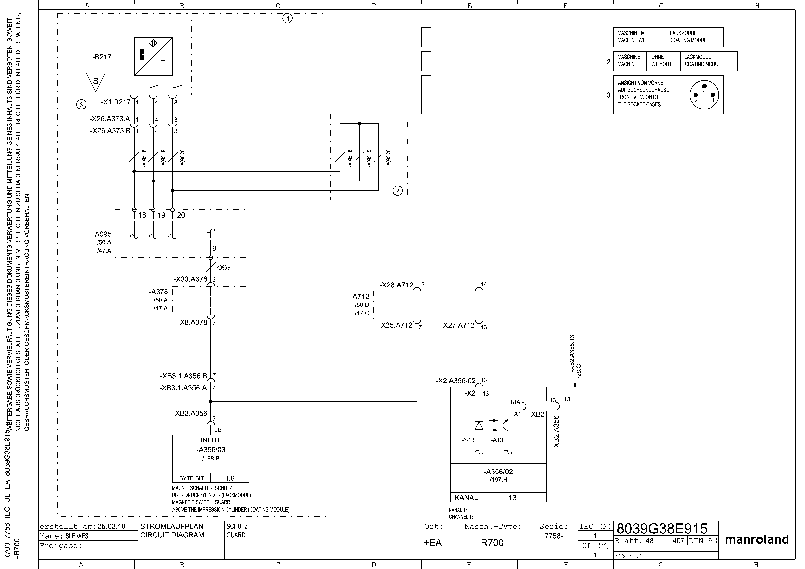

# +EA — Sheet 48 of 407 — SCHUTZ

**GUARD**

> Part of the manroland **R700** printing press IEC/UL circuit diagrams.
> Drawing class: **Stromlaufplan / Circuit diagram** (DIN A3).
> Document `+EA` covers the **Printing unit** machine section.

## At a glance

| Field | Value |
|---|---|
| Document | `+EA`  (8039G38E915) |
| Sheet | **48** of 407 |
| Section (DE) | SCHUTZ |
| Section (EN) | GUARD |
| Section type | CIRCUIT — Circuit diagram |
| Machine type | `R700` |
| Series | `7758` |
| Created | 25.03.10 |
| Replaces | — |
| Columns used | A, B, C, D, E, F, G, H |
| Path numbers | — |
| Labels on sheet | 104 |
| Cross-refs out | 9 |
| Cross-refs in | 29 |

**Previous:** [+EA sheet 47](SHEET_0047.md) · **Next:** [+EA sheet 49](SHEET_0049.md) · **Document TOC:** [_TOC.md](_TOC.md)  (+EA) · **Master TOC:** [all sheets](../_MASTER_TOC.md)

## Sheet image (300 DPI, exact vector render)



_Rendered directly from the PDF vector layer at 300 DPI (1-bit), no OCR and no resampling. Use it to confirm anything ambiguous in the text below._

## Cross-references on this sheet

Each entry is a wire leaving this sheet. The printed token is `/sheet.column`; the link resolves to that sheet inside the same document.

| Ref | Target sheet | Col | Path | Destination on target | Target section | From col |
|---|---|---|---|---|---|---|
| `/50.A` | [+EA sheet 50](SHEET_0050.md) | A | — | — | SCHUTZ | A |
| `/47.A` | [+EA sheet 47](SHEET_0047.md) | A | — | — | SCHUTZ | A |
| `/50.A` | [+EA sheet 50](SHEET_0050.md) | A | — | — | SCHUTZ | B |
| `/47.A` | [+EA sheet 47](SHEET_0047.md) | A | — | — | SCHUTZ | B |
| `/50.D` | [+EA sheet 50](SHEET_0050.md) | D | — | — | SCHUTZ | D |
| `/47.C` | [+EA sheet 47](SHEET_0047.md) | C | — | — | SCHUTZ | D |
| `/26.C` | [+EA sheet 26](SHEET_0026.md) | C | — | XB2.A356:13 | BUSVERBINDUNGEN: SICHERHEITSBUS | F |
| `/198.B` | [+EA sheet 198](SHEET_0198.md) | B | — | — | REFERENZMODUL | B |
| `/197.H` | [+EA sheet 197](SHEET_0197.md) | H | — | — | REFERENZMODUL | E |

### Incoming references (sheets that point here)

Every other sheet that sends a wire to this one. `Back-ref` is the token printed on *that* sheet; `Path` is its line number.

| From sheet | Cols | Back-ref | Path | Refs | What continues there |
|---|---|---|---|---|---|
| [+EA#26](SHEET_0026.md) | C | `/26.C` | — | 1 | XB2.A356:13 |
| [+EA#47](SHEET_0047.md) | A, C | `/47.A`, `/47.C` | — | 3 | — |
| [+EA#50](SHEET_0050.md) | A, D | `/50.A`, `/50.D` | — | 3 | — |
| [+EA#197](SHEET_0197.md) | H | `/197.H` | — | 1 | — |
| [+EA#198](SHEET_0198.md) | B | `/198.B` | — | 1 | — |
| [+EA#216](SHEET_0216.md) | F | `/216.F` | — | 3 | — |
| [+EA#225](SHEET_0225.md) | F | `/225.F` | — | 1 | — |
| [+EA#226](SHEET_0226.md) | E | `/226.E` | — | 1 | — |
| [+EA#234](SHEET_0234.md) | H | `/234.H` | — | 1 | — |
| [+EA#235](SHEET_0235.md) | A, B | `/235.A`, `/235.B` | — | 2 | — |
| [+EA#250](SHEET_0250.md) | D | `/250.D` | — | 1 | — |
| [+EA#268](SHEET_0268.md) | F | `/268.F` | — | 1 | — |
| [+EA#269](SHEET_0269.md) | F | `/269.F` | — | 6 | — |
| [+EA#271](SHEET_0271.md) | G | `/271.G` | — | 1 | — |
| [+EA#273](SHEET_0273.md) | C | `/273.C` | — | 2 | — |
| [+EA#277](SHEET_0277.md) | F | `/277.F` | — | 1 | — |


## Devices on this sheet

| Tag | Class | Class meaning (IEC) | Col | Sub | Terminal | Sign |
|---|---|---|---|---|---|---|
| `A356/03` | A | Baugruppe / assembly, module, PC board | B | 03 | — | — |
| `A095` | A | Baugruppe / assembly, module, PC board | A | — | — | — |
| `B217` | B | Umformer / transducer, sensor | A | — | — | — |
| `A378` | A | Baugruppe / assembly, module, PC board | B | — | — | — |
| `S13` | S | Schalter / switch | E | — | — | — |
| `A13` | A | Baugruppe / assembly, module, PC board | E | — | — | — |
| `X1` | X | Klemme / terminal, plug connector | E | — | — | — |
| `X2` | X | Klemme / terminal, plug connector | E | — | — | — |
| `XB2` | XB |  | F | — | — | — |
| `A356/02` | A | Baugruppe / assembly, module, PC board | E | 02 | — | — |
| `A712` | A | Baugruppe / assembly, module, PC board | D | — | — | — |
| `A095:18` | A | Baugruppe / assembly, module, PC board | B | — | 18 | — |
| `A095:19` | A | Baugruppe / assembly, module, PC board | B | — | 19 | — |
| `A095:20` | A | Baugruppe / assembly, module, PC board | B | — | 20 | — |
| `A095:9` | A | Baugruppe / assembly, module, PC board | B | — | 9 | — |
| `A095:18` | A | Baugruppe / assembly, module, PC board | D | — | 18 | — |
| `A095:19` | A | Baugruppe / assembly, module, PC board | D | — | 19 | — |
| `A095:20` | A | Baugruppe / assembly, module, PC board | D | — | 20 | — |
| `1.6` | — | cross-device reference | B | — | — | — |
| `XB3.A356` | — | cross-device reference | B | — | — | — |
| `X26.A373.B` | — | cross-device reference | A | — | — | — |
| `X26.A373.A` | — | cross-device reference | A | — | — | — |
| `X1.B217` | — | cross-device reference | A | — | — | — |
| `X33.A378` | — | cross-device reference | B | — | — | — |
| `X8.A378` | — | cross-device reference | B | — | — | — |
| `XB3.1.A356.B` | — | cross-device reference | B | — | — | — |
| `XB3.1.A356.A` | — | cross-device reference | B | — | — | — |
| `XB2.A356` | — | cross-device reference | F | — | — | — |
| `X28.A712` | — | cross-device reference | D | — | — | — |
| `X27.A712` | — | cross-device reference | E | — | — | — |
| `X25.A712` | — | cross-device reference | D | — | — | — |
| `XB2.A356:13` | — | cross-device reference | F | — | 13 | — |

## Potentials / nets

_No named potentials on this sheet._

## Wire-end annotations (grouped as printed)

A wire that continues elsewhere is annotated with a small cluster: the destination description, the path/line number `#NN`, and the `/sheet.column` cross reference. Each row below is one such cluster exactly as it is grouped on the drawing.

| Col | Y | Path | Cross-ref | Text on the wire |
|---|---|---|---|---|
| C | 23.9 | — | — | `1` |
| G | 46.0 | — | — | `1 MASCHINE MIT MACHINE WITH` |
| G | 46.0 | — | — | `LACKMODUL` |
| G | 56.6 | — | — | `COATING MODULE` |
| A | 79.7 | — | — | `B217` |
| G | 81.4 | — | — | `MASCHINE MACHINE` |
| G | 81.4 | — | — | `OHNE WITHOUT` |
| G | 81.4 | — | — | `LACKMODUL` |
| G | 86.7 | — | — | `2 COATING MODULE` |
| A | 114.5 | — | — | `S` |
| G | 119.7 | — | — | `FRONT VIEW ONTO ANSICHT VON VORNE AUF BUCHSENGEHÄUSE` |
| G | 132.0 | — | — | `4` |
| G | 136.3 | — | — | `3 THE SOCKET CASES` |
| G | 144.8 | — | — | `3 1` |
| B | 146.3 | — | — | `X1.B217 1 4 3` |
| A | 151.9 | — | — | `3` |
| A | 171.1 | — | — | `X26.A373.A 1 4 3` |
| A | 188.8 | — | — | `X26.A373.B 1 4 3` |
| B | 221.6 | — | — | `A095:18` |
| B | 221.6 | — | — | `A095:19` |
| B | 221.6 | — | — | `A095:20` |
| D | 221.6 | — | — | `A095:18` |
| D | 221.6 | — | — | `A095:19` |
| D | 221.6 | — | — | `A095:20` |
| D | 279.5 | — | — | `2` |
| B | 313.5 | — | — | `18 19 20` |
| A | 341.9 | — | — | `A095` |
| A | 354.9 | — | `/50.A`, `/47.A` | — |
| B | 363.1 | — | — | `9` |
| B | 393.2 | — | — | `A095:9` |
| B | 408.5 | — | — | `X33.A378 3` |
| E | 417.0 | — | — | `X28.A712 13 14` |
| B | 426.9 | — | — | `A378` |
| D | 434.0 | — | — | `A712` |
| B | 440.0 | — | `/50.A`, `/47.A` | — |
| D | 447.1 | — | `/50.D`, `/47.C` | — |
| B | 472.3 | — | — | `X8.A378 7` |
| E | 476.5 | — | — | `X25.A712 7 X27.A712 13` |
| F | 495.5 | — | `/26.C` | `XB2.A356:13` |
| B | 551.7 | — | — | `XB3.1.A356.B 7` |
| E | 558.7 | — | — | `X2.A356/02 13` |
| B | 568.7 | — | — | `XB3.1.A356.A 7` |
| E | 577.2 | — | — | `X2` |
| F | 578.6 | — | — | `13 13` |
| F | 587.1 | — | — | `13` |
| E | 591.3 | — | — | `18A` |
| B | 606.9 | — | — | `XB3.A356 7` |
| E | 608.3 | — | — | `X1` |
| F | 608.4 | — | — | `XB2` |
| F | 614.5 | — | — | `XB2.A356` |
| B | 632.4 | — | — | `9B` |
| B | 646.9 | — | — | `INPUT` |
| E | 647.3 | — | — | `S13 A13` |
| B | 660.8 | — | — | `A356/03` |
| B | 674.5 | — | `/198.B` | — |
| E | 693.4 | — | — | `A356/02` |
| B | 703.6 | — | — | `BYTE.BIT 1.6` |
| E | 705.8 | — | `/197.H` | — |
| B | 719.2 | — | — | `ÜBER DRUCKZYLINDER (LACKMODUL) MAGNETSCHALTER: SCHUTZ MAGNETIC SWITCH: GUARD` |
| E | 731.6 | — | — | `KANAL 13` |
| C | 751.1 | — | — | `ABOVE THE IMPRESSION CYLINDER (COATING MODULE)` |
| E | 752.0 | — | — | `KANAL 13 CHANNEL 13` |


## Reconstructed tables

This sheet carries tabular content (pin map / terminal assignment / index). The grid below was rebuilt from the drawing's own rule lines, so each row is exactly one physical row of the table.

### Table 1 — 4 data rows × 4 columns (at x=198.4, y=55.3)

| 1 1 1 A095:18 | 4 4 4 A095:19 | 3 3 3 A095:20 |  |
|---|---|---|---|
| `18` | `19 A378 /50.A /47.A` | `20 X33.A378 X8.A378 XB3.1.A356.B XB3.1.A356.A` | `9 A095:9 3 7 7 7` |
|  |  | `XB3.A356` | `7 9B` |
|  |  | `INPUT` | `A356/03 /198.B` |
|  |  | `BYTE.BIT` | `1.6` |


### Table 2 — 7 data rows × 12 columns (at x=503.1, y=112.0)

|  |  |  |  |  |  |  |  |  | 3 | ANSICHT VON VORNE AUF BUCHSENGEHÄUSE FRONT VIEW ONTO THE SOCKET CASES | 4 3 1 |
|---|---|---|---|---|---|---|---|---|---|---|---|
| `A095:18` | `A095:19` | `A095:20` |  |  |  |  |  |  |  |  |  |
|  |  | `2` |  |  |  |  |  |  |  |  |  |
|  | `A712 /50.D /47.C` | `X28.A712 X25.A712` | `13 7` | `X27.A712 X2.A356/02` | `14 13 13` |  |  | `XB2.A356:13` | `/26.C` |  |  |
|  |  |  |  | `X2` | `13` |  |  | `13 13` |  |  |  |
|  |  |  |  | `S13` | `A13` | `18A X1` | `XB2` | `XB2.A356` |  |  |  |
|  |  |  |  |  | `A356/02 /197.H` |  |  |  |  |  |  |
|  |  |  |  | `KANAL` |  | `13` |  |  |  |  |  |


## Notes and free text on this sheet

| Text | Col | Y (pt) |
|---|---|---|
| `9B` | B | 632.4 |
| `INPUT` | B | 646.94 |
| `BYTE.BIT` | B | 704.19 |
| `MAGNETSCHALTER: SCHUTZ` | B | 719.22 |
| `ÜBER DRUCKZYLINDER (LACKMODUL)` | B | 729.86 |
| `MAGNETIC SWITCH: GUARD` | B | 740.46 |
| `ABOVE THE IMPRESSION CYLINDER (COATING MODULE)` | C | 751.12 |
| `KANAL 13` | E | 751.97 |
| `CHANNEL 13` | E | 761.91 |
| `18A` | E | 591.31 |
| `KANAL` | E | 731.64 |
| `X2.A356/02` | E | 558.73 |
| `MASCHINE MIT` | G | 45.99 |
| `MACHINE WITH` | G | 56.57 |
| `LACKMODUL` | G | 46 |
| `COATING MODULE` | G | 56.63 |
| `MASCHINE` | G | 81.41 |
| `MACHINE` | G | 92.05 |
| `OHNE` | G | 81.41 |
| `WITHOUT` | G | 92.01 |
| `ANSICHT VON VORNE` | G | 119.69 |
| `AUF BUCHSENGEHÄUSE` | G | 130.32 |
| `FRONT VIEW ONTO` | G | 140.91 |
| `THE SOCKET CASES` | G | 151.56 |
| `S` | A | 114.47 |

## Complete label inventory (exact text from the drawing)

Every text object inside the drawing area of this sheet, in DIN reading order (column A→H, then top→bottom). This is the authoritative list: if a string is not here it is not printed on this sheet.

| Col | Y | X | Dir | Type | Text |
|---|---|---|---|---|---|
| A | 79.7 | 136.6 | → | device tag | `B217` |
| A | 114.5 | 137.6 | → | text | `S` |
| A | 146.3 | 149.1 | → | device ref | `X1.B217` |
| A | 151.9 | 118.5 | → | number | `3` |
| A | 171.1 | 132.4 | → | device ref | `X26.A373.A` |
| A | 188.8 | 133.2 | → | device ref | `X26.A373.B` |
| A | 341.9 | 136.6 | → | device tag | `A095` |
| A | 354.9 | 143.7 | → | cross-reference | `/50.A` |
| A | 367.3 | 143.7 | → | cross-reference | `/47.A` |
| B | 147.7 | 200.4 | → | number | `1` |
| B | 147.7 | 229.3 | → | number | `4` |
| B | 147.7 | 257.7 | → | number | `3` |
| B | 173.2 | 200.4 | → | number | `1` |
| B | 173.2 | 229.3 | → | number | `4` |
| B | 173.2 | 257.7 | → | number | `3` |
| B | 190.2 | 200.4 | → | number | `1` |
| B | 190.2 | 229.3 | → | number | `4` |
| B | 190.2 | 257.7 | → | number | `3` |
| B | 221.6 | 210.4 | ↕ | device tag | `A095:18` |
| B | 221.6 | 238.8 | ↕ | device tag | `A095:19` |
| B | 221.6 | 267.1 | ↕ | device tag | `A095:20` |
| B | 313.5 | 204.4 | → | number | `18` |
| B | 313.5 | 232.7 | → | number | `19` |
| B | 313.5 | 261.9 | → | number | `20` |
| B | 363.1 | 314.1 | → | number | `9` |
| B | 393.2 | 318.6 | → | device tag | `A095:9` |
| B | 408.5 | 256.5 | → | device ref | `X33.A378` |
| B | 409.9 | 314.4 | → | number | `3` |
| B | 426.9 | 220.3 | → | device tag | `A378` |
| B | 440.0 | 227.3 | → | cross-reference | `/50.A` |
| B | 452.4 | 227.3 | → | cross-reference | `/47.A` |
| B | 472.3 | 262.5 | → | device ref | `X8.A378` |
| B | 473.7 | 314.4 | → | number | `7` |
| B | 551.7 | 236.7 | → | device ref | `XB3.1.A356.B` |
| B | 551.7 | 314.4 | → | number | `7` |
| B | 568.7 | 314.4 | → | number | `7` |
| B | 569.4 | 235.8 | → | device ref | `XB3.1.A356.A` |
| B | 606.9 | 255.4 | → | device ref | `XB3.A356` |
| B | 615.4 | 314.4 | → | number | `7` |
| B | 632.4 | 317.2 | → | text | `9B` |
| B | 646.9 | 296.9 | → | text | `INPUT` |
| B | 660.8 | 290.4 | → | device tag | `A356/03` |
| B | 674.6 | 299.2 | → | cross-reference | `/198.B` |
| B | 703.6 | 333.1 | → | device ref | `1.6` |
| B | 704.2 | 265.0 | → | text | `BYTE.BIT` |
| B | 719.2 | 254.6 | → | text | `MAGNETSCHALTER: SCHUTZ` |
| B | 729.9 | 254.3 | → | text | `ÜBER DRUCKZYLINDER (LACKMODUL)` |
| B | 740.5 | 254.6 | → | text | `MAGNETIC SWITCH: GUARD` |
| C | 23.9 | 423.4 | → | number | `1` |
| C | 751.1 | 255.1 | → | text | `ABOVE THE IMPRESSION CYLINDER (COATING MODULE)` |
| D | 221.6 | 515.1 | ↕ | device tag | `A095:18` |
| D | 221.6 | 543.5 | ↕ | device tag | `A095:19` |
| D | 221.6 | 571.8 | ↕ | device tag | `A095:20` |
| D | 279.5 | 586.2 | → | number | `2` |
| D | 417.0 | 561.3 | → | device ref | `X28.A712` |
| D | 417.0 | 618.5 | → | number | `13` |
| D | 434.0 | 517.9 | → | device tag | `A712` |
| D | 447.1 | 525.0 | → | cross-reference | `/50.D` |
| D | 459.5 | 525.0 | → | cross-reference | `/47.C` |
| D | 476.5 | 559.8 | → | device ref | `X25.A712` |
| D | 480.8 | 619.1 | → | number | `7` |
| E | 417.0 | 710.6 | → | number | `14` |
| E | 476.5 | 652.0 | → | device ref | `X27.A712` |
| E | 480.8 | 710.6 | → | number | `13` |
| E | 558.7 | 644.6 | → | text | `X2.A356/02` |
| E | 558.7 | 710.6 | → | number | `13` |
| E | 577.2 | 687.1 | → | device tag | `X2` |
| E | 578.6 | 713.5 | → | number | `13` |
| E | 591.3 | 754.0 | → | text | `18A` |
| E | 608.3 | 757.7 | → | device tag | `X1` |
| E | 647.3 | 683.4 | → | device tag | `S13` |
| E | 647.3 | 726.0 | → | device tag | `A13` |
| E | 693.4 | 715.6 | → | device tag | `A356/02` |
| E | 705.8 | 724.5 | → | cross-reference | `/197.H` |
| E | 731.6 | 672.4 | → | text | `KANAL` |
| E | 731.6 | 752.0 | → | number | `13` |
| E | 752.0 | 664.2 | → | text | `KANAL 13` |
| E | 761.9 | 664.4 | → | text | `CHANNEL 13` |
| F | 51.3 | 897.4 | → | number | `1` |
| F | 86.7 | 897.2 | → | number | `2` |
| F | 136.3 | 897.0 | → | number | `3` |
| F | 495.5 | 842.2 | ↕ | device ref | `XB2.A356:13` |
| F | 538.9 | 852.1 | ↕ | cross-reference | `/26.C` |
| F | 587.1 | 834.0 | → | number | `13` |
| F | 588.5 | 812.7 | → | number | `13` |
| F | 608.3 | 782.1 | → | device tag | `XB2` |
| F | 614.6 | 818.1 | ↕ | device ref | `XB2.A356` |
| G | 46.0 | 913.6 | → | text | `MASCHINE MIT` |
| G | 46.0 | 991.3 | → | text | `LACKMODUL` |
| G | 56.6 | 913.6 | → | text | `MACHINE WITH` |
| G | 56.6 | 991.8 | → | text | `COATING MODULE` |
| G | 81.4 | 913.6 | → | text | `MASCHINE` |
| G | 81.4 | 963.5 | → | text | `OHNE` |
| G | 81.4 | 1012.5 | → | text | `LACKMODUL` |
| G | 92.0 | 913.6 | → | text | `MACHINE` |
| G | 92.0 | 963.8 | → | text | `WITHOUT` |
| G | 92.1 | 1013.1 | → | text | `COATING MODULE` |
| G | 119.7 | 914.2 | → | text | `ANSICHT VON VORNE` |
| G | 130.3 | 914.2 | → | text | `AUF BUCHSENGEHÄUSE` |
| G | 132.0 | 1039.7 | → | number | `4` |
| G | 140.9 | 913.3 | → | text | `FRONT VIEW ONTO` |
| G | 144.7 | 1027.0 | → | number | `3` |
| G | 151.6 | 913.9 | → | text | `THE SOCKET CASES` |
| H | 144.7 | 1052.9 | → | number | `1` |

## Reading-order text block

The same content as a plain block, grouped by DIN column — convenient to paste or to match against a visual description.

```text
=== Column A ===
  79.7  136.6  devtag       B217
 114.5  137.6  text         S
 146.3  149.1  devref       X1.B217
 151.9  118.5  numeric      3
 171.1  132.4  devref       X26.A373.A
 188.8  133.2  devref       X26.A373.B
 341.9  136.6  devtag       A095
 354.9  143.7  xref         /50.A
 367.3  143.7  xref         /47.A
=== Column B ===
 147.7  200.4  numeric      1
 147.7  229.3  numeric      4
 147.7  257.7  numeric      3
 173.2  200.4  numeric      1
 173.2  229.3  numeric      4
 173.2  257.7  numeric      3
 190.2  200.4  numeric      1
 190.2  229.3  numeric      4
 190.2  257.7  numeric      3
 221.6  210.4  devtag       A095:18
 221.6  238.8  devtag       A095:19
 221.6  267.1  devtag       A095:20
 313.5  204.4  numeric      18
 313.5  232.7  numeric      19
 313.5  261.9  numeric      20
 363.1  314.1  numeric      9
 393.2  318.6  devtag       A095:9
 408.5  256.5  devref       X33.A378
 409.9  314.4  numeric      3
 426.9  220.3  devtag       A378
 440.0  227.3  xref         /50.A
 452.4  227.3  xref         /47.A
 472.3  262.5  devref       X8.A378
 473.7  314.4  numeric      7
 551.7  236.7  devref       XB3.1.A356.B
 551.7  314.4  numeric      7
 568.7  314.4  numeric      7
 569.4  235.8  devref       XB3.1.A356.A
 606.9  255.4  devref       XB3.A356
 615.4  314.4  numeric      7
 632.4  317.2  text         9B
 646.9  296.9  text         INPUT
 660.8  290.4  devtag       A356/03
 674.6  299.2  xref         /198.B
 703.6  333.1  devref       1.6
 704.2  265.0  text         BYTE.BIT
 719.2  254.6  text         MAGNETSCHALTER: SCHUTZ
 729.9  254.3  text         ÜBER DRUCKZYLINDER (LACKMODUL)
 740.5  254.6  text         MAGNETIC SWITCH: GUARD
=== Column C ===
  23.9  423.4  numeric      1
 751.1  255.1  text         ABOVE THE IMPRESSION CYLINDER (COATING MODULE)
=== Column D ===
 221.6  515.1  devtag       A095:18
 221.6  543.5  devtag       A095:19
 221.6  571.8  devtag       A095:20
 279.5  586.2  numeric      2
 417.0  561.3  devref       X28.A712
 417.0  618.5  numeric      13
 434.0  517.9  devtag       A712
 447.1  525.0  xref         /50.D
 459.5  525.0  xref         /47.C
 476.5  559.8  devref       X25.A712
 480.8  619.1  numeric      7
=== Column E ===
 417.0  710.6  numeric      14
 476.5  652.0  devref       X27.A712
 480.8  710.6  numeric      13
 558.7  644.6  text         X2.A356/02
 558.7  710.6  numeric      13
 577.2  687.1  devtag       X2
 578.6  713.5  numeric      13
 591.3  754.0  text         18A
 608.3  757.7  devtag       X1
 647.3  683.4  devtag       S13
 647.3  726.0  devtag       A13
 693.4  715.6  devtag       A356/02
 705.8  724.5  xref         /197.H
 731.6  672.4  text         KANAL
 731.6  752.0  numeric      13
 752.0  664.2  text         KANAL 13
 761.9  664.4  text         CHANNEL 13
=== Column F ===
  51.3  897.4  numeric      1
  86.7  897.2  numeric      2
 136.3  897.0  numeric      3
 495.5  842.2  devref       XB2.A356:13
 538.9  852.1  xref         /26.C
 587.1  834.0  numeric      13
 588.5  812.7  numeric      13
 608.3  782.1  devtag       XB2
 614.6  818.1  devref       XB2.A356
=== Column G ===
  46.0  913.6  text         MASCHINE MIT
  46.0  991.3  text         LACKMODUL
  56.6  913.6  text         MACHINE WITH
  56.6  991.8  text         COATING MODULE
  81.4  913.6  text         MASCHINE
  81.4  963.5  text         OHNE
  81.4 1012.5  text         LACKMODUL
  92.0  913.6  text         MACHINE
  92.0  963.8  text         WITHOUT
  92.1 1013.1  text         COATING MODULE
 119.7  914.2  text         ANSICHT VON VORNE
 130.3  914.2  text         AUF BUCHSENGEHÄUSE
 132.0 1039.7  numeric      4
 140.9  913.3  text         FRONT VIEW ONTO
 144.7 1027.0  numeric      3
 151.6  913.9  text         THE SOCKET CASES
=== Column H ===
 144.7 1052.9  numeric      1
```

---
_Generated from the PDF vector text layer; no OCR. Source: `R700_7758_IEC_UL_EA_8039G38E915_p`, sheet 48._
