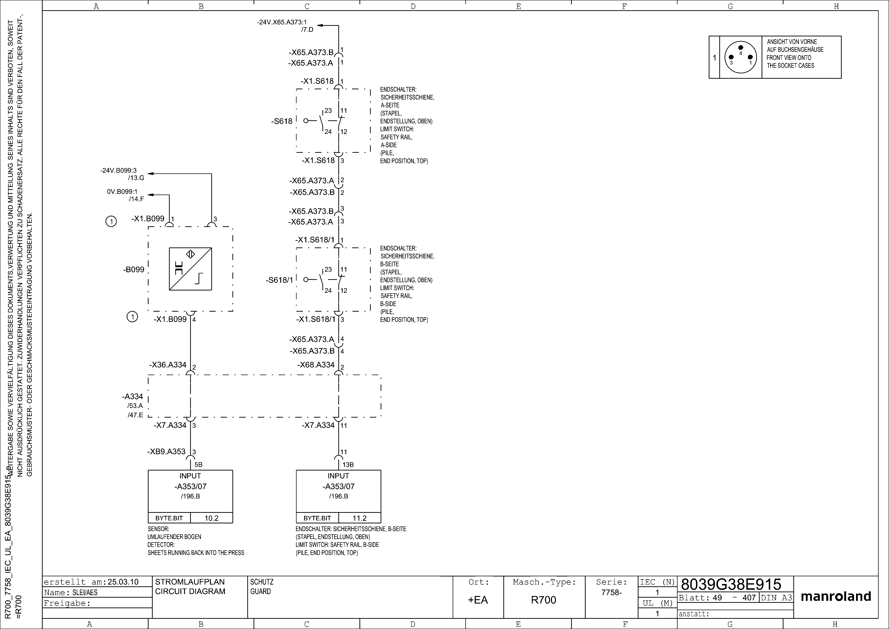

# +EA — Sheet 49 of 407 — SCHUTZ

**GUARD**

> Part of the manroland **R700** printing press IEC/UL circuit diagrams.
> Drawing class: **Stromlaufplan / Circuit diagram** (DIN A3).
> Document `+EA` covers the **Printing unit** machine section.

## At a glance

| Field | Value |
|---|---|
| Document | `+EA`  (8039G38E915) |
| Sheet | **49** of 407 |
| Section (DE) | SCHUTZ |
| Section (EN) | GUARD |
| Section type | CIRCUIT — Circuit diagram |
| Machine type | `R700` |
| Series | `7758` |
| Created | 25.03.10 |
| Replaces | — |
| Columns used | A, B, C, D, G, H |
| Path numbers | — |
| Labels on sheet | 110 |
| Cross-refs out | 7 |
| Cross-refs in | 28 |

**Previous:** [+EA sheet 48](SHEET_0048.md) · **Next:** [+EA sheet 50](SHEET_0050.md) · **Document TOC:** [_TOC.md](_TOC.md)  (+EA) · **Master TOC:** [all sheets](../_MASTER_TOC.md)

## Sheet image (300 DPI, exact vector render)



_Rendered directly from the PDF vector layer at 300 DPI (1-bit), no OCR and no resampling. Use it to confirm anything ambiguous in the text below._

## Cross-references on this sheet

Each entry is a wire leaving this sheet. The printed token is `/sheet.column`; the link resolves to that sheet inside the same document.

| Ref | Target sheet | Col | Path | Destination on target | Target section | From col |
|---|---|---|---|---|---|---|
| `/7.D` | [+EA sheet 7](SHEET_0007.md) | D | — | 24V.X65.A373:1 | SPANNUNGSVERSORGUNG: 400V, 24V | C |
| `/13.G` | [+EA sheet 13](SHEET_0013.md) | G | — | 24V.B099:3 | SPANNUNGSVERSORGUNG: 400V, 24V | A |
| `/14.F` | [+EA sheet 14](SHEET_0014.md) | F | — | 0V.B099:1 | SPANNUNGSVERSORGUNG: 400V, 24V | A |
| `/53.A` | [+EA sheet 53](SHEET_0053.md) | A | — | — | MASCHINENBEDIENUNG: LAUFKOMMANDOS | A |
| `/47.E` | [+EA sheet 47](SHEET_0047.md) | E | — | — | SCHUTZ | A |
| `/196.B` | [+EA sheet 196](SHEET_0196.md) | B | — | — | REFERENZMODUL | B |
| `/196.B` | [+EA sheet 196](SHEET_0196.md) | B | — | — | REFERENZMODUL | C |

### Incoming references (sheets that point here)

Every other sheet that sends a wire to this one. `Back-ref` is the token printed on *that* sheet; `Path` is its line number.

| From sheet | Cols | Back-ref | Path | Refs | What continues there |
|---|---|---|---|---|---|
| [+EA#7](SHEET_0007.md) | D | `/7.D` | — | 1 | 24V.X65.A373:1 |
| [+EA#13](SHEET_0013.md) | G | `/13.G` | — | 1 | 24V.B099:3 |
| [+EA#14](SHEET_0014.md) | F | `/14.F` | — | 1 | 0V.B099:1 |
| [+EA#47](SHEET_0047.md) | E | `/47.E` | — | 1 | — |
| [+EA#53](SHEET_0053.md) | A | `/53.A` | — | 1 | — |
| [+EA#196](SHEET_0196.md) | B | `/196.B` | — | 2 | — |
| [+EA#214](SHEET_0214.md) | F | `/214.F` | — | 3 | — |
| [+EA#221](SHEET_0221.md) | C | `/221.C` | — | 4 | — |
| [+EA#246](SHEET_0246.md) | F | `/246.F` | — | 2 | — |
| [+EA#252](SHEET_0252.md) | C | `/252.C` | — | 2 | — |
| [+EA#279](SHEET_0279.md) | B | `/279.B` | — | 1 | — |
| [+EA#284](SHEET_0284.md) | F | `/284.F` | — | 8 | — |
| [+EA#285](SHEET_0285.md) | B | `/285.B` | — | 1 | — |


## Devices on this sheet

| Tag | Class | Class meaning (IEC) | Col | Sub | Terminal | Sign |
|---|---|---|---|---|---|---|
| `A353/07` | A | Baugruppe / assembly, module, PC board | B | 07 | — | — |
| `A334` | A | Baugruppe / assembly, module, PC board | A | — | — | — |
| `B099` | B | Umformer / transducer, sensor | A | — | — | — |
| `S618` | S | Schalter / switch | C | — | — | — |
| `S618/1` | S | Schalter / switch | C | 1 | — | — |
| `A353/07` | A | Baugruppe / assembly, module, PC board | C | 07 | — | — |
| `10.2` | — | cross-device reference | B | — | — | — |
| `XB9.A353` | — | cross-device reference | B | — | — | — |
| `X36.A334` | — | cross-device reference | B | — | — | — |
| `X7.A334` | — | cross-device reference | B | — | — | — |
| `X1.B099` | — | cross-device reference | B | — | — | — |
| `X1.B099` | — | cross-device reference | A | — | — | — |
| `X1.S618` | — | cross-device reference | C | — | — | — |
| `X1.S618` | — | cross-device reference | C | — | — | — |
| `X65.A373.A` | — | cross-device reference | C | — | — | — |
| `X65.A373.B` | — | cross-device reference | C | — | — | — |
| `X65.A373.B` | — | cross-device reference | C | — | — | — |
| `X65.A373.A` | — | cross-device reference | C | — | — | — |
| `X65.A373.A` | — | cross-device reference | C | — | — | — |
| `X65.A373.B` | — | cross-device reference | C | — | — | — |
| `X65.A373.B` | — | cross-device reference | C | — | — | — |
| `X65.A373.A` | — | cross-device reference | C | — | — | — |
| `11.2` | — | cross-device reference | C | — | — | — |
| `X68.A334` | — | cross-device reference | C | — | — | — |
| `X7.A334` | — | cross-device reference | C | — | — | — |

## Potentials / nets

| Potential | Count | Columns | Attached devices | Terminals |
|---|---|---|---|---|
| `0V` | 1 | A | `B099` | `1` |
| `24V` | 2 | A, C | `A373`, `B099`, `X65` | `1`, `3` |


A potential such as `L24+/4` or `M24+` is a named supply/return rail; every place it appears on this sheet is electrically common.

## Wire-end annotations (grouped as printed)

A wire that continues elsewhere is annotated with a small cluster: the destination description, the path/line number `#NN`, and the `/sheet.column` cross reference. Each row below is one such cluster exactly as it is grouped on the drawing.

| Col | Y | Path | Cross-ref | Text on the wire |
|---|---|---|---|---|
| C | 25.8 | — | `/7.D` | `24V.X65.A373:1` |
| H | 53.1 | — | — | `FRONT VIEW ONTO ANSICHT VON VORNE AUF BUCHSENGEHÄUSE` |
| C | 62.7 | — | — | `X65.A373.B 1` |
| G | 68.2 | — | — | `4` |
| G | 72.5 | — | — | `1 3 1` |
| C | 79.7 | — | — | `X65.A373.A 1` |
| H | 85.0 | — | — | `THE SOCKET CASES` |
| C | 103.8 | — | — | `X1.S618 1` |
| D | 116.8 | — | — | `ENDSCHALTER:` |
| D | 127.5 | — | — | `ENDSTELLUNG, OBEN) LIMIT SWITCH: (STAPEL, SICHERHEITSSCHIENE, A SEITE` |
| C | 144.2 | — | — | `23` |
| C | 144.2 | — | — | `11` |
| C | 157.6 | — | — | `S618` |
| C | 172.5 | — | — | `24` |
| C | 172.5 | — | — | `12` |
| D | 180.6 | — | — | `END POSITION, TOP) (PILE, SAFETY RAIL, A SIDE` |
| C | 210.1 | — | — | `X1.S618 3` |
| A | 224.2 | — | `/13.G` | `24V.B099:3` |
| C | 237.0 | — | — | `X65.A373.A 2` |
| A | 252.6 | — | `/14.F` | `0V.B099:1` |
| C | 252.6 | — | — | `X65.A373.B 2` |
| C | 275.3 | — | — | `X65.A373.B 3` |
| B | 288.0 | — | — | `X1.B099 1 3` |
| C | 292.3 | — | — | `X65.A373.A 3` |
| A | 293.2 | — | — | `1` |
| C | 316.4 | — | — | `X1.S618/1 1` |
| D | 329.4 | — | — | `ENDSCHALTER:` |
| D | 340.1 | — | — | `B SEITE ENDSTELLUNG, OBEN) LIMIT SWITCH: (STAPEL, SICHERHEITSSCHIENE,` |
| A | 356.1 | — | — | `B099` |
| C | 356.8 | — | — | `23` |
| C | 356.8 | — | — | `11` |
| C | 370.2 | — | — | `S618/1` |
| C | 385.1 | — | — | `24` |
| C | 385.1 | — | — | `12` |
| D | 393.2 | — | — | `B SIDE END POSITION, TOP) (PILE, SAFETY RAIL,` |
| A | 420.7 | — | — | `1` |
| B | 422.7 | — | — | `X1.B099 4` |
| C | 422.7 | — | — | `X1.S618/1 3` |
| C | 449.6 | — | — | `X65.A373.A 4` |
| C | 465.2 | — | — | `X65.A373.B 4` |
| B | 483.6 | — | — | `X36.A334 2` |
| C | 483.6 | — | — | `X68.A334 2` |
| A | 526.1 | — | — | `A334` |
| A | 539.2 | — | `/53.A` | — |
| A | 551.6 | — | `/47.E` | — |
| B | 564.4 | — | — | `X7.A334 3` |
| C | 564.4 | — | — | `X7.A334 11` |
| B | 599.8 | — | — | `XB9.A353 3` |
| C | 601.3 | — | — | `11` |
| B | 618.2 | — | — | `5B` |
| C | 618.2 | — | — | `13B` |
| B | 632.8 | — | — | `INPUT` |
| C | 632.8 | — | — | `INPUT` |
| B | 646.6 | — | — | `A353/07` |
| C | 646.6 | — | — | `A353/07` |
| B | 660.4 | — | `/196.B` | — |
| C | 660.4 | — | `/196.B` | — |
| B | 689.5 | — | — | `BYTE.BIT 10.2` |
| C | 689.5 | — | — | `BYTE.BIT 11.2` |
| B | 705.0 | — | — | `UMLAUFENDER BOGEN DETECTOR: SENSOR:` |
| C | 705.0 | — | — | `ENDSCHALTER: SICHERHEITSSCHIENE, B SEITE LIMIT SWITCH: SAFETY RAIL, B SIDE (STAPEL, ENDSTELLUNG, OBEN) (PILE, END POSITION, TOP)` |
| B | 736.9 | — | — | `SHEETS RUNNING BACK INTO THE PRESS` |


## Reconstructed tables

This sheet carries tabular content (pin map / terminal assignment / index). The grid below was rebuilt from the drawing's own rule lines, so each row is exactly one physical row of the table.

### Table 1 — 4 data rows × 7 columns (at x=198.4, y=232.4)

|  | 1 |  | 3 |  | X65.A373.A X65.A373.B X65.A373.B X65.A373.A X1.S618/1 | 2 2 3 3 1 |
|---|---|---|---|---|---|---|
|  |  |  |  | `S618/1` | `23` | `11` |
| `X36.A334 XB9.A353` | `X1.B099 X7.A334` | `4 2 3 3 5B` |  |  | `24 X1.S618/1 X65.A373.A X65.A373.B X68.A334 X7.A334` | `12 3 4 4 2 11 11 13B` |
|  | `INPUT` | `A353/07 /196.B` |  |  | `INPUT` | `A353/07 /196.B` |
| `BYTE.BIT` |  | `10.2` |  |  | `BYTE.BIT` | `11.2` |


## Notes and free text on this sheet

| Text | Col | Y (pt) |
|---|---|---|
| `5B` | B | 618.22 |
| `INPUT` | B | 632.76 |
| `BYTE.BIT` | B | 690.01 |
| `SENSOR:` | B | 705.01 |
| `UMLAUFENDER BOGEN` | B | 715.68 |
| `DETECTOR:` | B | 726.28 |
| `SHEETS RUNNING BACK INTO THE PRESS` | B | 736.93 |
| `ENDSCHALTER:` | D | 116.84 |
| `SICHERHEITSSCHIENE,` | D | 127.47 |
| `A SEITE` | D | 138.07 |
| `(STAPEL,` | D | 148.69 |
| `ENDSTELLUNG, OBEN)` | D | 159.38 |
| `LIMIT SWITCH:` | D | 169.95 |
| `SAFETY RAIL,` | D | 180.6 |
| `A SIDE` | D | 191.25 |
| `(PILE,` | D | 201.83 |
| `END POSITION, TOP)` | D | 212.52 |
| `X1.S618/1` | C | 316.38 |
| `B SEITE` | D | 350.64 |
| `B SIDE` | D | 403.81 |
| `13B` | C | 618.24 |
| `INPUT` | C | 632.76 |
| `BYTE.BIT` | C | 690.01 |
| `ENDSCHALTER: SICHERHEITSSCHIENE, B SEITE` | C | 705.03 |
| `(STAPEL, ENDSTELLUNG, OBEN)` | C | 715.67 |
| `LIMIT SWITCH: SAFETY RAIL, B SIDE` | C | 726.27 |
| `(PILE, END POSITION, TOP)` | C | 736.92 |
| `ANSICHT VON VORNE` | H | 53.07 |
| `AUF BUCHSENGEHÄUSE` | H | 63.71 |
| `FRONT VIEW ONTO` | H | 74.3 |
| `THE SOCKET CASES` | H | 84.95 |

## Complete label inventory (exact text from the drawing)

Every text object inside the drawing area of this sheet, in DIN reading order (column A→H, then top→bottom). This is the authoritative list: if a string is not here it is not printed on this sheet.

| Col | Y | X | Dir | Type | Text |
|---|---|---|---|---|---|
| A | 224.2 | 134.4 | → | potential | `24V.B099:3` |
| A | 234.1 | 171.8 | → | cross-reference | `/13.G` |
| A | 252.6 | 143.4 | → | potential | `0V.B099:1` |
| A | 262.5 | 172.9 | → | cross-reference | `/14.F` |
| A | 288.0 | 176.0 | → | device ref | `X1.B099` |
| A | 293.2 | 147.1 | → | number | `1` |
| A | 356.1 | 165.0 | → | device tag | `B099` |
| A | 420.7 | 175.4 | → | number | `1` |
| A | 526.1 | 163.6 | → | device tag | `A334` |
| A | 539.2 | 170.6 | → | cross-reference | `/53.A` |
| A | 551.6 | 171.2 | → | cross-reference | `/47.E` |
| B | 289.5 | 228.8 | → | number | `1` |
| B | 289.5 | 286.0 | → | number | `3` |
| B | 422.7 | 205.8 | → | device ref | `X1.B099` |
| B | 424.1 | 257.7 | → | number | `4` |
| B | 483.6 | 199.8 | → | device ref | `X36.A334` |
| B | 487.9 | 257.7 | → | number | `2` |
| B | 564.4 | 205.8 | → | device ref | `X7.A334` |
| B | 565.8 | 257.7 | → | number | `3` |
| B | 599.8 | 197.3 | → | device ref | `XB9.A353` |
| B | 601.3 | 257.7 | → | number | `3` |
| B | 618.2 | 260.5 | → | text | `5B` |
| B | 632.8 | 240.2 | → | text | `INPUT` |
| B | 646.6 | 233.7 | → | device tag | `A353/07` |
| B | 660.4 | 242.5 | → | cross-reference | `/196.B` |
| B | 689.4 | 273.7 | → | device ref | `10.2` |
| B | 690.0 | 208.3 | → | text | `BYTE.BIT` |
| B | 705.0 | 198.1 | → | text | `SENSOR:` |
| B | 715.7 | 197.6 | → | text | `UMLAUFENDER BOGEN` |
| B | 726.3 | 197.6 | → | text | `DETECTOR:` |
| B | 736.9 | 198.1 | → | text | `SHEETS RUNNING BACK INTO THE PRESS` |
| C | 25.8 | 344.4 | → | potential | `24V.X65.A373:1` |
| C | 35.7 | 403.7 | → | cross-reference | `/7.D` |
| C | 62.7 | 455.5 | → | number | `1` |
| C | 65.5 | 386.9 | → | device ref | `X65.A373.B` |
| C | 79.7 | 386.1 | → | device ref | `X65.A373.A` |
| C | 79.7 | 455.5 | → | number | `1` |
| C | 103.8 | 402.8 | → | device ref | `X1.S618` |
| C | 105.2 | 455.5 | → | number | `1` |
| C | 144.2 | 434.8 | → | number | `23` |
| C | 144.2 | 455.5 | → | number | `11` |
| C | 157.6 | 363.4 | → | device tag | `S618` |
| C | 172.5 | 434.8 | → | number | `24` |
| C | 172.5 | 455.5 | → | number | `12` |
| C | 210.1 | 404.2 | → | device ref | `X1.S618` |
| C | 211.5 | 456.1 | → | number | `3` |
| C | 237.0 | 387.5 | → | device ref | `X65.A373.A` |
| C | 237.0 | 456.1 | → | number | `2` |
| C | 252.6 | 388.3 | → | device ref | `X65.A373.B` |
| C | 254.0 | 456.1 | → | number | `2` |
| C | 275.3 | 456.1 | → | number | `3` |
| C | 278.1 | 386.9 | → | device ref | `X65.A373.B` |
| C | 292.3 | 386.1 | → | device ref | `X65.A373.A` |
| C | 292.3 | 456.1 | → | number | `3` |
| C | 316.4 | 395.4 | → | text | `X1.S618/1` |
| C | 317.8 | 455.5 | → | number | `1` |
| C | 356.8 | 434.8 | → | number | `23` |
| C | 356.8 | 455.5 | → | number | `11` |
| C | 370.2 | 356.0 | → | device tag | `S618/1` |
| C | 385.1 | 434.8 | → | number | `24` |
| C | 385.1 | 455.5 | → | number | `12` |
| C | 422.7 | 396.9 | → | text | `X1.S618/1` |
| C | 424.1 | 456.1 | → | number | `3` |
| C | 449.6 | 387.5 | → | device ref | `X65.A373.A` |
| C | 449.6 | 456.1 | → | number | `4` |
| C | 465.2 | 388.3 | → | device ref | `X65.A373.B` |
| C | 466.6 | 456.1 | → | number | `4` |
| C | 483.6 | 398.3 | → | device ref | `X68.A334` |
| C | 487.9 | 456.1 | → | number | `2` |
| C | 564.4 | 404.2 | → | device ref | `X7.A334` |
| C | 565.8 | 455.5 | → | number | `11` |
| C | 601.3 | 455.5 | → | number | `11` |
| C | 618.2 | 458.4 | → | text | `13B` |
| C | 632.8 | 438.7 | → | text | `INPUT` |
| C | 646.6 | 432.1 | → | device tag | `A353/07` |
| C | 660.4 | 440.9 | → | cross-reference | `/196.B` |
| C | 689.4 | 472.1 | → | device ref | `11.2` |
| C | 690.0 | 406.8 | → | text | `BYTE.BIT` |
| C | 705.0 | 396.0 | → | text | `ENDSCHALTER: SICHERHEITSSCHIENE, B SEITE` |
| C | 715.7 | 396.3 | → | text | `(STAPEL, ENDSTELLUNG, OBEN)` |
| C | 726.3 | 396.0 | → | text | `LIMIT SWITCH: SAFETY RAIL, B SIDE` |
| C | 736.9 | 396.3 | → | text | `(PILE, END POSITION, TOP)` |
| D | 116.8 | 509.4 | → | text | `ENDSCHALTER:` |
| D | 127.5 | 510.0 | → | text | `SICHERHEITSSCHIENE,` |
| D | 138.1 | 510.2 | → | text | `A SEITE` |
| D | 148.7 | 509.7 | → | text | `(STAPEL,` |
| D | 159.4 | 509.4 | → | text | `ENDSTELLUNG, OBEN)` |
| D | 170.0 | 509.4 | → | text | `LIMIT SWITCH:` |
| D | 180.6 | 510.0 | → | text | `SAFETY RAIL,` |
| D | 191.2 | 510.2 | → | text | `A SIDE` |
| D | 201.8 | 509.7 | → | text | `(PILE,` |
| D | 212.5 | 509.4 | → | text | `END POSITION, TOP)` |
| D | 329.4 | 509.4 | → | text | `ENDSCHALTER:` |
| D | 340.1 | 510.0 | → | text | `SICHERHEITSSCHIENE,` |
| D | 350.6 | 509.4 | → | text | `B SEITE` |
| D | 361.3 | 509.7 | → | text | `(STAPEL,` |
| D | 372.0 | 509.4 | → | text | `ENDSTELLUNG, OBEN)` |
| D | 382.5 | 509.4 | → | text | `LIMIT SWITCH:` |
| D | 393.2 | 510.0 | → | text | `SAFETY RAIL,` |
| D | 403.8 | 509.4 | → | text | `B SIDE` |
| D | 414.4 | 509.7 | → | text | `(PILE,` |
| D | 425.1 | 509.4 | → | text | `END POSITION, TOP)` |
| G | 68.2 | 990.1 | → | number | `4` |
| G | 72.6 | 954.1 | → | number | `1` |
| G | 81.0 | 977.4 | → | number | `3` |
| G | 81.0 | 1003.3 | → | number | `1` |
| H | 53.1 | 1027.6 | → | text | `ANSICHT VON VORNE` |
| H | 63.7 | 1027.6 | → | text | `AUF BUCHSENGEHÄUSE` |
| H | 74.3 | 1026.7 | → | text | `FRONT VIEW ONTO` |
| H | 84.9 | 1027.3 | → | text | `THE SOCKET CASES` |

## Reading-order text block

The same content as a plain block, grouped by DIN column — convenient to paste or to match against a visual description.

```text
=== Column A ===
 224.2  134.4  net          24V.B099:3
 234.1  171.8  xref         /13.G
 252.6  143.4  net          0V.B099:1
 262.5  172.9  xref         /14.F
 288.0  176.0  devref       X1.B099
 293.2  147.1  numeric      1
 356.1  165.0  devtag       B099
 420.7  175.4  numeric      1
 526.1  163.6  devtag       A334
 539.2  170.6  xref         /53.A
 551.6  171.2  xref         /47.E
=== Column B ===
 289.5  228.8  numeric      1
 289.5  286.0  numeric      3
 422.7  205.8  devref       X1.B099
 424.1  257.7  numeric      4
 483.6  199.8  devref       X36.A334
 487.9  257.7  numeric      2
 564.4  205.8  devref       X7.A334
 565.8  257.7  numeric      3
 599.8  197.3  devref       XB9.A353
 601.3  257.7  numeric      3
 618.2  260.5  text         5B
 632.8  240.2  text         INPUT
 646.6  233.7  devtag       A353/07
 660.4  242.5  xref         /196.B
 689.4  273.7  devref       10.2
 690.0  208.3  text         BYTE.BIT
 705.0  198.1  text         SENSOR:
 715.7  197.6  text         UMLAUFENDER BOGEN
 726.3  197.6  text         DETECTOR:
 736.9  198.1  text         SHEETS RUNNING BACK INTO THE PRESS
=== Column C ===
  25.8  344.4  net          24V.X65.A373:1
  35.7  403.7  xref         /7.D
  62.7  455.5  numeric      1
  65.5  386.9  devref       X65.A373.B
  79.7  386.1  devref       X65.A373.A
  79.7  455.5  numeric      1
 103.8  402.8  devref       X1.S618
 105.2  455.5  numeric      1
 144.2  434.8  numeric      23
 144.2  455.5  numeric      11
 157.6  363.4  devtag       S618
 172.5  434.8  numeric      24
 172.5  455.5  numeric      12
 210.1  404.2  devref       X1.S618
 211.5  456.1  numeric      3
 237.0  387.5  devref       X65.A373.A
 237.0  456.1  numeric      2
 252.6  388.3  devref       X65.A373.B
 254.0  456.1  numeric      2
 275.3  456.1  numeric      3
 278.1  386.9  devref       X65.A373.B
 292.3  386.1  devref       X65.A373.A
 292.3  456.1  numeric      3
 316.4  395.4  text         X1.S618/1
 317.8  455.5  numeric      1
 356.8  434.8  numeric      23
 356.8  455.5  numeric      11
 370.2  356.0  devtag       S618/1
 385.1  434.8  numeric      24
 385.1  455.5  numeric      12
 422.7  396.9  text         X1.S618/1
 424.1  456.1  numeric      3
 449.6  387.5  devref       X65.A373.A
 449.6  456.1  numeric      4
 465.2  388.3  devref       X65.A373.B
 466.6  456.1  numeric      4
 483.6  398.3  devref       X68.A334
 487.9  456.1  numeric      2
 564.4  404.2  devref       X7.A334
 565.8  455.5  numeric      11
 601.3  455.5  numeric      11
 618.2  458.4  text         13B
 632.8  438.7  text         INPUT
 646.6  432.1  devtag       A353/07
 660.4  440.9  xref         /196.B
 689.4  472.1  devref       11.2
 690.0  406.8  text         BYTE.BIT
 705.0  396.0  text         ENDSCHALTER: SICHERHEITSSCHIENE, B SEITE
 715.7  396.3  text         (STAPEL, ENDSTELLUNG, OBEN)
 726.3  396.0  text         LIMIT SWITCH: SAFETY RAIL, B SIDE
 736.9  396.3  text         (PILE, END POSITION, TOP)
=== Column D ===
 116.8  509.4  text         ENDSCHALTER:
 127.5  510.0  text         SICHERHEITSSCHIENE,
 138.1  510.2  text         A SEITE
 148.7  509.7  text         (STAPEL,
 159.4  509.4  text         ENDSTELLUNG, OBEN)
 170.0  509.4  text         LIMIT SWITCH:
 180.6  510.0  text         SAFETY RAIL,
 191.2  510.2  text         A SIDE
 201.8  509.7  text         (PILE,
 212.5  509.4  text         END POSITION, TOP)
 329.4  509.4  text         ENDSCHALTER:
 340.1  510.0  text         SICHERHEITSSCHIENE,
 350.6  509.4  text         B SEITE
 361.3  509.7  text         (STAPEL,
 372.0  509.4  text         ENDSTELLUNG, OBEN)
 382.5  509.4  text         LIMIT SWITCH:
 393.2  510.0  text         SAFETY RAIL,
 403.8  509.4  text         B SIDE
 414.4  509.7  text         (PILE,
 425.1  509.4  text         END POSITION, TOP)
=== Column G ===
  68.2  990.1  numeric      4
  72.6  954.1  numeric      1
  81.0  977.4  numeric      3
  81.0 1003.3  numeric      1
=== Column H ===
  53.1 1027.6  text         ANSICHT VON VORNE
  63.7 1027.6  text         AUF BUCHSENGEHÄUSE
  74.3 1026.7  text         FRONT VIEW ONTO
  84.9 1027.3  text         THE SOCKET CASES
```

---
_Generated from the PDF vector text layer; no OCR. Source: `R700_7758_IEC_UL_EA_8039G38E915_p`, sheet 49._
