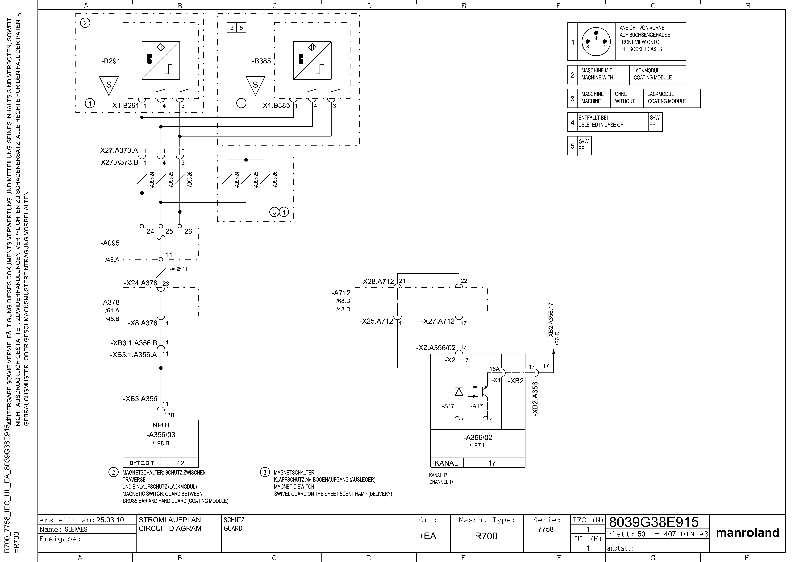

# +EA — Sheet 50 of 407 — SCHUTZ

**GUARD**

> Part of the manroland **R700** printing press IEC/UL circuit diagrams.
> Drawing class: **Stromlaufplan / Circuit diagram** (DIN A3).
> Document `+EA` covers the **Printing unit** machine section.

## At a glance

| Field | Value |
|---|---|
| Document | `+EA`  (8039G38E915) |
| Sheet | **50** of 407 |
| Section (DE) | SCHUTZ |
| Section (EN) | GUARD |
| Section type | CIRCUIT — Circuit diagram |
| Machine type | `R700` |
| Series | `7758` |
| Created | 25.03.10 |
| Replaces | — |
| Columns used | A, B, C, D, E, F, G |
| Path numbers | — |
| Labels on sheet | 128 |
| Cross-refs out | 8 |
| Cross-refs in | 31 |

**Previous:** [+EA sheet 49](SHEET_0049.md) · **Next:** [+EA sheet 51](SHEET_0051.md) · **Document TOC:** [_TOC.md](_TOC.md)  (+EA) · **Master TOC:** [all sheets](../_MASTER_TOC.md)

## Sheet image (300 DPI, exact vector render)



_Rendered directly from the PDF vector layer at 300 DPI (1-bit), no OCR and no resampling. Use it to confirm anything ambiguous in the text below._

## Cross-references on this sheet

Each entry is a wire leaving this sheet. The printed token is `/sheet.column`; the link resolves to that sheet inside the same document.

| Ref | Target sheet | Col | Path | Destination on target | Target section | From col |
|---|---|---|---|---|---|---|
| `/48.A` | [+EA sheet 48](SHEET_0048.md) | A | — | — | SCHUTZ | A |
| `/68.D` | [+EA sheet 68](SHEET_0068.md) | D | — | — | LEITSTANDSFUNKTIONEN | D |
| `/48.D` | [+EA sheet 48](SHEET_0048.md) | D | — | — | SCHUTZ | D |
| `/26.D` | [+EA sheet 26](SHEET_0026.md) | D | — | XB2.A356:17 | BUSVERBINDUNGEN: SICHERHEITSBUS | F |
| `/61.A` | [+EA sheet 61](SHEET_0061.md) | A | — | — | MASCHINENBEDIENUNG: BEDIENUNGKOMMANDOS | A |
| `/48.B` | [+EA sheet 48](SHEET_0048.md) | B | — | — | SCHUTZ | A |
| `/198.B` | [+EA sheet 198](SHEET_0198.md) | B | — | — | REFERENZMODUL | B |
| `/197.H` | [+EA sheet 197](SHEET_0197.md) | H | — | — | REFERENZMODUL | E |

### Incoming references (sheets that point here)

Every other sheet that sends a wire to this one. `Back-ref` is the token printed on *that* sheet; `Path` is its line number.

| From sheet | Cols | Back-ref | Path | Refs | What continues there |
|---|---|---|---|---|---|
| [+EA#26](SHEET_0026.md) | D | `/26.D` | — | 1 | XB2.A356:17 |
| [+EA#48](SHEET_0048.md) | A, B, D | `/48.A`, `/48.B`, `/48.D` | — | 3 | — |
| [+EA#61](SHEET_0061.md) | A | `/61.A` | — | 1 | — |
| [+EA#68](SHEET_0068.md) | D | `/68.D` | — | 1 | — |
| [+EA#197](SHEET_0197.md) | H | `/197.H` | — | 1 | — |
| [+EA#198](SHEET_0198.md) | B | `/198.B` | — | 1 | — |
| [+EA#216](SHEET_0216.md) | G | `/216.G` | — | 3 | — |
| [+EA#217](SHEET_0217.md) | F | `/217.F` | — | 3 | — |
| [+EA#225](SHEET_0225.md) | F | `/225.F` | — | 1 | — |
| [+EA#226](SHEET_0226.md) | E | `/226.E` | — | 1 | — |
| [+EA#234](SHEET_0234.md) | H | `/234.H` | — | 1 | — |
| [+EA#235](SHEET_0235.md) | A, B | `/235.A`, `/235.B` | — | 2 | — |
| [+EA#250](SHEET_0250.md) | D | `/250.D` | — | 1 | — |
| [+EA#266](SHEET_0266.md) | F | `/266.F` | — | 1 | — |
| [+EA#268](SHEET_0268.md) | F | `/268.F` | — | 1 | — |
| [+EA#270](SHEET_0270.md) | H | `/270.H` | — | 6 | — |
| [+EA#271](SHEET_0271.md) | G | `/271.G` | — | 1 | — |
| [+EA#273](SHEET_0273.md) | C | `/273.C` | — | 2 | — |


## Devices on this sheet

| Tag | Class | Class meaning (IEC) | Col | Sub | Terminal | Sign |
|---|---|---|---|---|---|---|
| `A356/03` | A | Baugruppe / assembly, module, PC board | B | 03 | — | — |
| `B385` | B | Umformer / transducer, sensor | C | — | — | — |
| `B291` | B | Umformer / transducer, sensor | A | — | — | — |
| `A378` | A | Baugruppe / assembly, module, PC board | A | — | — | — |
| `A095` | A | Baugruppe / assembly, module, PC board | A | — | — | — |
| `S17` | S | Schalter / switch | E | — | — | — |
| `A17` | A | Baugruppe / assembly, module, PC board | E | — | — | — |
| `X1` | X | Klemme / terminal, plug connector | E | — | — | — |
| `X2` | X | Klemme / terminal, plug connector | E | — | — | — |
| `XB2` | XB |  | F | — | — | — |
| `A356/02` | A | Baugruppe / assembly, module, PC board | E | 02 | — | — |
| `A712` | A | Baugruppe / assembly, module, PC board | D | — | — | — |
| `A095:26` | A | Baugruppe / assembly, module, PC board | B | — | 26 | — |
| `A095:25` | A | Baugruppe / assembly, module, PC board | B | — | 25 | — |
| `A095:24` | A | Baugruppe / assembly, module, PC board | B | — | 24 | — |
| `A095:24` | A | Baugruppe / assembly, module, PC board | C | — | 24 | — |
| `A095:25` | A | Baugruppe / assembly, module, PC board | C | — | 25 | — |
| `A095:26` | A | Baugruppe / assembly, module, PC board | C | — | 26 | — |
| `A095:11` | A | Baugruppe / assembly, module, PC board | B | — | 11 | — |
| `2.2` | — | cross-device reference | B | — | — | — |
| `XB3.A356` | — | cross-device reference | B | — | — | — |
| `X1.B385` | — | cross-device reference | C | — | — | — |
| `X1.B291` | — | cross-device reference | A | — | — | — |
| `X27.A373.B` | — | cross-device reference | A | — | — | — |
| `X27.A373.A` | — | cross-device reference | A | — | — | — |
| `X24.A378` | — | cross-device reference | B | — | — | — |
| `X8.A378` | — | cross-device reference | B | — | — | — |
| `XB2.A356` | — | cross-device reference | F | — | — | — |
| `XB3.1.A356.B` | — | cross-device reference | B | — | — | — |
| `XB3.1.A356.A` | — | cross-device reference | B | — | — | — |
| `X28.A712` | — | cross-device reference | D | — | — | — |
| `X27.A712` | — | cross-device reference | E | — | — | — |
| `X25.A712` | — | cross-device reference | D | — | — | — |
| `XB2.A356:17` | — | cross-device reference | F | — | 17 | — |

## Potentials / nets

_No named potentials on this sheet._

## Wire-end annotations (grouped as printed)

A wire that continues elsewhere is annotated with a small cluster: the destination description, the path/line number `#NN`, and the `/sheet.column` cross reference. Each row below is one such cluster exactly as it is grouped on the drawing.

| Col | Y | Path | Cross-ref | Text on the wire |
|---|---|---|---|---|
| A | 31.5 | — | — | `2` |
| C | 37.9 | — | — | `3 5` |
| G | 38.9 | — | — | `FRONT VIEW ONTO ANSICHT VON VORNE AUF BUCHSENGEHÄUSE` |
| F | 54.0 | — | — | `4` |
| F | 58.4 | — | — | `1 3 1` |
| G | 70.8 | — | — | `THE SOCKET CASES` |
| A | 86.8 | — | — | `B291` |
| C | 86.8 | — | — | `B385` |
| F | 102.7 | — | — | `MASCHINE MIT MACHINE WITH` |
| G | 102.7 | — | — | `LACKMODUL` |
| G | 108.0 | — | — | `2 COATING MODULE` |
| A | 121.6 | — | — | `S` |
| C | 121.6 | — | — | `S` |
| F | 138.1 | — | — | `MASCHINE MACHINE` |
| G | 138.1 | — | — | `OHNE WITHOUT` |
| G | 138.1 | — | — | `LACKMODUL` |
| G | 143.4 | — | — | `3 COATING MODULE` |
| B | 151.4 | — | — | `1 1` |
| B | 153.4 | — | — | `X1.B291 1 4 3` |
| C | 153.4 | — | — | `X1.B385 1 4 3` |
| G | 173.4 | — | — | `PP S+W` |
| F | 173.5 | — | — | `ENTFÄLLT BEI DELETED IN CASE OF` |
| F | 178.8 | — | — | `4` |
| F | 208.8 | — | — | `5 PP S+W` |
| B | 220.7 | — | — | `X27.A373.A 1 4 3` |
| B | 238.4 | — | — | `X27.A373.B 1 4 3` |
| B | 257.0 | — | — | `A095:24` |
| B | 257.0 | — | — | `A095:25` |
| B | 257.0 | — | — | `A095:26` |
| C | 257.0 | — | — | `A095:24` |
| C | 257.0 | — | — | `A095:25` |
| C | 257.0 | — | — | `A095:26` |
| C | 314.9 | — | — | `3 4` |
| B | 341.9 | — | — | `24 25 26` |
| A | 359.6 | — | — | `A095` |
| B | 377.3 | — | — | `11` |
| A | 385.1 | — | `/48.A` | — |
| B | 400.3 | — | — | `A095:11` |
| D | 417.0 | — | — | `X28.A712 21 22` |
| B | 419.1 | — | — | `X24.A378 23` |
| D | 434.0 | — | — | `A712` |
| D | 447.1 | — | `/68.D`, `/48.D` | — |
| A | 448.2 | — | — | `A378` |
| F | 453.0 | — | `/26.D` | `XB2.A356:17` |
| A | 461.2 | — | `/61.A`, `/48.B` | — |
| D | 476.5 | — | — | `X25.A712 11 X27.A712 17` |
| B | 479.4 | — | — | `X8.A378 11` |
| B | 509.1 | — | — | `XB3.1.A356.B 11` |
| E | 516.2 | — | — | `X2.A356/02 17` |
| B | 526.1 | — | — | `XB3.1.A356.A 11` |
| E | 534.7 | — | — | `X2` |
| E | 536.1 | — | — | `17 17` |
| F | 544.6 | — | — | `17` |
| E | 548.8 | — | — | `16A` |
| E | 565.8 | — | — | `X1` |
| F | 565.8 | — | — | `XB2` |
| F | 572.0 | — | — | `XB2.A356` |
| B | 592.8 | — | — | `XB3.A356 11` |
| E | 604.8 | — | — | `S17 A17` |
| B | 618.2 | — | — | `13B` |
| B | 632.8 | — | — | `INPUT` |
| B | 646.6 | — | — | `A356/03` |
| E | 650.9 | — | — | `A356/02` |
| B | 660.4 | — | `/198.B` | — |
| E | 663.2 | — | `/197.H` | — |
| E | 689.1 | — | — | `KANAL 17` |
| B | 689.4 | — | — | `BYTE.BIT 2.2` |
| B | 704.7 | — | — | `2 3` |
| B | 705.0 | — | — | `UND EINLAUFSCHUTZ (LACKMODUL) MAGNETSCHALTER: SCHUTZ ZWISCHEN MAGNETIC SWITCH: GUARD BETWEEN TRAVERSE CROSS BAR AND HAND GUARD (COATING MODULE)` |
| D | 705.0 | — | — | `KLAPPSCHUTZ AM BOGENAUFGANG (AUSLEGER) MAGNETSCHALTER: MAGNETIC SWITCH: SWIVEL GUARD ON THE SHEET SCENT RAMP (DELIVERY)` |
| E | 709.5 | — | — | `KANAL 17 CHANNEL 17` |


## Reconstructed tables

This sheet carries tabular content (pin map / terminal assignment / index). The grid below was rebuilt from the drawing's own rule lines, so each row is exactly one physical row of the table.

### Table 1 — 8 data rows × 4 columns (at x=184.3, y=62.4)

| X1.B291 | 1 | 4 | 3 |
|---|---|---|---|
|  | `1 1 A095:24` | `4 4 A095:25` | `3 3 A095:26` |
|  | `24` | `25 11 A095:11` | `26` |
| `X24.A378 XB3.1.A356.B` | `X8.A378` | `23 11 11` |  |
| `XB3.1.A356.A` |  | `11` |  |
| `XB3.A356` |  | `11 13B` |  |
|  | `INPUT` |  |  |
|  |  | `A356/03 /198.B` |  |
| `BYTE.BIT` |  | `2.2` |  |


### Table 2 — 7 data rows × 12 columns (at x=340.2, y=62.4) — **B385**

| 1 | S | X1.B385 | 1 | 4 | 3 |  |  |  |  |  |  |
|---|---|---|---|---|---|---|---|---|---|---|---|
| `A095:24` | `A095:25` | `A095:26` |  |  |  |  |  |  |  |  |  |
|  |  | `3 4` |  |  |  |  |  |  |  |  |  |
|  |  |  |  |  | `X28.A712 A712 /68.D /48.D X25.A712` | `21 11` | `X27.A712 X2.A356/02` | `22 17 17` |  |  | `XB2.A356:17` |
|  |  |  |  |  |  |  | `X2` | `17` |  |  | `17 17` |
|  |  |  |  |  |  |  | `S17` | `A17` | `16A X1` | `XB2` | `XB2.A356` |
|  |  |  |  |  |  |  |  | `A356/02 /197.H` |  |  |  |
|  |  |  |  |  |  |  | `KANAL` |  | `17` |  |  |


## Notes and free text on this sheet

| Text | Col | Y (pt) |
|---|---|---|
| `13B` | B | 618.24 |
| `INPUT` | B | 632.76 |
| `BYTE.BIT` | B | 690.01 |
| `MAGNETSCHALTER: SCHUTZ ZWISCHEN` | B | 705.03 |
| `TRAVERSE` | B | 715.65 |
| `UND EINLAUFSCHUTZ (LACKMODUL)` | B | 726.32 |
| `MAGNETIC SWITCH: GUARD BETWEEN` | B | 736.91 |
| `CROSS BAR AND HAND GUARD (COATING MODULE)` | B | 747.59 |
| `MAGNETSCHALTER:` | C | 705.04 |
| `KLAPPSCHUTZ AM BOGENAUFGANG (AUSLEGER)` | D | 715.67 |
| `MAGNETIC SWITCH:` | C | 726.27 |
| `SWIVEL GUARD ON THE SHEET SCENT RAMP (DELIVERY)` | D | 736.93 |
| `KANAL 17` | E | 709.45 |
| `CHANNEL 17` | E | 719.39 |
| `16A` | E | 548.79 |
| `KANAL` | E | 689.12 |
| `X2.A356/02` | E | 516.21 |
| `ANSICHT VON VORNE` | G | 38.9 |
| `AUF BUCHSENGEHÄUSE` | G | 49.53 |
| `FRONT VIEW ONTO` | G | 60.13 |
| `THE SOCKET CASES` | G | 70.78 |
| `MASCHINE MIT` | F | 102.68 |
| `MACHINE WITH` | F | 113.27 |
| `LACKMODUL` | G | 102.69 |
| `COATING MODULE` | G | 113.32 |
| `ENTFÄLLT BEI` | F | 173.5 |
| `DELETED IN CASE OF` | F | 184.16 |
| `S+W` | G | 173.4 |
| `PP` | G | 184.03 |
| `MASCHINE` | F | 138.1 |
| `MACHINE` | F | 148.74 |
| `OHNE` | G | 138.1 |
| `WITHOUT` | G | 148.7 |
| `S+W` | F | 208.83 |
| `PP` | F | 219.46 |
| `S` | C | 121.56 |
| `S` | A | 121.56 |

## Complete label inventory (exact text from the drawing)

Every text object inside the drawing area of this sheet, in DIN reading order (column A→H, then top→bottom). This is the authoritative list: if a string is not here it is not printed on this sheet.

| Col | Y | X | Dir | Type | Text |
|---|---|---|---|---|---|
| A | 31.5 | 125.6 | → | number | `2` |
| A | 86.8 | 152.2 | → | device tag | `B291` |
| A | 121.6 | 158.9 | → | text | `S` |
| A | 151.4 | 132.9 | → | number | `1` |
| A | 153.4 | 164.7 | → | device ref | `X1.B291` |
| A | 220.7 | 146.6 | → | device ref | `X27.A373.A` |
| A | 238.4 | 147.4 | → | device ref | `X27.A373.B` |
| A | 359.6 | 150.8 | → | device tag | `A095` |
| A | 385.1 | 157.9 | → | cross-reference | `/48.A` |
| A | 448.2 | 150.8 | → | device tag | `A378` |
| A | 461.2 | 157.9 | → | cross-reference | `/61.A` |
| A | 473.6 | 158.2 | → | cross-reference | `/48.B` |
| A | 704.7 | 168.1 | → | number | `2` |
| B | 154.8 | 214.6 | → | number | `1` |
| B | 154.8 | 243.5 | → | number | `4` |
| B | 154.8 | 271.8 | → | number | `3` |
| B | 222.8 | 214.6 | → | number | `1` |
| B | 222.8 | 243.5 | → | number | `4` |
| B | 222.8 | 271.8 | → | number | `3` |
| B | 239.9 | 214.6 | → | number | `1` |
| B | 239.9 | 243.5 | → | number | `4` |
| B | 239.9 | 271.8 | → | number | `3` |
| B | 257.0 | 224.6 | ↕ | device tag | `A095:24` |
| B | 257.0 | 252.9 | ↕ | device tag | `A095:25` |
| B | 257.0 | 281.3 | ↕ | device tag | `A095:26` |
| B | 341.8 | 219.4 | → | number | `24` |
| B | 341.8 | 247.7 | → | number | `25` |
| B | 341.8 | 276.1 | → | number | `26` |
| B | 377.3 | 246.9 | → | number | `11` |
| B | 400.3 | 254.8 | → | device tag | `A095:11` |
| B | 419.1 | 185.7 | → | device ref | `X24.A378` |
| B | 421.3 | 243.5 | → | number | `23` |
| B | 479.4 | 191.6 | → | device ref | `X8.A378` |
| B | 480.8 | 242.9 | → | number | `11` |
| B | 509.1 | 165.8 | → | device ref | `XB3.1.A356.B` |
| B | 509.1 | 242.9 | → | number | `11` |
| B | 526.2 | 242.9 | → | number | `11` |
| B | 526.9 | 165.0 | → | device ref | `XB3.1.A356.A` |
| B | 592.7 | 184.5 | → | device ref | `XB3.A356` |
| B | 601.3 | 242.9 | → | number | `11` |
| B | 618.2 | 245.8 | → | text | `13B` |
| B | 632.8 | 226.1 | → | text | `INPUT` |
| B | 646.6 | 219.5 | → | device tag | `A356/03` |
| B | 660.4 | 228.3 | → | cross-reference | `/198.B` |
| B | 689.4 | 262.5 | → | device ref | `2.2` |
| B | 690.0 | 194.2 | → | text | `BYTE.BIT` |
| B | 705.0 | 183.7 | → | text | `MAGNETSCHALTER: SCHUTZ ZWISCHEN` |
| B | 715.6 | 184.0 | → | text | `TRAVERSE` |
| B | 726.3 | 183.4 | → | text | `UND EINLAUFSCHUTZ (LACKMODUL)` |
| B | 736.9 | 183.7 | → | text | `MAGNETIC SWITCH: GUARD BETWEEN` |
| B | 747.6 | 184.0 | → | text | `CROSS BAR AND HAND GUARD (COATING MODULE)` |
| C | 37.9 | 344.8 | → | number | `3` |
| C | 37.9 | 359.0 | → | number | `5` |
| C | 86.8 | 377.6 | → | device tag | `B385` |
| C | 121.6 | 378.6 | → | text | `S` |
| C | 151.4 | 359.7 | → | number | `1` |
| C | 153.4 | 390.0 | → | device ref | `X1.B385` |
| C | 154.8 | 441.4 | → | number | `1` |
| C | 154.8 | 470.3 | → | number | `4` |
| C | 257.0 | 352.1 | ↕ | device tag | `A095:24` |
| C | 257.0 | 380.5 | ↕ | device tag | `A095:25` |
| C | 257.0 | 408.8 | ↕ | device tag | `A095:26` |
| C | 314.9 | 409.0 | → | number | `3` |
| C | 314.9 | 423.2 | → | number | `4` |
| C | 704.7 | 394.9 | → | number | `3` |
| C | 705.0 | 410.5 | → | text | `MAGNETSCHALTER:` |
| C | 726.3 | 410.5 | → | text | `MAGNETIC SWITCH:` |
| D | 154.8 | 498.6 | → | number | `3` |
| D | 417.0 | 540.0 | → | device ref | `X28.A712` |
| D | 417.0 | 597.8 | → | number | `21` |
| D | 434.0 | 496.6 | → | device tag | `A712` |
| D | 447.1 | 503.7 | → | cross-reference | `/68.D` |
| D | 459.5 | 503.7 | → | cross-reference | `/48.D` |
| D | 476.5 | 538.6 | → | device ref | `X25.A712` |
| D | 480.8 | 597.3 | → | number | `11` |
| D | 715.7 | 410.2 | → | text | `KLAPPSCHUTZ AM BOGENAUFGANG (AUSLEGER)` |
| D | 736.9 | 410.7 | → | text | `SWIVEL GUARD ON THE SHEET SCENT RAMP (DELIVERY)` |
| E | 417.0 | 690.0 | → | number | `22` |
| E | 476.5 | 630.7 | → | device ref | `X27.A712` |
| E | 480.8 | 689.4 | → | number | `17` |
| E | 516.2 | 623.3 | → | text | `X2.A356/02` |
| E | 516.2 | 689.4 | → | number | `17` |
| E | 534.7 | 665.9 | → | device tag | `X2` |
| E | 536.1 | 692.2 | → | number | `17` |
| E | 548.8 | 732.8 | → | text | `16A` |
| E | 565.8 | 736.4 | → | device tag | `X1` |
| E | 604.8 | 662.2 | → | device tag | `S17` |
| E | 604.8 | 704.7 | → | device tag | `A17` |
| E | 650.9 | 694.3 | → | device tag | `A356/02` |
| E | 663.2 | 703.3 | → | cross-reference | `/197.H` |
| E | 689.1 | 651.1 | → | text | `KANAL` |
| E | 689.1 | 730.8 | → | number | `17` |
| E | 709.4 | 642.9 | → | text | `KANAL 17` |
| E | 719.4 | 643.2 | → | text | `CHANNEL 17` |
| F | 54.0 | 890.9 | → | number | `4` |
| F | 58.4 | 854.9 | → | number | `1` |
| F | 66.8 | 878.2 | → | number | `3` |
| F | 66.8 | 904.1 | → | number | `1` |
| F | 102.7 | 871.1 | → | text | `MASCHINE MIT` |
| F | 108.0 | 854.6 | → | number | `2` |
| F | 113.3 | 871.1 | → | text | `MACHINE WITH` |
| F | 138.1 | 871.1 | → | text | `MASCHINE` |
| F | 143.4 | 854.5 | → | number | `3` |
| F | 148.7 | 871.1 | → | text | `MACHINE` |
| F | 173.5 | 866.6 | → | text | `ENTFÄLLT BEI` |
| F | 178.9 | 854.6 | → | number | `4` |
| F | 184.2 | 866.6 | → | text | `DELETED IN CASE OF` |
| F | 208.8 | 867.1 | → | text | `S+W` |
| F | 214.3 | 854.5 | → | number | `5` |
| F | 219.5 | 866.6 | → | text | `PP` |
| F | 453.0 | 820.9 | ↕ | device ref | `XB2.A356:17` |
| F | 496.3 | 830.8 | ↕ | cross-reference | `/26.D` |
| F | 544.6 | 812.7 | → | number | `17` |
| F | 546.0 | 791.4 | → | number | `17` |
| F | 565.8 | 760.8 | → | device tag | `XB2` |
| F | 572.0 | 796.8 | ↕ | device ref | `XB2.A356` |
| G | 38.9 | 928.3 | → | text | `ANSICHT VON VORNE` |
| G | 49.5 | 928.3 | → | text | `AUF BUCHSENGEHÄUSE` |
| G | 60.1 | 927.5 | → | text | `FRONT VIEW ONTO` |
| G | 70.8 | 928.1 | → | text | `THE SOCKET CASES` |
| G | 102.7 | 948.8 | → | text | `LACKMODUL` |
| G | 113.3 | 949.3 | → | text | `COATING MODULE` |
| G | 138.1 | 921.0 | → | text | `OHNE` |
| G | 138.1 | 970.0 | → | text | `LACKMODUL` |
| G | 148.7 | 921.3 | → | text | `WITHOUT` |
| G | 148.8 | 970.6 | → | text | `COATING MODULE` |
| G | 173.4 | 973.4 | → | text | `S+W` |
| G | 184.0 | 972.9 | → | text | `PP` |

## Reading-order text block

The same content as a plain block, grouped by DIN column — convenient to paste or to match against a visual description.

```text
=== Column A ===
  31.5  125.6  numeric      2
  86.8  152.2  devtag       B291
 121.6  158.9  text         S
 151.4  132.9  numeric      1
 153.4  164.7  devref       X1.B291
 220.7  146.6  devref       X27.A373.A
 238.4  147.4  devref       X27.A373.B
 359.6  150.8  devtag       A095
 385.1  157.9  xref         /48.A
 448.2  150.8  devtag       A378
 461.2  157.9  xref         /61.A
 473.6  158.2  xref         /48.B
 704.7  168.1  numeric      2
=== Column B ===
 154.8  214.6  numeric      1
 154.8  243.5  numeric      4
 154.8  271.8  numeric      3
 222.8  214.6  numeric      1
 222.8  243.5  numeric      4
 222.8  271.8  numeric      3
 239.9  214.6  numeric      1
 239.9  243.5  numeric      4
 239.9  271.8  numeric      3
 257.0  224.6  devtag       A095:24
 257.0  252.9  devtag       A095:25
 257.0  281.3  devtag       A095:26
 341.8  219.4  numeric      24
 341.8  247.7  numeric      25
 341.8  276.1  numeric      26
 377.3  246.9  numeric      11
 400.3  254.8  devtag       A095:11
 419.1  185.7  devref       X24.A378
 421.3  243.5  numeric      23
 479.4  191.6  devref       X8.A378
 480.8  242.9  numeric      11
 509.1  165.8  devref       XB3.1.A356.B
 509.1  242.9  numeric      11
 526.2  242.9  numeric      11
 526.9  165.0  devref       XB3.1.A356.A
 592.7  184.5  devref       XB3.A356
 601.3  242.9  numeric      11
 618.2  245.8  text         13B
 632.8  226.1  text         INPUT
 646.6  219.5  devtag       A356/03
 660.4  228.3  xref         /198.B
 689.4  262.5  devref       2.2
 690.0  194.2  text         BYTE.BIT
 705.0  183.7  text         MAGNETSCHALTER: SCHUTZ ZWISCHEN
 715.6  184.0  text         TRAVERSE
 726.3  183.4  text         UND EINLAUFSCHUTZ (LACKMODUL)
 736.9  183.7  text         MAGNETIC SWITCH: GUARD BETWEEN
 747.6  184.0  text         CROSS BAR AND HAND GUARD (COATING MODULE)
=== Column C ===
  37.9  344.8  numeric      3
  37.9  359.0  numeric      5
  86.8  377.6  devtag       B385
 121.6  378.6  text         S
 151.4  359.7  numeric      1
 153.4  390.0  devref       X1.B385
 154.8  441.4  numeric      1
 154.8  470.3  numeric      4
 257.0  352.1  devtag       A095:24
 257.0  380.5  devtag       A095:25
 257.0  408.8  devtag       A095:26
 314.9  409.0  numeric      3
 314.9  423.2  numeric      4
 704.7  394.9  numeric      3
 705.0  410.5  text         MAGNETSCHALTER:
 726.3  410.5  text         MAGNETIC SWITCH:
=== Column D ===
 154.8  498.6  numeric      3
 417.0  540.0  devref       X28.A712
 417.0  597.8  numeric      21
 434.0  496.6  devtag       A712
 447.1  503.7  xref         /68.D
 459.5  503.7  xref         /48.D
 476.5  538.6  devref       X25.A712
 480.8  597.3  numeric      11
 715.7  410.2  text         KLAPPSCHUTZ AM BOGENAUFGANG (AUSLEGER)
 736.9  410.7  text         SWIVEL GUARD ON THE SHEET SCENT RAMP (DELIVERY)
=== Column E ===
 417.0  690.0  numeric      22
 476.5  630.7  devref       X27.A712
 480.8  689.4  numeric      17
 516.2  623.3  text         X2.A356/02
 516.2  689.4  numeric      17
 534.7  665.9  devtag       X2
 536.1  692.2  numeric      17
 548.8  732.8  text         16A
 565.8  736.4  devtag       X1
 604.8  662.2  devtag       S17
 604.8  704.7  devtag       A17
 650.9  694.3  devtag       A356/02
 663.2  703.3  xref         /197.H
 689.1  651.1  text         KANAL
 689.1  730.8  numeric      17
 709.4  642.9  text         KANAL 17
 719.4  643.2  text         CHANNEL 17
=== Column F ===
  54.0  890.9  numeric      4
  58.4  854.9  numeric      1
  66.8  878.2  numeric      3
  66.8  904.1  numeric      1
 102.7  871.1  text         MASCHINE MIT
 108.0  854.6  numeric      2
 113.3  871.1  text         MACHINE WITH
 138.1  871.1  text         MASCHINE
 143.4  854.5  numeric      3
 148.7  871.1  text         MACHINE
 173.5  866.6  text         ENTFÄLLT BEI
 178.9  854.6  numeric      4
 184.2  866.6  text         DELETED IN CASE OF
 208.8  867.1  text         S+W
 214.3  854.5  numeric      5
 219.5  866.6  text         PP
 453.0  820.9  devref       XB2.A356:17
 496.3  830.8  xref         /26.D
 544.6  812.7  numeric      17
 546.0  791.4  numeric      17
 565.8  760.8  devtag       XB2
 572.0  796.8  devref       XB2.A356
=== Column G ===
  38.9  928.3  text         ANSICHT VON VORNE
  49.5  928.3  text         AUF BUCHSENGEHÄUSE
  60.1  927.5  text         FRONT VIEW ONTO
  70.8  928.1  text         THE SOCKET CASES
 102.7  948.8  text         LACKMODUL
 113.3  949.3  text         COATING MODULE
 138.1  921.0  text         OHNE
 138.1  970.0  text         LACKMODUL
 148.7  921.3  text         WITHOUT
 148.8  970.6  text         COATING MODULE
 173.4  973.4  text         S+W
 184.0  972.9  text         PP
```

---
_Generated from the PDF vector text layer; no OCR. Source: `R700_7758_IEC_UL_EA_8039G38E915_p`, sheet 50._
